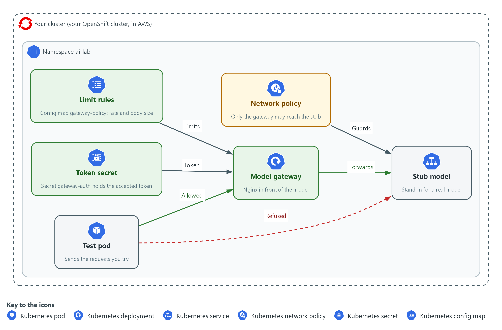
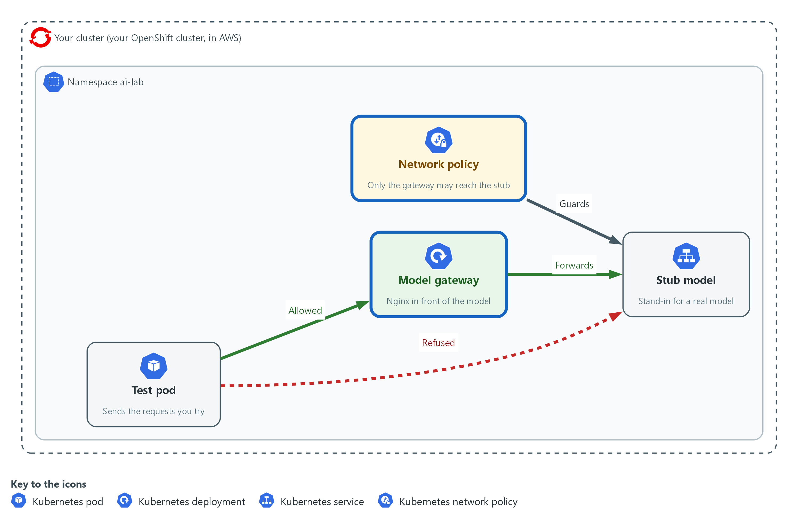
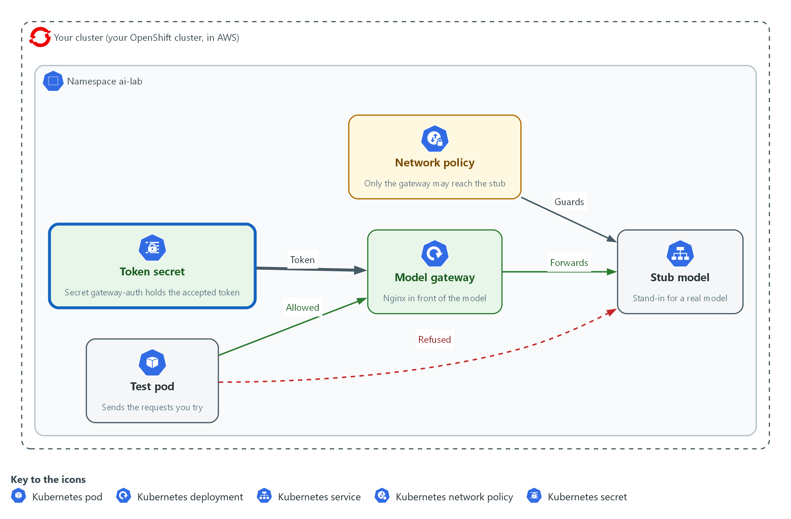
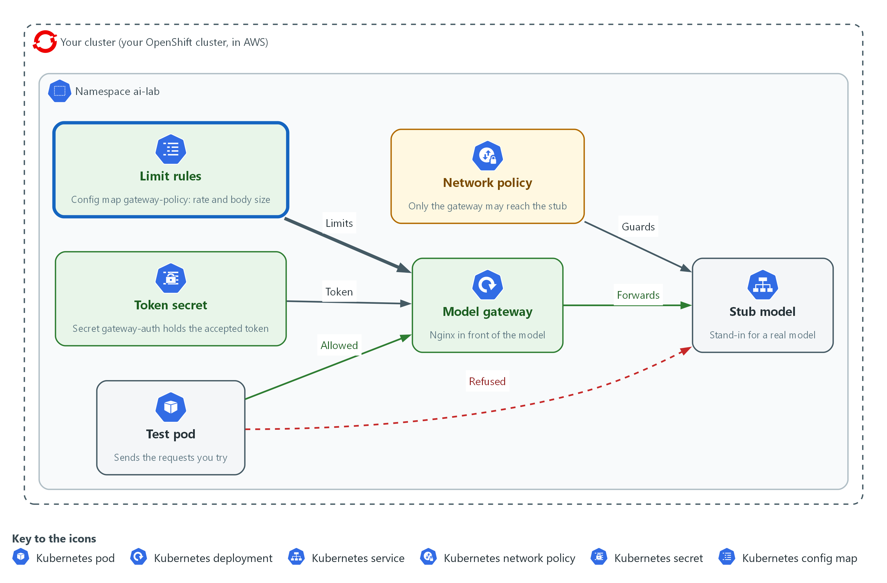

# AI-1: Put the Model Behind a Gateway (SC-7, AC-3, SC-5)

| Item | Detail |
| --- | --- |
| Sequence | Module 8 of 32 in the recommended order |
| Timed work | About 55 minutes (40 hands-on, 15 verify) |
| Standalone start | `lab start ai-1` |
| Combined start | Continue from the end state of the previous module |
| Tools | nginx (reverse proxy, free, open source), NetworkPolicy (OpenShift), Stub model service (provided by the lab), oc, curl, jq, openssl |
| Prerequisites | CPS-4 Isolate and Limit Workloads (NetworkPolicy, hardened pod settings and resource limits), AID-3 AI-Assisted Automation Under Review (the stub model service and request ids) |

## Section 1. Module Overview

- Purpose: show that a model service is reached through one managed entry point, that the entry point enforces who may use it, and that it limits how much one caller can use.
- You build the gateway settings, a NetworkPolicy, a token check and the rate limit. You write one line yourself: the rate limit rule.
- You test one request that must pass and three that must be refused.

- **Skill:** Put a model service behind a gateway, close the direct path with a NetworkPolicy, require a token, and limit the rate and size of requests.
- **Tools:** `nginx` is the gateway; a NetworkPolicy closes the direct path; `oc` applies the settings; `curl` sends the test requests; `openssl` makes the token.
- **Security Function:** Narrows the ways to reach the model to one managed entry point, refuses callers without the token, and refuses callers that ask too often or send too much.
- **NIST SC-7 Boundary Protection:** The only network path to the stub is the gateway, and a request sent straight to the stub is refused.
- **NIST AC-3 Access Enforcement:** The gateway passes a request only when it carries the token, and answers 401 otherwise.
- **NIST SC-5 Denial-of-Service Protection:** The gateway answers 429 to a caller that asks too fast and 413 to a request that is too large.

## Section 2. The Tools

### Tools used in this module

Each tool name links to its official overview. The table columns say how each tool is used in the lab and why the lab uses it instead of another way of doing the same job.

| Tool (overview link) | What it is | Used in this lab | Why this tool |
| --- | --- | --- | --- |
| [oc](https://docs.redhat.com/en/documentation/openshift_container_platform/4.22/html/cli_tools/openshift-cli-oc) | The OpenShift command-line tool for creating and managing applications and projects from a terminal. | Runs the cluster commands in each step. | It is the one command that talks to the cluster, so every module uses it to ask what is true and to make changes. You sign in once, and it works on OpenShift objects as well as standard Kubernetes ones. Unlike clicking in the web console, a command can be pasted, repeated and checked by a test. |
| [curl](https://curl.se/docs/manpage.html) | Command-line tool for transferring data over URLs, used here to call web endpoints. | Calls web endpoints to test behavior. | It calls a web address from the terminal, so you can check what a service really returns instead of trusting a screen. |
| [jq](https://jqlang.org/) | Command-line JSON processor. | Picks fields out of JSON output. | It picks one field out of a long JSON reply, so a test can read a single value. |

### How it fits together

#### Only the gateway reaches the model

- In the lab (test) setup, a test pod sends requests to the model gateway, and the gateway is the only path to the stub model.
- A network policy blocks every other path.
- New parts are drawn with thick lines.



- **1. Test pod:** sends the requests you try.
- **2. Model gateway:** an nginx deployment that every allowed request passes through on its way to the model.
- **3. Stub model:** a stand-in for a real model that only the gateway may reach.
- **4. Network policy:** blocks any path to the stub model that does not start at the gateway.
- **5. Token secret:** holds the token the gateway accepts.
- **6. Limit rules:** a config map that sets the request rate and the largest request body the gateway lets through.

### 2.1 One front door and no side door (SC-7 Boundary Protection)

- A check at the front door protects nothing if a side door lets callers reach the model service directly, so the network rule that closes the side door matters as much as the gateway.
- By default any pod in the cluster can reach any other pod, so you must add the rule that narrows it.
- The gateway is also the one place where requests can be counted and logged.

#### SC-7: Boundary Protection

*The control asks the system to monitor and control communications at its external managed interfaces and to connect to external networks or systems only through managed interfaces. NIST leaves some of the detail, such as the managed interfaces and what is monitored, to the organization. This is done using:*

- The nginx gateway: the one managed interface in front of the model service.
- The NetworkPolicy stub-from-gateway-only: allows traffic to the stub only from pods labelled app=model-gateway, so a request from any other pod is dropped.

### 2.2 Who may use the model (AC-3 Access Enforcement)

- The gateway answers 401 when the request carries no approved token, and passes the request on only when it does.
- The token is kept in a Secret and a file with permission 600 in your working folder. It is never written into the gateway settings you commit.
- A shared token proves a caller holds the token, not which caller it is, so a real system gives each caller its own.

#### AC-3: Access Enforcement

*The control asks the system to enforce approved authorizations for logical access to information and system resources, in line with the access control policy. Here the resource is the model service, and the approval is holding the token. This is done using:*

- The Secret gateway-auth: holds the map block that compares the Authorization header with the approved value.
- The policy file: returns 401 for any request where the flag is 0.

### 2.3 Limits on rate and size (SC-5 Denial-of-Service Protection)

- A model answer costs time or money, so a caller who asks too fast or sends something huge can exhaust a service that is otherwise working. OWASP calls this unbounded consumption (LLM10).
- A rate limit answers 429 when a caller asks faster than the allowed rate, after a small burst. A size limit answers 413 before the request body is read in full.
- These limits reduce the effect of a flood but do not stop a determined attack from many addresses. That needs limits further out, in front of the cluster.

#### SC-5: Denial-of-Service Protection

*The control asks the organization to protect against, or limit the effects of, denial-of-service events, using controls it selects. NIST leaves the types of events and the controls to the organization. This is done using:*

- limit_req_zone and the limit_req rule you write: refuse a caller that asks faster than the zone allows, after the burst.
- client_max_body_size: refuses a request body larger than the cap before it reaches the model.

The table lists the answers the gateway can give and why.

| Answer | When the gateway gives it | Where it is decided |
| --- | --- | --- |
| `200` | The token is right and the caller is within the limits | Passed on to the stub |
| `401` | No token, or a wrong one | The policy file |
| `413` | The request body is over the size cap | client_max_body_size |
| `429` | The caller asked faster than the rate allows | limit_req |

### Design decisions

#### Close the direct path with a NetworkPolicy, not only a token

- How: A NetworkPolicy on the stub pods allows incoming traffic only from pods labelled app=model-gateway. The token check at the gateway comes in addition.
- Why: A token check at the gateway protects nothing if a caller can reach the stub by another route, so the network has to refuse the other routes.
- Alternatives: Putting the token check in the stub itself is the alternative. Advantage: it holds even if the network rule is wrong. Drawback: the stub and every future model service must each carry the check, and the checks drift apart.

#### Keep the token in a Secret, separate from the gateway settings

- How: The token goes into a file with permission 600 and a Secret that holds the map block, while the policy file that refers to the flag sits in a config map.
- Why: The settings can then be read, reviewed and shared without the token in them.
- Alternatives: Writing the token into the one settings file is the alternative. Advantage: one fewer object to manage. Drawback: the token is then copied wherever the settings are copied, including into reviews and backups.

#### Limit rate and size at the gateway

- How: A rate zone, a rule with a small burst and a body size cap are set in the gateway, so a refusal happens before the request reaches the model.
- Why: A refusal at the gateway costs almost nothing, while a request that reaches a real model costs time and money.
- Alternatives: Limiting only at the model provider is the alternative. Advantage: the provider knows the true cost. Drawback: you pay for the request first, and one caller can use the whole quota for everyone.

## Section 3. Implement

- Start: type `lab start ai-1` in the terminal on your own computer (PowerShell on Windows, Terminal on Mac), not in the lab shell.
- Enter lab shell with `lab shell`. Every other command in this module runs inside lab shell.
- If a step fails: run `lab reset ai-1` on your own computer and repeat the step once. If it still fails, copy the whole command and error and ask your AI assistant. Do not skip the step.

### Step 1. Deploy the gateway and close the direct path to the stub (SC-7 Boundary Protection)

**Learning point: Running the gateway and then adding a NetworkPolicy shows the difference between a front door that exists and a front door that is the only door.**

- You first make the gateway and a probe pod.
- The gateway settings are kept in config maps, the pod runs without root, drops all extra Linux permissions and has a read-only root file system, as you did in CPS-4.
- The first test shows that a request sent straight to the stub works, which is the problem.
- Then the NetworkPolicy closes it.

What this step adds (thick lines and outlines are new):



- The gateway and the network policy go in. A request through the gateway reaches the stub model, and a request straight to the stub is refused.

#### 1a. Write the gateway settings and store them in the cluster

You will now paste the gateway settings as a heredoc and store them in two config maps.

- The rate zone is defined here, but nothing uses it yet.
- You write the rule that uses it in Step 3.

```bash
mkdir -p /workspace/ai-1 && cd /workspace/ai-1
cat > nginx.conf <<'EOF'
pid /tmp/nginx.pid;
events {}
http {
  access_log /dev/stdout;
  client_body_temp_path /tmp/body;
  proxy_temp_path /tmp/proxy;
  fastcgi_temp_path /tmp/fcgi;
  uwsgi_temp_path /tmp/uwsgi;
  scgi_temp_path /tmp/scgi;
  limit_req_zone $binary_remote_addr zone=perclient:1m rate=2r/s;
  limit_req_status 429;
  include /etc/gateway-auth/*.conf;
  server {
    listen 8080;
    location = /healthz { return 200 "ok\n"; }
    location /v1/ {
      include /etc/gateway-policy/policy.conf;
      proxy_pass http://stub-model:8080;
    }
  }
}
EOF
echo '# rules are added in later steps' > policy.conf
oc create configmap gateway-conf -n ai-lab --from-file=nginx.conf --dry-run=client -o yaml | oc apply -f -
oc create configmap gateway-policy -n ai-lab --from-file=policy.conf --dry-run=client -o yaml | oc apply -f -
```

**Expected output:**

```
Example only. The wording of the answers may differ.
configmap/gateway-conf created
configmap/gateway-policy created
```

| Part | What it does | Why you run it |
| --- | --- | --- |
| mkdir -p /workspace/ai-1 && cd /workspace/ai-1 | Makes a folder for this module and moves into it. | All the files for this module go in one folder so you can find them again. |
| cat > nginx.conf <<'EOF' | Writes everything up to the line EOF into the file nginx.conf. The quotes around EOF stop the shell from changing the dollar signs. | nginx uses dollar signs in its own settings, and they must reach the file unchanged. |
| pid /tmp/nginx.pid; ... _temp_path /tmp/... | Moves every file nginx writes to /tmp. | The pod's root file system is read-only, so nginx can write only to the /tmp folder you give it. |
| access_log /dev/stdout; | Sends one log line for every request to the pod's output. | The gateway is where requests are counted, and a later module reads these lines. |
| limit_req_zone $binary_remote_addr zone=perclient:1m rate=2r/s; | Defines a zone named perclient that counts requests per caller address and allows a steady 2 requests a second. It does nothing until a rule uses it. | The rate is set once, in the main settings, and the rule that applies it comes later. |
| limit_req_status 429; | Makes the refusal answer 429, the code for too many requests. | The default would be 503, which looks like a broken service. |
| include /etc/gateway-auth/*.conf; | Reads any file the Secret mounts here. There is none yet, and that is allowed. | Step 2 adds the token check without changing this file. |
| location = /healthz { return 200 ... } | Answers the health path itself, without calling the stub. | A check that the gateway is running should not depend on the model. |
| include /etc/gateway-policy/policy.conf; proxy_pass http://stub-model:8080; | Applies the rules in policy.conf to every request to /v1/ and then passes it to the stub. | All the rules live in one small file that you change in each step. |
| echo '# rules are added in later steps' > policy.conf | Makes a policy file that holds only a comment. | The gateway needs the file to exist before there are any rules in it. |
| oc create configmap ... --dry-run=client -o yaml \| oc apply -f - | Builds the config map from the file and applies it. Run again, it updates the existing one instead of failing. | You will change policy.conf twice, and this form works the first time and every time after. |

#### 1b. Run the gateway and a probe pod

You will now start the gateway as a hardened pod with a Service in front of it, and a probe pod to send test requests from.

- The probe is not the gateway, so it stands in for any other pod in the cluster.

```bash
oc apply -n ai-lab -f - <<'EOF'
apiVersion: apps/v1
kind: Deployment
metadata:
  name: model-gateway
spec:
  replicas: 1
  selector:
    matchLabels:
      app: model-gateway
  template:
    metadata:
      labels:
        app: model-gateway
    spec:
      automountServiceAccountToken: false
      containers:
      - name: nginx
        image: registry.access.redhat.com/ubi9/nginx-124:1
        command: ["nginx", "-e", "/dev/stderr", "-c", "/etc/gateway/nginx.conf", "-g", "daemon off;"]
        ports:
        - containerPort: 8080
        securityContext:
          allowPrivilegeEscalation: false
          readOnlyRootFilesystem: true
          runAsNonRoot: true
          capabilities:
            drop: ["ALL"]
          seccompProfile:
            type: RuntimeDefault
        resources:
          requests: {cpu: 50m, memory: 64Mi}
          limits: {cpu: 200m, memory: 128Mi}
        volumeMounts:
        - {name: conf, mountPath: /etc/gateway}
        - {name: policy, mountPath: /etc/gateway-policy}
        - {name: auth, mountPath: /etc/gateway-auth}
        - {name: tmp, mountPath: /tmp}
      volumes:
      - {name: conf, configMap: {name: gateway-conf}}
      - {name: policy, configMap: {name: gateway-policy}}
      - {name: auth, secret: {secretName: gateway-auth, optional: true}}
      - {name: tmp, emptyDir: {}}
---
apiVersion: v1
kind: Service
metadata:
  name: model-gateway
spec:
  selector:
    app: model-gateway
  ports:
  - port: 8080
    targetPort: 8080
EOF
oc rollout status deploy/model-gateway -n ai-lab --timeout=120s
oc run probe -n ai-lab --image=registry.access.redhat.com/ubi9/ubi-minimal:9.5 --restart=Never -- sleep infinity
oc wait --for=condition=Ready pod/probe -n ai-lab --timeout=120s
```

**Expected output:**

```
Example only. The wording of the answers may differ.
deployment.apps/model-gateway created
service/model-gateway created
deployment "model-gateway" successfully rolled out
pod/probe created
pod/probe condition met
```

| Part | What it does | Why you run it |
| --- | --- | --- |
| replicas: 1 ... app: model-gateway | Runs one copy of the gateway and gives it the label app=model-gateway. | The NetworkPolicy picks the gateway by this label. |
| automountServiceAccountToken: false | Keeps the cluster login token out of the pod. | The gateway never calls the cluster, so it gets no credentials, as in CPS-4. |
| image: registry.access.redhat.com/ubi9/nginx-124:1 | Uses the Red Hat nginx image. Unconfirmed: this tag exists. Check it with the image registry before you rely on it. | A tagged image is the same each time you start it. |
| command: ["nginx", "-e", "/dev/stderr", "-c", "/etc/gateway/nginx.conf", ...] | Starts nginx with your settings file and sends its error log to the pod output, since the root file system is read-only. | The image's own start script would use its own settings instead of yours. |
| allowPrivilegeEscalation: false ... drop: ["ALL"] | Forbids gaining extra permissions, requires a non-root user, drops all extra Linux permissions and uses the default system call filter. | The gateway is the part everyone can reach, so it is the part to harden most. |
| readOnlyRootFilesystem: true ... emptyDir: {} | Makes the file system read-only and gives nginx an empty scratch folder at /tmp. | A compromised gateway cannot change its own program files. |
| limits: {cpu: 200m, memory: 128Mi} | Caps what the gateway can use. | A flood against the gateway cannot take the whole node. |
| secret: {secretName: gateway-auth, optional: true} | Mounts the Secret from Step 2 if it exists, and starts without it if it does not. | The gateway can start now and get its token check later. |
| kind: Service ... port: 8080 | Gives the gateway the stable name model-gateway on port 8080. | Callers use a name and not a pod address. |
| oc run probe ... -- sleep infinity | Starts a pod from a small Red Hat image that only waits. | You send test requests from it with oc exec. |
| oc wait --for=condition=Ready pod/probe ... | Waits until the probe is ready. | The next block would fail if it ran too early. |

#### 1c. Show the side door, then close it

You will now send a request straight to the stub from the probe, and see that it works.

- That is the side door.
- You then add the NetworkPolicy and repeat the request.
- The gateway's own health path never touches the stub, so it answers either way.

```bash
GW=http://model-gateway.ai-lab.svc:8080
oc exec -n ai-lab probe -- curl -s -m 5 -o /dev/null -w 'gateway: %{http_code}\n' $GW/healthz
oc exec -n ai-lab probe -- curl -s -m 5 -o /dev/null -w 'direct to stub: %{http_code}\n' http://stub-model:8080/healthz
oc apply -n ai-lab -f - <<'EOF'
apiVersion: networking.k8s.io/v1
kind: NetworkPolicy
metadata:
  name: stub-from-gateway-only
spec:
  podSelector:
    matchLabels:
      app: stub-model
  policyTypes: ["Ingress"]
  ingress:
  - from:
    - podSelector:
        matchLabels:
          app: model-gateway
    ports:
    - {port: 8080, protocol: TCP}
EOF
sleep 3
oc exec -n ai-lab probe -- curl -s -m 5 -o /dev/null -w 'direct to stub: %{http_code}\n' http://stub-model:8080/healthz; echo "curl exit status: $?"
oc exec -n ai-lab probe -- curl -s -m 5 -o /dev/null -w 'gateway: %{http_code}\n' $GW/healthz
```

**Expected output:**

```
Example only. Before the policy, both requests answer 200. After it, the direct request gets no answer within 5 seconds (code 000, exit status 28) and the gateway still answers 200.
gateway: 200
direct to stub: 200
networkpolicy.networking.k8s.io/stub-from-gateway-only created
direct to stub: 000
curl exit status: 28
gateway: 200
```

| Part | What it does | Why you run it |
| --- | --- | --- |
| GW=http://model-gateway.ai-lab.svc:8080 | Stores the gateway address in a variable for this block. | The address is typed once. |
| curl -s -m 5 -o /dev/null -w 'gateway: %{http_code}\n' $GW/healthz | Sends a request from inside the probe, gives up after 5 seconds, hides the body and prints only the status code. | The status code is all you need to see that the gateway works. |
| http://stub-model:8080/healthz | Sends a request straight to the stub, around the gateway. | This is the side door. Before the policy it answers. |
| podSelector: matchLabels: app: stub-model | Says the rule protects the pods labelled app=stub-model. | The rule belongs on the service you want to protect. |
| policyTypes: ["Ingress"] | Makes the rule about traffic coming in. | Once a pod is selected for incoming traffic, anything not allowed is dropped. |
| from: - podSelector: matchLabels: app: model-gateway | Allows incoming traffic only from pods labelled app=model-gateway, on port 8080. | The gateway is the one managed interface. |
| sleep 3 | Waits a moment for the network to apply the rule. | A check made at once could still see the old rule. |
| echo "curl exit status: $?" | Prints the exit status of the curl before it. 28 means curl timed out. Unconfirmed: oc exec passes the status through on this cluster. | A timeout and not an error answer shows that the network dropped the request. |

> **YOUR TURN:** Paste the three blocks in order.

> **CHECKPOINT:** Before the policy, both the gateway and the stub answer 200. After it, the direct request prints 000 and exit status 28 while the gateway still answers 200.

> **TAKEAWAY:** A gateway protects nothing until the network refuses every other path to the service behind it.

**How this meets the control**

- **SC-7:** You deploy the nginx gateway, show that the stub can still be reached directly, then add a NetworkPolicy so only the gateway can reach it.

### Step 2. Require a token at the gateway (AC-3 Access Enforcement)

**Learning point: Keeping the approved token in a Secret and making the gateway compare each request with it shows how access is enforced at the one managed entry point.**

- The token is made once with openssl and kept in a file readable only by you.
- The gateway gets it through a Secret, not through the config map, so the policy file you may later share does not contain it.
- The rule that refuses a request is two lines in the policy file.

What this step adds (thick lines and outlines are new):



- The gateway reads a token from a Secret and refuses a request that has no token or a wrong one.

#### 2a. Make the token, store it in a Secret and turn on the check

You will now make a random token, store it in a Secret, add the rule to the policy file, and restart the gateway so it reads both.

- The command prints the length of the token file and never the token.

```bash
cd /workspace/ai-1
openssl rand -hex 16 > token
chmod 600 token
TOKEN=$(cat token)
printf 'map $http_authorization $token_ok {\n  default 0;\n  "Bearer %s" 1;\n}\n' "$TOKEN" > auth.conf
chmod 600 auth.conf
oc create secret generic gateway-auth -n ai-lab --from-file=auth.conf --dry-run=client -o yaml | oc apply -f -
cat > policy.conf <<'EOF'
if ($token_ok = 0) {
    return 401;
}
EOF
oc create configmap gateway-policy -n ai-lab --from-file=policy.conf --dry-run=client -o yaml | oc apply -f -
oc rollout restart deploy/model-gateway -n ai-lab
oc rollout status deploy/model-gateway -n ai-lab --timeout=120s
wc -c < token
```

**Expected output:**

```
Example only. The wording of the answers may differ.
secret/gateway-auth created
configmap/gateway-policy configured
deployment.apps/model-gateway restarted
deployment "model-gateway" successfully rolled out
33
```

| Part | What it does | Why you run it |
| --- | --- | --- |
| openssl rand -hex 16 > token | Makes 16 random bytes and writes them as 32 hexadecimal characters into the file token. | A random value cannot be guessed, as a chosen word could. |
| chmod 600 token | Makes the file readable and writable by you only. | Anyone who reads the token can use the gateway. |
| TOKEN=$(cat token) | Reads the token into a variable for this block. | The next line needs the value. |
| printf 'map $http_authorization $token_ok {...}' "$TOKEN" > auth.conf | Writes an nginx map block. It sets $token_ok to 1 only when the Authorization header is exactly Bearer followed by the token, and to 0 otherwise. | This is the comparison with the approved value. Single quotes keep the shell from touching the nginx variables. |
| chmod 600 auth.conf | Makes this file private too, since it holds the token. | The file is a second copy of the secret. |
| oc create secret generic gateway-auth ... --from-file=auth.conf | Stores the file in a Secret, applied in a way that can be repeated. | The token stays out of the config map that holds your settings. |
| if ($token_ok = 0) { return 401; } | Answers 401 when the flag is 0. The line is in the policy file, so it applies to /v1/ and not to the health path. | Refusing is the enforcement. The map only sets the flag. |
| oc rollout restart deploy/model-gateway ... | Restarts the gateway so it reads the new Secret and policy. | nginx reads its settings only when it starts. |
| wc -c < token | Prints the number of bytes in the token file. 32 characters and a line end make 33. | You confirm the token exists without printing it. |

> **YOUR TURN:** Paste the block and read the last number.

> **CHECKPOINT:** The rollout finishes and the last line prints 33.

> **TAKEAWAY:** A front door that anyone can walk through is a path, not a control, so decide who is let in and refuse the rest.

**How this meets the control**

- **AC-3:** You make a random token, store it in a Secret, and make the gateway refuse any request that does not carry it.

### Step 3. Limit how often and how much, and write the rate rule yourself (SC-5 Denial-of-Service Protection)

**Learning point: Defining a rate zone does nothing until a rule uses it, which you see by testing before and after you write the rule. A size cap, which the gateway checks before it reads the request in full, comes first.**

- You are supplied the size cap, because it is one line with no choice in it.
- You write the rate rule yourself, because the choice in it is the learning: which zone, and how large a burst.
- The first burst test shows that the zone from Step 1 has done nothing.
- The reference line is in the lines table of the second block, so try before you read it.

What this step adds (thick lines and outlines are new):



- A policy file sets how often one client may send and how large a request may be, and the gateway refuses the rest.

#### 3a. Add the size cap and send ten fast requests with no rate rule yet

You will now add the size cap, restart the gateway, and send ten requests as fast as the probe can.

- No rule uses the rate zone yet, so none should be refused.

```bash
cd /workspace/ai-1
GW=http://model-gateway.ai-lab.svc:8080
TOKEN=$(cat token)
echo 'client_max_body_size 1k;' >> policy.conf
oc create configmap gateway-policy -n ai-lab --from-file=policy.conf --dry-run=client -o yaml | oc apply -f -
oc rollout restart deploy/model-gateway -n ai-lab
oc rollout status deploy/model-gateway -n ai-lab --timeout=120s
oc exec -i -n ai-lab probe -- sh -s "$TOKEN" <<'EOF' | sort | uniq -c
for i in 1 2 3 4 5 6 7 8 9 10; do
  curl -s -m 5 -o /dev/null -w "%{http_code}\n" -H "Authorization: Bearer $1" -d '{"request_id":"summary-ok","input":"hello"}' http://model-gateway:8080/v1/answer
done
EOF
```

**Expected output:**

```
Example only. All ten answers are 200.
deployment.apps/model-gateway restarted
deployment "model-gateway" successfully rolled out
     10 200
```

| Part | What it does | Why you run it |
| --- | --- | --- |
| echo 'client_max_body_size 1k;' >> policy.conf | Adds a line that refuses a request body larger than 1 kilobyte with 413. | A summary request here is a few dozen bytes, so a megabyte body is not a real request. |
| oc exec -i -n ai-lab probe -- sh -s "$TOKEN" <<'EOF' | Runs the short loop that follows inside the probe, so the ten requests go out within a fraction of a second. The token is passed in as the first argument, which the loop reads as $1. | Ten separate oc exec calls are too slow to trip a limit of 2 requests a second. |
| for i in 1 2 3 4 5 6 7 8 9 10; do curl ... done | Sends ten requests with the token and prints only each status code. | The codes show what the gateway did with each. |
| sort \| uniq -c | Counts how many times each code appeared. | Ten 200 answers means the zone from Step 1 refused nothing. |

#### 3b. Write the rate rule, apply it and send the ten requests again

You will now apply the rate rule.

- Write the line yourself before you run this block.
- It must name the zone perclient from Step 1 and allow a burst of 2 requests with nodelay, which serves the burst at once and refuses the rest.
- The block shows the answer in its lines table.
- Replace the echo line with your own and compare.

```bash
cd /workspace/ai-1
GW=http://model-gateway.ai-lab.svc:8080
TOKEN=$(cat token)
echo 'limit_req zone=perclient burst=2 nodelay;' >> policy.conf
oc create configmap gateway-policy -n ai-lab --from-file=policy.conf --dry-run=client -o yaml | oc apply -f -
oc rollout restart deploy/model-gateway -n ai-lab
oc rollout status deploy/model-gateway -n ai-lab --timeout=120s
oc exec -i -n ai-lab probe -- sh -s "$TOKEN" <<'EOF' | sort | uniq -c
for i in 1 2 3 4 5 6 7 8 9 10; do
  curl -s -m 5 -o /dev/null -w "%{http_code}\n" -H "Authorization: Bearer $1" -d '{"request_id":"summary-ok","input":"hello"}' http://model-gateway:8080/v1/answer
done
EOF
```

**Expected output:**

```
Example only. The first requests pass and the rest are refused, and the exact split varies with timing.
deployment.apps/model-gateway restarted
deployment "model-gateway" successfully rolled out
      3 200
      7 429
```

| Part | What it does | Why you run it |
| --- | --- | --- |
| echo 'limit_req zone=perclient burst=2 nodelay;' >> policy.conf | The reference line. It applies the zone perclient, lets 2 extra requests through at once on top of the steady rate, and answers the rest at once with 429 and not after a delay. | This is the line that turns the rate zone from a definition into a limit. |
| limit_req zone=perclient | Names the zone to count against. | The zone only counts for rules that name it. |
| burst=2 nodelay | Allows a short burst and serves it without waiting. | Real callers send a few requests together, and a burst of 2 is generous for a lab that sends one at a time. |

> **TIP:** If you run the second block twice, policy.conf holds the rule twice, and nginx refuses to start. Open policy.conf, remove the repeat, and apply the config map again.

> **YOUR TURN:** Paste the first block, write your rate rule, then run the second block with your line in place of the reference.

> **CHECKPOINT:** Before the rate rule all ten answers are 200. After it some are 429.

> **TAKEAWAY:** Defining a limit is not applying it. Test that the limit refuses something.

**How this meets the control**

- **SC-5:** You add a request size cap, see that the rate zone alone refuses nothing, then write the one rule that applies it.

## Section 4. Verify It Works

### Test 1 (positive). A request with the token passes (AC-3 Access Enforcement)

- Send one request with the token through the gateway.
- If it did not pass, every refusal in the next tests could be a fault in the gateway and not a check working.

```bash
cd /workspace/ai-1
GW=http://model-gateway.ai-lab.svc:8080
TOKEN=$(cat token)
oc exec -n ai-lab probe -- curl -s -m 5 -H "Authorization: Bearer $TOKEN" -d '{"request_id":"summary-ok","input":"hello"}' $GW/v1/answer | jq -r '.request_id, .model'
```

**Expected output:**

```
Example only.
summary-ok
stub-1
```

| Part | What it does | Why you run it |
| --- | --- | --- |
| TOKEN=$(cat token) | Reads the token from the private file. | You never type the token. |
| curl -s -m 5 -H "Authorization: Bearer $TOKEN" -d ... | Sends the request with the token in the Authorization header. | This is the one thing the gateway checks. |
| -d '{"request_id":"summary-ok","input":"hello"}' | Sends the request id the stub knows. | The stub answers by request id. |
| jq -r '.request_id, .model' | Prints the request id and the model name from the answer. | Both appear only if the stub really answered. |

> **CHECKPOINT:** The output shows summary-ok and stub-1.

**How this meets the control**

- **AC-3:** A request that carries the approved token is passed on and answered, so the check lets the right callers in.

### Test 2 (negative). A request sent straight to the stub is refused (SC-7 Boundary Protection)

- Send a request straight to the stub, with the token, from the probe.
- Having the token must not matter, because the network drops the request before the stub sees it.

```bash
cd /workspace/ai-1
TOKEN=$(cat token)
oc exec -n ai-lab probe -- curl -s -m 5 -o /dev/null -w 'direct to stub: %{http_code}\n' -H "Authorization: Bearer $TOKEN" -d '{"request_id":"summary-ok","input":"hello"}' http://stub-model:8080/v1/answer; echo "curl exit status: $?"
oc get networkpolicy stub-from-gateway-only -n ai-lab -o jsonpath='{.spec.ingress[0].from[0].podSelector.matchLabels}'
```

**Expected output:**

```
Example only. Unconfirmed: the exit status 28 on this cluster.
direct to stub: 000
curl exit status: 28
{"app":"model-gateway"}
```

| Part | What it does | Why you run it |
| --- | --- | --- |
| http://stub-model:8080/v1/answer | Sends the request to the stub, not the gateway. | This is the side door. |
| -w 'direct to stub: %{http_code}\n' | Prints the status code. 000 means no answer came. | No answer within 5 seconds is how a dropped request looks. |
| oc get networkpolicy ... -o jsonpath='{...matchLabels}' | Prints the one label the policy allows. | You see which pods are let in, so the test names its cause. |

> **CHECKPOINT:** The direct request prints 000, not 200, and the policy shows app model-gateway.

**How this meets the control**

- **SC-7:** A request from the probe straight to the stub gets no answer, so the gateway is the only way in.

### Test 3 (negative). No token and a wrong token are refused (AC-3 Access Enforcement)

- Send the same request with no token and then with a wrong one.
- A gateway that only checks a header is present would let the wrong one through.

```bash
GW=http://model-gateway.ai-lab.svc:8080
oc exec -n ai-lab probe -- curl -s -m 5 -o /dev/null -w 'no token: %{http_code}\n' -d '{"request_id":"summary-ok","input":"hello"}' $GW/v1/answer
oc exec -n ai-lab probe -- curl -s -m 5 -o /dev/null -w 'wrong token: %{http_code}\n' -H 'Authorization: Bearer not-the-token' -d '{"request_id":"summary-ok","input":"hello"}' $GW/v1/answer
```

**Expected output:**

```
Example only.
no token: 401
wrong token: 401
```

| Part | What it does | Why you run it |
| --- | --- | --- |
| curl ... -d ... $GW/v1/answer | Sends the request with no Authorization header. | A caller with no token must not get in. |
| -H 'Authorization: Bearer not-the-token' | Sends a token that is not the approved one. | Holding a header is not enough. |
| -w 'no token: %{http_code}\n' | Prints the status code for each. | 401 is the answer that means not allowed in. |

> **CHECKPOINT:** Both lines show 401.

**How this meets the control**

- **AC-3:** Requests with no token and with a wrong token both get 401, so the gateway enforces the approved value and not just the presence of a header.

### Test 4 (negative). A fast burst and an oversize request are refused (SC-5 Denial-of-Service Protection)

- Send ten requests in one quick loop and count the answers, then send a body larger than the cap.
- A limit that was defined but never applied would show ten 200 answers.

```bash
cd /workspace/ai-1
GW=http://model-gateway.ai-lab.svc:8080
TOKEN=$(cat token)
oc exec -i -n ai-lab probe -- sh -s "$TOKEN" <<'EOF' | sort | uniq -c
for i in 1 2 3 4 5 6 7 8 9 10; do
  curl -s -m 5 -o /dev/null -w "%{http_code}\n" -H "Authorization: Bearer $1" -d '{"request_id":"summary-ok","input":"hello"}' http://model-gateway:8080/v1/answer
done
EOF
sleep 3
head -c 2000 /dev/zero | tr '\0' a | oc exec -i -n ai-lab probe -- curl -s -m 5 -o /dev/null -w 'oversize body: %{http_code}\n' -H "Authorization: Bearer $TOKEN" --data-binary @- $GW/v1/answer
```

**Expected output:**

```
Example only. The split between 200 and 429 varies with timing, and at least one 429 must appear.
      3 200
      7 429
oversize body: 413
```

| Part | What it does | Why you run it |
| --- | --- | --- |
| for i in 1 2 ... 10; do curl ... done | Sends ten requests with the token in one quick loop inside the probe. | Only a loop is fast enough to pass the rate. |
| sort \| uniq -c | Counts each answer. | At least one 429 shows the rate rule works. |
| sleep 3 | Waits for the rate allowance to refill. | The oversize request is not the one being tested for rate. |
| head -c 2000 /dev/zero \| tr '\0' a | Makes 2000 letters a on the lab shell. | It is larger than the 1 kilobyte cap and needs no file. |
| oc exec -i ... --data-binary @- | Passes that text from the pipe to curl as the request body. | The -i flag lets oc exec read from the pipe. |

> **CHECKPOINT:** At least one 429 is counted, and the oversize body prints 413.

**How this meets the control**

- **SC-5:** A burst of ten fast requests gets some 429 answers, and a 2000-byte body gets 413, so both limits refuse what they should.

## Section 5. What Each Control Is For

### Control mapping

| Control | What it requires, in plain words | Tool or service | Where this module covers it |
| --- | --- | --- | --- |
| SC-7 Boundary Protection | Reach the system only through managed entry points, and watch and control traffic at them. | A NetworkPolicy and the nginx gateway. Explained in section 2.1. | Section 3, Step 1: deploy the gateway and close the direct path to the stub. Section 4, Test 2: a request sent straight to the stub is refused. |
| AC-3 Access Enforcement | Allow access only when the access is authorized. | The token check in the nginx gateway. Explained in section 2.2. | Section 3, Step 2: refuse a request without the token. Section 4, Test 1: a request with the token passes. Section 4, Test 3: a request with no token or a wrong token is refused. |
| SC-5 Denial-of-Service Protection | Protect against, or limit the effect of, events that make the system unavailable. | The rate limit and the body size limit in the nginx gateway. Explained in section 2.3. | Section 3, Step 3: limit how often one caller can ask and how large a request can be. Section 4, Test 4: a fast burst and a large request are refused. |

### What each control is for

Each table below says what the control is trying to prevent and how this module's tool meets it.

#### SC-7 Boundary Protection

| Question | Answer |
| --- | --- |
| Control Intent | Someone reaches the model service by a path that has no checks, so the checks on the front door are worth nothing. |
| The operational question | From which places can a request reach the model service, and does each one go through the gateway? |
| What evidence proves it | The network rule, and a request sent straight to the stub that is refused while the same request through the gateway works. |
| How much is enough | The gateway is the only caller the network rule allows to reach the stub. NIST has the organization define the monitoring and control at the managed interfaces, so this module treats the gateway log as the monitoring and leaves its review to a later module. |
| How the tool in this module satisfies it | A NetworkPolicy named stub-from-gateway-only (Step 1) allows traffic to the stub only from pods that carry the label app=model-gateway. |

#### AC-3 Access Enforcement

| Question | Answer |
| --- | --- |
| Control Intent | Anyone who can reach the gateway can use the model, including a caller nobody approved. |
| The operational question | What does a caller have to hold to be let in, and what happens to a request without it? |
| What evidence proves it | A request with the token that passes, and requests with no token and a wrong token that are refused with 401. |
| How much is enough | The gateway compares the Authorization header with the one approved value before it passes anything on. The lab uses one shared token to keep the module small. A real system gives each caller its own identity, so one caller can be cut off alone. |
| How the tool in this module satisfies it | A map block in the gateway settings (Step 2) sets a flag when the header equals Bearer plus the token, and a rule in the policy file returns 401 when the flag is 0. |

#### SC-5 Denial-of-Service Protection

| Question | Answer |
| --- | --- |
| Control Intent | One caller, by mistake or on purpose, sends so many or such large requests that the model service is slow or unusable for everyone else, or that the bill grows without limit. |
| The operational question | How fast can one caller ask, how large can a request be, and what does the gateway do when either is exceeded? |
| What evidence proves it | A fast burst that gets some 429 answers, and an oversize request that gets 413. |
| How much is enough | The gateway sets a rate per caller address with a small burst allowance and a body size cap. NIST leaves the kinds of denial-of-service events and the controls to the organization, and the lab picks two: a rate limit and a size limit. The numbers are the lab's choice and not a NIST value. |
| How the tool in this module satisfies it | A limit_req_zone in the gateway settings with the limit_req rule you write in Step 3, and a client_max_body_size line. |

## Section 6. Next Steps

### Using this in other environments

- The gateway settings are plain nginx and work on any server that runs nginx; the NetworkPolicy works on any cluster whose network plugin enforces them.
- Lab-only values are the project ai-lab, the stub-model service, the labels app=stub-model and app=model-gateway and the names gateway-conf, gateway-policy and gateway-auth.
- The numbers 2 requests a second, a burst of 2 and 1 kilobyte are lab choices, not NIST values; set them from what real callers send.

The table shows what changes on each platform:

| Check/part | In this lab (OpenShift) | On other platforms | What you change |
| --- | --- | --- | --- |
| Gateway | nginx in project ai-lab | Same on any nginx, or replace with the cloud provider's API gateway | Move the three rules (token, rate, size) to the product's own settings. |
| Direct path closed | NetworkPolicy stub-from-gateway-only | Security groups or firewall rules on a cloud network | Allow incoming traffic to the model service only from the gateway's address or group. |
| Token check | A map block in a Secret | The platform's own identity and key service | Give each caller its own identity, not one shared token. |
| Rate and size limits | limit_req and client_max_body_size | The gateway product's quota settings | Set the numbers from real traffic. |

> **TIP:** Next module: Check a Model File Before You Use It: you verify the integrity and signature of a model file and refuse a tampered one.

<details>
<summary><strong>Section 7. Terms</strong></summary>

Each term is also explained the first time it appears. In Word, hover over an underlined term to see its meaning, or Ctrl+click it to jump to this table.

| Term | Plain meaning |
| --- | --- |
| AWS | Amazon Web Services, the cloud your lab runs in. |
| Burst | A small number of extra requests the rate limit lets through at once before it starts refusing. |
| chmod | A command that changes who may read, write or run a file. |
| Cluster | The group of servers that runs your lab and the programs in it. |
| Commit | One saved snapshot in git, with a short message. |
| Config map | A stored file or setting that the cluster keeps and can hand to a program. |
| Credential | A secret that proves who you are, such as a password, token or key. |
| curl | A command that sends a web request and prints the answer. |
| Drift | When the real system no longer matches what the files say it should be. |
| Exit status | A number a command leaves behind when it ends. 0 means success and anything else means a problem. |
| Gateway | A front door program. Every request to the model goes through it, and it decides whether to pass the request on. |
| Header | A line of extra information sent with a web request, such as a sign-in token. |
| Heredoc | A way to make a file by pasting its text between a first line such as cat > name <<'EOF' and a last line that says EOF. |
| HTTP | The protocol that web pages and web APIs use. HTTPS is the encrypted form. |
| HTTP status code | A number a web server sends back to say what happened. 200 means success, 401 means not allowed in, 413 means the request was too large and 429 means too many requests. |
| Image | A packaged copy of a program and everything it needs to run. A container starts from an image. |
| Ingress | The way traffic from outside the cluster reaches a program inside it. |
| jq | A tool that picks one value out of JSON text. |
| Kubernetes | The open-source system that runs and manages containers across servers. OpenShift is built on it. |
| Label | A name and value attached to a pod, such as app=model-gateway. A NetworkPolicy picks pods by their labels. |
| mkdir | A command that makes a new folder. |
| Model service | A program that writes text when you ask. Here a stub stands in for it. |
| Namespace | A named section of the cluster that holds a set of related parts. |
| NetworkPolicy | A cluster rule that says which pods may send traffic to which other pods. Without one, any pod in the cluster can reach any other. |
| nginx | A free web server that is often used as a reverse proxy. Here it is the gateway. |
| NIST | The US National Institute of Standards and Technology. It publishes the security control catalog these modules cite. |
| Node | One server in the cluster. |
| oc | The command-line tool for OpenShift. You type oc to ask the cluster questions. |
| OpenShift | The Red Hat platform your lab cluster runs on. It is Kubernetes with extra security and tools built in. |
| openssl | A tool for cryptography. Here it makes a random token. |
| Pod | One running copy of a program in the cluster. |
| Policy | A set of rules written down so that a tool can enforce them. |
| printf | A command that prints text in a set format. |
| Probe pod | A small pod you start only to send test requests from inside the cluster, so a test comes from a place that is not the gateway. |
| Project | A named section of the cluster that keeps workloads apart. OpenShift also calls it a namespace. |
| Provider | The company or plug-in that supplies a platform, such as a cloud provider or a Terraform provider. |
| Rate limit | A cap on how many requests one caller may send in a period of time. |
| Registry | A server that stores container images. |
| Replica | One running copy of a program. |
| Request id | A short name sent with each question. The stub picks its fixed answer by this name. |
| Reverse proxy | A program that receives requests on behalf of another program and passes them on. nginx does this here. |
| Route | An OpenShift object that gives a program inside the cluster an address reachable from outside. |
| Rule | A written condition that a tool checks. |
| Secret | A cluster object that holds a sensitive value such as a password or token, kept apart from ordinary settings. |
| Secret (cluster) | Like a config map, but meant for sensitive values such as a token. The cluster handles it with more care. |
| Signature | A value made with a private key that shows who made something and that it was not changed. |
| Stub model service | A small program that stands in for a model and returns a fixed answer for each request id. It needs no key and no internet access. |
| Token | A long secret string that works like a password for one program. Anyone who holds it can use the gateway, so never commit it or print it into a log. |
| uniq | A command that removes repeated neighbouring lines. |
| YAML | A plain-text format for settings: lines of name: value, with indentation to show what belongs to what. |

</details>
