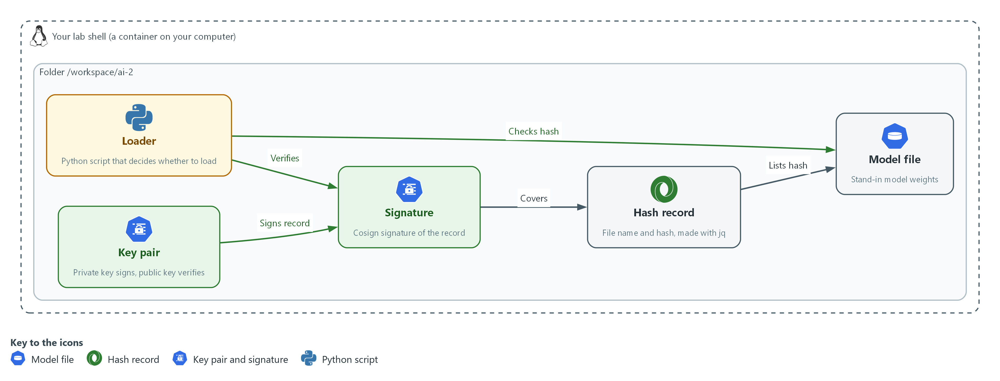
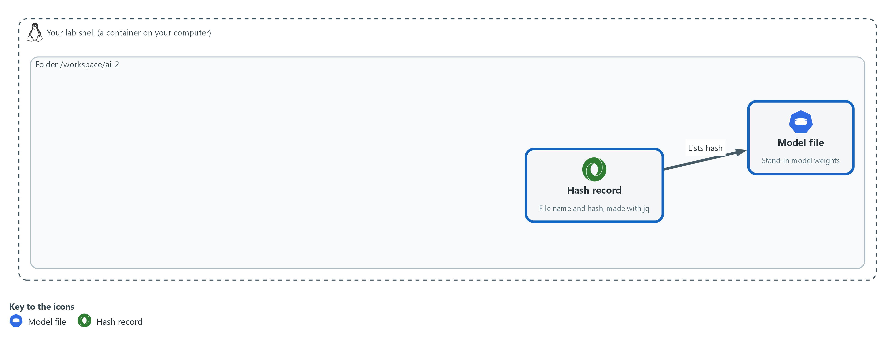
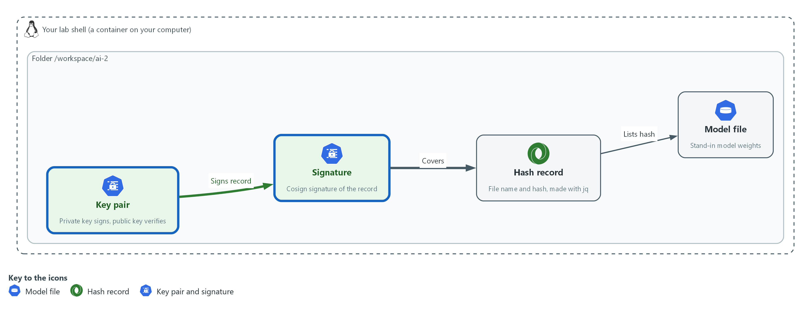
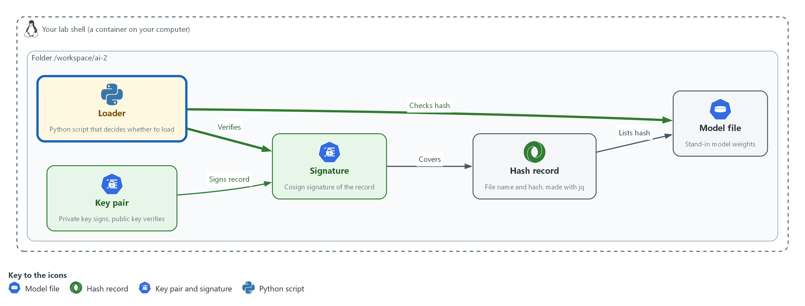

# AI-2: Check a Model File Before You Use It (SI-7, CM-14, SR-4)

| Item | Detail |
| --- | --- |
| Sequence | Module 24 of 32 in the recommended order |
| Timed work | About 50 minutes (35 hands-on, 15 verify) |
| Standalone start | `lab start ai-2` |
| Combined start | Continue from the end state of the previous module |
| Tools | Python (python3), Cosign (free, open source), openssl, jq, curl |
| Prerequisites | GRC-4 Evidence Signing (cosign sign-blob and verify-blob with a key pair, and what a signature does and does not cover) |

## Section 1. Module Overview

- Purpose: show that a model file is software from outside, that its origin and contents are recorded, and that the system checks both before it uses the file.
- You make the record, sign it and run a loader. You write one piece yourself: the hash check that the first loader is missing.
- You test one load that must succeed and two that must be refused.

- **Skill:** Record a model file's source and hash, sign the record, and write a loader that refuses a file whose signature or hash does not match.
- **Tools:** `openssl` computes the hash; `jq` writes the record; `cosign` signs and verifies it; `python3` runs the loader.
- **Security Function:** Detects a model file that has been changed since it was approved, and detects a record that did not come from the key holder, then refuses to load either.
- **NIST SI-7 Software, Firmware, and Information Integrity:** The loader recomputes the file's hash and compares it with the signed record, and refuses to load on a mismatch.
- **NIST CM-14 Signed Components:** The loader refuses a record whose signature does not verify with the approved public key.
- **NIST SR-4 Provenance:** The signed record names the file, its source, its hash and when it was recorded.

## Section 2. The Tools

### Tools used in this module

Each tool name links to its official overview. The table columns say how each tool is used in the lab and why the lab uses it instead of another way of doing the same job.

| Tool (overview link) | What it is | Used in this lab | Why this tool |
| --- | --- | --- | --- |
| [jq](https://jqlang.org/) | Command-line JSON processor. | Picks fields out of JSON output. | It picks one field out of a long JSON reply, so a test can read a single value. |
| [curl](https://curl.se/docs/manpage.html) | Command-line tool for transferring data over URLs, used here to call web endpoints. | Calls web endpoints to test behavior. | It calls a web address from the terminal, so you can check what a service really returns instead of trusting a screen. |

### How it fits together

#### The loader trusts a file only after two checks

- In the lab (test) setup, a hash record lists the model file, a signature covers the record, and the loader checks both before it uses the file.
- New parts are drawn with thick lines.



- **1. Model file:** a stand-in for real model weights.
- **2. Hash record:** a file that lists the model file name and its hash.
- **3. Key pair:** a private key that signs and a public key that verifies.
- **4. Signature:** the Cosign signature of the hash record.
- **5. Loader:** a Python script that verifies the signature on the record and then checks the hash of the model file before it loads anything.

### 2.1 A model file is software that came from outside (SI-7 Software, Firmware, and Information Integrity)

- A model file is run by the system, so a changed file changes what the system does. OWASP lists weak model provenance under supply chain risks (LLM03) and advises checking integrity with signing and file hashes.
- The file's name and size say nothing about its contents, so the system compares a hash of the contents with the one that was approved.
- A hash alone only helps if the expected hash cannot be changed by the same person who changed the file. Section 2.2 deals with that.

#### SI-7: Software, Firmware, and Information Integrity

*The control asks the organization to employ integrity verification tools to detect unauthorized changes to the software, firmware and information it names, and to take defined actions when a change is detected. NIST leaves the list of what to check and the actions to the organization. This is done using:*

- `openssl dgst -sha256`: computes the hash of the model file, once when it is recorded and again every time it is loaded.
- The loader load_model.py: compares the two hashes and refuses to load on a mismatch.

### 2.2 What a signature covers (CM-14 Signed Components)

- A signature on the manifest proves the manifest is the one the key holder signed. It says nothing about the model file, which is a different file.
- Step 3 shows this on purpose: the first loader checks only the signature and accepts a changed model file.
- A lab key pair that you made yourself proves the mechanism, not that anyone approved the key.

#### CM-14: Signed Components

*The control asks the system to prevent the installation of the components the organization names unless they have been digitally signed with a certificate the organization recognizes and approves. The components are chosen by the organization. This is done using:*

- `cosign sign-blob`: signs the manifest with the private key and writes the signature into a bundle file.
- `cosign verify-blob`: checks the bundle against the manifest with the public key alone, so a loader needs no secret.

### 2.3 The record (SR-4 Provenance)

- The manifest gives the loader and any later reader the file's name, its source, its hash and the time it was recorded.
- Because it is signed, the record cannot be quietly rewritten to match a swapped file.
- Keeping the record valid, for example when the file is replaced by a newer approved one, means signing a new record. The old record then stays as history.

#### SR-4: Provenance

*The control asks the organization to document, monitor and maintain valid provenance of the systems, system components and data it names. The list is the organization's to define. This is done using:*

- manifest.json: written by `jq` from the file name, the source, the hash and the time.
- The signature on it: stops the record being changed without the key.

The table lists the three checks the loader makes and what each one catches.

| Check | What it catches | What it does not catch |
| --- | --- | --- |
| Signature on the manifest | A manifest that was edited or never signed | A model file that was swapped |
| Hash of the model file | A model file that was changed or swapped | A model that was approved and was bad from the start |
| Source in the manifest | Nothing alone; it tells a reader where to look | A false source that the signer wrote |

### Design decisions

#### Sign the record and check the file against it, not one or the other

- How: The manifest holds the file's hash and is signed. The loader verifies the signature first, then recomputes the hash of the file and compares it with the signed one.
- Why: A hash with no signature can be replaced along with the file, and a signature on the record alone does not cover the file, so each check closes the gap in the other.
- Alternatives: Signing the model file itself is the alternative. Advantage: one check covers the file directly. Drawback: signing a very large file is slow, and the record still has to say where the file came from.

#### Verify with the public key only, at load time

- How: The loader holds cosign.pub and nothing secret. The private key and its password stay with whoever approves a file.
- Why: A loading host that is compromised cannot sign a fake record, because it does not hold the private key.
- Alternatives: Having the loader fetch a hash from a shared service is the alternative. Advantage: the expected hash can be changed centrally and quickly. Drawback: anyone who can change that service can change what is trusted, with no signature to show who did it.

#### Refuse and exit with status 1, and do not repair or fall back

- How: Any failed check prints one reason and ends the loader with status 1. It does not try an older file or skip the check.
- Why: A fallback turns a detected change into a silent one, which is the thing the checks exist to prevent.
- Alternatives: Loading the last good file when a check fails is the alternative. Advantage: the service keeps running. Drawback: the failure is hidden, and a repeated attack goes unnoticed unless something else raises it.

## Section 3. Implement

- Start: type `lab start ai-2` in the terminal on your own computer (PowerShell on Windows, Terminal on Mac), not in the lab shell.
- Enter lab shell with `lab shell`. Every other command in this module runs inside lab shell.
- If a step fails: run `lab reset ai-2` on your own computer and repeat the step once. If it still fails, copy the whole command and error and ask your AI assistant. Do not skip the step.

### Step 1. Make a stand-in model file and record where it came from (SR-4 Provenance, SI-7 Software, Firmware, and Information Integrity)

**Learning point: Computing a hash and writing it into a record with the file's name, source and time gives the file an identity that you can check later.**

- A real model file is many gigabytes.
- A random 4096 byte file stands in for it, because the checks work the same on any bytes.
- The record is written with jq so the values come from commands and not from typing.

What this step adds (thick lines and outlines are new):



- A stand-in model file is made and a hash record lists its name and hash.

#### 1a. Make the file and write its record

You will now make the stand-in model file, work out its hash and write the manifest.

- The last command recomputes the hash and compares it with the manifest.

```bash
mkdir -p /workspace/ai-2/model && cd /workspace/ai-2
head -c 4096 /dev/urandom > model/model.bin
SHA=$(openssl dgst -sha256 -r model/model.bin | cut -d' ' -f1)
jq -n --arg name model.bin --arg sha "$SHA" --arg source 'lab-generated stand-in' --arg made "$(date -u +%Y-%m-%dT%H:%M:%SZ)" '{name: $name, sha256: $sha, source: $source, recorded: $made}' > model/manifest.json
cat model/manifest.json
test "$(openssl dgst -sha256 -r model/model.bin | cut -d' ' -f1)" = "$(jq -r .sha256 model/manifest.json)" && echo hash-matches
```

**Expected output:**

```
Example only. The hash and the time will differ, and so will the file.
{
  "name": "model.bin",
  "sha256": "9f2c...64 letters and digits...",
  "source": "lab-generated stand-in",
  "recorded": "2026-11-12T10:15:00Z"
}
hash-matches
```

| Part | What it does | Why you run it |
| --- | --- | --- |
| mkdir -p /workspace/ai-2/model && cd /workspace/ai-2 | Makes a folder for this module, with a folder inside it for the model files, and moves into it. | The files that are signed and loaded are kept apart from the keys. |
| head -c 4096 /dev/urandom > model/model.bin | Writes 4096 random bytes to a file. | A random file stands in for a model file, since the checks only see bytes. |
| openssl dgst -sha256 -r model/model.bin \| cut -d' ' -f1 | Works out the SHA-256 hash of the file and keeps only the hash, not the file name that follows it. | The hash is the file's fingerprint. |
| jq -n --arg name ... --arg sha "$SHA" ... | Builds a JSON object from the values you give it. --arg passes each value in as text. | The values come from commands, so there is no typing error to hide a mismatch. |
| --arg source 'lab-generated stand-in' | Records the source. This is honest for a random file. A real record names the supplier and the address. | Provenance is only worth having if it says where the file really came from. |
| date -u +%Y-%m-%dT%H:%M:%SZ | Prints the time in UTC in a standard form. | The record shows when the file was approved. |
| test "$(...)" = "$(jq -r .sha256 model/manifest.json)" && echo hash-matches | Recomputes the hash and compares it with the one in the record. Prints hash-matches only if they are equal. | This comparison is what the loader will do in Step 3. |

> **YOUR TURN:** Paste the block.

> **CHECKPOINT:** The manifest shows four fields and the last line prints hash-matches.

> **TAKEAWAY:** Record what a file should be at the moment you approve it, because you cannot work it out later from the file alone.

**How this meets the controls**

- **SR-4:** You write a manifest with the file name, its source, its hash and the time.
- **SI-7:** You compute the hash that the loader will compare against.

### Step 2. Sign the record and see what a signature covers (CM-14 Signed Components)

**Learning point: Signing the manifest with a private key and checking it with the public key shows that an edited manifest no longer verifies, and why the signature alone does not protect the model file.**

- This is the same Cosign pattern as GRC-4: sign-blob writes a bundle, and verify-blob checks it with the public key alone.
- The key pair is made here, so the private key and its password stay in your working folder, and only the public key is used by the loader.
- The two flags that turn off the public transparency log are the ones GRC-4 uses.

What this step adds (thick lines and outlines are new):



- A key pair signs the record, so a changed record no longer verifies.

#### 2a. Make a key pair, sign the record, verify it, and verify an edited copy

You will now make a key pair, sign the manifest, and verify it with the public key.

- You then change one field in a copy of the manifest and verify the copy against the original signature.
- The second verify must fail.

```bash
cd /workspace/ai-2
openssl rand -base64 24 > signing.pass
chmod 600 signing.pass
COSIGN_PASSWORD="$(cat signing.pass)" cosign generate-key-pair
chmod 600 cosign.key
COSIGN_PASSWORD="$(cat signing.pass)" cosign sign-blob --yes --key cosign.key --use-signing-config=false --tlog-upload=false --bundle model/manifest.bundle.json model/manifest.json > /dev/null
cosign verify-blob --key cosign.pub --bundle model/manifest.bundle.json --insecure-ignore-tlog=true model/manifest.json
mkdir -p edited && cp model/manifest.bundle.json edited/
jq '.source = "somewhere-else"' model/manifest.json > edited/manifest.json
cosign verify-blob --key cosign.pub --bundle edited/manifest.bundle.json --insecure-ignore-tlog=true edited/manifest.json; echo "exit status: $?"
```

**Expected output:**

```
Example only. The wording of the messages may differ between Cosign releases.
Private key written to cosign.key
Public key written to cosign.pub
Verified OK
Error: invalid signature when validating ASN.1 encoded signature
exit status: 1
```

| Part | What it does | Why you run it |
| --- | --- | --- |
| openssl rand -base64 24 > signing.pass | Makes a random password and writes it to a file. | The private key is protected by a password that nobody chose. |
| chmod 600 signing.pass | Makes the file readable by you only. | The password opens the private key. |
| COSIGN_PASSWORD="$(cat signing.pass)" cosign generate-key-pair | Makes cosign.key (private) and cosign.pub (public) in the current folder. The password is given to this one command through a variable, so Cosign does not ask for it. Unconfirmed: this writes both files without a prompt. | The key pair is the identity that vouches for the record. |
| cosign sign-blob --yes --key cosign.key --use-signing-config=false --tlog-upload=false --bundle model/manifest.bundle.json model/manifest.json | Signs the manifest and writes the signature into the bundle file. The two flags keep it from using the public transparency log, which the lab does not have. | This is the step that makes any later edit to the manifest detectable. |
| cosign verify-blob --key cosign.pub --bundle model/manifest.bundle.json --insecure-ignore-tlog=true model/manifest.json | Checks the signature with the public key alone and skips the log check. | The check depends on nothing but the public key, so a loader needs no secret. |
| mkdir -p edited && cp model/manifest.bundle.json edited/ | Makes a copy folder holding the original signature. | You test an edit against a signature that was made for the original. |
| jq '.source = "somewhere-else"' model/manifest.json > edited/manifest.json | Changes one field in the copy. | One changed field is enough to break the signature. |
| ; echo "exit status: $?" | Prints the exit status of the verify before it. 1 means it refused. | A loader decides by this number. |

> **YOUR TURN:** Paste the block.

> **CHECKPOINT:** The first verify prints Verified OK. The second prints an error and the exit status is 1.

> **TAKEAWAY:** Sign the record that names the hash, so whoever swaps the file cannot also swap the expected hash.

**How this meets the control**

- **CM-14:** You sign the manifest with a private key, verify it with the public key, and see an edited copy fail.

### Step 3. Write the loader, find what it misses and add the hash check yourself (SI-7 Software, Firmware, and Information Integrity, CM-14 Signed Components)

**Learning point: A loader that checks only the signature accepts a changed model file, because the signature covers the manifest and not the file. Adding the hash check yourself closes that gap.**

- The first loader is supplied.
- It checks the signature and then loads.
- You change a copy of the model file and see it load, which is the gap.
- You then write the hash check yourself, as three lines.
- The reference answer is in the second block's lines table, so try before you read it.

What this step adds (thick lines and outlines are new):



- The loader checks the signature on the record and then the hash of the file, because the signature alone does not cover the file.

#### 3a. Read the first loader

You will now read the first loader, load_model.py, which a heredoc saves in the next block.

- It verifies the manifest signature and then loads.
- The comment marks the place where the hash check is missing.
- The next block saves it to a file for you.

```python
import hashlib
import json
import subprocess
import sys
from pathlib import Path


def refuse(reason):
    print("refused: " + reason)
    sys.exit(1)


def signature_ok(folder):
    command = [
        "cosign", "verify-blob", "--key", "cosign.pub",
        "--bundle", str(folder / "manifest.bundle.json"),
        "--insecure-ignore-tlog=true", str(folder / "manifest.json"),
    ]
    return subprocess.run(command, capture_output=True, text=True).returncode == 0


def main():
    folder = Path(sys.argv[1]) if len(sys.argv) > 1 else Path("model")
    if not signature_ok(folder):
        refuse("the manifest signature did not verify")
    manifest = json.loads((folder / "manifest.json").read_text())
    # hash check goes here
    print("loaded " + manifest["name"] + " from " + manifest["source"])


main()

```

**Expected output:**

```
Example only. Reading this block prints nothing.
```

| Part | What it does | Why you run it |
| --- | --- | --- |
| def refuse(reason): ... sys.exit(1) | Prints why and ends the program with exit status 1. | Every refusal looks the same to the caller: a printed reason and a status of 1. |
| def signature_ok(folder) | Runs the same cosign verify-blob command as Step 2 and returns true when its exit status is 0. | The loader decides by the exit status and does not parse the message. |
| capture_output=True, text=True | Keeps the messages from Cosign out of the loader's output. | Only the loader's own reason is shown. |
| if not signature_ok(folder): refuse(...) | Stops before reading the manifest if the signature fails. | A manifest that is not trusted is not read. |
| # hash check goes here | Marks the missing check. | Without it the loader trusts the file named in the manifest without looking at it. |

#### 3b. Save the loader, load the real file, then load a changed copy

You will now save the loader, load the real file, and load a copy of the model file with one byte added.

- The copy has the real, correctly signed manifest next to it.
- The first loader should load it, and that is the gap.

```bash
cd /workspace/ai-2
cat > load_model.py <<'EOF'
import hashlib
import json
import subprocess
import sys
from pathlib import Path


def refuse(reason):
    print("refused: " + reason)
    sys.exit(1)


def signature_ok(folder):
    command = [
        "cosign", "verify-blob", "--key", "cosign.pub",
        "--bundle", str(folder / "manifest.bundle.json"),
        "--insecure-ignore-tlog=true", str(folder / "manifest.json"),
    ]
    return subprocess.run(command, capture_output=True, text=True).returncode == 0


def main():
    folder = Path(sys.argv[1]) if len(sys.argv) > 1 else Path("model")
    if not signature_ok(folder):
        refuse("the manifest signature did not verify")
    manifest = json.loads((folder / "manifest.json").read_text())
    # hash check goes here
    print("loaded " + manifest["name"] + " from " + manifest["source"])


main()
EOF
python3 load_model.py model
mkdir -p tampered && cp model/manifest.json model/manifest.bundle.json tampered/
cp model/model.bin tampered/model.bin
echo x >> tampered/model.bin
python3 load_model.py tampered
```

**Expected output:**

```
Example only.
loaded model.bin from lab-generated stand-in
loaded model.bin from lab-generated stand-in
```

| Part | What it does | Why you run it |
| --- | --- | --- |
| cat > load_model.py <<'EOF' | Saves the loader shown above as load_model.py. The quotes around EOF keep the shell from changing it. | The file is the same one you just read. |
| python3 load_model.py model | Runs the loader on the real folder. | The real file must load, or a refusal later proves nothing. |
| mkdir -p tampered && cp model/manifest.json model/manifest.bundle.json tampered/ | Copies the signed manifest and its bundle into a new folder. | The attacker in this test has the real, signed record. |
| cp model/model.bin tampered/model.bin && echo x >> tampered/model.bin | Copies the model file and adds one byte to the end. | One byte is enough to change the hash. |
| python3 load_model.py tampered | Runs the loader on the copy. It loads, because the signature is fine and nothing looks at the file. | This is the gap: a signature on the record does not cover the file. |

#### 3c. Add the hash check and run both loads again

You will now add the missing check.

- Write the three lines yourself first: read the model file named in the manifest, work out its SHA-256 hash with hashlib, and call refuse when it differs from the hash in the manifest.
- The block shows the answer in its lines table.
- Replace the lines in hashcheck.txt with your own and compare.

```bash
cd /workspace/ai-2
cat > hashcheck.txt <<'EOF'
    actual = hashlib.sha256((folder / manifest["name"]).read_bytes()).hexdigest()
    if actual != manifest["sha256"]:
        refuse("the model file does not match the signed hash")
EOF
sed -i '/# hash check goes here/r hashcheck.txt' load_model.py
python3 load_model.py model
python3 load_model.py tampered; echo "exit status: $?"
```

**Expected output:**

```
Example only.
loaded model.bin from lab-generated stand-in
refused: the model file does not match the signed hash
exit status: 1
```

| Part | What it does | Why you run it |
| --- | --- | --- |
| actual = hashlib.sha256((folder / manifest["name"]).read_bytes()).hexdigest() | The reference line. Reads the model file named in the manifest and works out its hash. | The loader works out the hash itself, from the file it is about to load. |
| if actual != manifest["sha256"]: refuse(...) | The reference check. Refuses when the hash it worked out is not the hash in the signed manifest. | The signed manifest is the trusted side of the comparison, and the file is the side not yet trusted. |
| sed -i '/# hash check goes here/r hashcheck.txt' load_model.py | Inserts the contents of hashcheck.txt after the marker line. | You add the check without retyping the file. |
| python3 load_model.py tampered; echo "exit status: $?" | Runs the loader on the changed copy and prints the exit status. 1 means it refused. | The same copy that loaded before must now be refused. |

> **TIP:** If you run the third block twice, the check is inserted twice. That still works. To start over, paste the second block again to rebuild load_model.py.

> **YOUR TURN:** Read the loader, paste the second block, write the hash check, then paste the third block with your lines in hashcheck.txt.

> **CHECKPOINT:** Before the check, both loads print loaded. After it, the real folder loads and the tampered copy prints a refusal with exit status 1.

> **TAKEAWAY:** Check the thing you are about to use, not only the paperwork about it.

**How this meets the controls**

- **SI-7:** You add the hash comparison to the loader and see a changed file refused.
- **CM-14:** The loader verifies the manifest signature before it reads the manifest.

## Section 4. Verify It Works

### Test 1 (positive). The approved file loads (SR-4 Provenance, SI-7 Software, Firmware, and Information Integrity)

- Load the approved folder with the finished loader.
- If this fails, every refusal below could be a fault in the loader and not a check working.

```bash
cd /workspace/ai-2
python3 load_model.py model; echo "exit status: $?"
```

**Expected output:**

```
Example only.
loaded model.bin from lab-generated stand-in
exit status: 0
```

| Part | What it does | Why you run it |
| --- | --- | --- |
| python3 load_model.py model | Runs the finished loader on the approved folder. | The right file must load. |
| echo "exit status: $?" | Prints the exit status. 0 means it loaded. | Success and refusal differ by this number. |

> **CHECKPOINT:** It prints loaded and the exit status is 0.

**How this meets the controls**

- **SR-4:** The loader prints the name and source from the signed record only after the checks pass.
- **SI-7:** The file hash matches the signed record, so the load proceeds.

### Test 2 (negative). A changed model file is refused (SI-7 Software, Firmware, and Information Integrity)

- Load the copy whose model file has one extra byte.
- The record and signature are the real ones, so only the hash check can catch it.

```bash
cd /workspace/ai-2
python3 load_model.py tampered; echo "exit status: $?"
openssl dgst -sha256 -r tampered/model.bin | cut -c1-12
jq -r .sha256 tampered/manifest.json | cut -c1-12
```

**Expected output:**

```
Example only. The 12 characters will differ, and the two lines must not be equal.
refused: the model file does not match the signed hash
exit status: 1
3a91c07be2d4
9f2c58a1d036
```

| Part | What it does | Why you run it |
| --- | --- | --- |
| python3 load_model.py tampered | Loads the changed copy. | It must be refused. |
| openssl dgst -sha256 -r tampered/model.bin \| cut -c1-12 | Prints the first 12 characters of the changed file's hash. | You see the hash that the loader worked out. |
| jq -r .sha256 tampered/manifest.json \| cut -c1-12 | Prints the first 12 characters of the hash in the record. | The two differ, which is why it was refused. |

> **CHECKPOINT:** The loader refuses with exit status 1, and the two hash prefixes differ.

**How this meets the control**

- **SI-7:** A model file with one extra byte next to a correctly signed record is refused, so the hash check covers the file and not only the paperwork.

### Test 3 (negative). An edited record and a missing signature are refused (CM-14 Signed Components)

- An attacker who swaps the file will also edit the record to the new hash.
- Make that edit and load it, then remove the signature and load again.
- Both must be refused before the hash is even compared.

```bash
cd /workspace/ai-2
NEWSHA=$(openssl dgst -sha256 -r tampered/model.bin | cut -d' ' -f1)
jq --arg sha "$NEWSHA" '.sha256 = $sha' model/manifest.json > tampered/manifest.json
python3 load_model.py tampered; echo "edited record, exit status: $?"
mkdir -p unsigned && cp model/model.bin model/manifest.json unsigned/
python3 load_model.py unsigned; echo "no signature, exit status: $?"
```

**Expected output:**

```
Example only.
refused: the manifest signature did not verify
edited record, exit status: 1
refused: the manifest signature did not verify
no signature, exit status: 1
```

| Part | What it does | Why you run it |
| --- | --- | --- |
| NEWSHA=$(openssl dgst -sha256 -r tampered/model.bin \| cut -d' ' -f1) | Works out the hash of the changed file. | The attacker wants a record that agrees with the swapped file. |
| jq --arg sha "$NEWSHA" '.sha256 = $sha' model/manifest.json > tampered/manifest.json | Writes a record whose hash matches the changed file. Its signature is the old one, made for the original record. | The hash check would now pass, so only the signature can stop this. |
| python3 load_model.py tampered | Loads the changed file with its edited record. | The signature does not match the edited record, so the loader refuses. |
| mkdir -p unsigned && cp model/model.bin model/manifest.json unsigned/ | Makes a folder with the real file and record and no bundle. | A record with no signature is the simplest fake. |
| python3 load_model.py unsigned | Loads it. The signature check fails because the bundle is missing. | No signature means not trusted. |

> **CHECKPOINT:** Both loads print the signature refusal with exit status 1.

**How this meets the control**

- **CM-14:** A manifest edited to match a swapped file fails verification, and a manifest with no bundle fails too, so the loader trusts only a record the key holder signed.

## Section 5. What Each Control Is For

### Control mapping

| Control | What it requires, in plain words | Tool or service | Where this module covers it |
| --- | --- | --- | --- |
| SI-7 Software, Firmware, and Information Integrity | Detect unauthorized changes to software and information, and act when one is found. | `openssl`, which computes the hash, and the loader written in `python3`. Explained in section 2.1. | Section 3, Step 1: record the file's hash. Section 3, Step 3: refuse a file whose hash differs. Section 4, Test 2: a changed file is refused. |
| CM-14 Signed Components | Do not install certain components unless they are digitally signed in a way the organization approves. | `cosign`, which signs and verifies the record. Explained in section 2.2. | Section 3, Step 2: sign the record and verify it with the public key. Section 3, Step 3: the loader refuses a record that does not verify. Section 4, Test 3: an edited record and a missing signature are both refused. |
| SR-4 Provenance | Keep a record of where each component came from, and keep it valid. | `jq`, which writes the record (manifest.json). Explained in section 2.3. | Section 3, Step 1: write the record with the name, source, hash and time. Section 4, Test 1: the loader prints the recorded name only after the checks pass. |

### What each control is for

Each table below says what the control is trying to prevent and how this module's tool meets it.

#### SI-7 Software, Firmware, and Information Integrity

| Question | Answer |
| --- | --- |
| Control Intent | A model file is changed after it was approved, in storage or on the way, and the system loads it without noticing. |
| The operational question | How does the system know the file it is about to load is the one that was approved, and what does it do when it is not? |
| What evidence proves it | The recorded hash, the loader's comparison, and a refusal that stops the load. |
| How much is enough | The loader recomputes the hash of the file itself, at load time, and compares it with the hash in the signed record. NIST leaves the list of software and information to check, and the actions to take on a change, to the organization. The lab checks the model file and the action is to refuse and exit with status 1. |
| How the tool in this module satisfies it | `openssl dgst` (Step 1) computes the hash, and the check you write in Step 3 compares it in the loader. |

#### CM-14 Signed Components

| Question | Answer |
| --- | --- |
| Control Intent | The record that names the expected hash is itself replaced, so a swapped file comes with a matching record and passes the hash check. |
| The operational question | Who vouched for this record, and does the loader check that before it trusts what the record says? |
| What evidence proves it | A signature on the record that verifies with the approved public key, and a refusal when it does not. |
| How much is enough | The loader verifies the signature with the public key before it reads the record. NIST asks for a certificate recognized and approved by the organization, and it leaves the components to the organization. The lab uses a bare key pair it made itself, which shows the check but is not an organization-approved certificate. A real system uses a key the organization has approved and keeps its private half off the loading host. |
| How the tool in this module satisfies it | `cosign sign-blob` and `cosign verify-blob` (Step 2) with the key pair, as in GRC-4. |

#### SR-4 Provenance

| Question | Answer |
| --- | --- |
| Control Intent | Nobody can say where a model file came from or when it was approved, so a file of unknown origin is treated like an approved one. |
| The operational question | For this model file, what is recorded about its origin and contents, and who can change that record? |
| What evidence proves it | The signed record with the file name, source, hash and time. |
| How much is enough | Each model file has one signed record that names its source and hash. NIST leaves the list of systems, components and data to the organization. The lab's source is the text lab-generated stand-in, because the file is a random stand-in and not a downloaded model. A real record names the supplier and the address the file was fetched from. |
| How the tool in this module satisfies it | `jq` (Step 1) writes the record from the values you give it, and `date` stamps it. |

## Section 6. Next Steps

### Using this in other environments

- The hash, the manifest and the loader are plain openssl, jq and Python and work on any OS with those tools.
- The signing uses Cosign with a local key pair; any signing tool that signs a file and verifies it with a public key can replace it.
- Lab-only values are the stand-in model file, the source text lab-generated stand-in and the key pair in your working folder.

The table shows what changes on each platform:

| Check/part | In this lab (OpenShift) | On other platforms | What you change |
| --- | --- | --- | --- |
| Hash (`openssl dgst`) | openssl in lab shell | sha256sum or Get-FileHash | The command; the idea is the same. |
| Record (manifest.json) | Written with jq | Any tool that writes JSON | Name the real supplier and the address the file came from. |
| Signature (Cosign) | Local key pair, no transparency log | A key held in a key management service, or Sigstore with a log | The key reference and whether to upload to a log. |
| Loader (load_model.py) | python3 in lab shell | Same on any OS with Python 3 and Cosign | Nothing, except the path of the public key. |

> **TIP:** Next module: Watch the Gateway and Respond: you read the gateway log for abuse, write a detection in Loki and a short runbook.

<details>
<summary><strong>Section 7. Terms</strong></summary>

Each term is also explained the first time it appears. In Word, hover over an underlined term to see its meaning, or Ctrl+click it to jump to this table.

| Term | Plain meaning |
| --- | --- |
| Bundle | The file Cosign writes next to what it signed. It holds the signature. |
| Certificate | A file that proves a server's identity, signed by a trusted authority. |
| chmod | A command that changes who may read, write or run a file. |
| Cluster | The group of servers that runs your lab and the programs in it. |
| Container | A sealed box that holds one program and everything it needs to run. |
| Cosign | A free tool for signing and checking signatures. Here it signs and checks the manifest. |
| Digital signature | A mark made with a private key that anyone with the matching public key can check. It proves the signed bytes have not changed since the key holder signed them. |
| Evidence | Saved records that show a system is set up and behaving as claimed. |
| Exit status | A number a command leaves behind when it ends. 0 means success and anything else means a problem. |
| Hash | A short fingerprint worked out from a file's contents. Change one byte of the file and the hash changes completely. Here it is SHA-256, written as 64 letters and digits. |
| Heredoc | A way to make a file by pasting its text between a first line such as cat > name <<'EOF' and a last line that says EOF. |
| Image | A packaged copy of a program and everything it needs to run. A container starts from an image. |
| jq | A tool that picks one value out of JSON text, or builds JSON text. |
| JSON | A plain-text format for data: names and values written inside curly braces. |
| Key | A secret value that locks or unlocks encrypted data, or proves who you are. |
| Key pair | Two linked keys. The private key signs and stays secret; the public key checks signatures and can be shared. |
| Loki | The log store in the lab. You search it with LogQL. |
| Manifest | A small file that lists what a model file should be: its name, source and hash. Here it is manifest.json. |
| mkdir | A command that makes a new folder. |
| Model file | The saved numbers that make up a model, kept in a file. Real ones are very large; here a small random file stands in for one. |
| NIST | The US National Institute of Standards and Technology. It publishes the security control catalog these modules cite. |
| OpenShift | The Red Hat platform your lab cluster runs on. It is Kubernetes with extra security and tools built in. |
| openssl | A tool for cryptography. Here it works out the hash. |
| Pipeline | A set of automated steps that run in order, such as scan, check and sign. |
| Provenance | The record of where something came from and who handled it. |
| Runbook | Step-by-step instructions for handling a known situation. |
| Secret | A cluster object that holds a sensitive value such as a password or token, kept apart from ordinary settings. |
| sed | A command that edits text as it passes through, often to replace one string with another. |
| Signature | A value made with a private key that shows who made something and that it was not changed. |
| Supply chain | Everything a system takes in from outside, such as libraries, images and model files, and the people and places they pass through before they reach you. |
| Tampering | Changing something on purpose so that it behaves differently while looking the same. |
| Variable | A named value that a command can use. The dollar sign in front of a name means use its value. |

</details>
