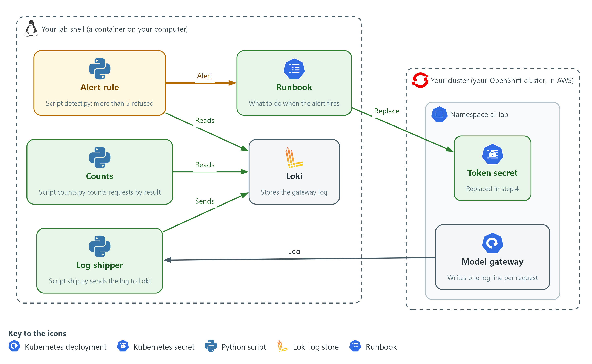
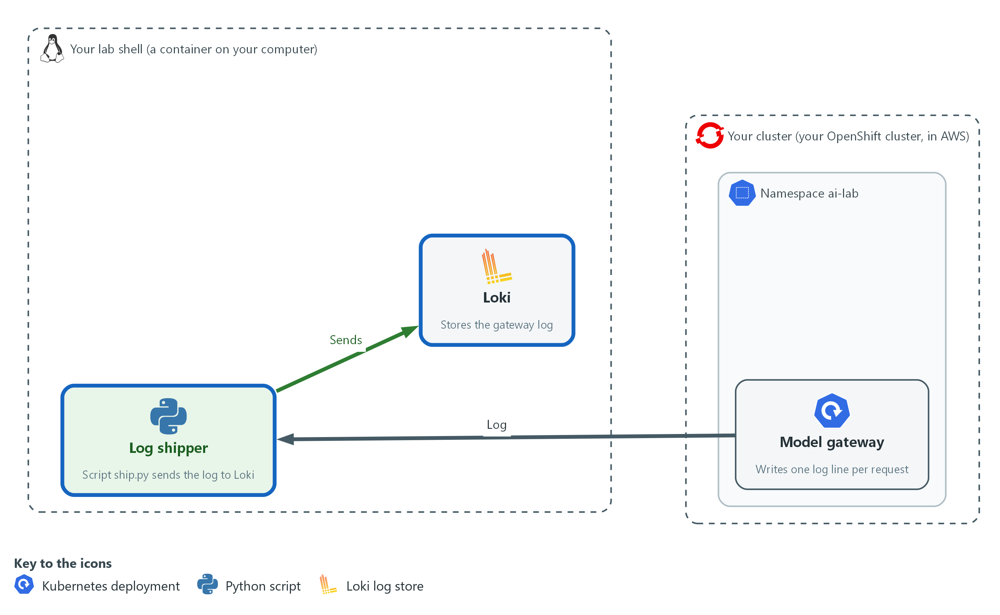
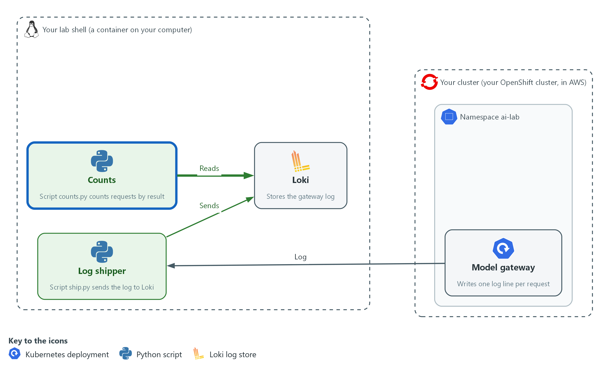
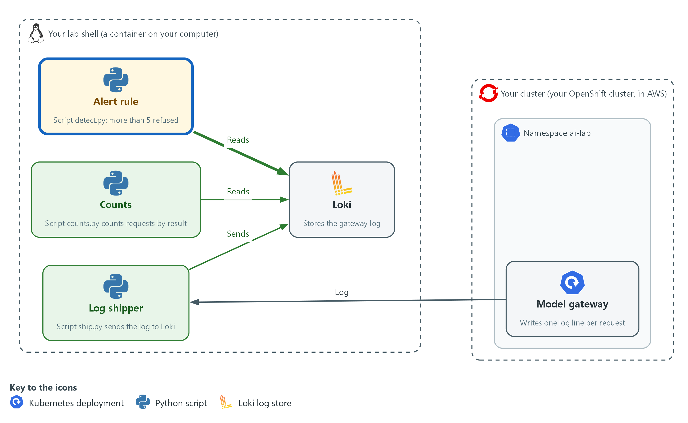
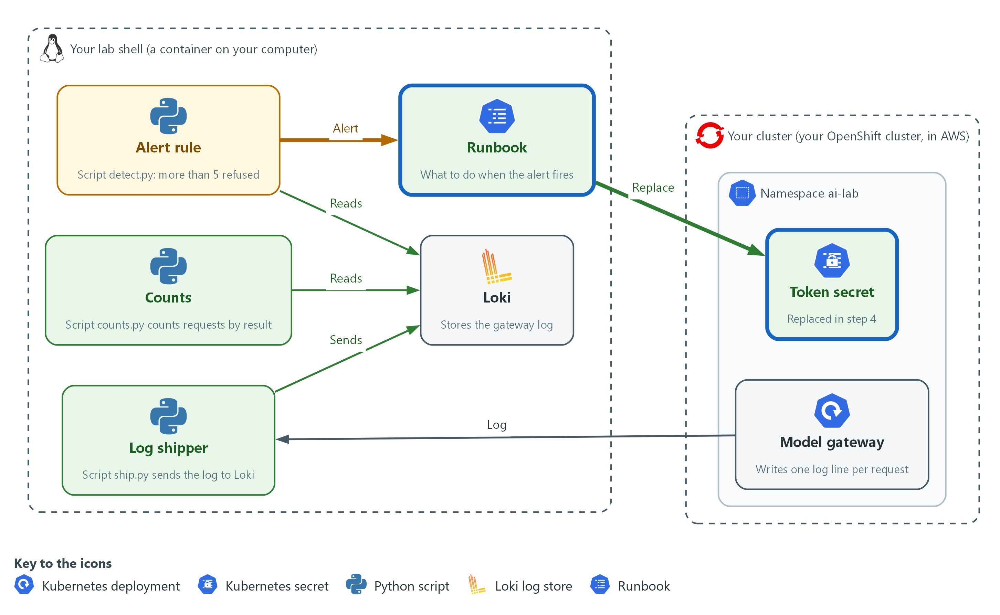

# AI-3: Watch the Model Gateway and Respond to Abuse (SI-4, AU-6, IR-4)

| Item | Detail |
| --- | --- |
| Sequence | Module 16 of 32 in the recommended order |
| Timed work | About 55 minutes (40 hands-on, 15 verify) |
| Standalone start | `lab start ai-3` |
| Combined start | Continue from the end state of the previous module |
| Tools | Python (python3), Loki (free, open source), oc, curl, awk, openssl |
| Prerequisites | Put the Model Behind a Gateway (the gateway, its token and the probe pod), AID-3 AI-Assisted Automation and Queries Under Review (the ailog.py file and the Loki variables), SDR-3 Detect with Queries and Alerts (what a detection is and how Loki is searched) |

## Section 1. Module Overview

- Purpose: show that refusals at the gateway are watched, that a rule turns a burst of them into an alert, and that a person has steps to follow when it fires.
- You send records, search them, write one rule yourself, and carry out the response. The first rule you are given misses the abuse, so you see why it must be written.
- You test one run that must not alert, one that must, and one token that must stop working.

- **Skill:** Ship gateway request records to a log store, write a rule that alerts on a burst of refusals, and follow a runbook to contain and recover.
- **Tools:** `ship.py` sends gateway records to Loki; `detect.py` searches them with LogQL and raises the alert; `oc` and `openssl` replace the token.
- **Security Function:** Detects repeated refused requests to the model gateway and starts a response that cuts off the abuser.
- **NIST SI-4 System Monitoring:** `detect.py` watches the gateway records for refused requests and raises an alert on a burst.
- **NIST AU-6 Audit Record Review, Analysis, and Reporting:** The gateway records are searched by status, and the source of the refusals is found in the log.
- **NIST IR-4 Incident Handling:** The runbook names the phases, and you carry out containment, eradication and recovery by replacing the token.

## Section 2. The Tools

### Tools used in this module

Each tool name links to its official overview. The table columns say how each tool is used in the lab and why the lab uses it instead of another way of doing the same job.

| Tool (overview link) | What it is | Used in this lab | Why this tool |
| --- | --- | --- | --- |
| [oc](https://docs.redhat.com/en/documentation/openshift_container_platform/4.22/html/cli_tools/openshift-cli-oc) | The OpenShift command-line tool for creating and managing applications and projects from a terminal. | Runs the cluster commands in each step. | It is the one command that talks to the cluster, so every module uses it to ask what is true and to make changes. You sign in once, and it works on OpenShift objects as well as standard Kubernetes ones. Unlike clicking in the web console, a command can be pasted, repeated and checked by a test. |
| [curl](https://curl.se/docs/manpage.html) | Command-line tool for transferring data over URLs, used here to call web endpoints. | Calls web endpoints to test behavior. | It calls a web address from the terminal, so you can check what a service really returns instead of trusting a screen. |

### How it fits together

#### From gateway log to alert to a new token

- In the lab (test) setup, the gateway log is sent to Loki, a counting script reads it, and a rule raises an alert when too many requests are refused.
- The runbook and a new token close the case.
- New parts are drawn with thick lines.



- **1. Model gateway:** writes one log line for every request.
- **2. Token secret:** holds the token the gateway accepts and is replaced in step 4.
- **3. Log shipper:** ship.py sends the gateway log to Loki.
- **4. Loki:** stores the gateway log.
- **5. Counts:** counts.py counts the requests by result.
- **6. Alert rule:** detect.py raises an alert when more than five requests are refused.
- **7. Runbook:** says what to do when the alert fires, including replacing the token.

### 2.1 The gateway already knows who was refused (AU-6 Audit Record Review, Analysis, and Reporting)

- The gateway writes one log line for every request, with the source address and the status number of the answer. Refusals are in that line: 401 for a missing or wrong token and 429 for too many requests.
- A log line in a pod is hard to search and is lost when the pod restarts. Sending each line to Loki with labels makes the records searchable together and keeps them.
- OWASP lists unbounded consumption as a risk for AI systems (LLM10) and advises logging and monitoring to detect unusual patterns of use. The gateway log is where those patterns show.

#### AU-6: Audit Record Review, Analysis, and Reporting

*The control asks the organization to review and analyze the system audit records for indications of inappropriate or unusual activity, at a frequency it defines, and to report what it finds. The lab review is a count by status. This is done using:*

- `ship.py`: reads the gateway log and sends one record per request to Loki, labelled with the app, the run and the status.
- `counts.py`: asks Loki how many records each status has for a run.

### 2.2 A rule turns a count into an alert (SI-4 System Monitoring)

- A single refused request is normal: someone mistypes a token. A burst of them in a short time is not. The rule counts the refusals in a window and compares the count with a limit.
- The limit is a choice. Too low and normal use raises false alarms. Too high and abuse passes. The lab uses a limit of 5 refused requests in 15 minutes for a run.
- The rule is code that you read and test. In Step 3 the first version never alerts, so you see why the decision line matters.

#### SI-4: System Monitoring

*The control asks the organization to monitor the system to detect attacks and indicators of potential attacks against the objectives it sets, and to identify unauthorized use through the techniques it chooses. This is done using:*

- `detect.py`: asks Loki for the number of 401 and 429 records for a run and prints ALERT with exit status 2 when the number passes the limit.
- The limit THRESHOLD: one named value in the file, so changing it is a one-line, reviewable change.

### 2.3 Steps written down before the alert (IR-4 Incident Handling)

- An alert at night should not need anyone to invent a response. The runbook lists the phases in order so that the first action is known.
- For a leaked or guessed token the fastest containment is rotation: replace the token. The old one stops working when the gateway restarts with the new one.
- Recovery is not finished until you test both sides: the old token is refused and the new one works.

#### IR-4: Incident Handling

*The control asks the organization to implement an incident handling capability that is consistent with its incident response plan and covers preparation, detection and analysis, containment, eradication and recovery. This is done using:*

- `runbook.md`: one line for each phase, so the order is written down.
- `openssl rand` and `oc`: make the new token, store it in the Secret and restart the gateway.

The table lists the refusals the gateway makes and what each can mean.

| Status | What the gateway meant | What it can point to |
| --- | --- | --- |
| 401 | No token, or the wrong one | A caller guessing tokens, or a person with a stale token |
| 429 | Too many requests from one address | A caller flooding the model, or a script that loops |
| 413 | The body is too large | A caller sending a very large prompt |

### Design decisions

#### Count refusals by status in a window and compare with a limit

- How: detect.py counts 401 and 429 records for a run and alerts when the count passes THRESHOLD.
- Why: A count over a window ignores the single mistyped token and still catches a burst, and a named limit is easy to review and change.
- Alternatives: Alerting on every refusal is the alternative. Advantage: nothing is missed. Drawback: normal mistakes raise false alarms until people stop reading them.

#### Put the outcome in a label, and the rest of the line in the text

- How: ship.py sends app, run and status as labels and keeps the whole gateway log line as the record text.
- Why: A search by status is fast when status is a label, and the full line is still there when a person needs the address.
- Alternatives: Putting every field in a label is the alternative. Advantage: any field can be searched quickly. Drawback: labels with many different values, such as addresses, make the store slow and large.

#### Contain by replacing the token, before finding every detail

- How: The runbook puts containment before the rest of the analysis, and the token is replaced with a new random value in the Secret.
- Why: The abuser keeps using the old token for as long as it works, so stopping it first limits the harm and the analysis can go on afterwards.
- Alternatives: Investigating fully before acting is the alternative. Advantage: you learn more about the abuser before they notice. Drawback: the abuse continues while you investigate.

## Section 3. Implement

- Start: type `lab start ai-3` in the terminal on your own computer (PowerShell on Windows, Terminal on Mac), not in the lab shell.
- Enter lab shell with `lab shell`. Every other command in this module runs inside lab shell.
- If a step fails: run `lab reset ai-3` on your own computer and repeat the step once. If it still fails, copy the whole command and error and ask your AI assistant. Do not skip the step.

### Step 1. Send the gateway log to Loki and count it (AU-6 Audit Record Review, Analysis, and Reporting)

**Learning point: A pod log becomes useful once each request is a searchable record with a status label, so you can ask how many requests got each answer.**

- The script reads only the lines written after a start time, so each run is separate.
- The label run names the run, so a later search can look at one run and not at the lab's whole history.
- You do not write the scripts here.
- ship.py reuses ailog.py from the AID-3 repository for the sign-in and the certificate check.

What this step adds (thick lines and outlines are new):



- A shipping script sends the gateway log to Loki, and a count shows the requests by result.

#### 1a. Save the scripts, send three normal requests and count them

You will now save ship.py and counts.py with a heredoc, send three normal requests through the gateway, ship the records and count them by status.

- The sleep gives the clocks time to agree.

```bash
mkdir -p /workspace/ai-3 && cd /workspace/ai-3
cat > ship.py <<'EOF'
import re
import subprocess
import sys

sys.path.insert(0, "/workspace/aid-3/ai-tools")
from ailog import push

STATUS = re.compile(r'" (\d{3}) ')


def gateway_lines(start):
    command = ["oc", "logs", "deployment/model-gateway", "-n", "ai-lab", "--since-time=" + start]
    result = subprocess.run(command, capture_output=True, text=True)
    if result.returncode != 0:
        print("could not read the gateway log: " + result.stderr.strip())
        sys.exit(1)
    return result.stdout.splitlines()


def main():
    run, start = sys.argv[1], sys.argv[2]
    sent = 0
    for line in gateway_lines(start):
        match = STATUS.search(line)
        if match:
            push({"app": "model-gateway", "run": run, "status": match.group(1)}, line)
            sent += 1
    print("shipped " + str(sent) + " records for run " + run)


main()
EOF
cat > counts.py <<'EOF'
import sys

sys.path.insert(0, "/workspace/aid-3/ai-tools")
from ailog import query


def main():
    expr = 'sum by (status) (count_over_time({app="model-gateway", run="' + sys.argv[1] + '"}[15m]))'
    for item in query(expr)["data"]["result"]:
        print(item["metric"]["status"] + "  " + str(int(float(item["value"][1]))))


main()
EOF
TOKEN=$(cat /workspace/ai-1/token)
START=$(date -u +%Y-%m-%dT%H:%M:%SZ)
sleep 5
oc exec -i -n ai-lab probe -- sh -s "$TOKEN" <<'EOF' | sort | uniq -c
for i in 1 2 3; do
  curl -s -m 5 -o /dev/null -w "%{http_code}\n" -H "Authorization: Bearer $1" -d '{"request_id":"summary-ok","input":"hello"}' http://model-gateway:8080/v1/answer
  sleep 1
done
EOF
python3 ship.py normal-1 "$START"
python3 counts.py normal-1

```

**Expected output:**

```
Example only. Address and counts will differ.
      3 200
shipped 3 records for run normal-1
200  3
```

| Part | What it does | Why you run it |
| --- | --- | --- |
| mkdir -p /workspace/ai-3 && cd /workspace/ai-3 | Makes a folder for this module and moves into it. | The scripts and the old token are kept together. |
| cat > ship.py <<'EOF' | Saves the shipping script. The quotes around EOF keep the shell from changing it. | The script is supplied, so you do not retype it. |
| --since-time=" + start | Reads only the gateway lines after the start time. | Each run is counted on its own. |
| push({"app": "model-gateway", "run": run, "status": match.group(1)}, line) | Sends one record with three labels and the whole log line as its text. | The labels are how a search finds the record again. |
| sum by (status) (count_over_time({app="model-gateway", run="..."}[15m])) | A LogQL search in counts.py. It counts the records for the run in the last 15 minutes, one count for each status. | This is the count by outcome. |
| TOKEN=$(cat /workspace/ai-1/token) | Reads the gateway token from the file the gateway module made. | You never type the token. |
| START=$(date -u +%Y-%m-%dT%H:%M:%SZ) | Notes the time now, in UTC. | The script reads only lines after this. |
| sleep 5 | Waits 5 seconds after the start time. | A small difference between the two clocks cannot drop the first request. |
| oc exec -i -n ai-lab probe -- sh -s "$TOKEN" <<'EOF' \| sort \| uniq -c | Runs the loop inside the probe pod, with the token as its first argument, and counts the answers. | Requests come from inside the cluster, as a real caller would. |
| python3 ship.py normal-1 "$START" | Sends the records for this run to Loki. | The run name ties the records to this test. |
| python3 counts.py normal-1 | Asks Loki for the count by status. | You see that the records arrived. |

> **YOUR TURN:** Paste the block.

> **CHECKPOINT:** The loop prints 3 200, the shipper says it shipped 3 records, and the count shows 200 with 3.

> **TAKEAWAY:** Put the outcome in a label, because a count by outcome is the first question every review asks.

**How this meets the control**

- **AU-6:** You send each gateway request to Loki as a record labelled with its status, and count the records by status.

### Step 2. See what abuse looks like in the records (AU-6 Audit Record Review, Analysis, and Reporting, SI-4 System Monitoring)

**Learning point: Eight requests with a wrong token leave eight 401 records. The pattern is easy to see in a count, and the log shows the same address each time.**

- The rule you write next needs something to find.
- The wrong token is a literal word, so no secret is used here.
- The run name is new, so the records from Step 1 are not counted again.

What this step adds (thick lines and outlines are new):



- Abuse shows up as a run of refused requests from one source.

#### 2a. Send eight requests with a wrong token and count them

You will now send eight requests with a wrong token, ship the records and count them.

- All eight should be refused.

```bash
cd /workspace/ai-3
TOKEN=not-the-token
START=$(date -u +%Y-%m-%dT%H:%M:%SZ)
sleep 5
oc exec -i -n ai-lab probe -- sh -s "$TOKEN" <<'EOF' | sort | uniq -c
for i in 1 2 3 4 5 6 7 8; do
  curl -s -m 5 -o /dev/null -w "%{http_code}\n" -H "Authorization: Bearer $1" -d '{"request_id":"summary-ok","input":"hello"}' http://model-gateway:8080/v1/answer
  sleep 1
done
EOF
python3 ship.py abuse-1 "$START"
python3 counts.py abuse-1

```

**Expected output:**

```
Example only.
      8 401
shipped 8 records for run abuse-1
401  8
```

| Part | What it does | Why you run it |
| --- | --- | --- |
| TOKEN=not-the-token | Uses a word that is not the gateway token. | Every request is refused, and no real secret is used. |
| for i in 1 2 3 4 5 6 7 8; do ... sleep 1; done | Sends eight requests, one every second. | A pause keeps the rate limit from turning some answers into 429. |
| python3 ship.py abuse-1 "$START" | Ships the records for this run. | A new run name keeps these apart from the normal run. |
| python3 counts.py abuse-1 | Counts the records by status. | The count shows 401 with 8. |

> **YOUR TURN:** Paste the block.

> **CHECKPOINT:** The loop prints 8 401, and the count shows 401 with 8.

> **TAKEAWAY:** Abuse is a pattern across records, so it shows up in a count and not in any single line.

**How this meets the controls**

- **AU-6:** You review a run of refused requests by status and see the pattern.
- **SI-4:** The refusals are the indicator that the rule in Step 3 will watch for.

### Step 3. Write the rule that raises the alert (SI-4 System Monitoring)

**Learning point: A rule has two parts: a search that counts and a decision line that compares the count with a limit. The first version always says no, and so it misses the abuse you just made.**

- detect.py is supplied with the search, the limit and the output.
- The decision line is a stub that returns False.
- You write the one line that compares the count with the limit.
- The reference line is in the lines table of the second block, so try before you read it.

What this step adds (thick lines and outlines are new):



- A detection script alerts when more than five requests are refused in the window.

#### 3a. Save the first rule and run it on both runs

You will now save detect.py with a heredoc and run it on the normal run and the abuse run.

- The first version should say ok for both, which is the gap.

```bash
cd /workspace/ai-3
cat > detect.py <<'EOF'
import sys

sys.path.insert(0, "/workspace/aid-3/ai-tools")
from ailog import query

THRESHOLD = 5


def rejected(run):
    expr = 'sum(count_over_time({app="model-gateway", run="' + run + '", status=~"401|429"}[15m]))'
    result = query(expr)["data"]["result"]
    return int(float(result[0]["value"][1])) if result else 0


def is_abuse(count):
    return False  # replace this line


def main():
    run = sys.argv[1]
    count = rejected(run)
    if is_abuse(count):
        print("ALERT  run " + run + "  " + str(count) + " rejected requests, limit " + str(THRESHOLD))
        sys.exit(2)
    print("ok     run " + run + "  " + str(count) + " rejected requests")


main()
EOF
python3 detect.py normal-1; echo "exit status: $?"
python3 detect.py abuse-1; echo "exit status: $?"
```

**Expected output:**

```
Example only.
ok     run normal-1  0 rejected requests
exit status: 0
ok     run abuse-1  8 rejected requests
exit status: 0
```

| Part | What it does | Why you run it |
| --- | --- | --- |
| THRESHOLD = 5 | The limit: more than 5 refused requests in a run is abuse. | One named value, so changing it is a one-line change. |
| status=~"401\|429" | Matches records whose status is 401 or 429. | These are the two refusals that point to abuse. |
| [15m] | Counts records from the last 15 minutes. | A window keeps old runs out of the count. |
| return int(float(result[0]["value"][1])) if result else 0 | Takes the number out of Loki's answer, or 0 when nothing matched. | No matching record means no refusals. |
| return False  # replace this line | The stub. It never says abuse. | It misses the abuse run, which is the gap to close. |
| sys.exit(2) | Ends with status 2 when it alerts. | A schedule or a person can tell an alert from a normal run by this number. |

#### 3b. Write the decision line and run both runs again

You will now write the decision line yourself.

- In rule.txt, write one line, indented four spaces, that returns true when the count is greater than the limit.
- The block shows the answer in its lines table.
- Replace the line in rule.txt with your own and compare.

```bash
cd /workspace/ai-3
cat > rule.txt <<'EOF'
    return count > THRESHOLD
EOF
sed -i -e '/return False  # replace this line/r rule.txt' -e '/return False  # replace this line/d' detect.py
python3 detect.py normal-1; echo "exit status: $?"
python3 detect.py abuse-1; echo "exit status: $?"
```

**Expected output:**

```
Example only.
ok     run normal-1  0 rejected requests
exit status: 0
ALERT  run abuse-1  8 rejected requests, limit 5
exit status: 2
```

| Part | What it does | Why you run it |
| --- | --- | --- |
| return count > THRESHOLD | The reference line. True when the count is more than the limit. | This is the decision. Greater than means exactly 5 refusals do not alert and 6 do. |
| sed -i -e '/return False  # replace this line/r rule.txt' -e '/return False  # replace this line/d' detect.py | Puts the contents of rule.txt after the stub line and then deletes the stub line. | You change the file without retyping it. |
| python3 detect.py abuse-1; echo "exit status: $?" | Runs the rule on the abuse run and prints the exit status. | The abuse run that passed before must now alert with status 2. |

> **TIP:** If the second block is run twice, the stub is already gone and the file is unchanged, so the result is the same. To start over, paste the first block again.

> **YOUR TURN:** Paste the first block, write the line in rule.txt, then paste the second block.

> **CHECKPOINT:** Before the line, both runs print ok. After it, normal-1 prints ok with status 0 and abuse-1 prints ALERT with status 2.

> **TAKEAWAY:** Run a rule on a known bad case, because a rule that has never alerted may never be able to.

**How this meets the control**

- **SI-4:** You write the decision line that turns the count of refused requests into an alert.

### Step 4. Find the source, write the runbook and replace the token (IR-4 Incident Handling, AU-6 Audit Record Review, Analysis, and Reporting)

**Learning point: Responding means finding where the refusals came from, then stopping the old token from working, and then testing that the new one works and the old one does not.**

- Analysis is quick in the lab: the address is the probe pod.
- In a real incident the address tells you where to look next.
- The token is replaced the same way the gateway module set it, with a new random value in the Secret and a restart.
- The old token is kept in a private file so the test in Section 4 can prove it no longer works.

What this step adds (thick lines and outlines are new):



- A runbook says what to do, and a new token replaces the old one so the old one is refused.

#### 4a. Find the address that sent the refused requests

You will now read the gateway log, count the 401 lines by source address and print the probe pod's address to compare.

```bash
oc logs deployment/model-gateway -n ai-lab --since=30m | awk '$9 == 401 {print $1}' | sort | uniq -c
oc get pod probe -n ai-lab -o jsonpath='{.status.podIP}'; echo
```

**Expected output:**

```
Example only. The address and count will differ.
      8 10.128.2.15
10.128.2.15
```

| Part | What it does | Why you run it |
| --- | --- | --- |
| oc logs deployment/model-gateway -n ai-lab --since=30m | Prints the gateway log for the last 30 minutes. | The raw log has the source address that the labels do not. |
| awk '$9 == 401 {print $1}' | Keeps lines whose ninth word is 401 and prints the first word, the source address. | In the default log form the first word is the address and the ninth is the status. Unconfirmed for this image. |
| sort \| uniq -c | Counts how often each address appears. | One address with a high count is the source. |
| oc get pod probe -n ai-lab -o jsonpath='{.status.podIP}' | Prints the probe pod's address. | It matches the source, so the lab traffic came from the probe pod. |

#### 4b. Write the runbook and replace the token

You will now save the runbook with a heredoc, print it, make a new token, store it in the Secret and restart the gateway.

- The old token is kept in old-token so you can test it.

```bash
cd /workspace/ai-3
cat > runbook.md <<'EOF'
Runbook: abuse of the model gateway

Detect:    detect.py prints ALERT for a run of requests.
Analyze:   find the source address of the rejected requests in the gateway log.
Contain:   replace the token, so the old token stops working at once.
Eradicate: remove the old token from every file that holds it.
Recover:   confirm the new token works and the old one does not, then run detect.py again.
Record:    note the time, the source address and the count in the incident record.
EOF
cat runbook.md
cd /workspace/ai-3
cp /workspace/ai-1/token old-token
chmod 600 old-token
openssl rand -hex 16 > /workspace/ai-1/token
chmod 600 /workspace/ai-1/token
NEW=$(cat /workspace/ai-1/token)
printf 'map $http_authorization $token_ok {\n  default 0;\n  "Bearer %s" 1;\n}\n' "$NEW" > auth.conf
chmod 600 auth.conf
oc create secret generic gateway-auth -n ai-lab --from-file=auth.conf --dry-run=client -o yaml | oc apply -f -
rm -f auth.conf
oc rollout restart deploy/model-gateway -n ai-lab
oc rollout status deploy/model-gateway -n ai-lab --timeout=120s
```

**Expected output:**

```
Example only. The rollout wording may differ.
Runbook: abuse of the model gateway
...
secret/gateway-auth configured
deployment.apps/model-gateway restarted
deployment "model-gateway" successfully rolled out
```

| Part | What it does | Why you run it |
| --- | --- | --- |
| cat > runbook.md <<'EOF' | Saves the runbook, one line for each phase. | The order is written down before it is needed. |
| cp /workspace/ai-1/token old-token | Keeps a copy of the old token in a private file. | The test needs the old token to prove it is refused. |
| openssl rand -hex 16 > /workspace/ai-1/token | Makes a new random token and overwrites the token file. | A new random value cannot be guessed from the old one. |
| printf 'map $http_authorization $token_ok {...}' "$NEW" > auth.conf | Writes the map block with the new token. | This is the same block the gateway module made, with the new value. |
| oc create secret generic gateway-auth ... \| oc apply -f - | Replaces the Secret. | The new token is now in the cluster. |
| rm -f auth.conf | Deletes the local copy of the block. | The Secret and the token file hold the value, and a third copy is not needed. |
| oc rollout restart deploy/model-gateway -n ai-lab | Restarts the gateway so it reads the new Secret. | nginx reads its settings only when it starts. |

> **YOUR TURN:** Paste the first block, then the second.

> **CHECKPOINT:** The address with the high count matches the probe pod, the runbook prints and the rollout finishes.

> **TAKEAWAY:** Write the response down before the alert, then do the fastest safe action first and test it.

**How this meets the controls**

- **IR-4:** You write the runbook, then carry out analysis, containment, eradication and recovery.
- **AU-6:** You read the gateway log to find the address that sent the refused requests.

## Section 4. Verify It Works

### Test 1 (positive). Normal use does not alert (SI-4 System Monitoring)

- Send normal traffic with the new token.
- If this alerts, every later alert is suspect.

```bash
cd /workspace/ai-3
TOKEN=$(cat /workspace/ai-1/token)
START=$(date -u +%Y-%m-%dT%H:%M:%SZ)
sleep 5
oc exec -i -n ai-lab probe -- sh -s "$TOKEN" <<'EOF' | sort | uniq -c
for i in 1 2 3; do
  curl -s -m 5 -o /dev/null -w "%{http_code}\n" -H "Authorization: Bearer $1" -d '{"request_id":"summary-ok","input":"hello"}' http://model-gateway:8080/v1/answer
  sleep 1
done
EOF
python3 ship.py verify-normal "$START"
python3 counts.py verify-normal
python3 detect.py verify-normal; echo "exit status: $?"
```

**Expected output:**

```
Example only.
      3 200
shipped 3 records for run verify-normal
200  3
ok     run verify-normal  0 rejected requests
exit status: 0
```

| Part | What it does | Why you run it |
| --- | --- | --- |
| TOKEN=$(cat /workspace/ai-1/token) | Reads the new token. | Valid requests use the current token. |
| python3 detect.py verify-normal | Runs the rule on this run. | No refusals, so no alert. |
| echo "exit status: $?" | Prints the exit status. 0 means no alert. | A quiet rule is part of a working rule. |

> **CHECKPOINT:** The count shows 200 with 3, the rule prints ok, and the exit status is 0.

**How this meets the control**

- **SI-4:** Three valid requests produce no refusals, so the rule stays quiet.

### Test 2 (negative). A burst of refusals raises the alert (SI-4 System Monitoring, AU-6 Audit Record Review, Analysis, and Reporting)

- Send eight requests with a wrong token on a new run name and run the rule.
- This is the run the first version of the rule missed.

```bash
cd /workspace/ai-3
TOKEN=not-the-token
START=$(date -u +%Y-%m-%dT%H:%M:%SZ)
sleep 5
oc exec -i -n ai-lab probe -- sh -s "$TOKEN" <<'EOF' | sort | uniq -c
for i in 1 2 3 4 5 6 7 8; do
  curl -s -m 5 -o /dev/null -w "%{http_code}\n" -H "Authorization: Bearer $1" -d '{"request_id":"summary-ok","input":"hello"}' http://model-gateway:8080/v1/answer
  sleep 1
done
EOF
python3 ship.py verify-abuse "$START"
python3 counts.py verify-abuse
python3 detect.py verify-abuse; echo "exit status: $?"
```

**Expected output:**

```
Example only.
      8 401
shipped 8 records for run verify-abuse
401  8
ALERT  run verify-abuse  8 rejected requests, limit 5
exit status: 2
```

| Part | What it does | Why you run it |
| --- | --- | --- |
| TOKEN=not-the-token | Uses a word that is not the token. | Every request is refused. |
| python3 detect.py verify-abuse | Runs the rule on this run. | Eight is more than 5, so it alerts. |
| echo "exit status: $?" | Prints the exit status. 2 means alert. | The number is how a schedule would tell. |

> **CHECKPOINT:** The count shows 401 with 8, the rule prints ALERT, and the exit status is 2.

**How this meets the controls**

- **SI-4:** Eight refused requests pass the limit, so the rule prints ALERT with status 2.
- **AU-6:** The count by status shows the 401 records that caused the alert.

### Test 3 (negative). The old token is refused and the new one works (IR-4 Incident Handling)

- Send one request with the old token and one with the new.
- Containment holds only if the old one is refused, and recovery holds only if the new one works.

```bash
cd /workspace/ai-3
oc exec -i -n ai-lab probe -- sh -s "$(cat old-token)" "$(cat /workspace/ai-1/token)" <<'EOF'
for t in "$1" "$2"; do
  curl -s -m 5 -o /dev/null -w "%{http_code}\n" -H "Authorization: Bearer $t" -d '{"request_id":"summary-ok","input":"hello"}' http://model-gateway:8080/v1/answer
done
EOF
```

**Expected output:**

```
Example only.
401
200
```

| Part | What it does | Why you run it |
| --- | --- | --- |
| sh -s "$(cat old-token)" "$(cat /workspace/ai-1/token)" | Passes the old token as the first argument and the new token as the second. | One run tests both. |
| for t in "$1" "$2"; do ... done | Sends one request with each token, old first. | The order matches the expected output. |
| -w "%{http_code}\n" | Prints only the status number. | The number is the proof. |

> **CHECKPOINT:** The first line is 401 and the second is 200.

**How this meets the control**

- **IR-4:** After the rotation the old token gets 401 and the new token gets 200, so containment and recovery both hold.

## Section 5. What Each Control Is For

### Control mapping

| Control | What it requires, in plain words | Tool or service | Where this module covers it |
| --- | --- | --- | --- |
| SI-4 System Monitoring | Watch the system for attacks and for use that is not authorized, using the methods the organization chooses. | `detect.py`, which searches the gateway records in Loki and alerts. Explained in section 2.2. | Section 3, Step 2: abuse shows up as refused requests. Section 3, Step 3: the rule raises an alert. Section 4, Test 2: a burst of refusals raises the alert. |
| AU-6 Audit Record Review, Analysis, and Reporting | Review and analyze the audit records for signs of inappropriate or unusual activity, and report what you find. | `ship.py` and Loki, which hold the records so they can be searched. Explained in section 2.1. | Section 3, Step 1: each gateway request becomes a record with a status label. Section 3, Step 4: the log shows which address sent the refused requests. |
| IR-4 Incident Handling | Have a way to handle incidents that covers preparation, detection, analysis, containment, eradication and recovery. | `runbook.md`, which lists the phases, and `oc` and `openssl`, which replace the token. Explained in section 2.3. | Section 3, Step 4: the runbook is written and the token is replaced. Section 4, Test 3: the old token is refused and the new one works. |

### What each control is for

Each table below says what the control is trying to prevent and how this module's tool meets it.

#### SI-4 System Monitoring

| Question | Answer |
| --- | --- |
| Control Intent | Someone tries many wrong tokens or floods the gateway, and the refusals pile up in a log that nobody searches. |
| The operational question | How does the system notice that refused requests have become a pattern, and who is told? |
| What evidence proves it | A rule that counts refused requests, its limit, and an alert that appears when the limit is passed. |
| How much is enough | NIST leaves the monitoring objectives and the techniques to the organization. The lab objective is a burst of refused requests, and the technique is a count over a window with a limit. A real objective list is longer and is set by the organization. |
| How the tool in this module satisfies it | `detect.py` (Step 3) counts refused requests in Loki and compares the count with the limit. |

#### AU-6 Audit Record Review, Analysis, and Reporting

| Question | Answer |
| --- | --- |
| Control Intent | The gateway writes a record for every request, but the records stay in the pod and nobody can search them or read them together. |
| The operational question | Can the gateway records be searched by outcome, and can a reviewer find out who sent the refused requests? |
| What evidence proves it | Records in Loki with a status label, a count by status, and the source address found in the gateway log. |
| How much is enough | NIST leaves the frequency and the inappropriate or unusual activity to review to the organization. The lab review is a count by status after each run, and a look at the source address when the count is high. |
| How the tool in this module satisfies it | `ship.py` and `counts.py` (Step 1) send and count the records, and `awk` (Step 4) reads the source address. |

#### IR-4 Incident Handling

| Question | Answer |
| --- | --- |
| Control Intent | An alert fires and nobody knows what to do, so the abuser keeps using the old token while people decide. |
| The operational question | What are the steps after the alert, in what order, and how do you know the abuse has stopped? |
| What evidence proves it | A runbook with the phases, a replaced token, and a test showing the old token is refused and the new one works. |
| How much is enough | NIST requires a handling capability that covers preparation, detection and analysis, containment, eradication and recovery. The lab runbook has a line for each phase and the module carries out containment, eradication and recovery for one cause, a leaked token. |
| How the tool in this module satisfies it | `runbook.md` (Step 4) lists the phases, and `openssl` and `oc` replace the token. |

## Section 6. Next Steps

### Using this in other environments

- The idea (ship the records, count refusals by status, alert on a burst, follow a runbook) is the same on any gateway and any log store.
- The log line shape, the Loki calls and the Secret are specific to this lab; replace each with the one your platform uses.
- Lab-only values are the project ai-lab, the app label model-gateway, the run labels and the limit of 5.

The table shows what changes on each platform:

| Check/part | In this lab (OpenShift) | On other platforms | What you change |
| --- | --- | --- | --- |
| Records (`ship.py`) | oc logs, then Loki with labels | A log agent that ships to your log store | Keep the status as a label and a run or time window. |
| Detection (`detect.py`) | LogQL count with a limit of 5 | A rule in your alerting product | The query language and the limit. |
| Response (`runbook.md`) | Replace the token in a Secret and restart | Rotate the key in your secret manager | The command; the phases stay. |

> **TIP:** Next module: Build a Constrained Triage Agent: you give an AI agent a view-only identity and an allowed list, and audit what it does.

<details>
<summary><strong>Section 7. Terms</strong></summary>

Each term is also explained the first time it appears. In Word, hover over an underlined term to see its meaning, or Ctrl+click it to jump to this table.

| Term | Plain meaning |
| --- | --- |
| Alert | The message a detection raises when its threshold is passed. |
| AWS | Amazon Web Services, the cloud your lab runs in. |
| Certificate | A file that proves a server's identity, signed by a trusted authority. |
| Cluster | The group of servers that runs your lab and the programs in it. |
| Container | A sealed box that holds one program and everything it needs to run. |
| Containment | Stopping the abuse from going on, before you find out everything about it. |
| Detection | A search or rule that turns log records into a yes or no answer about a problem. |
| Eradication | Removing the cause, such as a leaked token, so the abuse cannot start again the same way. |
| Exit status | A number a command leaves behind when it ends. 0 means success and anything else means a problem. |
| False alarm | An alert that fires when nothing is wrong. A good rule stays quiet for normal use. |
| Gateway log | The line the gateway writes for every request: who sent it, what they asked for and the status number of the answer. |
| Heredoc | A way to make a file by pasting its text between a first line such as cat > name <<'EOF' and a last line that says EOF. |
| HTTP | The protocol that web pages and web APIs use. HTTPS is the encrypted form. |
| Image | A packaged copy of a program and everything it needs to run. A container starts from an image. |
| Kubernetes | The open-source system that runs and manages containers across servers. OpenShift is built on it. |
| Label | A name and value tag on a log record, such as status=401. Loki searches by label. |
| Log | A line of text that a program saves about what happened. |
| LogQL | Loki's search language. A search names labels and can then count what matches. |
| Loki | The log store in the lab. You search it with LogQL. |
| mkdir | A command that makes a new folder. |
| Namespace | A named section of the cluster that holds a set of related parts. |
| NIST | The US National Institute of Standards and Technology. It publishes the security control catalog these modules cite. |
| oc | The command-line tool for OpenShift. You type oc to ask the cluster questions. |
| OpenShift | The Red Hat platform your lab cluster runs on. It is Kubernetes with extra security and tools built in. |
| Pod | The smallest thing the cluster runs: one or more containers that run together and share one network address. |
| printf | A command that prints text in a set format. |
| Query | A question you ask a data store, written in a query language, such as a log search. |
| Recovery | Getting back to normal use and checking that it works. |
| Rotation | Replacing a secret with a new one and making the old one stop working. |
| Rule | A written condition that a tool checks. |
| Runbook | A short written list of what to do when an alert fires, in order. |
| Secret | A cluster object that holds a sensitive value such as a password or token, kept apart from ordinary settings. |
| sed | A command that edits text as it passes through, often to replace one string with another. |
| Status | The three-digit number in the answer. 200 means it worked, 401 means no valid token and 429 means too many requests. |
| Threshold | The number at which a count becomes a problem. Here it is the limit on refused requests. |
| Token | A secret value a caller sends to prove it may use the gateway. |
| uniq | A command that removes repeated neighbouring lines. |
| Variable | A named value that a command can use. The dollar sign in front of a name means use its value. |

</details>
