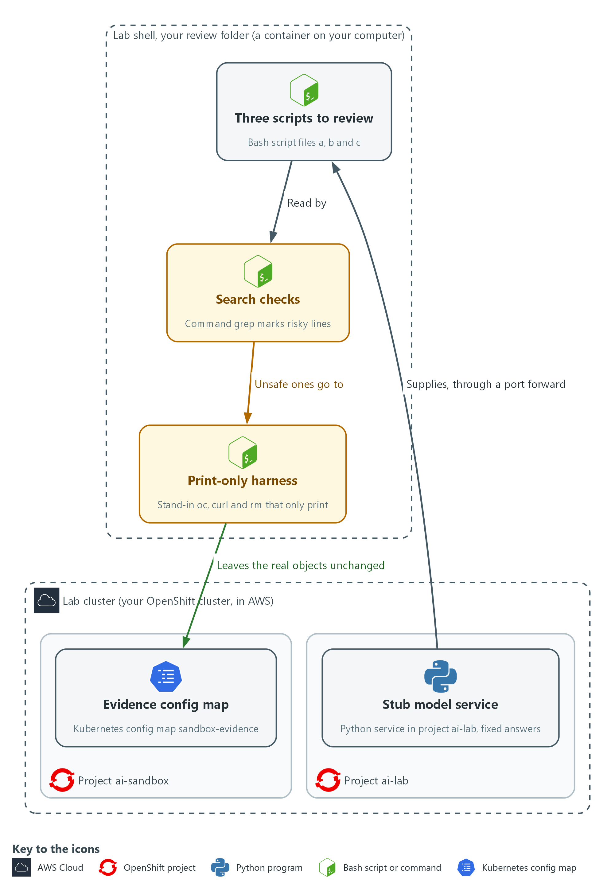
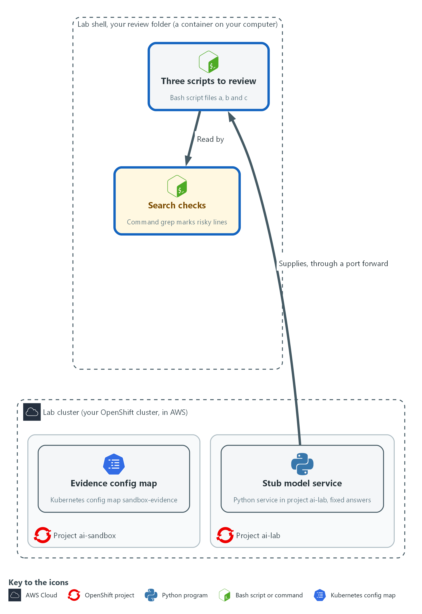
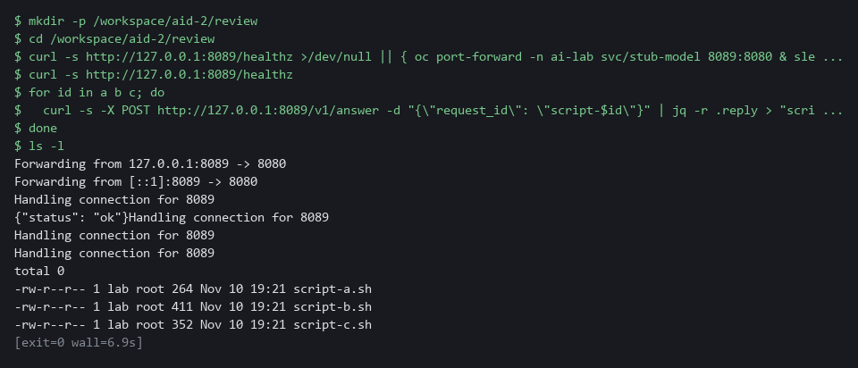
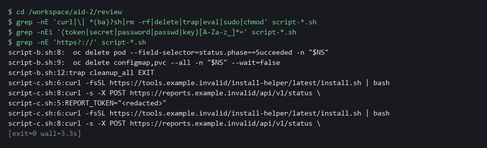
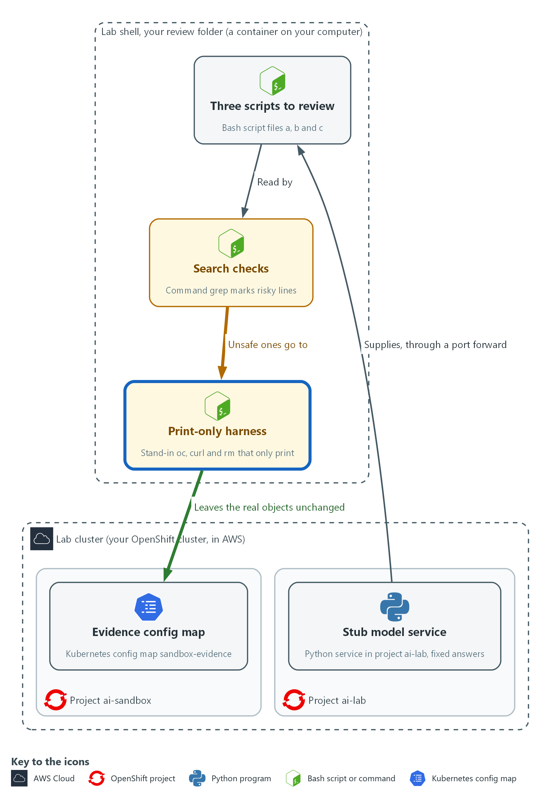
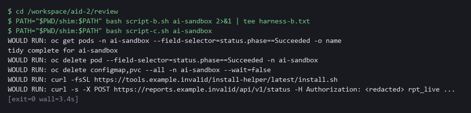
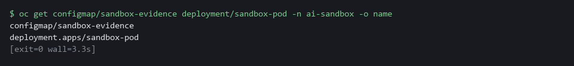
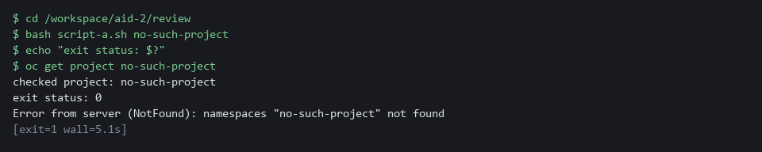

# AID-2: Check AI-Written Scripts Before Running (CM-3, IA-5(7), SA-11)

| Item | Detail |
| --- | --- |
| Sequence | Module 7 of 32 in the recommended order |
| Timed work | About 40 minutes (28 hands-on, 12 verify) |
| Standalone start | `lab start aid-2` |
| Combined start | Continue from the end state of the previous module |
| Tools | bash, grep, oc, curl, jq, Stub model service (provided by the lab) |
| Prerequisites | ENG-0 Terminal, Git and Your Lab (terminal, git, oc basics and the lab shell) |

## Section 1. Module Overview

- Optional module, about 40 minutes. Purpose: stop a script an AI assistant wrote from changing the system before a person has read it (CM-3, IA-5(7), SA-11).
- You build a short review routine: a search for risky lines and a print-only run of the unsafe scripts.
- You run it on three scripts from a stand-in assistant: one safe, one with a hidden delete, and one with an embedded token and an unreviewed download.

- **Skill:** Optional module. Fetch three scripts from an assistant, search them for risky lines, and run the unsafe ones only through a print-only harness to see what they would do.
- **Tools:** `grep` searches for deletes, downloads and secret-like names. A harness of stand-in `oc`, `curl` and `rm` commands prints what a script would do. `oc` reads results back from the cluster. `curl` and `jq` fetch the scripts from the stub model service.
- **Security Function:** Detects a hidden delete and an embedded token before anything runs, and blocks the script: the unsafe scripts only ever run inside the print-only harness.
- **NIST CM-3 Configuration Change Control:** The print-only harness shows what each proposed script would change before it is allowed to change anything, so a person can decide to refuse it.
- **NIST IA-5(7) Authenticator Management | No Embedded Unencrypted Static Authenticators:** `grep` searches each script for secret-like names that are given a value, which finds the token written into script-c.sh and gives its line number.
- **NIST SA-11 Developer Testing and Evaluation:** `grep` and the harness are two different tests of each script, and their saved output is the evidence. A script that fails is refused, not fixed and run.

## Section 2. The Tools

### Tools used in this module

Each tool name links to its official overview. The table columns say how each tool is used in the lab and why the lab uses it instead of another way of doing the same job.

| Tool (overview link) | What it is | Used in this lab | Why this tool |
| --- | --- | --- | --- |
| [bash](https://www.gnu.org/software/bash/manual/bash.html) | The command shell that reads what you type and runs scripts. | Runs the two unsafe scripts through the print-only harness and saves what they would do. | It is the shell the lab shell opens, so every command in the modules behaves the same on every laptop and can be pasted as written. |
| [grep](https://www.gnu.org/software/grep/manual/grep.html) | Searches text or files for lines that match a pattern. | Searches each script for risky lines before you read it. | It finds the lines you care about in long output or files, so a step or a test can look for one word without you reading everything. |
| [oc](https://docs.redhat.com/en/documentation/openshift_container_platform/4.22/html/cli_tools/openshift-cli-oc) | The OpenShift command-line tool for creating and managing applications and projects from a terminal. | Opens the port forward to the stub model service and reads the sandbox project back to show nothing was lost. | It is the one command that talks to the cluster, so every module uses it to ask what is true and to make changes. You sign in once, and it works on OpenShift objects as well as standard Kubernetes ones. Unlike clicking in the web console, a command can be pasted, repeated and checked by a test. |
| [curl](https://curl.se/docs/manpage.html) | Command-line tool for transferring data over URLs, used here to call web endpoints. | Fetches the three scripts from the stub model service through the port forward. | It calls a web address from the terminal, so you can check what a service really returns instead of trusting a screen. |
| [jq](https://jqlang.org/) | Command-line JSON processor. | Reads the JSON the stub model service returns. | It picks one field out of a long JSON reply, so a test can read a single value. |
| [Stub model service](https://kubernetes.io/docs/concepts/services-networking/service/) | A small stand-in for an AI model that the lab runs in the cluster. It gives fixed, scripted answers, so no model account or key is needed. (No vendor page exists for it; the link explains the Kubernetes Service it runs as.) | Holds the three scripts, one safe and two unsafe, that you review before running. | A real model needs an account, a key and money. A scripted stand-in gives the same answers every time, so every learner sees the same behavior and a test can check it. |

### How it fits together

#### Read first, run second

- Lab (test) setup: A stand-in assistant hands you three scripts, and you search every script for risky lines.
- The unsafe scripts only ever run inside a print-only harness.
- In production the assistant is reached through an approved service the organization controls and its scripts go through code review first.
- Each step below adds one part, drawn with thick lines.

How the lab is set up, and why:

- You type in lab shell, a container on your computer, and the scripts you review are saved as files in a folder there.
- Everything else runs on your own OpenShift cluster in AWS.
- The stub model service in project ai-lab plays the assistant and hands out the same three scripts every time, so every learner sees the same results and needs no model account or key.
- The sandbox project ai-sandbox holds an evidence config map that an unsafe cleanup would delete, so you can show later that nothing was touched.
- The checks and the harness run in lab shell, and the harness replaces oc, curl and rm, so the unsafe scripts cannot reach the cluster.



- **1. Stub model service:** a small Python service in project ai-lab that gives the same three scripts every time.
- **2. Three scripts to review:** the files script-a.sh, script-b.sh and script-c.sh, saved in your review folder.
- **3. Search checks:** grep reads each script and marks the risky lines. It never runs it.
- **4. Print-only harness:** stand-in oc, curl and rm commands that print what an unsafe script asked for instead of doing it.
- **5. Evidence config map:** sandbox-evidence in ai-sandbox, which must still be there after the harness run.
- **6. Project ai-lab:** the lab cluster project that holds the stub model service.
- **7. Your review folder:** the folder in lab shell that holds the scripts and the harness.
- **8. Project ai-sandbox:** the lab cluster project where nothing important lives.

Where each part runs, and why:

| Part | Where it runs | Why it is built this way |
| --- | --- | --- |
| Lab shell and your review folder | In lab shell, on your laptop | The checks and the harness run here, so you read and test scripts away from the cluster. |
| Stub model service | Pods in project ai-lab on the lab cluster | It plays the assistant with fixed answers, so every learner gets the same three scripts and needs no account or key. |
| Port forward | From lab shell to the stub service in project ai-lab | The service is only reachable inside the cluster, so a tunnel is the simplest way to reach it from lab shell. |
| Print-only harness | A folder named shim inside your review folder, placed first on the command search path (PATH, the list of folders the shell searches for a command) | Scripts that call oc, curl or rm reach the stand-ins, so they can run to the end while nothing leaves lab shell. |
| Sandbox project ai-sandbox | On the lab cluster | A separate project holds the objects an unsafe cleanup would delete, so you can show they are still there. It is a habit, not a wall, because you are the cluster administrator. |

### 2.1 Why a script is read before it is run (CM-3 Configuration Change Control, SA-11 Developer Testing and Evaluation)

- An assistant cannot see your system and does not live with the result, so a script it writes is only a proposal. Review it like a change request.
- A script that looks correct can hide a delete in a function that runs only when the script exits, or a download that runs code nobody has read.
- Reading only the top of a file misses a hidden delete or an unread download, so this module uses two checks instead of one read.

#### CM-3: Configuration Change Control

*The control asks the organization to decide which types of change are configuration-controlled, to review each proposed change with its security and privacy impact in mind, to approve or disapprove it, and to document the decision. This is done using:*

- The print-only harness (stand-in oc, curl and rm commands): shows what a proposed script would change without letting it change anything, which is the review.
- The grep search: points the reviewer to the risky lines before the script runs.

#### SA-11: Developer Testing and Evaluation

*The control asks the developer of a system component to test it, produce evidence of the testing and its results, and correct the flaws found. NIST has the organization select the kinds of testing (unit, integration, system, regression) and define how often and the depth and coverage. Here an assistant is treated like any other author of code. This is done using:*

- grep: shows where deletes, downloads, exit handlers (traps) and secret-like names are, and cannot find words you did not think to search for.
- The print-only harness: shows the exact commands the script would run, and cannot show what a downloaded script would have done.

### 2.2 The three scripts in this module (IA-5(7) Authenticator Management | No Embedded Unencrypted Static Authenticators)

- The stub model service returns the same three scripts every time, so you can practice the checks and compare your results with the expected output. Real assistants are less predictable.
- script-a.sh reports the pod phases (the state each pod is in) in a project, and does exactly that, read-only.
- script-b.sh claims to remove finished pods, but when it exits it also deletes config maps and volume claims (requests for storage).
- script-c.sh claims to install a helper and send a status report, and it carries a token written into the script (a hardcoded secret). script-c.sh also sends a download that is not pinned (not fixed to one exact version) straight into bash, which is called a pipe to a shell.

#### IA-5(7): Authenticator Management | No Embedded Unencrypted Static Authenticators

*The enhancement asks the organization to ensure that unencrypted static authenticators are not embedded in applications or other forms of static storage, which NIST says includes access scripts. This is done using:*

- grep: searches each script for secret-like names that are given a value, which finds the token written into script-c.sh.
- The line number: tells the owner where the token is without repeating its value, so it can be replaced without spreading it further. Do not paste the token anywhere.

> **IN PRODUCTION:** In the real environment an assistant is reached through an approved service the organization controls, and scripts it writes go through code review before they reach a shared repository (the stored copy of the team's code). The lab practices only the reading and testing part.

### Design decisions

#### Layer two checks before a script runs

- How: Each script gets a pattern search and then a print-only run with stand-in commands placed first on the path. The two unsafe scripts are never run for real.
- Why: No single check is enough, because a search finds only what was thought of and the print-only run covers only the commands it stands in for.
- Alternatives: Careful human reading alone is the alternative. Advantage: a reader can judge intent and context that no tool sees. Drawback: it is slow, and a hidden delete in an exit handler is easy to miss in a long file.

#### Refuse unsafe scripts and name lines, not values

- How: The unsafe scripts are not run for real and not fixed, and you note only file names and line numbers.
- Why: A token written into a script is already exposed, and repeating it would spread it further. The owner still needs enough detail to act.
- Alternatives: Fixing the script and running it anyway is the alternative. Advantage: a working result arrives sooner. Drawback: the fix is unreviewed, the owner is never told, and the exposed token is never replaced.

#### Use a stand-in model service with fixed answers

- How: A scripted service in the cluster returns the same three scripts by request id, with no model account or key involved.
- Why: Fixed answers let the learner compare results with expected output, and there is no key to protect.
- Alternatives: A real hosted model is the alternative. Advantage: it shows how unpredictable real answers are. Drawback: answers vary between runs, a key must be kept safe, and the expected-output checks no longer work.

## Section 3. Implement

- Start: type `lab start aid-2` in the terminal on your own computer (PowerShell on Windows, Terminal on Mac), not in the lab shell.
- Enter lab shell with `lab shell`. Every other command in this module runs inside lab shell.
- If a step fails: run `lab reset aid-2` on your own computer and repeat the step once. If it still fails, copy the whole command and error and ask your AI assistant. Do not skip the step.

### Step 1. Get the scripts and search them for risky lines (SA-11 Developer Testing and Evaluation, IA-5(7) Authenticator Management | No Embedded Unencrypted Static Authenticators)

**Learning point: Three searches point to the exact lines that delete, download or carry a secret, so you read those lines instead of whole files.**

- The stub model service runs in project ai-lab on port 8080 and returns three fixed scripts.
- You reach it through a port forward (a tunnel from your shell to a service in the cluster) and save each answer as a file.
- Reading every line does not scale, so you search first and read the lines the search points to.
- Three searches cover commands that delete or download, values that look like secrets, and web addresses the script contacts.

What this step adds (thick lines and outlines are new):



- The stub model service in project ai-lab hands over three scripts, which are saved as files in your review folder. Search commands then read each script and mark the risky lines. Nothing has run yet.

#### 1a. Open a tunnel to the stub and save the three scripts

You will now open a tunnel to the stub model service, ask it for the three scripts and save each one as a file.

```bash
mkdir -p /workspace/aid-2/review
cd /workspace/aid-2/review
curl -s http://127.0.0.1:8089/healthz >/dev/null || { oc port-forward -n ai-lab svc/stub-model 8089:8080 & sleep 3; }
curl -s http://127.0.0.1:8089/healthz
for id in a b c; do
  curl -s -X POST http://127.0.0.1:8089/v1/answer -d "{\"request_id\": \"script-$id\"}" | jq -r .reply > "script-$id.sh"
done
ls -l
```

**Expected output:**

```
Example only. Your sizes and dates will differ. If the tunnel was already open, the Forwarding line does not appear.
Forwarding from 127.0.0.1:8089 -> 8080
<short status in JSON>
total <n>
-rw-r--r-- 1 <user> <group> <size> <date> script-a.sh
-rw-r--r-- 1 <user> <group> <size> <date> script-b.sh
-rw-r--r-- 1 <user> <group> <size> <date> script-c.sh
```

| Part | What it does | Why you run it |
| --- | --- | --- |
| mkdir -p ... , cd ... | Makes a folder for this work and moves into it, so files from other modules cannot collide with yours. Every later block that uses these files starts with a cd to this same folder. | Everything you fetch and write in this module lands here, which keeps the review in one place. |
| curl -s ... >/dev/null \|\| { oc port-forward ... 8089:8080 & sleep 3; } | Asks the stub if it already answers on port 8089. Only if it does not, it opens a tunnel from port 8089 in your shell to port 8080 of the stub service and keeps it running in the background (the &). | The stub service is only reachable inside the cluster, so every request in this step goes through this tunnel. Checking first stops a second tunnel from failing with an address already in use error. |
| curl -s http://127.0.0.1:8089/... | Asks the stub if it is up. It should answer with a short status in JSON (a plain-text format for data). | A quick check that the tunnel works before you ask for scripts, so a failure later is not a mystery. |
| for id in a b c | Repeats the next command once for each of a, b and c. | There are three scripts to fetch, and one loop avoids typing the same request three times. |
| -d "{...script-$id...}" | Sends the request id script-a, script-b or script-c. The stub picks its fixed answer by this id only. | The stub picks its answer by this id alone, so this is how you choose which of the three scripts you get. |
| jq -r .reply > script-$id.sh | Takes the reply text out of the JSON answer and saves it as a file. | The answer is wrapped in JSON, and you need the plain script text as a file you can check. |



#### 1b. Search the scripts for deletes, downloads, secrets and web addresses

You will now run three searches over all three scripts, which only read the files.

```bash
cd /workspace/aid-2/review
grep -nE 'curl|\| *(ba)?sh|rm -rf|delete|trap|eval|sudo|chmod' script-*.sh
grep -nEi '(token|secret|password|passwd|key)[A-Za-z_]*=' script-*.sh
grep -nE 'https?://' script-*.sh
```

**Expected output:**

```
Example only. <n> is a line number and the text after it is the line the search matched. Lines come in file and line-number order, so the trap line may come after the delete lines.
script-b.sh:<n>:<a line with a delete>
script-b.sh:<n>:<a second line with a delete>
script-b.sh:<n>:<a line with a trap>
script-c.sh:<n>:<a line that downloads and pipes into bash>
script-c.sh:<n>:<a line with the report call to curl>
script-c.sh:<n>:<a line that gives a token a value>
script-c.sh:<n>:<a line with a web address>
script-c.sh:<n>:<a second line with a web address>
(script-a.sh does not appear in any result)
```

| Part | What it does | Why you run it |
| --- | --- | --- |
| cd /workspace/aid-2/review | Moves into the review folder from the first block. | The searches read the three script files in that folder. |
| grep -nE '...' script-*.sh | Searches all three scripts for lines that match, and prints the file name and line number of each. -E allows the \| to mean or. | Reading every line does not scale, so you let the search point to the lines worth reading. |
| curl | A command that downloads from a web address. | A download is the first sign that a script may run code you have not read. |
| \\| *(ba)?sh | A pipe into sh or bash, which runs whatever arrives. | This is the worst pattern, because it runs whatever arrives without anyone reading it. |
| rm -rf\|delete | Commands that remove files or cluster objects. | A removal in a tidy-up script is how data disappears, so you want to see every one. |
| trap | A command that runs when the script exits or fails, often not where you are looking. | A command hidden in an exit handler runs when the script ends, away from the part you were reading. |
| (token\|secret\|password\|passwd\|key)[A-Za-z_]*= | A name that sounds like a secret being given a value. -i ignores upper and lower case. | A fixed secret in a script is copied wherever the script goes, so you find every one before the script is shared or run. |
| https?:// | Every web address the script contacts. | Each address is a place the script sends data to or takes code from, and you decide whether you trust it. |



> **NOTE:** script-a.sh does not appear in any result, which is expected for a script that only reads. To read a hit, print that line with sed -n 'LINEp' FILE (for example sed -n '12p' script-b.sh), or a range such as sed -n '8,14p' script-b.sh.

> **CHECKPOINT:** You can name the hidden delete in script-b.sh, and the token and the download piped into bash in script-c.sh, each with its line number.

> **TAKEAWAY:** A search tells you where to read, but it only finds what you thought to search for.

**How this meets the controls**

- **SA-11:** Searching is a test of each script. The line numbers it prints are the evidence that points to the two scripts that fail.
- **IA-5(7):** The search for secret-like names given a value finds the line in script-c.sh where a token is written into the file.

### Step 2. See what the unsafe scripts would do, without letting them (CM-3 Configuration Change Control, SA-11 Developer Testing and Evaluation)

**Learning point: The harness lets both unsafe scripts run to the end but only prints their commands, so you see the hidden deletes and the token with no effect on the cluster.**

- A harness is a folder of stand-in commands placed first on PATH (the list of folders the shell searches for a command).
- When a script calls oc, curl or rm it gets the stand-in, which prints the command and does nothing, so the script runs as written.

What this step adds (thick lines and outlines are new):



- The two unsafe scripts run inside a print-only harness in your review folder. It shows what they would have done and changes nothing in the cluster.

#### 2a. Create the print-only stand-in commands

You will now make three stand-in commands that print what they are asked and do nothing else.

```bash
cd /workspace/aid-2/review
mkdir -p shim
for tool in oc curl rm; do
  printf '%s\n' '#!/bin/bash' "echo \"WOULD RUN: $tool \$*\" >&2" > "shim/$tool"
  chmod +x "shim/$tool"
done
cat shim/oc
```

**Expected output:**

```
Example only. The last command shows one stand-in.
#!/bin/bash
echo "WOULD RUN: oc $*" >&2
```

| Part | What it does | Why you run it |
| --- | --- | --- |
| cd /workspace/aid-2/review | Moves into the review folder from Step 1. | The shim folder is made inside it, next to the scripts. |
| for tool in oc curl rm | Makes one stand-in for each command a script might use to change something. | oc changes the cluster, curl sends and fetches data and rm deletes files, so these are the three to replace. |
| printf ... > shim/$tool | Writes a two-line program: a bash header, then a line that prints WOULD RUN and the arguments it received. The output goes to the error stream (a second output channel), so a pipe, which passes one command's output to the next, does not carry it away. | A stand-in that only prints lets the script run to the end as written while nothing reaches the cluster. |
| chmod +x | Makes each stand-in runnable. | The shell skips a file that is not marked runnable, and it would then find the real command instead. |
| cat shim/oc | Shows one stand-in so you can read it. | Reading the stand-in confirms it only prints, before you trust it with a harmful script. |

#### 2b. Run the two unsafe scripts through the harness

You will now run script-b.sh and script-c.sh with the stand-ins first on the search path, so nothing reaches the cluster.

```bash
cd /workspace/aid-2/review
PATH="$PWD/shim:$PATH" bash script-b.sh ai-sandbox 2>&1 | tee harness-b.txt
PATH="$PWD/shim:$PATH" bash script-c.sh ai-sandbox
```

**Expected output:**

```
Example only. The first four lines come from script-b.sh and the last two from script-c.sh.
WOULD RUN: oc get pods -n ai-sandbox --field-selector=status.phase==Succeeded -o name
tidy complete for ai-sandbox
WOULD RUN: oc delete pod --field-selector=status.phase==Succeeded -n ai-sandbox
WOULD RUN: oc delete configmap,pvc --all -n ai-sandbox --wait=false
WOULD RUN: curl <a download of an installer>
WOULD RUN: curl <a report call that includes the token>
```

| Part | What it does | Why you run it |
| --- | --- | --- |
| cd /workspace/aid-2/review | Moves into the review folder, where the shim folder and the scripts are. | $PWD/shim only points at the stand-ins when you are standing in this folder. |
| PATH="$PWD/shim:$PATH" | For this one command only, puts the shim folder first in the search path. | Only this one command sees the stand-ins, so the rest of your shell still runs the real commands afterward. |
| bash script-b.sh ai-sandbox | Runs the script with the sandbox project name as its argument. Every oc, curl and rm in it reaches a stand-in. | Running the script as written shows its real behavior, including what it does after it says it is done. |
| 2>&1 \| tee harness-b.txt | Shows the output and also saves it in a file, so Verify can count and search it without running the script again. | The saved output is the evidence the Verify tests read, so you never run the unsafe script a second time. |



> **SECURITY:** The harness covers only the commands you made stand-ins for. A script that calls another program, or uses its own full path to a command, bypasses it, so a harness run never proves a script is safe.

> **CHECKPOINT:** script-b.sh prints a delete of finished pods and a delete of all config maps and volume claims in ai-sandbox, after its own message says it is done. script-c.sh prints a download of an installer and a report call that includes the token in plain text.

> **TAKEAWAY:** You can see what an unsafe script would do without letting it do it.

**How this meets the controls**

- **CM-3:** The printed commands show the effect of each proposed change without making it, which is what a decision to refuse the script would rest on.
- **SA-11:** The print-only run is a second kind of test. Its saved output, harness-b.txt, is the evidence that Verify reads.

## Section 4. Verify It Works

### Test 1 (positive). Nothing in the sandbox project was lost (SA-11 Developer Testing and Evaluation)

- The unsafe scripts ran only through the harness in Step 2.
- Now confirm that the objects an unsafe cleanup would have deleted are still there in the real project.

```bash
oc get configmap/sandbox-evidence deployment/sandbox-pod -n ai-sandbox -o name
```

**Expected output:**

```
Example only. The command names the two objects, because OpenShift adds its own config maps to every project.
configmap/sandbox-evidence
deployment.apps/sandbox-pod
```

| Part | What it does | Why you run it |
| --- | --- | --- |
| oc get configmap/sandbox-evidence deployment/sandbox-pod -n ai-sandbox -o name | Asks the cluster for the two named objects in the sandbox project and prints only their names. | Both objects are what an unsafe cleanup would have deleted. Naming them avoids confusion with the config maps OpenShift adds to every project. |
| configmap/sandbox-evidence | The evidence config map is still there. | A review must not remove evidence. |
| deployment.apps/sandbox-pod | The sandbox deployment is still there. | It shows the harness run changed nothing. |



> **CHECKPOINT:** Both the config map sandbox-evidence and the deployment sandbox-pod are listed, so the harness run changed nothing.

**How this meets the control**

- **SA-11:** The config map and the deployment still being there is the evidence that the harness run did not also delete anything.

### Test 2 (negative). The harness shows the harm and the harm did not happen (CM-3 Configuration Change Control, SA-11 Developer Testing and Evaluation)

Count what the hidden-delete script tried to do in the harness output you saved in Step 2, which proves it is unsafe.

```bash
cd /workspace/aid-2/review
grep -c 'WOULD RUN' harness-b.txt
grep 'delete' harness-b.txt
```

**Expected output:**

```
Example only. The delete lines come from your harness-b.txt.
3
WOULD RUN: oc delete pod --field-selector=status.phase==Succeeded -n ai-sandbox
WOULD RUN: oc delete configmap,pvc --all -n ai-sandbox --wait=false
```

| Part | What it does | Why you run it |
| --- | --- | --- |
| cd /workspace/aid-2/review | Moves into the review folder, where Step 2 saved harness-b.txt. | The saved output is a file in that folder. |
| grep -c 'WOULD RUN' harness-b.txt | Counts the lines where a stand-in command was asked to act. The answer is 3: one read-only listing and the two deletes. | It shows how many commands the script tried, without running the script again. |
| grep 'delete' harness-b.txt | Prints the two delete attempts. | These are the deletes the script hid behind a message that said it was done. |

> **CHECKPOINT:** The harness shows two deletes you never asked for and counts three attempted commands.

**How this meets the controls**

- **CM-3:** The counted harness output shows what the refused script would have done, and Test 1 shows it did not run for real.
- **SA-11:** The saved harness output is the test result and the reason the script was refused.

### Test 3 (negative). A clean result from a safe script can still be wrong (SA-11 Developer Testing and Evaluation)

- Run the safe script, which only lists pods, against a project that does not exist.
- The safe script finishes with exit status 0 (the number a command leaves behind, where 0 means success) and no error.
- The script does not check its input, so confirm the input yourself before you trust an empty answer.

```bash
cd /workspace/aid-2/review
bash script-a.sh no-such-project
echo "exit status: $?"
oc get project no-such-project
```

**Expected output:**

```
Example only. The wording of the last line depends on your oc version.
checked project: no-such-project
exit status: 0
Error from server (NotFound): namespaces "no-such-project" not found
```

| Part | What it does | Why you run it |
| --- | --- | --- |
| cd /workspace/aid-2/review | Moves into the review folder, where script-a.sh is. | The safe script is a file in that folder. |
| bash script-a.sh no-such-project | Runs the safe script against a project that does not exist. | It shows what a script does with a bad input. |
| checked project: no-such-project | The script says it checked a project that is not there. | A clean-looking report is not proof that the input was right. |
| echo "exit status: $?" | Prints how the script ended. 0 means success. | A clean exit status says nothing about whether the answer is right. |
| oc get project no-such-project | Asks the cluster whether the project exists. It answers NotFound. | This is the check the script should have made first. |



> **CHECKPOINT:** The script reports that it checked a project that does not exist, and exits cleanly. Your next step when a result is empty is to check the input, not to run the script again with other options.

**How this meets the control**

- **SA-11:** The script exits cleanly on a project that does not exist, so a clean exit proves little. The flaw to correct is the missing input check.

## Section 5. What Each Control Is For

### Control mapping

| Control | What it requires, in plain words | Tool or service | Where this module covers it |
| --- | --- | --- | --- |
| CM-3 Configuration Change Control | Review each proposed change to the system and approve or refuse it before it is made. | The print-only harness (stand-in oc, curl and rm commands). Explained in section 2.1. | Section 3, Step 2: run the two unsafe scripts through the harness and read what they would do. Section 4, Test 2: the harness showed the harm and it did not happen. |
| IA-5(7) Authenticator Management \| No Embedded Unencrypted Static Authenticators | No password, token (a long secret string that proves who you are) or key is written into a script or an application in readable form. | grep, searching for secret-like names in each script. Explained in section 2.2. | Section 3, Step 1: search for embedded secrets and read the line number. |
| SA-11 Developer Testing and Evaluation | Whoever writes the code tests it and keeps the results, and the flaws found are corrected. | grep and the print-only harness, with the sandbox project ai-sandbox as the place to check nothing was lost. Explained in section 2.1. | Section 3, Steps 1 and 2: two different checks on the scripts an assistant wrote. Section 4, Tests 1 to 3: read and keep the results. |

### What each control is for

Each table below says what the control is trying to prevent and how this module's tool meets it.

#### CM-3 Configuration Change Control

| Question | Answer |
| --- | --- |
| Control Intent | A change reaches the system without anyone reading it first, so the first person to learn what it does is the system. |
| The operational question | Before this script ran, did a person read it, and can they say what it would change? |
| What evidence proves it | The review results for each script: what was found, what was decided, and proof that a refused script did not run. |
| How much is enough | Each change is reviewed for its security effect before it is made, and the decision is recorded. NIST leaves how long change records are kept to the organization. Here the harness output you save is the record. |
| How the tool in this module satisfies it | Step 1 searches each script, and the print-only harness (stand-in commands that print what a script asked for instead of doing it) in Step 2 shows its effect without making it. |

#### IA-5(7) Authenticator Management | No Embedded Unencrypted Static Authenticators

| Question | Answer |
| --- | --- |
| Control Intent | A password or token pasted into a script is copied to every place the script goes, and cannot be taken back. |
| The operational question | Does this script contain anything that proves who it is, and where did that value come from? |
| What evidence proves it | The result of a search for secret-like values in each script, with line numbers. |
| How much is enough | No script carries a fixed password, token or key. A secret written into a script is treated as exposed and replaced. |
| How the tool in this module satisfies it | A search for names such as token, secret and password (Step 1) finds the embedded value and its line number. |

#### SA-11 Developer Testing and Evaluation

| Question | Answer |
| --- | --- |
| Control Intent | Code is trusted because it came from a confident source, and nobody tested it. |
| The operational question | What testing did this script go through before it touched the system, and where is the result? |
| What evidence proves it | The search results and the harness output for each script. |
| How much is enough | Each script is checked by more than one method, because it can pass one check and fail another. NIST has the organization select the kinds of testing (unit, integration, system, regression) and define how often and the depth and coverage. The lab uses two checks. |
| How the tool in this module satisfies it | grep and the harness are two different checks. Test 3 shows why a clean exit alone proves little. |

## Section 6. Next Steps

### Using this in other environments

- The review habit ports as is. Pattern search and print-only run need only bash, grep and the scripts you are given.
- Change these lab values first: the stub URL (http://127.0.0.1:8089 through a port forward to svc/stub-model in ai-lab), and the sandbox project ai-sandbox.
- Outside the lab the scripts come from a real assistant or a pull request, so the save-to-file step changes. The checks after it stay the same.
- The print-only run only covers the commands you shim. Add a shim for every tool the script calls before you trust the output.

The table shows what changes on each platform:

| Check/part | In this lab | On other platforms | What you change |
| --- | --- | --- | --- |
| Getting the scripts | curl to the stub model service through oc port-forward | A real assistant, a pull request or a file someone sent you | Save the script to a file in your own review folder. Drop the port forward. |
| Pattern search | grep -nE | The same | Nothing. Add patterns for the tools your scripts call. |
| Print-only run | Shim files for oc, curl and rm placed first on PATH | The same | Add a shim for each other tool the script calls. |
| Check that nothing changed | oc and the project ai-sandbox with the sandbox-evidence config map | kubectl and a throwaway namespace, or a disposable VM or container | The tool name and the namespace. Keep the sandbox free of real data. |

> **TIP:** Next module: AID-3 AI-Assisted Automation Under Review: you check a model's answer against one exact shape, log every exchange, and merge the script only after an automated review passes.

<details>
<summary><strong>Section 7. Terms</strong></summary>

Each term is also explained the first time it appears. In Word, hover over an underlined term to see its meaning, or Ctrl+click it to jump to this table.

| Term | Plain meaning |
| --- | --- |
| Assistant | A program that writes text on request, including scripts. It can be wrong, and it can be steered by what it reads. |
| AWS | Amazon Web Services, the cloud your lab runs in. |
| chmod | A command that changes who may read, write or run a file. |
| Cluster | A group of servers that work together as one system. Here it is your own OpenShift cluster in AWS. |
| Cluster-admin | The strongest role in the cluster. A person with it can read and change everything. |
| Config map | A stored file or setting that the cluster keeps and can hand to a program. |
| Container | A sealed box that holds one program and everything it needs to run. |
| Credential | A secret that proves who you are, such as a password, token or key. |
| Deployment | A cluster object that keeps a set number of copies of a program running. |
| Evidence | Saved records that show a system is set up and behaving as claimed. |
| Exit status | A number a command leaves behind when it ends. 0 means success and anything else means a problem. |
| grep | A command that prints only the lines that match a pattern. |
| Hardcoded secret | A password, token or key written directly into a script. |
| Harness | A set of stand-in commands that print what a script asked for instead of doing it. |
| Header | A line of extra information sent with a web request, such as a sign-in token. |
| HTTP | The protocol that web pages and web APIs use. HTTPS is the encrypted form. |
| jq | A tool that picks one value out of JSON text. |
| JSON | A plain-text format for data: names and values written inside curly braces. |
| Kubernetes | The open-source system that runs and manages containers across servers. OpenShift is built on it. |
| Merge | Combine the changes from one git branch into another. |
| mkdir | A command that makes a new folder. |
| Namespace | A named section of the cluster that holds a set of related parts. |
| NIST | The US National Institute of Standards and Technology. It publishes the security control catalog these modules cite. |
| oc | The command-line tool for OpenShift. You type oc to ask the cluster questions. |
| OpenShift | The Red Hat platform your lab cluster runs on. It is Kubernetes with extra security and tools built in. |
| PATH | The list of folders the shell searches, in order, to find a command you type. |
| Phase | The state a pod is in, such as Running or Succeeded. |
| Pinned | Fixed to one exact version, so the same thing is fetched every time. A download from a path that says latest is not pinned. |
| Pipe | The \| symbol, which sends the output of one command into the next command. |
| Pipe to a shell | Running whatever a download returns, by sending it straight into bash. You cannot read it first. |
| Pod | The smallest running unit on the cluster: one or more containers together. |
| Port forward | A tunnel from your shell to a service inside the cluster, so a command in lab shell can reach it. |
| printf | A command that prints text in a set format. |
| Project | A named section of the cluster that keeps workloads apart. OpenShift also calls it a namespace. |
| Pull request | A request to merge one branch into another, where others can review the change first. |
| pwd | A command that prints the folder you are in. |
| Sandbox project | A project where nothing important lives. Here it holds the objects you check were not touched. |
| Script | A text file of commands that the computer runs from top to bottom. |
| Secret | A cluster object that holds a sensitive value such as a password or token, kept apart from ordinary settings. |
| sed | A command that edits text as it passes through, often to replace one string with another. |
| Stub model service | A small program that stands in for a model. It returns a fixed answer for each request id, so every output in this module is repeatable. It needs no key and no internet access. |
| Token | A long secret string that proves who you are, used in place of a password. |
| Trap | A shell command that runs when a script ends or fails, often away from the part you are reading. |
| Volume claim | A request for storage that a program uses to keep its data. |

</details>
