# AID-3: AI-Assisted Automation Under Review (SI-10, AU-12, CM-3, SA-11)

| Item | Detail |
| --- | --- |
| Sequence | Module 14 of 29 in the recommended order |
| Timed work | About 72 minutes (50 hands-on, 22 verify) |
| Standalone start | `lab start aid-3` |
| Combined start | Continue from the end state of the previous module |
| Tools | Python (python3), git, Gitea (in-lab git server), OpenShift Pipelines (Tekton), Loki (free, open source), Stub model service (provided by the lab), oc, tkn, curl, jq |
| Prerequisites | ENG-0 Terminal, Git and Your Lab (git clone, commit and push, the lab shell, and reading oc output) |

## Section 1. Module Overview

- Purpose: show that a model reply is an input that must be checked, every exchange must be logged, and a script that calls a model is a controlled change.
- You build `shape.py` (the reply checker), the test that finds its flaw, `summarize.py` (the logging script), and `check_query.py` (the query checker).
- You run the script end to end, push it through the review gate, and test three LogQL drafts against eight known events.

- **Skill:** Build a summary script that validates the model reply shape, logs every exchange, and passes a review gate before merging, then check a drafted LogQL query against known events.
- **Tools:** `python3` sends findings to the stub model service and validates replies; `ailog.py` pushes records to Loki; OpenShift Pipelines (Tekton) runs the review gate `ai-script-review`; Gitea enforces branch protection; `scope.py` and `check_query.py` test drafted queries.
- **Security Function:** Detects invalid model output and blocks untested scripts. A shape check refuses replies that do not match the required fields, types and size limit. A review gate refuses a script that skips the check or logging. A query checker refuses a draft whose scope is too wide before it reaches the log store.
- **NIST SI-10 Information Input Validation:** `shape.py` accepts one exact reply shape (three fields, fixed types, severity from a short list, summary at most 300 characters) and raises an error for everything else; the checker refuses a drafted query whose selector or range is wider than the task needs.
- **NIST AU-12 Audit Record Generation:** `ailog.py` sends a record to Loki for every prompt, reply and rejection, with a request id that ties the three together.
- **NIST CM-3 Configuration Change Control:** The pipeline `ai-script-review` runs outside the repository it judges and records pass or fail as a commit status; the main branch merges only when that status is success.
- **NIST SA-11 Developer Testing and Evaluation:** `check_query.py` tests a drafted LogQL query against eight known sign-in events and reports whether the result matches the counts worked out before the query ran.

## Section 2. The Tools

### Tools used in this module

Each tool name links to its official overview. The table columns say how each tool is used in the lab and why the lab uses it instead of another way of doing the same job.

| Tool (overview link) | What it is | Used in this lab | Why this tool |
| --- | --- | --- | --- |
| [Python 3](https://docs.python.org/3/tutorial/introduction.html) | General-purpose language, used here for small helper scripts. | You write the shape check, its tests and summarize.py, which asks the model and logs every exchange. | Python reads and writes JSON easily and is already in the lab shell, so a small script needs nothing installed. |
| [Git](https://git-scm.com/about) | Version control that stores repository history. | You branch, commit and push your work, then open a pull request. | It keeps scripts and settings with a history, so every change has a record of who made it and when, and a mistake can be undone. |
| [Gitea](https://docs.gitea.com/) | A lightweight self-hosted git server. | Holds the repository and merges your pull request only when the commit status is success. | It gives the lab a git server of its own, so you can push and review changes without an outside account. |
| [OpenShift Pipelines (Tekton)](https://docs.redhat.com/en/documentation/openshift_container_platform/4.22/html/pipelines/index) | Kubernetes-native CI/CD built on Tekton. | Runs the review gate pipeline in project build that clones your branch and checks it. | It runs automated tasks inside the cluster, so you can see a check run with no person at the keyboard and under its own limited identity. A script run from a laptop could not show that. |
| [Grafana Loki](https://grafana.com/docs/loki/latest/) | Log storage that indexes only labels and keeps compressed log data in object storage. | Stores the log of every prompt and reply so you can search it. | It stores logs cheaply and is free and open source, so the lab can keep the logs that detections and investigations need without a paid logging product. |
| [Stub model service](https://kubernetes.io/docs/concepts/services-networking/service/) | A small stand-in for an AI model that the lab runs in the cluster. It gives fixed, scripted answers, so no model account or key is needed. (No vendor page exists for it; the link explains the Kubernetes Service it runs as.) | Returns the scan findings and the scripted replies, including bad ones your check must refuse. | A real model needs an account, a key and money. A scripted stand-in gives the same answers every time, so every learner sees the same behavior and a test can check it. |
| [oc](https://docs.redhat.com/en/documentation/openshift_container_platform/4.22/html/cli_tools/openshift-cli-oc) | The OpenShift command-line tool for creating and managing applications and projects from a terminal. | Opens a port forward to the model service and checks the pipeline. | It is the one command that talks to the cluster, so every module uses it to ask what is true and to make changes. You sign in once, and it works on OpenShift objects as well as standard Kubernetes ones. Unlike clicking in the web console, a command can be pasted, repeated and checked by a test. |
| [tkn](https://docs.redhat.com/en/documentation/openshift_container_platform/4.22/html/cli_tools/pipelines-cli-tkn) | Command-line tool for managing pipelines, runs and tasks. | Starts and follows the review gate run. | It starts and reads pipeline runs from the terminal, so the same shell you use for everything else drives the pipeline. The other way is the web console, which cannot be pasted into a step. |
| [curl](https://curl.se/docs/manpage.html) | Command-line tool for transferring data over URLs, used here to call web endpoints. | Calls the lab services' web interfaces to check results. | It calls a web address from the terminal, so you can check what a service really returns instead of trusting a screen. |
| [jq](https://jqlang.org/) | Command-line JSON processor. | Checks the model's JSON replies and reads the log records. | It picks one field out of a long JSON reply, so a test can read a single value. |

### How it fits together

#### A model answer is checked before it is used

- The diagram shows the lab (test) setup.
- The script runs from lab shell against a stub model service, with Loki for logs and Gitea for the merge gate.
- In production the pipeline posts the commit status itself, the branch protection rule is one that administrators cannot override, and Loki is replicated to protected storage.
- Each step below adds one part, drawn with thick lines.

How the lab is set up, and why:

- You work in lab shell on your laptop, in a working copy of a repository, as in ENG-0.
- This module adds four parts to your lab cluster (your own OpenShift cluster in AWS): a stand-in model service, Loki for logs, a review gate that runs as a pipeline, and a protected branch on Gitea, which accepts a change only through a pull request (a request to merge one branch into another) that passes its rules.
- The stand-in model service gives fixed answers, so the bad replies that your shape check (code that accepts one exact structure and refuses the rest) must refuse are the same for every learner and need no model account.
- Loki and Gitea already run in the lab cluster, so the logs and the merge rule live where a real team would keep them, outside your laptop.
- The review gate runs in its own project (a named section of the cluster) and is stored there, not in your repository, so the person who writes a script cannot weaken the check that judges it.
- Your script reaches the model and Loki over the network from lab shell, and Gitea decides about the merge using the status the gate left.
- In the last step the same stand-in model drafts search queries, and a checker you paste tests them against eight sign-in events whose answer is known before the query runs.

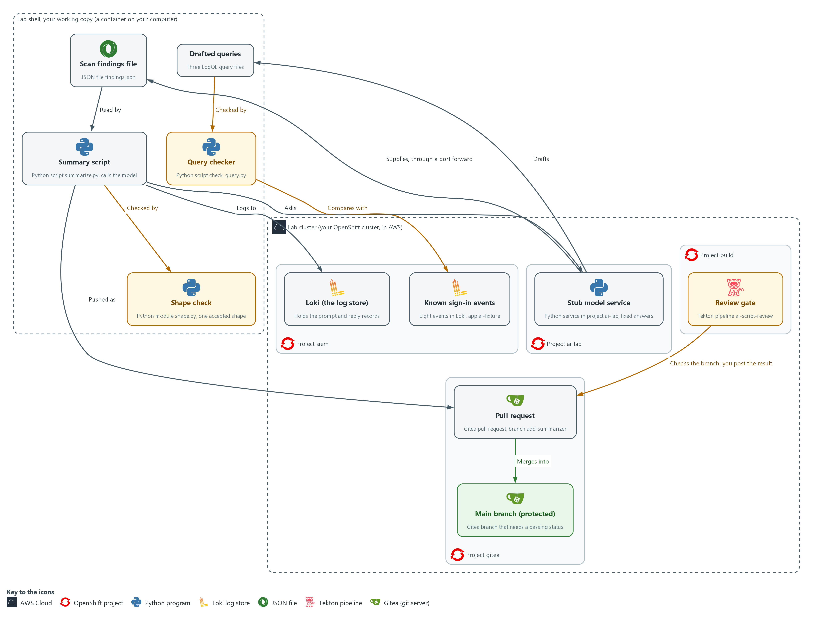

- **1. Stub model service:** a Python service in project ai-lab that gives fixed answers by request id.
- **2. Scan findings file:** findings.json in your working copy, fetched from the stub through a port forward.
- **3. Shape check:** shape.py, which accepts one exact reply shape and refuses everything else.
- **4. Summary script:** summarize.py, which sends the findings to the stub, passes the reply through the shape check and logs every exchange.
- **5. Loki:** the log store in project siem that receives every prompt, reply and rejection.
- **6. Review gate:** the Tekton pipeline ai-script-review in project build, which checks your pushed branch.
- **7. Pull request:** the Gitea request to merge the branch add-summarizer into main.
- **8. Main branch (protected):** merges only when the commit status from the gate is success.
- **9. Drafted queries:** three LogQL query files that the stub drafts.
- **10. Query checker:** check_query.py, which refuses a draft with the wrong scope and compares the others with the known events.
- **11. Known sign-in events:** eight events in Loki with the label app=ai-fixture, whose right counts you know before any query runs.

Where each part runs, and why:

| Part | Where it runs | Why it is built this way |
| --- | --- | --- |
| Working copy and tests | In lab shell, on your laptop | You review the shape check, write a test for it, and run the script where you also run git, so a failure shows up before anything is shared. |
| Stub model service | Pods in project ai-lab on the lab cluster | It returns fixed answers by request id, so the bad replies are the same for every learner and no account or key is needed. |
| Port forward | A tunnel from lab shell to the stub service in project ai-lab | The service is only reachable inside the cluster, so a tunnel is the simplest way to reach it from lab shell. |
| Loki | Inside the lab cluster, in project siem | The records live in one shared place that the script only writes to, so you can search them later by request id. |
| Repository ai-tools on Gitea | Inside the lab cluster, in project gitea | Your branch and the pull request live on the server, so the merge rule is enforced there and not on your laptop. |
| Review gate | A pipeline in project build, with its script stored in a config map there | The check is held outside the repository it judges, so the author of a script cannot weaken it in the same change. |
| Known sign-in events and query checker | Eight events in Loki with the label app=ai-fixture, and a checker in your working copy | A drafted query is believed only when it finds events whose count you knew before it ran. |

### 2.1 A model reply is an input (SI-10 Information Input Validation, AU-12 Audit Record Generation)

- A model reply is text from outside the script's own code, so the script checks it before using it, as it would any other input.
- The shape check limits what a reply can be, but it cannot show that the summary is true, so a person still reads the result.
- The stub model service can send six replies, and five of them are wrong in a different way, so each one tests a different part of the check.

#### SI-10: Information Input Validation

*The control asks the organization to check the validity of organization-defined information inputs to the system. NIST leaves the list of inputs to the organization, and the lab treats the model reply as one. This is done using:*

- shape.py: accepts one JSON object with three fields of fixed types, a severity from a short list and a summary of at most 300 characters, and raises an error for anything else.
- summarize.py: compares the count in the reply with the number of findings it sent, because a reply can have the right shape and a wrong count.

#### AU-12: Audit Record Generation

*The control asks the system to be able to generate audit records for the event types it can audit, to let organization-defined personnel or roles select which event types are logged, and to include the content that AU-3 defines. This is done using:*

- `ailog.py`: sends one record to Loki for each prompt, each reply and each rejection.
- The request id: ties the three records together, so a person can later search for what was asked, what came back and what the script decided.

The table lists each reply the stub can send, what is wrong with it and what the script does.

| Reply the stub can send | What is wrong | What the script does |
| --- | --- | --- |
| `summary-ok` | Nothing | Accepts and prints it |
| `summary-prose` | Friendly words around the JSON | Refuses: not pure JSON |
| `summary-extra` | An extra field that holds a command | Refuses: not exactly three fields |
| `summary-badseverity` | A value outside the allowed list | Refuses |
| `summary-wrongcount` | Right shape, but the count does not match what was sent | Refuses after cross-checking |
| `summary-long` | A summary over 300 characters | Refuses |

### 2.2 The review gate (CM-3 Configuration Change Control)

- The review gate is a script that runs on every proposed change and fails when the change is not acceptable.
- The gate compiles every Python file, searches for hardcoded secrets and risky calls, requires that the script logs the prompt and the reply and calls the shape check, and runs the unit tests.
- The gate is kept in a config map in project build, outside the repository it checks, because a gate inside the repository could be weakened in the same change it judges.

#### CM-3: Configuration Change Control

*The control asks the organization to determine which types of change are configuration-controlled, to review proposed changes and approve or disapprove them with security and privacy impact in mind, and to document the decision. NIST leaves the time that change records are kept to the organization. This is done using:*

- The pipeline ai-script-review: runs the gate on your branch, which is the review of the change.
- The commit status: records the gate's pass or fail against one exact commit, which is the documented decision.
- The protected main branch on Gitea: merges only when that status is success, so a change that failed review cannot be made.

> **IN PRODUCTION:** In the real environment the gate runs in the same pipeline that builds and signs images. A branch protection rule that administrators cannot override requires the status check. The lab account is an administrator, so in the lab you rely on the commit status, as Test 3 shows.

### 2.3 A query the model drafts is a proposal (SA-11 Developer Testing and Evaluation, SI-10 Information Input Validation)

- A drafted query is text from outside your code, so it is checked before it runs and tested before you rely on it.
- A query that finds nothing looks the same as a quiet system, so a wrong field value reads as all clear.
- A query that names every stream over a long range can load the log store, so the checker reads the query first and runs it on known data only if the scope is acceptable.

#### SA-11: Developer Testing and Evaluation

*The control asks the developer of a system component to test it, produce evidence of the testing and its results, and correct the flaws found. NIST has the organization select the kinds of testing (unit, integration, system, regression) and define how often and the depth and coverage. This is done using:*

- seed_fixture.py: pushes eight sign-in events whose right counts are worked out before any query runs.
- check_query.py: compares the result of each drafted query with those counts, prints the expected and actual values as evidence, and fails a draft that does not match so it can be corrected.

#### SI-10: Information Input Validation

*The control asks the organization to check the validity of organization-defined information inputs to the system. Here, a drafted query is an input to the log store. This is done using:*

- scope.py: refuses a draft whose selector is not exactly the one allowed or whose range is missing or longer than one hour, before any request reaches Loki.

The table lists each drafted query, what is wrong with it and what catches it.

| Draft | What is wrong | What catches it |
| --- | --- | --- |
| `draft-good` | Nothing | Passes the scope check and the known-data test |
| `draft-wrongfield` | Searches for a field value that does not exist, so it finds nothing | The known-data test: it should have found four failed sign-ins |
| `draft-wide` | Searches every app over a long range | The scope check, before the query runs |

### Design decisions

#### Accept one narrow reply shape and refuse everything else

- How: A function accepts exactly one JSON object with three named fields of fixed types, a severity from a short list and a size limit, and raises an error for anything else. The script then compares the count the model reports with the findings it sent.
- Why: A model reply is an input, so narrowing what it can be limits what planted text can do, although the shape never proves the summary is true.
- Alternatives: Repairing replies, for example by stripping prose around the JSON, is the alternative. Advantage: fewer failed runs. Drawback: every repair rule widens what injected text can pass, and silent fixing hides a model whose behavior has changed.

#### Hold the review gate outside the repository it checks

- How: The gate runs as a pipeline in a separate project from a stored config map, clones the branch and records a commit status that the protected main branch requires. In the lab the learner posts that status by hand to show the idea, while a real pipeline posts it itself.
- Why: If the gate lived in the repository, the author could weaken it in the same change it is meant to judge.
- Alternatives: Keeping the gate script in the repository is the alternative. Advantage: it is versioned with the code and easy to edit. Drawback: the author can change the gate and the work it judges together.

#### Test a drafted query on known data and check its scope before it runs

- How: Eight sign-in events are pushed once, the right counts are worked out from the event list alone, and a drafted query passes only if its result equals those counts exactly. A separate check refuses a selector that is not exact and a range over an hour before any request is sent.
- Why: A query that finds nothing looks the same as a quiet system, and a query that is too wide can return the right answer while loading the log store, so neither a read-through nor a single run settles it.
- Alternatives: Reading the query and trusting a non-empty result is the alternative. Advantage: it is quick and needs no test data. Drawback: a wrong field value returns nothing and reads as all clear, and a wide query returns plausible numbers.

## Section 3. Implement

- Start: type `lab start aid-3` in the terminal on your own computer (PowerShell on Windows, Terminal on Mac), not in the lab shell.
- Enter lab shell with `lab shell`. Every other command in this module runs inside lab shell.
- If a step fails: run `lab reset aid-3` on your own computer and repeat the step once. If it still fails, copy the whole command and error and ask your AI assistant. Do not skip the step.

### Step 1. Reach the model and clone the repository

**Learning point: Opening a tunnel to the stub model service, fetching its three scan findings and cloning the repository gives you a working copy and the data the summary script will summarize.**

- The stub is only reachable through a port forward.
- The main branch accepts changes only through a reviewed pull request, so the work starts on a branch.

What this step adds (thick lines and outlines are new):

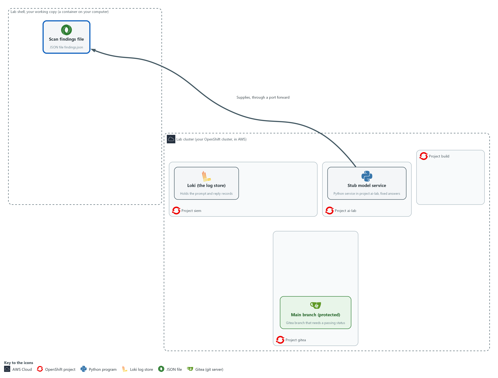

- The lab starts with the stub model service in project ai-lab, Loki in project siem, and a repository on Gitea (project gitea) whose main branch needs a passing check. You clone that repository into your working copy and fetch the scan findings from the stub.

#### 1a. Make a folder, clone the repository and fetch the scan findings

You will now clone the repository, start a branch, and save the stub's three scan findings in a file.

```bash
mkdir -p /workspace/aid-3 && cd /workspace/aid-3
curl -s http://127.0.0.1:8089/healthz >/dev/null || { oc port-forward -n ai-lab svc/stub-model 8089:8080 & sleep 3; }
test -d ai-tools || git -c 'credential.helper=!f() { echo username=$GITEA_USER; echo password=$GITEA_TOKEN; }; f' clone "$GITEA_URL/$GITEA_USER/ai-tools.git"
cd ai-tools
git config credential.helper '!f() { echo username=$GITEA_USER; echo password=$GITEA_TOKEN; }; f'
git config user.name "$GITEA_USER"
git config user.email "$GITEA_USER@example.invalid"
git checkout -B add-summarizer
curl -s -X POST http://127.0.0.1:8089/v1/answer -d '{"request_id": "findings-1"}' | jq -r .reply | jq . > findings.json
jq length findings.json
git branch --show-current
```

**Expected output:**

```
Example only. If the tunnel to the stub is already open, the Forwarding line does not appear. On a second run the clone is skipped.
Forwarding from 127.0.0.1:8089 -> 8080
Cloning into 'ai-tools'...
Switched to a new branch 'add-summarizer'
3
add-summarizer
```

| Part | What it does | Why you run it |
| --- | --- | --- |
| mkdir -p ... && cd ... | Makes a folder for this module and moves into it, so files from other modules cannot collide with yours. The folder persists between lab sessions, and every later block that uses these files starts with a cd to it. | All the files for this module go in one folder so you can find them again. |
| curl -s ... \|\| { oc port-forward ... 8089:8080 & ...; } | Asks the stub if it already answers on port 8089 (for example from an earlier module in this shell). Only if it does not, it tunnels port 8089 in your shell to the stub service (a port forward) and keeps running in the background. This avoids an address already in use error. | A second tunnel would fail while the first runs, so the command first checks whether the stub already answers. |
| test -d ai-tools \|\| git -c '...' clone ... ai-tools.git | Copies the repository from the in-lab Gitea server, unless the folder is already there. The -c part gives git a helper for this one command that prints your Gitea user name and token when git asks for them. | You need a working copy of the repository on Gitea to add your script to. The helper means the token is never typed or saved in a file, and skipping the clone makes the block safe to run twice. |
| git config credential.helper ... | Saves the same helper in this repository so push works. The file stores the variable names, not the token value. | Push signs in to Gitea the same way, so it needs the helper too. |
| git config user.name / user.email | Tells git who you are, so each commit carries a name. The address is a placeholder that stays inside this repository. | Git refuses to commit without a name, and every commit records who made it. |
| git checkout -B add-summarizer | Starts the branch for this work, or switches to it if it already exists. | Main accepts changes only through a reviewed pull request, so you do the work on a branch. |
| -d '{"request_id": "findings-1"}' | Asks the stub for its stored scan findings. The id picks the fixed answer. | The summary script needs something to summarize, and the stub holds a fixed list of scan findings for it. |
| jq -r .reply \| jq . > findings.json | Takes the reply text out of the answer, formats it, and saves it as a file. | The findings arrive wrapped in the stub's answer, and you need them as a plain file the script can read. |
| jq length findings.json | Counts the findings. You will compare this number with what the model reports. | Step 3 compares the model's count with this number. |
| git branch --show-current | Prints the name of the branch you are on. | It confirms the work happens on the branch and not on main. |

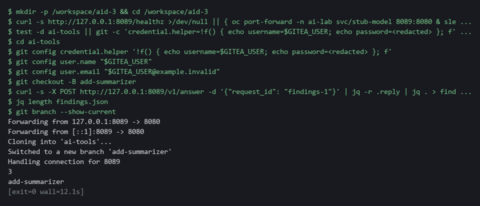

> **YOUR TURN:** Run the block.

> **CHECKPOINT:** The count is 3, and the last line says add-summarizer.

> **TAKEAWAY:** Work on a branch from the start, because the main branch merges only through a reviewed pull request.

### Step 2. Review a drafted shape check and write the test that catches its flaw (SI-10 Information Input Validation)

**Learning point: Writing a test for a bad input, watching it fail against the assistant-drafted shape check and fixing the flaw it finds proves the check refuses what it should.**

- An AI assistant wrote the shape check from a written specification.
- You paste the shape check as it came, paste four tests, write the fifth test yourself, and read what the test tells you.
- The review gate in Step 4 requires the tests.

What this step adds (thick lines and outlines are new):

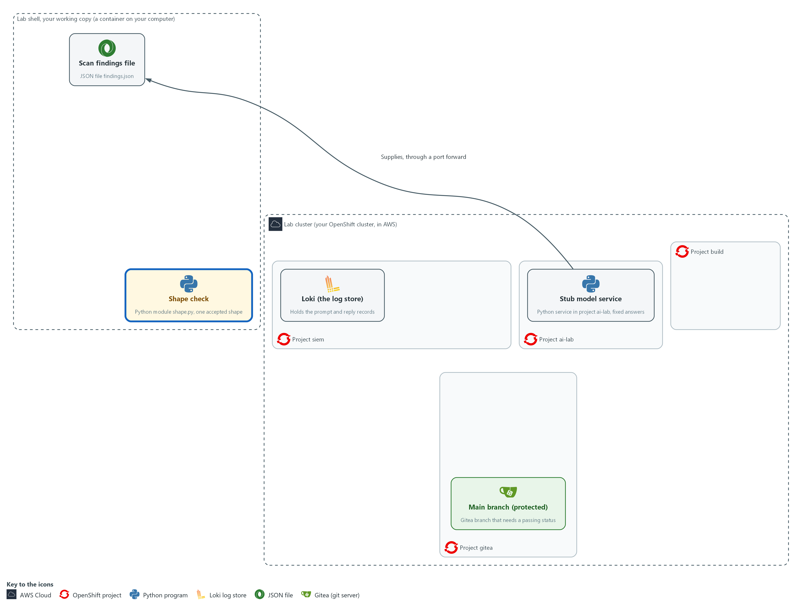

- A shape check is added in your working copy. It accepts one exact reply shape and refuses everything else.

#### 2a. Save the drafted shape check as shape.py

You will now make the file shape.py in the ai-tools folder by pasting the whole block (a heredoc) into the lab shell.

- The file holds the AI-drafted check, exactly as it came.
- The quoted EOF keeps every character exactly as shown, including the spaces at the start of lines, which Python needs.
- The command prints ok when shape.py has content.

```bash
cd /workspace/aid-3/ai-tools
cat > shape.py <<'EOF'
import json

FIELDS = {"summary": str, "severity": str, "count": int}
SEVERITIES = {"low", "medium", "high", "critical"}
MAX_SUMMARY = 300


def parse_reply(text):
    try:
        data = json.loads(text)
    except ValueError as exc:
        raise ValueError("reply is not pure JSON") from exc
    if not isinstance(data, dict) or set(data) != set(FIELDS):
        raise ValueError("reply must have exactly summary, severity and count")
    for name, kind in FIELDS.items():
        if not isinstance(data[name], kind):
            raise ValueError("field " + name + " has the wrong type")
    if data["severity"] not in SEVERITIES:
        raise ValueError("severity is not an allowed value")
    if len(data["summary"]) > MAX_SUMMARY or data["count"] < 0:
        raise ValueError("summary too long or count negative")
    return dict(data)
EOF
test -s shape.py && echo ok || echo EMPTY
```

**Expected output:**

```
Example only.
ok
```

| Part | What it does | Why you run it |
| --- | --- | --- |
| cd /workspace/aid-3/ai-tools | Moves into the repository folder from Step 1. | The file is made in the folder you are standing in. |
| cat > shape.py <<'EOF' ... EOF | Writes everything between the first and the last line into shape.py. The quotes around EOF stop the shell from changing any character. Running it again replaces the file with the same text. | This is how you make a file with only a paste, since the lab has no editor. |
| test -s shape.py && echo ok \|\| echo EMPTY | Prints ok if the file has content and EMPTY if it has none. | Pasting the block twice can leave the file empty. If EMPTY shows, paste the block again. |
| FIELDS = {...} | The only fields allowed and the type of each. | Spelling out the allowed fields in advance is what lets the check refuse everything else. |
| SEVERITIES, MAX_SUMMARY | The allowed values for severity and the longest summary accepted. These are choices the lab makes. | A short list of allowed values stops a reply from carrying words the rest of the system does not expect. |
| json.loads(text) | Reads the reply as JSON. Words around the JSON make this fail, which is intended. | Text that is not pure JSON cannot be trusted to have a fixed shape, so it is refused here. |
| set(data) != set(FIELDS) | Refuses a reply with a missing field or an extra one. A field you did not ask for is a place to hide an instruction. | An extra field is a place where a planted instruction could hide, so any difference is refused. |
| `isinstance(data[name], kind)` | Checks the type of each field against the type in FIELDS. | A value of the wrong type must not reach the later steps, so it is refused here. |
| not in SEVERITIES | Refuses any severity word that is not on the list. | Only words on the list may pass, so a made-up severity cannot reach later steps. |
| `return dict(data)` | Returns a copy, so the caller cannot change the checked object by accident. | Handing back a copy means the checked reply cannot be altered by accident after it has passed. |

#### 2b. Save four tests as tests/test_shape.py

You will now make the folder tests and the file test_shape.py inside it by pasting the whole block into the lab shell.

- The file holds four tests, and the command prints ok when test_shape.py has content.
- You write the fifth test in the next two blocks.

```bash
cd /workspace/aid-3/ai-tools
mkdir -p tests
cat > tests/test_shape.py <<'EOF'
import json
import unittest

from shape import parse_reply

GOOD = {"summary": "Two high findings.", "severity": "high", "count": 2}


def variant(**changes):
    return json.dumps({**GOOD, **changes})


class ParseReplyTests(unittest.TestCase):
    def test_accepts_a_good_reply(self):
        self.assertEqual(parse_reply(json.dumps(GOOD)), GOOD)

    def test_rejects_prose_around_json(self):
        with self.assertRaises(ValueError):
            parse_reply("Sure! " + json.dumps(GOOD))

    def test_rejects_an_extra_field(self):
        with self.assertRaises(ValueError):
            parse_reply(variant(action="oc delete pods --all"))

    def test_rejects_an_unknown_severity(self):
        with self.assertRaises(ValueError):
            parse_reply(variant(severity="urgent"))
EOF
test -s tests/test_shape.py && echo ok || echo EMPTY
```

**Expected output:**

```
Example only.
ok
```

| Part | What it does | Why you run it |
| --- | --- | --- |
| cd ... ; mkdir -p tests | Moves into the repository folder and makes the tests folder. -p means no error if it already exists. | The test runner looks for tests in this folder. |
| cat > tests/test_shape.py <<'EOF' ... EOF | Writes everything between the first and the last line into the file. Running it again replaces the file with the same text. | The lab has no editor, so a paste is how you make the file. |
| test -s tests/test_shape.py && echo ok \|\| echo EMPTY | Prints ok if the file has content and EMPTY if it has none. | Pasting the block twice can leave the file empty. If EMPTY shows, paste the block again. |
| GOOD, variant() | One good reply, and a helper that makes a copy of it with one thing changed. | Each test starts from one good reply and changes one thing, so a failure points at that one thing. |
| test_accepts_a_good_reply | The check must not refuse a correct reply. A check that refuses everything is useless. | Without this test, a check that refuses everything would pass all the others. |
| assertRaises(ValueError) | The test passes only if the check refuses the reply. | The test passes only when the check refuses, which is the behavior you are proving. |
| test_rejects_... | One test for each of three shape problems the stub sends: prose, an extra field and a bad value. The long summary is checked end to end in Test 2, and the wrong count is caught in Step 3 by the cross-check, not by the shape check. | Together with your test, these show the check refuses the main kinds of bad reply, and the review gate later requires at least four that expect a refusal. |

#### 2c. Start the test you will write

You will now make tests/test_boolean.py with the setup of your test: a reply whose count is true instead of a number.

- The test has no check yet, because you write that in the next block.
- The command prints ok when tests/test_boolean.py has content.

```bash
cd /workspace/aid-3/ai-tools
cat > tests/test_boolean.py <<'EOF'
import json
import unittest

from shape import parse_reply


class BooleanCountTest(unittest.TestCase):
    def test_rejects_a_boolean_count(self):
        reply = json.dumps({"summary": "One finding.", "severity": "low", "count": True})
EOF
test -s tests/test_boolean.py && echo ok || echo EMPTY
```

**Expected output:**

```
Example only.
ok
```

| Part | What it does | Why you run it |
| --- | --- | --- |
| cat > tests/test_boolean.py <<'EOF' ... EOF | Writes the file. Running it again replaces the file, which is how you start over if your lines go wrong. | A separate file keeps the four supplied tests unchanged, and the next block adds your lines to this one. |
| test -s tests/test_boolean.py && echo ok \|\| echo EMPTY | Prints ok if the file has content and EMPTY if it has none. | Pasting the block twice can leave the file empty. If EMPTY shows, paste the block again. |
| "count": True | Builds a reply that is otherwise good, but whose count is the JSON value true. | A model can send true where a number belongs. The check is supposed to refuse it. |

#### 2d. Write your test and run all five

You will now write two lines.

- Type the block, but replace the line <replace this line with your two lines> with your own two lines.
- The spec: the test passes only if parse_reply(reply) refuses the reply by raising ValueError.
- Follow the pattern of the tests in test_shape.py, such as test_rejects_an_unknown_severity.
- Indent your first line by 8 spaces and your second line by 12, because both sit inside the method.
- The reference answer is stored on the cluster, and you open it in the last block of this step, after you have tried.
- The command then counts your assertRaises lines (1 means your lines are in) and runs all five tests.
- Your new test is expected to fail before the fix in 2e.
- An error right after the copy usually means shape.py or a test file is empty: paste its block again.

```bash
cd /workspace/aid-3/ai-tools
cat >> tests/test_boolean.py <<'EOF'
<replace this line with your two lines>
EOF
grep -c assertRaises tests/test_boolean.py
python3 -m unittest discover -s tests
```

**Expected output:**

```
Example only. The place of the F and the times will differ.
1
F....
======================================================================
FAIL: test_rejects_a_boolean_count (test_boolean.BooleanCountTest.test_rejects_a_boolean_count)
----------------------------------------------------------------------
Traceback (most recent call last):
  ...
AssertionError: ValueError not raised

----------------------------------------------------------------------
Ran 5 tests in <time>

FAILED (failures=1)
```

| Part | What it does | Why you run it |
| --- | --- | --- |
| cat >> tests/test_boolean.py <<'EOF' ... EOF | Adds the lines between the first and the last line to the end of the file. Do not run it twice in a row, or your lines appear twice; run the previous block first to start over. | Your lines complete the method that the previous block started. |
| <replace this line with your two lines> | Your two lines: a with self.assertRaises(ValueError): line, then an indented line that calls parse_reply(reply). | This is the check itself: the test passes only if the reply is refused. |
| grep -c assertRaises tests/test_boolean.py | Counts the lines that contain assertRaises. 1 means your with-line is in the file; 0 means the test would pass without checking anything. | A test with no check passes whatever the code does, so you confirm yours has one. |
| `python3 -m unittest discover -s tests` | Runs all five tests. The failure means the test did its job: the drafted check let a count of true through. | A test that cannot fail proves nothing. Seeing it fail first shows it can catch this flaw. |

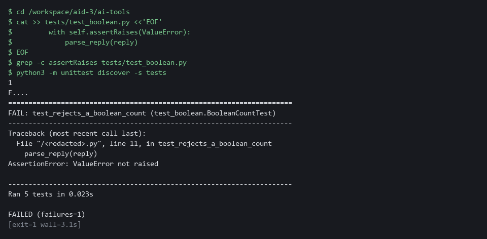

#### 2e. Fix the flaw and run all five again

You will now fix the flaw the test found, then run all five tests again.

- The cause: in Python, true counts as a whole number (True is 1), so a check written with `isinstance` accepts true where a number belongs.
- The fix compares the exact type instead.
- The sed command replaces that one line in shape.py.

```bash
cd /workspace/aid-3/ai-tools
grep -n isinstance shape.py
sed -i 's/if not isinstance(data\[name\], kind):/if type(data[name]) is not kind:/' shape.py
grep -n 'kind' shape.py
python3 -m unittest discover -s tests
```

**Expected output:**

```
Example only. The line numbers and the time will differ.
13:    if not isinstance(data, dict) or set(data) != set(FIELDS):
16:        if not isinstance(data[name], kind):
15:    for name, kind in FIELDS.items():
16:        if type(data[name]) is not kind:
.....
----------------------------------------------------------------------
Ran 5 tests in <time>

OK
```

| Part | What it does | Why you run it |
| --- | --- | --- |
| `grep -n isinstance shape.py` | Prints the line number and text of each line that uses `isinstance`. The first checks that the reply is a JSON object and is correct; the flaw is the one inside the loop. | You see the line before you change it. |
| sed -i 's/.../.../' shape.py | Replaces the text between the first pair of slashes with the text between the second pair, in place. The result: if type(data[name]) is not kind. | Fixing one line with sed needs no editor, and running it twice changes nothing the second time. |
| grep -n 'kind' shape.py | Prints the lines that mention kind, so you can see the new line in place. | You confirm the change before running the tests. |
| `python3 -m unittest discover -s tests` | Runs all five tests again. All must pass. | The test that failed now passes, and the other four still pass, so the fix broke nothing. |

#### 2f. Compare with the reference answer (only after you have tried)

You will now print the reference text stored on the cluster: the two lines of the test, and the flaw with its fix.

- Do not open the reference answer until you have tried the test and the fix.
- Compare the reference text with what you wrote.

```bash
oc get configmap aid3-reference -n build -o jsonpath='{.data.test_boolean_count\.txt}'
```

**Expected output:**

```
Example only. The text is fixed.
Reference answer for AID-3 Step 2. Open it only after you have tried.
(the two lines of the test)
(the flaw in the drafted check, and the fixed line)
```

| Part | What it does | Why you run it |
| --- | --- | --- |
| oc get configmap aid3-reference -n build -o jsonpath=... | Prints one stored file from the config map aid3-reference in project build. The lab start created it. | The answer sits outside your working copy, so you cannot open it by accident while you work. |

> **TIP:** Both files you paste can be pasted again safely. To redo your test, paste the block that starts test_boolean.py again before you add your lines.

> **YOUR TURN:** Paste shape.py and the four tests, write the fifth test, watch it fail, fix shape.py, and open the reference answer last.

> **CHECKPOINT:** Before the fix, four tests pass and yours fails with ValueError not raised. After the fix, five tests run and the last line is OK.

> **TAKEAWAY:** A draft that reads well can still be wrong, so write the test before you trust the draft.

**How this meets the control**

- **SI-10:** You test the assistant-drafted shape check with a bad reply, find a flaw and fix it.

### Step 3. Write the summary script and log every exchange (SI-10 Information Input Validation, AU-12 Audit Record Generation)

**Learning point: Running the summary script end to end shows the SI-10 and AU-12 loop at work: the prompt and reply go to Loki, and the reply passes the shape check and the count cross-check.**

- The script logs the prompt, applies the shape check, and cross-checks the count against the findings it sent.
- A shape check alone cannot detect a count that is wrong.
- `ailog.py` came with the repository and is reused, so you read it but do not type it.

What this step adds (thick lines and outlines are new):

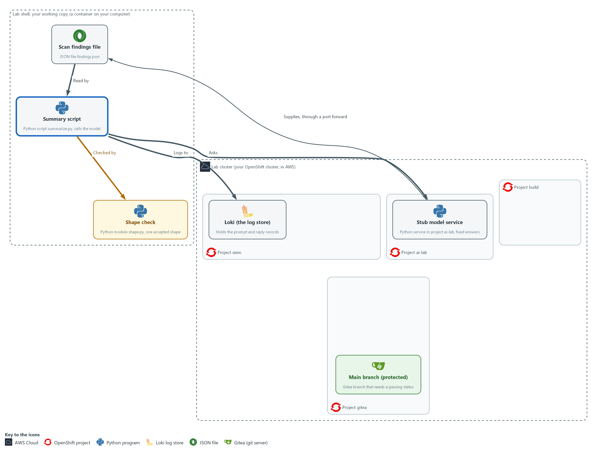

- The summary script in your working copy sends the findings to the stub model service, applies the shape check to the reply, and sends a log record of every prompt, reply and rejection to Loki in project siem.

#### 3a. Read ailog.py

You will now read the file `ailog.py`, which came with the repository you cloned.

- You do not type `ailog.py`, and reading it prints nothing.
- To see the same file in lab shell, type cd /workspace/aid-3/ai-tools and then cat `ailog.py`.
- Step 5 uses the query function in ailog.py.

Look for these as you read:

- loki_access() builds the sign-in header and the certificate check once, so push() and query() cannot send a request without them.
- post() sends one JSON request and gives up after 10 seconds, so a stuck server cannot hang the script.
- push() sends one record with the labels you give it. log_event() calls it with the labels app and kind, and those two are what you search by in Loki.
- query() asks Loki one question at one moment (an instant query) and returns the answer as data. Step 5 uses it.
- The login and the certificate file come from lab variables (os.environ), so no password is written in the file. A missing lab variable stops the script with an error, and no unauthenticated request is sent.

```python
import base64
import json
import os
import ssl
import time
import urllib.parse
import urllib.request


def loki_access():
    login = os.environ["LOKI_USER"] + ":" + os.environ["LOKI_PASSWORD"]
    headers = {"Authorization": "Basic " + base64.b64encode(login.encode("utf-8")).decode("ascii")}
    return headers, ssl.create_default_context(cafile=os.environ["LOKI_CA_FILE"])


def post(url, body, headers=None, context=None):
    data = json.dumps(body).encode("utf-8")
    request = urllib.request.Request(url, data, {"Content-Type": "application/json", **(headers or {})})
    with urllib.request.urlopen(request, timeout=10, context=context) as response:
        return response.read().decode("utf-8")


def push(labels, line):
    headers, context = loki_access()
    stream = {"stream": labels, "values": [[str(time.time_ns()), line]]}
    post(os.environ["LOKI_URL"] + "/loki/api/v1/push", {"streams": [stream]}, headers, context)


def log_event(kind, request_id, text):
    line = json.dumps({"kind": kind, "request_id": request_id, "text": text})
    push({"app": "ai-summarizer", "kind": kind}, line)


def query(expr):
    headers, context = loki_access()
    url = os.environ["LOKI_URL"] + "/loki/api/v1/query?" + urllib.parse.urlencode({"query": expr})
    request = urllib.request.Request(url, headers=headers)
    with urllib.request.urlopen(request, timeout=10, context=context) as response:
        return json.loads(response.read().decode("utf-8"))
```

| Part | What it does | Why you run it |
| --- | --- | --- |
| loki_access() | Reads the sign-in from lab variables (named values the lab sets for you) and builds the certificate check. No password appears in the file, and a missing variable stops the script with an error instead of sending an unauthenticated request. | Reading the sign-in from lab variables keeps passwords out of the file you commit, and one function keeps every request on the same footing. |
| `cafile=os.environ["LOKI_CA_FILE"]` | Checks that the server is the real Loki, using the lab's certificate file. | A certificate check makes sure the records go to the real Loki and not to something pretending to be it. |
| post(...) | Sends one JSON request and returns the text of the answer. It gives up after 10 seconds instead of waiting forever. | One small function sends every request the same way, with a time limit so a stuck server cannot hang the script. |
| push(labels, line) | Sends one record to Loki with the labels you pass in and its own timestamp in nanoseconds, which is what Loki expects. | Loki orders records by their time, so each record needs its own, and the labels are how you find the record again. |
| log_event(kind, request_id, text) | Writes one record: what kind of event, which request, and the text. Only app and kind are labels, so a search by app and kind is fast. | Every exchange goes through one function, so no event can be logged in a different way or forgotten. |
| query(expr) | Sends one LogQL query to Loki as an instant query and returns the answer as data. | The checker in Step 5 needs to ask Loki a question from code, and reusing this file keeps the sign-in and certificate handling in one place. |


#### 3b. Save the summary script as summarize.py

You will now make the file summarize.py in the ai-tools folder, next to shape.py and `ailog.py`, by pasting the whole block into the lab shell.

- The command prints ok when summarize.py has content.

```bash
cd /workspace/aid-3/ai-tools
cat > summarize.py <<'EOF'
import json
import os
import sys
import urllib.error

from ailog import log_event, post
from shape import parse_reply

STUB_URL = os.environ.get("STUB_URL", "http://127.0.0.1:8089")


def ask(request_id, prompt):
    body = {"request_id": request_id, "input": prompt}
    return json.loads(post(STUB_URL + "/v1/answer", body))["reply"]


def main(request_id):
    with open("findings.json", encoding="utf-8") as handle:
        findings = json.load(handle)
    prompt = "Summarize these findings as JSON: " + json.dumps(findings)
    log_event("prompt", request_id, prompt)
    try:
        raw = ask(request_id, prompt)
    except urllib.error.URLError as exc:
        print("MODEL UNREACHABLE:", exc)
        return 2
    log_event("reply", request_id, raw)
    try:
        reply = parse_reply(raw)
        if reply["count"] != len(findings):
            raise ValueError("count does not match the findings sent")
    except ValueError as exc:
        log_event("rejected", request_id, str(exc))
        print("REJECTED:", exc)
        return 1
    print(json.dumps(reply))
    return 0


if __name__ == "__main__":
    sys.exit(main(sys.argv[1] if len(sys.argv) > 1 else "summary-ok"))
EOF
test -s summarize.py && echo ok || echo EMPTY
```

**Expected output:**

```
Example only.
ok
```

| Part | What it does | Why you run it |
| --- | --- | --- |
| cd ... ; cat > summarize.py <<'EOF' ... EOF | Moves into the repository folder and writes everything between the first and the last line into summarize.py. Running it again replaces the file with the same text. | The lab has no editor, so a paste is how you make the file. |
| test -s summarize.py && echo ok \|\| echo EMPTY | Prints ok if the file has content and EMPTY if it has none. | Pasting the block twice can leave the file empty. If EMPTY shows, paste the block again. |
| STUB_URL | Where the model is. The default is the port forward from Step 1. | The model address is set in one place, so the same script works wherever the model runs. |
| log_event("prompt", ...) | Logs the question before it is sent, so a failed call still leaves a record. | Logging the question first means even a failed call leaves a record of what was asked. |
| `except urllib.error.URLError` | If the model cannot be reached the script says so and exits with status 2. It does not guess an answer. | A model that cannot be reached must stop the script, not leave it guessing an answer. |
| log_event("reply", ...) | Logs the raw reply before any check, so a refused reply is still on record. | Logging the raw reply before any check means a refused reply is still on record. |
| parse_reply(raw) | The only way the reply gets into the program. Nothing uses the raw text. | Forcing every reply through the shape check means no part of the program uses text that was not checked. |
| reply["count"] != len(findings) | Cross-checks the reply against data the script already holds. The shape can be right while the content is wrong. | A reply can have the right shape and still be wrong, so the count is checked against data the script holds. |
| return 1 ... return 0 | The exit status is the number a command leaves behind when it ends. 0 means a good summary and 1 means refused, so a pipeline or a schedule can tell. | The exit status lets a person, a schedule or the review gate tell a good run from a refused one without reading the output. |

#### 3c. Run the script on the good reply

You will now run the summary script on the stub's good summary.

- The refused replies are tested in Verify, Test 2.
- An error right after the copy usually means summarize.py is empty: paste its block again.

```bash
cd /workspace/aid-3/ai-tools
curl -s http://127.0.0.1:8089/healthz >/dev/null || { oc port-forward -n ai-lab svc/stub-model 8089:8080 & sleep 3; }
python3 summarize.py summary-ok
```

**Expected output:**

```
Example only. The summary text and the severity come from the stub.
{"summary": "<summary text>", "severity": "<low, medium, high or critical>", "count": 3}
```

| Part | What it does | Why you run it |
| --- | --- | --- |
| cd /workspace/aid-3/ai-tools | Moves into the repository folder from Step 1. | The script reads findings.json from the folder it runs in. |
| curl -s ... \|\| { oc port-forward ... } | Opens the tunnel to the stub only if it is not already open. | The script asks the stub for the reply, and the tunnel from Step 1 is gone if you opened a new lab shell. |
| summarize.py summary-ok | Asks the stub for its good summary. The id chooses the fixed answer. The script sends the prompt and the reply to Loki, checks the reply and prints it. | A good case first shows the script works end to end before Verify feeds it bad replies. |

> **NOTE:** The first block is `ailog.py`, which is already in the repository you cloned. It is shown so you can read how it works. You paste only summarize.py.

> **SECURITY:** The script logs the whole prompt. Here the prompt holds scan findings, which carry no secrets. If a prompt could include a password, a token or personal data, remove or mask it before it is logged and before it is sent.

> **YOUR TURN:** Read `ailog.py`, paste the summarize.py block, then run the last block.

> **CHECKPOINT:** The command prints a JSON object with three fields.

> **TAKEAWAY:** Log the prompt and reply before acting on them, so a refused reply is still on record.

**How this meets the controls**

- **SI-10:** Every reply goes through the shape check and a count cross-check, and a refused reply ends the run with status 1.
- **AU-12:** The script logs the prompt, the reply and any rejection to Loki before acting, tied together by a request id.

### Step 4. Push the branch, run the review gate and merge (CM-3 Configuration Change Control)

**Learning point: Running the review gate from outside your repository, recording its result as a commit status and merging only on success puts the CM-3 decision on record and makes the merge depend on it.**

- The gate is a pipeline in project build that clones your branch and runs a check script held in a config map, outside your repository.
- The protected main branch requires a passing commit status before it merges.

What this step adds (thick lines and outlines are new):


- You push the branch add-summarizer to the repository on Gitea. You start the review gate, a pipeline in project build, on that branch. You then record its pass or fail result in Gitea against the commit from lab shell, and the pull request merges into the main branch only because the gate passed.

#### 4a. Commit, push the branch and read the start of the review gate

You will now save your five files in one commit, send the branch to Gitea, and print the first lines of the gate script held on the cluster.

```bash
cd /workspace/aid-3/ai-tools
git add findings.json shape.py summarize.py tests/test_shape.py tests/test_boolean.py
git commit -m "Add reviewed summary script" || true
git push -u origin add-summarizer
oc get configmap ai-review-gate -n build -o jsonpath='{.data.review_gate\.py}' | head -n 30
```

**Expected output:**

```
Example only. The commit id will differ.
[add-summarizer <hash>] Add reviewed summary script
 5 files changed, <n> insertions(+)
<git lists the five new files>
branch 'add-summarizer' set up to track 'origin/add-summarizer'.
<the first 30 lines of review_gate.py>
```

| Part | What it does | Why you run it |
| --- | --- | --- |
| cd /workspace/aid-3/ai-tools | Moves into the repository folder from Step 1. | git acts on the repository you are standing in. |
| git add ... commit ... \|\| true | Saves exactly the five files you made or fixed in this module. Nothing else is included. The \|\| true lets the block run a second time, when there is nothing new to save. | Listing the five files by name means nothing you did not mean to share is saved. The name and address git records come from the git config you set in Step 1. |
| git push -u origin add-summarizer | Sends the branch to Gitea. A push straight to main would be refused. | The branch must be on Gitea for the gate to check it and for a pull request to be opened. |
| oc get configmap ai-review-gate ... \| head -n 30 | Prints the top of the gate script, so you can read what it will check before it judges your work. | Reading the gate before it judges your work shows what is checked and where it is stored. |

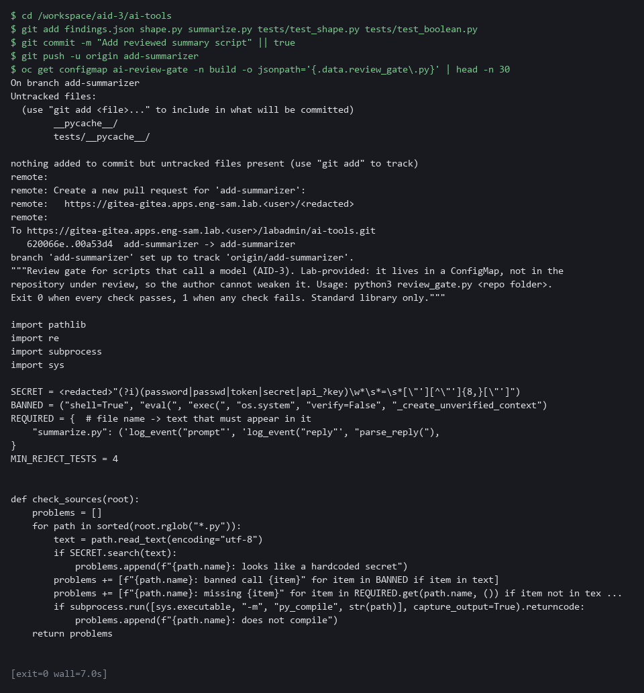

#### 4b. Run the review gate pipeline and record its result in Gitea

You will now run the gate pipeline on your branch, turn its result into success or failure, and record that result in Gitea against your commit.

- The first run needs the cluster to pull the gate image from the internet, so it can take a minute.

```bash
cd /workspace/aid-3/ai-tools
if tkn pipeline start ai-script-review -n build \
  -p git-url="$GITEA_URL/$GITEA_USER/ai-tools.git" -p git-revision=add-summarizer \
  -s pipeline --use-param-defaults -w name=source,claimName=ai-review-pvc -w name=ssl-ca,config=lab-ca --showlog --exit-with-pipelinerun-error; then
  STATE=success
else
  STATE=failure
fi
echo "gate result: $STATE"
SHA=$(git rev-parse HEAD)
curl -s -X POST -H "Authorization: token $GITEA_TOKEN" -H 'Content-Type: application/json' \
  -d "{\"state\":\"$STATE\",\"context\":\"ai-script-review\"}" \
  "$GITEA_URL/api/v1/repos/$GITEA_USER/ai-tools/statuses/$SHA" | jq -r .status
```

**Expected output:**

```
Example only. The log lines come from the gate.
(the pipeline log streams while the gate runs)
GATE PASSED
gate result: success
success
```

| Part | What it does | Why you run it |
| --- | --- | --- |
| cd /workspace/aid-3/ai-tools | Moves into the repository folder from Step 1. | git rev-parse below reads the commit of the repository you are standing in. |
| tkn pipeline start ai-script-review | Runs the gate pipeline once. tkn is the command-line tool for Tekton, the engine behind OpenShift Pipelines. | The gate runs inside the cluster, away from your laptop, so it checks the pushed branch and not your local files. |
| -s pipeline | Runs it as the service account named pipeline (an identity for a program instead of a person), which holds the Gitea sign-in the clone needs. | The clone of the private repository only works under that identity. |
| -p git-revision=add-summarizer | Tells it which branch to check. | The gate must judge the branch you pushed, not main. |
| --use-param-defaults | Uses the default for any parameter you did not give, such as the gate image. Without it tkn stops and asks. | A run started from a script has nobody to answer a question. |
| -w name=source,claimName=ai-review-pvc | Gives the run a folder on a volume claim that the lab start created. Each run replaces what the clone put there. | The clone and the gate run in separate pods, so they must share a disk. A scratch folder made for one pod would be empty for the other. |
| -w name=ssl-ca,config=lab-ca | Gives the clone the lab's certificate authority, so it can verify the Gitea certificate. | Gitea uses a certificate the lab made itself. The clone stays encrypted and checked, and trusts only this authority. |
| `--showlog --exit-with-pipelinerun-error` | Prints the gate's output as it runs and makes the command fail if the pipeline failed. | Watching the output lets you read which checks failed, and the error option makes a failed gate stop the command. |
| if ...; then STATE=success; else STATE=failure; fi | Turns the command's pass or fail into the word Gitea expects. | Gitea expects the words success or failure, so the pass or fail of the command is turned into one of them. |
| SHA=$(git rev-parse HEAD) | The identity of the commit that was just checked. The status is attached to that exact commit. | A status belongs to one exact commit, so a result cannot be mistaken for a later change. |
| curl ... /statuses/$SHA | Records the result in Gitea under the name ai-script-review, which is the name the protected branch requires. | Main refuses a merge until this named status is success, so this call is what lets the merge happen. |

#### 4c. Open the pull request and merge it

You will now open a pull request from add-summarizer into main and ask Gitea to merge it.

```bash
API="$GITEA_URL/api/v1/repos/$GITEA_USER/ai-tools"
PR=$(curl -s -H "Authorization: token $GITEA_TOKEN" "$API/pulls?state=open" | jq -r '.[] | [.head.ref, .number] | @tsv' | grep '^add-summarizer' | cut -f2 | head -n 1)
test -n "$PR" || curl -s -o /dev/null -X POST -H "Authorization: token $GITEA_TOKEN" -H 'Content-Type: application/json' \
  -d '{"head":"add-summarizer","base":"main","title":"Add reviewed summary script"}' "$API/pulls"
PR=$(curl -s -H "Authorization: token $GITEA_TOKEN" "$API/pulls?state=open" | jq -r '.[] | [.head.ref, .number] | @tsv' | grep '^add-summarizer' | cut -f2 | head -n 1)
echo "pull request: $PR"
curl -s -o /dev/null -w '%{http_code}\n' -X POST -H "Authorization: token $GITEA_TOKEN" -H 'Content-Type: application/json' \
  -d '{"Do":"merge"}' "$API/pulls/$PR/merge"
```

**Expected output:**

```
Example only. The pull request number will differ.
pull request: <n>
200
```

| Part | What it does | Why you run it |
| --- | --- | --- |
| API=... | Holds the address of the repository's API (the address a program uses to talk to Gitea) so it is not repeated. | Three calls use the same address. |
| PR=$(curl ... /pulls?state=open \| jq ... \| cut -f2 \| head -n 1) | Looks for a pull request from add-summarizer that is already open, and keeps its number. | A second run reuses the pull request instead of creating a duplicate. |
| test -n "$PR" \|\| curl -X POST ... /pulls | Creates the pull request only if none was found. | A pull request is the reviewed way into main, and it is where the status is checked. |
| PR=$(...) again | Looks the number up once more, so $PR holds it whether the request was new or old. | The merge call below needs the number. |
| "head":"add-summarizer","base":"main" | Asks to merge your branch into main. | It says which branch goes into which, so Gitea knows what the status must cover. |
| -o /dev/null -w '%{http_code}\n' | Hides the answer body and prints only the HTTP status code (a number a web server sends back, where 200 means success). | Only the number tells you whether the merge worked, so the rest is hidden. |
| "Do":"merge" | Asks Gitea to merge. It checks the protected branch rules first. | This is the test of the whole chain, because Gitea merges only if the gate left a passing status. |

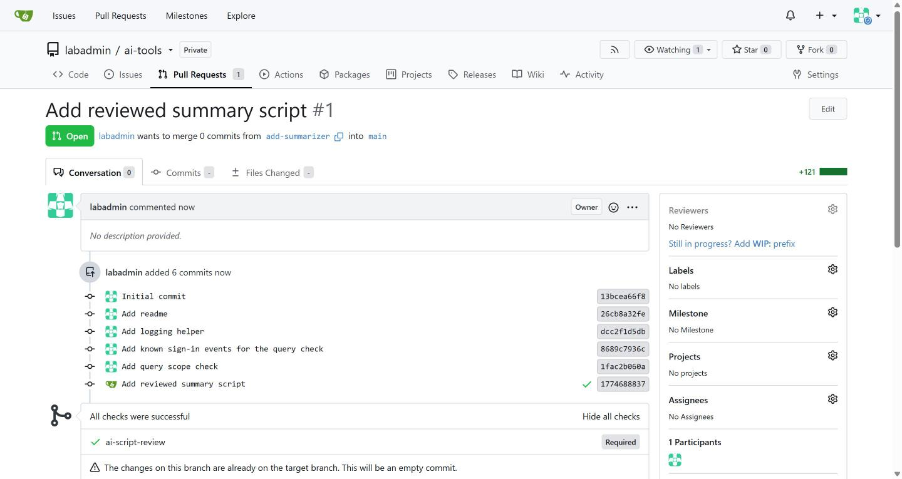

> **NOTE:** If you run the blocks a second time, git has nothing new to save, the pipeline runs again, the pull request is found instead of created, and the merge answers with an error number because it is already merged. That is expected. Posting the status by hand from your shell is how the lab shows the idea. In the real environment the pipeline posts its own status, so the person who wrote the script cannot post it.

> **YOUR TURN:** Run the three blocks in order and read the gate output.

> **CHECKPOINT:** The gate prints GATE PASSED, the line gate result: success appears, and the status call prints success. Then a pull request number prints, followed by 200, which means Gitea merged it.

> **TAKEAWAY:** The gate is held outside the repository it checks, so the author cannot weaken it in the same change.

**How this meets the control**

- **CM-3:** The gate reviews your branch from outside your repository, and the merge happens only because the commit status is success.

### Step 5. Check a query the model drafted against known data (SI-10 Information Input Validation, SA-11 Developer Testing and Evaluation)

**Learning point: Testing each drafted query with a checker that refuses a too-wide scope and compares the rest against counts known before any query ran shows whether the query can be trusted.**

- A drafted query is text from outside your code.
- You push eight sign-in events whose answer you know in advance, then test each draft against those known counts.
- The scope check (`scope.py`) came with the repository; you paste `check_query.py` that uses it.

What this step adds (thick lines and outlines are new):

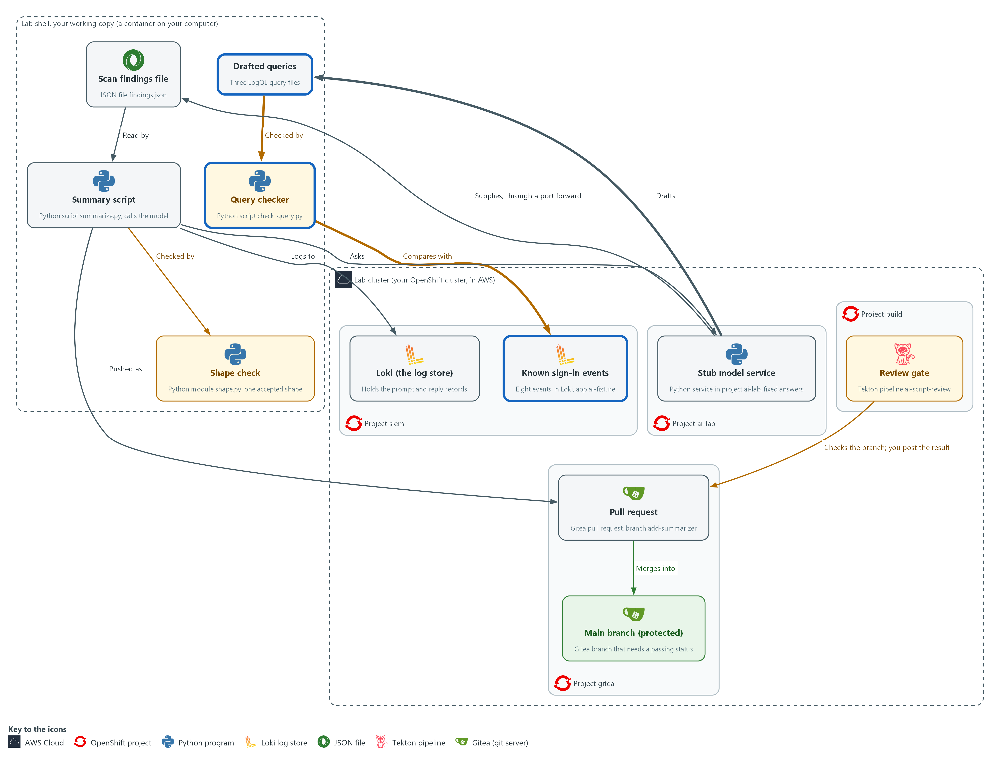

- The stub model service drafts three LogQL queries. A query checker in your working copy refuses a draft with the wrong scope, runs the others against eight known sign-in events in Loki, and compares the result with the answer it already knows.

#### 5a. Read the seed script and push the eight known events

You will now read the supplied seed script and run it.

- The script pushes eight sign-in events to Loki with the label app=ai-fixture and saves them in fixture.json.

```bash
cd /workspace/aid-3/ai-tools
cat seed_fixture.py
python3 seed_fixture.py || true
sleep 5
```

**Expected output:**

```
Example only. On a second run the script prints that fixture.json exists and pushes nothing.
<the text of seed_fixture.py>
pushed 8 events to app=ai-fixture
```

| Part | What it does | Why you run it |
| --- | --- | --- |
| cd /workspace/aid-3/ai-tools | Moves into the repository folder from Step 1. | seed_fixture.py and fixture.json live there. |
| cat seed_fixture.py | Prints the supplied script so you can read the events before they are pushed. Failed sign-ins: alice three times, bob once, carol never. | You read the right answer before any query runs, so a query cannot choose its own. |
| python3 seed_fixture.py | Pushes each event to Loki as one record with its own timestamp, and writes the same list to fixture.json. It refuses to run twice, because a second push would double every count; the \|\| true lets the block carry on when it refuses. | The checker reads fixture.json to work out the expected counts without using Loki or the query. |
| sleep 5 | Waits a few seconds so Loki and your shell agree that the events are in the last hour. | The checker counts events in the last hour, and a clock that is a little off could leave one out. |

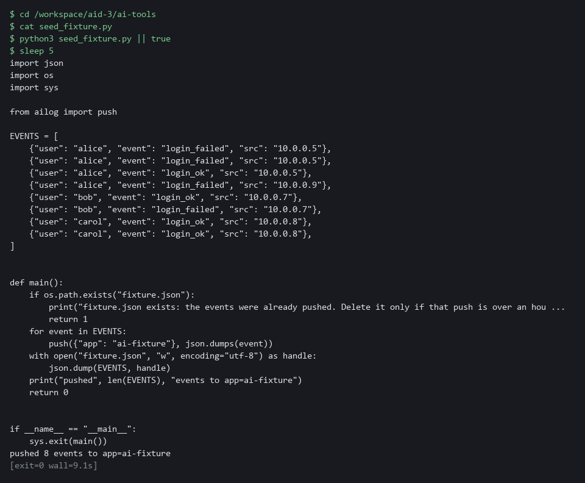

#### 5b. Ask the stub for three drafted queries

You will now ask the stub model service for three LogQL queries and save each as a file.

```bash
cd /workspace/aid-3/ai-tools
curl -s http://127.0.0.1:8089/healthz >/dev/null || { oc port-forward -n ai-lab svc/stub-model 8089:8080 & sleep 3; }
PROMPT='Write one LogQL metric query: failed sign-ins per user over the last hour, for app ai-fixture.'
for id in good wrongfield wide; do
  curl -s -X POST http://127.0.0.1:8089/v1/answer -d "$(jq -n --arg id "logql-$id" --arg p "$PROMPT" '{request_id: $id, input: $p}')" | jq -r .reply > "draft-$id.logql"
done
head -n 3 draft-*.logql
```

**Expected output:**

```
Example only. The stub gives fixed drafts, and the wording of the first query depends on its answer.
==> draft-good.logql <==
sum by (user) (count_over_time({app="ai-fixture"} | json | event="login_failed" [1h]))

==> draft-wide.logql <==
<a query that searches every app over a long range>

==> draft-wrongfield.logql <==
<a query that looks right but names a different event value>
```

| Part | What it does | Why you run it |
| --- | --- | --- |
| cd /workspace/aid-3/ai-tools | Moves into the repository folder from Step 1. | The draft files are saved there. |
| curl ... \|\| { oc port-forward ... } | Opens the tunnel to the stub only if it is not already open. | A second tunnel would fail while the first runs, so the command checks first. |
| jq -n --arg id ... --arg p ... | Builds the request with the request id and the prompt, quoted safely. The stub picks its fixed answer by the id and never reads the prompt. | Building the JSON with jq stops a quote in the prompt from breaking the request. |
| jq -r .reply > draft-$id.logql | Saves the reply text as a file, one file for each draft. | The checker reads a file, so the draft is kept exactly as the model wrote it. |

#### 5c. Read the scope check in scope.py

You will now read scope.py, which came with the repository next to `ailog.py`.

- You do not type or change scope.py.

```bash
cd /workspace/aid-3/ai-tools
cat scope.py
```

**Expected output:**

```
Example only.
<the text of scope.py: SELECTOR, MAX_WINDOW, scope_problems() and rows()>
```

| Part | What it does | Why you run it |
| --- | --- | --- |
| cat scope.py | Prints the supplied file so you can read the scope check before the checker uses it. | You read what the checker will rely on. |
| SELECTOR, MAX_WINDOW | The only stream the task needs and the longest range allowed, one hour. These are choices the lab makes. | A selector and a range are what decide how much of the log store a query reads, so they are fixed in the checker and not left to the draft. |
| `re.findall(r"\{[^}]*\}", expr) != [SELECTOR]` | Finds every selector in the query. There must be exactly one and it must equal the allowed selector, so a pattern match such as app=~".+" is refused. | A pattern match can name every stream at once, so only an exact match is accepted. |
| `re.findall(r"\[(\d+)([smhd])\]", expr)` | Finds every range such as [1h] and turns it into seconds. A query with no range, or a range over the limit, is a problem. | A long range makes Loki read far more data than the task needs. |
| rows(expr) | Runs one query through query() in `ailog.py` and returns the list of results. | Every call to Loki goes through the one function that holds the sign-in and the certificate check. |

#### 5d. Save the checker as check_query.py

You will now make the file check_query.py, which uses scope.py, by pasting the whole block into the lab shell.

- Do not add check_query.py to git.
- The command prints ok when check_query.py has content.

```bash
cd /workspace/aid-3/ai-tools
cat > check_query.py <<'EOF'
import json
import sys
import urllib.error
from collections import Counter

from scope import SELECTOR, rows, scope_problems


def main(path):
    with open(path, encoding="utf-8") as handle:
        expr = handle.read().strip()
    with open("fixture.json", encoding="utf-8") as handle:
        events = json.load(handle)
    problems = scope_problems(expr)
    for problem in problems:
        print("FAIL:", problem)
    if problems:
        return 1
    total = rows("sum(count_over_time(" + SELECTOR + "[1h]))")
    if not total or int(float(total[0]["value"][1])) != len(events):
        print("FIXTURE: Loki does not hold exactly the", len(events), "events from the last hour")
        return 2
    expected = dict(Counter(e["user"] for e in events if e["event"] == "login_failed"))
    try:
        got = {r["metric"].get("user", ""): int(float(r["value"][1])) for r in rows(expr)}
    except urllib.error.HTTPError as exc:
        print("FAIL: Loki refused the query, HTTP", exc.code)
        return 1
    if got != expected:
        print("FAIL: expected", expected, "got", got or "nothing")
        return 1
    print("PASS: matches the known data", expected)
    return 0


if __name__ == "__main__":
    sys.exit(main(sys.argv[1]))
EOF
test -s check_query.py && echo ok || echo EMPTY
```

**Expected output:**

```
Example only.
ok
```

| Part | What it does | Why you run it |
| --- | --- | --- |
| cd ... ; cat > check_query.py <<'EOF' ... EOF | Moves into the repository folder and writes everything between the first and the last line into check_query.py. Running it again replaces the file with the same text. | The lab has no editor, so a paste is how you make the file. |
| test -s check_query.py && echo ok \|\| echo EMPTY | Prints ok if the file has content and EMPTY if it has none. | Pasting the block twice can leave the file empty. If EMPTY shows, paste the block again. |
| from scope import ... | Takes the selector, the scope check and the Loki call from scope.py. | The scope rules live in one file, so the checker and any later test use the same rules. |
| problems = scope_problems(expr) | The scope check runs first. A draft that fails it is refused before any request reaches Loki, with a reason for each problem. | A refused draft costs the log store nothing. |
| total = rows(...) != len(events) | Counts every event in the fixture stream over the last hour and compares the count with the number of events in fixture.json. If they differ the checker stops with status 2 and says the fixture is wrong. | A test against known data is only fair when the data is exactly what you think it is, so the data is checked first. |
| expected = dict(Counter(...)) | Works out the right answer from fixture.json alone: failed sign-ins for each user. Loki and the draft are not involved. | The expected answer must come from somewhere other than the query under test. |
| `except urllib.error.HTTPError` | Loki answers with an error if the text is not a valid metric query. That is reported as a failed draft. | A model can draft text that is not a query at all, and it fails like any other bad draft. |
| got != expected | Any difference fails the draft, and an empty result is reported as nothing. A query that finds nothing is not a quiet system, it is a query that missed four known events. | An exact match is the only result that shows the query found everything it should and nothing else. |
| return 1 ... return 2 ... return 0 | Exit status 0 means pass, 1 means the draft failed, and 2 means the test data was wrong. | The status lets a script or a pipeline tell the three outcomes apart without reading the text. |

#### 5e. Check the good draft

You will now check that the checker is well formed and then run it on the good draft.

- An error right after the copy usually means check_query.py is empty: paste its block again.

```bash
cd /workspace/aid-3/ai-tools
python3 -m py_compile check_query.py
python3 check_query.py draft-good.logql; echo "exit status: $?"
```

**Expected output:**

```
Example only.
PASS: matches the known data {'alice': 3, 'bob': 1}
exit status: 0
```

| Part | What it does | Why you run it |
| --- | --- | --- |
| cd /workspace/aid-3/ai-tools | Moves into the repository folder from Step 1. | The checker reads the draft file and fixture.json from there. |
| python3 -m py_compile check_query.py | Checks that the file is well formed without running it. No output means success. | A typing slip in a long file is cheaper to find here than in the middle of a check. |
| python3 check_query.py draft-good.logql | Runs the scope check, confirms the fixture, runs the query in Loki and compares the counts. | The good draft is the control: a checker that passes nothing would prove nothing. |

> **YOUR TURN:** Run the first two blocks, read scope.py, paste check_query.py, then run the last block.

> **CHECKPOINT:** The good draft passes with the line PASS and the counts alice 3 and bob 1, and the exit status is 0. The two other drafts fail in Verify, Test 4.

> **TAKEAWAY:** Know the right answer before you run the query, because a query that finds nothing looks the same as a quiet system.

**How this meets the controls**

- **SI-10:** The checker refuses a draft whose selector or range is wider than the task needs, and prints a reason for each problem.
- **SA-11:** The checker compares each draft result with counts worked out from the event list alone, and prints the expected and actual values on a mismatch.

## Section 4. Verify It Works

### Test 1 (positive). Every exchange is in Loki (AU-12 Audit Record Generation)

- Search Loki for the records of the Step 3 good run by request id, over the last 3 hours.
- If the prompt and the reply are both there, someone can later answer what was asked and what came back.

```bash
curl -sG --cacert "$LOKI_CA_FILE" -u "$LOKI_USER:$LOKI_PASSWORD" \
  "$LOKI_URL/loki/api/v1/query_range" \
  --data-urlencode 'query={app="ai-summarizer"} | json | request_id="summary-ok"' \
  --data-urlencode "start=$(date -d '3 hours ago' +%s)" \
  --data-urlencode 'limit=20' | jq -r '.data.result[].stream.kind' | sort | uniq -c
```

**Expected output:**

```
Example only. Each kind is listed once per stream, however often you ran the script.
      1 prompt
      1 reply
```

| Part | What it does | Why you run it |
| --- | --- | --- |
| curl -sG ... -u "$LOKI_USER:$LOKI_PASSWORD" .../query_range | Asks Loki a question over the web, signing in with the lab variables and checking Loki's certificate. -G sends the query in the address. | The records live in Loki, so you read them from there and not from your screen. No password is typed. |
| query={app="ai-summarizer"} \| json \| request_id="summary-ok" | Picks the records the script wrote, then keeps those for the request id of the good run. | The request id is what ties a prompt and a reply together. |
| start=$(date -d '3 hours ago' +%s) | Searches back three hours. | Loki searches a short time window by default, so the start time is set. |
| jq -r '.data.result[].stream.kind' \| sort \| uniq -c | Lists the kind of each stream and counts them. | Seeing both prompt and reply shows what was asked and what came back. |
| 1 prompt / 1 reply | One stream for each kind. | A rejected line would mean the good run was refused. |

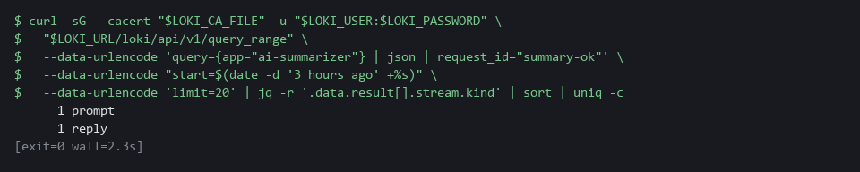

> **CHECKPOINT:** The kinds prompt and reply are both listed. There is no rejected record for summary-ok.

**How this meets the control**

- **AU-12:** Finding both the prompt and the reply in Loki by request id proves someone can later say what was asked and what came back.

### Test 2 (negative). Five bad replies are refused and logged (SI-10 Information Input Validation, AU-12 Audit Record Generation)

- Send the five bad replies through the script.
- Every bad reply must be refused with its own reason, exit with status 1 and leave a rejected record.
- A script that accepts any bad reply has a hole.

```bash
cd /workspace/aid-3/ai-tools
curl -s http://127.0.0.1:8089/healthz >/dev/null || { oc port-forward -n ai-lab svc/stub-model 8089:8080 & sleep 3; }
for id in summary-prose summary-extra summary-badseverity summary-wrongcount summary-long; do
  python3 summarize.py "$id" || echo "  exit status: $?"
done
sleep 5
curl -sG --cacert "$LOKI_CA_FILE" -u "$LOKI_USER:$LOKI_PASSWORD" \
  "$LOKI_URL/loki/api/v1/query_range" \
  --data-urlencode 'query={app="ai-summarizer", kind="rejected"}' \
  --data-urlencode 'limit=20' | jq -r '.data.result[].values[][1]' | jq -r .request_id | sort | uniq -c
```

**Expected output:**

```
Example only. The counts at the end are log lines, so they rise each time you run the loop.
REJECTED: reply is not pure JSON
  exit status: 1
REJECTED: reply must have exactly summary, severity and count
  exit status: 1
REJECTED: severity is not an allowed value
  exit status: 1
REJECTED: count does not match the findings sent
  exit status: 1
REJECTED: summary too long or count negative
  exit status: 1
      1 summary-badseverity
      1 summary-extra
      1 summary-long
      1 summary-prose
      1 summary-wrongcount
```

| Part | What it does | Why you run it |
| --- | --- | --- |
| cd /workspace/aid-3/ai-tools | Moves into the repository folder from Step 1. | summarize.py and findings.json are there. |
| curl ... \|\| { oc port-forward ... } | Opens the tunnel to the stub only if it is not already open. | The script asks the stub for each bad reply. |
| for id in summary-prose ... summary-long | Runs the script once for each of the five bad replies. | Each reply is wrong in its own way, so each must be refused for its own reason. |
| python3 summarize.py "$id" \|\| echo "  exit status: $?" | Runs the script and prints its exit status only when it fails. | Exit status 1 means the script refused the reply. |
| REJECTED: ... | The reason the script gave for each refusal. | Five different reasons show five different checks working. |
| sleep 5 | Waits a few seconds so Loki has the records. | A search straight away can miss the newest records. |
| query={app="ai-summarizer", kind="rejected"} ... \| sort \| uniq -c | Reads the rejected records back from Loki and counts them for each request id. | Each refusal must also be on record in the central store. |

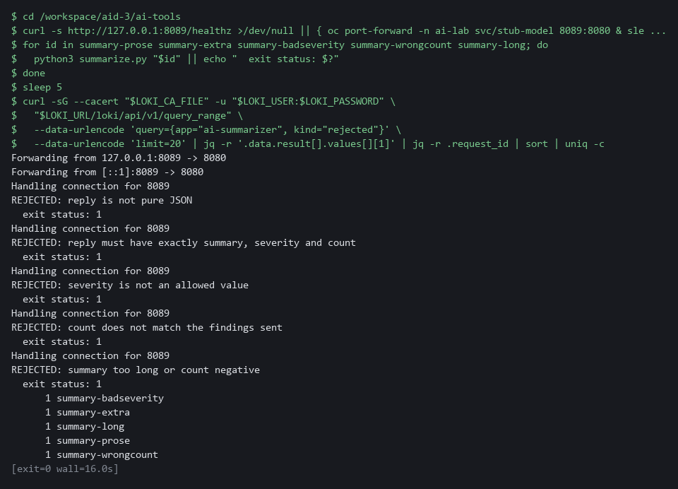

> **CHECKPOINT:** Five different reasons, five exit statuses of 1, and at least one rejected record for each request id. `summary-wrongcount` shows why a shape check alone is not enough.

**How this meets the controls**

- **SI-10:** Each of five bad replies is refused for its own reason with exit status 1. The wrong count shows why a shape check alone is not enough.
- **AU-12:** Each refusal also leaves a rejected record in Loki, and the count of records for each request id is the evidence.

### Test 3 (negative). A bad script fails the gate and cannot merge (CM-3 Configuration Change Control)

- The repository has a second branch, bad-summarizer, with a summary script that has a hardcoded token, no shape check and no logging.
- Run the gate on bad-summarizer and see it fail.
- Try to merge bad-summarizer without a passing status and see Gitea refuse.

```bash
tkn pipeline start ai-script-review -n build \
  -p git-url="$GITEA_URL/$GITEA_USER/ai-tools.git" -p git-revision=bad-summarizer \
  -s pipeline --use-param-defaults -w name=source,claimName=ai-review-pvc -w name=ssl-ca,config=lab-ca --showlog --exit-with-pipelinerun-error || echo "gate failed, as expected"
BAD=$(curl -s -X POST -H "Authorization: token $GITEA_TOKEN" -H 'Content-Type: application/json' \
  -d '{"head":"bad-summarizer","base":"main","title":"Add summarizer without checks"}' \
  "$GITEA_URL/api/v1/repos/$GITEA_USER/ai-tools/pulls" | jq -r .number)
curl -s -o /dev/null -w '%{http_code}\n' -X POST -H "Authorization: token $GITEA_TOKEN" -H 'Content-Type: application/json' \
  -d '{"Do":"merge"}' "$GITEA_URL/api/v1/repos/$GITEA_USER/ai-tools/pulls/$BAD/merge"
```

**Expected output:**

```
Example only. The exact order of the gate lines can differ.
FAIL summarize.py: looks like a hardcoded secret
FAIL summarize.py: missing log_event("prompt"
FAIL summarize.py: missing log_event("reply"
FAIL summarize.py: missing parse_reply(
FAIL tests: need at least 4 tests that expect a rejection
GATE FAILED
gate failed, as expected
405
```

| Part | What it does | Why you run it |
| --- | --- | --- |
| tkn pipeline start ai-script-review ... -p git-revision=bad-summarizer | Runs the same gate on the second branch, which holds a deliberately bad script. | The gate must fail on it, which proves the gate can say no. |
| --exit-with-pipelinerun-error \|\| echo "gate failed, as expected" | Makes the command fail when the gate fails, and prints a note when it does. | A failing gate is the expected result here. |
| FAIL ... lines | Each defect the gate found in the bad script. | The gate says what is wrong, so the author can correct it. |
| BAD=$(curl -X POST ... /pulls \| jq -r .number) | Opens a pull request from bad-summarizer into main and keeps its number. | The merge is attempted so you can see Gitea refuse it. |
| "Do":"merge" ... prints 405 | Asks Gitea to merge. A number from 400 to 499 means it refused. | Nothing reaches main without a passing status. |

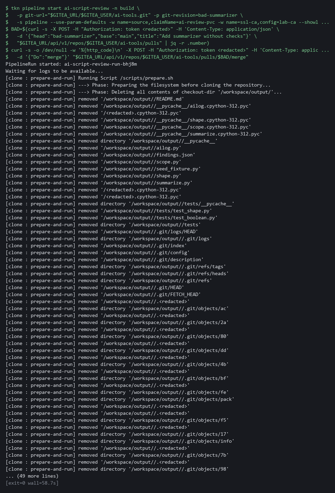

> **CHECKPOINT:** The gate lists each defect and ends with GATE FAILED. The merge returns an error code (405 or another number from 400 to 499) and nothing reaches main. If it returns 200, the branch protection is not enforcing the status check for your account: copy the whole block and its output and ask your AI assistant.

**How this meets the control**

- **CM-3:** The gate fails a branch with a hardcoded token, no shape check and no logging, and Gitea refuses the merge, so nothing reaches main.

### Test 4 (negative). A query that finds nothing and a query that is too wide are both refused (SI-10 Information Input Validation, SA-11 Developer Testing and Evaluation)

- Run the checker on all three drafts side by side.
- The good draft must still pass, so you know the checker is not refusing everything.
- The draft with a wrong event value is a valid query, and Loki accepts it and answers with nothing.
- The wide draft is refused before it runs.
- Run this within an hour of Step 5, while the eight events are still in the last hour.

```bash
cd /workspace/aid-3/ai-tools
for id in good wrongfield wide; do
  echo "draft-$id"
  python3 check_query.py "draft-$id.logql"; echo "  exit status: $?"
done
```

**Expected output:**

```
Example only. Python prints the dictionary with quotes around the names.
draft-good
PASS: matches the known data {'alice': 3, 'bob': 1}
  exit status: 0
draft-wrongfield
FAIL: expected {'alice': 3, 'bob': 1} got nothing
  exit status: 1
draft-wide
FAIL: selector must be exactly {app="ai-fixture"}
FAIL: every range must be present and at most 1h
  exit status: 1
```

| Part | What it does | Why you run it |
| --- | --- | --- |
| cd /workspace/aid-3/ai-tools | Moves into the repository folder from Step 1. | The drafts and fixture.json are there. |
| for id in good ... wide | Runs the checker on each of the three drafts. | The good draft shows the checker is not refusing everything. |
| python3 check_query.py "draft-$id.logql"; echo "  exit status: $?" | Checks one draft and prints how the checker ended. 0 is a pass, 1 a failed draft, 2 wrong test data. | The status tells the three outcomes apart. |
| PASS: matches the known data | The good draft found exactly the failed sign-ins you worked out in advance. | An exact match is the only result that proves the query found everything. |
| FAIL: expected ... got nothing | The wrong-value draft found nothing, though four failed sign-ins exist. | An empty answer is not a quiet system. |
| FAIL: selector must be exactly ... | The wide draft is refused before it runs, with one reason for each problem. | A too-wide query never reaches Loki. |

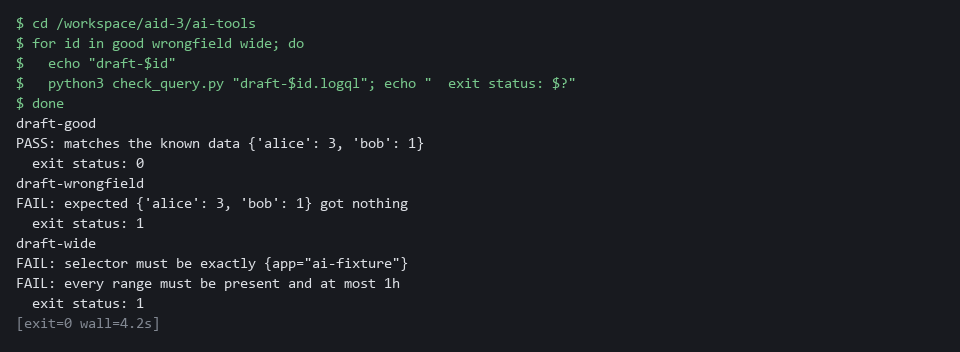

> **CHECKPOINT:** The good draft passes. The wrong-value draft fails with got nothing, so an empty result was not taken for a quiet system. The wide draft is refused with two reasons and never reaches Loki. If the output says FIXTURE, the eight events are no longer exactly the ones in the last hour: delete fixture.json (rm fixture.json), run python3 seed_fixture.py again, wait five seconds and repeat.

**How this meets the controls**

- **SI-10:** The wide draft names every app and a long range, and the checker refuses it before any request reaches Loki, printing a reason for each problem.
- **SA-11:** The draft with a wrong event value is a valid query that finds nothing, and the known data shows it missed four failed sign-ins. Reading the query alone would not have caught that.

## Section 5. What Each Control Is For

### Control mapping

| Control | What it requires, in plain words | Tool or service | Where this module covers it |
| --- | --- | --- | --- |
| SI-10 Information Input Validation | Check that inputs to the system are valid before they are used. | shape.py and summarize.py, run with python3. Explained in section 2.1. | Section 3, Steps 2 and 3: accept one exact reply shape from the model and refuse the rest. Section 3, Step 5: refuse a drafted query whose scope is wrong before it runs. Section 4, Test 2: five bad replies are refused. Section 4, Test 4: a too-wide query is refused. |
| AU-12 Audit Record Generation | The system produces audit records for the events it is meant to record. | `ailog.py`, which sends each record to Loki (the log store in your lab cluster). Explained in section 2.1. | Section 3, Step 3: log each prompt (the question sent to the model), each reply and each rejection to Loki. Section 4, Test 1: find the records. Section 4, Test 2: find the rejected records. |
| CM-3 Configuration Change Control | Review each proposed change and approve or refuse it before it is made. | The review gate pipeline ai-script-review (OpenShift Pipelines) and the protected main branch on Gitea. Explained in section 2.2. | Section 3, Step 4: run the review gate on the branch and merge it into main only on a pass. Section 4, Test 3: a bad branch fails the gate. |
| SA-11 Developer Testing and Evaluation | Whoever writes the code tests it and keeps the results, and the flaws found are corrected. | check_query.py (python3), seed_fixture.py and Loki. Explained in section 2.3. | Section 3, Step 5: test a query the model drafted against eight known sign-in events and compare the result with the answer known in advance. Section 4, Test 4: a query that finds nothing fails the test. |

### What each control is for

Each table below says what the control is trying to prevent and how this module's tool meets it.

#### SI-10 Information Input Validation

| Question | Answer |
| --- | --- |
| Control Intent | Text that came from a model is used as if it were trusted, and a malformed or planted answer changes what the system does. |
| The operational question | What exact shape is allowed, and what happens to an answer that is anything else? |
| What evidence proves it | The written shape, the tests that feed it bad answers, and a record of the rejections. |
| How much is enough | The accepted shape is narrow and written as code: the fields, their types, the allowed values and a size limit. Everything else is refused, not repaired. NIST leaves the list of inputs to check to the organization. The lab checks the model reply and the count it reports. |
| How the tool in this module satisfies it | shape.py (Step 2) accepts only a JSON object (a plain-text data format of names and values) with three named fields, and summarize.py (Step 3) also compares the count in the reply with the number of findings it sent. |

#### AU-12 Audit Record Generation

| Question | Answer |
| --- | --- |
| Control Intent | A model said something and nobody can later show what was asked, what came back, or what the script did with it. |
| The operational question | For any answer the script used or refused, can you show the prompt, the reply and the decision? |
| What evidence proves it | Log entries for each prompt, each reply and each rejection, in the same store as the other logs. |
| How much is enough | Each exchange is logged before the script acts on it, in the central log store, with a request id (a short name sent with each question) that ties the three records together. Logs that hold prompts can hold sensitive text, so what is sent to a model is chosen with that in mind. |
| How the tool in this module satisfies it | `ailog.py` (Step 3) sends one record per event to Loki with the labels (name and value tags) app and kind. |

#### CM-3 Configuration Change Control

| Question | Answer |
| --- | --- |
| Control Intent | A script that calls a model, or acts on its answers, is added to the system without anyone checking that it validates and logs. |
| The operational question | Who or what decided this script could be merged, and on what evidence? |
| What evidence proves it | The gate result recorded as a commit status (a pass or fail mark attached to one saved snapshot, called a commit), and the merge that depended on it. |
| How much is enough | Changes reach the main branch only through a reviewed change request with a passing automated check, held outside the repository under review. The lab treats every script in ai-tools as a controlled change. Direct pushes to main are turned off. |
| How the tool in this module satisfies it | The pipeline ai-script-review (an automated sequence of tasks) runs review_gate.py from a config map (a stored file or setting the cluster keeps). Gitea (the git server in your lab) refuses to merge into main until the commit status is success. |

#### SA-11 Developer Testing and Evaluation

| Question | Answer |
| --- | --- |
| Control Intent | A query a model drafted is trusted because it looks right and returns something, and a query that quietly finds nothing is read as all clear. |
| The operational question | Before this query was relied on, what known events was it tested against, and did it find all of them? |
| What evidence proves it | The known events, the expected counts worked out without the query, and the checker output for each draft. |
| How much is enough | Each drafted query is tested on data whose right answer is known first, and only an exact match passes. A query that returns nothing fails when the known data holds events it should have found. NIST leaves the kinds of testing, how often and the depth to the organization. The lab uses one fixture of eight events. |
| How the tool in this module satisfies it | check_query.py (Step 5) compares the result of the query with counts computed from fixture.json, and Test 4 shows a draft that finds nothing failing. |

## Section 6. Next Steps

### Using this in other environments

- The shape check and summary script are plain Python and work on any OS with Python 3; the stub model service needs no key or internet access.
- Lab-only values are the projects ai-lab, siem, build and gitea, the lab variables LOKI_URL, LOKI_CA_FILE, LOKI_USER, LOKI_PASSWORD, GITEA_URL, GITEA_USER and GITEA_TOKEN, the repository ai-tools, the status name ai-script-review and the label app=ai-fixture.
- The Loki calls in `ailog.py` and `scope.py` and the Gitea commit-status call are specific to those products; on another product, replace the check and keep its idea (log every exchange, and require a recorded pass before a merge).
- The review gate is a Tekton pipeline run with `tkn`; on another CI system, replace the check with a job that clones the branch and runs the same gate Python script.

The table shows what changes on each platform:

| Check/part | In this lab (OpenShift) | On other platforms | What you change |
| --- | --- | --- | --- |
| Shape check (`shape.py`) | python3 in lab shell | Same on any OS with Python 3 | Nothing. |
| Summary script (`summarize.py`) | Port forward to the stub in project ai-lab | Replace the check: a real model service has its own request format | Change `ask()` and set `STUB_URL` to the real endpoint. |
| Log store (`ailog.py`) | Loki in project siem, basic authentication | Replace the check | Rewrite `push()` and `query()` for the target log store; keep the request id on every record. |
| Git server (Gitea) | In-cluster Gitea, commit-status call and branch protection | Replace the check | Rewrite the `curl` calls for the target git server's status and merge rules. |
| Review gate pipeline | OpenShift Pipelines (Tekton), `ai-script-review` | Replace the check | Replace the `tkn` commands with the target CI system; the gate Python script is unchanged. |
| Query checker (`check_query.py`) | Loki LogQL, instant query endpoint | Replace the check | Rewrite `scope.py` for the target query language and endpoint. |

> **TIP:** Next module: AID-4 Build a Constrained Triage Agent: you build a loop where a model proposes steps and your code decides which may run, then attack it with a planted instruction.

<details>
<summary><strong>Section 7. Terms</strong></summary>

Each term is also explained the first time it appears. In Word, hover over an underlined term to see its meaning, or Ctrl+click it to jump to this table.

| Term | Plain meaning |
| --- | --- |
| AWS | Amazon Web Services, the cloud your lab runs in. |
| Boolean | A value that is either true or false. In Python, true also counts as the number 1, which is how a count of true can slip past a careless type check. |
| Branch | A separate line of changes in a repository. The branch named main holds the approved version. |
| Certificate | A file that proves a server's identity, signed by a trusted authority. |
| Clone | Copy a repository from a server to your folder. |
| Cluster | A group of servers that work together as one system. Here it is your own OpenShift cluster in AWS. |
| Commit | One saved snapshot in git, with a short message. |
| Commit status | A pass or fail mark attached to one commit in Gitea. A protected branch can require it. |
| Config map | A stored file or setting that the cluster keeps and can hand to a program. |
| Container | A sealed box that holds one program and everything it needs to run. |
| Credential | A secret that proves who you are, such as a password, token or key. |
| Endpoint | One address and port that something listens on, such as a pod behind a Service or a URL path that returns data. |
| Evidence | Saved records that show a system is set up and behaving as claimed. |
| Exit status | A number a command leaves behind when it ends. 0 means success and anything else means a problem. |
| Fixture | A fixed set of test data whose right answer you know in advance. Here it is the eight sign-in events. |
| Gitea | A git server that runs in your lab. It holds the repository and decides whether a merge is allowed. |
| grep | A command that prints only the lines that match a pattern. |
| Hardcoded secret | A password, token or key written directly into a script. |
| Header | A line of extra information sent with a web request, such as a sign-in token. |
| Heredoc | A way to make a file by pasting its text between a first line such as cat > name <<'EOF' and a last line that says EOF. |
| HTTP | The protocol that web pages and web APIs use. HTTPS is the encrypted form. |
| HTTP status code | A number a web server sends back to say what happened. 200 means success. |
| Image | A packaged copy of a program and everything it needs to run. A container starts from an image. |
| jq | A tool that picks one value out of JSON text. |
| JSON | A plain-text format for data: names and values written inside curly braces. |
| Known data | Events you create yourself, so you can work out the right answer to a query before you run it. |
| Label | A name and value attached to a log stream, such as app=ai-summarizer. Loki searches by labels. |
| Log stream (Loki) | A series of log lines that share the same labels, such as app=ai-summarizer. |
| LogQL | The query language of Loki. A query names the streams to search and can count or filter the lines found. |
| Loki | A log store that runs in your lab cluster. Programs send log lines to it and you search them later. |
| Merge | Bring the changes from one branch into another. |
| mkdir | A command that makes a new folder. |
| Model | A program that writes text when you ask. Here a stub stands in for it. |
| Model reply | The text a model sends back. For the script it is input that is not trusted, however sensible it looks. |
| NIST | The US National Institute of Standards and Technology. It publishes the security control catalog these modules cite. |
| oc | The command-line tool for OpenShift. You type oc to ask the cluster questions. |
| OpenShift | The Red Hat platform your lab cluster runs on. It is Kubernetes with extra security and tools built in. |
| Pipeline | An automated sequence of tasks. Each task runs in its own pod, which is one running copy of a program. |
| PipelineRun | One execution of a Tekton pipeline. |
| Pod | The smallest thing the cluster runs: one or more containers that run together and share one network address. |
| Port forward | A tunnel from your shell to a service inside the cluster, so a command in lab shell can reach it. |
| Project | A named section of the cluster that keeps workloads apart. OpenShift also calls it a namespace. |
| Prompt | The question or instruction text sent to a model. |
| Protected branch | A branch that refuses direct changes. Changes reach it only through a pull request that passes the rules set for it. |
| Pull request | A request to merge one branch into another, which is where review and checks happen. |
| Push | Send your saved commits to the repository on the server. |
| Query | A question you ask a data store, written in a query language, such as a log search. |
| Reference answer | A finished answer to an exercise, kept apart from your work so you open it only after you have tried. |
| Repository | A folder whose history git tracks, so you can see what changed and when. Here it is stored on Gitea. |
| Request id | A short name sent with each question. The stub picks its fixed answer by this name. Here it also ties a prompt, a reply and a rejection together in the log. |
| Review gate | An automated check that must pass before a change is merged. It fails when the work is not acceptable. |
| Role | A list of actions a user or program may take on named kinds of objects. |
| Rule | A written condition that a tool checks. |
| Runner | The program or container that carries out the steps of a pipeline. |
| Scan | A check of software or settings against a list of known problems. The scan reports what it finds. |
| Scan findings | A list of problems that a scan found, one entry for each. |
| Script | A text file of commands or code that the computer runs from top to bottom. |
| Secret | A cluster object that holds a sensitive value such as a password or token, kept apart from ordinary settings. |
| sed | A command that edits text as it passes through, often to replace one string with another. |
| Selector | The part of a LogQL query in curly braces that picks which log streams to search, for example app="ai-fixture". |
| Service account | An identity for a program instead of a person. The review gate pipeline runs as the service account named pipeline. |
| Severity | How serious a finding is, such as low, medium, high or critical. |
| Shape check | Code that accepts one exact structure and refuses everything else, instead of trying to repair a bad answer. |
| Stub model service | A small program that stands in for a model and returns a fixed answer for each request id. It needs no key and no internet access. |
| Tekton | The pipeline engine inside OpenShift Pipelines. It runs each task of a pipeline in its own pod. |
| Template | A file with blanks that are filled in when it is used. |
| Timestamp | The date and time recorded for an event. |
| tkn | The command-line tool for Tekton. It starts a pipeline and shows its log. |
| Token | A long secret string that works like a password for one program. The lab gives you one for Gitea so git and the pull request calls can prove who you are. Anyone who holds it can act as you, so never print it or commit it. |
| uniq | A command that removes repeated neighbouring lines. |
| Unit test | A small test that checks one behavior of a piece of code and says pass or fail. |
| URL | A web address, such as https://example.com/page. |
| Variable | A named value the lab sets for you, such as LOKI_URL. The dollar sign in front of a name means use its value. |

</details>
