# ARC-2: Trace the Security Stack (PL-8, CM-8, SC-7)

| Item | Detail |
| --- | --- |
| Sequence | Module 9 of 32 in the recommended order |
| Timed work | About 56 minutes (34 hands-on, 22 verify) |
| Standalone start | `lab start arc-2` |
| Combined start | Continue from the end state of the previous module |
| Tools | OpenShift Container Platform, Kubernetes NetworkPolicy, Kyverno (free, open source), oc, jq, python3 |
| Prerequisites | ENG-0 Terminal, Git and Your Lab (how to type commands in the lab shell and read what oc prints). No earlier ARC module is needed. This module teaches what a network policy and a Kyverno policy are, in the terms and concepts below. |

## Section 1. Module Overview

- Purpose: show that the written description of a system matches what is really running (PL-8, CM-8, SC-7).
- What you build: nothing. The lab supplies a script that reads the cluster and writes one map file of the parts, the allowed flows and the rules.
- How you run it: run the script, read each section of the map, then prove three claims from it with real requests and two test pods.

- **Skill:** Run a supplied script that maps a sample project from the live cluster, read each section of the map, and prove three claims from it with real requests and test pods.
- **Tools:** `oc` reads the cluster. A supplied Python script (trace_stack.py) turns the answers into one JSON map. `jq` reads one section of the map at a time. Kubernetes NetworkPolicy limits which parts may talk to which. Kyverno refuses or records pods that break a rule.
- **Security Function:** Detects drift between the written description and the running system, and proves which safeguards block and which only record. The map is rebuilt from the live cluster, and real requests and test pods show which paths are blocked and which rule refuses.
- **NIST PL-8 Security and Privacy Architectures:** The supplied script trace_stack.py builds the architecture description from the live cluster, and the claims in the map are tested in Steps 4 and 5 with requests and test pods.
- **NIST CM-8 System Component Inventory:** The components section of the map lists every deployment with its image. `oc get deployments` gives you a second list to compare it with, and a part the script cannot explain is raised as a gap.
- **NIST SC-7 Boundary Protection:** Kubernetes NetworkPolicy objects allow only web to api and api to db. The flows section of the map lists them, and the requests in Step 4 show the other paths are blocked.

## Section 2. The Tools

### Tools used in this module

Each tool name links to its official overview. The table columns say how each tool is used in the lab and why the lab uses it instead of another way of doing the same job.

| Tool (overview link) | What it is | Used in this lab | Why this tool |
| --- | --- | --- | --- |
| [OpenShift Container Platform](https://docs.redhat.com/en/documentation/openshift_container_platform/4.22/html/overview/ocp-overview) | A Kubernetes container platform for running and managing containerized applications. | The cluster the map script reads. | It is the platform the whole lab runs on, so every module works on the same real cluster, with the same kinds of objects a production OpenShift system has. |
| [NetworkPolicy](https://docs.redhat.com/en/documentation/openshift_container_platform/4.22/html/network_security/network-policy) | Rules for which pods may talk to which. Once a policy selects a pod, it accepts only what the policies allow. | One of the parts the map shows: which pods may talk to which. You test the claim with real traffic. | It is the built-in way to limit which pods can talk to which, so you need no extra product to show what a blocked connection looks like. |
| [Kyverno](https://kyverno.io/docs/) | A policy engine that checks and enforces rules on Kubernetes resources. | Its rules are mapped as enforced or only logged, and two test pods show the difference. | It is the policy engine the lab already uses to check and enforce rules on cluster objects, so there are real policies to count and read as evidence. It is free and open source. |
| [oc](https://docs.redhat.com/en/documentation/openshift_container_platform/4.22/html/cli_tools/openshift-cli-oc) | The OpenShift command-line tool for creating and managing applications and projects from a terminal. | Lists the parts by hand first, then runs the checks that test the map's claims. | It is the one command that talks to the cluster, so every module uses it to ask what is true and to make changes. You sign in once, and it works on OpenShift objects as well as standard Kubernetes ones. Unlike clicking in the web console, a command can be pasted, repeated and checked by a test. |
| [jq](https://jqlang.org/) | Command-line JSON processor. | Reads the map and picks sections out of cluster JSON. | It picks one field out of a long JSON reply, so a test can read a single value. |
| [Python 3](https://docs.python.org/3/tutorial/introduction.html) | General-purpose language, used here for small helper scripts. | Runs the supplied map script and keeps its output in a file. | Python reads and writes JSON easily and is already in the lab shell, so a small script needs nothing installed. |

### How it fits together

#### One project, three parts, two kinds of safeguard

- Lab (test) setup: a small sample project on your own cluster.
- The project has three parts (web, api, db).
- Network policies decide who may talk to whom.
- Two Kyverno rules decide what is refused and what is only recorded.
- The supplied script reads the project, the network policies and the Kyverno rules, and writes one map.
- In production the script would run against the real projects, and a person would review the map after each change.
- Each step adds one thing, drawn with thick lines.

How the lab is set up, and why:

- You work in your lab shell on your laptop, and the sample project arc-lab runs on your own cluster.
- The script asks the cluster with oc because only the cluster knows what is really running.
- The script writes the map into your lab shell, away from the cluster, so reading the map cannot change anything it describes.
- The test pods in Step 5 are created inside the same project, because the two Kyverno rules are set to match only the project arc-lab.

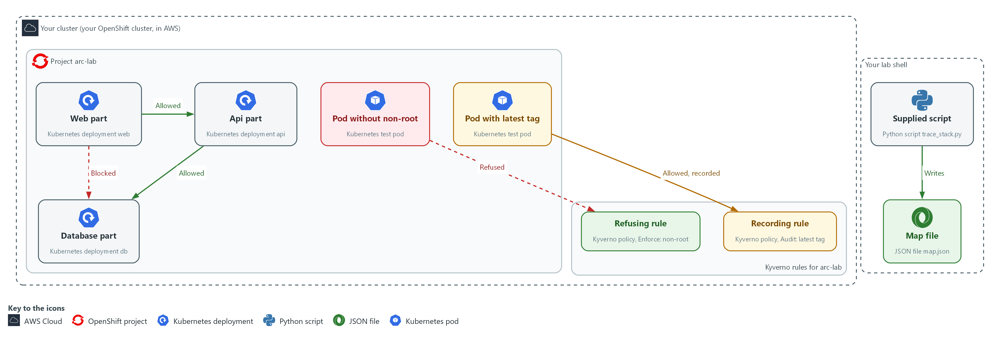

- **1. Web part:** the front end, a Kubernetes deployment named web. It may call the api part.
- **2. Api part:** the application logic, a deployment named api. It may call the database part.
- **3. Database part:** the data store, a deployment named db. Only the api part may call it. A request from the web part is blocked.
- **4. Refusing rule:** a Kyverno policy in Enforce mode. It turns away a pod that does not say it must run as non-root.
- **5. Recording rule:** a Kyverno policy in Audit mode. It lets a pod with the latest tag in and records the violation.
- **6. Supplied script:** the Python script trace_stack.py. It reads the cluster with oc and writes the map.
- **7. Map file:** map.json, written in your lab shell. It holds the parts, the allowed flows and the rules.
- **8. Pod without non-root:** a test pod you create in Step 5. The refusing rule turns it away, so it is never created.
- **9. Pod with latest tag:** a test pod you create in Step 5. It is allowed in, and the recording rule records it.

Where each part runs, and why:

| Part | Where it runs | Why it is built this way |
| --- | --- | --- |
| Lab shell | A container on your laptop | You run the script and every check from one place with the same tools, so the map and the tests come from the same view of the cluster. |
| Project arc-lab | On your cluster | A small closed system with three parts, so you can describe all of it and test every claim. |
| Network policies | In project arc-lab | The cluster enforces them on every connection, and the map reports them as the allowed paths. |
| Kyverno rules | Cluster-wide objects that Kyverno checks | They are checked when a pod is created, so one can refuse and one only records, which Step 5 tests. |
| Supplied script | In the arc folder in your lab shell | It only reads the cluster with oc and writes a file, so running it changes nothing. |

### 2.1 What the map joins together (PL-8 Security and Privacy Architectures, CM-8 System Component Inventory, SC-7 Boundary Protection)

- The supplied script asks the cluster three questions about the project: which deployments exist, which network policies exist, and which Kyverno policies exist.
- The script joins the answers into one JSON file, map.json, with six sections: components, mechanisms, flows, admission, gaps and claims.
- The components section has one row per deployment, with its image and purpose, and supports CM-8.
- The mechanisms and flows sections list the network policies and the paths between parts that they allow, and support SC-7.
- The admission section lists each Kyverno policy and whether it refuses or only records.
- The gaps section lists any part the script cannot explain, which a person must follow up, and supports CM-8.
- The claims section holds three statements you can prove with a command, and supports PL-8.

#### PL-8: Security and Privacy Architectures

*The control asks the organization to develop security and privacy architectures that describe the requirements and approach for protecting the confidentiality, integrity and availability of organizational information, and to review and update them (NIST leaves the frequency organization-defined; FedRAMP assigns at least annually and when a significant change occurs). This is done using:*

- The supplied script trace_stack.py: reads the live cluster with oc and builds the description, so the map names the parts, the allowed flows and the rules.
- The claims section of the map: gives three statements that Steps 4 and 5 test with real requests and test pods.

#### CM-8: System Component Inventory

*The control asks the organization to develop and document an inventory of system components that accurately reflects the system and includes all components within the system, and to review and update it (NIST leaves the frequency organization-defined; FedRAMP assigns at least monthly). This is done using:*

- The components section of the map: lists every deployment with its image and purpose, rebuilt from the cluster each time you run the script.
- The gaps section: lists a part the script cannot explain, so it goes to its owner instead of being ignored.
- oc get deployments (Step 1): gives you your own list to compare with the map.

#### SC-7: Boundary Protection

*The control asks the organization to monitor and control communications at the external managed interfaces to the system and at key internal managed interfaces within the system. SC-7(5) adds denying network traffic by default and allowing it by exception. This is done using:*

- Kubernetes NetworkPolicy objects in arc-lab: allow web to api and api to db, and block every other path to those parts.
- The flows section of the map: lists each allowed path and the network policy that allows it.
- The request loop in Step 4: sends a request along four paths to show the listed ones answer and the others are blocked.

### 2.2 Enforced versus only logged

- A Kyverno rule in Enforce mode stops a request, for example a request to create a pod. Nothing is created, and the refusal message is the evidence.
- A rule in Audit mode lets the request through and records the violation in the policy report. The pod is created and runs even though it broke the rule.
- Only Enforce prevents anything. A policy named arc-disallow-latest sounds like a ban. In Audit mode the latest tag can still be used, so read the mode, not the name.
- The script reads the mode from each policy and says in words what the policy does. Step 5 proves it with two test pods.

### Design decisions

#### Build the map from the live cluster instead of drawing it

- How: A supplied script reads the deployments, network policies and Kyverno policies, derives the map sections and writes one JSON file. Its exit code says whether a person is needed, and a failure to read the cluster stops it with no map rather than a guess.
- Why: A diagram nobody compares with the running system drifts, while a map built at each run is current and cannot hide parts it failed to read.
- Alternatives: A hand-drawn diagram is the alternative. Advantage: it can show intent and reasons that the cluster cannot tell. Drawback: it goes stale and nobody can check it.

#### Test the map's claims with real traffic and test pods

- How: Claims taken from the map are checked by sending a request along each path and by creating two test pods that each break one rule.
- Why: Policy objects only count if behavior matches them, and a rule in Audit mode prevents nothing even when its name sounds like a prohibition.
- Alternatives: Trusting the policy objects is the alternative. Advantage: no test traffic or test pods are needed. Drawback: it cannot tell an enforcing rule from a recording one or show a policy that has no effect.

## Section 3. Implement

- Start: type `lab start arc-2` in the terminal on your own computer (PowerShell on Windows, Terminal on Mac), not in the lab shell.
- Enter lab shell with `lab shell`. Every other command in this module runs inside lab shell.
- If a step fails: run `lab reset arc-2` on your own computer and repeat the step once. If it still fails, copy the whole command and error and ask your AI assistant. Do not skip the step.

### Step 1. List the parts yourself (CM-8 System Component Inventory)

**Learning point: Listing the parts yourself with oc gives you counts and images that do not come from the script, so in Step 3 you can tell whether the map left something out.**

- A map is only worth trusting if you know what it was built from.
- Before you read the map, list the parts and images with plain oc commands.

What this step adds (thick lines and outlines are new):

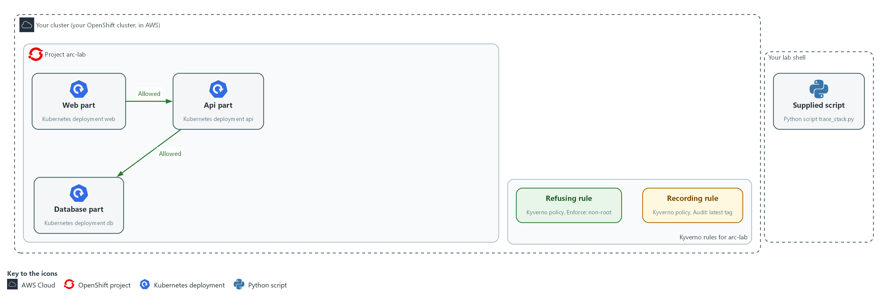

- The lab starts with three parts, the network policies that join them, two Kyverno rules and the supplied script.

#### 1a. List the parts and the policies yourself

You will now list the parts and policies of the project with plain commands.

- The command only reads the cluster and changes nothing.

```bash
oc get deployments,networkpolicies -n arc-lab -o wide
oc get clusterpolicies
```

**Expected output:**

```
Example only. Names, ages and images will differ.
The first command lists the deployments web, api and db with their images, and the network policies in arc-lab.
The second lists the Kyverno cluster policies, with their mode.
```

| Part | What it does | Why you run it |
| --- | --- | --- |
| oc get deployments,networkpolicies -n arc-lab -o wide | Lists the parts (deployments) with their images, and the network policies in the project arc-lab. | Gives you your own count of parts, images and policies before you read the map, so you can tell later whether the map left something out. |
| oc get clusterpolicies | Lists the Kyverno admission policies. They are cluster-wide objects, so they have no project. | Shows which Kyverno rules exist, so you know what the map should list under admission. |

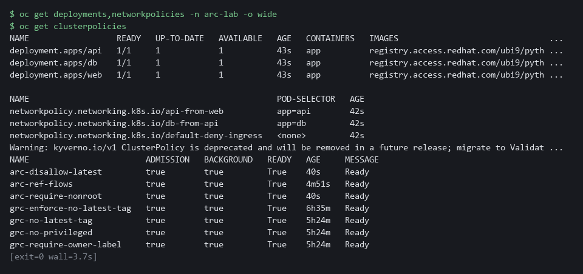

> **CHECKPOINT:** Three deployments (web, api, db), three network policies and two cluster policies. If other cluster-wide Kyverno policies exist on your cluster, you will see more than two, and the map will count them too.

> **TAKEAWAY:** Build your own list first, so you can check the map against it.

**How this meets the control**

- **CM-8:** You list the deployments yourself with oc. That gives you a second inventory to compare with the map in Step 3 and Test 1.

### Step 2. Run the script and keep its output (PL-8 Security and Privacy Architectures)

**Learning point: The script saves a map of the live cluster in map.json, and its exit code says whether a person must look at the gaps (1) or the run cannot be trusted (2).**

- The map goes into the file and the one-line summary stays on screen.
- Exit code 0 means nothing to follow up, 1 means look at the gaps list, 2 means stop.

What this step adds (thick lines and outlines are new):

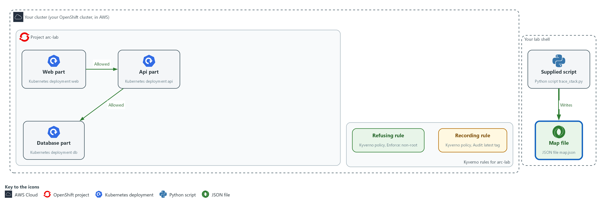

- The supplied script, run in your lab shell, asks the cluster for its deployments and policies and writes the answer to the file map.json.

#### 2a. Run the script and keep the map

You will now run the supplied script on the project arc-lab, keep the map in map.json, and print its summary.

```bash
python3 "$HOME/arc/trace_stack.py" --namespace arc-lab > "$HOME/arc/map.json"
echo "exit code $?"
jq '.summary' "$HOME/arc/map.json"
```

**Expected output:**

```
Example only. Your counts depend on your cluster.
A one-line summary on screen from the script (components, flows, admission, gaps).
exit code 0
A JSON object with the counts of parts, flows, rules and gaps.
```

| Part | What it does | Why you run it |
| --- | --- | --- |
| python3 ... --namespace arc-lab | Runs the script on the project arc-lab. | This is the run that reads the live cluster and builds the map you check for the rest of the module. |
| > "$HOME/arc/map.json" | Saves the map. The summary line still appears on screen. | Keeps the map in a file so later steps can read one section at a time. |
| echo "exit code $?" | Prints the number the script returned. $? always holds the result of the last command. | The code is the script's own verdict. Read it before the map, because a 2 means nothing printed can be trusted. |
| jq '.summary' | Prints the counts the script computed: parts, flows, rules and gaps. | Gives the counts to compare with the counts from Step 1. |

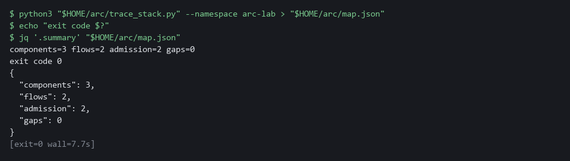

> **NOTE:** If the exit code is 2 the script printed STOP and no map. Do not go on. The script could not read the cluster, and a guess would hide parts. Copy the whole command and the message and ask your AI assistant.

> **CHECKPOINT:** Exit code 0, three components, two flows, two admission rules (more if other cluster-wide policies exist) and no gaps.

> **TAKEAWAY:** Read the exit code before you read the map.

**How this meets the control**

- **PL-8:** Running the script builds the architecture description from the live cluster and saves it as map.json, so it can be reviewed and rerun after a change.

### Step 3. Read each part of the map (CM-8 System Component Inventory, SC-7 Boundary Protection)

**Learning point: Printing each section shows what the script found, from the parts and images to the allowed paths, the rule modes and the three claims you test in Steps 4 and 5.**

Read one section at a time and ask: does it match what I saw in Step 1?

#### 3a. Read the sections of the map

You will now print each section of map.json as a table, one section at a time.

- The command only reads the map and changes nothing.

```bash
jq -r '.components[] | [.name, .image, .does] | @tsv' "$HOME/arc/map.json"
jq -r '.mechanisms[] | [.kind, .name, (.supports | join(","))] | @tsv' "$HOME/arc/map.json"
jq -r '.flows[] | [.from, .to, (.port | tostring), .allowed_by] | @tsv' "$HOME/arc/map.json"
jq -r '.admission[] | [.policy, .mode, .effect] | @tsv' "$HOME/arc/map.json"
jq -r '.claims[] | [.id, .kind, .text] | @tsv' "$HOME/arc/map.json"
```

**Expected output:**

```
Example only. Values will differ.
components: one tab-separated row per deployment (web, api, db) with name, <image> and purpose.
mechanisms: one row per network policy, with kind, name and the controls it supports.
flows: one row per allowed flow with from, to, <port> and the allowing policy.
admission: one row per Kyverno policy with its policy name, mode and effect.
claims: three rows, each with an id, a kind and a statement.
```

| Part | What it does | Why you run it |
| --- | --- | --- |
| .components[] | One row per part: name, image and what it does. A tag such as 9.5 names one version; latest does not. | Lets you compare each part and its image with your own list from Step 1, to see whether a part is missing or unexplained. |
| .mechanisms[] | The network policies, each with the control it supports. | Shows which network policies the map found, so you can match them to the ones you counted. |
| .flows[] | Each allowed flow: from, to, port (the number that picks which program on a pod is called), and the policy that allows it. | These are the allowed paths. They become the first claim you test in Step 4. |
| .admission[] | Each Kyverno policy, its mode and what that mode does in words. | Shows which rule refuses and which only records. You test both in Step 5. |
| .claims[] | Three statements the map makes that you can test. Steps 4 and 5 test them. | Gives you the three statements to prove, so each later test has a clear target. |
| @tsv | Prints the fields separated by tabs so each row reads on one line. | Puts each row on one line so you can scan the columns and compare rows by eye. |

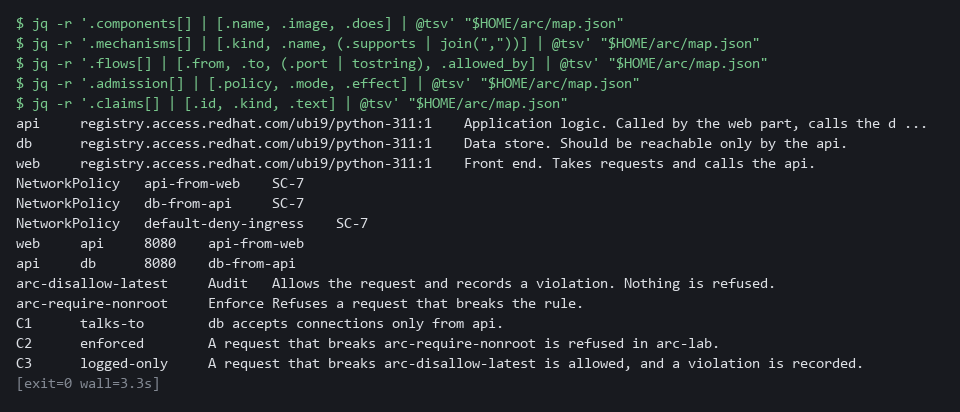

> **TIP:** Read the admission section twice. Other modules' policies may also appear in it. Look at the rows whose names start with arc-: arc-require-nonroot says Enforce and arc-disallow-latest says Audit, and the effect column says in plain words what each does.

> **CHECKPOINT:** The component names and images match your Step 1 list, two flows are listed (web to api, api to db), the arc-require-nonroot row is Enforce, the arc-disallow-latest row is Audit, and three claims are printed. Claims C2 and C3 name those two arc- policies.

> **TAKEAWAY:** Compare every section with your own list, because a section that surprises you is a finding.

**How this meets the controls**

- **CM-8:** The components section is the inventory, one row per deployment. You compare it with your Step 1 list.
- **SC-7:** The flows section lists each allowed path and the policy that allows it. Step 4 tests that claim.

### Step 4. Check claim C1: what talks to what (SC-7 Boundary Protection, PL-8 Security and Privacy Architectures)

**Learning point: Sending a request along four paths shows what the network policies really do, so claim C1 (only the api part may reach the database) is proven by behavior, not just by reading a policy file.**

- The map says the database accepts connections only from the api.
- Send a request along each path to test that the database accepts only the api.

What this step adds (thick lines and outlines are new):

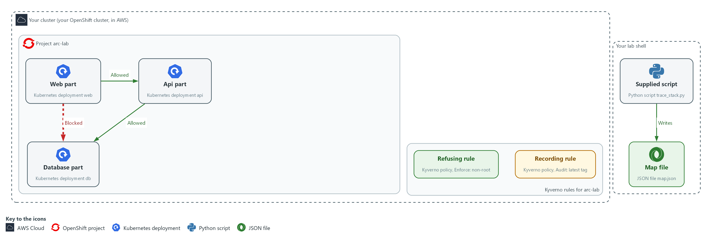

- You send a request from the web part to the database part, and it is blocked. The same request from the api part to the database part is answered.

#### 4a. Send a request along four paths

You will now send one web request from inside each source part to each target part and print what comes back.

```bash
for pair in web:api web:db api:db api:web; do
  from=${pair%%:*}
  to=${pair##*:}
  echo -n "$from -> $to: "
  oc exec -n arc-lab -c app "deploy/$from" -- python3 -c "import urllib.request as u; print(u.urlopen('http://$to:8080', timeout=4).status)" 2>/dev/null || echo blocked
done
```

**Expected output:**

```
Example only. The result should follow the policies.
web -> api: 200
web -> db: blocked
api -> db: 200
api -> web: blocked
```

| Part | What it does | Why you run it |
| --- | --- | --- |
| for pair in ... | Repeats the lines below once for each from:to pair in the list. | Covers every path in one run: the two that should work and two that should not. |
| from=${pair%%:*}, to=${pair##*:} | Splits a pair such as web:api into its two names. | Lets one loop serve every pair, so each path is tested the same way. |
| oc exec ... deploy/$from | Runs a command inside the pod of the source part. | The request must start inside the source part, because that is where a real caller would be. |
| python3 -c ... `urlopen` | Sends one web request to the target part and prints the status code. 200 means it answered. | A real request shows what the network does, which a policy file alone cannot prove. |
| timeout=4 | Gives up after a few seconds. A blocked path never answers, so it ends in an error. | Limits the wait, so a blocked path ends in an error you can read instead of hanging. |
| \|\| echo blocked | Prints blocked when the request failed. | Turns a failure into a word you can read, so the list of results is plain. |

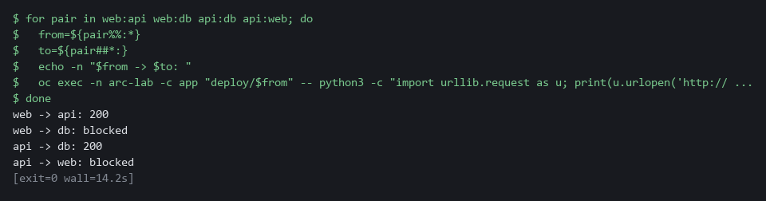

> **NOTE:** Each blocked path waits about 4 seconds before it gives up, so the whole step takes about half a minute. That wait is normal: the network policy is silently dropping the traffic.

> **CHECKPOINT:** web to api prints 200, api to db prints 200, web to db prints blocked and api to web prints blocked. The claim C1 is true.

> **TAKEAWAY:** A network policy counts only if traffic behaves the way it says.

**How this meets the controls**

- **SC-7:** The two listed paths answer and the two unlisted paths are blocked, which shows the boundary denies by default as SC-7(5) asks.
- **PL-8:** Claim C1 says the database accepts only the api part. The requests prove or disprove it against the running system.

### Step 5. Check claims C2 and C3: what is enforced and what is only logged (PL-8 Security and Privacy Architectures)

**Learning point: Two test pods show which rule refuses and which only records: the pod without non-root is turned away, while the pod with the latest tag runs and appears in the policy report.**

- Each test pod breaks one rule.
- If the map is right, the pod without non-root is refused, and the pod with the latest tag is allowed and then recorded.

What this step adds (thick lines and outlines are new):

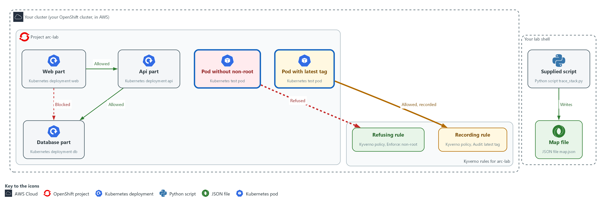

- You send two test pods to the cluster. The refusing rule turns the first one away. The recording rule lets the second one in and records it.

#### 5a. Try to create a pod that breaks the refusing rule

You will now ask the cluster to create a test pod that does not set non-root.

- If the map is right, the request is refused.

```bash
oc delete pod probe-root -n arc-lab --ignore-not-found
oc run probe-root -n arc-lab --image=registry.access.redhat.com/ubi9/ubi-minimal:9.5 --restart=Never -- sleep 300
oc get pod probe-root -n arc-lab
```

**Expected output:**

```
Example only. The wording of the refusal will differ.
An error that names the non-root policy and says the request was blocked.
Error from server (NotFound): pods "probe-root" not found
```

| Part | What it does | Why you run it |
| --- | --- | --- |
| oc run probe-root | Asks the cluster to create a pod with no security settings, so it does not say it must run as non-root. | Tests the refusing rule: if the map is right, the cluster turns this request away. |
| -- sleep 300 | The pod just waits. It does nothing else. | Gives the pod a harmless job, so the only thing that can stop it is the rule under test. |
| oc get pod probe-root | Shows whether the pod exists. If the request was refused there is no such pod. | Confirms whether anything was created. No pod is the proof that the request was refused. |

#### 5b. Create a pod that breaks only the recording rule

You will now create a test pod that sets non-root but uses the latest tag, look for the policy report, and delete the pod.

- The pod really runs for a short time.

```bash
oc delete pod probe-latest -n arc-lab --ignore-not-found
oc run probe-latest -n arc-lab --image=registry.access.redhat.com/ubi9/ubi-minimal:latest --restart=Never --overrides='{"spec":{"securityContext":{"runAsNonRoot":true}}}' -- sleep 300
oc get pod probe-latest -n arc-lab
oc api-resources | grep -i policyreport
sleep 30
oc get policyreport -n arc-lab -o json | jq -r '.items[] | (.scope.name // "") as $pod | .results[]? | select(.result == "fail") | [.policy, .rule, (.resources[0].name // $pod)] | @tsv'
oc delete pod probe-latest -n arc-lab
```

**Expected output:**

```
Example only. Names and times will differ.
pod/probe-latest created
probe-latest   <ready>   <status>   <restarts>   <age>
One line naming the policy report resource type (if nothing prints, stop and copy the whole command and its output to your AI assistant).
One tab-separated line with the policy arc-disallow-latest, <rule> and probe-latest.
pod "probe-latest" deleted
```

| Part | What it does | Why you run it |
| --- | --- | --- |
| --image=...:latest | Uses the moving latest tag, which the recording rule flags. | Breaks only the recording rule, so the result shows what that rule does and nothing else. |
| --overrides=...runAsNonRoot | Adds the non-root setting so this pod breaks only the latest-tag rule. | Satisfies the refusing rule on purpose, so only the recording rule can react to this pod. |
| oc api-resources \| grep -i `policyreport` | Lists the report resource types the cluster knows. If this prints nothing, stop and copy the whole command and its output to your AI assistant. | Checks that the report type exists under this name before you rely on it, so a missing one is not mistaken for no violations. |
| sleep 30 | Waits so Kyverno can write the report. Reports are not instant. | Without the wait the report may still be empty, and you would wrongly conclude that nothing was recorded. |
| oc get `policyreport` ... select(.result == "fail") | Prints only the failed results: the policy, the rule and the pod that broke it. Kyverno 1.19 stores the pod name in the report's scope, so the command reads it from there when the result has none. | This is the record of the violation. It proves the rule noted the pod without stopping it. |
| oc delete pod probe-latest | Removes the test pod. | This pod really runs, so you remove it to leave the project clean for the next test. |

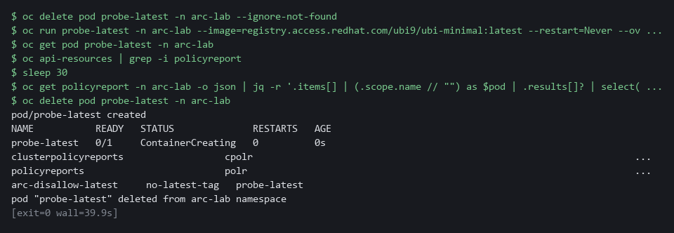

> **SECURITY:** The pod with the latest tag really runs. That is the point of this test: a rule in Audit mode prevents nothing. The last line deletes it.

> **CHECKPOINT:** probe-root is refused with a message that names the non-root policy and no pod exists. probe-latest is created and a failed result for arc-disallow-latest names it. Claims C2 and C3 are true.

> **TAKEAWAY:** A rule in Audit mode prevents nothing; only a refusal is prevention.

**How this meets the control**

- **PL-8:** Claims C2 and C3 say one rule refuses and one only records. The two test pods check that by behavior, because a recording rule prevents nothing.

## Section 4. Verify It Works

### Test 1 (positive). The map lists every deployment the cluster reports (CM-8 System Component Inventory)

- A map that misses a part is worse than no map.
- Compare the map's component count with the cluster's deployment count.

```bash
test "$(jq '.components | length' "$HOME/arc/map.json")" -eq "$(oc get deployments -n arc-lab --no-headers | wc -l)" && echo MATCH || echo MISMATCH
```

**Expected output:**

```
Example only.
MATCH
```

| Part | What it does | Why you run it |
| --- | --- | --- |
| jq '.components \| length' ... | Counts the components in the map. | This is the map's count of parts. |
| oc get deployments -n arc-lab --no-headers \| wc -l | Counts the deployments the cluster reports, one line each. | This is the cluster's own count, which the map must equal. |
| test ... -eq ... && echo MATCH \|\| echo MISMATCH | Prints MATCH when the two numbers are equal, MISMATCH when they are not. | One word you can read, instead of two numbers to compare by eye. |

> **CHECKPOINT:** The line prints MATCH. If it prints MISMATCH, rerun the script from Step 2 and compare again before reporting it.

**How this meets the control**

- **CM-8:** Matching the map's component count to the cluster's deployment count shows the inventory includes every deployment. A mismatch means the inventory is wrong.

### Test 2 (negative). A project that does not exist stops the script (PL-8 Security and Privacy Architectures)

- A wrong project name must not produce an empty map that looks like a clean result.
- The script stops with exit code 2 and no map.
- If you see STOP, do not go on: copy the whole command and message and ask your AI assistant.

```bash
python3 "$HOME/arc/trace_stack.py" --namespace no-such-project > "$HOME/arc/map-missing.json"
echo "exit code $?"
wc -c "$HOME/arc/map-missing.json"
```

**Expected output:**

```
Example only. The wording of the cluster message and the folder in the last line will differ.
STOP: oc get namespace no-such-project failed: Error from server (NotFound): namespaces "no-such-project" not found
Nothing was printed because a partial map would hide parts. Copy this message and ask your AI assistant before going on.
exit code 2
0 /root/arc/map-missing.json
```

| Part | What it does | Why you run it |
| --- | --- | --- |
| --namespace no-such-project | Points the script at a project that does not exist. | The script cannot read it, so it must stop instead of guessing. |
| STOP: ... NotFound | The script names what failed. This text goes to the screen, not into the file. | A clear stop message is the safe failure. |
| exit code 2 | Exit code 2 means the cluster could not be read and no map was made. | Other programs can tell a stop from a clean run. |
| 0 .../map-missing.json | wc -c counts the bytes in the file: 0. | An empty file proves no map was written, so nothing can be mistaken for a clean result. |

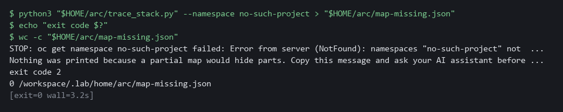

> **CHECKPOINT:** A STOP message, exit code 2 and an empty file. An empty or missing map is never a pass.

**How this meets the control**

- **PL-8:** A map built from a failed read would look complete and say nothing true. The script stops with exit code 2 and writes no map instead of guessing.

### Test 3 (negative). A part the map cannot explain is raised, not hidden (CM-8 System Component Inventory)

- Create a deployment with no tier label (the label that tells the script what kind of part it is), like a part someone added without telling anyone.
- The script cannot say what it does, so it reports a gap.
- The refusing rule turns away the stray deployment's pod, so the pod never becomes ready.
- The map still lists the deployment, because the map reads deployments.

```bash
oc delete deployment stray -n arc-lab --ignore-not-found
oc create deployment stray -n arc-lab --image=registry.access.redhat.com/ubi9/ubi-minimal:9.5 -- sleep infinity
python3 "$HOME/arc/trace_stack.py" --namespace arc-lab > "$HOME/arc/map-stray.json"
echo "exit code $?"
jq -c '.gaps[]' "$HOME/arc/map-stray.json"
oc delete deployment stray -n arc-lab
```

**Expected output:**

```
Example only. Your counts depend on your cluster.
components=4 flows=2 admission=<n> gaps=1
exit code 1
{"type":"unmapped","name":"stray","detail":"no known tier label; owner and purpose unknown"}
```

| Part | What it does | Why you run it |
| --- | --- | --- |
| oc delete deployment stray ... --ignore-not-found | Removes a stray from an earlier try, if there is one. | Makes the test safe to run twice. |
| oc create deployment stray ... | Adds a deployment with no tier label. | It stands in for a part someone added without telling anyone. |
| components=4 flows=2 admission=<n> gaps=1 | The script prints this summary line on the screen (standard error), while the map goes into the file. gaps=1 is the stray deployment. | The summary is the quick sign that the map counted a fourth part and found one gap. |
| exit code 1 | 1 means a map was built but a person must look at the gaps. | A gap is raised, not hidden. |
| jq -c '.gaps[]' | Prints each gap on one line. It names stray and says its owner and purpose are unknown. | Shows exactly what a person has to follow up. |
| oc delete deployment stray | Removes the test deployment. | Leaves the project as it was. |

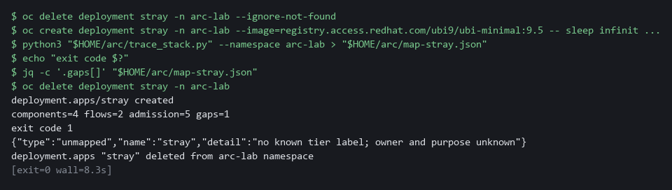

> **CHECKPOINT:** Exit code 1 and a gap that names stray. You deleted it afterwards. In real work you would send the gap to the owner of the project.

**How this meets the control**

- **CM-8:** An unlabeled deployment is listed in the gaps with exit code 1. The right response is to send the gap to its owner, not to add a label so it disappears.

## Section 5. What Each Control Is For

### Control mapping

| Control | What it requires, in plain words | Tool or service | Where this module covers it |
| --- | --- | --- | --- |
| PL-8 Security and Privacy Architectures | Develop security and privacy architectures that describe how information is protected, and review and update them. NIST leaves the frequency organization-defined; FedRAMP assigns at least annually and when a significant change occurs. | The supplied script trace_stack.py, which reads the cluster with oc and writes the map file map.json. Explained in section 2.1. | Section 3, Step 2: run the script and keep the map. Section 3, Steps 4 and 5: check claims from the map against the cluster. Section 4, Test 2: the script stops instead of guessing. |
| CM-8 System Component Inventory | A list of the system's components that matches what is really there. | The components section of the map, built from the cluster's deployments. Explained in section 2.1. | Section 3, Steps 1 and 3: list the parts yourself, then read the components section. Section 4, Test 1: the map lists every deployment. Section 4, Test 3: a part the map cannot explain is raised. |
| SC-7 Boundary Protection | Communications are controlled at the edge of the system and between its internal parts. The enhancement SC-7(5) adds deny by default and allow by exception. | Kubernetes NetworkPolicy objects in the project arc-lab, listed in the flows section of the map. Explained in section 2.1. | Section 3, Step 3: read the flows section of the map. Section 3, Step 4: send a request along each path and see which are blocked. |

### What each control is for

Each table below says what the control is trying to prevent and how this module's tool meets it.

#### PL-8 Security and Privacy Architectures

| Question | Answer |
| --- | --- |
| Control Intent | The architecture on paper says one thing, the running system does another, and nobody notices until an assessment. |
| The operational question | If you read the architecture today, which of its statements could you prove from the running system in five minutes? |
| What evidence proves it | A description of where each safeguard sits, produced from the live system, and checks that show each statement holds. |
| How much is enough | The description names the parts, the allowed flows and the rules, and each claim has a command that proves or disproves it. NIST leaves the review frequency organization-defined; FedRAMP assigns at least annually and when a significant change occurs. |
| How the tool in this module satisfies it | The supplied script (Step 2) builds the map from the cluster. Steps 4 and 5 check three claims from it. |

#### CM-8 System Component Inventory

| Question | Answer |
| --- | --- |
| Control Intent | A component runs in the system that nobody listed, so nobody patches, scans or owns it. |
| The operational question | Can every running part be named, and does the list contain a part nobody can explain? |
| What evidence proves it | The list of components with image and purpose, and its comparison with what the cluster reports. |
| How much is enough | The list matches the cluster, and a part with no known purpose is raised rather than ignored. NIST leaves the review frequency organization-defined; FedRAMP assigns at least monthly. |
| How the tool in this module satisfies it | The components section of the map (Step 3), the count check in Test 1 and the unexplained part in Test 3. |

#### SC-7 Boundary Protection

| Question | Answer |
| --- | --- |
| Control Intent | One part is compromised and can reach every other part because nothing limits internal traffic. |
| The operational question | Which parts may talk to which, and does a test confirm the others cannot? |
| What evidence proves it | The list of allowed flows from the network policies and a connection test for an allowed and a blocked path. |
| How much is enough | Traffic is denied by default, as SC-7(5) asks, and each allowed flow is listed. Step 4 shows the unlisted ones fail. |
| How the tool in this module satisfies it | The flows section of the map and the connection tests in Step 4. |

## Section 6. Next Steps

### Using this in other environments

- Works as is on any OpenShift 4.x cluster that has Kyverno and a network plugin that enforces network policies, with the sample project arc-lab deployed.
- Change these lab values first: the namespace arc-lab, the script path $HOME/arc/trace_stack.py, the container name app used by oc exec, and the images from registry.access.redhat.com (mirror them on a cluster with no internet).
- On other Kubernetes platforms the oc commands map to kubectl. Deployments, NetworkPolicy and Kyverno ClusterPolicy objects are standard and read the same way.
- The map is only as good as the script that builds it. Run it against your own namespace and compare it with the commands in Step 1 before you trust it.

The table shows what changes on each platform:

| Check/part | In this lab | On other platforms | What you change |
| --- | --- | --- | --- |
| Parts list (Step 1) | oc get deployments,networkpolicies -n arc-lab | kubectl get deployments,networkpolicies -n your-namespace | The tool name and the namespace. |
| Kyverno policies | oc get clusterpolicies | The same, if Kyverno is installed | The tool name. Replace the check if you use another policy engine. |
| Path test (Step 4) | oc exec into deploy/web and deploy/api, container app | kubectl exec into your own pods | The tool name, the pod names and the container name. |
| Network policy enforcement | OVN-Kubernetes, the cluster's network plugin, enforces NetworkPolicy | Only if the network plugin enforces it | Check your plugin first. A policy that is not enforced still shows up in the map. |
| Test pods (Step 5) | oc run with ubi9 images from registry.access.redhat.com | kubectl run with images your cluster can pull | The tool name and the image names. |
| Policy report | The policy report resource in arc-lab (`oc get policyreport -n arc-lab`) | The same, if Kyverno policy reports are installed | The tool name and the namespace. |

> **TIP:** Next module: ARC-3 Choose an Admission Mode: choose between two Kyverno modes, Audit and Enforce, by reading back what each one refused and recorded.

<details>
<summary><strong>Section 7. Terms</strong></summary>

Each term is also explained the first time it appears. In Word, hover over an underlined term to see its meaning, or Ctrl+click it to jump to this table.

| Term | Plain meaning |
| --- | --- |
| Admission policy | A rule checked when someone asks the cluster to create or change something, before it is saved. |
| Annotation | A note attached to a cluster object that tools can read. Unlike a label, it is not used to pick objects. |
| Audit mode | The setting in which an admission policy allows a request that breaks the rule and records a violation instead. |
| AWS | Amazon Web Services, the cloud your lab runs in. |
| Cluster | A group of servers that work together as one system. Here it is your own OpenShift cluster. |
| Cluster policy | A Kyverno policy that applies to the whole cluster. |
| Component | One separately running part of the system, such as the web front end or the database. In the cluster each is a deployment. |
| Container | A sealed box that holds one program and everything it needs to run. |
| Controller | A program in the cluster that keeps the real state matching what you asked for. |
| Deployment | A cluster object that keeps a set of identical pods (running copies of a program) alive. |
| Drift | When the real system no longer matches what the files say it should be. |
| Enforce mode | The setting in which an admission policy refuses a request that breaks the rule. |
| Evidence | Saved records that show a system is set up and behaving as claimed. |
| Exit code | The number a command returns when it finishes. 0 means success. Any other number means something needs attention. |
| FedRAMP | The US program that sets security requirements for cloud services used by the federal government. |
| grep | A command that prints only the lines that match a pattern. |
| Header | A line of extra information sent with a web request, such as a sign-in token. |
| Image | The packaged program a pod starts from. Its tag, such as 9.5 or latest, names the version. |
| Inventory | A list of the parts of a system; in Ansible, the machines a playbook runs against. |
| jq | A tool that picks one value out of JSON text. |
| JSON | A plain-text format for structured data, made of names and values in braces. jq reads it. |
| Kubernetes | The open-source system that runs and manages containers across servers. OpenShift is built on it. |
| Kyverno | A policy engine for the cluster. It checks, changes or blocks objects against rules you write. |
| Kyverno policy | An admission policy written for Kyverno, a policy engine (a program that checks every create or change request) running in the cluster. Each policy names what it applies to, the test, and whether it refuses (Enforce) or only records (Audit). |
| Label | A key=value tag on a cluster object, such as app=web. Network policies pick pods by label. |
| Latest tag | A tag that always points at the newest version of an image, so the program can change without notice. |
| Namespace | A named section of the cluster that holds a set of related parts. |
| Network policy | A cluster rule that lists which pods may send traffic to which other pods. Anything not listed is blocked once a pod is selected. |
| NIST | The US National Institute of Standards and Technology. It publishes the security control catalog these modules cite. |
| Non-root | Running as an ordinary user instead of the all-powerful root user, so a break-in has fewer rights. |
| oc | The command-line tool for OpenShift. You type oc to ask the cluster questions. |
| OpenShift | The Red Hat platform your lab cluster runs on. It is Kubernetes with extra security and tools built in. |
| Pod | One running copy of a program in the cluster. A deployment keeps a set number of pods alive. |
| Policy | A set of rules written down so that a tool can enforce them. |
| Policy report | The list of violations that Kyverno records for requests and resources that break a rule. |
| Port | A number that picks which program on a pod receives a request, such as 8080. |
| Project | A named section of the cluster that keeps one set of parts apart from others. Here it is arc-lab. OpenShift also calls it a namespace. |
| Provider | The company or plug-in that supplies a platform, such as a cloud provider or a Terraform provider. |
| Registry | A server that stores container images. |
| Rule | A written condition that a tool checks. |
| Scan | A check of software or settings against a list of known problems. The scan reports what it finds. |
| Script | A text file of commands or program code that the computer runs from top to bottom. |
| Standard error | Where a command prints status lines and problems. It still shows on screen when standard output goes to a file. |
| Standard output | Where a command prints its normal answer. The > sign sends it into a file instead of the screen. |
| TSV | Tab-separated values: a table written as text, with a tab between columns. |

</details>
