# ARC-3: Choose an Admission Mode (SA-8, CM-7, AU-12)

| Item | Detail |
| --- | --- |
| Sequence | Module 15 of 29 in the recommended order |
| Timed work | About 57 minutes (40 hands-on, 17 verify) |
| Standalone start | `lab start arc-3` |
| Combined start | Continue from the end state of the previous module |
| Tools | OpenShift Container Platform, Kyverno (free, open source), oc, jq, python3 |
| Prerequisites | ENG-0 Terminal, Git and Your Lab (typing commands in lab shell, making a file with a heredoc, reading oc output) |

## Section 1. Module Overview

- Purpose: choose between Audit and Enforce mode from test results instead of habit (SA-8, CM-7, AU-12).
- You write a short Python test script that sends four pod requests to the cluster as dry runs, and a review gate checks that test script.
- You run the test script under three conditions (no policy, Audit, Enforce), read the table compare.py prints, and turn the table into a requirement check with jq.

- **Skill:** Test the Audit and Enforce modes of one Kyverno policy against a no-policy baseline, read what each mode lets through and records, and write the choice as a check you can rerun.
- **Tools:** Kyverno policy arc-baseline is the rule being tested, `oc` sends the test requests as dry runs, a Python test script you write collects the outcomes, a review gate script fails a careless test script, and `jq` turns the results into the name of the condition that meets the requirement.
- **Security Function:** Proves what each mode does before it is chosen. The table shows which rule-breaking requests Audit lets through and Enforce blocks, and which records each mode leaves behind.
- **NIST SA-8 Security and Privacy Engineering Principles:** The test script, the review gate and a jq filter apply one principle: test each option the same way before choosing. The jq filter makes the choice a check anyone can rerun.
- **NIST CM-7 Least Functionality:** Kyverno policy arc-baseline restricts what a pod may ask for, and four test pods show which requests Audit lets through and Enforce blocks.
- **NIST AU-12 Audit Record Generation:** Kyverno policy reports and cluster events are the records each mode generates, and the snapshot script counts them after 20 load pods.

## Section 2. The Tools

### Tools used in this module

Each tool name links to its official overview. The table columns say how each tool is used in the lab and why the lab uses it instead of another way of doing the same job.

| Tool (overview link) | What it is | Used in this lab | Why this tool |
| --- | --- | --- | --- |
| [OpenShift Container Platform](https://docs.redhat.com/en/documentation/openshift_container_platform/4.22/html/overview/ocp-overview) | A Kubernetes container platform for running and managing containerized applications. | The cluster where the same Kyverno rules run in three conditions. | It is the platform the whole lab runs on, so every module works on the same real cluster, with the same kinds of objects a production OpenShift system has. |
| [Kyverno](https://kyverno.io/docs/) | A policy engine that checks and enforces rules on Kubernetes resources. | Its rules run in Audit and in Enforce mode; you send the same test requests under each. | It is the policy engine the lab already uses to check and enforce rules on cluster objects, so there are real policies to count and read as evidence. It is free and open source. |
| [oc](https://docs.redhat.com/en/documentation/openshift_container_platform/4.22/html/cli_tools/openshift-cli-oc) | The OpenShift command-line tool for creating and managing applications and projects from a terminal. | Sends the test requests as dry runs and switches the policy between conditions. | It is the one command that talks to the cluster, so every module uses it to ask what is true and to make changes. You sign in once, and it works on OpenShift objects as well as standard Kubernetes ones. Unlike clicking in the web console, a command can be pasted, repeated and checked by a test. |
| [jq](https://jqlang.org/) | Command-line JSON processor. | Reads the result files the comparison prints. | It picks one field out of a long JSON reply, so a test can read a single value. |
| [Python 3](https://docs.python.org/3/tutorial/introduction.html) | General-purpose language, used here for small helper scripts. | Runs the test script and the comparison table. | Python reads and writes JSON easily and is already in the lab shell, so a small script needs nothing installed. |

### How it fits together

#### One choice, three conditions, one table

- Lab (test) setup: you send test requests and read back what each condition lets through and records, a review gate checks your script, and a supplied script prints the three conditions side by side.
- In production you would not switch the live policy or create load pods: you would run this test on a non-production cluster, then set the chosen mode through a reviewed change.
- Each step below adds one part, drawn with thick lines.

How the lab is set up, and why:

- You work in lab shell on your laptop, and the tool you are choosing a mode for runs on your own cluster.
- This module adds a project named arc-measure, four test pod files in your arc folder, and a Kyverno policy that you switch between no policy, Audit and Enforce, so the same requests can be sent under three conditions.
- The test script and the review gate run in lab shell because they only send requests and read files, so they cannot change the cluster except through the dry-run requests and the load pods you ask for.
- The result files stay in lab shell, one for each condition, so the comparison script and the requirement check read the same results.
- Kyverno runs in its own project on the cluster, apart from the project it guards.

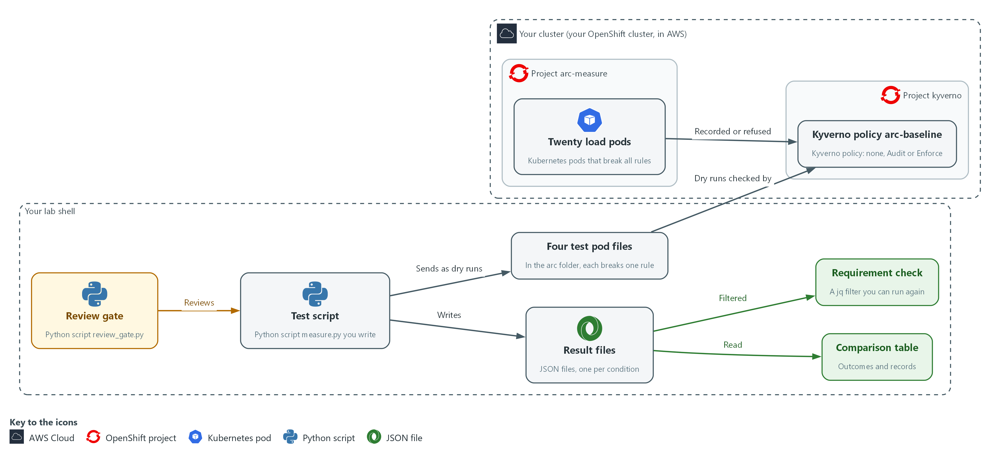

- **1. Four test pod files:** pod definitions in your arc folder. One is fine and three each break one rule (root user, latest image tag, no limits). They are sent as dry runs, so no pod is created.
- **2. Twenty load pods:** pods in the arc-measure project that break every rule on purpose, so each mode has something to record.
- **3. Kyverno policy arc-baseline:** the one policy you switch between no policy, Audit and Enforce. It checks every request to create a pod in arc-measure.
- **4. Test script:** the Python script measure.py you write. It sends the four test requests and records whether each was allowed or denied.
- **5. Review gate:** the supplied script review_gate.py. It reads your test script and fails it if it makes a common mistake.
- **6. Result files:** one JSON file for each condition, holding what each request did and what was recorded.
- **7. Comparison table:** printed by the supplied compare.py, with one column for each condition.
- **8. Requirement check:** a jq filter over the result files that prints the name of each condition that meets the requirement. You can run it again whenever the cluster changes.

Where each part runs, and why:

| Part | Where it runs | Why it is built this way |
| --- | --- | --- |
| Lab shell | A container on your laptop | The test script, the review gate and the comparison all run here and keep their files here, so every condition is tested from the same place. |
| Project arc-measure | On your cluster | The test pods and load pods live here, so the test touches only this project. |
| Kyverno policy arc-baseline | A cluster-wide object checked by Kyverno | One policy in two modes lets you change only the mode between conditions. |
| Kyverno | Project kyverno on your cluster | It is the platform tool you are choosing a mode for. |
| Result files | The results folder in the arc folder in lab shell | One file for each condition lets the table and the requirement check read the same results. |

### 2.1 Why test each mode (SA-8 Security and Privacy Engineering Principles, CM-7 Least Functionality, AU-12 Audit Record Generation)

- A Kyverno rule in Audit mode lets a request through and records the violation, and in Enforce mode it refuses the request. The policy file differs by one word, so the difference is easy to overlook.
- A rule that only records can be mistaken for a rule that protects, so each mode gets the same four requests and the same 20 load pods.
- A test run the same way every time can be repeated by someone else and rerun after an upgrade.

#### SA-8: Security and Privacy Engineering Principles

*The control asks the organization to apply organization-defined systems security and privacy engineering principles in the specification, design, development, implementation and modification of the system. NIST leaves the principles open, and the lab applies one: test each option under the same test before choosing. This is done using:*

- The test script (measure.py): sends the same four requests under every condition, so every option gets the same test.
- The review gate (review_gate.py): fails a test script that makes a common mistake, so the results can be trusted.
- The comparison script and a jq filter: put the results side by side and turn the choice into a check anyone can rerun.

#### CM-7: Least Functionality

*The control asks the organization to configure the system to provide only organization-defined mission essential capabilities, and to prohibit or restrict organization-defined functions, ports, protocols, software and services. This is done using:*

- Kyverno policy arc-baseline: restricts what a pod may ask for, and its mode decides whether a request that breaks a rule is refused (Enforce) or only noted (Audit).
- Four test pod files: three each break one rule (root user, latest image tag, no limits) and one is fine, so the table shows which requests each mode lets through. Only Enforce mode restricts anything.
- oc create with --dry-run=server: sends each pod file through the cluster's admission check without saving a pod.

#### AU-12: Audit Record Generation

*The control asks the organization to provide audit record generation capability for the event types the system can audit, on organization-defined system components, to let organization-defined personnel or roles select which event types each component logs, and to generate audit records for those events. This is done using:*

- Kyverno policy reports: list the failed results Kyverno recorded, which in Audit mode is one for each rule a load pod breaks.
- Cluster events: short notes the cluster records when something happens, such as a pod that could not be created in Enforce mode.
- The snapshot script (snapshot.py): creates the 20 load pods and counts the reports and events for each mode, so the table shows what record exists and how many.

### Design decisions

#### Test Audit and Enforce against a no-policy baseline

- How: One script sends the four test requests as dry runs under three conditions: no policy, Audit and Enforce, and records whether each was allowed or denied. A snapshot of records is taken for each condition.
- Why: The no-policy condition shows what happens with nothing applied, and an identical method makes the result repeatable after an upgrade.
- Alternatives: A dedicated load tool is the alternative. Advantage: it tests behavior under heavy traffic. Drawback: more setup and time, and a result that is harder for a learner to read.

#### Pass the test script through a review gate

- How: A gate script rejects a test script that uses a wall clock, skips the dry run, takes too few samples, keeps the first sample or reports no median, and rejects a result file with missing keys.
- Why: These are the common mistakes, and a gate makes them impossible to miss although it cannot prove the script correct.
- Alternatives: Peer review alone is the alternative. Advantage: a reviewer can catch unusual flaws that a fixed rule list would not. Drawback: it depends on the reviewer's attention every time.

## Section 3. Implement

- Start: type `lab start arc-3` in the terminal on your own computer (PowerShell on Windows, Terminal on Mac), not in the lab shell.
- Enter lab shell with `lab shell`. Every other command in this module runs inside lab shell.
- If a step fails: run `lab reset arc-3` on your own computer and repeat the step once. If it still fails, copy the whole command and error and ask your AI assistant. Do not skip the step.

### Step 1. Confirm the starting condition (CM-7 Least Functionality)

**Learning point: Checking that no policy exists, and that the platform adds no non-root setting of its own, makes the none condition a true baseline. The root test pod is then refused later only because of Kyverno.**

- The three conditions must differ in one thing only.
- The lab already installed Kyverno in the kyverno project, and the cluster pulls ubi-minimal images from registry.access.redhat.com.
- Two kit cases (the latest test pod and the load pods) use the :latest tag on purpose to break the no-latest rule; the other test pods use the pinned 9.5 tag.

What this step adds (thick lines and outlines are new):

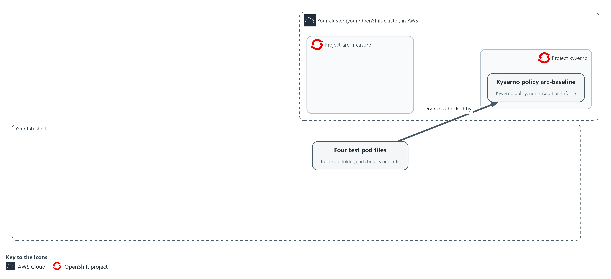

- The lab starts with a project, four test pod files in your arc folder and the Kyverno policy as an Audit file and an Enforce file. No policy is applied to the cluster yet.

#### 1a. Confirm the starting condition

You will now confirm that no policy exists yet and ask the cluster what it adds on its own to the root test pod.

- The command changes nothing on the cluster.

```bash
oc get clusterpolicy arc-baseline --ignore-not-found
oc create -n arc-measure --dry-run=server -f "$HOME/arc/cases/root.yaml" -o jsonpath='{.spec.securityContext}{"\n"}'
```

**Expected output:**

```
Example only. Names and times will differ.
Nothing is printed for the first command (no policy named arc-baseline yet). Policies from other modules may exist; they do not apply in arc-measure.
The security settings of the pod, which should not include runAsNonRoot.
```

| Part | What it does | Why you run it |
| --- | --- | --- |
| oc get clusterpolicy arc-baseline --ignore-not-found | Looks for this module's policy by name and prints nothing if it does not exist. Nothing printed is the answer you want. | The none condition means this module's policy is absent. This proves the starting point is the one you think it is. |
| --dry-run=server ... -o jsonpath | Asks the cluster to check the root test pod (the one that does not say it must run as non-root) without saving it, and prints the security settings it would have. With no policy, non-root should not be set. | Checks that the platform adds nothing of its own, because if it did, the root case would be refused for the wrong reason. |

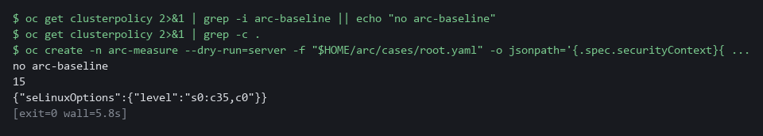

> **NOTE:** If runAsNonRoot is already true, the platform adds it before Kyverno sees the pod, so the root case would be refused for the wrong reason. Stop and ask your AI assistant, with the command and its output.

> **CHECKPOINT:** No arc-baseline policy exists, and the root pod's security settings do not include runAsNonRoot.

> **TAKEAWAY:** A fair comparison starts from a baseline you have checked.

**How this meets the control**

- **CM-7:** Confirming that no policy exists gives the none condition a clean starting point, so later refusals are credited to Kyverno and not to the platform.

### Step 2. Write the test script and pass the review gate (SA-8 Security and Privacy Engineering Principles)

**Learning point: Saving measure.py and running the review gate gives you one test script that sends the four requests as dry runs. A pass means it avoids the mistakes the gate looks for.**

The script sends the four test requests to the cluster as dry runs and records whether each is allowed or denied.

What this step adds (thick lines and outlines are new):

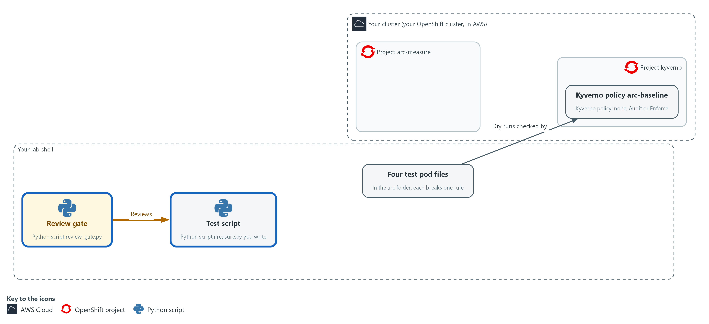

- You write the test script in your arc folder in lab shell, and the review gate reads it before anything runs.

#### 2a. Save the test script

You will now make the test script measure.py in your arc folder by pasting the whole block at once into the lab shell.

- The paste prints only the file listing; you run measure.py in Step 3.

Look for these as you read:

- Look for the mode taken from the command line: the result file must say which condition it measured.
- Look for the --dry-run=server option: the cluster runs every admission check but saves nothing, so you can repeat the request.

```bash
mkdir -p "$HOME/arc"
cd "$HOME/arc"
cat > measure.py <<'EOF'
import json
import os
import statistics
import subprocess
import sys
import time

mode = sys.argv[1]
cases = os.path.expanduser("~/arc/cases")
names = ["ok", "root", "latest", "nolimits"]
SAMPLES = 25


def admit(name):
    cmd = ["oc", "create", "-n", "arc-measure", "--dry-run=server", "-f", "%s/%s.yaml" % (cases, name)]
    start = time.perf_counter()
    done = subprocess.run(cmd, capture_output=True, text=True)
    return (time.perf_counter() - start) * 1000, done.returncode == 0


outcomes = {n: ("allowed" if admit(n)[1] else "denied") for n in names}
samples = sorted([admit("ok")[0] for _ in range(SAMPLES)][1:])
print(json.dumps({
    "mode": mode,
    "n": len(samples),
    "median_ms": round(statistics.median(samples), 1),
    "p95_ms": round(samples[int(len(samples) * 0.95)], 1),
    "outcomes": outcomes,
}))
EOF
ls -l measure.py
```

**Expected output:**

```
Example only. Date and size will differ.
-rw-r--r-- 1 <user> <group> <size> <date> measure.py
```

| Part | What it does | Why you run it |
| --- | --- | --- |
| cd ... cat > measure.py <<'EOF' ... EOF | Moves into the arc folder and writes everything between the first and last line into measure.py. The quotes around EOF keep the text exactly as typed. | The lab has no editor, so a paste is how you make a file. The script text is Python (a programming language), which the lab shell already has as python3. |
| `mode = sys.argv[1]` | Takes the condition name (none, audit or enforce) from the command line. | The result file must say which condition it measured, or three files could not be told apart. |
| cases, names, SAMPLES | Where the test pods are, which four there are, and how many timing samples (one timing from one request) the script takes. | Keeps the four cases and the sample size in one place, so every condition is measured the same way. |
| `def admit(name)` | Sends one dry-run create request and returns how long it took and whether it was accepted. | One small function means every request is sent and timed in the same way. |
| --dry-run=server | The cluster runs every admission check but saves nothing, so you can repeat it without creating objects. | The timing must include the admission check, and a dry run lets you repeat it many times without creating anything. |
| `time.perf_counter()` | A clock built for measuring short intervals. It does not jump when the system time changes. | A clock that can jump would give a wrong delay, and the gate rejects scripts that use one. |
| outcomes = {...} | Runs each of the four cases once and writes allowed or denied for each. | These four answers are what the table later shows as what each mode lets through. |
| [...][1:] inside sorted(...) | Takes 25 timings in the order they were made, drops the first one, which includes warm-up, and sorts the other 24. | The first request is slower for reasons unrelated to the policy, so leaving it out keeps the median fair. |
| statistics.median, p95 | Reports the middle timing and the 95th percentile, not the mean, which one slow outlier can distort. | The median shows the usual delay and the p95 shows the slow tail, which an average would hide. |

#### 2b. Run the review gate on your script

You will now run the supplied review gate on your script.

- The gate only reads the file.

```bash
cd "$HOME/arc"
python3 review_gate.py measure.py
```

**Expected output:**

```
Example only. If your script has a mistake, you see one FAIL line for each rule it breaks.
review gate: PASSED
```

| Part | What it does | Why you run it |
| --- | --- | --- |
| cd ... | Moves into the arc folder. | The gate and your script are both there. |
| review_gate.py measure.py | Reads your script without running it and prints one FAIL line for each rule it breaks, then PASSED or FAILED. | Catches the common mistakes before you spend minutes collecting results you could not trust. |

> **TIP:** Save the script as $HOME/arc/measure.py. The gate's rules are in review_gate.py if you want to read them.

> **CHECKPOINT:** The gate prints review gate: PASSED.

> **TAKEAWAY:** Gate the test script before you trust the results it makes.

**How this meets the control**

- **SA-8:** One test script, passed through a gate that fails common mistakes, tests every condition the same way, so the results can be trusted.

### Step 3. Collect all three conditions, and test the gate meanwhile (SA-8 Security and Privacy Engineering Principles, CM-7 Least Functionality, AU-12 Audit Record Generation)

**Learning point: Running the loop switches the policy for each condition, sends the four requests and counts the reports and events each mode records. You end with one result file for each condition.**

- For each condition the loop switches the policy, sends the requests, gates the output and runs the snapshot.
- The snapshot creates 20 load pods, waits 60 seconds and counts what was recorded.
- Each condition takes about two minutes, so the loop runs in the background while you test the gate.

What this step adds (thick lines and outlines are new):

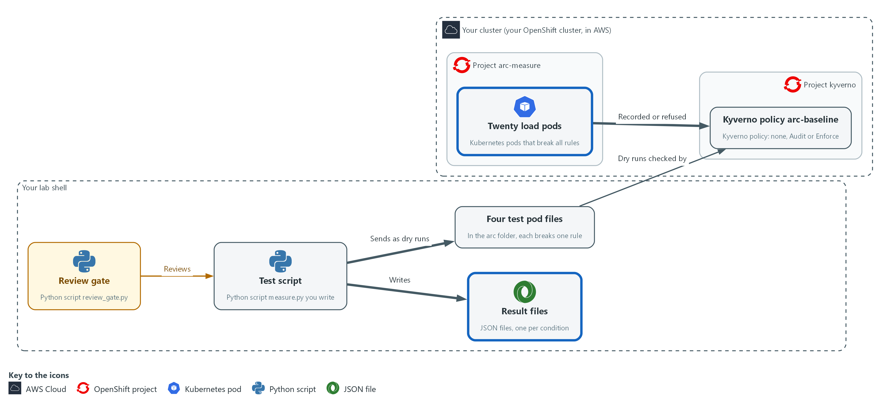

- For each condition you switch the policy in the cluster, send test requests from lab shell to the cluster, add 20 load pods to the project, and save what each mode refused and recorded in result files in your arc folder.

#### 3a. Start the loop that collects all three conditions

You will now start a loop in the background that switches the policy, sends the test requests, gates the output and takes a snapshot of the records for each condition.

- The loop takes about six minutes in all.

```bash
mkdir -p "$HOME/arc/results"
{ for mode in none audit enforce; do
  bash "$HOME/arc/set_mode.sh" "$mode"
  python3 "$HOME/arc/measure.py" "$mode" > "$HOME/arc/results/$mode.json"
  python3 "$HOME/arc/review_gate.py" "$HOME/arc/measure.py" "$HOME/arc/results/$mode.json" && python3 "$HOME/arc/snapshot.py" "$mode"
done; } > "$HOME/arc/loop.log" 2>&1 &
echo "loop started in the background"
```

**Expected output:**

```
Example only.
loop started in the background
```

| Part | What it does | Why you run it |
| --- | --- | --- |
| { for mode in none audit enforce; do ... done; } > loop.log 2>&1 & | Repeats the lines between for and done once for each condition, writes everything they print to loop.log, and runs the whole loop in the background so you can carry on. | Runs all three conditions without you waiting at the keyboard, in the same order each time. |
| set_mode.sh "$mode" | Removes the load pods, then removes the policy (none) or applies it in that mode, and waits until it is ready. | Each condition must start clean, otherwise leftovers from the last one would change the numbers. |
| measure.py "$mode" > results/$mode.json | Runs your script and saves its output for this condition. | Produces the outcome rows for this condition. |
| review_gate.py ... && snapshot.py | Runs the gate on your script and on this condition's result file. The snapshot runs only if the gate passes. | A result file from a poor script must not feed the table, so the snapshot waits for the gate. |
| snapshot.py | Creates the load pods, waits, then adds report counts and event counts to the same result file. | Adds what each mode records, which the test script alone cannot see. |

#### 3b. Run the gate on the careless script

You will now run the gate on the careless script from the kit while the loop works.

- The gate only reads the file.

```bash
python3 "$HOME/arc/review_gate.py" "$HOME/arc/bad_measure.py"
echo "exit code $?"
```

**Expected output:**

```
Example only. The wording of each line will differ.
Six FAIL lines, one for each rule the careless script breaks.
review gate: FAILED
exit code 1
```

| Part | What it does | Why you run it |
| --- | --- | --- |
| review_gate.py bad_measure.py | Runs the same gate on the careless script from the kit. The kit's bad script times with a wall clock, takes one sample and does not discard it, creates a real pod and reports no median, which together break the six rules. The gate only reads the file, so it does not disturb the loop. | Shows that the gate really fails a careless script, which you cannot know from seeing it pass. |
| echo "exit code $?" | Prints the exit code (the number a command leaves behind when it ends) of the gate. A rejected script returns 1. | A pipeline reads this number and not the words, so you check that it is 1 for a rejected script. |

#### 3c. Follow the loop and list the result files

You will now follow the loop log until all three conditions are saved, then list the result files.

- Press Ctrl+C to stop the tail.

```bash
tail -f "$HOME/arc/loop.log"
ls "$HOME/arc/results"
```

**Expected output:**

```
Example only.
Log lines from set_mode.sh, measure.py and snapshot.py.
snapshot saved (three times, once for each condition)
audit.json  enforce.json  none.json
```

| Part | What it does | Why you run it |
| --- | --- | --- |
| tail -f loop.log | Follows the loop's log. Press Ctrl+C when the third snapshot saved line appears. Ctrl+C stops only the tail, not the loop. | Lets you watch the loop make progress, so you know when to move on. |
| ls results | Lists the result files. | Confirms the three files exist before you try to compare them. |

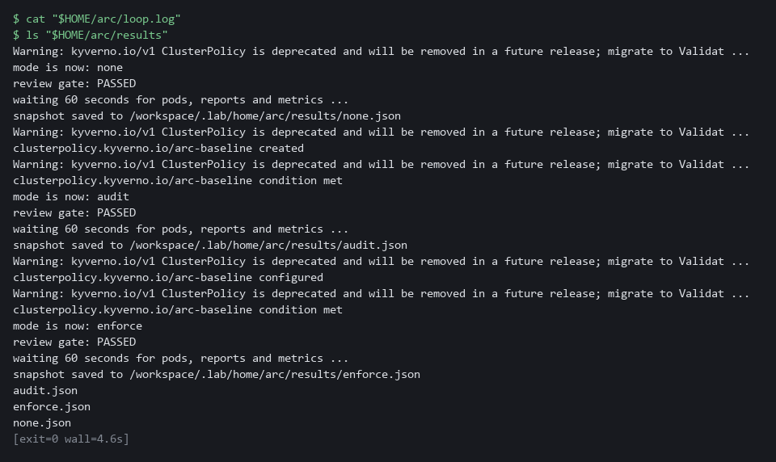

> **NOTE:** If the gate fails inside the loop, read its FAIL lines in loop.log, fix measure.py and run the loop again. Do not run lab start for this module again after this step: it clears the results folder.

> **TIP:** To redo one condition, run: bash "$HOME/arc/set_mode.sh" audit && python3 "$HOME/arc/measure.py" audit > "$HOME/arc/results/audit.json" && python3 "$HOME/arc/snapshot.py" audit

> **CHECKPOINT:** The careless script prints six FAIL lines, review gate: FAILED and exit code 1. Three files exist in the results folder: none.json, audit.json and enforce.json. The log shows snapshot saved three times.

> **TAKEAWAY:** Collect every condition the same way, and show that the gate can fail.

**How this meets the controls**

- **SA-8:** The careless script fails the gate with exit code 1, which shows the gate can reject a poor test script.
- **CM-7:** The result files record whether each of the four requests is allowed or denied under each condition, which shows what each mode restricts.
- **AU-12:** The snapshot script creates 20 load pods and saves the count of policy report results and events each mode produced.

### Step 4. Read back what each mode refused and recorded (CM-7 Least Functionality, AU-12 Audit Record Generation)

**Learning point: Printing the comparison table shows, side by side, which of the four requests each mode refused and which records it left behind.**

- The comparison script reads the three result files and prints, for each condition, which requests were allowed or denied and which records exist.
- The record counts are checked in Verify.

What this step adds (thick lines and outlines are new):

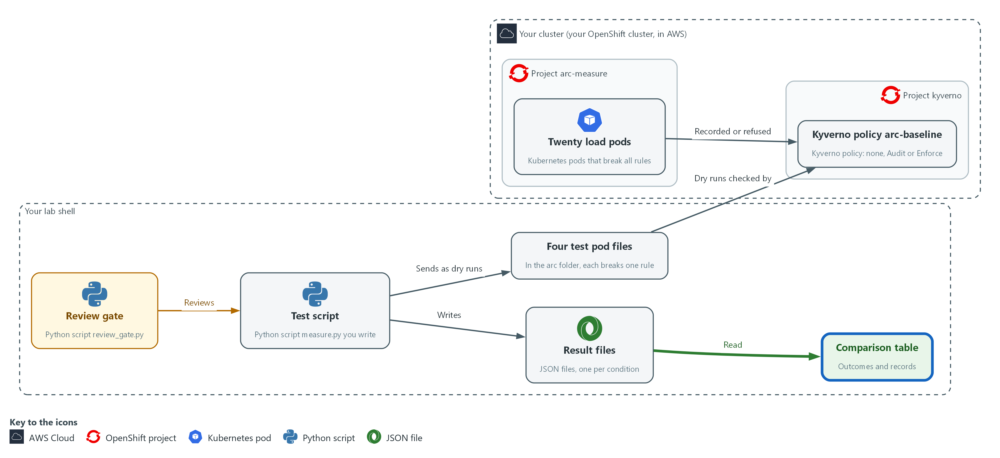

- The comparison script reads the result files in your arc folder and prints the table of outcomes and records on your screen.

#### 4a. Print the table of outcomes and records

You will now print the comparison table from the three result files.

```bash
python3 "$HOME/arc/compare.py"
```

**Expected output:**

```
Example only. All numbers will differ.
A table with one column for each condition (none, audit, enforce): what each of the four requests did and what was recorded. It also holds timing and memory rows from the supplied script, which this module does not use.
```

| Part | What it does | Why you run it |
| --- | --- | --- |
| compare.py | Prints one column per condition: what each of the four requests did and what was recorded. It stops with an error if a result is missing or too small. | Reads back what each mode refused and recorded, which is the evidence that Enforce restricts and Audit only records. |

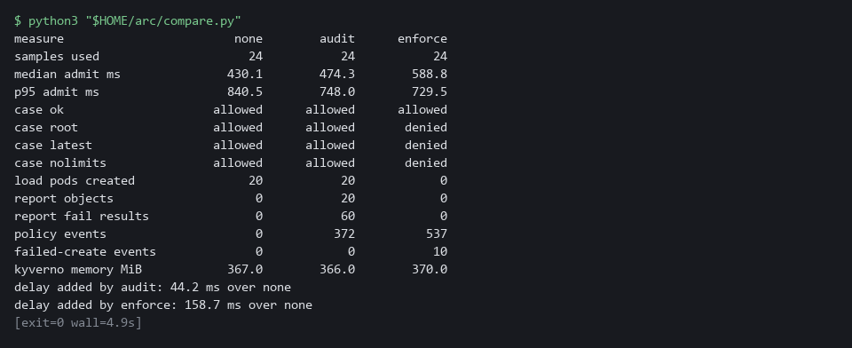

> **NOTE:** Read only the request outcome rows and the record rows. Each of the 20 load pods breaks three rules, so in Audit mode expect three failed results per pod.

> **CHECKPOINT:** The table has three columns. In Enforce the load pods created is 0 and the root request is denied. In none the root request is allowed. The Audit count is checked in Verify.

> **TAKEAWAY:** Only Enforce refuses a rule-breaking request; Audit lets it through and records it.

**How this meets the controls**

- **CM-7:** The outcome rows show which of the four requests each mode refused, and only Enforce refuses any.
- **AU-12:** The record rows show that Audit and Enforce each left reports or events and that the none condition left none. Verify checks the Audit count.

### Step 5. Turn the table into a check on one requirement (SA-8 Security and Privacy Engineering Principles)

**Learning point: Writing the requirement as a jq filter over the result files names the condition that meets it, and the filter can be rerun whenever the tool or the cluster changes.**

- A decision that cannot be rechecked will be argued again.
- The filter asks one question of the result files: which condition refuses the root request and also leaves a record?

What this step adds (thick lines and outlines are new):

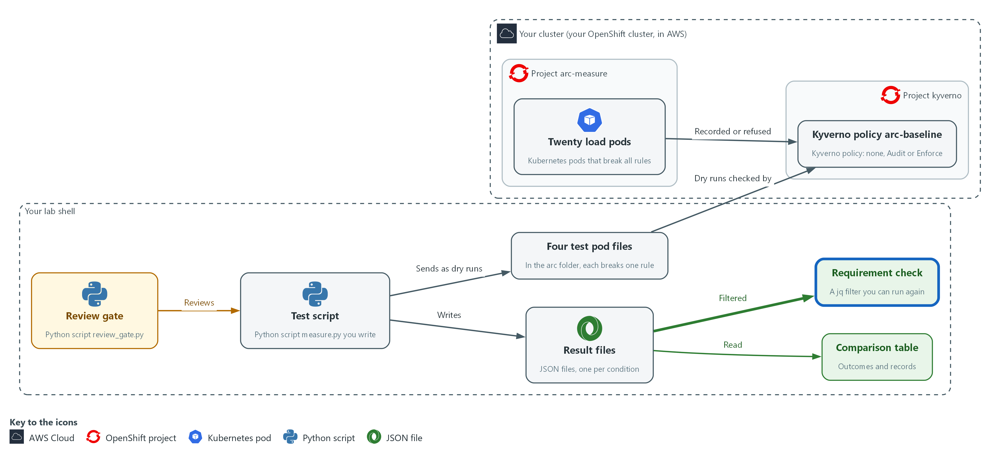

- You run a jq filter over the same result files, which prints the name of the condition that meets the requirement on your screen.

#### 5a. Write the requirement as a filter and reset the project

You will now run a jq filter over the three result files and reset the project.

```bash
jq -r 'select(.outcomes.root == "denied" and (.report_fail_results + .policy_events + .failed_create_events) > 0) | .mode' "$HOME/arc/results/"*.json
bash "$HOME/arc/set_mode.sh" none
```

**Expected output:**

```
Example only.
enforce
(set_mode.sh none prints its progress as it removes the policy and the load)
```

| Part | What it does | Why you run it |
| --- | --- | --- |
| select(.outcomes.root == "denied" and ... > 0) | Keeps only a condition that refused the root request and also left at least one record of any kind. | Writes the requirement as a check anyone can rerun, so the choice is not argued from memory. |
| \| .mode | Prints the name of each condition that passes. | Gives the answer as the name of the condition that meets the requirement. |
| set_mode.sh none | Removes the policy and the load so the project is back to the starting condition. | Puts the project back to the starting condition so the next run starts clean. |

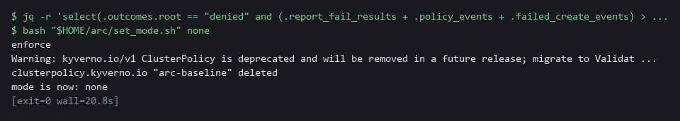

> **TIP:** Change the requirement and rerun the first line, for example to require that the compliant case is still allowed or that no load pod is created.

> **CHECKPOINT:** Only enforce is printed by the first line.

> **TAKEAWAY:** A decision written as a runnable check does not have to be argued again.

**How this meets the control**

- **SA-8:** The jq filter writes the requirement down, so the choice follows from written criteria that anyone can rerun.

## Section 4. Verify It Works

### Test 1 (positive). The record count follows from the load (AU-12 Audit Record Generation)

- A number you can derive independently is a number you can trust.
- Each load pod breaks three rules, so Audit mode should hold three failed results per pod.

```bash
jq '.report_fail_results == (.load_pods_created * 3)' "$HOME/arc/results/audit.json"
```

**Expected output:**

```
Example only.
true
```

| Part | What it does | Why you run it |
| --- | --- | --- |
| .report_fail_results | The number of failed results the Audit snapshot counted in the policy report. | This is what Kyverno recorded. |
| .load_pods_created * 3 | The 20 load pods created, times the three rules each one breaks. | This is what the load predicts, worked out without looking at the report. |
| == ... true | Prints true when the two counts are equal. | A match shows the records follow from the load. false means the counts differ, so compare the two numbers in the result file. |

> **CHECKPOINT:** The answer is true. If it is false, rerun the audit condition once in case the reports were slow, then compare report_fail_results with load_pods_created in audit.json.

**How this meets the control**

- **AU-12:** Each load pod breaks three rules, so Audit mode should hold three failed results for each pod, and this test checks that count.

### Test 2 (negative). The comparison refuses incomplete data (SA-8 Security and Privacy Engineering Principles)

- A table with a column missing would look fine and mislead.
- Move one result away and run the comparison.

```bash
cp "$HOME/arc/results/enforce.json" "$HOME/arc/results/enforce.hold"
rm "$HOME/arc/results/enforce.json"
python3 "$HOME/arc/compare.py"
echo "exit code $?"
cp "$HOME/arc/results/enforce.hold" "$HOME/arc/results/enforce.json"
rm "$HOME/arc/results/enforce.hold"
```

**Expected output:**

```
Example only. The path will differ.
STOP: missing /root/arc/results/enforce.json: run all three conditions before comparing
exit code 2
```

| Part | What it does | Why you run it |
| --- | --- | --- |
| cp ... enforce.hold, rm ... enforce.json | Keeps a copy of the Enforce result and removes the original. | Makes one condition missing, as if a run had failed. |
| python3 compare.py | Tries to print the table with only two of three conditions. | A table with a column missing would look fine and mislead, so it must refuse. |
| STOP: missing ... | The comparison names the missing file and prints no table. | A clear stop is the safe failure. |
| exit code 2 | 2 means the comparison could not run on the data it was given. | Other programs read this number, not the words. |
| cp ... enforce.hold ..., rm ... enforce.hold | Puts the file back and removes the spare. | Leaves your results as they were. |

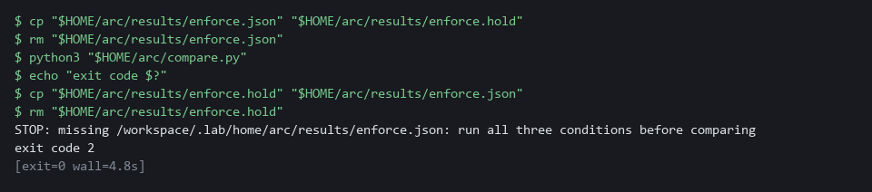

> **CHECKPOINT:** A STOP message and exit code 2, and no table. Put the file back, as the last line does.

**How this meets the control**

- **SA-8:** Removing one result file shows the comparison stops with exit code 2 instead of printing a table with a column missing.

## Section 5. What Each Control Is For

### Control mapping

| Control | What it requires, in plain words | Tool or service | Where this module covers it |
| --- | --- | --- | --- |
| SA-8 Security and Privacy Engineering Principles | Design choices follow stated engineering principles and are made before the system is built or changed. | The test script, the review gate, the comparison script and a jq filter over the result files. Explained in section 2.1. | Section 3, Steps 2 to 4: write and gate the test script, collect three conditions, read back the table. Section 3, Step 5: write the criterion as a check. Section 4, Test 2: the comparison refuses incomplete data. |
| CM-7 Least Functionality | Allow only what the mission needs and block the rest. | Kyverno policy arc-baseline in Audit and Enforce mode, with four test pods that each break one rule. Explained in section 2.1. | Section 3, Step 3: collect the outcome of each test request under each condition. Section 3, Step 4: print the table of outcomes. |
| AU-12 Audit Record Generation | The system produces records of the events that matter. | Kyverno policy reports and cluster events, counted by the kit script snapshot.py. Explained in section 2.1. | Section 3, Step 3: snapshot.py counts what each mode recorded. Section 3, Step 4: read the records rows of the table. Section 4, Test 1: the record count follows from the load. |

### What each control is for

Each table below says what the control is trying to prevent and how this module's tool meets it.

#### SA-8 Security and Privacy Engineering Principles

| Question | Answer |
| --- | --- |
| Control Intent | A design choice is made because it sounds safer or because a colleague preferred it, and it later turns out to block real work or to protect nothing. |
| The operational question | What would you test to know which option is right, and what result would change your mind? |
| What evidence proves it | The criteria, the test results for each option under the same test, and the check that applies the criteria. |
| How much is enough | Each option is tested the same way, including a condition with nothing applied as a baseline. NIST leaves the principles organization-defined. The lab chooses a simple one: test each option under the same test before choosing. |
| How the tool in this module satisfies it | The test script, the review gate and the comparison (Steps 2 to 4), and the criterion check in Step 5. |

#### CM-7 Least Functionality

| Question | Answer |
| --- | --- |
| Control Intent | A request for more power than a workload needs gets through because the rule that should stop it only writes a note. |
| The operational question | For each kind of rule-breaking request, does the cluster refuse it or only note it? |
| What evidence proves it | The outcome of each of four test requests under each mode. |
| How much is enough | Only Enforce mode restricts anything. The table shows which of the four requests each mode allows. Which functions to prohibit or restrict is organization-defined. |
| How the tool in this module satisfies it | The four test pods and the outcome rows of the comparison table. |

#### AU-12 Audit Record Generation

| Question | Answer |
| --- | --- |
| Control Intent | A rule-breaking request is allowed and no record of it exists, or a refusal leaves no trace. |
| The operational question | After a rule-breaking request, what record exists, and where would you find it? |
| What evidence proves it | Counts of policy report results and events for each mode, tied to the pods that caused them. |
| How much is enough | The table shows, for each mode, which kind of record exists and how many. The system components that must generate records are organization-defined. |
| How the tool in this module satisfies it | The snapshot step and the records rows of the comparison table. |

## Section 6. Next Steps

### Using this in other environments

- The method ports as is. It sends a server-side dry run of four manifests and records whether each is allowed or denied.
- Change these lab values first: the project arc-measure, the policy name arc-baseline, the kyverno project, the cases folder $HOME/arc/cases, and the commands in set_mode.sh that switch the Kyverno mode.
- Server-side dry run works with kubectl as well: kubectl create --dry-run=server. The oc create in measure.py becomes kubectl create.
- set_mode.sh, snapshot.py and review_gate.py are lab files. Copy them if you keep them, and adjust the namespaces and policy names inside.

The table shows what changes on each platform:

| Check/part | In this lab | On other platforms | What you change |
| --- | --- | --- | --- |
| Test script | measure.py calls oc create --dry-run=server in arc-measure | The same call with kubectl | The tool name in the command list, and the namespace. |
| Switching modes | set_mode.sh changes the Kyverno policies in the lab | The same, if Kyverno is installed | The policy names and the namespace the script targets. |
| Policy results | Policy reports and events read by snapshot.py | The same, if Kyverno policy reports are installed | The namespace. Replace the check if you use another policy engine. |
| Review gate | review_gate.py is a plain Python script | Runs anywhere Python 3 runs | Nothing. |
| Test images | ubi-minimal 9.5 and latest from registry.access.redhat.com | Any image your cluster can pull, with one pinned and one latest | The image names in the case files. |

> **TIP:** Next module: ARC-4 Test Two Designs: run the same attack cases against two ways of isolating workloads and compare what each blocks.

<details>
<summary><strong>Section 7. Terms</strong></summary>

Each term is also explained the first time it appears. In Word, hover over an underlined term to see its meaning, or Ctrl+click it to jump to this table.

| Term | Plain meaning |
| --- | --- |
| Admission | The check the cluster makes on a request to create or change an object, before the object is saved. |
| Audit mode | The setting in which a rule lets a request through and records a violation. |
| AWS | Amazon Web Services, the cloud your lab runs in. |
| Baseline | The agreed starting configuration that the system is expected to match. |
| Cluster | A group of servers that work together as one system. Here it is your own OpenShift cluster. |
| Cluster policy | A Kyverno policy that applies to the whole cluster. |
| Condition | One setup you test. Here there are three: no policy, Audit mode and Enforce mode. |
| Container | A sealed box that holds one program and everything it needs to run. |
| Dry run | A request the cluster checks fully but does not save. With --dry-run=server the check includes the admission rules. |
| Enforce mode | The setting in which a rule refuses a request that breaks it. |
| Event | A short note the cluster records when something happens to an object, such as a pod that could not be created. |
| Evidence | Saved records that show a system is set up and behaving as claimed. |
| Exit code | The number a command leaves behind when it ends. 0 means success. Any other number means something needs attention. |
| Heredoc | A way to make a file by pasting its text between a first line such as cat > name <<'EOF' and a last line that says EOF. |
| Image | A packaged copy of a program and everything it needs to run. A container starts from an image. |
| jq | A tool that picks one value out of JSON text. |
| JSON | A text format for data, made of names and values in braces. |
| Kit | The files that lab start puts in your arc folder: test pods, policy files, helper scripts and the review gate. |
| Kubernetes | The open-source system that runs and manages containers across servers. OpenShift is built on it. |
| Kyverno | A program in your cluster that checks every request to create or change something against rules, called policies, and can refuse or record the request. |
| Latest tag | A tag that always points at the newest version of a program image, so the program can change without notice. |
| Load pods | Twenty small pods that break every rule on purpose, including the no-latest rule through a deliberate :latest image tag, created to give each mode something to record. |
| Manifest | A YAML file that describes the objects to create in the cluster. |
| Median | The middle timing in the test script's output: half of the requests were faster. Not the point of this module. |
| Namespace | A named section of the cluster that holds a set of related parts. |
| NIST | The US National Institute of Standards and Technology. It publishes the security control catalog these modules cite. |
| oc | The command-line tool for OpenShift. You type oc to ask the cluster questions. |
| OpenShift | The Red Hat platform your lab cluster runs on. It is Kubernetes with extra security and tools built in. |
| p95 | The timing that 95 of 100 requests beat. Part of the test script's output, not the learning goal. |
| Pipeline | A set of automated steps that run in order, such as scan, check and sign. |
| Pod | One running copy of a program in the cluster. |
| Policy | A set of rules written down so that a tool can enforce them. |
| Policy report | The list of violations Kyverno records for pods that break a rule. |
| Project | A named section of the cluster that keeps one set of work apart from others. Here it is arc-measure. OpenShift also calls it a namespace. |
| Registry | A server that stores container images. |
| Replica | One running copy of a program. |
| Review gate | A script that fails when the work given to it is not acceptable, so a person does not have to catch the same mistakes every time. |
| Role | A list of actions a user or program may take on named kinds of objects. |
| Rule | A written condition that a tool checks. |
| Sample | One timing taken from one request by the test script. Many samples give a fairer picture than one. |
| Script | A text file of commands or program code that the computer runs from top to bottom. |
| Snapshot | A kit script that creates the load pods, waits, and records report counts and event counts for one condition. |
| Wall clock | The ordinary time of day on the computer. It can jump when the system time changes, so it is a poor way to time a short request. |
| Warm-up | Extra time the first request takes because nothing is ready yet. It says nothing about the policy, so the script drops it. |
| Webhook | An address that another program calls to send it a message when something happens. |
| YAML | A plain-text format for settings: lines of name: value, with indentation to show what belongs to what. |

</details>
