# ARC-5: Verify a Reference Architecture (PL-8, SC-7, CM-2, CM-8)

| Item | Detail |
| --- | --- |
| Sequence | Module 32 of 32 in the recommended order |
| Timed work | About 62 minutes (46 hands-on, 16 verify) |
| Standalone start | `lab start arc-5` |
| Combined start | Continue from the end state of the previous module |
| Tools | OpenShift Container Platform, Kubernetes NetworkPolicy, Kyverno (free, open source), oc, jq, python3 |
| Prerequisites | ENG-0 Terminal, Git and Your Lab (typing commands in lab shell, making a file with a heredoc, reading oc output) |

## Section 1. Module Overview

- Purpose: show that a running system matches its reference architecture and keeps matching it (PL-8, SC-7, CM-2, CM-8).
- You write one YAML list of allowed flows between four components. Two generators turn it into network policies and a Kyverno admission rule, and a conformance test compares the running project with the list.
- You apply the generated files to the project arc-ref and run the conformance test. You then try to add something the list does not name, and use a supplied timer to measure how fast three kinds of drift are noticed.

- **Skill:** Write one list of allowed flows, generate network policies and an admission rule from it, and build a conformance test that compares the running project with the list and times how fast it notices drift.
- **Tools:** `python3` with PyYAML runs the generators and the test. Kubernetes NetworkPolicy blocks every flow the list does not allow, and Kyverno refuses unlisted policies and pods. `oc` applies the files and reads the cluster, `jq` reads the test report, and OpenShift runs the four components.
- **Security Function:** Blocks every flow between components that the list does not allow, and refuses unlisted policies and pods when they are created. It also detects drift that gets around that (a deleted policy, an extra deployment, an edited list) and measures the detection time.
- **NIST PL-8 Security and Privacy Architectures:** The flow list is the architecture written as data. The Python generators build the running rules from it and the conformance test fails when the project no longer matches it.
- **NIST SC-7 Boundary Protection:** Kubernetes NetworkPolicy objects start from default deny and allow only listed flows. The conformance test opens real connections between every pair of components, and Kyverno refuses a hand-written policy.
- **NIST CM-2 Baseline Configuration:** The flow list is the baseline. The generators put a hash of it on every object. The conformance test reports any object or admission rule built from an older version of the list.
- **NIST CM-8 System Component Inventory:** Kyverno refuses a pod the list does not name, and the conformance test reports an unlisted deployment. The drift timer measures how long that detection takes against the 300 second limit (FedRAMP's five-minute maximum delay).

## Section 2. The Tools

### Tools used in this module

Each tool name links to its official overview. The table columns say how each tool is used in the lab and why the lab uses it instead of another way of doing the same job.

| Tool (overview link) | What it is | Used in this lab | Why this tool |
| --- | --- | --- | --- |
| [OpenShift Container Platform](https://docs.redhat.com/en/documentation/openshift_container_platform/4.22/html/overview/ocp-overview) | A Kubernetes container platform for running and managing containerized applications. | The cluster whose four components you check against the list. | It is the platform the whole lab runs on, so every module works on the same real cluster, with the same kinds of objects a production OpenShift system has. |
| [NetworkPolicy](https://docs.redhat.com/en/documentation/openshift_container_platform/4.22/html/network_security/network-policy) | Rules for which pods may talk to which. Once a policy selects a pod, it accepts only what the policies allow. | Generated from the flows file: default-deny plus one allow policy per entry. | It is the built-in way to limit which pods can talk to which, so you need no extra product to show what a blocked connection looks like. |
| [Kyverno](https://kyverno.io/docs/) | A policy engine that checks and enforces rules on Kubernetes resources. | The generated admission check refuses a pod the list does not name. | It is the policy engine the lab already uses to check and enforce rules on cluster objects, so there are real policies to count and read as evidence. It is free and open source. |
| [oc](https://docs.redhat.com/en/documentation/openshift_container_platform/4.22/html/cli_tools/openshift-cli-oc) | The OpenShift command-line tool for creating and managing applications and projects from a terminal. | Applies the generated objects and checks live state. | It is the one command that talks to the cluster, so every module uses it to ask what is true and to make changes. You sign in once, and it works on OpenShift objects as well as standard Kubernetes ones. Unlike clicking in the web console, a command can be pasted, repeated and checked by a test. |
| [jq](https://jqlang.org/) | Command-line JSON processor. | Reads results. | It picks one field out of a long JSON reply, so a test can read a single value. |
| [Python 3](https://docs.python.org/3/tutorial/introduction.html) | General-purpose language, used here for small helper scripts. | Runs gen_netpol.py, gen_admission.py, conformance.py and drift_timer.py. | Python reads and writes JSON easily and is already in the lab shell, so a small script needs nothing installed. |

### How it fits together

#### One list of allowed flows drives everything

- Lab (test) setup: you run everything from your lab shell against one project on your own cluster.
- In production the generators and the conformance test would run in a pipeline on a schedule, and a failure would be sent to a person.
- Each step adds one thing, drawn with thick lines.

How the lab is set up, and why:

- You write the list and run the scripts in lab shell on your laptop, as in the foundation module, and everything they act on runs on your cluster.
- This module adds a project named arc-ref with four components, and two kinds of object that the generators write into the cluster: network policies in arc-ref and an admission rule that Kyverno checks.
- The list, the generators and the test stay in lab shell, because the list is the one thing a person owns and reviews, and the cluster should hold only what is generated from it.
- The admission rule sits with Kyverno, which already runs in the cluster, because only something inside the cluster can refuse a request before it is saved.
- The conformance test runs from lab shell and reaches into the components with oc exec, because it has to look at the cluster from outside to notice a change nobody listed.
- The timer runs the test again and again from lab shell, so the delay between a change and the first failure can be measured.

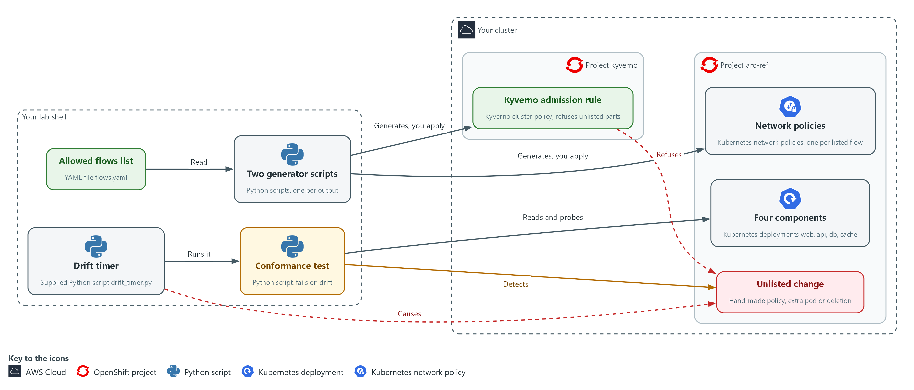

- **1. Your lab shell:** the tools container on your laptop where you write the list, run the generators and run the test.
- **2. Your cluster:** your own OpenShift cluster in AWS. It holds the project arc-ref and Kyverno.
- **3. Project arc-ref:** the named section of the cluster that holds the four components and the generated network policies.
- **4. Project kyverno:** the named section of the cluster where Kyverno runs.
- **5. Allowed flows list:** the file flows.yaml. It is the only thing a person edits.
- **6. Two generator scripts:** they read the list and write the network policies and the admission rule. You apply the output to the cluster.
- **7. Conformance test:** it compares the live policies and real connections with the list, and exits with failure when they differ.
- **8. Drift timer:** it causes drift on purpose, runs the conformance test again and again, and prints how long it took to notice.
- **9. Four components:** the web, api, db and cache parts that run in the project arc-ref.
- **10. Network policies:** the generated rules that allow each listed flow and block every other flow.
- **11. Unlisted change:** a hand-written policy, an extra pod or a deleted policy, none of which the list names.
- **12. Kyverno admission rule:** it refuses a hand-written network policy and a pod that the list does not name.

Where each part runs, and why:

| Part | Where it runs | Why it is built this way |
| --- | --- | --- |
| Lab shell | A container on your laptop | The list, the generators, the conformance test and the timer live here, so a person edits one file and everything else is built from it. |
| Project arc-ref | On your cluster | It holds the four components and the generated network policies, so the test has a small system to compare with the list. |
| Network policies | In project arc-ref | The cluster enforces them on every connection. They are generated, so they are the same every time. |
| Kyverno admission rule | A cluster-wide object checked by Kyverno | It refuses new things that the list does not account for, before they are saved. |
| Conformance test | A script in lab shell that uses oc | It looks at the cluster from outside, so it can find a change that admission could not refuse. |
| Drift timer | A supplied script in lab shell | It repeats the test on an interval and records how long detection takes. |

### 2.1 Data in, rules out (PL-8 Security and Privacy Architectures, SC-7 Boundary Protection, CM-2 Baseline Configuration)

- A person edits one list of allowed flows. Scripts called generators turn it into network policies and an admission check, and nobody writes the output by hand.
- Generated policies are the same every time, so a test can compare them with the running system. Hand-written policies drift and differ between teams.

The four layers are the flow list, the network policies, the admission rule and the conformance test. Each has a limit, which is why all four are used together:

- The flow list enforces nothing by itself.
- The network policies cannot notice that someone deleted them.
- The admission rule cannot stop a delete or a change made before the rule existed.
- The conformance test finds a difference but cannot prevent it.

#### PL-8: Security and Privacy Architectures

*The control asks the organization to develop security and privacy architectures that describe how information is protected, and to review and update them (NIST leaves the frequency organization-defined; FedRAMP assigns at least annually and when a significant change occurs). This is done using:*

- The flow list flows.yaml: the architecture written as data, one entry per allowed call between two components.
- The two generator scripts: write the network policies and the admission rule from the list, so the running project is built from the architecture file.
- The conformance test: fails when the running project no longer matches the list.

#### SC-7: Boundary Protection

*The control asks the organization to monitor and control communications at the external managed interfaces to the system and at key internal managed interfaces within the system. The enhancement SC-7(5) asks for deny by default and allow by exception. This is done using:*

- Kubernetes NetworkPolicy objects: a default-deny policy plus one allow policy per listed flow, so every other flow is blocked.
- The Kyverno admission rule: refuses a hand-written network policy that was not generated from the list.
- The conformance test: opens a real connection between every pair of components to show that the unlisted pairs are blocked.

#### CM-2: Baseline Configuration

*The control asks the organization to develop, document and maintain under configuration control a current baseline configuration of the system, and to review and update it (NIST leaves the frequency organization-defined; FedRAMP assigns at least annually and when a significant change occurs), when organization-defined circumstances require it, and when system components are installed or upgraded. This is done using:*

- The flow list: the baseline, kept as one file.
- The flows hash label: the generators put a hash of the list on every object, so each object names the version of the list it came from.
- The conformance test: reports a network policy or admission rule whose hash differs from the current list as stale.

### 2.2 What the conformance test compares (CM-8 System Component Inventory)

- The test reads the network policies in the project and works out which flows they allow. It then opens a real connection between every ordered pair of components and records which succeed.
- A flow is covered only when a live policy allows it and a real connection succeeds. Coverage is the share of listed flows that are covered.

The test reports four kinds of drift:

- Policy or traffic drift: a listed flow that no policy allows or no connection reaches, or an unlisted flow that a policy allows or a connection reaches.
- Unlisted component drift: a deployment whose app label the list does not name.
- Stale network policy drift: a policy that carries the hash of an older version of the list.
- Admission check drift: the admission rule is missing, is not set to Enforce, or was built from another version of the list.

#### CM-8: System Component Inventory

*The control asks the organization to develop and document an inventory of system components that accurately reflects the system and includes all components within it. Its enhancement CM-8(3) asks for automated detection of unauthorized components. This is done using:*

- The flow list: names the allowed components, so it is the inventory.
- The known-components rule in the Kyverno admission policy: refuses a pod whose app label the list does not name.
- The conformance test: reports a deployment whose app label the list does not name.
- The drift timer: measures how long that detection takes and checks it against the 300 second limit (FedRAMP's five-minute maximum delay).

### Design decisions

#### Keep the allowed flows in one data file and generate from it

- How: One short YAML file lists the components and allowed flows. Generators write a default-deny policy, one allow policy per flow and an admission policy, each carrying a hash of the file.
- Why: Hand-written policies drift and differ between teams, whereas generated ones are identical every time and a test can compare them with the running system.
- Alternatives: Hand-written policies reviewed in pull requests are the alternative. Advantage: full flexibility for unusual rules. Drawback: drift, style differences and no machine link between the list and the objects.

#### Add a timed conformance test to the admission check

- How: The test compares the live policies, the real connections between every ordered pair, the deployments and the hash with the file, and a short timer reruns it.
- Why: Admission cannot stop a delete, so only a repeated comparison catches one, and the worst-case detection time is the interval plus one run.
- Alternatives: Admission alone is the alternative. Advantage: bad changes are refused at once and nothing needs polling. Drawback: it is blind to deletes and to drift that happened before the rule existed.

## Section 3. Implement

- Start: type `lab start arc-5` in the terminal on your own computer (PowerShell on Windows, Terminal on Mac), not in the lab shell.
- Enter lab shell with `lab shell`. Every other command in this module runs inside lab shell.
- If a step fails: run `lab reset arc-5` on your own computer and repeat the step once. If it still fails, copy the whole command and error and ask your AI assistant. Do not skip the step.

### Step 1. State the allowed flows as data (PL-8 Security and Privacy Architectures)

**Learning point: Writing the flow list and running the supplied checker gives you the one file everything else is generated from, and proves it has the shape the generators expect.**

- The list is the architecture: each entry says one component may call another on one port.
- A supplied checker rejects a file in the wrong shape, so a typo cannot become a silent gap.

What this step adds (thick lines and outlines are new):

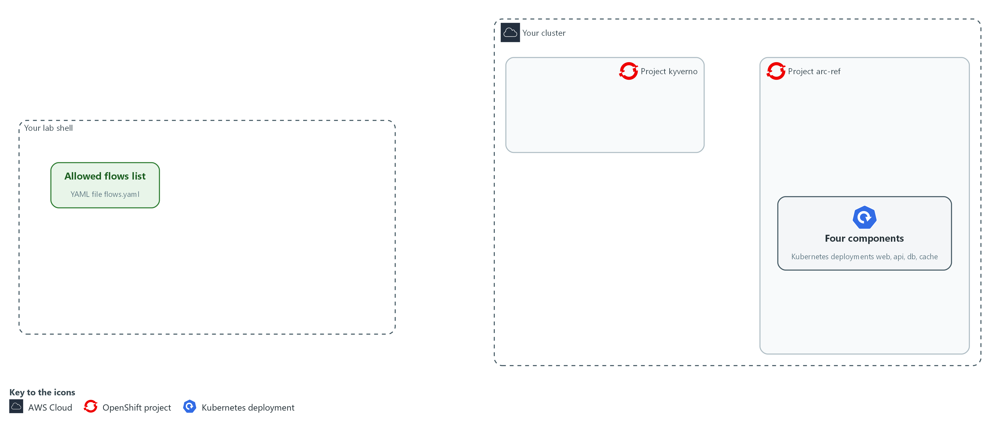

- You write the list of allowed flows in your arc folder in lab shell and check it. The project arc-ref on the cluster runs four components and no policies yet.

#### 1a. Save the allowed flows list

You will now make the file flows.yaml in your arc folder by pasting the whole block at once into the lab shell.

- The last line counts its lines; the next block checks the content.

Look for these as you read:

- namespace names the project the list describes, and every generated object is placed there.
- Each entry under flows is one allowed flow. The list is the whole architecture, so a path not listed is not allowed.
- from and to are the app labels of the caller and the receiver. These are the component names.
- Each flow has one TCP port, so allowing a path never opens more than intended.

```bash
mkdir -p "$HOME/arc/generated"
cd "$HOME/arc"
cat > flows.yaml <<'EOF'
namespace: arc-ref
flows:
  - from: web
    to: api
    port: 8080
  - from: api
    to: db
    port: 8080
  - from: api
    to: cache
    port: 8080
EOF
wc -l flows.yaml
```

**Expected output:**

```
Example only.
11 flows.yaml
```

| Part | What it does | Why you run it |
| --- | --- | --- |
| cd ... cat > flows.yaml <<'EOF' ... EOF | Moves into the arc folder and writes the text between the first and last line into flows.yaml. The quotes around EOF keep the text exactly as typed. | The lab has no editor, so a paste is how you make a file. |
| namespace: arc-ref | The project (a named section of the cluster) the list describes. Every generated object is placed there. | Puts every generated object in the right project, so none lands somewhere unexpected. |
| flows | A list. Every entry is one allowed flow. | One entry per allowed path means the list is the whole architecture. |
| from, to | The app label (a key=value tag on a pod) of the caller and of the receiver. These are the component names. | Names components by the label the policies select on, so the list and the cluster speak the same words. |
| port: 8080 | The one TCP port (a number that picks which program on a pod receives a request) the flow may use. | Limits each flow to one port, so allowing a path never opens more than intended. |

#### 1b. Check the list

You will now check the list with the supplied checker.

```bash
cd "$HOME/arc"
python3 check_flows.py flows.yaml
```

**Expected output:**

```
Example only.
flows file OK: 3 flows, 4 components
```

| Part | What it does | Why you run it |
| --- | --- | --- |
| cd "$HOME/arc" | Moves to the folder that holds the kit. Later steps use short names from here. | The later commands use short file names, so you stand where the kit lives. |
| check_flows.py flows.yaml | Rejects a file with unknown keys, repeated flows, a flow from a component to itself, or a port outside 1 to 65535. | Catches a typo in the list before it can produce wrong policies. |

> **NOTE:** The lab has already installed Kyverno in the kyverno project and runs the four components in arc-ref. The supplied files check_flows.py, flows-bad.txt and drift_timer.py are in the arc folder.

> **CHECKPOINT:** The checker prints flows file OK: 3 flows, 4 components.

> **TAKEAWAY:** The architecture is one short file that a person owns and a tool checks.

**How this meets the control**

- **PL-8:** The supplied checker rejects a flow list in the wrong shape.

### Step 2. Generate the network policies and the admission check (PL-8 Security and Privacy Architectures, SC-7 Boundary Protection, CM-2 Baseline Configuration)

**Learning point: Generating and applying the two files turns the list into a default-deny network and an admission guard, both stamped with the hash of the list.**

- The network policy generator and the admission check generator read the same file and stamp every output with a short hash of it.
- You apply the admission check first, so it already guards the project when the network policies arrive.

What this step adds (thick lines and outlines are new):

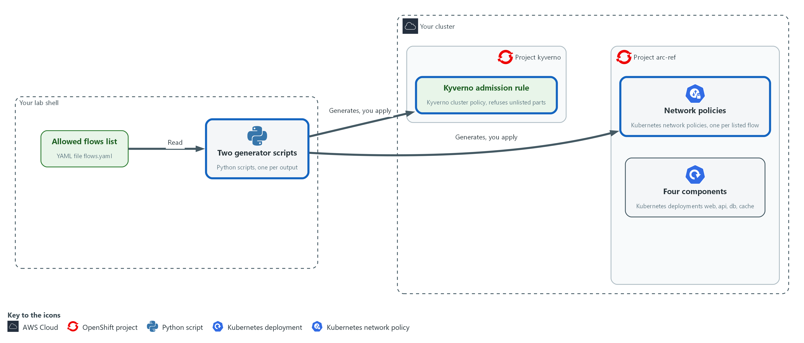

- The generators read the list and write the network policies and the admission check into files in your arc folder. You then apply them to the cluster: the admission rule goes to Kyverno and the network policies go to the project arc-ref.

#### 2a. Save the network policy generator

You will now make the script `gen_netpol.py` in your arc folder by pasting the whole block at once into the lab shell.

- You run it in the third block.

Look for these as you read:

- The input list and the output file come from the command line, so the script never changes when the architecture changes.
- The hash is a short fingerprint of the list file, held in the variable digest. Every policy carries it, so a policy from an older list can be seen later.
- The network policy generator first writes a policy that selects every pod and allows nothing, which is default deny.
- One allow policy is built for each flow in the list, with the receiver and the sender chosen by label and one TCP port.
- The policies are written in a fixed order, so the same list always gives the same file.

```bash
mkdir -p "$HOME/arc/generated"
cd "$HOME/arc"
cat > gen_netpol.py <<'EOF'
import hashlib
import sys

import yaml

flows_path, out_path = sys.argv[1], sys.argv[2]
data = yaml.safe_load(open(flows_path))
digest = hashlib.sha256(open(flows_path, "rb").read()).hexdigest()[:12]


def netpol(name, selector, rule):
    spec = {"podSelector": selector, "policyTypes": ["Ingress"]}
    if rule:
        spec["ingress"] = [rule]
    meta = {"name": name, "namespace": data["namespace"], "labels": {"arc-flows": digest}}
    return {"apiVersion": "networking.k8s.io/v1", "kind": "NetworkPolicy", "metadata": meta, "spec": spec}


docs = [netpol("default-deny-ingress", {}, None)]
for flow in data["flows"]:
    source = {"podSelector": {"matchLabels": {"app": flow["from"]}}}
    rule = {"from": [source], "ports": [{"protocol": "TCP", "port": flow["port"]}]}
    name = "allow-%s-to-%s-%d" % (flow["from"], flow["to"], flow["port"])
    docs.append(netpol(name, {"matchLabels": {"app": flow["to"]}}, rule))

with open(out_path, "w") as out:
    yaml.safe_dump_all(docs, out, sort_keys=True)
print("wrote %d policies, flows hash %s" % (len(docs), digest))
EOF
```

**Expected output:**

```
No output. The prompt returns when the paste has finished.
```

| Part | What it does | Why you run it |
| --- | --- | --- |
| `cd ... cat > gen_netpol.py <<'EOF' ... EOF` | Moves into the arc folder and writes the text between the first and last line into `gen_netpol.py`. The quotes around EOF keep the text exactly as typed. | The lab has no editor, so a paste is how you make a file. |
| `flows_path, out_path = sys.argv[1], sys.argv[2]` | The input file and the output file come from the command line. | The same script serves any list, so you never edit the generator to change the architecture. |
| `digest = sha256(file)[:12]` | The first 12 characters of a fingerprint of the file. It changes whenever the file changes. | Stamps every object with the version of the list it came from, which makes a stale object visible later. |
| `def netpol(...)` | Builds one network policy as a dictionary (a Python structure of names and values). An empty rule means deny all. | One function builds every policy, so they all have the same shape. |
| `docs = [netpol("default-deny-ingress", {}, None)]` | The first policy selects every pod and allows nothing: the default deny. | Starts the project from deny all, so anything not listed is blocked. |
| for flow in data["flows"] | Adds one allow policy per listed flow: the receiver and the sender chosen by label, and one TCP port. | Turns each list entry into one allow policy, so adding a flow means adding a line to the list. |
| yaml.safe_dump_all | Writes all policies to one file in a fixed order, so the same list always gives the same file. | Same list, same file every time, so the repeatability check in Verify can pass. |

#### 2b. Save the admission check generator

You will now make the script gen_admission.py in your arc folder by pasting the whole block at once into the lab shell.

- You run it in the next block.

Look for these as you read:

- The set of allowed component names is built from the list itself, so the list is the only place names are written.
- The admission policy has two rules, policy-from-flows and known-components. Both apply to create and update requests in the project, and each refuses a request that fails its pattern.
- The policy-from-flows rule requires a network policy to carry the current hash, so a policy not generated from this list is refused.
- The known-components rule requires a pod to carry an app label from the list, so an unlisted component is refused.
- The annotation set to none stops Kyverno from copying the pod rule onto deployments, so an unlisted deployment can still be created and the conformance test can find it.

```bash
mkdir -p "$HOME/arc/generated"
cd "$HOME/arc"
cat > gen_admission.py <<'EOF'
import hashlib
import sys

import yaml

flows_path, out_path = sys.argv[1], sys.argv[2]
data = yaml.safe_load(open(flows_path))
digest = hashlib.sha256(open(flows_path, "rb").read()).hexdigest()[:12]
apps = sorted({flow[end] for flow in data["flows"] for end in ("from", "to")})


def rule(name, kind, message, pattern):
    where = {"kinds": [kind], "namespaces": [data["namespace"]], "operations": ["CREATE", "UPDATE"]}
    validate = {"failureAction": "Enforce", "message": message, "pattern": pattern}
    return {"name": name, "match": {"any": [{"resources": where}]}, "validate": validate}


label = {"metadata": {"labels": {"arc-flows": digest}}}
known = {"metadata": {"labels": {"app": " | ".join(apps)}}}
policy = {
    "apiVersion": "kyverno.io/v1",
    "kind": "ClusterPolicy",
    "metadata": {"name": "arc-ref-flows", "annotations": {"pod-policies.kyverno.io/autogen-controllers": "none"}},
    "spec": {"background": True, "rules": [
        rule("policy-from-flows", "NetworkPolicy", "Network policies here must be generated from flows.yaml.", label),
        rule("known-components", "Pod", "Pods here must carry an app label that flows.yaml lists.", known),
    ]},
}
with open(out_path, "w") as out:
    yaml.safe_dump(policy, out, sort_keys=True)
print("wrote the admission check for %s, flows hash %s" % (", ".join(apps), digest))
EOF
```

**Expected output:**

```
No output. The prompt returns when the paste has finished.
```

| Part | What it does | Why you run it |
| --- | --- | --- |
| cd ... cat > gen_admission.py <<'EOF' ... EOF | Moves into the arc folder and writes the text between the first and last line into gen_admission.py. The quotes around EOF keep the text exactly as typed. | The lab has no editor, so a paste is how you make a file. |
| apps = sorted({...}) | Every component name that appears in any flow, as the allowed set. | Builds the set of allowed component names from the list itself. |
| `def rule(...)` | Builds one Kyverno rule that applies to create and update requests in the project and refuses a request that fails the pattern. | Makes both rules from one shape, so they refuse in the same way. |
| label = {...arc-flows: digest} | The pattern for network policies: the label must equal the current hash. | Refuses a network policy that was not generated from the current list. |
| known = {...app: the names joined...} | The pattern for pods: the app label must be one of the listed names, written as one string with a vertical bar between the names. | Refuses a pod whose app label is not in the list. |
| `autogen-controllers: none` | Stops Kyverno from copying the pod rule onto deployments (its automatic rule generation), so an unlisted deployment can still be created and the conformance test can find it. The pod rule still refuses that deployment's pods. | Keeps an unlisted deployment creatable, so the conformance test, and not admission, is what finds it. |

#### 2c. Generate both files and apply them

You will now run both generators, apply the admission check first and then the network policies, and list the policies with their labels.

```bash
cd "$HOME/arc"
mkdir -p generated
python3 gen_netpol.py flows.yaml generated/networkpolicies.yaml
python3 gen_admission.py flows.yaml generated/admission.yaml
oc apply -f generated/admission.yaml
oc wait clusterpolicy/arc-ref-flows --for=condition=Ready --timeout=120s
oc rollout status deployment/kyverno-admission-controller -n kyverno --timeout=180s
for try in 1 2 3; do oc apply -f generated/networkpolicies.yaml && break; echo 'the Kyverno webhook is not answering yet, retrying'; sleep 15; done
oc get networkpolicy -n arc-ref --show-labels
```

**Expected output:**

```
Example only. Hashes and ages will differ.
wrote 4 policies, flows hash <hash>
wrote the admission check for api, cache, db, web, flows hash <hash>
clusterpolicy.kyverno.io/arc-ref-flows created (a re-run says configured or unchanged).
clusterpolicy.kyverno.io/arc-ref-flows condition met
deployment "kyverno-admission-controller" successfully rolled out
Four networkpolicy objects created (a re-run says configured or unchanged). If the webhook was not answering yet, a retry message prints first.
A warning that ClusterPolicy is deprecated may print after each oc command that touches Kyverno policies. It is harmless.
Four network policies in arc-ref, each with the same arc-flows=<hash> label.
```

| Part | What it does | Why you run it |
| --- | --- | --- |
| cd ... mkdir -p generated | Moves into the arc folder and makes the folder for the generated files if it is not there. | The commands below use short names from here, and the folder must exist to receive the files. |
| `gen_netpol.py ... gen_admission.py` | Write the two generated files. Never edit them. Edit the flow list and run these again. | Produce the objects from the list, so nobody writes the output by hand. |
| oc apply -f generated/admission.yaml | Installs the admission check first, so the network policies that follow are checked by it. | The guard goes first, so the policies that follow are checked by it. |
| oc wait ... Ready | Waits until Kyverno reports the policy ready. | A rule that is not ready yet would not check the next apply. |
| oc rollout status deployment/kyverno-admission-controller | Waits until the Kyverno component that answers admission requests is fully running. | The policy can be Ready before the component that serves the check is answering, and a request sent too early fails with connection refused. |
| for try in 1 2 3; do ... && break; ...; done | Tries the apply up to three times, stopping at the first success and pausing 15 seconds between tries. | If Kyverno restarts at the wrong moment, a second try succeeds, so a short outage does not stop you. |
| --show-labels | Shows the flows hash on every network policy. | Confirms each policy carries the current hash. |

> **TIP:** Because both generators write in a fixed order, running them twice gives byte-identical files. Test 2 checks that.

> **CHECKPOINT:** Four network policies, each with the same arc-flows label, and the admission policy is ready.

> **TAKEAWAY:** Nobody writes the policies by hand: edit the list, run the generators, apply.

**How this meets the controls**

- **PL-8:** The generators write the policies and the admission rule from the list, so the running project is built from the architecture file.
- **SC-7:** The policy generator writes a default-deny policy and one allow policy per listed flow, and you apply them to arc-ref.
- **CM-2:** Both generators stamp every object with a hash of the flow list, so a change to the baseline means a change to the list.

### Step 3. Build the conformance test (SC-7 Boundary Protection, CM-8 System Component Inventory)

**Learning point: Building and running the conformance test gives you a pass or fail answer to whether the running project matches the list, with coverage as a number.**

- Three small files make the test: one reads the live policies and opens real connections, one holds the comparison rules, and one prints a single report and exits with failure on drift.
- A pipeline can act on the exit code the script returns.

What this step adds (thick lines and outlines are new):

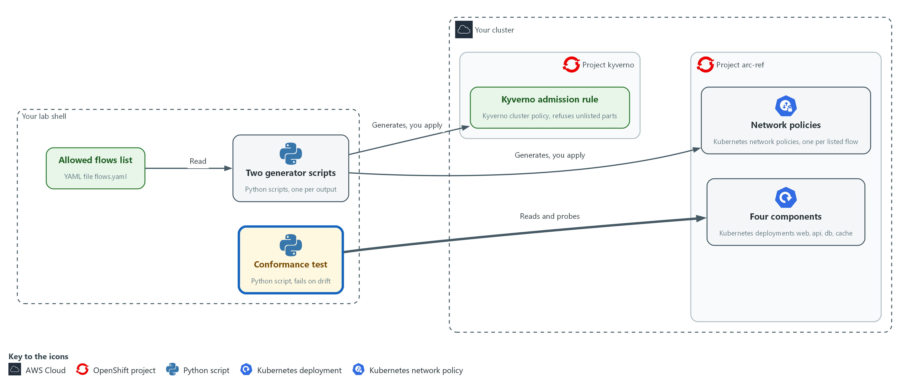

- The conformance test reads the live policies from the cluster and opens a connection from each component to every other one in arc-ref.

#### 3a. Save the live checks

You will now make the script live_net.py in your arc folder by pasting the whole block at once into the lab shell.

- conformance.py uses it.

Look for these as you read:

- oc_json() is the one way the code asks the cluster. A failed command gives nothing instead of a crash.
- policy_flows() works out which flows the live network policies allow, as sender, receiver and port.
- reachable() tries a real connection from each component to every other on each port, using oc exec. A policy that says allowed proves nothing about traffic.
- reachable() runs its attempts at the same time, so blocked pairs do not add up their waiting time.

```bash
mkdir -p "$HOME/arc/generated"
cd "$HOME/arc"
cat > live_net.py <<'EOF'
import json
import subprocess
from concurrent.futures import ThreadPoolExecutor

CONNECT = "import socket; socket.create_connection(('%s', %d), 3); print('open')"


def oc_json(args):
    done = subprocess.run(["oc", *args, "-o", "json"], capture_output=True, text=True, timeout=60)
    return json.loads(done.stdout) if done.returncode == 0 else None


def policy_flows(ns):
    found, selected = set(), set()
    for pol in (oc_json(["get", "networkpolicy", "-n", ns]) or {"items": []})["items"]:
        target = pol["spec"].get("podSelector", {}).get("matchLabels", {}).get("app", "*")
        selected.add(target)
        for rule in pol["spec"].get("ingress", []):
            for src in rule.get("from", []):
                source = src.get("podSelector", {}).get("matchLabels", {}).get("app", "?")
                found |= {(source, target, p.get("port")) for p in rule.get("ports", [])}
    return found, selected


def reachable(ns, apps, ports):
    pairs = [(a, b, p) for a in apps for b in apps for p in ports if a != b]

    def one(pair):
        a, b, p = pair
        cmd = ["oc", "exec", "deploy/" + a, "-n", ns, "-c", "app", "--", "python3", "-c", CONNECT % (b, p)]
        done = subprocess.run(cmd, capture_output=True, text=True, timeout=60)
        return pair if done.returncode == 0 and "open" in done.stdout else None

    with ThreadPoolExecutor(max_workers=12) as pool:
        return {r for r in pool.map(one, pairs) if r}, len(pairs)
EOF
```

**Expected output:**

```
No output. The prompt returns when the paste has finished.
```

| Part | What it does | Why you run it |
| --- | --- | --- |
| cd ... cat > live_net.py <<'EOF' ... EOF | Moves into the arc folder and writes the text between the first and last line into live_net.py. The quotes around EOF keep the text exactly as typed. | The lab has no editor, so a paste is how you make a file. |
| `def oc_json(args)` | Runs oc and returns its JSON answer, or nothing if the command failed. | Gives the other functions one safe way to ask the cluster, so a failed command gives a clear nothing and not a crash. |
| `def policy_flows(ns)` | Works out which flows the live policies allow, as (from, to, port), and which components they select. | Reads what the cluster really allows, which can differ from what the list says. |
| `def reachable(ns, apps, ports)` | Tries a TCP connection from each component to every other on each port, using oc exec in the app container. | A policy that says allowed proves nothing about traffic, so this opens real connections. |
| ThreadPoolExecutor(max_workers=12) | Runs the 12 connection attempts at once, so blocked pairs do not add up their waiting time. | Runs the attempts at once, so the whole test stays short enough to run often. |

#### 3b. Save the drift rules

You will now make the script drift_rules.py in your arc folder by pasting the whole block at once into the lab shell.

- conformance.py uses it.

Look for these as you read:

- deployed_apps() lists the app labels of the deployments that exist, so a component nobody listed can be seen.
- policy_hashes() reads the hash on each live network policy, so a policy built from an older list can be seen.
- admission_hash() returns nothing when the admission rule is missing, and a not-enforced marker when it is not set to Enforce.
- find_drift() puts every difference in one list: policy, traffic, unlisted component, stale policy and admission check.

```bash
mkdir -p "$HOME/arc/generated"
cd "$HOME/arc"
cat > drift_rules.py <<'EOF'
from live_net import oc_json


def deployed_apps(ns):
    items = (oc_json(["get", "deployment", "-n", ns]) or {"items": []})["items"]
    return {d["spec"]["template"]["metadata"]["labels"].get("app", "?") for d in items}


def policy_hashes(ns):
    items = (oc_json(["get", "networkpolicy", "-n", ns]) or {"items": []})["items"]
    return {p["metadata"].get("labels", {}).get("arc-flows", "none") for p in items}


def admission_hash():
    item = oc_json(["get", "clusterpolicy", "arc-ref-flows"])
    if not item:
        return None
    rule = item["spec"]["rules"][0]["validate"]
    return rule["pattern"]["metadata"]["labels"]["arc-flows"] if rule.get("failureAction") == "Enforce" else "not-enforced"


def find_drift(ns, listed, apps, digest, by_policy, by_traffic):
    drift = []
    for kind, live in (("policy", by_policy), ("traffic", by_traffic)):
        drift += [(kind + " missing", f) for f in sorted(listed - live)]
        drift += [(kind + " extra", f) for f in sorted(live - listed)]
    drift += [("unlisted component", (a,)) for a in sorted(deployed_apps(ns) - set(apps))]
    drift += [("stale network policy", (h,)) for h in sorted(policy_hashes(ns) - {digest})]
    if admission_hash() != digest:
        drift.append(("admission check", (str(admission_hash()),)))
    return drift
EOF
```

**Expected output:**

```
No output. The prompt returns when the paste has finished.
```

| Part | What it does | Why you run it |
| --- | --- | --- |
| cd ... cat > drift_rules.py <<'EOF' ... EOF | Moves into the arc folder and writes the text between the first and last line into drift_rules.py. The quotes around EOF keep the text exactly as typed. | The lab has no editor, so a paste is how you make a file. |
| `def deployed_apps(ns)` | The app labels of the deployments that exist. | Lets the test see a component that nobody listed. |
| `def policy_hashes(ns)` | The flows hash found on each live network policy. | Reveals a policy built from an older list. |
| `def admission_hash()` | The hash the live admission rule enforces, or nothing when the rule is missing or not set to Enforce. | Shows whether the guard exists, enforces and matches the current list. |
| `def find_drift(...)` | Compares policies, traffic, deployments, hashes and the admission rule with the list and returns every difference. | Puts every kind of difference in one list, so the report is complete. |

#### 3c. Save the conformance test

You will now make the script conformance.py in your arc folder by pasting the whole block at once into the lab shell.

- You run it in the next block.

Look for these as you read:

- listed holds the flows from the file. by_policy holds what the live policies allow. by_traffic holds what really connects.
- A flow is confirmed only when it appears in listed, by_policy and by_traffic. Coverage is the share of listed flows that are confirmed.
- The report lists every drift found, the pairs tested, the unlisted pairs that were blocked, and the time the run took.
- The script exits with 1 when anything drifted and 0 when nothing did. A pipeline reads that number.

```bash
mkdir -p "$HOME/arc/generated"
cd "$HOME/arc"
cat > conformance.py <<'EOF'
import hashlib
import json
import sys
import time

import yaml

from drift_rules import find_drift
from live_net import policy_flows, reachable

path = sys.argv[1]
started = time.perf_counter()
data = yaml.safe_load(open(path))
ns = data["namespace"]
digest = hashlib.sha256(open(path, "rb").read()).hexdigest()[:12]
listed = {(f["from"], f["to"], f["port"]) for f in data["flows"]}
apps = sorted({name for flow in listed for name in flow[:2]})
by_policy, _ = policy_flows(ns)
by_traffic, tested = reachable(ns, apps, sorted({f[2] for f in listed}))
drift = find_drift(ns, listed, apps, digest, by_policy, by_traffic)
confirmed = len(listed & by_policy & by_traffic)
report = {
    "flows_listed": len(listed),
    "flows_confirmed": confirmed,
    "coverage_percent": round(100 * confirmed / len(listed)),
    "pairs_tested": tested,
    "unlisted_pairs_blocked": tested - len(listed) - len(by_traffic - listed),
    "drift": [[kind, list(item)] for kind, item in drift],
    "seconds": round(time.perf_counter() - started, 1),
}
print(json.dumps(report, indent=2))
sys.exit(1 if drift else 0)
EOF
```

**Expected output:**

```
No output. The prompt returns when the paste has finished.
```

| Part | What it does | Why you run it |
| --- | --- | --- |
| cd ... cat > conformance.py <<'EOF' ... EOF | Moves into the arc folder and writes the text between the first and last line into conformance.py. The quotes around EOF keep the text exactly as typed. | The lab has no editor, so a paste is how you make a file. |
| listed = {...} | The flows from the file, as a set of (from, to, port). | The intended design in a form the code can compare. |
| by_policy, _ = policy_flows(ns) | The flows the live policies allow. | The design as the policies describe it. |
| by_traffic, tested = reachable(...) | The flows that really connect, and how many pairs were tried. | The design as real connections show it. |
| confirmed = len(listed & by_policy & by_traffic) | Counts a flow as covered only when both the policy and the real connection agree with the list. | A flow counts only if the policy and the traffic both agree, which makes coverage mean something. |
| unlisted_pairs_blocked | The number of tested pairs that the list does not allow and that really failed to connect: pairs tested, minus listed flows, minus any unlisted pair that did connect. With 12 pairs, 3 listed flows and no stray connection it is 9. | Shows the default deny working. If an unlisted pair connects, this number drops and the connection also appears in the drift list. |
| sys.exit(1 if drift else 0) | A failing exit code when anything drifted. | The exit code is what a pipeline reads, so the test can stop a change. |

#### 3d. Run the conformance test on the clean project

You will now run the conformance test once on the project as you built it.

```bash
cd "$HOME/arc"
python3 conformance.py flows.yaml
echo "exit code $?"
```

**Expected output:**

```
Example only. The time will differ.
{
  "flows_listed": 3,
  "flows_confirmed": 3,
  "coverage_percent": 100,
  "pairs_tested": 12,
  "unlisted_pairs_blocked": 9,
  "drift": [],
  "seconds": <n>
}
exit code 0
```

| Part | What it does | Why you run it |
| --- | --- | --- |
| cd "$HOME/arc" | Moves into the arc folder where the files are. | The commands use short file names from here. |
| conformance.py flows.yaml | Prints the report. The drift list should be empty. | A first clean run proves the test passes when the project matches, so a later failure means something. |
| echo "exit code $?" | Prints the exit code, 0 when nothing drifted. | Shows the number a pipeline would act on. |

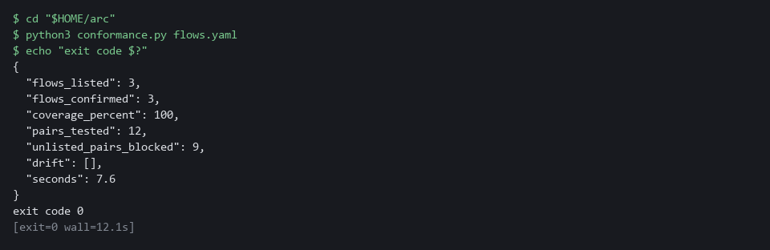

> **NOTE:** Python finds live_net.py and drift_rules.py because they sit next to conformance.py in the arc folder.

> **CHECKPOINT:** flows_listed 3, flows_confirmed 3, coverage_percent 100, pairs_tested 12, unlisted_pairs_blocked 9, an empty drift list and exit code 0.

> **TAKEAWAY:** A conformance test turns the question of whether the system matches its design into an exit code.

**How this meets the controls**

- **SC-7:** The test opens a real connection from each component to every other, so a policy that says a flow is allowed is checked against real traffic.
- **CM-8:** The test lists the deployments in arc-ref and reports any whose app label the list does not name.

### Step 4. Try to add something nobody listed (SC-7 Boundary Protection, CM-8 System Component Inventory)

**Learning point: Sending an open policy and an unlisted pod shows the admission rule refusing both before anything is saved.**

- The admission rule should refuse a hand-written policy that opens everything and a pod the list does not name.
- The admission rule cannot refuse a delete, so Step 5 times how fast a delete is noticed.

What this step adds (thick lines and outlines are new):

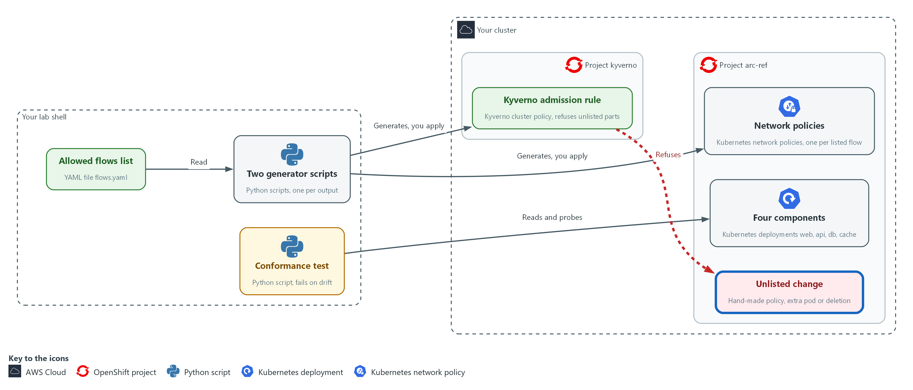

- You send a hand-written policy and an unlisted pod to the cluster, and the admission rule refuses them.

#### 4a. Try a hand-written policy and an unlisted pod

You will now send two requests that the admission rule should refuse, then look for either object.

```bash
echo '{"apiVersion":"networking.k8s.io/v1","kind":"NetworkPolicy","metadata":{"name":"open-all","namespace":"arc-ref"},"spec":{"podSelector":{},"ingress":[{}],"policyTypes":["Ingress"]}}' | oc apply -f -
oc run extra -n arc-ref --image=registry.access.redhat.com/ubi9/ubi-minimal:9.5 --labels=app=extra --restart=Never -- sleep 60
oc get networkpolicy,pod -n arc-ref | grep -E 'open-all|extra'
```

**Expected output:**

```
Example only. The wording of the messages will differ.
An error from the admission webhook that names the rule policy-from-flows and says the network policy must be generated from flows.yaml.
An error from the admission webhook that names the rule known-components and says the pod must carry an app label that flows.yaml lists.
(the last command prints nothing)
```

| Part | What it does | Why you run it |
| --- | --- | --- |
| echo '{...open-all...}' \| oc apply -f - | Tries to create a network policy named open-all that allows every sender. It has no flows hash label. | Tries the careless fix someone might make in an emergency, to see the guard refuse it. |
| oc run extra ... --labels=app=extra | Tries to start a pod whose app label is not in the list. | Tries to add a component nobody listed, to see the guard refuse it. |
| grep -E 'open-all\|extra' | Shows whether either object exists. Nothing should print. | Silence is the proof, because a refused request leaves nothing behind. |

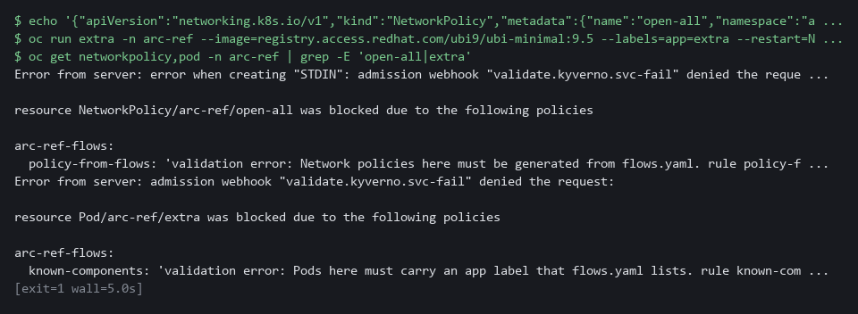

> **NOTE:** The block ends with no output on purpose: a refused request leaves nothing behind. Read the two refusal messages above it and check they name the rules policy-from-flows and known-components.

> **CHECKPOINT:** The hand-written policy and the extra pod are both refused, and neither object exists.

> **TAKEAWAY:** Admission stops unlisted additions, so the test only has to find what got around it.

**How this meets the controls**

- **SC-7:** You try to create a hand-written policy that allows every sender, and the admission rule refuses it.
- **CM-8:** You try to start a pod whose app label the list does not name, and the admission rule refuses it.

### Step 5. Measure how fast drift is caught (CM-8 System Component Inventory)

**Learning point: Timing three kinds of drift measures how long a deleted policy, a deleted admission rule and an unlisted deployment stay unnoticed, and checks that against the 300 second limit.**

- A test nobody has timed promises nothing.
- The timer causes each drift, runs your test every 10 seconds until it fails, undoes the drift and prints how long detection took.
- The worst case is the 10 second interval plus one run, compared with the 300 second limit.

What this step adds (thick lines and outlines are new):

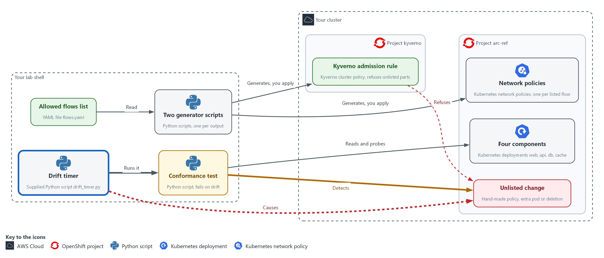

- The drift timer causes drift in arc-ref on purpose, runs the conformance test again and again from lab shell, and prints how long the test took to notice.

#### 5a. Time three kinds of drift

You will now run the supplied drift timer for three kinds of drift and query the saved lines.

- The drift timer takes a few minutes.

```bash
cd "$HOME/arc"
rm -f drift-times.json
for kind in policy admission component; do
  python3 drift_timer.py flows.yaml "$kind" | tee -a drift-times.json
done
jq -s 'all(.[]; .worst_case_s < 300 and .recovered)' drift-times.json
```

**Expected output:**

```
Example only. Every time will differ.
One line of JSON for each kind of drift (policy, admission, component) with its kind, <detected_after_s>, <worst_case_s> and recovered.
true
```

| Part | What it does | Why you run it |
| --- | --- | --- |
| cd ... rm -f drift-times.json | Moves into the arc folder and removes the numbers from an earlier run, if any. | A rerun then starts with an empty file, so old lines cannot change the final yes or no. |
| for kind in policy admission component | Repeats the timer for three kinds of drift: a deleted default-deny policy, a deleted admission rule, and an unlisted deployment. | Covers three different ways drift happens, because each is found by a different part of the test. |
| drift_timer.py flows.yaml "$kind" | Confirms a clean start, causes the drift, polls every 10 seconds until the test fails, undoes the drift, and prints one line of JSON. | Gives a measured detection time for one kind of drift, and undoes it so the next starts clean. |
| tee -a drift-times.json | Shows each line and also appends it to a file for the queries below. | Keeps the numbers for the queries that follow. |
| all(.[]; .worst_case_s < 300 and .recovered) | True only if every kind of drift was caught within the limit and the project recovered. | Turns the requirement into a yes or no that you can rerun. |

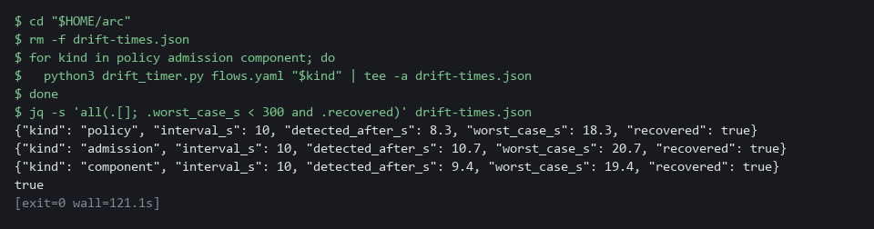

> **NOTE:** The timer takes a few minutes in all. If a line shows detected_after_s as null, the test never failed within the 180 second give-up time: that drift is invisible to your test, which is a finding to fix before anything else.

> **CHECKPOINT:** Each kind of drift has a detection time, recovered is true for all three, and the last query prints true.

> **TAKEAWAY:** A check is only a promise once you have measured how quickly it notices.

**How this meets the control**

- **CM-8:** The CM-8(3) enhancement asks for automated detection of unauthorized components. The timer causes three kinds of drift, and the last query checks each worst case against the 300 second limit (FedRAMP's five-minute maximum delay).

## Section 4. Verify It Works

### Test 1 (positive). The project matches the list and coverage is complete (PL-8 Security and Privacy Architectures)

State the pass condition as a query: no drift, and every listed flow confirmed by both policy and traffic.

```bash
cd "$HOME/arc"
python3 conformance.py flows.yaml | jq -e '.coverage_percent == 100 and (.drift | length) == 0'
```

**Expected output:**

```
Example only.
true
```

| Part | What it does | Why you run it |
| --- | --- | --- |
| cd "$HOME/arc" | Moves into the arc folder. | The test and the list are there. |
| python3 conformance.py flows.yaml | Runs the conformance test and prints its report. | Compares the running project with the list. |
| jq -e '.coverage_percent == 100 and (.drift \| length) == 0' | Prints true only when coverage is 100 percent and the drift list is empty. | A yes or no that a pipeline can act on. |

> **CHECKPOINT:** The query prints true.

**How this meets the control**

- **PL-8:** The query prints true only when there is no drift and every listed flow is confirmed by both policy and traffic.

### Test 2 (positive). Generation is repeatable (CM-2 Baseline Configuration)

- Generate again to a second file and compare the two byte for byte.
- Only a repeatable generator lets a later difference be trusted as drift.

```bash
cd "$HOME/arc"
python3 gen_netpol.py flows.yaml generated/again.yaml
diff generated/networkpolicies.yaml generated/again.yaml && echo identical
```

**Expected output:**

```
Example only.
wrote 4 policies, flows hash 6d328d57c080
identical
```

| Part | What it does | Why you run it |
| --- | --- | --- |
| `gen_netpol.py flows.yaml generated/again.yaml` | Generates the policies a second time into a new file. | Gives a second copy to compare against. |
| diff ... && echo identical | Compares the two files byte for byte and prints identical when there is no difference. | Shows the generator is repeatable. |

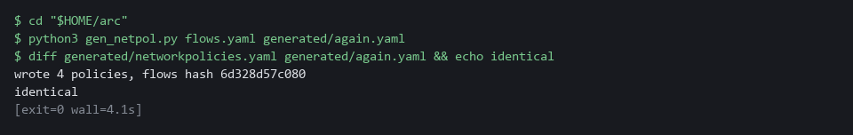

> **CHECKPOINT:** The word identical appears. The hash is a fingerprint of your exact file text, so it matches the example only if your flows.yaml is identical to the one in Step 1.

**How this meets the control**

- **CM-2:** The test generates the policies twice and compares the two files byte for byte.

### Test 3 (negative). The flow checker rejects a bad list (CM-2 Baseline Configuration)

- The kit includes a list with a port outside the valid range and a component that calls itself.
- The checker must reject that list and exit with failure, so a bad list never reaches the generators.

```bash
cd "$HOME/arc"
python3 check_flows.py flows-bad.txt
echo "exit code $?"
```

**Expected output:**

```
Example only.
FAIL: flow 1: port must be a whole number from 1 to 65535
FAIL: flow 2: from and to are the same component
exit code 1
```

| Part | What it does | Why you run it |
| --- | --- | --- |
| check_flows.py flows-bad.txt | Runs the checker on the bad list from the kit. | A bad list must be stopped before it reaches the generators. |
| FAIL: flow 1: port must be ... | The first flow has a port outside 1 to 65535. | The message names the flow and the rule it breaks. |
| FAIL: flow 2: from and to are the same component | The second flow calls itself. | A second mistake is reported in the same run. |
| exit code 1 | 1 means the list was rejected. | Other programs read this number. |

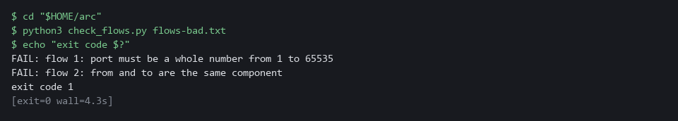

> **CHECKPOINT:** Two FAIL lines and exit code 1.

**How this meets the control**

- **CM-2:** A baseline with an invalid entry would produce wrong policies. The checker must fail on a bad list with exit code 1, so the list never reaches the generators.

### Test 4 (negative). Editing the list without regenerating shows as drift (CM-2 Baseline Configuration)

- A copy of the list with one extra flow stands in for a change someone made to the file and did not regenerate from.
- Every object built from the old list is now out of date, and the test must say so.

```bash
cd "$HOME/arc"
cp flows.yaml flows-extra.yaml
echo "  - from: web" >> flows-extra.yaml
echo "    to: db" >> flows-extra.yaml
echo "    port: 8080" >> flows-extra.yaml
python3 conformance.py flows-extra.yaml > drift-extra.json
echo "exit code $?"
jq -c '.drift[]' drift-extra.json
```

**Expected output:**

```
Example only. The hash is a fingerprint of your exact file text, so it differs if your text differs.
exit code 1
["policy missing",["web","db",8080]]
["traffic missing",["web","db",8080]]
["stale network policy",["6d328d57c080"]]
["admission check",["6d328d57c080"]]
```

| Part | What it does | Why you run it |
| --- | --- | --- |
| cp ... echo >> flows-extra.yaml | Makes a copy of the list and adds one more flow, web to db. | Stands in for an edit made without regenerating. |
| conformance.py flows-extra.yaml > drift-extra.json | Runs the test against the edited list. The cluster is not changed. | The cluster was built from the old list, so it now disagrees. |
| exit code 1 | 1 means drift was found. | A pipeline would stop here. |
| policy missing / traffic missing | No policy allows web to db and no connection works. | The new flow is on the list but not in the cluster. |
| stale network policy | The policies carry the hash of the old list. | Objects built from an older list are visible. |
| admission check | The admission rule was built from the old list. | The guard is out of date too. |

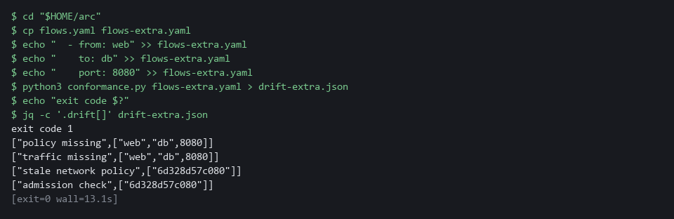

> **CHECKPOINT:** Exit code 1 with the new flow missing in policy and traffic, the old hash reported as stale, and the admission check reported as built from another version. Nothing in the cluster was changed, so nothing needs restoring.

**How this meets the control**

- **CM-2:** The test reports the new flow as missing and the old hash as stale.

## Section 5. What Each Control Is For

### Control mapping

| Control | What it requires, in plain words | Tool or service | Where this module covers it |
| --- | --- | --- | --- |
| PL-8 Security and Privacy Architectures | The security design states how information is protected and is kept up to date as the system changes. | The flow list flows.yaml, the two generator scripts and the conformance test. Explained in section 2.1. | Section 3, Steps 1 and 2: write the flow list and generate and apply the rules from it. Section 4, Test 1: the project matches the list. |
| SC-7 Boundary Protection | Traffic between key internal parts is controlled and denied by default. | Kubernetes NetworkPolicy objects generated from the list, and a Kyverno admission rule. Explained in section 2.1. | Section 3, Step 2: generate the deny-by-default policies. Section 3, Step 3: test a real connection between every pair of components. Section 3, Step 4: a hand-written policy is refused. Section 3, Step 5: a deleted policy is found. |
| CM-2 Baseline Configuration | A current baseline is kept under configuration control, and a change from it is a visible event. | The flow list as the baseline, and the flows hash label on every generated object. Explained in section 2.1. | Section 3, Step 2: each generated object carries the hash. Section 4, Test 2: generation is repeatable. Section 4, Test 4: a list edited without regenerating shows as drift. |
| CM-8 System Component Inventory | The list of components matches what is running, and an unauthorized component is detected by automated means. | The known-components rule of the Kyverno admission policy, the conformance test and the drift timer. Explained in section 2.2. | Section 3, Step 3: the test reports a deployment the list does not name. Section 3, Step 4: the admission rule refuses an unlisted pod. Section 3, Step 5: time how fast an unlisted deployment is detected. |

### What each control is for

Each table below says what the control is trying to prevent and how this module's tool meets it.

#### PL-8 Security and Privacy Architectures

| Question | Answer |
| --- | --- |
| Control Intent | Each team draws its own picture of what may talk to what, and the pictures and the running systems disagree. |
| The operational question | Where is the one place the allowed flows are written, and what in the running system is built from it? |
| What evidence proves it | The flow file, the generators, and a conformance result that shows the running project matches the file. |
| How much is enough | A reviewer can read one short file and trust that it describes the running system, because a test fails when it does not. NIST leaves the review frequency organization-defined; FedRAMP assigns at least annually and when a significant change occurs. |
| How the tool in this module satisfies it | flows.yaml, the generators and the flow checker (Steps 1 and 2). |

#### SC-7 Boundary Protection

| Question | Answer |
| --- | --- |
| Control Intent | An unlisted flow is opened by hand during an incident and never closed. |
| The operational question | Of all the pairs that could talk, which can, and is that exactly the list? |
| What evidence proves it | A result for every pair from real connection attempts, and the policies read from the cluster. |
| How much is enough | Every listed flow works, every other pair is blocked, and the generated policies are the only network policies in the project. The lab tests one port per flow. |
| How the tool in this module satisfies it | The generated network policies, the admission rule and the connection probes in the conformance test. |

#### CM-2 Baseline Configuration

| Question | Answer |
| --- | --- |
| Control Intent | The baseline file is edited and nobody regenerates the cluster from it, or the cluster is changed and the file is not. |
| The operational question | If the file and the cluster disagree, which one does the system tell you about, and how soon? |
| What evidence proves it | The hash in each generated object, compared with the hash of the current file. |
| How much is enough | Every generated object names the version of the file it came from, and a mismatch is reported. NIST leaves the baseline review times organization-defined; FedRAMP assigns at least annually and when a significant change occurs. |
| How the tool in this module satisfies it | The flows hash label and the stale-policy check in the conformance test. |

#### CM-8 System Component Inventory

| Question | Answer |
| --- | --- |
| Control Intent | A component appears that nobody listed, and it is found only at the next assessment. |
| The operational question | How long can an unlisted component exist before something tells you? |
| What evidence proves it | A refusal at admission, or a conformance failure, and the measured time to the failure. |
| How much is enough | Unlisted pods are refused, and an unlisted deployment is detected by an automated check. The enhancement CM-8(3) asks for automated detection of unauthorized components. The lab runs the check every 10 seconds and measures the worst case against the 300 second limit, which is the five-minute maximum delay FedRAMP assigns for CM-8(3). |
| How the tool in this module satisfies it | The known-components admission rule and the drift timer (Steps 4 and 5). |

## Section 6. Next Steps

### Using this in other environments

- The flow list, the two generators and the conformance logic are plain YAML and Python. They port to any Kubernetes cluster whose network plugin enforces NetworkPolicy and that runs Kyverno.
- Change these lab values first: the project arc-ref, the four component names and port 8080 in flows.yaml, the kyverno project, the cluster policy name arc-ref-flows, and the two public images ubi9/python-311:1 and ubi9/ubi-minimal:9.5.
- The probes use oc exec into a container named app in each deployment. On another platform use kubectl exec and check that your containers have that name and can open a TCP connection.
- The 10 second interval and the 180 second give-up time are lab choices. The 300 second limit is the five-minute maximum detection delay FedRAMP assigns for CM-8(3). In production use the delay your authorization assigns, run the test from a pipeline on a schedule, and send a failure to a person.

The table shows what changes on each platform:

| Check/part | In this lab | On other platforms | What you change |
| --- | --- | --- | --- |
| Flow list and generators | flows.yaml and two Python scripts using PyYAML in the lab shell | The same files with any Python 3 that has PyYAML | The namespace, component names and port. |
| Network policies | Kubernetes NetworkPolicy, enforced by the OpenShift default network plugin OVN-Kubernetes | Kubernetes NetworkPolicy, if the cluster's network plugin enforces it | Check that your plugin enforces NetworkPolicy. If it does not, replace the check. |
| Admission rule | Kyverno cluster policy arc-ref-flows | The same, where Kyverno is installed | The policy name and the namespace. With another policy engine, replace the check. |
| Connection probes | oc exec into the app container, then python3 opens a TCP connection | kubectl exec, if the container has python3 or another way to open a connection | The tool name, the container name and the probe command. |
| Drift timer | Supplied drift_timer.py run from the lab shell | A scheduled job or pipeline that runs the same test | The runner. The test stays the same. |
| Detection limit | 300 seconds, the FedRAMP five-minute maximum for CM-8(3) | The value your authorization assigns | The limit in the jq query at the end of Step 5. |

> **TIP:** This is the last module in the track. ARC-5 closes the architecture dimension: you stated the allowed flows once as data, generated the rules from it and proved the cluster still matches it.

<details>
<summary><strong>Section 7. Terms</strong></summary>

Each term is also explained the first time it appears. In Word, hover over an underlined term to see its meaning, or Ctrl+click it to jump to this table.

| Term | Plain meaning |
| --- | --- |
| Admission check | A rule applied when something is created or changed, which can refuse the request. |
| Admission rule | The Kyverno policy generated from the list. It is the admission check this module builds. |
| Admission webhook | The way the cluster asks Kyverno whether to allow a request before it is saved. |
| Annotation | A note attached to a cluster object that tools can read. Unlike a label, it is not used to pick objects. |
| AWS | Amazon Web Services, the cloud your lab runs in. |
| Baseline | The agreed starting configuration that the system is expected to match. |
| Cluster | A group of servers that work together as one system. Here it is your own OpenShift cluster. |
| Cluster policy | A Kyverno policy that applies to the whole cluster. |
| Component | One separately running part of the system, such as the web part or the database. |
| Conformance test | A script that compares the running system with the intended design and fails when they differ. |
| Container | A sealed box that holds one program and everything it needs to run. |
| Controller | A program in the cluster that keeps the real state matching what you asked for. |
| Coverage | The share of listed flows that the test confirms with both a live policy and a real working connection. |
| Default deny | A network policy that selects every pod and allows nothing, so any flow not allowed by another policy is blocked. |
| Deployment | A cluster object that keeps a set of identical pods running. Each of the four components is a deployment. |
| diff | A command that shows the differences between two files. |
| Digest | A hash computed from content. The same content always gives the same digest; for a container image it names that exact image, written like sha256:... |
| Drift | Any difference between the intended design and the running system. |
| Enforce | The Kyverno setting that makes a rule refuse a request. The other setting, Audit, only records it. |
| Exit code | The number a command leaves behind when it ends. 0 means success. Any other number means something needs attention. |
| FedRAMP | The US program that sets security requirements for cloud services used by the federal government. |
| Flows hash | A short fingerprint of the flow file. Each generated object carries it so a stale object can be seen. |
| Function | A named group of commands or code that you call by name. |
| Generator | A script that produces configuration from data, so people edit the data and never the output. |
| grep | A command that prints only the lines that match a pattern. |
| Hash | A short fingerprint of some text. The same text always gives the same hash, and any change to the text gives a different one. |
| Heredoc | A way to make a file by pasting its text between a first line such as cat > name <<'EOF' and a last line that says EOF. |
| Image | A packaged copy of a program and everything it needs to run. A container starts from an image. |
| Ingress | The way traffic from outside the cluster reaches a program inside it. |
| Inventory | A list of the parts of a system; in Ansible, the machines a playbook runs against. |
| jq | A tool that picks one value out of JSON text. |
| JSON | A text format for data, made of names and values in braces. |
| Kubernetes | The open-source system that runs and manages containers across servers. OpenShift is built on it. |
| Kyverno | A program in your cluster that checks every request to create or change something against rules, and can refuse the request. |
| Label | A key=value tag on a cluster object, such as app=web. Network policies pick pods by label. |
| mkdir | A command that makes a new folder. |
| Namespace | A named section of the cluster that holds a set of related parts. |
| Network policy | A cluster rule that lists which pods may send traffic to which other pods, chosen by pod label and port. Anything not listed is blocked. |
| NIST | The US National Institute of Standards and Technology. It publishes the security control catalog these modules cite. |
| oc | The command-line tool for OpenShift. You type oc to ask the cluster questions. |
| oc exec | An oc command that runs a command inside a running container. |
| OpenShift | The Red Hat platform your lab cluster runs on. It is Kubernetes with extra security and tools built in. |
| Ordered pair | A sender and a receiver in a fixed order, so web to api and api to web are two different pairs. |
| Pipeline | An automated sequence of tasks that runs without a person typing each command. |
| Pod | One running copy of a program in the cluster. |
| Policy | A set of rules written down so that a tool can enforce them. |
| Poll | To ask again and again at a fixed interval until something changes. |
| Port | A number that picks which program on a pod receives a request, such as 8080. |
| Probe | A real connection attempt made only to see whether it works. |
| Project | A named section of the cluster that keeps one set of work apart from others. Here it is arc-ref. OpenShift also calls it a namespace. |
| Pull request | A request to merge one branch into another, where others can review the change first. |
| Query | A question you ask a data store, written in a query language, such as a log search. |
| Reference architecture | A design that other teams copy. Here it is the list of allowed flows plus everything generated from it. |
| Rule | A written condition that a tool checks. |
| Runner | The program or container that carries out the steps of a pipeline. |
| Script | A text file of code that the computer runs from top to bottom. |
| TCP | The standard way programs send data reliably over a network. |
| Webhook | An address that another program calls to send it a message when something happens. |
| YAML | A plain-text format for settings and lists, with indentation to show what belongs to what. |

</details>
