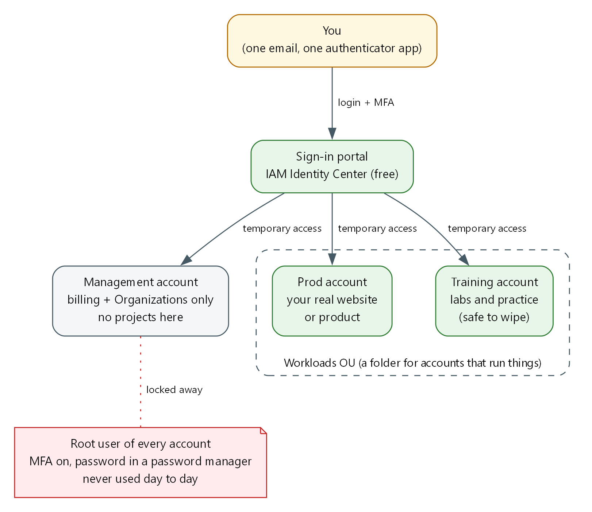
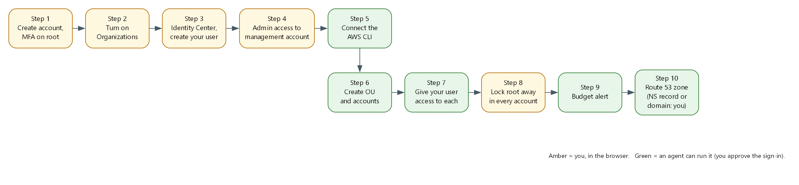

# AWS Account Set Up: one login, separate accounts, root locked away

| Item | Detail |
| --- | --- |
| Sequence | Do this first, before any lab or course that builds things in AWS. It gives that work a safe account to run in. |
| Timed work | About 75 minutes by hand, or about 30 minutes with an agent (you still do the browser steps) |
| Modes | By hand (follow every step) or With an agent (give the agent file to your coding assistant) |
| Tools | AWS Organizations, IAM Identity Center, AWS CLI v2, AWS Budgets, an authenticator app, a password manager |
| Prerequisites | An email address you control that accepts plus aliases (Gmail does), a phone with an authenticator app, a credit card for AWS |
| You end with | One sign-in portal, a management account for billing, a Training account, optionally a Prod account, a budget alert, root locked away, and a public Route 53 zone in the Training account |

## 1. Why This Matters

A new AWS account starts with one all-powerful login called the root user. Many beginners use it for everything. That is risky: root cannot be limited, and one mistake or one stolen password affects the whole account and its bill. It also mixes your experiments with anything you want to keep.

This guide sets up the layout professionals use, at a size that suits one learner. You sign in through one portal with a code from your phone. You get temporary access to separate accounts. Practice goes in a Training account you can wipe without touching anything else, and the root logins stay locked away.

### What you get

| Part | What it is | Why you want it |
| --- | --- | --- |
| Management account | The first account you create. It owns the bill and the organization. | Keeping projects out of it means a lab mistake can never touch billing. |
| Training account | A separate account for labs and courses. | You can destroy everything in it, or close it, and the rest is unaffected. |
| Prod account (optional) | A separate account for anything you want to keep running, such as a website. | Experiments cannot break it. |
| Workloads OU | A folder in the organization that holds the Training and Prod accounts. | Rules can later be applied to the whole folder at once. |
| Sign-in portal | IAM Identity Center, a free AWS sign-in page. | One login with MFA, temporary access, no access keys saved on your laptop. |
| Budget alert | An email when spending passes a limit you choose. | A forgotten lab does not become a surprise bill. |
| Route 53 zone | A public DNS zone (a domain name managed in AWS) inside the Training account. | Some labs build things that need a web address. A zone belongs to one account, so the new account needs its own. |

### The picture

You log in once at the portal. The portal hands you temporary access to each account. Root users sit to the side, protected, and are used only in an emergency.



- You: The only person who signs in. One email address and one authenticator app protect the whole setup.
- Sign-in portal: IAM Identity Center. You sign in here and choose an account and a role.
- Management account: Holds the organization and the bill. Nothing else runs here.
- Workloads OU: A folder inside the organization that holds the accounts that run things.
- Prod and Training accounts: Separate accounts. What happens in one cannot change the other.
- Root user: The all-powerful login each account is born with. Protect it, then stop using it.

### Order of work

Amber steps need you in the browser. Green steps can be done by an agent with commands.



### Terms in this guide

| Term | Plain meaning |
| --- | --- |
| AWS account | A container for your AWS resources and the bill for them. Separate accounts cannot see each other by default. |
| Root user | The login made from the email and password you used to create an account. It has no limits. |
| MFA | Multi-factor authentication: a password plus a changing code from your phone. |
| Authenticator app | A phone app that shows the changing code. Examples: Google Authenticator, Microsoft Authenticator, Authy. |
| Plus alias | A variation of your email, such as name+training@gmail.com. Mail still arrives in your normal inbox, but AWS sees a new address. |
| AWS Organizations | The AWS service that groups several accounts under one bill and one owner. |
| Management account | The account that owns the organization. Also called the payer account. |
| Member account | Any account inside the organization other than the management account. |
| OU | Organizational unit: a folder inside the organization that holds accounts. |
| IAM Identity Center | The free AWS sign-in service. You log in once and pick which account to enter. Formerly called AWS SSO. |
| Permission set | A named level of access, such as AdministratorAccess, that Identity Center can give a user in an account. |
| Assignment | The link that says this user gets this permission set in this account. |
| Session | The temporary access you get after signing in. It expires, by default after 8 hours in this guide. |
| AWS CLI | The AWS command-line tool. It lets you, or an agent, run AWS actions by typing commands. |
| Profile | A saved name in the AWS CLI settings that points at one account and role. |
| Access key | A long-lived secret that lets a program act as you. This guide avoids creating them. |
| Budget | An AWS setting that emails you when spending passes a share of a limit. |
| Route 53 | The AWS service that manages domain names and turns names into addresses. |
| Hosted zone | The set of DNS records Route 53 holds for one domain name. Public means it answers questions from the internet. |
| Delegation | Telling the internet that a subdomain such as lab.example.com is answered by a different set of name servers, using NS records. |
| NS record | A DNS record that lists the name servers responsible for a domain or subdomain. |
| Password manager | An app that stores long random passwords so you do not have to remember or reuse them. |

## 2. The Tools

| Tool (overview link) | What it is | Used in this lab | Why this tool |
| --- | --- | --- | --- |
| [AWS Organizations](https://docs.aws.amazon.com/organizations/latest/userguide/orgs_introduction.html) | Groups accounts under one owner and one bill. | Creates the organization, the Workloads OU and the member accounts. | It is how AWS expects several accounts to be managed together. |
| [IAM Identity Center](https://docs.aws.amazon.com/singlesignon/latest/userguide/what-is.html) | A free sign-in portal with temporary access to accounts. | Replaces everyday root logins with one login and MFA. | It avoids saved passwords and long-lived keys on your laptop. |
| [AWS CLI v2](https://docs.aws.amazon.com/cli/latest/userguide/getting-started-install.html) | Runs AWS actions from a terminal. | Creates accounts, assignments and the budget, and checks your work. | Commands can be pasted, repeated and handed to an agent. |
| [AWS Budgets](https://docs.aws.amazon.com/cost-management/latest/userguide/budgets-managing-costs.html) | Tracks spending against a limit and emails you. | Sends the spending alert. | It warns you before a forgotten lab becomes a bill. |

## 3. Implement

### Step 0. Decide before you click

Write these down. You will use them in every later step. Do not put real passwords in the file.

| Decision | Example | Notes |
| --- | --- | --- |
| Main email | you@gmail.com | Becomes the root email of the management account and your Identity Center login. Must be an inbox you will keep forever. |
| Member account emails | you+training@gmail.com, you+prod@gmail.com | Each AWS account needs its own unique email. Plus aliases deliver to your normal inbox. |
| Home region | us-east-1 | Identity Center and billing tools live in one region. Pick one and keep it. |
| Monthly budget | 20 (US dollars) | The alert fires at 80 percent actual and at 100 percent forecast. |
| Account names | Training, Prod | Short and plain. You can rename later. |

> **TIP:** Create a password manager vault called AWS first. Save each root password there the moment you create it.

> **CHECKPOINT:** Your decisions are written down and the password manager is ready.

### Step 1. Create the management account and protect root

If you already have an AWS account, use it as the management account and skip to 1b.

#### 1a. Create the account

1. Go to https://aws.amazon.com and choose Create an AWS account.
1. Enter your main email and an account name such as Mgmt. Choose a long random password from your password manager.
1. Add a card and verify your phone. Choose the Basic (free) support plan.
#### 1b. Turn on MFA for root

1. Sign in as Root user with your main email.
1. Open the account menu (your name, top right), then Security credentials.
1. Under Multi-factor authentication, choose Assign MFA device, then Authenticator app, and scan the QR code.
1. Enter two codes in a row and save.
#### 1c. Allow billing to be seen through the portal later

Still as root, open the account menu, then Account. Find IAM user and role access to billing information, choose Edit, turn on Activate IAM Access, and save. This lets your portal login open the Billing pages so you never need root for them.

> **SECURITY:** Do not create access keys for root. Check Security credentials: the access key list should be empty.

> **CHECKPOINT:** Security credentials shows one MFA device assigned and no access keys.

### Step 2. Turn on AWS Organizations

1. While signed in as root of the management account, open AWS Organizations in the console.
1. Choose Create an organization. Keep all features enabled, which is the default.
1. Check your inbox and click the verification link AWS sends. Without it, account creation can fail later.
> **CHECKPOINT:** The Organizations page lists your account with the tag Management account.

### Step 3. Turn on IAM Identity Center and create your user

1. In the console, switch to your home region (for example N. Virginia, us-east-1).
1. Open IAM Identity Center and choose Enable. Choose Enable with AWS Organizations.
1. Open Users, then Add user. Enter your main email as the username and email, add your name, and choose to send an email invitation.
1. Open the invitation email, accept it, set a password, and register an authenticator app when asked.
1. On the Identity Center Dashboard, note the AWS access portal URL. It looks like https://d-xxxxxxxxxx.awsapps.com/start. Save it in your decisions file.
> **TIP:** Use a different entry in your authenticator app from the root one. The app now holds two: one for root, one for your portal user.

> **CHECKPOINT:** You can open the portal URL, sign in, and see the sign-in succeed (it may show no accounts yet).

### Step 4. Give your user admin access to the management account

Identity Center needs a permission set and an assignment before the portal shows any account. You do this one time in the console, so that from here on you never need root.

1. In IAM Identity Center, open Permission sets, then Create permission set.
1. Choose Predefined permission set, select AdministratorAccess, name it AdministratorAccess, and set the session duration to 8 hours.
1. Open AWS accounts, select the management account, choose Assign users or groups, pick your user, pick the AdministratorAccess permission set, and submit.
1. Open the portal URL, sign in, expand the management account, and choose Management console under AdministratorAccess.
> **CHECKPOINT:** The console top right shows AdministratorAccess/your-email and the management account number.

> **SECURITY:** From now on, do your work this way. Sign in as root only for the few tasks that require it.

### Step 5. Install the AWS CLI and connect it to the portal

The AWS CLI lets you, or an agent, run AWS actions by typing commands. It signs in through the portal, so no access key is created or saved.

#### 5a. Install the AWS CLI v2

Use the command for your computer. Skip this if aws --version already shows version 2.

| System | Command to type |
| --- | --- |
| Windows (PowerShell) | winget install -e --id Amazon.AWSCLI |
| Windows (no winget) | msiexec.exe /i https://awscli.amazonaws.com/AWSCLIV2.msi |
| Mac (Terminal) | brew install awscli |
| Linux (x86_64) | curl "https://awscli.amazonaws.com/awscli-exe-linux-x86_64.zip" -o awscliv2.zip && unzip awscliv2.zip && sudo ./aws/install |

Close the terminal, open a new one, and check it worked:

```bash
aws --version
```

**Expected output:**

```
Example only. Your numbers will differ.
aws-cli/2.x.x Python/3.x.x ...
```

> **NOTE:** The version must start with aws-cli/2. If it says 1, an old version is first on your path. Remove it or install v2 again. Other install methods are at https://docs.aws.amazon.com/cli/latest/userguide/getting-started-install.html.

#### 5b. Add the profile

Pick one way. Way 1 asks questions and writes the file for you. Way 2 is editing the file yourself, which is what an agent does.

Way 1, guided. Type aws configure sso and answer the prompts:

| Prompt | What to enter |
| --- | --- |
| SSO session name | main |
| SSO start URL | Your portal URL from Step 3 |
| SSO region | Your home region, for example us-east-1 |
| SSO registration scopes | Press Enter to accept sso:account:access |
| Then a browser opens | Sign in and approve. Back in the terminal, choose the management account and the AdministratorAccess role |
| Default client region / output format | Your home region, and json |
| Profile name | sso-mgmt |

Way 2, edit the file. The config file is the file named config inside the .aws folder of your home directory (Mac and Linux: ~/.aws/config. Windows: C:\Users\YOUR-NAME\.aws\config). Add this and replace the values in capitals.

```ini
[sso-session main]
sso_start_url = PORTAL_URL
sso_region = HOME_REGION
sso_registration_scopes = sso:account:access

[profile sso-mgmt]
sso_session = main
sso_account_id = MANAGEMENT_ACCOUNT_ID
sso_role_name = AdministratorAccess
region = HOME_REGION

```

| Part | What it does | Why you run it |
| --- | --- | --- |
| sso-session main | One saved login to the portal that every profile can share. | You sign in once and all profiles reuse it. |
| sso_start_url / sso_region | The portal address and the region that holds Identity Center. | The CLI needs to know where to log in. |
| profile sso-mgmt | A named shortcut to the management account with the AdministratorAccess role. | You pick an account by naming the profile. |

#### 5c. Sign in and test

```bash
aws sso login --profile sso-mgmt
aws sts get-caller-identity --profile sso-mgmt
```

**Expected output:**

```
Example only. Your ids will differ.
A browser opens. Approve the request and enter your MFA code.
{
    "UserId": "<id>:you@example.com",
    "Account": "<management account id>",
    "Arn": "arn:aws:sts::<account id>:assumed-role/AWSReservedSSO_AdministratorAccess_<id>/you@example.com"
}
```

| Part | What it does | Why you run it |
| --- | --- | --- |
| aws sso login | Opens your browser so you sign in through the portal and approve the CLI. | This is the only time a password or code is typed. The CLI never sees it. |
| aws sts get-caller-identity | Prints who the CLI is acting as and in which account. | Always check this before creating anything. A wrong account means resources and cost in the wrong place. |

> **CHECKPOINT:** The Arn contains assumed-role/AWSReservedSSO_AdministratorAccess and the Account is your management account.

### Step 6. Create the Workloads OU and the member accounts

From here an agent can do the work. By hand, type each block in your terminal. Set the profile first so you do not repeat it.

```bash
export AWS_PROFILE=sso-mgmt
aws organizations list-roots --query 'Roots[0].Id' --output text
```

**Expected output:**

```
Example only.
r-abcd
```

#### 6a. Create the OU

```bash
ROOT_ID=$(aws organizations list-roots --query 'Roots[0].Id' --output text)
aws organizations create-organizational-unit --parent-id "$ROOT_ID" --name Workloads
```

**Expected output:**

```
Example only.
{ "OrganizationalUnit": { "Id": "ou-abcd-12345678", "Name": "Workloads" } }
```

#### 6b. Create the Training account

```bash
aws organizations create-account --email "you+training@gmail.com" --account-name "Training" \
  --iam-user-access-to-billing DENY
aws organizations list-create-account-status --states IN_PROGRESS SUCCEEDED FAILED
```

**Expected output:**

```
Example only.
State "SUCCEEDED" and an AccountId appear within a minute or two.
```

Repeat with your Prod email and the name Prod if you want a Prod account.

#### 6c. Move the accounts into the OU

```bash
aws organizations move-account --account-id TRAINING_ACCOUNT_ID \
  --source-parent-id "$ROOT_ID" --destination-parent-id WORKLOADS_OU_ID
```

| Part | What it does | Why you run it |
| --- | --- | --- |
| create-organizational-unit | Makes the Workloads folder under the organization root. | A folder lets you treat all workload accounts the same way later. |
| create-account | Asks AWS to build a new account with the unique email you give it. | Each project area gets its own account so a mistake stays contained. |
| --iam-user-access-to-billing DENY | Stops IAM users in that account from seeing billing. | Billing stays in the management account. |
| list-create-account-status | Shows whether creation finished and gives the new account id. | Creation is asynchronous, so you check before the next step. |
| move-account | Moves an account from the root into the OU. | New accounts land at the root and must be filed. |

> **SECURITY:** Accounts are easy to create and slow to remove. A closed account stays recoverable for 90 days and its email stays used. Check each email before you run create-account.

> **TIP:** Each new account also has a root user with the email you gave. Do Step 8 for each one.

> **CHECKPOINT:** aws organizations list-accounts shows your accounts, and list-accounts-for-parent for the OU shows Training (and Prod).

### Step 7. Give your user access to each account

Find the three values you need, then create one assignment per account.

```bash
aws sso-admin list-instances --query 'Instances[0].[InstanceArn,IdentityStoreId]' --output text
aws sso-admin list-permission-sets --instance-arn INSTANCE_ARN
aws identitystore list-users --identity-store-id IDENTITY_STORE_ID \
  --query 'Users[].[UserName,UserId]' --output text
```

**Expected output:**

```
Example only.
arn:aws:sso:::instance/ssoins-xxxxxxxxxxxxxxxx  d-xxxxxxxxxx
(a permission set ARN)
you@gmail.com  <user id>
```

```bash
aws sso-admin create-account-assignment \
  --instance-arn INSTANCE_ARN \
  --target-type AWS_ACCOUNT --target-id TRAINING_ACCOUNT_ID \
  --permission-set-arn PERMISSION_SET_ARN \
  --principal-type USER --principal-id USER_ID
```

| Part | What it does | Why you run it |
| --- | --- | --- |
| list-instances | Finds your Identity Center instance and its user directory. | Every later command needs these two ids. |
| list-permission-sets | Lists the permission sets, including the AdministratorAccess one from Step 4. | You attach the access level by its address. |
| create-account-assignment | Gives your user the permission set in one account. | Without it, the account does not appear in your portal. |

Add a profile for each account to the config file, copying the sso-mgmt block and changing the name and account id:

```ini
[profile sso-training]
sso_session = main
sso_account_id = TRAINING_ACCOUNT_ID
sso_role_name = AdministratorAccess
region = HOME_REGION

```

> **CHECKPOINT:** The portal now lists every account. aws sts get-caller-identity --profile sso-training returns the Training account id.

### Step 8. Lock root away in every account

Do this once per account, including each new member account. It cannot be done by an agent because it needs the root password reset email and a phone code.

1. Open the sign-in page, choose Root user, enter the account email, then choose Forgot password and set a long random password. Save it in the password manager.
1. Sign in as root, open Security credentials, and add an authenticator-app MFA device.
1. Confirm there are no access keys.
1. Sign out. From now on use the portal.
> **SECURITY:** Root is for rare account-level tasks such as closing an account or restoring access. If you never need it, you never sign in.

> **CHECKPOINT:** Every account has MFA on root and no access keys, and the passwords are in the password manager.

### Step 9. Set a budget alert

Run this in the management account so it covers the whole organization. Replace the email and amount.

```bash
cat > budget.json <<'EOF'
{ "BudgetName": "monthly-total", "BudgetType": "COST", "TimeUnit": "MONTHLY",
  "BudgetLimit": { "Amount": "20", "Unit": "USD" } }
EOF
cat > notify.json <<'EOF'
[ { "Notification": { "NotificationType": "ACTUAL", "ComparisonOperator": "GREATER_THAN", "Threshold": 80, "ThresholdType": "PERCENTAGE" },
    "Subscribers": [ { "SubscriptionType": "EMAIL", "Address": "you@gmail.com" } ] },
  { "Notification": { "NotificationType": "FORECASTED", "ComparisonOperator": "GREATER_THAN", "Threshold": 100, "ThresholdType": "PERCENTAGE" },
    "Subscribers": [ { "SubscriptionType": "EMAIL", "Address": "you@gmail.com" } ] } ]
EOF
ACCOUNT_ID=$(aws sts get-caller-identity --query Account --output text)
aws budgets create-budget --account-id "$ACCOUNT_ID" --budget file://budget.json --notifications-with-subscribers file://notify.json
```

**Expected output:**

```
Example only. A successful create prints nothing.
```

| Part | What it does | Why you run it |
| --- | --- | --- |
| BudgetLimit | The monthly spend you are comfortable with. | The alert needs a number to measure against. |
| ACTUAL at 80 percent | Emails you when real spending passes 80 percent of the limit. | Warns you when the month is already expensive. |
| FORECASTED at 100 percent | Emails you when AWS predicts you will pass the limit. | Warns you before it happens. |

> **NOTE:** A budget emails you. It does not stop spending. Delete labs when you finish for the day.

> **CHECKPOINT:** aws budgets describe-budgets --account-id $ACCOUNT_ID lists monthly-total.

### Step 10. Create a public Route 53 zone in the Training account

Some labs build things that need a web address, so the Training account needs a public hosted zone: a domain name managed by Route 53. A zone belongs to one account. A zone in another account does not count. Most labs expect exactly one public zone in the account. If an account has more than one, the lab needs to be told which to use.

> **SECURITY:** The zone must belong to a real domain name that you own, because the internet finds your lab's addresses through that domain. A made-up name will not work. If you own no domain, you will register one (Option B), and that is a purchase. Decide before you start.

Pick one option. Option A costs the least and buys nothing, but needs a domain you already own.

| Option | Use it when | What you do |
| --- | --- | --- |
| A. Delegate a subdomain | You already own a domain, in any account or at any registrar. | Create a zone for a subdomain such as lab.example.com in Training, then point the parent domain at it. |
| B. Register a new domain | You own no domain, or you want this account fully separate. | Register the domain in Route 53 while signed in to Training. Route 53 creates the zone for you. |

> **NOTE:** A hosted zone costs about $0.50 per month while it exists. Domain registration is billed separately and the price depends on the ending (.com, .net and so on). Route 53 shows the price before you buy.

#### 10a. Option A: create the zone

Replace lab.example.com with a subdomain of your own domain. Type this with the Training profile.

```bash
export AWS_PROFILE=sso-training
aws route53 create-hosted-zone --name lab.example.com --caller-reference "$(date +%s)"
aws route53 list-hosted-zones --query 'HostedZones[].[Name,Id,Config.PrivateZone]' --output text
```

**Expected output:**

```
Example only.
lab.example.com.  /hostedzone/Z0123456789ABC  False
```

Get the four name servers AWS gave the zone. Replace ZONE_ID with the Id from the list, without the /hostedzone/ part.

```bash
aws route53 get-hosted-zone --id ZONE_ID --query 'DelegationSet.NameServers' --output text
```

**Expected output:**

```
Example only.
ns-123.awsdns-45.com  ns-678.awsdns-90.net  ns-111.awsdns-22.org  ns-333.awsdns-44.co.uk
```

#### 10b. Option A: point the parent domain at the new zone

Where your parent domain's DNS lives decides where you do this. In that DNS service, add one NS record named lab (for lab.example.com) whose values are the four name servers from 10a.

| Where the parent domain's DNS is | What to do |
| --- | --- |
| A Route 53 zone in another account | Sign in to that account through the portal, open the parent zone, and create a record: name lab, type NS, the four name servers, one per line. |
| A Route 53 zone in this account | Same, in the parent zone here. |
| Another provider (your registrar's DNS page) | Add an NS record for the host lab with the four name servers. |

#### 10c. Option B: register a domain

Use this if you own no domain. You will pay for the name, and the price depends on its ending.

1. Sign in to the Training account through the portal (not as root). Open Route 53, then Registered domains, then Register domains.
1. Type the name you want and choose Search. Pick a name from the results. Each result shows its yearly price. Short, plain names with common endings are usually cheapest. Choose Add to cart, then Proceed to checkout.
1. Leave the registration period at 1 year. Decide about auto-renew: it is on by default and charges your card each year until you turn it off. Turn it off if this is only for learning.
1. Enter the contact details. These are personal details, so you type them yourself. Keep privacy protection on, which is the default, so your details are hidden from public lookups.
1. Complete the payment. A domain can take from a few minutes to a few hours to register.
1. Open the email AWS sends to the contact address and click the verification link. Without it the domain can be suspended.
1. When registration finishes, open Hosted zones and confirm a public zone for the new domain exists. Route 53 creates it when it registers the domain.
> **TIP:** Write down the domain name. Later steps and labs ask for it.

#### 10d. Check the zone

```bash
aws route53 list-hosted-zones --profile sso-training \
  --query 'HostedZones[?Config.PrivateZone==`false`].[Name,Id]' --output text
```

**Expected output:**

```
Example only. Exactly one line is expected.
lab.example.com.  /hostedzone/Z0123456789ABC
```

For Option A, also check that the internet now sends lab.example.com questions to AWS. This can take from a few minutes up to a day.

```bash
nslookup -type=NS lab.example.com
```

**Expected output:**

```
Example only.
lab.example.com  nameserver = ns-123.awsdns-45.com
...
```

| Part | What it does | Why you run it |
| --- | --- | --- |
| create-hosted-zone | Makes an empty public zone for the name you give it. | The zone is the place records for your lab's addresses will go. |
| --caller-reference | A unique value so AWS can tell this request apart from a repeat. | It prevents creating the same zone twice by accident. |
| get-hosted-zone ... NameServers | Prints the four AWS name servers for the zone. | The parent domain needs these to hand questions to your zone. |
| PrivateZone==`false` | Filters out private zones. | A lab that picks its zone automatically looks only at public ones. |
| nslookup -type=NS | Asks the internet who answers for the subdomain. | Proves the parent domain's NS record is in place. |

> **SECURITY:** Do not create a zone for a domain you do not control. Records in it will not work, and you will pay the monthly charge.

> **CHECKPOINT:** Exactly one public zone is listed in the Training account, and for Option A nslookup shows the AWS name servers.

## 4. Verify

| Test | Command or action | Pass looks like |
| --- | --- | --- |
| 1. One login works | aws sso login --profile sso-training, then aws sts get-caller-identity --profile sso-training | Arn shows AWSReservedSSO_AdministratorAccess and the Training account id |
| 2. Accounts are filed | aws organizations list-accounts-for-parent --parent-id WORKLOADS_OU_ID | Training (and Prod) are listed |
| 3. No root access keys | In each account, Security credentials as root | Access key list is empty |
| 4. Root has MFA | Same page | One MFA device is assigned |
| 5. Budget exists | aws budgets describe-budgets --account-id MGMT_ACCOUNT_ID | monthly-total is listed with both notifications |
| 6. Billing visible without root | Portal, Management account, Billing and Cost Management | The page opens without a permission error |
| 7. One public zone in Training | aws route53 list-hosted-zones --profile sso-training with the public filter from Step 10d | Exactly one line |

> **CHECKPOINT:** All seven tests pass. Your account setup is finished.

## 5. Daily use

- Start work: open the portal, or run aws sso login --profile sso-training. Use the profile name on every command, or export AWS_PROFILE.
- Sessions expire after 8 hours. Run aws sso login again.
- Run labs and courses only in the Training account. Keep anything you want to keep in Prod.
- Check which account you are in before you create anything: aws sts get-caller-identity.
- Before you stop for the day, destroy lab resources. The budget only warns you.

### Closing a Training account later

If you want a clean slate or want charges from an account to stop completely, close it from the management account in Organizations. AWS keeps a closed account recoverable for 90 days. Export anything you need first.

### Troubleshooting

| Symptom | Likely cause | Fix |
| --- | --- | --- |
| Portal shows no accounts | No assignment yet | Do Step 4 (management) or Step 7 (members) |
| create-account fails with email already in use | That email already belongs to an AWS account | Use a different plus alias |
| create-account state FAILED | Organizations email not verified, or an account quota reached | Verify the email in Step 2. Check the failure reason in list-create-account-status |
| The CLI says the session expired | The 8 hour session ended | aws sso login --profile NAME |
| The CLI says sso-session does not exist | The config block is missing or misnamed | Check [sso-session main] spelling and that the profile says sso_session = main |
| Billing page denies access | Billing access for IAM was not activated | Do Step 1c as root |
| nslookup shows no AWS name servers | The NS record is missing or has not spread yet | Check the record name is just lab and the four values match Step 10a. Wait and retry |
| More than one public zone in the account | An old or extra zone exists | Delete the one you do not need, or tell the lab which zone to use |
| Plus alias mail does not arrive | Provider does not support plus addresses | Use an email provider that does, or a domain you own |

### Using an agent

Give your coding assistant the file named AWS Account Set Up - Agent.md from this folder and say: follow this file to set up my AWS accounts. It will do Steps 5 to 7, 9 and 10a with commands, and stop to ask you for the browser steps (1 to 4, 8, 10b and 10c) and for each email address and domain name.

> **NOTE:** Never paste a password, a code or an access key into the chat. The agent does not need them.
