# CPS-2: Apply a Hardening Baseline (CM-6, CM-7, SC-6)

| Item | Detail |
| --- | --- |
| Sequence | Module 6 of 29 in the recommended order |
| Timed work | About 59 minutes (38 hands-on, 21 verify) |
| Standalone start | `lab start cps-2` |
| Combined start | Continue from the end state of the previous module |
| Tools | OpenShift Container Platform, OpenShift Compliance Operator, Pod security admission (built into OpenShift), oc, jq |
| Prerequisites | ENG-0 Terminal, Git and Your Lab (running commands in lab shell, reading oc output, and checking that the lab platform is healthy) |

## Section 1. Module Overview

- Purpose: run a workload with the least power and the smallest resource allowance it needs, and check those settings against a checklist (CM-6, CM-7, SC-6).
- The lab supplies the files: pod security labels, a patch with a restricted security context and memory limits, a quota, a default-deny network rule and a short scan.
- You apply the files with `oc`, try to create a bad pod that must be refused, run the scan and read why one check fails.

- **Skill:** Apply a supplied hardening configuration to a sample workload, prove a bad pod is refused, run a short compliance scan and explain why one check fails.
- **Tools:** `oc` applies the supplied files and reads the cluster, pod security admission refuses over-powered pods, the Compliance Operator scans the cluster against a checklist, and `jq` picks values out of JSON.
- **Security Function:** Blocks over-powered pods in the namespace, caps what a workload may use, and detects settings that fail a checklist, with a reason and an owner for each failure.
- **NIST CM-6 Configuration Settings:** The Compliance Operator scan checks the cluster against a short list of checklist rules, and the supplied patch and files are the documented settings that `oc apply` and `oc patch` put in force.
- **NIST CM-7 Least Functionality:** Pod security admission, switched on by labels on the namespace, refuses any new pod that asks for host networking, privileged mode or the root account.
- **NIST SC-6 Resource Availability:** A memory limit on the container and a ResourceQuota on the namespace cap what the workload and the namespace may use.

## Section 2. The Tools

### Tools used in this module

Each tool name links to its official overview. The table columns say how each tool is used in the lab and why the lab uses it instead of another way of doing the same job.

| Tool (overview link) | What it is | Used in this lab | Why this tool |
| --- | --- | --- | --- |
| [OpenShift Container Platform](https://docs.redhat.com/en/documentation/openshift_container_platform/4.22/html/overview/ocp-overview) | A Kubernetes container platform for running and managing containerized applications. | The cluster and the workload you harden with a supplied baseline. | It is the platform the whole lab runs on, so every module works on the same real cluster, with the same kinds of objects a production OpenShift system has. |
| [Compliance Operator](https://docs.redhat.com/en/documentation/openshift_container_platform/4.22/html/security_and_compliance/compliance-operator) | Checks cluster configuration against standards and benchmarks. It is not an auditor. | Runs the supplied scan profile and reports a status for each rule. | It scans the cluster against a published checklist inside the cluster, so you get repeatable results instead of checking each setting by hand. |
| [Pod security admission](https://kubernetes.io/docs/concepts/security/pod-security-admission/) | A built-in check that refuses or warns about new pods that break a chosen security level. | You label the namespace so a new pod that breaks the restricted level is refused, then try a bad pod. | It is built into OpenShift, so the lab can show a pod being refused for breaking a security level without installing anything. |
| [oc](https://docs.redhat.com/en/documentation/openshift_container_platform/4.22/html/cli_tools/openshift-cli-oc) | The OpenShift command-line tool for creating and managing applications and projects from a terminal. | Applies the labels, patch, quota and default-deny rule, then reads the scan results. | It is the one command that talks to the cluster, so every module uses it to ask what is true and to make changes. You sign in once, and it works on OpenShift objects as well as standard Kubernetes ones. Unlike clicking in the web console, a command can be pasted, repeated and checked by a test. |
| [jq](https://jqlang.org/) | Command-line JSON processor. | Reads workload settings and picks fields out of the scan results. | It picks one field out of a long JSON reply, so a test can read a single value. |

### How it fits together

#### Supplied files harden the workload, then a scan checks it

- Lab (test) setup: The lab supplies the hardening files, you apply them to a sample workload, then run a short supplied scan and read which checks pass.
- New parts are drawn with thick lines.
- In production a deployment pipeline applies reviewed files from a repository, and a failing check opens a tracked item.

How the lab is set up, and why:

- Everything this module touches runs on your cluster in AWS.
- The supplied files, the sample workload and every change you make live in the namespace harden-lab, so nothing other modules use is touched.
- The scan runs in the namespace openshift-compliance because the Compliance Operator keeps its scans and results there and reads settings from outside harden-lab, so one check can fail for a setting you do not own.

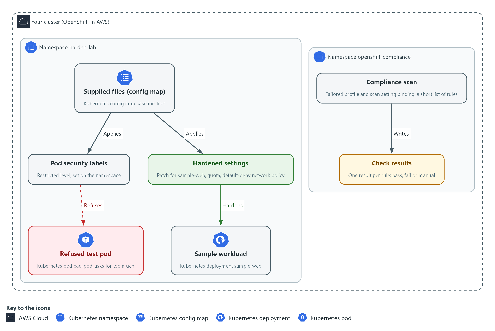

- **1. Supplied files (config map):** the six hardening files the lab supplies, stored in a config map named baseline-files in harden-lab.
- **2. Sample workload:** the program sample-web that you harden. It runs in harden-lab.
- **3. Pod security labels:** labels on the namespace that make the cluster check every new pod against the restricted level.
- **4. Refused test pod:** a pod named bad-pod that asks for host networking and privileged mode. The labels refuse it, so it never starts.
- **5. Hardened settings:** the patch, the quota and the default-deny rule from the supplied files, once applied to harden-lab.
- **6. Compliance scan:** a short scan the Compliance Operator runs in openshift-compliance against a few chosen rules.
- **7. Check results:** one result per rule, marked pass, fail or manual. You read them in Step 5.

Where each part runs, and why:

| Part | Where it runs | Why it is built this way |
| --- | --- | --- |
| Supplied files | A config map named baseline-files in the namespace harden-lab | Every learner starts from the same files, and you can read each one before you apply it. |
| Sample workload | The namespace harden-lab on your cluster | Changes stay in one namespace, so nothing other modules use is touched. |
| Pod security labels | On the namespace harden-lab | A rule on the namespace covers pods that do not exist yet, not only the one that runs today. |
| Compliance Operator and its scan | The namespace openshift-compliance on your cluster | The operator keeps scans and results in its own namespace, and its checks read settings across the whole cluster. |

### 2.1 Three layers that harden a workload (CM-6 Configuration Settings, CM-7 Least Functionality, SC-6 Resource Availability)

- A hardening configuration is a set of files you apply to a workload and its namespace, so the result is the same every time and there is a record of what was applied.
- The security context sits in the workload spec and limits what the container can do on the node.
- Pod security labels sit on the namespace and decide which pods the cluster will refuse to start there, including pods that do not exist yet.
- Memory limits sit on the container and a quota sits on the namespace, and together they cap how much the workload may use.

#### CM-6: Configuration Settings

*The control asks the organization to establish and document configuration settings that reflect the most restrictive mode consistent with operational requirements, using organization-defined common secure configurations. It also asks that the settings be implemented, that deviations be identified, documented and approved, and that changes be monitored and controlled. This is done using:*

- The supplied files: they are the documented settings, and `oc apply` and `oc patch` in Step 3 implement them.
- The Compliance Operator scan: checks the cluster against a short list of checklist rules in Steps 4 and 5.
- The organization defines which common secure configurations apply. This module runs only a short scan, not a full STIG profile (a STIG is a published list of secure settings for one product).

#### CM-7: Least Functionality

*The control asks the organization to configure the system to provide only organization-defined mission essential capabilities, and to prohibit or restrict organization-defined functions, ports, protocols, software and services. This is done using:*

- Pod security admission: built into OpenShift and switched on by the labels on harden-lab, it refuses a pod that asks for host networking, privileged mode or the root account.
- A restricted security context in the supplied patch: the sample workload itself drops the extra powers the restricted level forbids.

#### SC-6: Resource Availability

*The control asks the organization to protect the availability of organization-defined resources by allocating them by priority, by quota, or by other organization-defined controls. This is done using:*

- A memory request and limit on the container in the supplied patch: cap what one container may use.
- A ResourceQuota on the namespace: caps what all workloads in harden-lab may use together. This lab chooses memory as the resource.

### 2.2 What a scan can and cannot tell you

- The Compliance Operator reads cluster settings and marks each rule PASS, FAIL or MANUAL. MANUAL means the tool cannot decide and a person must check.
- A scan measures the whole cluster, not only your namespace, so a failing rule can measure a setting that belongs to another team.
- When a check fails, read its fix text first and ask whose setting it measures. Fix it if it is in your namespace; escalate it to its owner, with the evidence, if it is not.

> **IN PRODUCTION:** In the real environment a deployment pipeline applies these files from a reviewed repository, never by hand, and a failing check opens a tracked item. The lab applies them by hand so you see each result.

### Design decisions

#### Enforce the restricted pod security level on the namespace

- How: The namespace carries enforce, warn and audit labels, all set to the restricted level, so the cluster itself refuses a new pod that asks for privilege, host access or the root account. The workload's own security context is patched to match, so the running pod already meets that level.
- Why: A control on the namespace covers pods that do not exist yet, so it does not rely on each developer remembering the settings.
- Alternatives: The main alternative is to set only the warn and audit labels and leave enforce off. Advantage: nothing breaks while teams adapt to the stricter level. Drawback: an over-powered pod still starts, so protection depends on someone reading the warning.

#### Scan with a short tailored profile and read who owns each failure

- How: A tailored profile lists a handful of rules about how workloads are secured, and a scan setting binding runs it in report-only mode. Each failing check is read for its fix text to learn whose setting it measures before anyone edits anything.
- Why: A scan of a whole cluster mixes platform settings the team does not own with its own, so a long failure list would hide the few items the team can act on.
- Alternatives: A full STIG profile is the alternative. Advantage: far wider coverage of the rules a program is eventually held to. Drawback: a much longer run and many failures that belong to other teams.

#### Memory limits on containers plus a namespace quota

- How: The patch gives each container a memory request and limit, and the quota caps the sum for the namespace. The patch is applied before the quota, because a memory quota refuses any pod that has no memory limit.
- Why: Per-container limits stop one process from taking the node, and the quota stops the namespace as a whole from growing without a reviewed change.
- Alternatives: A limit range that injects default values is the alternative. Advantage: pods that forgot their limits are still accepted. Drawback: the defaults are chosen centrally, may suit no workload, and hide that a team never set a limit.

## Section 3. Implement

- Start: type `lab start cps-2` in the terminal on your own computer (PowerShell on Windows, Terminal on Mac), not in the lab shell.
- Enter lab shell with `lab shell`. Every other command in this module runs inside lab shell.
- If a step fails: run `lab reset cps-2` on your own computer and repeat the step once. If it still fails, copy the whole command and error and ask your AI assistant. Do not skip the step.

### Step 1. Look at the workload and get the supplied files

**Learning point: Reading the sample workload shows which hardened settings it lacks today, and copying the six supplied files out of the config map gives you the exact files you apply in Steps 2 to 4.**

- A field that prints null or as empty braces ({}) is a setting nobody chose.
- The lab put the hardening files in a config map, so every learner starts from the same content.

What this step adds (thick lines and outlines are new):

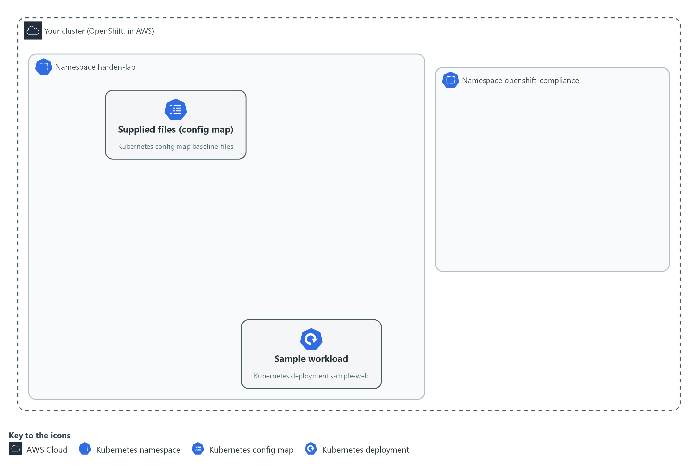

- The sample workload runs with none of the hardened settings, and the supplied files are waiting in a config map in the namespace harden-lab.

#### 1a. Look at the workload and get the supplied files

You will now read the sample workload's current settings and copy the six supplied files into a folder of your own.

```bash
mkdir -p /workspace/cps-2 && cd /workspace/cps-2
oc get deployment sample-web -n harden-lab -o json | jq '.spec.template.spec | {pod: .securityContext, container: (.containers[0] | {securityContext, resources})}'
oc extract configmap/baseline-files -n harden-lab --to=. --confirm
ls
```

**Expected output:**

```
Example only. A blank setting prints as null or {}.
{
  "pod": {},
  "container": {
    "securityContext": null,
    "resources": {}
  }
}
(oc extract prints the name of each file it writes)
bad-pod.yaml  default-deny.yaml  namespace.yaml  quota.yaml  scan.yaml  workload-patch.yaml
```

| Part | What it does | Why you run it |
| --- | --- | --- |
| mkdir -p ... && cd ... | Makes a folder for this module and moves into it, so files from other modules cannot collide with yours. The folder persists between lab sessions. | Gives this module its own folder, so the supplied files you extract in a moment land in one known place. |
| oc get deployment sample-web ... -o json | Reads the live workload as JSON (a plain-text data format). oc is the OpenShift command-line tool. | Shows the workload before you change it, so you have a starting picture to compare with after Step 3. |
| jq '.spec.template.spec \| {...}' | Keeps only the security context and the resources, so the answer is short. | Cuts the long answer down to the fields this module changes, so a blank setting stands out. |
| oc extract configmap/baseline-files --to=. --confirm | Writes each supplied file into the current folder. --confirm lets it overwrite files from an earlier run. | Brings the lab's hardening files from the config map into your folder, so you can read each one before you apply it. |
| ls | Lists the files, which include namespace, patch, quota, default-deny, scan and a bad pod. Files from an earlier run may also appear. | Confirms all six files arrived before the next steps need them. |

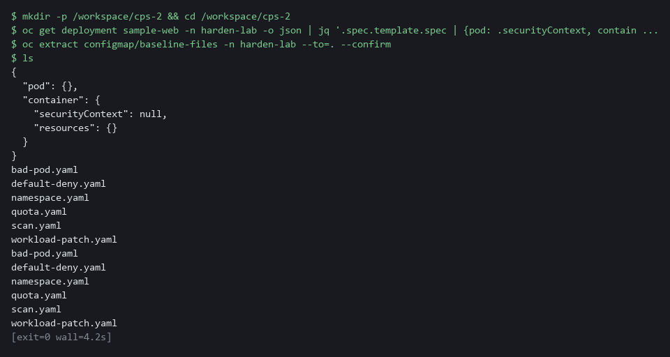

> **CHECKPOINT:** The pod and container security contexts print empty ({} or null), the resources print {}, none of the hardened values appear, and ls lists at least the six yaml files (more if an earlier run left files in the folder).

> **TAKEAWAY:** Look at the state before you change it, so you can prove what the change did.

### Step 2. Apply the pod security labels (CM-7 Least Functionality)

**Learning point: Applying the supplied labels to harden-lab turns on pod security admission there, so the cluster checks every new pod against the restricted level and refuses one that asks for too much.**

- The enforce label refuses a bad pod.
- The warn and audit labels only print or record a message.

What this step adds (thick lines and outlines are new):

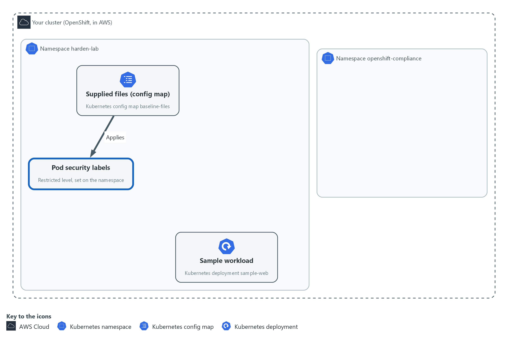

- Applying the supplied namespace file puts labels on the namespace harden-lab, and the cluster then refuses any new pod there that asks for too much.

#### 2a. Apply the pod security labels

You will now read the supplied namespace file, check it with a dry run, apply it, and read the labels back.

```bash
cd /workspace/cps-2
cat namespace.yaml
oc apply -f namespace.yaml --dry-run=server
oc apply -f namespace.yaml
oc get namespace harden-lab --show-labels
```

**Expected output:**

```
Example only. The label list on your cluster may be longer.
(the contents of namespace.yaml)
namespace/harden-lab configured (server dry run)
namespace/harden-lab configured
NAME         STATUS   AGE     LABELS
harden-lab   Active   <age>   ...,pod-security.kubernetes.io/audit=restricted,pod-security.kubernetes.io/enforce=restricted,pod-security.kubernetes.io/warn=restricted
```

| Part | What it does | Why you run it |
| --- | --- | --- |
| cd ... | Moves into the module folder from Step 1, where the supplied files are. | Every block starts in the folder that holds its files, so it works on its own. |
| cat namespace.yaml | Prints the supplied file so you read it before you apply it. | Reading a file before you apply it shows what the cluster is about to be told, which is the habit that stops surprises. |
| --dry-run=server | Asks the cluster to check the file without saving it. This is called a dry run. | Lets the cluster check the labels first. A mistake shows up here and changes nothing. |
| oc apply -f namespace.yaml | Saves the labels. A warning may follow that names settings the running pod is missing. | Turns on the pod security check for this namespace, so the refusal test in Step 4 has something to refuse with. |
| --show-labels | Prints the labels now on the namespace. | Reads the labels back from the cluster, which proves the apply saved them. |

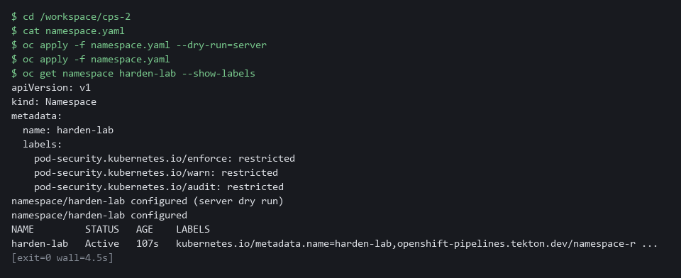

> **NOTE:** A warning does not stop the running pod. The enforce label only checks pods created from now on.

> **CHECKPOINT:** The namespace shows three labels that start with pod-security.kubernetes.io, each set to restricted.

> **TAKEAWAY:** A rule on the namespace protects pods that do not exist yet.

**How this meets the control**

- **CM-7:** The labels restrict what any pod in harden-lab may ask for. Step 4 proves it with a refusal.

### Step 3. Apply the hardening patch, the quota and the default-deny rule (CM-6 Configuration Settings, SC-6 Resource Availability)

**Learning point: The patch hardens the workload, the quota caps the namespace, and the default-deny rule blocks pod traffic until another rule allows it.**

The new pod must meet the restricted level that Step 2 turned on, or it will not start.

What this step adds (thick lines and outlines are new):

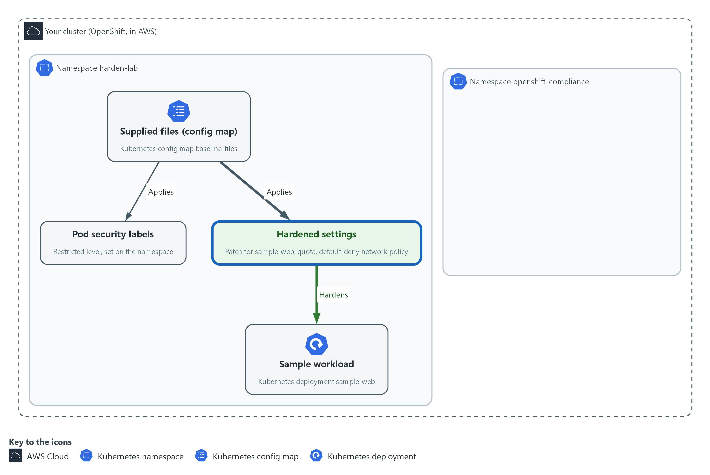

- The supplied patch hardens the sample workload in harden-lab, and the quota and default-deny files add a quota and a network rule to that same namespace.

#### 3a. Apply the patch, the quota and the default-deny rule

You will now read the supplied patch, apply it to the sample workload, wait for the new pod, then apply the quota and the network rule.

```bash
cd /workspace/cps-2
cat workload-patch.yaml
oc patch deployment sample-web -n harden-lab --patch-file workload-patch.yaml --dry-run=server
oc patch deployment sample-web -n harden-lab --patch-file workload-patch.yaml
oc rollout status deployment/sample-web -n harden-lab --timeout=180s
oc apply -f quota.yaml -f default-deny.yaml
oc describe quota harden-quota -n harden-lab
```

**Expected output:**

```
Example only. Names and amounts come from the supplied files. The first patched line is the dry run, which prints the same line but saves nothing.
(the contents of workload-patch.yaml)
deployment.apps/sample-web patched
deployment.apps/sample-web patched
deployment "sample-web" successfully rolled out
resourcequota/harden-quota created
networkpolicy.networking.k8s.io/<name> created
Name:         harden-quota
Namespace:    harden-lab
Resource      Used     Hard
--------      ----     ----
<resource>    <used>   <hard>
```

| Part | What it does | Why you run it |
| --- | --- | --- |
| cd ... | Moves into the module folder from Step 1, where the supplied files are. | Every block starts in the folder that holds its files, so it works on its own. |
| --patch-file workload-patch.yaml | Merges the supplied settings into the live workload. Containers match by name. | This is the step that hardens the running workload, so its pod now meets the level the labels enforce. |
| oc rollout status | Waits for the rollout, which is the replacement of the old pod by a new one, to finish. A pod that breaks the restricted level never starts. | A patch replaces the pod. Waiting shows whether the new, hardened pod starts or is refused. |
| oc apply -f quota.yaml -f default-deny.yaml | Saves the namespace quota and the network rule. | Puts the limits and the network rule in place after the patch, because a memory quota refuses any new pod that has no memory limit. |
| oc describe quota | Shows how much of the quota the workload uses. Used cannot exceed Hard. | Shows the quota counting the new pod, so you know the cap is active and the workload fits under it. |

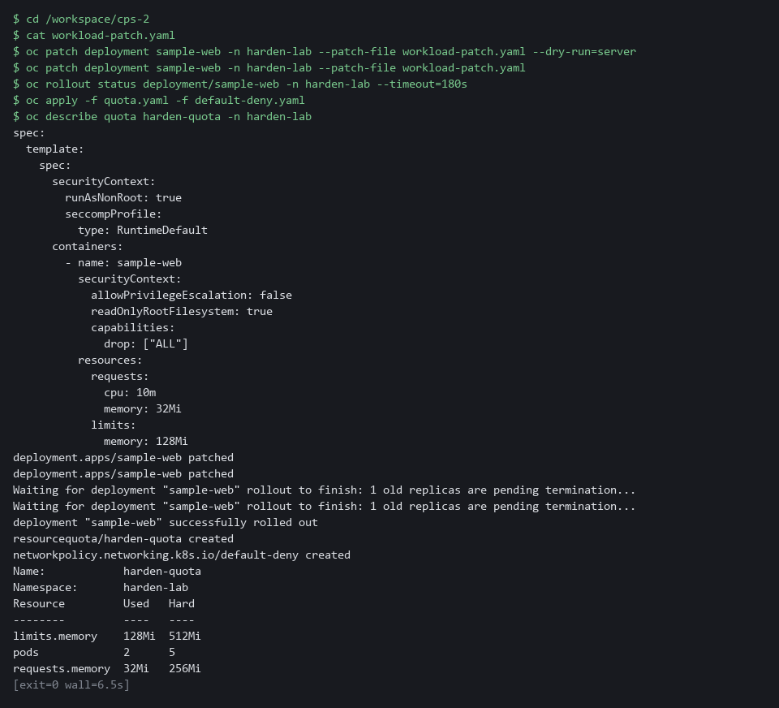

> **SECURITY:** A quota on memory refuses any new pod that has no memory limit, and the old pod spec had none, so a pod with no limit is blocked rather than left to use unbounded memory.

> **CHECKPOINT:** The rollout finishes, the new pod is Running, and the quota shows a used amount under its hard amount.

> **TAKEAWAY:** Apply the patch before the quota, because the order decides whether the new pod starts.

**How this meets the controls**

- **CM-6:** The supplied patch is the documented setting, and applying it puts it in force on the running pod.
- **SC-6:** The memory limits and the quota cap what one container and the whole namespace may use.

### Step 4. Run the supplied scan and try a bad pod while it runs (CM-6 Configuration Settings, CM-7 Least Functionality)

**Learning point: The scan records one result for each chosen rule, and the bad pod shows the Step 2 labels refuse host networking and privileged mode.**

- The scan uses a tailored profile, which is a short list of rules chosen so it finishes quickly, and a scan setting binding starts it.
- The binding runs in report-only mode, so it changes nothing on the cluster.
- The scan finishes in about a minute on the lab cluster, so you can test the bad pod while it runs.

What this step adds (thick lines and outlines are new):

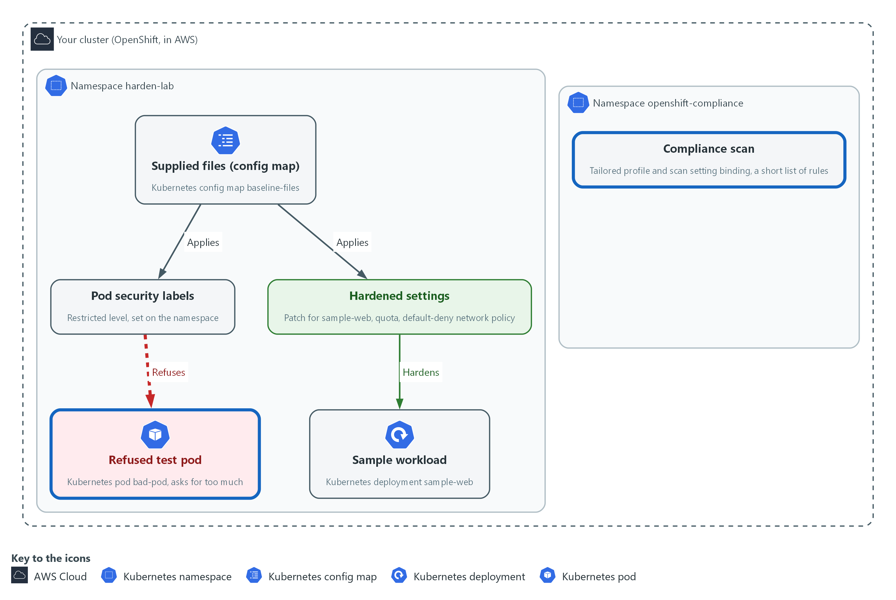

- The supplied scan file starts a short scan in the namespace openshift-compliance. While it runs, the test pod you send to harden-lab is refused.

#### 4a. Start the supplied scan

You will now read the supplied scan file, check it with a dry run, apply it, and wait for the operator to accept the profile.

```bash
cd /workspace/cps-2
cat scan.yaml
oc apply -f scan.yaml --dry-run=server
oc apply -f scan.yaml
oc wait tailoredprofile/harden-baseline -n openshift-compliance --for=jsonpath='{.status.state}'=READY --timeout=120s
oc get tailoredprofile harden-baseline -n openshift-compliance -o jsonpath='{.status.state}{"\n"}'
```

**Expected output:**

```
Example only. The object names come from the supplied file.
(the contents of scan.yaml)
tailoredprofile.compliance.openshift.io/harden-baseline created (server dry run)
scansettingbinding.compliance.openshift.io/<name> created (server dry run)
tailoredprofile.compliance.openshift.io/harden-baseline created
scansettingbinding.compliance.openshift.io/<name> created
tailoredprofile.compliance.openshift.io/harden-baseline condition met
READY
```

| Part | What it does | Why you run it |
| --- | --- | --- |
| cd ... | Moves into the module folder from Step 1, where the supplied files are. | Every block starts in the folder that holds its files, so it works on its own. |
| cat scan.yaml | Prints the two supplied objects: the tailored profile and the binding that starts the scan. | Shows which rules the scan will check before it starts, so the result is not a surprise. |
| oc apply -f scan.yaml | Saves both. The operator creates a suite (the record of one scan run) and one scan. | Starts the scan. It runs for about a minute, which is the time you use for the bad pod test. |
| oc wait ... READY | Waits up to two minutes for the operator to accept the profile. If it times out, the next line shows the state. | A scan built on a rejected profile never runs. Waiting here finds that early. |
| jsonpath='{.status.state}' | Prints the profile state. READY means the operator accepted every rule name. | Prints the state so you can read it yourself if the wait timed out. |

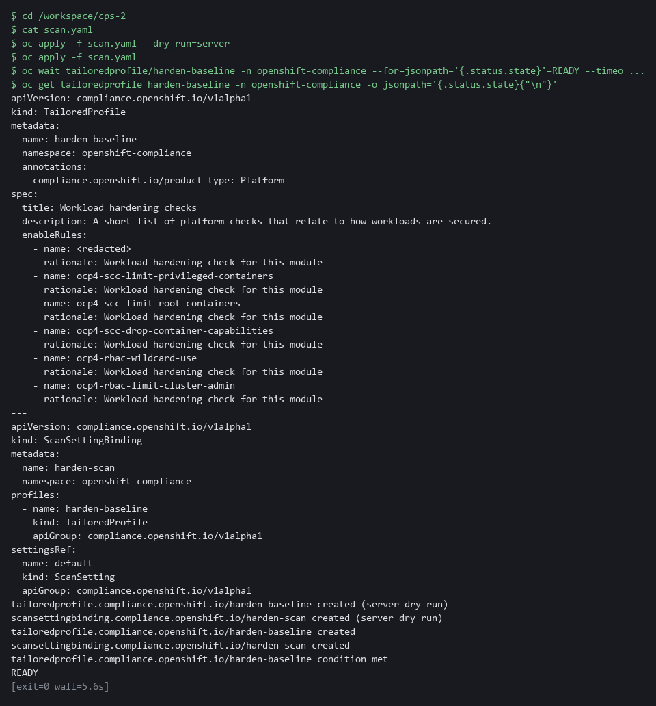

#### 4b. Try the bad pod while the scan runs

You will now read the supplied bad pod and try to create it, while the scan from 4a is still running, to see the namespace labels refuse it.

```bash
cd /workspace/cps-2
cat bad-pod.yaml
oc apply -f bad-pod.yaml
oc get pod bad-pod -n harden-lab
```

**Expected output:**

```
Example only. The wording of the refusal differs between releases.
(the contents of bad-pod.yaml)
Error from server (Forbidden): error when creating "bad-pod.yaml": pods "bad-pod" is forbidden: violates PodSecurity "restricted:latest": ... (the reasons name host namespaces and privileged)
Error from server (NotFound): pods "bad-pod" not found
```

| Part | What it does | Why you run it |
| --- | --- | --- |
| cd ... | Moves into the module folder from Step 1, where the supplied files are. | Every block starts in the folder that holds its files, so it works on its own. |
| cat bad-pod.yaml | Prints the supplied pod that asks for host networking (using the node's own network) and a privileged container (one with node-level power). As cluster-admin you may ask for both, so only the pod security labels from Step 2 stand in the way. | Read what the pod asks for, so you know exactly what the refusal is for. |
| oc apply -f bad-pod.yaml | Tries to create it. The enforce label should refuse it with a Forbidden message that names what was wrong. The wording differs between releases. | This is the test of the labels from Step 2: a cluster that enforces them refuses the request. |
| oc get pod bad-pod | Shows that the pod does not exist: NotFound. | Confirms the refusal left nothing behind. A pod that exists would mean the labels do not enforce. |

#### 4c. Wait for the scan to finish

You will now wait for the scan to finish (about a minute), then read its overall result.

```bash
while ! oc get compliancesuite harden-scan -n openshift-compliance >/dev/null 2>&1; do sleep 5; done
oc wait compliancesuite/harden-scan -n openshift-compliance --for=jsonpath='{.status.phase}'=DONE --timeout=20m
oc get compliancesuite harden-scan -n openshift-compliance
```

**Expected output:**

```
Example only. Your result may be COMPLIANT.
(the first command prints nothing)
compliancesuite.compliance.openshift.io/harden-scan condition met
NAME          PHASE   RESULT
harden-scan   DONE    NON-COMPLIANT
```

| Part | What it does | Why you run it |
| --- | --- | --- |
| while ! ... do sleep 5; done | Repeats the check every five seconds until the operator has created the suite, so the next wait does not start too early. | The scan suite appears a moment after you apply the file. Waiting for it stops the next command failing too early. |
| oc wait ... DONE | Waits until the scan finishes. | Reading results from a scan that is still running would show nothing or only part of the answer. |
| oc get compliancesuite | Shows the final phase and the overall result. | Gives the overall verdict before you read single checks. |

> **NOTE:** If the profile state is ERROR, a rule name was not accepted. Do not edit the file. Copy the whole command and the error and ask your AI assistant, because the lab start state should have skipped that rule.

> **CHECKPOINT:** The profile is READY. The bad pod is refused with a message that names host namespaces and privileged, and the pod does not exist afterwards. If the pod was created, go back to Step 2. The suite is DONE and the result is NON-COMPLIANT or COMPLIANT.

> **TAKEAWAY:** A restriction counts only when a request that breaks it is refused.

**How this meets the controls**

- **CM-6:** The scan checks the cluster against a short list of checklist rules and records one result per rule.
- **CM-7:** The cluster refuses a pod that asks for host networking and privileged mode, which shows the restriction is automatic.

### Step 5. Read the results and find out why one fails (CM-6 Configuration Settings)

**Learning point: Counting results by status shows how many rules passed and failed, and one failure's three texts show what it measures and who owns it.**

- Each rule becomes a check result with a status and three texts: what it checks, how to fix it, and why it matters.
- A check's fix text shows whose setting the rule measures, which decides whether you fix it or hand it on.

What this step adds (thick lines and outlines are new):

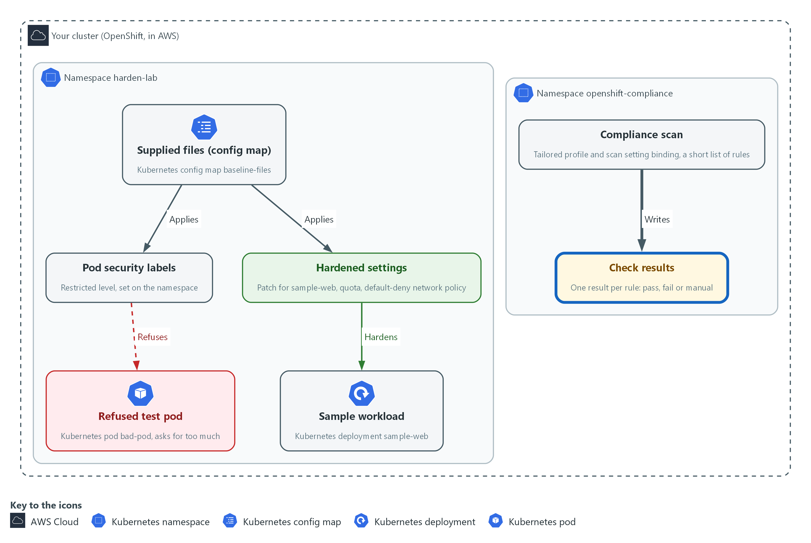

- You read each check result the scan wrote in openshift-compliance, and the reason behind the one that fails.

#### 5a. List every check, count the statuses and read one failure

You will now list the check results of the scan, count them by status, and read the three texts of the first failing check.

```bash
oc get compliancecheckresults -n openshift-compliance -l compliance.openshift.io/scan-name=harden-baseline -o json | jq -r '.items[] | "\(.status)\t\(.metadata.name)"'
oc get compliancecheckresults -n openshift-compliance -l compliance.openshift.io/scan-name=harden-baseline -o json | jq -r '.items[].status' | sort | uniq -c
FAILED=$(oc get compliancecheckresults -n openshift-compliance -l compliance.openshift.io/scan-name=harden-baseline,compliance.openshift.io/check-status=FAIL -o name | head -n 1)
echo "$FAILED"
oc get "$FAILED" -n openshift-compliance -o json | jq -r '.description, "", .instructions, "", .rationale'
```

**Expected output:**

```
Example only. Names and counts depend on your cluster.
<status>    <check name>
<status>    <check name>
  <n> FAIL
  <n> MANUAL
  (a PASS line appears only if a rule passes)
compliancecheckresult.compliance.openshift.io/<failing check name>
(three texts follow, separated by blank lines: what the rule checks, how to fix it, why it matters)
```

| Part | What it does | Why you run it |
| --- | --- | --- |
| jq -r '.items[] \| ...' | Prints one line per rule: its status, a tab, and its name. | Gives one line per rule, so you see every pass and fail at once before you pick one to read. |
| ... \| sort \| uniq -c | Counts how many checks have each status. A scan that returns nothing proves nothing, so the counts must add up to one result per rule in scan.yaml (six on the lab cluster). MANUAL means the tool cannot decide and a person must check. | Every rule must have a result, whether PASS, FAIL or MANUAL. A missing result would mean the scan did not work. A MANUAL result is work for a person, not a pass. |
| compliance.openshift.io/check-status=FAIL | Selects only the failing checks. | Narrows the list to the failures, which are the ones you must explain. |
| FAILED=$(... \| head -n 1) | Keeps the name of the first failing check in a shell variable (a named value that later commands can use). | Saves the name so the next command can read that one check without you copying it. |
| jq -r '.description, ..., .instructions, ..., .rationale' | Prints what the rule checks, how to fix it, and why it matters, with a blank line between. | The three texts say what is checked, how to fix it and why it matters. The fix text shows whose setting it is, which decides whether you act or hand it on. |

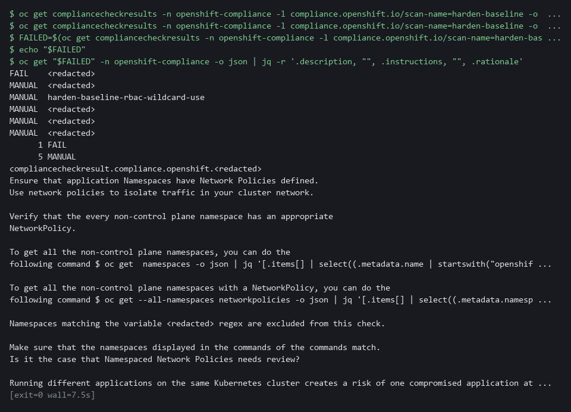

> **TIP:** Look for the words every, all or cluster in the fix text, because they show that the rule measures more than your namespace. If `echo "$FAILED"` prints an empty line, no check failed. Read any check by setting FAILED to its name from the list, for example `FAILED=compliancecheckresult/<name>`, and run the last command again.

> **CHECKPOINT:** The counts add up to one result per rule (six on the lab cluster: typically one FAIL and five MANUAL, since MANUAL rules need a person to check). You can say in one sentence what the failing check measures and whose settings it covers.

> **TAKEAWAY:** Read why a check fails and who owns the setting before you change anything.

**How this meets the control**

- **CM-6:** Reading each check result identifies the deviation from the checklist and who owns the setting behind it.

## Section 4. Verify It Works

### Test 1 (positive). The workload runs with the hardened settings (CM-6 Configuration Settings, SC-6 Resource Availability)

Do not trust the apply message: read the live spec back, then confirm the pod is running.

```bash
oc get deployment sample-web -n harden-lab -o json | jq '.spec.template.spec | {nonRoot: .securityContext.runAsNonRoot, allowEscalation: .containers[0].securityContext.allowPrivilegeEscalation, dropped: .containers[0].securityContext.capabilities.drop, readOnly: .containers[0].securityContext.readOnlyRootFilesystem, memoryLimit: .containers[0].resources.limits.memory}'
oc get pods -n harden-lab
```

**Expected output:**

```
Example only.
{
  "nonRoot": true,
  "allowEscalation": false,
  "dropped": [
    "ALL"
  ],
  "readOnly": true,
  "memoryLimit": "128Mi"
}
NAME                          READY   STATUS    RESTARTS   AGE
sample-web-6d9c7b8f5d-x2k4q   1/1     Running   0          2m
```

| Part | What it does | Why you run it |
| --- | --- | --- |
| jq '.spec.template.spec \| {...}' | Reads the live workload and keeps the fields the supplied patch set. | You check the running object, not the apply message, so you know the settings are in force. |
| nonRoot: true | The pod must run as a user that is not root. | A flaw in the application then does not hand an attacker the root account. |
| allowEscalation: false | The container may not gain more power than it started with. | Stops a program in the container from raising its own privileges. |
| readOnly: true | The container cannot write to its own file system. | A program that cannot write files cannot easily plant tools inside the container. |
| dropped: [ALL] | The container keeps none of the extra Linux powers (capabilities). | Least functionality: only what the program needs, which here is nothing extra. |
| memoryLimit: 128Mi | The most memory the container may use. | Proves the resource cap is on the container that runs, which is what SC-6 asks for. |
| oc get pods -n harden-lab | Lists the pods. READY 1/1 and STATUS Running. | A hardened pod that does not start would be useless, so you confirm it runs. |

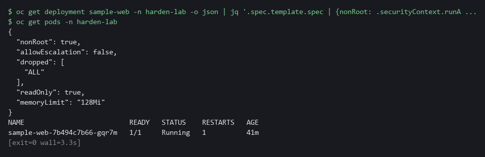

> **CHECKPOINT:** allowEscalation prints false, which means privilege escalation is not allowed. The other fields match the supplied patch and the pod is Running.

**How this meets the controls**

- **CM-6:** Reading the live workload spec back proves the supplied settings are in force now.
- **SC-6:** The memory limit read from the live spec shows the cap is set on the container that runs.

### Test 2 (negative). A failing check outside your namespace stays failed (CM-6 Configuration Settings)

- This test shows that the default-deny rule in harden-lab does not fix the cluster-wide network policy check, because the check also looks at other teams' namespaces.
- You list the namespaces that have no network policy.
- If a different check failed for you, read that check's fix text and list the namespaces it covers the same way.

```bash
cd /workspace/cps-2
oc get namespaces -o json | jq -r '.items[].metadata.name' | grep -v -e '^openshift' -e '^kube-' -e '^default$' | sort > all-namespaces.txt
oc get networkpolicy --all-namespaces -o json | jq -r '.items[].metadata.namespace' | sort -u > covered-namespaces.txt
grep -v -x -f covered-namespaces.txt all-namespaces.txt
```

**Expected output:**

```
Example only. Your list will differ.
chat
demo
gitea
keycloak
```

| Part | What it does | Why you run it |
| --- | --- | --- |
| cd ... | Moves into the module folder so the two list files are made there. | Every block starts in a known folder. |
| oc get namespaces ... > all-namespaces.txt | Writes every namespace name except the platform ones (openshift and kube) and default into a file. | This is the full set of namespaces a cluster-wide network check looks at. |
| oc get networkpolicy --all-namespaces ... > covered-namespaces.txt | Writes the namespaces that have at least one network policy into a second file. | These are the namespaces the check would accept. |
| grep -v -x -f covered-namespaces.txt all-namespaces.txt | Prints the names in the first file that are not in the second. | What is left has no network policy. Those belong to other teams, so you report them and do not change them. |
| harden-lab missing from the list | Your namespace is covered by the default-deny rule from Step 3. | Shows your own fix worked while the cluster-wide check still fails. |

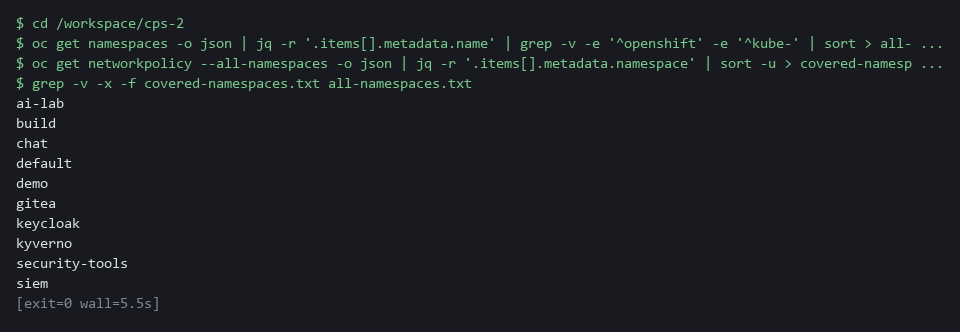

> **CHECKPOINT:** harden-lab is not in the list, because you protected it. The listed namespaces belong to other teams. You do not change them. You pass the list and the check name to their owners, and the check stays FAIL until they act.

**How this meets the control**

- **CM-6:** The list of namespaces with no network policy identifies deviations you do not own, to pass to their owners.

## Section 5. What Each Control Is For

### Control mapping

| Control | What it requires, in plain words | Tool or service | Where this module covers it |
| --- | --- | --- | --- |
| CM-6 Configuration Settings | Use a checklist of secure settings, apply it, record any deviation, and check that it still holds. | Supplied settings files applied with oc, and the OpenShift Compliance Operator scan. Explained in sections 2.1 and 2.2. | Section 3, Step 3: apply the supplied settings. Section 3, Steps 4 and 5: run a short supplied scan and read why a check fails. Section 4, Test 1: read the live settings back. A full STIG scan (a STIG is a published list of secure settings for a product) covers far more rules than this module runs. |
| CM-7 Least Functionality | Allow only the capabilities the mission needs and block the rest. | Pod security admission (built into OpenShift), switched on by labels on the namespace. Explained in section 2.1. | Section 3, Step 2: label the namespace so the cluster refuses over-powered pods. Section 3, Step 4: the bad pod is refused. |
| SC-6 Resource Availability | Protect the availability of resources by giving each workload a priority or a quota. | Container memory limits and a ResourceQuota on the namespace. Explained in section 2.1. | Section 3, Step 3: set memory limits on the workload and a quota on the namespace. Section 4, Test 1: read the memory limit back. |

### What each control is for

Each table below says what the control is trying to prevent and how this module's tool meets it.

#### CM-6 Configuration Settings

| Question | Answer |
| --- | --- |
| Control Intent | A workload runs with default settings nobody chose, and nobody can say whether it matches the approved checklist. |
| The operational question | For this workload, which settings does the checklist require, and does the live workload match them today? |
| What evidence proves it | The supplied settings file, the live workload spec, and a scan result for each check with the reason for every failure. |
| How much is enough | The settings come from a named, supplied file, a scan checks them, and each failing check has a reason and an owner. NIST leaves the common secure configurations organization-defined; this module uses a short scan, and a full STIG profile covers far more rules. |
| How the tool in this module satisfies it | A supplied patch (Step 3) and a supplied Compliance Operator scan (Steps 4 and 5). |

#### CM-7 Least Functionality

| Question | Answer |
| --- | --- |
| Control Intent | A pod asks for node-level power or runs as the root account, and a flaw in the application becomes a takeover of the node. |
| The operational question | What stops a new pod from asking for more power than it needs? |
| What evidence proves it | The namespace labels, the hardened pod spec, and a refused request. |
| How much is enough | The restriction is automatic, not a habit. The restricted level refuses privileged pods, host networking, privilege escalation and root. The organization decides which capabilities count as mission essential. |
| How the tool in this module satisfies it | Pod security labels on the namespace (Step 2) and a restricted security context on the workload (Step 3). |

#### SC-6 Resource Availability

| Question | Answer |
| --- | --- |
| Control Intent | One workload uses all the memory on the node and starves the rest, including the security tools. |
| The operational question | What is the most memory this workload, and this namespace as a whole, may use? |
| What evidence proves it | The container limits and the quota status. |
| How much is enough | Each container has a memory request and a limit, and the namespace has a quota. NIST leaves the resources and the method to the organization; the lab chooses memory and a quota. |
| How the tool in this module satisfies it | Container limits in the supplied patch and a ResourceQuota (Step 3). |

## Section 6. Next Steps

### Using this in other environments

- The pod security labels, the patch, the memory quota and the default-deny rule are plain Kubernetes objects and apply on any recent Kubernetes cluster with kubectl.
- The scan is not portable: it uses the OpenShift Compliance Operator in the openshift-compliance namespace, with a TailoredProfile and a ScanSettingBinding.
- Change these lab values first: the namespace harden-lab, the config map baseline-files in it, and the module work folder in the lab shell.
- A default-deny network rule only blocks traffic if the cluster's network plugin enforces network policies. Confirm that before you rely on it.

The table shows what changes on each platform:

| Check | In this lab (OpenShift) | On other platforms | What you change |
| --- | --- | --- | --- |
| Supplied files | oc extract configmap/baseline-files in harden-lab | Save the six files in a folder, or in git | Replace the extract step with your own copy of the files. |
| Pod security labels | oc apply -f namespace.yaml, then oc get namespace --show-labels | kubectl apply -f namespace.yaml, then kubectl get namespace --show-labels | The tool name. |
| Hardening patch and quota | oc patch deployment and oc apply -f quota.yaml | kubectl patch deployment and kubectl apply -f quota.yaml | The tool name and the namespace. |
| Default-deny rule | A NetworkPolicy, enforced by the lab's network plugin | The same object, if the network plugin enforces policies | Confirm enforcement. |
| Scan | TailoredProfile and ScanSettingBinding in openshift-compliance | Use the platform's equivalent scanner | Replace the check. |
| Scan results | Read each rule result from the Compliance Operator, filtered by scan name | Use the platform's equivalent scanner | Replace the check. |

> **TIP:** Next module: CPS-3 Least-Privilege Roles and Baselines. You write the role, the network rule and the security context yourself, and pass a review gate.

<details>
<summary><strong>Section 7. Terms</strong></summary>

Each term is also explained the first time it appears. In Word, hover over an underlined term to see its meaning, or Ctrl+click it to jump to this table.

| Term | Plain meaning |
| --- | --- |
| Annotation | A note attached to a cluster object that tools can read. Unlike a label, it is not used to pick objects. |
| AWS | Amazon Web Services, the cloud your lab runs in. |
| Baseline | The agreed starting configuration that the system is expected to match. |
| Check result | The record of one rule in one scan: its status, its description, and its fix text (the steps to fix it). |
| Cluster | A group of servers that work together as one system. Here it is your own OpenShift cluster in AWS. |
| Cluster-admin | The built-in role that allows every action on every object in the cluster. |
| Compliance Operator | An OpenShift add-on (an operator is a program that manages another program for you) that scans the cluster against a checklist and reports pass or fail for each rule. |
| Config map | A stored set of small files or settings that the cluster keeps and can hand to a program. |
| Container | A sealed box that holds one program and everything it needs to run, so it runs the same way anywhere. |
| CRD | Custom resource definition: adds a new kind of object to the cluster. |
| Default-deny | A network policy that selects every pod and lists no allowed traffic, so everything is blocked until another rule allows it. |
| Deployment | A cluster object that keeps a set number of copies of a program running and replaces them when you change it. |
| Dry run | A check that reads and validates a file without making any change. |
| Escalate | Hand a finding you do not own to the people who own it, with the evidence, and not fix it yourself. |
| Evidence | Saved records that show a system is set up and behaving as claimed. |
| grep | A command that prints only the lines that match a pattern. |
| Hardening baseline | A fixed set of secure settings that every workload of a kind must carry. |
| Host networking | A pod setting that puts the pod on the node's own network instead of a network of its own. |
| jq | A command-line tool that reads JSON and picks out the fields you ask for. |
| JSON | A plain-text data format of names and values written inside curly braces. oc can print it and jq can read it. |
| Kubernetes | The open-source system that runs and manages containers across servers. OpenShift is built on it. |
| Label | A key=value tag on a cluster object. Tags pick objects out, or switch a check on. |
| Merge | Combine the changes from one git branch into another. |
| mkdir | A command that makes a new folder. |
| Namespace | A named section of the cluster that keeps workloads apart. OpenShift also calls it a project. |
| Network policy | A rule that says which pods may send traffic to which other pods. |
| NIST | The US National Institute of Standards and Technology. It publishes the security control catalog these modules cite. |
| Node | One server in the cluster. |
| oc | The OpenShift command-line tool. You type oc, then a verb such as get, then what it acts on. |
| OpenShift | The Red Hat platform your lab cluster runs on. It is Kubernetes with extra security and tools built in. |
| Operator | A program that installs and looks after another tool inside the cluster. |
| Patch | A small file of changes merged into an object that already exists. The rest of the object stays as it was. |
| Pipeline | A set of automated steps that run in order, such as scan, check and sign. |
| Pod | The smallest running unit on the cluster: one or more containers together. |
| Pod security admission | A built-in OpenShift check that compares each new pod with a named security level and refuses it if it asks for too much. |
| Pod security labels | Labels on a namespace that make the cluster check every new pod against a named level (privileged, baseline or restricted) and refuse, warn or record. |
| Policy | A set of rules written down so that a tool can enforce them. |
| Privileged | A container setting that gives the container the same power as the node it runs on. |
| Query | A question you ask a data store, written in a query language, such as a log search. |
| Quota | A cap on what a whole namespace may use, such as total memory or number of pods. |
| Resource limit | A cap on what one container may use, such as memory. |
| Resource quota | A limit on the total resources a namespace may use. |
| Role | A list of actions a user or program may take on named kinds of objects. |
| Rollout | The replacement of old pods by new ones after you change a deployment. |
| Root | The all-powerful account on a computer. A program that runs as root can change almost anything. |
| Rule | A written condition that a tool checks. |
| Scan | A run that reads cluster settings and compares each one with a rule from a checklist. |
| Scan setting binding | An object that tells the Compliance Operator which profile to scan with, and starts the scan. |
| Security context | The safety settings on a pod or container, such as which user it runs as and which extra powers (capabilities) it keeps. |
| STIG | A published list of secure settings for one product. A full STIG scan checks far more rules than this module runs. |
| Suite | The record the Compliance Operator keeps for one scan run. It shows the phase of the scan and the overall result. |
| Tailored profile | A short, named list of checklist rules (a profile) chosen for one purpose, so a scan stays small. |
| Template | A file with blanks that are filled in when it is used. |
| uniq | A command that removes repeated neighbouring lines. |
| Variable | A named value in the shell. A dollar sign in front of the name means use its value. |
| Workload | A program the cluster runs, such as the sample app sample-web. |
| YAML | A plain-text format for settings: lines of name: value, with indentation to show what belongs to what. |

</details>
