# CPS-3: Least-Privilege Roles and Baselines (AC-6, SC-7, CM-6)

| Item | Detail |
| --- | --- |
| Sequence | Module 13 of 29 in the recommended order |
| Timed work | About 68 minutes (52 hands-on, 16 verify) |
| Standalone start | `lab start cps-3` |
| Combined start | Continue from the end state of the previous module |
| Tools | OpenShift Container Platform, Kubernetes RBAC and NetworkPolicy (included with OpenShift), oc, jq, python3, AWS CLI (iam simulate-custom-policy, no changes made) |
| Prerequisites | ENG-0 Terminal, Git and Your Lab (running oc commands in lab shell, reading their output, and making a file with a heredoc) |

## Section 1. Module Overview

- Purpose: give each program only the permissions it needs and enforce that at the network and container level (AC-6, SC-7, CM-6).
- You write a minimal RBAC role, check it with a review gate that exits with 1 on a wildcard or cluster-admin grant, and confirm before-and-after with oc auth can-i.
- You apply a default-deny network policy and a hardened security context, and verify that a call is blocked and the gate now passes.
- You write a scoped AWS IAM policy and test it by simulation: one read is allowed and all other actions are denied.

- **Skill:** Measure what a service account can do, write a minimal role and pass it through a review gate, close the network with a default-deny policy, harden the container settings, and test a scoped cloud policy by simulation.
- **Tools:** `oc auth can-i` and `oc policy who-can` measure cluster permissions. The review gate script refuses wildcards and cluster-admin grants. `oc` applies RBAC and NetworkPolicy. The AWS CLI simulates a cloud policy without creating anything.
- **Security Function:** Blocks excess access. A review gate stops a wildcard or cluster-admin grant before it reaches the cluster. A default-deny rule blocks traffic with no approved rule. A security context removes powers the container never uses.
- **NIST AC-6 Least Privilege:** `oc auth can-i` and `oc policy who-can` measure what the account may do. A minimal RBAC role replaces a broad binding. The review gate refuses wildcards and cluster-admin grants. An AWS IAM policy is tested by simulation.
- **NIST SC-7 Boundary Protection:** A Kubernetes NetworkPolicy with an empty pod selector blocks all traffic in both directions until another rule allows it. Step 4 applies it, and Verify Test 3 proves a call is blocked.
- **NIST CM-6 Configuration Settings:** A pod and container security context sets the most restrictive mode the app can run with. The review gate reads the live workload for privilege escalation and checks the result.

## Section 2. The Tools

### Tools used in this module

Each tool name links to its official overview. The table columns say how each tool is used in the lab and why the lab uses it instead of another way of doing the same job.

| Tool (overview link) | What it is | Used in this lab | Why this tool |
| --- | --- | --- | --- |
| [OpenShift Container Platform](https://docs.redhat.com/en/documentation/openshift_container_platform/4.22/html/overview/ocp-overview) | A Kubernetes container platform for running and managing containerized applications. | The cluster where you measure, then restrict, one workload. | It is the platform the whole lab runs on, so every module works on the same real cluster, with the same kinds of objects a production OpenShift system has. |
| [Kubernetes RBAC](https://kubernetes.io/docs/reference/access-authn-authz/rbac/) | Roles list what an identity may do, and bindings give those roles to users or service accounts. | You write a minimal role and binding for the report app's service account and remove the broad one. | It is the built-in way to say who may do what in the cluster, so the lab uses the same permission model a real OpenShift system uses. |
| [NetworkPolicy](https://docs.redhat.com/en/documentation/openshift_container_platform/4.22/html/network_security/network-policy) | Rules for which pods may talk to which. Once a policy selects a pod, it accepts only what the policies allow. | You write a default-deny policy that blocks all traffic, then show a call is blocked. | It is the built-in way to limit which pods can talk to which, so you need no extra product to show what a blocked connection looks like. |
| [oc](https://docs.redhat.com/en/documentation/openshift_container_platform/4.22/html/cli_tools/openshift-cli-oc) | The OpenShift command-line tool for creating and managing applications and projects from a terminal. | Measures what the service account can do and applies the role, binding, policy and patch. | It is the one command that talks to the cluster, so every module uses it to ask what is true and to make changes. You sign in once, and it works on OpenShift objects as well as standard Kubernetes ones. Unlike clicking in the web console, a command can be pasted, repeated and checked by a test. |
| [jq](https://jqlang.org/) | Command-line JSON processor. | Reads Role, binding and Deployment JSON for the gate. | It picks one field out of a long JSON reply, so a test can read a single value. |
| [Python 3](https://docs.python.org/3/tutorial/introduction.html) | General-purpose language, used here for small helper scripts. | Runs review_gate.py, which refuses wildcards and cluster-admin grants. | Python reads and writes JSON easily and is already in the lab shell, so a small script needs nothing installed. |
| [AWS CLI](https://docs.aws.amazon.com/cli/latest/userguide/cli-chap-welcome.html) | Runs AWS actions from a shell instead of the browser console. | Reads and checks AWS resources from the shell. | It reads the cloud account's settings from a terminal, so a check can be pasted, repeated and tested instead of clicked through in the console. |

### How it fits together

#### A review gate stands in front of a minimal role

- Lab (test) setup: The service account report-sa starts with a broad binding.
- You check what report-sa can do, write a minimal role, pass it through a review gate, add a network rule and a hardened security context, then test a scoped cloud policy by simulation.
- In production the review gate runs in the pipeline before every merge and deploy, and each approved network flow has its own reviewed rule.
- New parts are drawn with thick lines.

How the lab is set up, and why:

- You work in lab shell on your laptop, as before, and the review gate is a script that runs there, so you can run it before anything reaches the cluster.
- The report app, its service account, the backend and the rules all live in one namespace, rbac-lab, so every role and network rule you write affects only that namespace.
- The app and the backend run side by side, so the network rule has a real call to block.
- The service account is the identity the cluster checks when the app asks to read something, and the review gate sits in front of the role file.
- You ask the cluster questions with oc auth can-i, so you can see a permission change before and after.
- This module adds a gate and four protections to the workload layout from CPS-2, so you now write the files that module only applied.

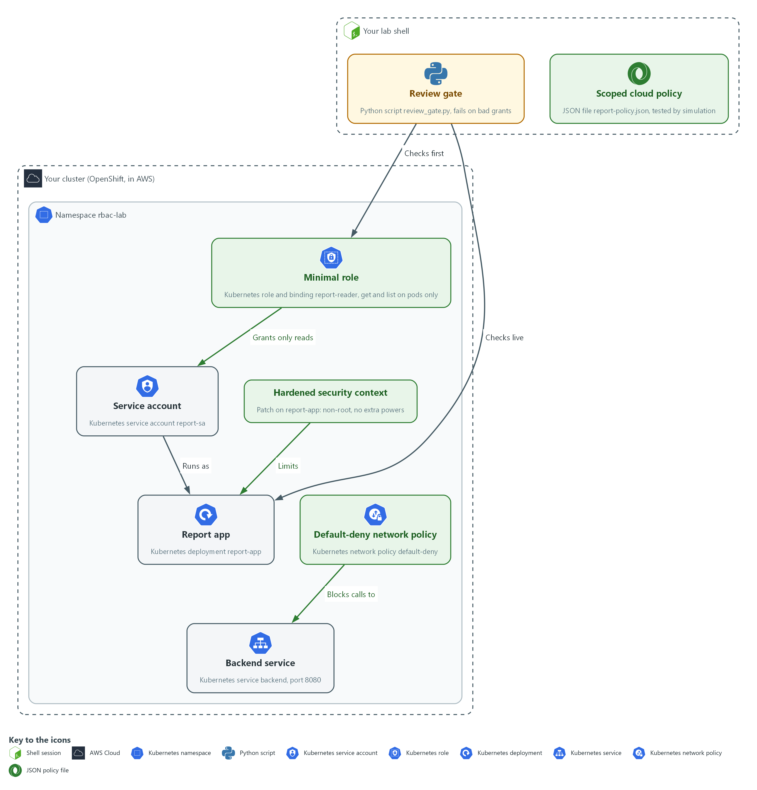

- **1. Review gate:** a Python script in your lab shell that fails on wildcards, cluster-admin grants and privilege escalation.
- **2. Service account:** the Kubernetes identity report-sa that the report app runs as, in the namespace rbac-lab.
- **3. Broad role binding:** report-sa-edit, the starting grant that gives report-sa too much. It is removed in Step 3.
- **4. Minimal role:** the role and binding report-reader, which allow only get and list on pods.
- **5. Report app:** the Kubernetes deployment report-app that runs as the service account.
- **6. Backend service:** the Kubernetes service backend on port 8080, which the report app calls.
- **7. Default-deny network policy:** a rule that blocks all traffic to and from the pods in rbac-lab until another rule allows it.
- **8. Hardened security context:** a patch on report-app that makes it run as non-root with no extra powers.
- **9. Scoped cloud policy:** the JSON file report-policy.json in your lab shell, tested by simulation.

Where each part runs, and why:

| Part | Where it runs | Why it is built this way |
| --- | --- | --- |
| Review gate | A script in your lab shell | You can run it before anything is sent to the cluster, and again on the live workload. |
| Service account report-sa | The namespace rbac-lab | The cluster checks this identity when the app asks to read something, so its role decides what the app can do. |
| Roles and bindings | The namespace rbac-lab | A role inside one namespace keeps a mistake inside that namespace. |
| Report app and backend | The namespace rbac-lab | Two programs side by side give the network rule a real call to block. |
| Network and security settings | Applied to the report app in rbac-lab | They act at the pod and the container, which are the places the app could do harm. |
| Scoped cloud policy | A JSON file in your lab shell, tested by a call to AWS that changes nothing | The simulation answers allowed or denied for each action, so you prove the scope without creating anything. |

### 2.1 Measure first, then write the role (AC-6 Least Privilege)

- Least privilege is a measurement before it is a file: a role written from memory may still allow more than intended.
- The measure-first routine has four stages: ask the cluster what the account can do now, decide what it should do, write a role that grants exactly that, and ask again.

#### AC-6: Least Privilege

*The control asks the organization to employ the principle of least privilege, allowing only authorized accesses for users, or processes acting on behalf of users, that are necessary to accomplish assigned organizational tasks. This is done using:*

- oc auth can-i: asks the cluster whether the service account report-sa may do one action, so you can measure its access before and after the fix.
- oc policy who-can: lists every user and account that may do one action, which shows who else holds a power such as reading secrets.
- The review gate script: refuses wildcards and cluster-admin grants in role files and in the live workload, so an over-broad grant is stopped before it is applied.
- aws iam simulate-custom-policy: tests a cloud policy that allows one read, and shows that every other action is denied, without creating anything.

The table below shows the two questions you ask the cluster and what a good answer looks like:

| Question | Command | What a good answer looks like |
| --- | --- | --- |
| May this account do X? | oc auth can-i X --as=ACCOUNT | yes for needed actions, no for everything else |
| Who may do X? | oc policy who-can X | the report account is not listed for sensitive actions |

### 2.2 Why a review gate

- A review gate is a script that reads a file before it is applied and exits with 1 when the file breaks a rule.
- The gate in this module refuses a wildcard in a role's verbs, resources or API groups, and any binding to cluster-admin.
- The gate also reads a running workload and refuses a container that may gain extra privilege.
- The negative tests feed the gate bad files and show it refusing them.

> **IN PRODUCTION:** In the real environment the gate runs in the pipeline before every merge and again before every deploy, so a person cannot skip it. The lab runs it by hand so you see its output.

### 2.3 The network rule and the container settings (SC-7 Boundary Protection, CM-6 Configuration Settings)

- A default-deny network policy blocks traffic that no rule allows.
- A security context removes powers the container does not need.
- A pod cut off from the network and with no extra powers does little harm if the program inside it is flawed.

#### SC-7: Boundary Protection

*The control asks the organization to monitor and control communications at the external and key internal managed interfaces of the system, and to connect to external networks only through managed interfaces. The enhancement SC-7(5), which this module follows, asks to deny network communications traffic by default and allow it by exception. This is done using:*

- A default-deny NetworkPolicy: blocks all traffic in both directions for every pod in the namespace rbac-lab, so nothing is allowed unless a rule says so.
- A separate rule for each approved flow, added later: allows one reviewed flow without removing the default-deny.

#### CM-6: Configuration Settings

*The control asks the organization to establish and document configuration settings in the most restrictive mode consistent with operational requirements, and to implement and monitor them. NIST leaves the choice of common secure configurations to the organization. This is done using:*

- A security context patch: sets the report app to run as non-root, with no privilege escalation, a read-only file system and no extra capabilities.
- The review gate: reads the settings back from the live workload and fails if privilege escalation is still allowed.

### Design decisions

#### Measure first, write a minimal role, and gate it with a script

- How: The cluster is asked what the service account can do and who else can do the same, then a role lists only the verbs and resources the app uses. A review gate script refuses wildcards and cluster-admin bindings before the file is applied, and the broad binding is removed only after the new one exists.
- Why: Asking before and after catches grants that a role written from memory would miss, and a gate that fails on bad input makes review automatic instead of a habit.
- Alternatives: The alternative is to rely on human review of the role file alone. Advantage: no script to write or maintain. Drawback: reviewers miss wildcards under time pressure, and nothing stops a bad file from being applied.

#### Start closed with a default-deny network policy

- How: A policy with an empty pod selector blocks traffic in both directions for every pod in the namespace. Each approved flow is added later as its own rule.
- Why: When the default is closed, a forgotten flow fails visibly, whereas a forgotten block in an open network is never noticed.
- Alternatives: The alternative is to allow everything and add deny rules for known risks. Advantage: fewer outages while the real flows are being discovered. Drawback: every new pod stays open until someone remembers to block it.

## Section 3. Implement

- Start: type `lab start cps-3` in the terminal on your own computer (PowerShell on Windows, Terminal on Mac), not in the lab shell.
- Enter lab shell with `lab shell`. Every other command in this module runs inside lab shell.
- If a step fails: run `lab reset cps-3` on your own computer and repeat the step once. If it still fails, copy the whole command and error and ask your AI assistant. Do not skip the step.

### Step 1. Measure what the service account can do today (AC-6 Least Privilege)

**Learning point: Running oc auth can-i and oc policy who-can shows what the account may do and who else holds the same power. These are the before answers that prove the fix worked.**

- The app only needs to read pods in its own namespace.
- Find out whether the service account of the app can also read secrets, and who else holds that power.

What this step adds (thick lines and outlines are new):

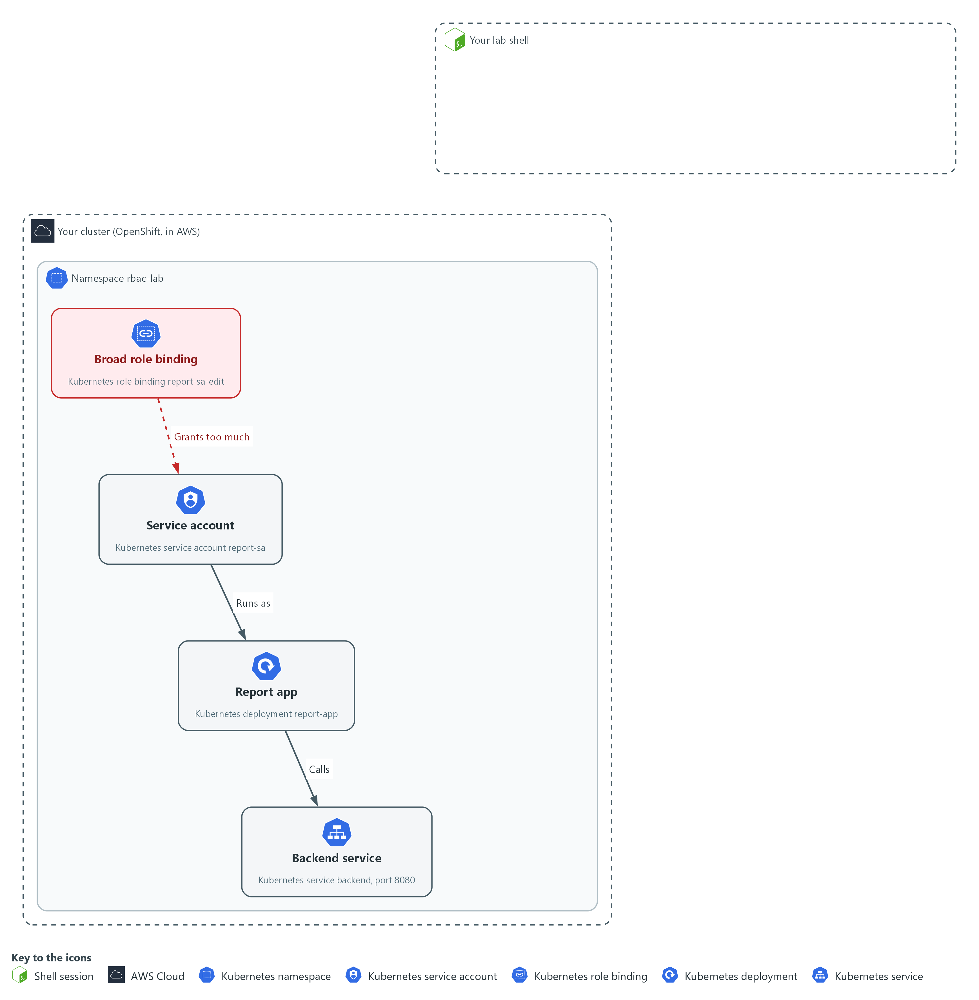

- The service account report-sa runs the report app in the namespace rbac-lab and holds a broad binding. You only measure what it can do, with questions you send to the cluster.

#### 1a. Measure what the service account can do

You will now ask the cluster what the service account report-sa may do and who else may read secrets.

```bash
mkdir -p /workspace/cps-3 && cd /workspace/cps-3
SA=system:serviceaccount:rbac-lab:report-sa
oc auth can-i get secrets -n rbac-lab --as=$SA
oc policy who-can get secrets -n rbac-lab
```

**Expected output:**

```
Example only. Your lists and names will differ.
yes
resourceaccessreviewresponse.authorization.openshift.io/<unknown>
Namespace: rbac-lab
Verb:      get
Resource:  secrets

Users:  ...
        system:serviceaccount:rbac-lab:report-sa
```

| Part | What it does | Why you run it |
| --- | --- | --- |
| mkdir -p ... && cd ... | Makes a folder for this module and moves into it, so files from other modules cannot collide with yours. The folder persists between lab sessions. | Gives this module its own folder, so the gate and the role files you write later stay together. |
| SA=system:serviceaccount:rbac-lab:report-sa | Keeps the full name of the service account in a shell variable (a named value that later commands can use). | Saves typing the long name each time, and makes sure every question asks about the same account. |
| oc auth can-i get secrets --as=$SA | Asks about one sensitive action. --as asks the question as that account. The answer is yes or no. | Secrets hold passwords, so this is the power most worth removing. The answer is your before value. |
| oc policy who-can get secrets | Lists every user and account that may read secrets in the namespace. | Shows who else has the same power, so you know how far the problem reaches beyond this one account. |

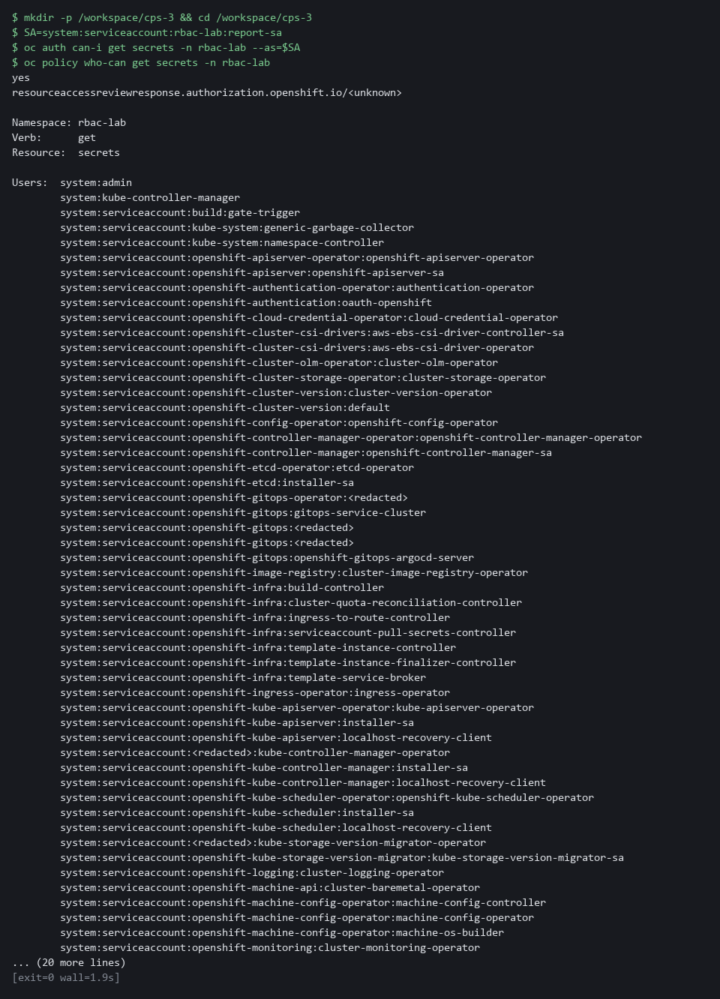

> **YOUR TURN:** Run the commands and note that the account can read secrets, which it should not.

> **CHECKPOINT:** The account can read secrets, and report-sa appears in the who-can list. That is the problem you fix.

> **TAKEAWAY:** Read what the account can do before you change it.

**How this meets the control**

- **AC-6:** You ask the cluster what report-sa may do and who else may read secrets. The answers show how far the account is from least privilege.

### Step 2. Write the review gate (AC-6 Least Privilege, CM-6 Configuration Settings)

**Learning point: A gate that refuses wildcards and cluster-admin grants and exits with 1 lets you check every role and binding before it reaches the cluster.**

- Write the gate before the role, so the role has something to pass.
- The script reads JSON from a file or a live workload and prints FAIL for a wildcard, a cluster-admin grant or extra powers.
- A non-zero exit code is how a pipeline knows to stop.

What this step adds (thick lines and outlines are new):

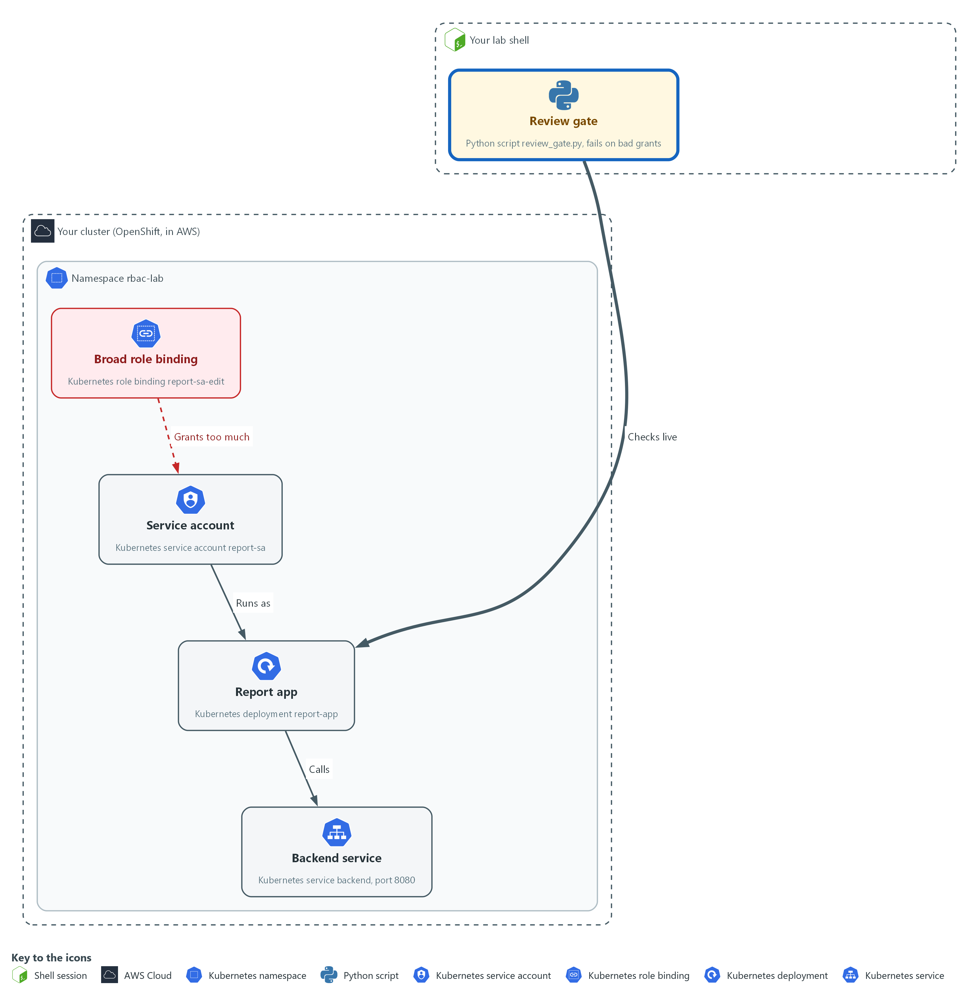

- You write the review gate in your lab shell, a script that fails on cluster-admin grants and wildcard verbs. It reads the files and live objects that you pipe into it.

#### 2a. Save the review gate script

You will now make review_gate.py in the folder from Step 1.

- Paste the whole block at once.
- The only output is the line count.

```bash
cd /workspace/cps-3
cat > review_gate.py <<'EOF'
import json, sys

def problems(obj):
    kind = obj.get("kind", "")
    name = obj.get("metadata", {}).get("name", "?")
    if kind in ("Role", "ClusterRole"):
        for rule in obj.get("rules", []):
            for field in ("verbs", "resources", "apiGroups"):
                if "*" in rule.get(field, []):
                    yield f"wildcard in {field} of {kind}/{name}"
    if kind in ("RoleBinding", "ClusterRoleBinding"):
        if obj.get("roleRef", {}).get("name") == "cluster-admin":
            yield f"cluster-admin granted by {kind}/{name}"
    if kind == "Deployment":
        for c in obj["spec"]["template"]["spec"].get("containers", []):
            sc = c.get("securityContext", {})
            if sc.get("privileged"):
                yield f"privileged container {c['name']} in {name}"
            if sc.get("allowPrivilegeEscalation") is not False:
                yield f"{c['name']} in {name} allows privilege escalation"

text = sys.stdin.read()
decoder = json.JSONDecoder()
docs, at = [], 0
while at < len(text):
    if text[at].isspace():
        at += 1
        continue
    obj, at = decoder.raw_decode(text, at)
    docs.extend(obj.get("items", []) if obj.get("kind") == "List" else [obj])
found = [p for o in docs for p in problems(o)]
if not docs:
    found = ["no input to check"]
for p in found:
    print("FAIL", p)
print("gate:", "FAIL" if found else "PASS")
sys.exit(1 if found else 0)
EOF
wc -l review_gate.py
```

**Expected output:**

```
Example only. The count is the number of lines you pasted.
37 review_gate.py
```

| Part | What it does | Why you run it |
| --- | --- | --- |
| cd ... | Moves into the module folder from Step 1, where the files of this module live. | Every block starts in the folder that holds its files, so it works on its own. |
| cat > review_gate.py <<'EOF' ... EOF | Writes everything between the first line and the line EOF into review_gate.py. The quotes around EOF keep every dollar sign and bracket exactly as typed. | You need no editor: one paste makes the whole file. |
| wc -l review_gate.py | Counts the lines of the file. | A quick check that the whole paste arrived. |
| def problems(obj) | A Python function that hands back one text line for each problem it finds in one object. | One function holds every rule, so adding a rule later means adding lines in one place. |
| kind in ("Role", "ClusterRole") | Looks at the rules of a role. | Roles are where a wildcard can hide, so the gate reads their rules first. |
| "*" in rule.get(field, []) | A wildcard in verbs, resources or API groups (sets of object kinds) means every action, every kind or every group. | A star would let the account do anything, which is the opposite of a minimal role. |
| roleRef ... "cluster-admin" | Refuses any binding that hands out the cluster-admin role. | Binding the account to that role would hand over every permission at once, so the gate refuses it by name. |
| kind == "Deployment" | Also reads a workload so Step 4 can be checked. | Lets the same gate check the live workload in Step 4, so one script covers files and running objects. |
| sc.get("privileged") | Refuses a container that has node-level power. | A privileged container has node-level power, so it should never pass review. |
| allowPrivilegeEscalation") is not False | Refuses a container that does not say, in writing, that it may not gain more privilege. | A missing setting counts the same as allowed, so the file must state the safe value. That is why the gate fails on report-app until Step 4. |
| decoder.raw_decode(text, at) | Reads JSON objects one after another from the input. oc may print one object for each document in a file, or one List; both work. | The gate is fed whatever oc prints, so it must cope with both shapes of output. |
| if not docs | Fails when nothing was read, so an empty input can never pass. | A gate that passes on nothing would hide a broken pipe, so empty input is a failure. |
| sys.exit(1 if found else 0) | Exits with 1 when anything failed. A pipeline stops on a non-zero exit. | A pipeline or a person can only stop on a failure if the script says so with its exit code. |

#### 2b. Run the gate on the live workload

You will now pass the live report app to your gate and print its exit code.

- An error right after the copy usually means review_gate.py is empty: paste the previous block again.

```bash
cd /workspace/cps-3
oc get deployment report-app -n rbac-lab -o json | python3 review_gate.py
echo "exit code: $?"
```

**Expected output:**

```
Example only. The exact FAIL lines depend on the live workload.
FAIL report-app in report-app allows privilege escalation
gate: FAIL
exit code: 1
```

| Part | What it does | Why you run it |
| --- | --- | --- |
| cd ... | Moves into the module folder from Step 1, where review_gate.py is. | Every block starts in the folder that holds its files, so it works on its own. |
| oc get deployment report-app -o json | Reads the live workload as JSON. | Gets the live workload, so the gate checks what is running and not what a file says. |
| \| python3 review_gate.py | Passes it to the gate on standard input (the stream a program reads its data from). | Hands that JSON to your gate without saving a file. |
| echo "exit code: $?" | Prints the exit code of the gate. $? is the exit code of the last command. | Shows the result the way a pipeline would see it, as a number. |

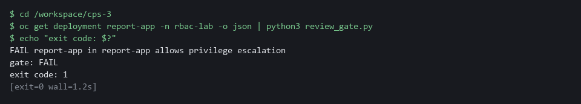

> **TIP:** Keep review_gate.py in git, so any change to the gate is reviewed.

> **YOUR TURN:** Paste the first block to make review_gate.py, then run the second block.

> **CHECKPOINT:** The gate prints FAIL for report-app (it does not forbid privilege escalation) and the exit code is 1. You fix that in Step 4.

> **TAKEAWAY:** A gate that exits with 1 can stop a bad file in a pipeline.

**How this meets the controls**

- **AC-6:** The gate refuses wildcards and cluster-admin bindings, the two broadest grants. Its exit code can stop a file before it is applied.
- **CM-6:** The gate also reads the live workload for a privileged container and for privilege escalation. It prints FAIL for report-app until Step 4 fixes the settings.

### Step 3. Write the minimal role and replace the broad binding (AC-6 Least Privilege)

**Learning point: Gating a role that allows only get and list on pods, then removing the broad binding, shows in the can-i answers exactly what changed.**

- The app lists and reads pods and does nothing else.
- The role grants only get and list on pods.
- Run the gate on the role file first, apply it only when the gate passes, then remove the broad binding and measure again.

What this step adds (thick lines and outlines are new):

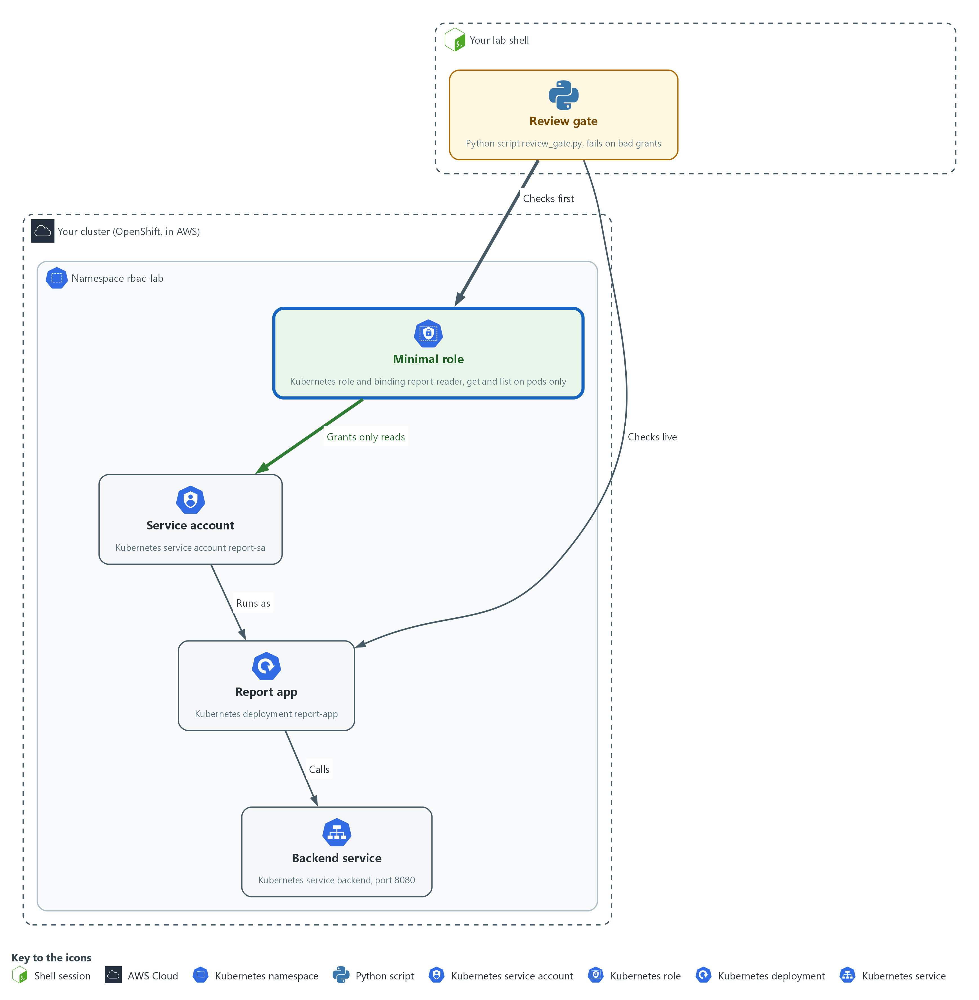

- The minimal role replaces the broad binding on report-sa in rbac-lab. The gate checks the role file before you send it to the cluster.

#### 3a. Save the minimal role and its binding

You will now make role.yaml in the folder from Step 1.

- Paste the whole block at once.

```bash
cd /workspace/cps-3
cat > role.yaml <<'EOF'
apiVersion: rbac.authorization.k8s.io/v1
kind: Role
metadata:
  name: report-reader
  namespace: rbac-lab
rules:
  - apiGroups: [""]
    resources: ["pods"]
    verbs: ["get", "list"]
---
apiVersion: rbac.authorization.k8s.io/v1
kind: RoleBinding
metadata:
  name: report-reader
  namespace: rbac-lab
subjects:
  - kind: ServiceAccount
    name: report-sa
    namespace: rbac-lab
roleRef:
  apiGroup: rbac.authorization.k8s.io
  kind: Role
  name: report-reader
EOF
wc -l role.yaml
```

**Expected output:**

```
Example only.
23 role.yaml
```

| Part | What it does | Why you run it |
| --- | --- | --- |
| cd ... | Moves into the module folder from Step 1, where the files of this module live. | Every block starts in the folder that holds its files, so it works on its own. |
| cat > role.yaml <<'EOF' ... EOF | Writes everything between the first line and the line EOF into role.yaml. The quotes around EOF keep every dollar sign and bracket exactly as typed. | You need no editor: one paste makes the whole file. |
| kind: Role | A list of allowed actions inside one namespace. | Keeps the grant inside one namespace, so a mistake cannot spread to other namespaces. |
| apiGroups: [""] | The core group (the set of built-in kinds of object), which holds pods. | Pods live in the core group, so naming it points the rule at the right kind of object. |
| resources: ["pods"] | Only pods. Not secrets, deployments or anything else. | Limits the rule to what the app needs. Secrets and deployments stay out of reach. |
| verbs: ["get", "list"] | Only reading. No create, update, delete or wildcard. | Reading is all the app does, so nothing that changes things is listed. |
| kind: RoleBinding | Gives the role to one account in this namespace. | A role grants nothing until a binding gives it to someone, so this is what makes the role take effect. |
| subjects | The service account that receives the role. | Names the one account that gets the role, so no other account gains it. |
| roleRef | The role being granted: the one above. | Ties the binding to the role above and not to a broader one. |

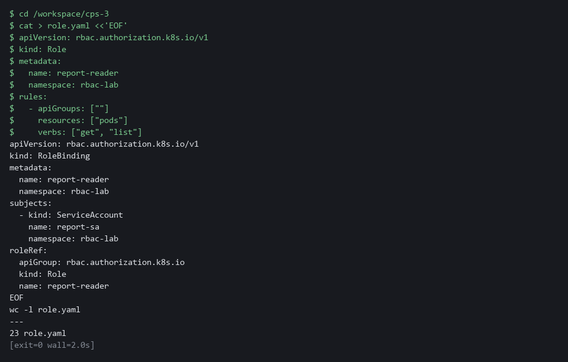

#### 3b. Gate the role, apply it and remove the broad binding

You will now run the gate on the role file, apply it, remove the broad binding, and ask the cluster again.

- An error right after the copy usually means role.yaml is empty: paste the previous block again.

```bash
cd /workspace/cps-3
SA=system:serviceaccount:rbac-lab:report-sa
oc create --dry-run=client -f role.yaml -o json | python3 review_gate.py
oc apply -f role.yaml --dry-run=server
oc apply -f role.yaml
oc delete rolebinding report-sa-edit -n rbac-lab --ignore-not-found
oc auth can-i get pods -n rbac-lab --as=$SA
oc auth can-i get secrets -n rbac-lab --as=$SA
```

**Expected output:**

```
Example only. The gate must print PASS before you apply anything.
gate: PASS
role.rbac.authorization.k8s.io/report-reader created (server dry run)
rolebinding.rbac.authorization.k8s.io/report-reader created (server dry run)
role.rbac.authorization.k8s.io/report-reader created
rolebinding.rbac.authorization.k8s.io/report-reader created
rolebinding.rbac.authorization.k8s.io "report-sa-edit" deleted from rbac-lab namespace
yes
no
The block ends with exit code 1 because the last answer is no. That is the correct result.
```

| Part | What it does | Why you run it |
| --- | --- | --- |
| cd ... | Moves into the module folder from Step 1, where role.yaml and review_gate.py are. | Every block starts in the folder that holds its files, so it works on its own. |
| SA=system:serviceaccount:... | Sets the account name again, so the block also works in a new lab shell. | A new lab shell does not remember earlier variables, so the block sets it again. |
| oc create --dry-run=client -f role.yaml -o json | Reads the file and prints it as JSON without saving anything. | The gate reads JSON, so this turns the file into the form the gate understands without saving anything. |
| \| python3 review_gate.py | Runs the gate on it. Continue only when it prints PASS. | Review comes before apply. A failing file must be fixed, not applied. |
| --dry-run=server | Asks the cluster to check the file without saving it. This is called a dry run. | The cluster checks details the gate does not, such as unknown fields. |
| oc delete rolebinding report-sa-edit --ignore-not-found | Removes the broad binding from the starting state. --ignore-not-found makes a second run harmless. | Removing the broad binding is what takes the extra power away. It comes after the new binding exists. |
| oc auth can-i ... | Asks again: reading pods should now be yes and reading secrets no. | Measures again, so you see the change in the account's real permissions. |

> **NOTE:** Delete the broad binding only after the new binding exists, so the program is never left with no access at all.

> **YOUR TURN:** Paste the first block to make role.yaml, then run the second block.

> **CHECKPOINT:** The gate prints PASS, get pods answers yes, and get secrets answers no.

> **TAKEAWAY:** A role that only reads pods leaves the app working and the secrets out of reach.

**How this meets the control**

- **AC-6:** The role lists only get and list on pods, and the broad binding is removed. The can-i answers then match what the app does.

### Step 4. Close the network and harden the container (SC-7 Boundary Protection, CM-6 Configuration Settings)

**Learning point: A default-deny policy and a security context close the network and remove container powers. After this step the gate that failed in Step 2 passes on the live workload.**

- A network policy with no allow list blocks all traffic in both directions.
- A security context removes powers the app does not need, and your gate from Step 2 checks the result.

What this step adds (thick lines and outlines are new):

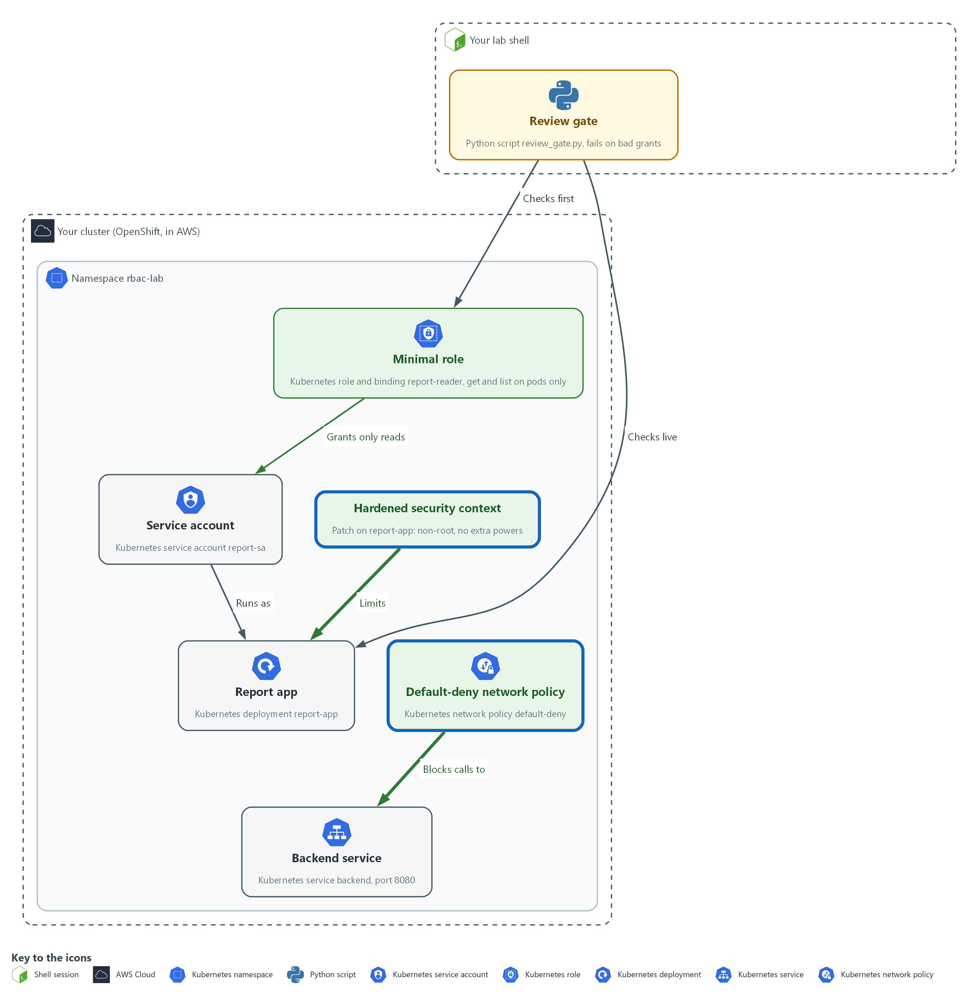

- A default-deny rule blocks the report app from calling the backend until another rule allows it, and a hardened security context removes extra powers from its container.

#### 4a. Save the policy, try the call, then apply the policy

You will now make default-deny.yaml, try the call from the report app to the backend, apply the policy, and list it.

- Paste the whole block at once.

```bash
cd /workspace/cps-3
cat > default-deny.yaml <<'EOF'
apiVersion: networking.k8s.io/v1
kind: NetworkPolicy
metadata:
  name: default-deny
  namespace: rbac-lab
spec:
  podSelector: {}
  policyTypes:
    - Ingress
    - Egress
EOF
test -s default-deny.yaml || echo "EMPTY: type the block again"
oc exec -n rbac-lab deploy/report-app -- timeout 3 bash -c 'echo > /dev/tcp/backend/8080'; echo "before: exit=$?"
oc apply -f default-deny.yaml --dry-run=server
oc apply -f default-deny.yaml
oc get networkpolicy -n rbac-lab
```

**Expected output:**

```
Example only. Your age will differ. If you run this block a second time, the policy already exists and the first line shows a non-zero number instead of 0.
before: exit=0
networkpolicy.networking.k8s.io/default-deny created (server dry run)
networkpolicy.networking.k8s.io/default-deny created
NAME           POD-SELECTOR   AGE
default-deny   <none>         <age>
```

| Part | What it does | Why you run it |
| --- | --- | --- |
| cd ... | Moves into the module folder from Step 1, where the files of this module live. | Every block starts in the folder that holds its files, so it works on its own. |
| cat > default-deny.yaml <<'EOF' ... EOF | Writes everything between the first line and the line EOF into default-deny.yaml. The quotes around EOF keep every dollar sign and bracket exactly as typed. | You need no editor: one paste makes the whole file. |
| kind: NetworkPolicy | A rule about which traffic pods may send and receive. | This is the object that holds the network rule. |
| podSelector: {} | An empty selector matches every pod in the namespace. | Selecting every pod makes the rule cover the whole namespace, including pods created later. |
| policyTypes: Ingress, Egress | Covers traffic arriving (ingress) and traffic leaving (egress). | Naming both directions means traffic is blocked on arrival and on departure. |
| no ingress or egress list | Nothing is allowed. A pod that is selected and has no allow rule is cut off. | An empty allow list is what makes it deny. Allowed flows are added later as separate rules. |
| oc exec ... deploy/report-app -- ... | Runs a command inside the report app container. | Runs the test from inside the app, because that is where the blocked call would start. |
| timeout 3 bash -c 'echo > /dev/tcp/backend/8080' | Opens a connection to the backend service (the program the app calls) on port 8080 (a numbered entry point on a server) and gives up after 3 seconds. | Uses tools already in the image, so the test does not depend on curl. The time limit stops a blocked call from hanging. |
| echo "before: exit=$?" | Prints the exit code. 0 means the connection worked. | The exit code is your before value: 0 means the call works today. |
| oc apply -f default-deny.yaml | Saves the policy. | Switches the rule on, so the same call can be tried again in the tests. |

#### 4b. Save the patch, apply it and run the gate on the live workload

You will now make context-patch.yaml, apply it, wait for the new pod, and run your gate on the live workload.

- Paste the whole block at once.

```bash
cd /workspace/cps-3
cat > context-patch.yaml <<'EOF'
spec:
  template:
    spec:
      securityContext:
        runAsNonRoot: true
        seccompProfile:
          type: RuntimeDefault
      containers:
        - name: report-app
          securityContext:
            allowPrivilegeEscalation: false
            readOnlyRootFilesystem: true
            capabilities:
              drop: ["ALL"]
EOF
test -s context-patch.yaml || echo "EMPTY: type the block again"
oc patch deployment report-app -n rbac-lab --patch-file context-patch.yaml --dry-run=server
oc patch deployment report-app -n rbac-lab --patch-file context-patch.yaml
oc rollout status deployment/report-app -n rbac-lab --timeout=180s
oc get deployment report-app -n rbac-lab -o json | python3 review_gate.py
```

**Expected output:**

```
Example only.
deployment.apps/report-app patched
deployment.apps/report-app patched
Waiting for deployment "report-app" rollout to finish: 1 old replicas are pending termination...
deployment "report-app" successfully rolled out
gate: PASS
```

| Part | What it does | Why you run it |
| --- | --- | --- |
| cd ... | Moves into the module folder from Step 1, where review_gate.py is and where the patch file will be made. | Every block starts in the folder that holds its files, so it works on its own. |
| cat > context-patch.yaml <<'EOF' ... EOF | Writes everything between the first line and the line EOF into context-patch.yaml. The quotes around EOF keep every dollar sign and bracket exactly as typed. | You need no editor: one paste makes the whole file. |
| runAsNonRoot: true | The pod must not run as the root account. | A flaw in the app would then run as an ordinary user, not as the root account of the container. |
| seccompProfile: RuntimeDefault | Blocks the system calls (requests a program makes to the operating system) that the container runtime marks as dangerous. | Removes a class of calls the app never needs, so there is less for an attacker to use. |
| name: report-app | Matches the container by name, so the patch changes the right one. | The patch merges by container name, so naming it makes the change land on the right container. |
| allowPrivilegeEscalation: false | The process cannot gain more privilege than it started with. | This is the exact setting the gate looked for in Step 2, so setting it turns that FAIL into a PASS. |
| readOnlyRootFilesystem: true | The container cannot write to its own file system. | An attacker who gets in cannot drop files into the container. |
| capabilities drop ALL | Removes every extra Linux power (a capability is one slice of root power). | Takes away the extra root-like powers the app never uses. |
| --patch-file context-patch.yaml | Merges the file into the live workload. | Applies the file to the live workload without replacing the rest of it. |
| oc rollout status | Waits for the rollout (the replacement of the old pod by a new one) to start the pod with the new settings. | The pod is replaced. Waiting shows that the hardened pod still starts. |
| python3 review_gate.py | Runs your gate on the live workload. | Runs your own gate on the live workload, which closes the loop from Step 2. |

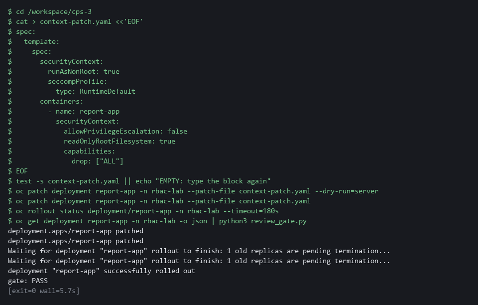

> **SECURITY:** Default-deny also blocks name lookup (turning the name backend into an address). A real workload needs a reviewed rule that allows it, and each approved flow gets its own rule. Do not remove the default-deny to make a call work.

> **YOUR TURN:** Run the two blocks in order: the first makes default-deny.yaml and applies it, the second makes context-patch.yaml and applies it.

> **CHECKPOINT:** The call before the policy prints exit=0, the policy is listed, the rollout finishes and the gate prints PASS.

> **TAKEAWAY:** Try the same call before and after the policy to prove it blocks.

**How this meets the controls**

- **SC-7:** The policy selects every pod and allows nothing, so traffic is denied by default. A call that worked before now needs a reviewed rule.
- **CM-6:** The patch sets non-root, no privilege escalation, a read-only file system and no extra capabilities. The gate from Step 2 now passes on the live workload.

### Step 5. Write a scoped cloud policy and test it by simulation (AC-6 Least Privilege)

**Learning point: A policy that names one action and one folder, tested by simulation, proves the scope is right without creating anything in the cloud account.**

- A short cloud policy that names one action and one resource is a least-privilege policy.
- Write the policy from a list of needs and test it with a simulation that changes nothing in the cloud account.

What this step adds (thick lines and outlines are new):

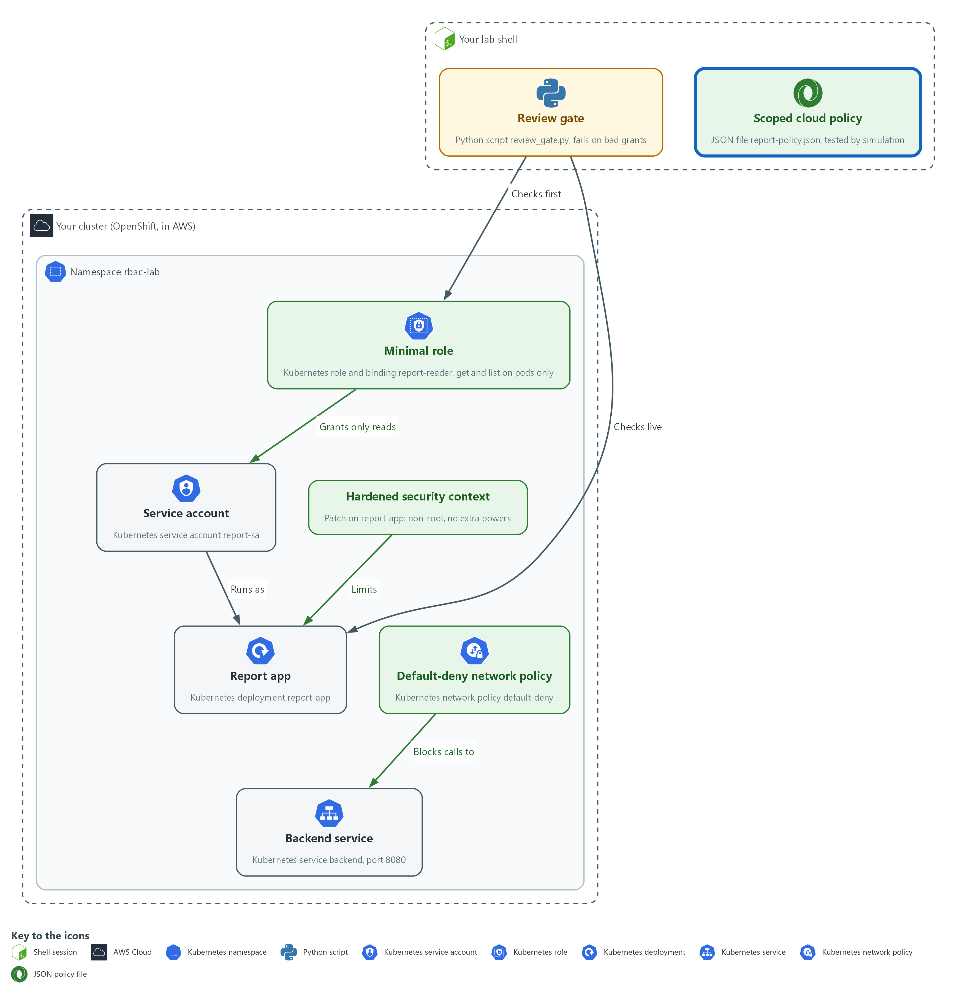

- A scoped cloud policy file in your lab shell is tested by simulation: one read is allowed and every other action is denied.

#### 5a. Write the scoped cloud policy

You will now write the file report-policy.json yourself.

- The report app must be able to do one thing in the cloud: read (download) the files in the folder reports of the storage bucket named report-app-data.
- The report app must not be able to write a file, delete a file, read a file outside the folder reports, or use a star (*) in the action.
- The block below is the whole file with two gaps, the two values that start with WRITE.
- Type the block (do not paste it) and write your own value in place of each WRITE value.
- Example for a different job: a program that may only upload into the folder incoming of the bucket example-uploads has "Action": ["s3:PutObject"] and "Resource": "arn:aws:s3:::example-uploads/incoming/*".
- To fix a mistake, type the block again with the corrected value, which replaces the file.
- Give yourself about 10 minutes, and do not open the file in the reference folder yet.

```bash
mkdir -p /workspace/cps-3 && cd /workspace/cps-3
cat > report-policy.json <<'EOF'
{
  "Version": "2012-10-17",
  "Statement": [
    {
      "Sid": "ReadReportFiles",
      "Effect": "Allow",
      "Action": ["WRITE-ACTION"],
      "Resource": "WRITE-RESOURCE"
    }
  ]
}
EOF
test -s report-policy.json || echo "EMPTY: type the block again"
jq . report-policy.json > /dev/null && echo "valid JSON"
```

**Expected output:**

```
Example only. You see this once the file is valid JSON; it says nothing yet about whether the policy is right.
valid JSON
```

| Part | What it does | Why you run it |
| --- | --- | --- |
| mkdir -p ... && cd ... | Makes the module folder if it is missing and moves into it. | Every block starts in the folder that holds its files, so it works on its own. |
| cat > report-policy.json <<'EOF' ... EOF | Writes everything between the first line and the line EOF into report-policy.json. Running it again replaces the file. | You need no editor, and a second try needs no clean-up. |
| "Effect": "Allow" | This statement grants access. A policy has no other way to grant it. | Everything not granted is denied, so the policy only needs to list what the app does. |
| "Action": ["WRITE-ACTION"] | GAP 1. You write the one action, with its service prefix (s3 is the AWS storage service, so s3: then the action name). A star would cover other actions. | The app only reads files, so create, change and delete must stay out. |
| "Resource": "WRITE-RESOURCE" | GAP 2. You write the ARN (the full name of a cloud resource). For files in a bucket it is arn:aws:s3::: then the bucket name, a slash, the folder, a slash and a star. | Scopes the read to the one folder the app uses, so files elsewhere stay out of reach. |
| jq . report-policy.json > /dev/null && echo "valid JSON" | Checks that the file is well-formed JSON. It prints valid JSON only when it is. | Catches a missing quote or comma before the cloud check. |

#### 5b. Check your policy by simulation

You will now ask AWS whether your policy allows the report read and refuses a write, a delete and a read outside the folder.

- The simulation creates and changes nothing in the account.
- This step needs the lab shell to reach the internet.
- While the WRITE values are still in the file the check prints FAIL.
- Fix the file, then run this block again until it prints PASS.
- An error usually means report-policy.json is empty: type the previous block again.

```bash
cd /workspace/cps-3
POLICY=$(jq -c . report-policy.json)
BASE=arn:aws:s3:::report-app-data
FAILS=0; ASK=""; ACT=""; KEY=""; WANT=""
jq -e '[.Statement[].Action] | flatten | map(contains("*")) | any | not' report-policy.json > /dev/null && echo "no star in Action: ok" || { echo "star in Action: FAIL"; FAILS=1; }
for ASK in "s3:GetObject reports/q1.csv allowed" "s3:PutObject reports/q1.csv implicitDeny" "s3:DeleteObject reports/q1.csv implicitDeny" "s3:GetObject private/keys.txt implicitDeny"; do
  read ACT KEY WANT <<< "$ASK"
  GOT=$(aws iam simulate-custom-policy --policy-input-list "$POLICY" --action-names "$ACT" --resource-arns "$BASE/$KEY" --query 'EvaluationResults[0].EvalDecision' --output text)
  echo "$ACT $BASE/$KEY -> $GOT (want $WANT)"
  test "$GOT" = "$WANT" || FAILS=1
done
test "$FAILS" = 0 && echo "policy check: PASS" || echo "policy check: FAIL"
```

**Expected output:**

```
Example only. Each simulation line shows the request, the decision AWS gave and the decision wanted.
no star in Action: ok
s3:GetObject arn:aws:s3:::report-app-data/reports/q1.csv -> allowed (want allowed)
s3:PutObject arn:aws:s3:::report-app-data/reports/q1.csv -> implicitDeny (want implicitDeny)
s3:DeleteObject arn:aws:s3:::report-app-data/reports/q1.csv -> implicitDeny (want implicitDeny)
s3:GetObject arn:aws:s3:::report-app-data/private/keys.txt -> implicitDeny (want implicitDeny)
policy check: PASS
```

| Part | What it does | Why you run it |
| --- | --- | --- |
| cd ... | Moves into the module folder from Step 1, where report-policy.json is. | Every block starts in the folder that holds its files, so it works on its own. |
| POLICY=$(jq -c . report-policy.json) | Prints the policy as one line of JSON and keeps it in a variable. The simulator takes the policy as a text string. | Turns your file into the single string the command expects. |
| FAILS=0; ASK=""; ... | A counter that any wrong answer turns to 1, and empty names that the loop fills in. | Lets one final line report the whole check. |
| jq -e '... contains("*") ...' | Fails when any action in your file contains a star. | A star in the action would allow more than the one read, whatever the four requests show. |
| for ASK in "..."; do ... done | Repeats the same question four times. Each text holds an action, a file and the decision wanted. | One loop keeps the four questions identical, so only the action and the file change. |
| s3:GetObject reports/q1.csv allowed | The read the app needs, on a file inside the folder. Wanted: allowed. | A policy that blocks the job is as wrong as one that allows too much. |
| s3:PutObject ... and s3:DeleteObject ... | A write and a delete on the same file. Wanted: implicitDeny (nothing allows it). | Each implicitDeny is proof that a power was left out. |
| s3:GetObject private/keys.txt implicitDeny | The same read outside the folder. Wanted: implicitDeny. | Proves the folder scope in the resource works. |
| aws iam simulate-custom-policy --policy-input-list "$POLICY" | Asks AWS what your policy decides for the action and file. The policy goes in inline; it is not saved in any account. | Tests the file before it is used anywhere, so no account or resource is touched. |
| test "$GOT" = "$WANT" \|\| FAILS=1 | Turns the counter to 1 when the decision is not the one wanted. | Any wrong answer makes the last line say FAIL. |
| policy check: PASS | Printed only when every answer matched. | One line to read. The first run, with the WRITE values, prints FAIL, which shows the check can fail. |

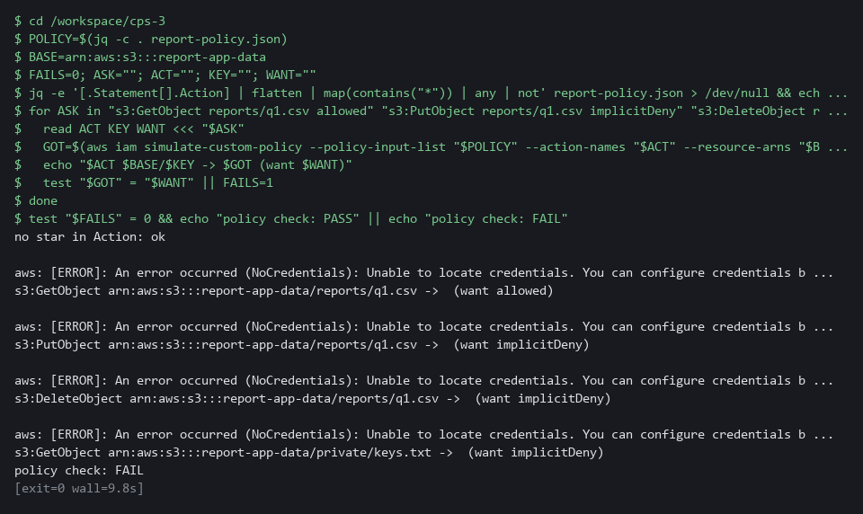

#### 5c. Compare with the reference answer

You will now compare your policy with the reference answer that lab start placed in the reference folder.

- Compare with the reference only after your policy printed PASS, or after you tried for the full 10 minutes.

```bash
cd /workspace/cps-3
diff <(jq -S . report-policy.json) <(jq -S . reference/report-policy.reference.json) && echo "same as the reference" || echo "differs from the reference"
```

**Expected output:**

```
Example only. A correct policy can differ, for example in the Sid name; the simulation check decides whether yours is right.
same as the reference
```

| Part | What it does | Why you run it |
| --- | --- | --- |
| cd ... | Moves into the module folder from Step 1, where report-policy.json and the reference folder are. | Every block starts in the folder that holds its files, so it works on its own. |
| jq -S . | Prints each file as JSON with the keys sorted, so spacing and key order do not matter. | Compares the meaning of the two policies, not how they were typed. |
| diff <(...) <(...) | Shows any line that differs between the two printed policies. It prints nothing when they match. | Shows exactly which part of your policy is different. |
| differs from the reference | Printed when any line differs. Read the diff lines above it. | The reference is only a model to learn from; the simulation check is the test. |

> **NOTE:** An error that says Unable to locate credentials means the lab shell has no AWS keys loaded; load them as in earlier modules and run the block again. An AccessDenied error that names iam:SimulateCustomPolicy means your cloud identity lacks that one permission. Copy the command and the error and ask your AI assistant.

> **YOUR TURN:** Type the first block and write the two missing values, run the second block until it prints PASS, then run the third block.

> **CHECKPOINT:** The policy check prints PASS: the read of the report file is allowed, and the write, the delete and the read outside the reports folder are all implicitDeny.

> **TAKEAWAY:** implicitDeny is the proof that a power was left out.

**How this meets the control**

- **AC-6:** The policy allows one read on one folder, and AWS simulates four requests against it. One is allowed and three are denied, with nothing created.

## Section 4. Verify It Works

### Test 1 (positive). The account can do its job and nothing more (AC-6 Least Privilege)

- You will now ask five questions: two should be yes and three no.
- You will also ask who else can read secrets.

```bash
SA=system:serviceaccount:rbac-lab:report-sa
for check in "get pods" "list pods" "get secrets" "delete pods" "create deployments"; do echo "$check: $(oc auth can-i $check -n rbac-lab --as=$SA)"; done
oc policy who-can get secrets -n rbac-lab | grep report-sa || echo "report-sa is not listed"
```

**Expected output:**

```
Example only.
get pods: yes
list pods: yes
get secrets: no
delete pods: no
create deployments: no
report-sa is not listed
```

| Part | What it does | Why you run it |
| --- | --- | --- |
| SA=system:serviceaccount:... | Sets the account name again so the block works on its own. | A new lab shell does not remember earlier variables. |
| for check in ...; do ... oc auth can-i ... | Asks the cluster five yes or no questions as the account: read one pod, list pods, read secrets, delete pods, create deployments. | Two actions are the job and three are not, so the answers show whether the role is minimal. |
| get pods: yes / list pods: yes | The two actions the report app needs are allowed. | A role that blocks the job is as wrong as one that allows too much. |
| get secrets / delete pods / create deployments: no | The three actions the app does not need are refused. | Each no is proof that a power was removed. |
| report-sa is not listed | The who-can list for reading secrets no longer names the account. The echo runs only when grep finds nothing. | The second view of the same fact: from the action side, the account is not among those who can read secrets. |

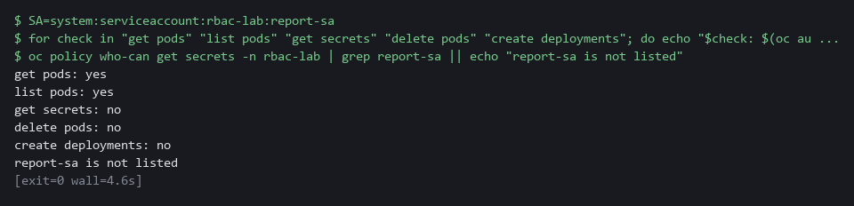

> **CHECKPOINT:** Exactly two yes answers, and report-sa is not in the who-can list.

**How this meets the control**

- **AC-6:** Five questions are asked as the account: two give yes and three give no. The yes and no answers are the evidence that the role is minimal.

### Test 2 (negative). The gate refuses a wildcard and a cluster-admin grant (AC-6 Least Privilege)

- You will now make two bad files: one with a wildcard verb, one binding the account to cluster-admin.
- Apply neither bad file; the gate must fail both bad files.

```bash
cd /workspace/cps-3
sed 's/\["get", "list"\]/["*"]/' role.yaml > bad-role.yaml
oc create --dry-run=client -f bad-role.yaml -o json | python3 review_gate.py; echo "exit code: $?"
oc create rolebinding bad-admin --clusterrole=cluster-admin --serviceaccount=rbac-lab:report-sa -n rbac-lab --dry-run=client -o yaml > bad-binding.yaml
oc create --dry-run=client -f bad-binding.yaml -o json | python3 review_gate.py; echo "exit code: $?"
```

**Expected output:**

```
Example only.
FAIL wildcard in verbs of Role/report-reader
gate: FAIL
exit code: 1
FAIL cluster-admin granted by RoleBinding/bad-admin
gate: FAIL
exit code: 1
```

| Part | What it does | Why you run it |
| --- | --- | --- |
| cd ... | Moves into the module folder from Step 1, where role.yaml and review_gate.py are. | The block works on its own. |
| sed ... role.yaml > bad-role.yaml | Copies your good role into a new file with the list of verbs replaced by a star. | Makes a bad file without touching the good one. |
| oc create --dry-run=client ... \| python3 review_gate.py | Turns the file into JSON without saving it and hands it to the gate. | The gate sees exactly what it would see in a real review. |
| FAIL wildcard in verbs of Role/report-reader | The gate names the rule that was broken and the object. | A refusal that says why can be fixed. |
| oc create rolebinding bad-admin ... > bad-binding.yaml | Writes a binding of the account to cluster-admin into a file. Nothing is saved to the cluster. | The second bad file the gate must refuse. |
| exit code: 1 | The exit code is 1 for both files. | A pipeline stops on a non-zero exit code. |

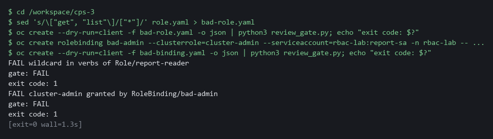

> **CHECKPOINT:** Both files fail with exit code 1 and nothing was applied. If a bad file passes, your gate has a hole: fix the gate, not the file.

**How this meets the control**

- **AC-6:** The gate is fed a role with a wildcard and a binding to cluster-admin. Two FAIL results show it would stop both grants.

### Test 3 (negative). A call that no rule allows is blocked (SC-7 Boundary Protection)

- You will now repeat the call from Step 4.
- The call must fail, by a blocked name lookup or a blocked connection.

```bash
oc exec -n rbac-lab deploy/report-app -- timeout 3 bash -c 'echo > /dev/tcp/backend/8080'; echo "after: exit=$?"
```

**Expected output:**

```
Example only. The exit code is 1 when the lookup fails and 124 when the connection times out. oc may print command terminated with exit code 124 just before the after line.
after: exit=124
```

| Part | What it does | Why you run it |
| --- | --- | --- |
| oc exec ... deploy/report-app -- timeout 3 bash -c 'echo > /dev/tcp/backend/8080' | Repeats the call from Step 4: the app tries to open a connection to the backend and gives up after 3 seconds. | Same call, same place, so the only change is the policy. |
| after: exit=124 | 124 means the connection timed out. 1 means the name lookup failed. Both mean blocked. | Before the policy the number was 0. A different number is the evidence that the rule works. |

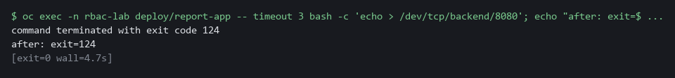

> **CHECKPOINT:** The exit code is not 0. Before the policy it was 0. If it is still 0, the network plugin is not enforcing policies: copy the whole command and the output and ask your AI assistant.

**How this meets the control**

- **SC-7:** The call from Step 4 is repeated after the policy exists. It now ends with a non-zero exit code, where before it was 0.

## Section 5. What Each Control Is For

### Control mapping

| Control | What it requires, in plain words | Tool or service | Where this module covers it |
| --- | --- | --- | --- |
| AC-6 Least Privilege | Give users and programs only the access they need to do their assigned tasks. | Kubernetes RBAC roles and role bindings, measured with oc auth can-i and oc policy who-can, the review gate script, and an AWS IAM policy tested with aws iam simulate-custom-policy. Explained in sections 2.1 and 2.2. | Section 3, Steps 1 and 3: measure, then replace a broad binding with a minimal role. Section 3, Step 2: the review gate refuses cluster-admin and wildcards. Section 3, Step 5: a scoped cloud policy allows one read and denies the rest. Section 4, Tests 1 and 2. |
| SC-7 Boundary Protection | Control traffic at the boundaries. The quoted requirement is from the SC-7(5) enhancement: deny traffic by default and allow it only by exception. | Kubernetes NetworkPolicy, enforced by the OVN-Kubernetes network plugin (the cluster part that carries and filters pod traffic). Explained in section 2.3. | Section 3, Step 4: write a default-deny network policy. Section 4, Test 3: a call is blocked. |
| CM-6 Configuration Settings | Establish secure settings for components, at the most restrictive mode that still lets them work. | A pod and container security context, patched in with oc and checked by the review gate. Explained in sections 2.2 and 2.3. | Section 3, Step 4: set a hardened security context. Section 3, Steps 2 and 4: the gate reads it back from the live workload. |

### What each control is for

Each table below says what the control is trying to prevent and how this module's tool meets it.

#### AC-6 Least Privilege

| Question | Answer |
| --- | --- |
| Control Intent | A program holds far more permission than its job needs, and a flaw in the program becomes a flaw in the whole namespace. |
| The operational question | What can this service account do today, who else can do the same, and what is the least it needs? |
| What evidence proves it | The can-i results for a list of actions, the who-can answer for a sensitive action, and the role file that passed the review gate. |
| How much is enough | The role lists only the verbs and resources the program uses, with no wildcard and no cluster-admin grant. |
| How the tool in this module satisfies it | oc auth can-i and oc policy who-can measure (Steps 1 and 3), the review gate (Step 2) refuses bad grants, and a simulation (Step 5) tests a cloud policy. |

#### SC-7 Boundary Protection

| Question | Answer |
| --- | --- |
| Control Intent | Any pod in the namespace can reach any other pod, so one compromised pod can probe everything near it. |
| The operational question | Which calls between pods are approved, and what happens to a call that is not on the list? |
| What evidence proves it | The network policy file and a call that fails because no rule allows it. |
| How much is enough | A default-deny rule selects every pod for both directions, and each approved flow is added as its own rule. This module writes only the default-deny. |
| How the tool in this module satisfies it | A NetworkPolicy with an empty pod selector (Step 4) and a blocked call (Test 3). |

#### CM-6 Configuration Settings

| Question | Answer |
| --- | --- |
| Control Intent | A container runs with settings nobody chose, such as the power to gain more privilege than it started with. |
| The operational question | Which security settings does this container carry, and does the live workload still carry them? |
| What evidence proves it | The security context read back from the live workload and the gate result. |
| How much is enough | The settings come from a file, are applied by command, and are checked by script. NIST leaves the choice of common secure configurations to the organization; CPS-2 ran a scan, and this module checks the live workload itself. |
| How the tool in this module satisfies it | A security context patch and the gate run on the live workload (Step 4). |

## Section 6. Next Steps

### Using this in other environments

- The commands work as is on any OpenShift 4.x cluster that runs the OVN-Kubernetes network plugin and where the AWS CLI can be reached from the lab shell.
- Lab-only values to change first: the namespace rbac-lab, the service account report-sa, the service name backend and port 8080, and the bucket report-app-data in the cloud policy.
- On other Kubernetes platforms, oc becomes kubectl: kubectl auth can-i answers the same question as oc auth can-i. Replace the check for oc policy who-can, because kubectl has no direct equivalent.
- The review gate is a plain Python script and runs anywhere that can produce the object as JSON. The cloud policy simulation uses the AWS CLI; on another cloud, replace the check with that provider's policy simulator.

The table shows what changes on each platform:

| Check | In this lab (OpenShift) | On other platforms | What you change |
| --- | --- | --- | --- |
| Measure permissions | oc auth can-i and oc policy who-can | kubectl auth can-i; replace the check for who-can | The tool name, and the who-can check. |
| Review gate | Python script fed by oc create --dry-run=client -o json | Python script fed by kubectl create --dry-run=client -o json | The tool name. |
| NetworkPolicy | oc apply -f (OVN-Kubernetes enforces it) | kubectl apply -f (needs a network plugin that enforces NetworkPolicy) | The tool name; confirm the network plugin enforces NetworkPolicy. |
| Security context | oc patch deployment | kubectl patch deployment | The tool name. |
| Cloud policy | aws iam simulate-custom-policy (AWS CLI) | Replace the check | Use your provider's policy simulator in place of the AWS CLI call. |

> **TIP:** Next module: CPS-4 Secure a Workload End to End: you secure one workload on your own, including its secrets and a Falco rule.

<details>
<summary><strong>Section 7. Terms</strong></summary>

Each term is also explained the first time it appears. In Word, hover over an underlined term to see its meaning, or Ctrl+click it to jump to this table.

| Term | Plain meaning |
| --- | --- |
| ARN | The full name of one cloud resource in AWS, such as a bucket or a folder in it. |
| AWS | Amazon Web Services, the cloud your lab runs in. |
| Baseline | The agreed starting configuration that the system is expected to match. |
| Bucket | A named container for files (objects) in AWS storage. |
| Capability | One slice of root power that a container can keep or drop. |
| CLI | Command-line interface: a program you use by typing commands. |
| Cluster | A group of servers that work together as one system. Here it is your own OpenShift cluster in AWS. |
| cluster-admin | The built-in role that allows every action on every object in the cluster. |
| Container | A sealed box that holds one program and everything it needs to run, so it runs the same way anywhere. |
| Credential | A secret that proves who you are, such as a password, token or key. |
| Default-deny | A network policy that selects every pod and lists no allowed traffic, so everything is blocked until another rule allows it. |
| Deployment | A cluster object that keeps a set number of copies of a program running and replaces them when you change it. |
| diff | A command that shows the differences between two files. |
| Dry run | A check that reads and validates a file without making any change. |
| Egress | Network traffic leaving a pod. |
| Evidence | Saved records that show a system is set up and behaving as claimed. |
| Exit code | A number a command leaves behind when it ends. 0 means success; anything else means a problem. |
| Falco | A tool that watches what programs do on a node and raises an alert when the behavior looks wrong. |
| grep | A command that prints only the lines that match a pattern. |
| Heredoc | A way to make a file by pasting its text between a first line such as cat > name <<'EOF' and a last line that says EOF. |
| IAM policy | A JSON document that lists which cloud actions are allowed on which cloud resources. Anything not allowed is denied. |
| Identity | The name a person or program is known by when it asks for something. |
| Image | A packaged copy of a program and everything it needs to run. A container starts from an image. |
| implicitDeny | The AWS answer that no statement allows the action, so it is denied. |
| Ingress | Network traffic arriving at a pod. |
| jq | A command-line tool that reads JSON and picks out the fields you ask for. |
| JSON | A plain-text data format of names and values written inside curly braces. oc can print it and jq can read it. |
| Kubernetes | The open-source system that runs and manages containers across servers. OpenShift is built on it. |
| Merge | Combine the changes from one git branch into another. |
| mkdir | A command that makes a new folder. |
| Namespace | A named section of the cluster that holds a set of related parts. |
| NetworkPolicy | A rule about which traffic pods may send and receive. |
| NIST | The US National Institute of Standards and Technology. It publishes the security control catalog these modules cite. |
| Node | One server in the cluster. Your lab cluster has a single node. |
| oc | The OpenShift command-line tool. You type oc, then a verb such as get, then what it acts on. |
| oc auth can-i | A command that asks the cluster whether a user or service account may do one action. It answers yes or no without doing it. |
| OpenShift | The Red Hat platform your lab cluster runs on. It is Kubernetes with extra security and tools built in. |
| Patch | A small file of changes merged into an object that already exists. The rest of the object stays as it was. |
| Pipeline | An automated sequence of tasks that runs without a person at the keyboard. |
| Pod | The smallest running unit on the cluster: one or more containers together. |
| Policy | A set of rules written down so that a tool can enforce them. |
| Privilege escalation | A process gaining more permission than it started with. |
| Provider | The company or plug-in that supplies a platform, such as a cloud provider or a Terraform provider. |
| Python | A programming language. The review gate is a short Python script that needs nothing installed. |
| RBAC | Role-based access control: permissions are given to roles, and roles are given to users or programs. |
| Review gate | A check that runs before work is accepted and fails when the work breaks a rule. |
| Role | A list of allowed actions on named kinds of object. |
| Role binding | The link that gives a role to a user or a service account. |
| Rollout | The replacement of old pods by new ones after you change a deployment. |
| Root | The all-powerful account on a computer. A program that runs as root can change almost anything. |
| Rule | A written condition that a tool checks. |
| Runtime | The time when a program is running, as opposed to when it is written or built. |
| Scan | A check of software or settings against a list of known problems. The scan reports what it finds. |
| Script | A text file of commands or code that the computer runs from top to bottom. |
| Secret | A cluster object that holds a sensitive value such as a password or token, kept apart from ordinary settings. |
| Security context | The safety settings on a pod or container, such as which user it runs as and which extra powers it keeps. |
| sed | A command that edits text as it passes through, often to replace one string with another. |
| Selector | A rule that picks objects by their labels. |
| Service account | An identity for a program instead of a person. |
| Simulation | A call to AWS that asks whether a policy would allow an action, without doing the action or creating anything. |
| TCP | The standard way programs send data reliably over a network. |
| Terraform | A tool that builds infrastructure from files that describe it. |
| Variable | A named value in the shell. A dollar sign in front of the name means use its value. |
| Verb | One action in a role, such as get, list, create or delete. A wildcard verb (*) means every action. |
| who-can | A command (oc policy who-can) that lists every user and account that may do one action. |
| Wildcard | The star (*) that stands for every verb, resource or group. |
| Workload | A program the cluster runs, such as the report app. Running workloads is what the cluster is for. |
| YAML | A plain-text format for settings: lines of name: value, with indentation to show what belongs to what. |

</details>
