# CPS-4: Secure a Workload End to End (AC-6, IA-5, SC-28, SC-7)

| Item | Detail |
| --- | --- |
| Sequence | Module 22 of 32 in the recommended order |
| Timed work | About 74 minutes (50 hands-on, 24 verify) |
| Standalone start | `lab start cps-4` |
| Combined start | Continue from the end state of the previous module |
| Tools | OpenShift Container Platform, Kubernetes secrets, RBAC and NetworkPolicy (included with OpenShift), Falco (free, open source), AWS CLI (read-only calls), oc, jq, python3 |
| Prerequisites | ENG-0 Terminal, Git and Your Lab (running oc in lab shell, reading its output, and making a file with a heredoc) |

## Section 1. Module Overview

- Purpose: apply all four workload protections to one program without a script to follow, choosing between options using evidence from the cluster (AC-6, IA-5, SC-28, SC-7).
- You read the starting state, choose an identity, move the password into a generated secret and mount it read-only.
- You apply a default-deny rule and two allow rules so only the approved caller reaches the workload.
- You harden the container, write a Falco rule, and write a check script that reads seven live settings and exits with 1 on any FAIL.

- **Skill:** Secure one workload without a script to follow: choose its identity using evidence, move its password into a secret, write allow rules and a Falco rule, and prove each protection with a check script.
- **Tools:** `oc` creates the service account and applies secrets, patches and network policies. The AWS CLI reads identity and key state. Falco watches container system calls. `python3 check_workload.py` reads the live workload and prints PASS or FAIL for each protection.
- **Security Function:** Removes excess access, moves credentials out of the workload definition, blocks unapproved network flows, removes container powers, and detects a shell or a secret-file read in the workload namespace.
- **NIST AC-6 Least Privilege:** A dedicated service account with no token and no role gives the workload no cluster or cloud access it does not use. The AWS CLI reads which cloud identity is in play. Step 1 collects the evidence, Step 2 applies the change, and a Falco rule reports any shell started in the workload (Step 4, Test 5).
- **NIST IA-5 Authenticator Management:** A generated secret value is mounted as a read-only file. It is never typed, echoed or stored in the pod spec. Step 2 removes the plain-text variable; Verify Test 1 proves it is gone. A Falco rule you write reports any read of the password file (Step 4, Tests 6 and 7).
- **NIST SC-28 Protection of Information at Rest:** OpenShift etcd encryption stores secrets as encrypted bytes. Step 1 reads the encryption state; Verify Test 2 reads the stored bytes and confirms the encryption marker.
- **NIST SC-7 Boundary Protection:** A default-deny NetworkPolicy blocks every flow. An ingress rule and an egress rule open one approved call. Verify Tests 3 and 4 show the allowed call succeeds and all others are blocked.

## Section 2. The Tools

### Tools used in this module

Each tool name links to its official overview. The table columns say how each tool is used in the lab and why the lab uses it instead of another way of doing the same job.

| Tool (overview link) | What it is | Used in this lab | Why this tool |
| --- | --- | --- | --- |
| [OpenShift Container Platform](https://docs.redhat.com/en/documentation/openshift_container_platform/4.22/html/overview/ocp-overview) | A Kubernetes container platform for running and managing containerized applications. | The cluster and the workload you secure end to end. | It is the platform the whole lab runs on, so every module works on the same real cluster, with the same kinds of objects a production OpenShift system has. |
| [Kubernetes Secrets](https://kubernetes.io/docs/concepts/configuration/secret/) | Objects that hold small sensitive values, such as a password, apart from the workload's settings. | Hold the password that you move out of the workload's settings. | It is the built-in place for small sensitive values, so you see how a cluster keeps a password apart from the workload that uses it. |
| [Kubernetes RBAC](https://kubernetes.io/docs/reference/access-authn-authz/rbac/) | Roles list what an identity may do, and bindings give those roles to users or service accounts. | Gives the workload its own service account with no role. | It is the built-in way to say who may do what in the cluster, so the lab uses the same permission model a real OpenShift system uses. |
| [NetworkPolicy](https://docs.redhat.com/en/documentation/openshift_container_platform/4.22/html/network_security/network-policy) | Rules for which pods may talk to which. Once a policy selects a pod, it accepts only what the policies allow. | Default-deny plus one rule that accepts the approved caller. | It is the built-in way to limit which pods can talk to which, so you need no extra product to show what a blocked connection looks like. |
| [Falco](https://falco.org/docs/) | Watches system calls and alerts in real time when a rule detects suspicious behavior. | A rule you add alerts when a shell is started in the workload's container. | It watches what a running container actually does, which the cluster's own settings cannot show, so you can detect behavior and not only configuration. It is free and open source. |
| [AWS CLI](https://docs.aws.amazon.com/cli/latest/userguide/cli-chap-welcome.html) | Runs AWS actions from a shell instead of the browser console. | Read-only calls that show the cloud identity of the lab shell. | It reads the cloud account's settings from a terminal, so a check can be pasted, repeated and tested instead of clicked through in the console. |
| [oc](https://docs.redhat.com/en/documentation/openshift_container_platform/4.22/html/cli_tools/openshift-cli-oc) | The OpenShift command-line tool for creating and managing applications and projects from a terminal. | Collects the evidence and applies the identity, secret, policies and container settings. | It is the one command that talks to the cluster, so every module uses it to ask what is true and to make changes. You sign in once, and it works on OpenShift objects as well as standard Kubernetes ones. Unlike clicking in the web console, a command can be pasted, repeated and checked by a test. |
| [jq](https://jqlang.org/) | Command-line JSON processor. | Reads the live settings for the check. | It picks one field out of a long JSON reply, so a test can read a single value. |
| [Python 3](https://docs.python.org/3/tutorial/introduction.html) | General-purpose language, used here for small helper scripts. | Runs check_workload.py, which fails if any of seven things drift. | Python reads and writes JSON easily and is already in the lab shell, so a small script needs nothing installed. |

### How it fits together

#### One workload, secured four ways

- You secure one workload: its identity, its secret, its network, and what it can do at runtime.
- A script then checks the identity, secret, network and runtime settings of the workload.
- New parts are drawn with thick lines.
- This is the lab (test) setup: in production the password would come from an approved secret store, and the check would run in a pipeline instead of your lab shell.

How the lab is set up, and why:

- You work in your lab shell on your laptop, as in ENG-0, and send every question and change to your cluster.
- The workload, its secret and its network rules live in one namespace, secure-lab, so every change you make stays inside it.
- The cluster saves the secret in its own database (etcd), which is why the picture shows that database: encryption there is what protects a copy of the stored data.
- Falco runs in a separate namespace, security-tools, because it is a platform tool that watches containers across the cluster and is not part of your workload, so changing the workload does not change it.
- The check script runs in your lab shell and reads live settings from the cluster, so it tells you what is true now and not what a file says.
- CPS-4 adds the cluster database and the Falco watcher to the layout from CPS-3, so one workload can be secured on every layer.

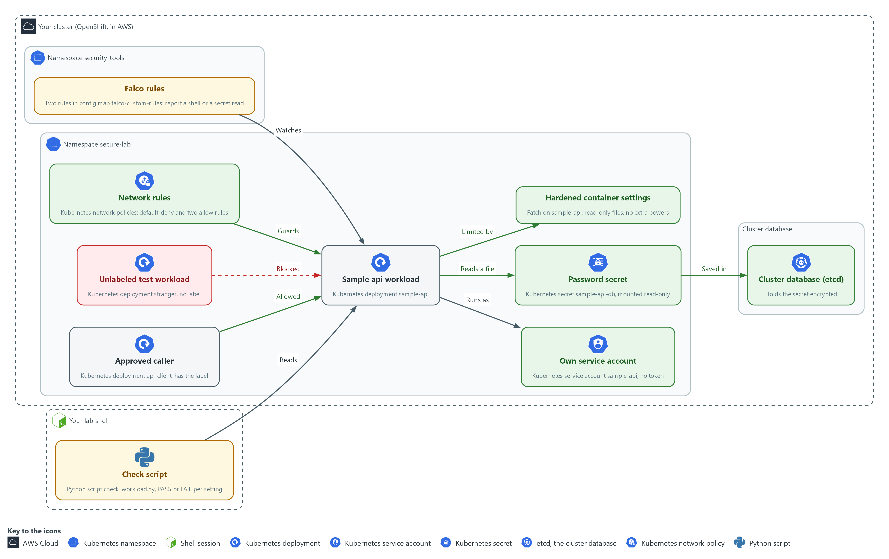

- **1. Sample api workload:** the program you secure, a Kubernetes deployment named sample-api in secure-lab.
- **2. Approved caller:** the deployment api-client, which carries the label that the allow rules look for.
- **3. Unlabeled test workload:** the deployment stranger, which has no label and must be blocked.
- **4. Own service account:** the account sample-api, with no token and no role, which the workload runs as.
- **5. Password secret:** the secret sample-api-db, mounted read-only into the workload as a file.
- **6. Cluster database (etcd):** where the cluster saves the secret, encrypted.
- **7. Network rules:** the default-deny policy and the two allow policies that guard the workload.
- **8. Hardened container settings:** the patch that makes the files read-only and drops extra powers.
- **9. Falco rules:** two rules in the namespace security-tools that report a shell or a read of the password file.
- **10. Check script:** check_workload.py, run in your lab shell, which prints PASS or FAIL for each setting.

Where each part runs, and why:

| Part | Where it runs | Why it is built this way |
| --- | --- | --- |
| Sample api workload | The namespace secure-lab | It is the thing you secure, and keeping it in one namespace keeps every change contained. |
| Password secret | The namespace secure-lab, saved in the cluster database | The cluster keeps it apart from the workload settings and saves it encrypted. |
| Cluster database (etcd) | Inside your cluster | Every secret is saved here, so encryption here protects a copy of the stored data. |
| Network rules | The namespace secure-lab | The workload and its approved caller are both here, so the rules sit on both ends of the call. |
| Falco | The namespace security-tools | It is a platform tool that watches containers, kept apart from the workload it watches. |
| Check script | Your lab shell | It reads live settings, so you can run it again after every change. |

### 2.1 Choosing the identity (AC-6 Least Privilege)

- A workload can run under its cluster service account, under a cloud identity, or under neither.
- The right choice depends on what the workload actually calls in the cluster or the cloud.
- Any identity a workload holds is something an attacker can steal, so a workload that calls nothing should hold nothing.
- Step 1 collects the evidence for the choice.

#### AC-6: Least Privilege

*The control asks the organization to employ the principle of least privilege, allowing only authorized accesses for users, or processes acting on behalf of users, that are necessary to accomplish assigned organizational tasks. This is done using:*

- A Kubernetes service account named sample-api, created for this workload only and bound to no role, so the workload has no cluster permissions.
- The setting automountServiceAccountToken: false, which keeps a cluster token out of the pod.
- The AWS CLI call aws sts get-caller-identity, which shows the cloud identity of your lab shell, so you can decide the workload needs none.

The table compares the three identity options and the evidence that rules each in or out:

| Option | What it needs | Evidence that rules it in or out |
| --- | --- | --- |
| No identity | The workload calls no cluster or cloud service | The code and the pod spec show no such calls |
| Static cloud keys in a secret | Nothing from the cluster | Rejected: the keys never expire and anyone who reads the secret owns them |
| Short-lived cloud role credentials | A token issuer (the service that creates and signs tokens) set up for the cloud provider | The token issuer setting in the cluster is empty, so this option is not available here |

### 2.2 Choosing how the secret reaches the container (IA-5 Authenticator Management)

- A secret can reach a container as an environment variable or as a mounted file, and both read from the same stored secret object.
- An environment variable appears in process dumps and crash reports, while a mounted file is read only by a process that opens it.
- A mounted secret file is refreshed when the stored secret changes, while an environment variable is fixed when the container starts.

#### IA-5: Authenticator Management

*The control asks the organization to manage system authenticators, including protecting authenticator content from unauthorized disclosure and modification. The enhancement IA-5(7) adds that unencrypted static authenticators must not be embedded in applications or other forms of static storage. This is done using:*

- A Kubernetes secret named sample-api-db, created with oc from a value that openssl generates, so no person types or sees the password.
- A read-only mounted file with file mode 256 (owner read only), which delivers the password to the container without putting it in the pod spec.
- The command oc set env with a trailing minus, which removes the old plain-text variable from the workload.

The table compares three ways to deliver the password:

| Delivery | Leak risk | Rotation |
| --- | --- | --- |
| Value written in the pod spec | Anyone who can read the workload object, or its copy in git, reads the password | Needs a new deployment |
| Environment variable from a secret | Shown in process environment dumps and crash reports | Needs a restart |
| Mounted file, read-only, owner only | Only the process that reads the file | The file updates in place, so no restart is needed |

> **IN PRODUCTION:** In the real environment secrets come from an approved secret store and a rotation process, and the cluster never holds the long-lived original. The lab generates a value on the spot so you practice the delivery and the proof.

### 2.3 Etcd encryption (SC-28 Protection of Information at Rest)

- The API servers encrypt each secret with aesgcm before writing it to etcd, so the stored bytes start with a k8s:enc:aesgcm:v1: marker and are not readable text.
- The cluster reports encryption as the Encrypted condition with the reason EncryptionCompleted, and the lab start command turns encryption on if it is off.

#### SC-28: Protection of Information at Rest

*The control asks the organization to protect the confidentiality, the integrity, or both, of organization-defined information at rest, as selected. This is done using:*

- OpenShift etcd encryption with aesgcm, which stores each secret in the cluster database as encrypted bytes.
- The command oc get openshiftapiserver, which reads the Encrypted condition in Step 1, and etcdctl, which reads a stored secret in Test 2 to confirm the marker.
- The read-only AWS CLI calls aws kms describe-key and aws ec2 describe-volumes, which show the state of the encryption key and whether node disks are encrypted.

### 2.4 Approving each network flow (SC-7 Boundary Protection)

- A default-deny network policy blocks all traffic in both directions for every pod.
- Each approved flow needs a rule at both ends: ingress on the receiver and egress on the caller.
- A flow with permission at only one end still fails.
- The workload here calls nothing, so it gets no egress rule.

#### SC-7: Boundary Protection

*The control asks the organization to monitor and control communications at the external managed interfaces to the system and at key internal managed interfaces within the system. The enhancement SC-7(5) adds that network communications traffic must be denied by default and allowed by exception. This is done using:*

- A default-deny Kubernetes NetworkPolicy, which selects every pod in secure-lab and allows nothing.
- An ingress policy on the workload and an egress policy on the caller, which together open the one approved call on port 8080.
- The OVN-Kubernetes network plugin, which enforces the policies.

### 2.5 Detecting a shell or a secret read with Falco (AC-6 Least Privilege, IA-5 Authenticator Management)

- Falco watches the system calls that containers make and prints a line when one matches a rule.
- A Falco rule has four parts: a condition (a test on the event), an output (the message printed, with fields filled in), a priority and tags.
- A Falco condition joins tests with the word and, and each test names a Falco field such as proc.name or fd.name.
- Falco loads rules from a folder mounted from the falco-custom-rules config map, so adding your rule file to that config map and restarting Falco loads your rule.
- The shell rule supports AC-6 by reporting a shell started in the workload, which a program with no need for extra power should never do.
- The secret-read rule you write supports IA-5 by reporting a read of the mounted password file, naming the pod and the command but never the password.

### Design decisions

#### Give the workload its own identity with no token and no role

- How: The workload runs under a dedicated service account with token mounting off and no role binding, and it holds no cloud identity. The evidence step reads the cluster token issuer setting and the lab shell identity before this choice is made.
- Why: The workload calls nothing in the cluster or the cloud, so any identity it holds is only something an attacker could steal.
- Alternatives: A cloud identity with short-lived credentials is the alternative. Advantage: it is the right choice when the workload must call cloud services, because no long-lived key is stored. Drawback: it needs a token issuer that the evidence shows is not set here, and it adds an identity nobody needs.

#### Deliver the password as a read-only mounted secret file

- How: A generated value is created straight into a secret and mounted as a read-only file that only its owner can read. It is never typed, saved or echoed.
- Why: A file with an owner-only mode is harder to leak by accident, and a mounted secret is generally refreshed when the stored secret changes, while an environment variable is fixed at start.
- Alternatives: An environment variable is the alternative. Advantage: it is the simplest option for applications that only read their environment. Drawback: it is easier to leak through logs, crash dumps and child processes, and changing it needs a restart.

#### Approve each network flow on both sides

- How: The supplied default-deny rule stays in place, and you add an ingress rule on the workload for the approved caller and an egress rule on the caller. The workload gets no egress rule at all.
- Why: Because both directions are blocked by default, a flow needs permission at both ends, and a workload with no egress cannot be used to call out if it is compromised.
- Alternatives: One broad allow rule for the whole project is the alternative. Advantage: a single short file that is quick to write. Drawback: every pod can then reach the workload, which largely undoes the default-deny.

## Section 3. Implement

- Start: type `lab start cps-4` in the terminal on your own computer (PowerShell on Windows, Terminal on Mac), not in the lab shell.
- Enter lab shell with `lab shell`. Every other command in this module runs inside lab shell.
- If a step fails: run `lab reset cps-4` on your own computer and repeat the step once. If it still fails, copy the whole command and error and ask your AI assistant. Do not skip the step.

### Step 1. Collect the evidence (AC-6 Least Privilege, IA-5 Authenticator Management, SC-28 Protection of Information at Rest)

**Learning point: Reading the workload, the token issuer and the encryption state first gives you the evidence to choose an identity and to see what already protects the secret.**

- You read the workload, the cluster's token and encryption settings, and the lab shell's cloud identity before you change anything.
- The AWS calls are read-only.

What this step adds (thick lines and outlines are new):

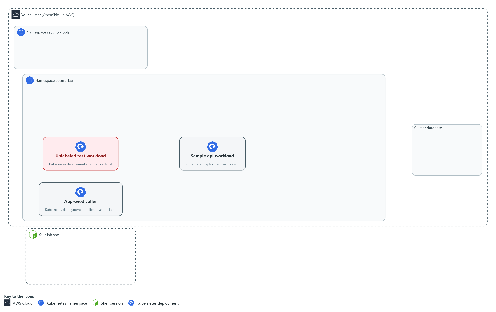

- The workload starts under the default service account, with a password in its settings and no network rules. You read the evidence first, by sending read-only questions from your lab shell to the cluster and to AWS.

#### 1a. Read the workload, the cluster settings and the cloud identity

You will now ask the cluster and AWS six read-only questions.

- These six questions change nothing.
- The lab shell must be able to reach the internet for this step.

```bash
oc get deployment sample-api -n secure-lab -o json | jq '.spec.template.spec | {account: .serviceAccountName, env: .containers[0].env}'
oc get authentication cluster -o jsonpath='{.spec.serviceAccountIssuer}{"\n"}'
oc get openshiftapiserver -o jsonpath='{.items[0].status.conditions[?(@.type=="Encrypted")].reason}{"\n"}'
aws sts get-caller-identity --query Arn --output text
aws kms describe-key --key-id "$KMS_KEY_ARN" --query KeyMetadata.KeyState --output text
aws ec2 describe-volumes --region "$AWS_REGION" --filters "Name=tag-key,Values=kubernetes.io/cluster/*" --query 'Volumes[].Encrypted' --output text
```

**Expected output:**

```
Example only. Your values will differ.
{
  "account": null,
  "env": [
    {
      "name": "DB_PASSWORD",
      "value": "<plain-text value>"
    }
  ]
}
(an empty line: the token issuer is not set)
EncryptionCompleted
arn:aws:sts::<account-id>:<identity>
<key state>
True  True
```

| Part | What it does | Why you run it |
| --- | --- | --- |
| oc get deployment sample-api ... \| jq | Shows the account the workload runs as and its environment variables. | Shows the starting point: whose identity the pod uses and whether a password sits in plain text. |
| serviceAccountIssuer | The cluster's token issuer. Empty means no external issuer for cloud role credentials. | Decides which identity option is open to you. Without an issuer, short-lived cloud credentials are not available here. |
| Encrypted ... reason | EncryptionCompleted means secrets in the cluster database are stored encrypted. | Tells you whether secrets are stored encrypted, which decides how much you must rely on other protections. |
| aws sts get-caller-identity | Prints who the lab shell is in the cloud account. A read-only call. | Shows which cloud identity your lab shell uses, so you do not confuse it with the workload's identity. |
| aws kms describe-key | Reads the state of the lab encryption key (a KMS key, kept by the AWS key service). A read-only call. | Checks that the key behind encrypted storage is usable, without changing it. |
| aws ec2 describe-volumes ... Encrypted | Lists whether each node volume (a disk attached to the node) is encrypted. A read-only call. | Shows whether node disks are encrypted, which is the stored-data evidence for the disks. |

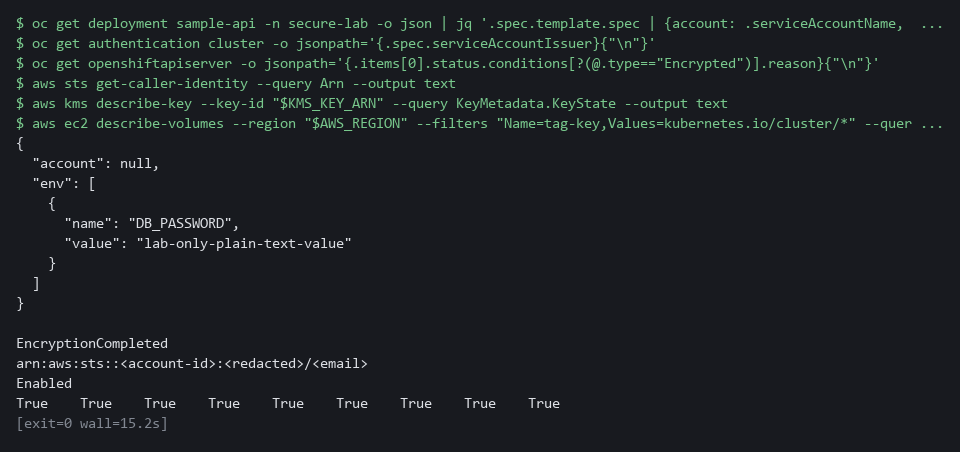

> **NOTE:** The AWS identity you read belongs to the lab shell, not the workload. The workload has no cloud identity, and the empty issuer setting shows why short-lived credentials are not an option here.

> **YOUR TURN:** Run the commands. Read off three things: the identity decision, the way the password is stored today, and whether secrets and volumes are encrypted.

> **CHECKPOINT:** You find a plain-text DB_PASSWORD value, an account of null (the workload names none, so it uses the default account), an empty token issuer, EncryptionCompleted, and True for every volume. You can state which identity option you will use and why.

> **TAKEAWAY:** Read off the identity decision, how the password is stored, and the encryption state: Step 2 fixes the first two.

**How this meets the controls**

- **AC-6:** You read the workload service account and the cluster token issuer, which is the evidence for choosing no cloud identity.
- **IA-5:** You read the workload definition and find the password in plain text, the weakness Step 2 removes.
- **SC-28:** You read the cluster encryption status, the key state and whether node volumes are encrypted.

### Step 2. Give it its own identity and move the password into a secret (AC-6 Least Privilege, IA-5 Authenticator Management)

**Learning point: Giving the workload its own service account with no token and mounting a generated secret as a read-only file removes the two weaknesses Step 1 found.**

- The workload never calls the cluster API, so it gets its own service account with no role and no token.
- The password becomes a secret created from a generated value (never typed or saved) and is mounted as a read-only file.

What this step adds (thick lines and outlines are new):

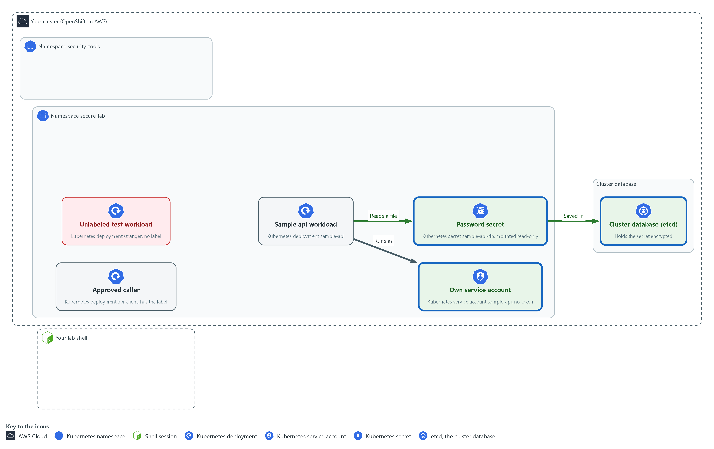

- The workload gets its own service account with no token. Its password moves into a secret in secure-lab, which the cluster saves encrypted in its database and mounts read-only into the workload.

#### 2a. Save the identity patch

You will now make identity-patch.yaml in a folder for this module.

- Paste the whole block at once.

```bash
mkdir -p /workspace/cps-4
cd /workspace/cps-4
cat > identity-patch.yaml <<'EOF'
spec:
  template:
    spec:
      serviceAccountName: sample-api
      automountServiceAccountToken: false
      volumes:
        - name: db-secret
          secret:
            secretName: sample-api-db
            defaultMode: 256
      containers:
        - name: sample-api
          volumeMounts:
            - name: db-secret
              mountPath: /etc/sample-api
              readOnly: true
EOF
wc -l identity-patch.yaml
```

**Expected output:**

```
Example only.
16 identity-patch.yaml
```

| Part | What it does | Why you run it |
| --- | --- | --- |
| mkdir -p ... && cd ... | Makes the folder for this module if it is not there and moves into it. The folder persists between lab sessions. | Every block starts in the folder that holds its files, so it works on its own. |
| cat > identity-patch.yaml <<'EOF' ... EOF | Writes everything between the first line and the line EOF into identity-patch.yaml. The quotes around EOF keep every dollar sign and bracket exactly as typed. | You need no editor: one paste makes the whole file. |
| serviceAccountName: sample-api | Runs the pod as an account created just for it. | Gives the workload an identity of its own, so a flaw in another workload cannot borrow it. |
| automountServiceAccountToken: false | Does not put a cluster API token inside the pod. | The workload never calls the cluster API, so a token inside it would only be something to steal. |
| secretName: sample-api-db | The name of the secret to mount. | Points the pod at the secret you create in the next block, so the password comes from there and not from the pod spec. |
| defaultMode: 256 | File permissions written as a decimal number. 256 equals 400 in octal (the number system file permissions use): read for the owner only. The platform may also give the pod's file group read access, so a non-root process can read it. | Limits who can read the file inside the container, so a password file is not open to every process. |
| mountPath: /etc/sample-api | Where the password file appears inside the container. | Fixes where the program will look for the password, so the application and the secret agree. |
| readOnly: true | The container cannot change the mounted file. | Stops the program, or an attacker, from altering the secret copy it sees. |

#### 2b. Create the account and the secret, then apply the patch

You will now create the service account and the secret, remove the plain-text variable, and apply your patch.

```bash
cd /workspace/cps-4
oc create serviceaccount sample-api -n secure-lab --dry-run=client -o yaml | oc apply -f -
oc get secret sample-api-db -n secure-lab >/dev/null 2>&1 || oc create secret generic sample-api-db -n secure-lab --from-literal=password="$(openssl rand -base64 24)"
oc set env deployment/sample-api DB_PASSWORD- -n secure-lab
oc patch deployment sample-api -n secure-lab --patch-file identity-patch.yaml --dry-run=server
oc patch deployment sample-api -n secure-lab --patch-file identity-patch.yaml
oc rollout status deployment/sample-api -n secure-lab --timeout=180s
```

**Expected output:**

```
Example only. The password is never printed. On a second run the account shows configured or unchanged and the secret line is missing.
serviceaccount/sample-api created
secret/sample-api-db created
deployment.apps/sample-api updated
deployment.apps/sample-api patched
deployment.apps/sample-api patched
(the first patched line is the dry run; it prints the same text but saves nothing; "Waiting for deployment ... old replicas are pending termination" lines may appear while the rollout finishes)
deployment "sample-api" successfully rolled out
```

| Part | What it does | Why you run it |
| --- | --- | --- |
| cd ... | Moves into the module folder, where identity-patch.yaml is. | Every block starts in the folder that holds its files, so it works on its own. |
| oc create serviceaccount sample-api ... \| oc apply -f - | Creates the identity, or leaves it as it is on a second run. It is bound to no role, so it can do nothing in the cluster. | The patch names this account, so it has to exist first. A dry run checks a change without making it; piping it into apply makes the line safe to run twice. |
| oc get secret sample-api-db ... \|\| oc create secret ... | Creates the secret only if it does not exist yet. The two vertical bars mean: run the second command only if the first one fails. | A second run keeps the secret you already have instead of failing. |
| --from-literal=password="$(openssl rand -base64 24)" | Makes a random password and stores it in the secret. It is never printed or saved in a file. | The value is made on the spot and goes straight into the secret, so no person ever sees or types it. |
| oc set env deployment/sample-api DB_PASSWORD- | The trailing minus removes the plain-text variable. | Removes the plain-text copy, which is the weakness this step exists to fix. |
| oc patch ... --patch-file | Merges your patch (a small file of changes) into the live workload. The first patch command is a dry run: the cluster checks the change and does not make it. | Changes the live workload to use the new identity and the mounted secret. |
| oc rollout status | Waits for the rollout (the replacement of the old pod by a new one) to finish and the new pod to start. | The change replaces the pod. Waiting shows that the new pod starts with the secret mounted. |

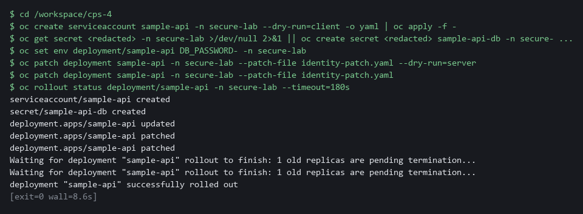

> **SECURITY:** Never put a generated password in a command that echoes it, in a file, or in a chat. Here it exists only inside the secret.

> **YOUR TURN:** Paste the first block to make identity-patch.yaml, then run the second block.

> **CHECKPOINT:** The rollout finishes and the pod is Running.

> **TAKEAWAY:** The password goes straight from openssl into the secret and is never printed.

**How this meets the controls**

- **AC-6:** You give the workload its own service account with no role and no token, so it holds no cluster access it does not use.
- **IA-5:** You remove the plain-text password and mount a generated secret as a read-only file, so the pod spec holds no password.

### Step 3. Set the network boundaries (SC-7 Boundary Protection)

**Learning point: Three network policies (default-deny, an ingress rule and an egress rule) mean only the approved caller reaches the workload and the workload cannot call out.**

- Default-deny blocks every flow in both directions for every pod in the namespace.
- The workload needs an ingress rule for the approved caller, and the caller needs an egress rule.
- The workload gets no egress rule because it calls nothing.

What this step adds (thick lines and outlines are new):

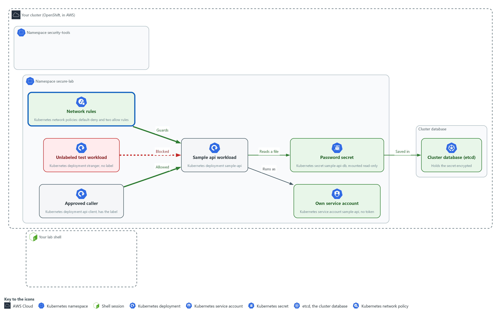

- A default-deny rule on every pod in secure-lab, plus one allow rule on the workload and one on the caller, let only the approved caller reach the workload.

#### 3a. Save the two allow rules

You will now make both allow rules in one file, allow-rules.yaml (the three dashes start the second rule).

- The first rule lets the approved caller reach the workload.
- The second rule lets that caller send traffic to the workload.
- Paste the whole block at once.

```bash
mkdir -p /workspace/cps-4
cd /workspace/cps-4
cat > allow-rules.yaml <<'EOF'
apiVersion: networking.k8s.io/v1
kind: NetworkPolicy
metadata:
  name: allow-api-client-ingress
  namespace: secure-lab
spec:
  podSelector:
    matchLabels:
      app: sample-api
  policyTypes: [Ingress]
  ingress:
    - from:
        - podSelector:
            matchLabels:
              role: api-client
      ports:
        - port: 8080
---
apiVersion: networking.k8s.io/v1
kind: NetworkPolicy
metadata:
  name: allow-api-client-egress
  namespace: secure-lab
spec:
  podSelector:
    matchLabels:
      role: api-client
  policyTypes: [Egress]
  egress:
    - to:
        - podSelector:
            matchLabels:
              app: sample-api
      ports:
        - port: 8080
EOF
wc -l allow-rules.yaml
```

**Expected output:**

```
Example only.
35 allow-rules.yaml
```

| Part | What it does | Why you run it |
| --- | --- | --- |
| mkdir -p ... && cd ... | Makes the folder for this module if it is not there and moves into it. The folder persists between lab sessions. | Every block starts in the folder that holds its files, so it works on its own. |
| cat > allow-rules.yaml <<'EOF' ... EOF | Writes everything between the first line and the line EOF into allow-rules.yaml. The quotes around EOF keep every dollar sign and bracket exactly as typed. | You need no editor: one paste makes the whole file. |
| podSelector app: sample-api (first rule) | The rule applies to the workload. | This rule is about who may reach the workload. |
| ingress from role: api-client port 8080 | Only pods with that label may connect, and only to port 8080. | Only the approved caller gets in, and only on the one port the workload serves. |
| --- | Ends the first rule and starts the second one in the same file. | One file holds both ends of the flow, so you paste once. |
| podSelector role: api-client (second rule) | The rule applies to the approved caller. | This rule is about what the caller may do, because the caller also needs permission to send. |
| egress to app: sample-api port 8080 | The caller may send only to the workload on that port. | Opens the caller's way out to the workload only, and nowhere else. |

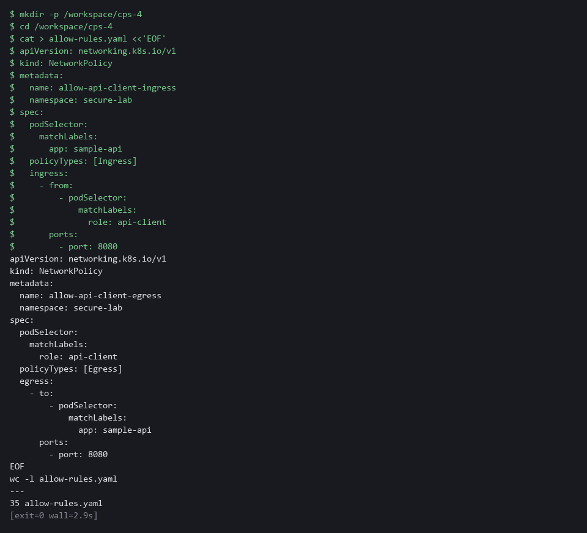

#### 3b. Extract the default-deny file, apply the network policies and list them

You will now copy the supplied default-deny file from the cluster into your folder and print it.

- The file blocks all traffic in both directions for the namespace secure-lab.
- Then you check it and allow-rules.yaml with a dry run, apply both, and list the policies.

Look for these as you read:

- The podSelector is {} and policyTypes lists Ingress and Egress with no allow list, so everything is blocked in both directions.
- The namespace is secure-lab, so the rule applies only to this project.

```bash
mkdir -p /workspace/cps-4 && cd /workspace/cps-4
oc extract configmap/secure-lab-kit -n secure-lab --to=. --confirm
cat default-deny.yaml
oc apply -f default-deny.yaml -f allow-rules.yaml --dry-run=server
oc apply -f default-deny.yaml -f allow-rules.yaml
oc get networkpolicy -n secure-lab
```

**Expected output:**

```
Example only. A policy that already exists shows configured, not created. The first command prints the name of the file it writes.
default-deny.yaml
(the contents of default-deny.yaml)
networkpolicy.networking.k8s.io/default-deny created (server dry run)
networkpolicy.networking.k8s.io/allow-api-client-ingress created (server dry run)
networkpolicy.networking.k8s.io/allow-api-client-egress created (server dry run)
(the same three lines again, without the dry run note)
NAME                       POD-SELECTOR      AGE
allow-api-client-egress    role=api-client   <age>
allow-api-client-ingress   app=sample-api    <age>
default-deny               <none>            <age>
```

| Part | What it does | Why you run it |
| --- | --- | --- |
| mkdir -p ... && cd ... | Makes the folder for this module if it is not there and moves into it. The folder persists between lab sessions. | Every block starts in the folder that holds its files, so it works on its own. |
| oc extract configmap/secure-lab-kit ... --confirm | Writes the supplied default-deny.yaml into the current folder. | The default-deny rule is supplied, so you spend your effort on the allow rules. |
| cat default-deny.yaml | Prints the file so you read it before you apply it. | Confirms the baseline is closed for every pod, in both directions, before you open anything. |
| -f default-deny.yaml -f allow-rules.yaml | Applies the two files in one command. | One command saves the closed baseline and the openings together, so there is no gap between them. |
| oc get networkpolicy | Lists the three policies. | Lists what is now in force, so you can count the three policies before you test. |

> **NOTE:** A real workload also needs a rule that allows name lookup (DNS). This module calls the workload by its cluster address so the test needs no lookup.

> **YOUR TURN:** Paste the allow-rules block, then run the last block, which extracts and reads default-deny.yaml before it applies the policies.

> **CHECKPOINT:** Three policies are listed.

> **TAKEAWAY:** One allowed call and one blocked call in the Verify tests prove the policies work.

**How this meets the control**

- **SC-7:** You read the default-deny rule and write an ingress rule and an egress rule for one approved caller, so only that caller reaches the workload.

### Step 4. Harden the container and write a Falco rule (AC-6 Least Privilege, IA-5 Authenticator Management)

**Learning point: A restricted security context removes container powers, and Falco rules report a shell start or a password-file read in secure-lab; you write the second rule.**

- The container must run as non-root, gain no extra privilege, have a read-only filesystem and keep no extra powers, with a writable /tmp.
- The first Falco rule, which you paste, reports any shell started in secure-lab.
- You write a second rule that reports cat, head or tail reading a file under /etc/sample-api/ in secure-lab, and no other file.

What this step adds (thick lines and outlines are new):

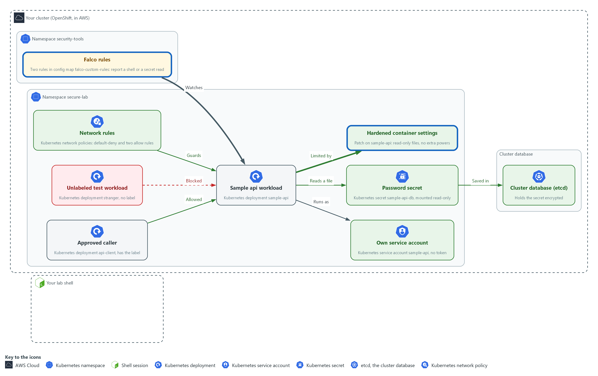

- The container loses extra powers, and two Falco rules in the namespace security-tools report any shell opened in secure-lab and any read of the password file (you write the second rule).

#### 4a. Save the runtime patch

You will now make runtime-patch.yaml in the folder for this module.

- Paste the whole block at once.

```bash
mkdir -p /workspace/cps-4
cd /workspace/cps-4
cat > runtime-patch.yaml <<'EOF'
spec:
  template:
    spec:
      securityContext:
        runAsNonRoot: true
        seccompProfile:
          type: RuntimeDefault
      volumes:
        - name: tmp
          emptyDir: {}
      containers:
        - name: sample-api
          securityContext:
            allowPrivilegeEscalation: false
            readOnlyRootFilesystem: true
            capabilities:
              drop: ["ALL"]
          volumeMounts:
            - name: tmp
              mountPath: /tmp
EOF
wc -l runtime-patch.yaml
```

**Expected output:**

```
Example only.
20 runtime-patch.yaml
```

| Part | What it does | Why you run it |
| --- | --- | --- |
| mkdir -p ... && cd ... | Makes the folder for this module if it is not there and moves into it. The folder persists between lab sessions. | Every block starts in the folder that holds its files, so it works on its own. |
| cat > runtime-patch.yaml <<'EOF' ... EOF | Writes everything between the first line and the line EOF into runtime-patch.yaml. The quotes around EOF keep every dollar sign and bracket exactly as typed. | You need no editor: one paste makes the whole file. |
| runAsNonRoot: true | The pod must not run as the root account. | A flaw in the app then runs as an ordinary user. |
| seccompProfile: RuntimeDefault | Blocks the system calls (requests a program makes to the operating system) that the container runtime marks as dangerous. | Removes calls the app never needs. |
| allowPrivilegeEscalation: false | The process cannot gain more privilege than it started with. | Closes the usual way from an ordinary user to more power. |
| readOnlyRootFilesystem: true | The container cannot write to its own files. | An attacker who gets in cannot drop files into the container. |
| capabilities drop [ALL] | Removes every extra Linux power (a capability is one slice of root power). | Takes away the root-like powers the app never uses. |
| emptyDir: {} and mountPath: /tmp | A writable scratch space that disappears when the pod ends, mounted where the workload writes. | A read-only filesystem would break a program that writes to /tmp, so this gives it one safe place to write. |

#### 4b. Save the Falco rule

You will now make secure-lab-rules.yaml in the folder for this module.

- Paste the whole block at once.

```bash
mkdir -p /workspace/cps-4
cd /workspace/cps-4
cat > secure-lab-rules.yaml <<'EOF'
- rule: Shell Started in secure-lab
  desc: A shell was started inside a container in the secure-lab project
  condition: >
    evt.type in (execve, execveat) and container.id != host
    and k8s.ns.name = secure-lab and proc.name in (sh, bash)
  output: "Shell started in secure-lab (user=%user.name pod=%k8s.pod.name command=%proc.cmdline)"
  priority: WARNING
  enabled: true
  tags: [container, shell]
EOF
wc -l secure-lab-rules.yaml
```

**Expected output:**

```
Example only.
9 secure-lab-rules.yaml
```

| Part | What it does | Why you run it |
| --- | --- | --- |
| mkdir -p ... && cd ... | Makes the folder for this module if it is not there and moves into it. The folder persists between lab sessions. | Every block starts in the folder that holds its files, so it works on its own. |
| cat > secure-lab-rules.yaml <<'EOF' ... EOF | Writes everything between the first line and the line EOF into secure-lab-rules.yaml. The quotes around EOF keep every dollar sign and bracket exactly as typed. | You need no editor: one paste makes the whole file. |
| evt.type in (execve, execveat) | Matches the moment a program is started. | Starting a shell is the likely first move of an attacker inside a container, so the rule watches for it. |
| container.id != host | Only inside containers, not on the node. | Keeps node activity out of the alerts, so only container behavior is reported. |
| k8s.ns.name = secure-lab | Only this project. | Keeps the alert about this project, so other projects do not trigger it. |
| proc.name in (sh, bash) | Only when the program started is a shell. | Normal use of the app never starts a shell, so only shells raise the alert. |
| output: ...%proc.cmdline | The message printed, with the full command in it. | Makes the alert useful: it names the pod and the exact command. |

#### 4c. Save the rule scaffold (your exercise starts here)

You will now make the start of your own Falco rule as the file secret-read-rule.yaml.

- The file is finished except for the end of the condition, which you write in the next block.
- Paste the whole block at once.

```bash
mkdir -p /workspace/cps-4
cd /workspace/cps-4
cat > secret-read-rule.yaml <<'EOF'
- rule: Secret File Read in secure-lab
  desc: A program read the mounted password file in secure-lab
  output: "Secret file read in secure-lab (user=%user.name pod=%k8s.pod.name file=%fd.name command=%proc.cmdline)"
  priority: WARNING
  tags: [container, secret]
  condition: >
    evt.type in (open, openat, openat2) and evt.is_open_read=true
    and container.id != host and k8s.ns.name = secure-lab
EOF
wc -l secret-read-rule.yaml
```

**Expected output:**

```
Example only.
8 secret-read-rule.yaml
```

| Part | What it does | Why you run it |
| --- | --- | --- |
| mkdir -p ... && cd ... | Makes the folder for this module if it is not there and moves into it. The folder persists between lab sessions. | Every block starts in the folder that holds its files, so it works on its own. |
| cat > secret-read-rule.yaml <<'EOF' ... EOF | Writes everything between the first line and the line EOF into secret-read-rule.yaml. The quotes around EOF keep every dollar sign and bracket exactly as typed. | You need no editor: one paste makes the whole file. |
| output: ... file=%fd.name | The message printed, with the file path filled in (fd.name is the path of the file the program opened). | The alert names the file, so a responder sees which secret was touched. It never prints the password itself. |
| evt.type in (...) and evt.is_open_read=true | Matches the moment a program opens a file to read it. | A read starts with opening the file, so this is the event to watch. |
| container.id != host and k8s.ns.name = secure-lab | Only inside containers of this project, as in the shell rule. | Keeps node activity and other projects out of the alerts. |
| (missing) program name and file path | Two tests are not here yet: which program, and which file. Falco joins tests with the word and. | Without them the rule would report every file read in secure-lab. You add them next. |

#### 4d. Write the two missing condition lines

You will now write the two missing condition lines yourself.

- Before you run the block, replace each line that starts with and followed by an angle bracket with a real test, using the table in 4c and the shell rule as your pattern.
- Keep four spaces at the start of each line.
- Hint: "is one of" is written as in (a, b, c), and "begins with" is written as the words starts and with joined into one word, with no space.
- If you make a mistake, paste the scaffold block again and redo this one.
- If tail prints nothing, or the last line is not 0, paste the scaffold block again and redo this block.

```bash
cd /workspace/cps-4
cat >> secret-read-rule.yaml <<'EOF'
    and <your line 1: the program name (proc.name) is cat, head or tail>
    and <your line 2: the file path (fd.name) starts with /etc/sample-api/>
EOF
tail -n 4 secret-read-rule.yaml
grep -c '<your' secret-read-rule.yaml || true
```

**Expected output:**

```
Example only. Your wording may differ; the last line must be 0.
    evt.type in (open, openat, openat2) and evt.is_open_read=true
    and container.id != host and k8s.ns.name = secure-lab
    and (your test on the program name)
    and (your test on the file path)
0
```

| Part | What it does | Why you run it |
| --- | --- | --- |
| cd ... | Moves into the module folder, where secret-read-rule.yaml is. | Every block starts in the folder that holds its files, so it works on its own. |
| cat >> secret-read-rule.yaml <<'EOF' | Appends the lines below to the end of the file (two greater-than signs add and do not replace). | The condition is the last thing in the file, so your lines continue it. |
| and ... proc.name ... | Your test on the program name. Hint: the shell rule uses proc.name in (sh, bash). | Limits the rule to programs that print a file, so the app reading its own password is not the target. |
| and ... fd.name ... | Your test on the file path. Use the hint above for the word that means begins with. | Limits the rule to the mounted password folder, so reading /etc/hostname stays silent. |
| tail -n 4 secret-read-rule.yaml | Prints the last four lines so you can read what you wrote. | Catches a missing space or a typo before it reaches Falco. |
| grep -c '<your' ... \|\| true | Counts lines that still contain the placeholder. 0 means you replaced both. | A placeholder left in the file would break the rule. |

#### 4e. Apply the runtime patch and load the Falco rule

You will now patch the workload, wait for the new pod, add both rules to the Falco config map, restart Falco, and read your rule back from the config map.

```bash
cd /workspace/cps-4
oc patch deployment sample-api -n secure-lab --patch-file runtime-patch.yaml --dry-run=server
oc patch deployment sample-api -n secure-lab --patch-file runtime-patch.yaml
oc rollout status deployment/sample-api -n secure-lab --timeout=180s
oc set data configmap/falco-custom-rules -n security-tools --from-file=secure-lab-rules.yaml --from-file=secret-read-rule.yaml
oc rollout restart daemonset/falco -n security-tools
oc get configmap falco-custom-rules -n security-tools -o jsonpath='{.data.secret-read-rule\.yaml}' | tail -n 2
```

**Expected output:**

```
Example only.
deployment.apps/sample-api patched
deployment.apps/sample-api patched
deployment "sample-api" successfully rolled out
(a line that says the config map was updated)
daemonset.apps/falco restarted
(the last two lines of your rule: your two condition lines)
```

| Part | What it does | Why you run it |
| --- | --- | --- |
| cd ... | Moves into the module folder, where runtime-patch.yaml, secure-lab-rules.yaml and secret-read-rule.yaml are. | Every block starts in the folder that holds its files, so it works on its own. |
| oc patch ... runtime-patch.yaml | Merges the settings into the live workload. Volumes and mounts add to the ones from Step 2. | Hardens the live workload without replacing the settings from Step 2. |
| oc set data configmap/falco-custom-rules | Adds your two rules files as keys and keeps any other keys already in the config map. | Delivers the rule to Falco through the config map Falco already reads, without touching other rules. |
| oc get configmap falco-custom-rules ... jsonpath=... | Prints your rule as the cluster stores it, last two lines only. | Proves the rule you wrote is the one now loaded, not just a file in your folder. |
| oc rollout restart daemonset/falco | Restarts Falco (a DaemonSet, which runs one copy on every node) so it loads the new rules. You do not wait for it here. It restarts while you write the check in the next step, and Test 5 waits for it. | Falco reads its rules only when it starts, so a restart is what makes the new rule active. |

> **YOUR TURN:** Paste the first two blocks to make runtime-patch.yaml and secure-lab-rules.yaml. Paste the scaffold block, then write the two condition lines yourself. Run the apply block.

> **CHECKPOINT:** The workload rollout finishes with the new pod Running. The Falco restart has been issued and is not waited on. Your rule file has no placeholder left (the count is 0).

> **TAKEAWAY:** Deploy what you write; a Falco rule that stays in a file reports nothing.

**How this meets the controls**

- **AC-6:** You make the container run as non-root with a read-only filesystem and no extra powers, so a flaw in it gains little. The shell rule reports a shell started in the workload.
- **IA-5:** The rule you write reports a read of the mounted password file, naming the pod and the command but never the password.

### Step 5. Write the check that proves it (AC-6 Least Privilege, IA-5 Authenticator Management, SC-7 Boundary Protection)

**Learning point: Writing a check script that reads seven live settings and exits with 1 on any FAIL lets a pipeline stop when any protection drifts.**

- A secured workload drifts: someone adds the password back, or removes a rule.
- A check script reads the live settings and fails when any of seven things is wrong.
- The script is written so you can run it again after every change.

What this step adds (thick lines and outlines are new):

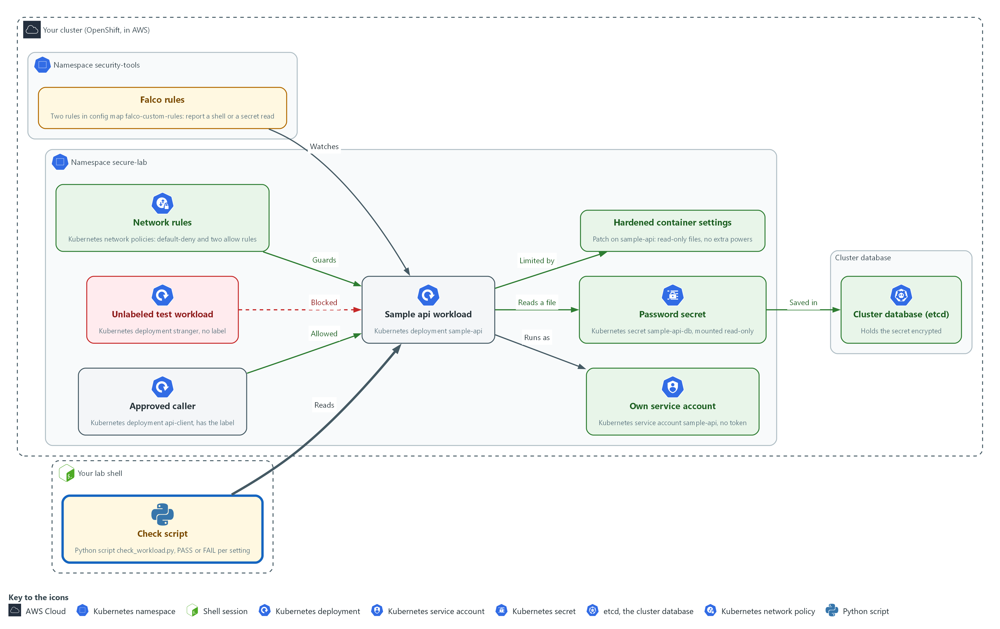

- A check script in your lab shell reads the live settings of the workload and prints PASS or FAIL for each.

#### 5a. Save the check script

You will now make check_workload.py in the folder for this module.

- Paste the whole block at once.
- The only output is the line count.

```bash
mkdir -p /workspace/cps-4
cd /workspace/cps-4
cat > check_workload.py <<'EOF'
import json, re, subprocess

def oc(*args):
    out = subprocess.run(["oc", "get", *args, "-n", "secure-lab", "-o", "json"],
                         capture_output=True, text=True, check=True)
    return json.loads(out.stdout)

pod = oc("deployment", "sample-api")["spec"]["template"]["spec"]
ctr = pod["containers"][0]
sc = ctr.get("securityContext", {})
looks_secret = re.compile("PASS|SECRET|TOKEN|KEY", re.I)
policies = oc("networkpolicy")["items"]
checks = {
    "no plain-text secret in env": not any(looks_secret.search(e["name"]) and "value" in e for e in ctr.get("env", [])),
    "own service account": pod.get("serviceAccountName") not in (None, "default"),
    "no token mounted": pod.get("automountServiceAccountToken") is False,
    "secret mounted read-only": any(m.get("readOnly") for m in ctr.get("volumeMounts", []) if m["name"] == "db-secret"),
    "read-only root filesystem": sc.get("readOnlyRootFilesystem") is True,
    "all capabilities dropped": sc.get("capabilities", {}).get("drop") == ["ALL"],
    "default-deny present": any(p["spec"].get("podSelector") == {} for p in policies),
}
for name, ok in checks.items():
    print("PASS" if ok else "FAIL", name)
raise SystemExit(0 if all(checks.values()) else 1)
EOF
wc -l check_workload.py
```

**Expected output:**

```
Example only. The count is the number of lines you pasted.
24 check_workload.py
```

| Part | What it does | Why you run it |
| --- | --- | --- |
| mkdir -p ... && cd ... | Makes the folder for this module if it is not there and moves into it. The folder persists between lab sessions. | Every block starts in the folder that holds its files, so it works on its own. |
| cat > check_workload.py <<'EOF' ... EOF | Writes everything between the first line and the line EOF into check_workload.py. The quotes around EOF keep every dollar sign and bracket exactly as typed. | You need no editor: one paste makes the whole file. |
| def oc(*args) | Runs oc get in the project and returns the answer as JSON. | One helper asks the cluster, so each check reads live state and not a file. |
| pod = oc("deployment", "sample-api") ... | Reads the pod part of the live workload. | Reads the part of the workload every check looks at. |
| looks_secret = re.compile(...) | A pattern for variable names that look like secrets. | Lets the check catch a password put back under a new name. |
| "no plain-text secret in env" | Fails if any such variable holds a value in the spec. A reference to a secret has no value here. | This is the check that fails in Test 8, when the password is put back. |
| "own service account" and "no token mounted" | Fail if the workload uses the default account or mounts a token. | These prove the identity choice from Step 2 still holds. |
| "secret mounted read-only" | Fails unless the secret volume is mounted read-only. | Proves the delivery choice from Step 2 still holds. |
| "read-only root filesystem", "all capabilities dropped" | Fail if the runtime settings are missing. | Proves the hardening from Step 4 still holds. |
| "default-deny present" | Fails unless a policy selects every pod. | Proves the network baseline from Step 3 still holds. |
| raise SystemExit(0 if all(...) else 1) | Exits with 1 if anything failed, so a pipeline (an automated sequence of tasks) can stop on it. | A pipeline can only stop on a failure if the script reports one. |

#### 5b. Run the check

You will now run the check against the live workload and print its exit code.

```bash
cd /workspace/cps-4
python3 check_workload.py
echo "exit code: $?"
```

**Expected output:**

```
Example only.
PASS no plain-text secret in env
PASS own service account
PASS no token mounted
PASS secret mounted read-only
PASS read-only root filesystem
PASS all capabilities dropped
PASS default-deny present
exit code: 0
```

| Part | What it does | Why you run it |
| --- | --- | --- |
| cd ... | Moves into the module folder, where check_workload.py is. | Every block starts in the folder that holds its files, so it works on its own. |
| python3 check_workload.py | Runs the check against the live cluster. | Runs all seven checks in one go, so you see the state of the whole workload. |
| echo "exit code: $?" | Prints the exit code. 0 means every check passed. | Shows the number a pipeline would read to pass or stop. |

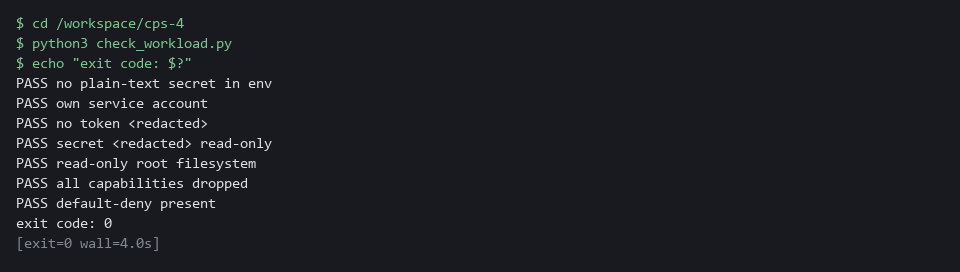

> **TIP:** Keep check_workload.py in git (the tool that records the history of your files) and run it from the pipeline, so a spec that regresses never reaches the cluster.

> **YOUR TURN:** Paste the first block to make check_workload.py, then run the second block.

> **CHECKPOINT:** Seven PASS lines and exit code 0. A FAIL line names the part you missed: go back and fix that part, not the script.

> **TAKEAWAY:** Run it after every change, so a regression names the setting it broke.

**How this meets the controls**

- **AC-6:** The check fails if the workload goes back to the default account or mounts a token.
- **IA-5:** The check fails and names the setting if a variable that looks like a secret holds a value.
- **SC-7:** The check fails unless a policy selects every pod, which is the default-deny baseline.

## Section 4. Verify It Works

### Test 1 (positive). The password is not in the pod spec (IA-5 Authenticator Management)

- Search every live object that could hold the old password value (the plain-text value Step 1 showed).
- The old value must appear nowhere, and the secret must exist.

```bash
oc get deployment,pod -n secure-lab -o yaml | grep -c "lab-only-plain-text-value"
oc get secret sample-api-db -n secure-lab
oc exec -n secure-lab deploy/sample-api -- ls -l /etc/sample-api
```

**Expected output:**

```
Example only.
0
NAME            TYPE     DATA   AGE
sample-api-db   Opaque   1      4m
total 0
lrwxrwxrwx. 1 root 1001 15 Oct 29 14:02 password -> ..data/password
```

| Part | What it does | Why you run it |
| --- | --- | --- |
| oc get deployment,pod ... -o yaml \| grep -c ... | Prints the live workload and its pod as text and counts the lines that contain the old plain-text password. | The old value must be gone from every live object that could hold it. |
| 0 | No line holds the old value. grep exits with 1 when it counts nothing, which is expected here. | Zero is the pass: the password is not in the pod spec. |
| oc get secret sample-api-db | Shows the secret that now holds the password. DATA 1 means one item. | The password has to live somewhere: in a secret, not in the spec. |
| ls -l /etc/sample-api | Lists the mounted folder inside the running container. The file password appears. | Proves the container still gets its password, as a file. |

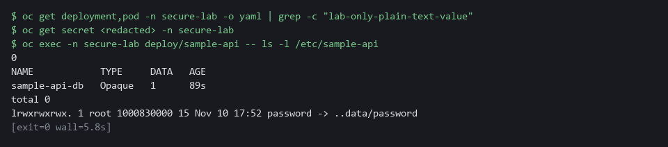

> **CHECKPOINT:** The count is 0 (grep prints 0 and exits with 1, which is expected), the secret has one data item, and the password appears as a file.

**How this meets the control**

- **IA-5:** You search the live objects for the old value and list the mounted file; a count of 0 and a secret that holds the password show the password left the spec.

### Test 2 (positive). The stored secret is encrypted (SC-28 Protection of Information at Rest)

- Do not trust the status message alone.
- Read the stored bytes from the cluster database.
- An encrypted value starts with a marker that names the algorithm.

```bash
ETCD_POD=$(oc get pods -n openshift-etcd -l app=etcd -o name | head -1)
oc exec -n openshift-etcd $ETCD_POD -- etcdctl get /kubernetes.io/secrets/secure-lab/sample-api-db --print-value-only | head -c 18
```

**Expected output:**

```
Example only.
k8s:enc:aesgcm:v1:
```

| Part | What it does | Why you run it |
| --- | --- | --- |
| ETCD_POD=$(oc get pods -n openshift-etcd ... \| head -1) | Keeps the name of the first etcd pod in a variable (a named value later commands can use). | etcd is the cluster database, so you read the stored bytes from inside its pod. |
| etcdctl get /kubernetes.io/secrets/secure-lab/sample-api-db --print-value-only | Reads the secret exactly as it is stored. | This is what someone with a copy of the database would see. |
| \| head -c 18 | Keeps the first 18 bytes only, so the rest of the unreadable value is not printed. | The start of the value is the marker that names the encryption method. |
| k8s:enc:aesgcm:v1: | The marker for aesgcm encryption. | Proves the secret is stored encrypted, not just reported as encrypted. |

> **CHECKPOINT:** The value starts with k8s:enc:aesgcm. A plain value would start with k8s and unreadable characters.

**How this meets the control**

- **SC-28:** You read the stored bytes of the secret from the cluster database, which proves encryption without relying on the status message.

### Test 3 (positive). The approved caller reaches the workload (SC-7 Boundary Protection)

- Call by cluster address from the pod that carries the label role=api-client.
- The call must succeed, or the rules are too tight.

```bash
IP=$(oc get service sample-api -n secure-lab -o jsonpath='{.spec.clusterIP}')
oc exec -n secure-lab deploy/api-client -- timeout 3 bash -c "echo > /dev/tcp/$IP/8080"; echo "api-client: exit=$?"
```

**Expected output:**

```
Example only.
api-client: exit=0
```

| Part | What it does | Why you run it |
| --- | --- | --- |
| IP=$(oc get service sample-api ... clusterIP) | Keeps the cluster address of the workload's service in a variable. | The call uses the address, so it needs no name lookup. |
| oc exec ... deploy/api-client -- timeout 3 bash -c "echo > /dev/tcp/$IP/8080" | Runs inside the approved caller and tries to open a connection to port 8080, giving up after 3 seconds. | A connection that opens proves the two allow rules work. |
| api-client: exit=0 | 0 means the connection opened. | If this is not 0, the allow rules are too tight. |

> **CHECKPOINT:** The exit code is 0.

**How this meets the control**

- **SC-7:** You call the workload from the pod that carries the approved label; exit code 0 shows the exception works.

### Test 4 (negative). Any other pod is blocked (SC-7 Boundary Protection)

Call the workload from a pod without the approved label; the connection must time out or be refused.

```bash
IP=$(oc get service sample-api -n secure-lab -o jsonpath='{.spec.clusterIP}')
oc exec -n secure-lab deploy/stranger -- timeout 3 bash -c "echo > /dev/tcp/$IP/8080"; echo "stranger: exit=$?"
```

**Expected output:**

```
Example only. The exit code is 124 on a timeout. oc may print a line saying the command terminated with exit code 124 before it.
stranger: exit=124
```

| Part | What it does | Why you run it |
| --- | --- | --- |
| IP=$(oc get service sample-api ... clusterIP) | Sets the address again, so this block works on its own. | A new lab shell does not remember earlier variables. |
| oc exec ... deploy/stranger -- timeout 3 bash -c ... | The same call, from a pod that does not carry the approved label. | Only the label differs from the last test, so any difference in the result is caused by the rules. |
| stranger: exit=124 | 124 means the connection timed out. Anything but 0 means blocked. | Proves the default-deny rule holds for every pod you did not approve. |

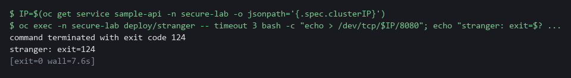

> **CHECKPOINT:** The exit code is not 0. If it is 0, the policies are not enforced: re-run the check script and the policy list.

**How this meets the control**

- **SC-7:** You make the same call from a pod without the label; a non-zero exit code shows default-deny is enforced.

### Test 5 (positive). The container has no powers, and a shell raises a Falco event (AC-6 Least Privilege)

- Open a shell on purpose to show the capability set is empty, the root filesystem is read-only, and Falco reports the shell.
- Wait for the Falco restart from Step 4 to finish first, then read the Falco log.

```bash
oc rollout status daemonset/falco -n security-tools --timeout=180s
oc exec -n secure-lab deploy/sample-api -- sh -c 'grep CapEff /proc/self/status; touch /etc/test-write'
sleep 15
oc logs daemonset/falco -c falco -n security-tools --since=5m | grep "Shell started in secure-lab" | tail -n 1
```

**Expected output:**

```
Example only.
daemon set "falco" successfully rolled out
CapEff:	0000000000000000
touch: cannot touch '/etc/test-write': Read-only file system
command terminated with exit code 1
A long line of JSON from Falco (a single raw event) that contains the words Shell started in secure-lab, the user, the pod name and the command sh -c grep CapEff /proc/self/status; touch /etc/test-write
```

| Part | What it does | Why you run it |
| --- | --- | --- |
| oc rollout status daemonset/falco ... | Waits until the Falco restart from Step 4 has finished. | Falco loads your rule only after it restarts, so an event before that is not reported. |
| sh -c 'grep CapEff /proc/self/status; touch /etc/test-write' | Opens a shell in the workload, prints its set of extra powers, and tries to write a file. | Opening a shell is the event the Falco rule watches for. The two results show the hardening. |
| CapEff: 0000000000000000 | All zeros: the container keeps no extra powers. | Proves the capabilities were dropped. |
| Read-only file system | The write is refused. | Proves an attacker cannot drop files here. |
| sleep 15 and oc logs daemonset/falco ... \| grep ... | Gives Falco a moment, then picks the newest line about your shell from its log. | The alert names the pod and the command, which is what a responder needs. |

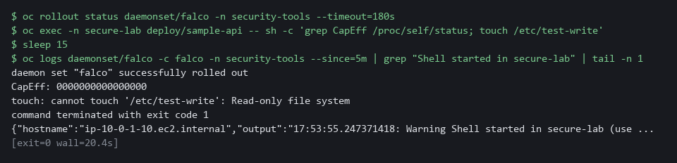

> **CHECKPOINT:** CapEff is all zeros, the write is refused, and the Falco line names your pod and the command.

**How this meets the control**

- **AC-6:** You open a shell on purpose and read the capability set, which shows the container keeps no extra powers.

### Test 6 (positive). Your rule fires when the secret file is read (IA-5 Authenticator Management)

Read the mounted password file with cat, discarding the output so the password is never shown; your Falco rule must report the read.

```bash
oc rollout status daemonset/falco -n security-tools --timeout=180s
oc exec -n secure-lab deploy/sample-api -- cat /etc/sample-api/password > /dev/null
sleep 15
oc logs daemonset/falco -c falco -n security-tools --since=5m | grep "Secret file read in secure-lab" | tail -n 1
```

**Expected output:**

```
Example only.
daemon set "falco" successfully rolled out
A long line of JSON from Falco (a single raw event) that contains the words Secret file read in secure-lab, the user, the pod name, the file /etc/sample-api/password and a command that ends with cat /etc/sample-api/password (the command text may include extra words before it)
```

| Part | What it does | Why you run it |
| --- | --- | --- |
| oc rollout status daemonset/falco ... | Waits until Falco has restarted with your rule. | Falco loads rules only at start, so an earlier read is not reported. |
| cat /etc/sample-api/password > /dev/null | Reads the password file inside the workload and throws the text away on your side. | This is the action the rule exists to catch, and nothing sensitive is printed. |
| grep "Secret file read in secure-lab" \| tail -n 1 | Picks the newest Falco line from your rule. | The line names the pod, the file and the command, which is what a responder needs. |

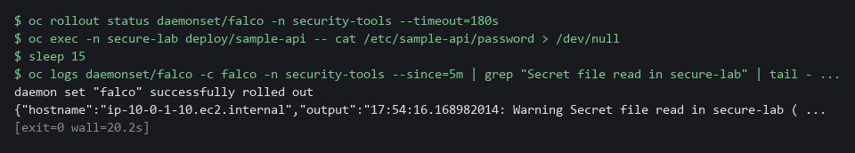

> **CHECKPOINT:** One Falco line appears that names the file /etc/sample-api/password and the command cat. If nothing appears, re-read your two condition lines, fix the file, apply again and restart Falco.

**How this meets the control**

- **IA-5:** Your Falco rule reports a read of the mounted password file, naming the pod and the command but never the password.

### Test 7 (negative). Reading another file stays silent (IA-5 Authenticator Management)

Read a harmless file with the same program and count the new events from your rule; the count must stay the same, or the rule reports too much.

```bash
COUNT_CMD='oc logs daemonset/falco -c falco -n security-tools --since=10m'
BEFORE=$($COUNT_CMD | grep -c "Secret file read in secure-lab" || true)
oc exec -n secure-lab deploy/sample-api -- cat /etc/hostname > /dev/null
sleep 15
AFTER=$($COUNT_CMD | grep -c "Secret file read in secure-lab" || true)
echo "new events: $((AFTER - BEFORE))"
```

**Expected output:**

```
Example only.
new events: 0
```

| Part | What it does | Why you run it |
| --- | --- | --- |
| BEFORE=... grep -c | Counts your rule's alerts in the last ten minutes before the test. | A count before and after does not depend on clocks, so it is a fair test. |
| cat /etc/hostname > /dev/null | The same program reads a different, harmless file. | Only the file path differs from the last test, so any alert would mean the file test in your rule is wrong. |
| echo "new events: $((AFTER - BEFORE))" | Prints how many alerts appeared during the test. | 0 means the rule is narrow enough: it fires on the secret and not on other files. |

> **CHECKPOINT:** The line says new events: 0. If it says 1 or more, your file test is too wide: tighten it and repeat.

**How this meets the control**

- **IA-5:** Reading a harmless file raises no alert, so the rule reports only access to the password file.

### Test 8 (negative). Putting the password back makes the check fail (IA-5 Authenticator Management)

- A check you have only seen pass is untested.
- Add the password to the spec as a plain value, run the check, then remove it and run it again.

```bash
cd /workspace/cps-4
oc set env deployment/sample-api DB_PASSWORD=plain-text-oops -n secure-lab
python3 check_workload.py; echo "exit code: $?"
oc set env deployment/sample-api DB_PASSWORD- -n secure-lab
oc rollout status deployment/sample-api -n secure-lab --timeout=180s
python3 check_workload.py; echo "exit code: $?"
```

**Expected output:**

```
Example only. The FAIL line appears among six PASS lines. oc also prints updated lines and rollout wait lines.
FAIL no plain-text secret in env
exit code: 1
(seven PASS lines)
exit code: 0
```

| Part | What it does | Why you run it |
| --- | --- | --- |
| cd ... | Moves into the module folder, where check_workload.py is. | The block works on its own. |
| oc set env deployment/sample-api DB_PASSWORD=plain-text-oops | Puts a password back into the spec as a plain value. | This is the mistake the check exists to catch. |
| FAIL no plain-text secret in env | The check names the setting that broke and the exit code is 1. | A check that can fail is proven; one you have only seen pass is not. |
| oc set env deployment/sample-api DB_PASSWORD- | Removes the variable again. | Puts the workload back the way it was. |
| exit code: 0 | After the rollout all seven checks pass. | Shows the check follows the real state of the workload. |

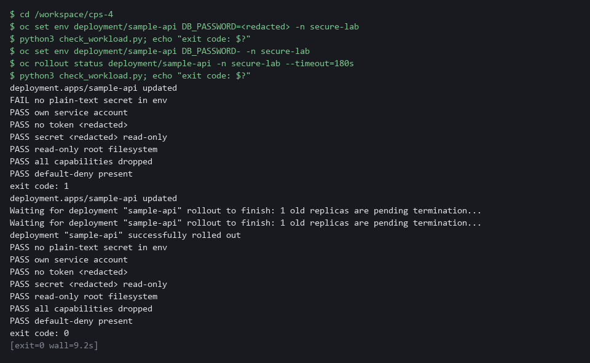

> **CHECKPOINT:** The first run fails and names the setting, with exit code 1. After you remove the variable, all seven checks pass and the exit code is 0.

**How this meets the control**

- **IA-5:** You add the password back as a plain value and run the check; the FAIL that names the setting shows the check catches a regression.

## Section 5. What Each Control Is For

### Control mapping

| Control | What it requires, in plain words | Tool or service | Where this module covers it |
| --- | --- | --- | --- |
| AC-6 Least Privilege | Give a process only the access it needs to do its assigned tasks. | A dedicated Kubernetes service account with no token, a restricted security context, a Falco shell rule, and read-only AWS calls to see which identity is in play. Explained in sections 2.1 and 2.5. | Section 3, Step 1: read which cloud identity is in play. Section 3, Step 2: give the workload its own identity with no token and no role. Section 3, Step 4: remove container powers and report a shell. Section 3, Step 5: check the identity settings. Section 4, Test 5. |
| IA-5 Authenticator Management | Protect passwords and other authenticators. The IA-5(7) enhancement adds: do not embed unencrypted static authenticators in applications or static storage. | A Kubernetes secret mounted as a read-only file, and a Falco rule that reports a read of it. Explained in sections 2.2 and 2.5. | Section 3, Step 2: move the password out of the pod spec into a secret. Section 3, Step 4: write the Falco secret-read rule. Section 3, Step 5: check no plain-text secret returns. Section 4, Test 1: search the live objects for the old value. Section 4, Tests 6 to 8: the rule fires, stays silent on other files, and the check catches a regression. |
| SC-28 Protection of Information at Rest | Protect the confidentiality, integrity, or both, of organization-defined information at rest, as selected. | OpenShift etcd encryption (aesgcm), read with oc. Explained in section 2.3. | Section 3, Step 1: read the etcd encryption state. Section 4, Test 2: read the stored secret to prove it is encrypted. |
| SC-7 Boundary Protection | Control traffic at the boundaries. The SC-7(5) enhancement adds: deny traffic by default and allow it only by exception. | Kubernetes NetworkPolicy, enforced by the OVN-Kubernetes network plugin. Explained in section 2.4. | Section 3, Step 3: use a supplied default-deny rule and paste two allow rules. Section 3, Step 5: check the default-deny policy is present. Section 4, Tests 3 and 4: one call is allowed and one is blocked. |

### What each control is for

Each table below says what the control is trying to prevent and how this module's tool meets it.

#### AC-6 Least Privilege

| Question | Answer |
| --- | --- |
| Control Intent | A workload carries a shared identity or a stored cloud key, and a flaw in it lets an attacker act as that identity everywhere it works. |
| The operational question | Which identity does this workload act as, what can that identity do, and does the workload need it at all? |
| What evidence proves it | The service account and token setting on the live workload, the cluster's token issuer setting, and the lab shell's own cloud identity. |
| How much is enough | The workload has its own account. If it needs no cluster or cloud access it gets none. |
| How the tool in this module satisfies it | A dedicated service account with no token (Step 2), a restricted security context and a Falco shell rule (Step 4), and read-only AWS calls (Step 1) to see which identity the lab shell uses. |

#### IA-5 Authenticator Management

| Question | Answer |
| --- | --- |
| Control Intent | A password sits in plain text in the pod spec, so anyone who can read the workload object, or a copy of it in git, can read the password. |
| The operational question | Can you find the password by reading the pod spec, the deployment, or a command history? |
| What evidence proves it | A search of the live objects for the old value, and the check script result. |
| How much is enough | No authenticator appears in a workload definition. The password reaches the container as a mounted secret generated by command. NIST does not name a delivery method; the lab uses a mounted file. |
| How the tool in this module satisfies it | A secret created from a generated value, mounted read-only (Step 2), a Falco rule that reports a read of it (Step 4), and a check script (Step 5). |

#### SC-28 Protection of Information at Rest

| Question | Answer |
| --- | --- |
| Control Intent | A copy of the cluster database or a node disk is read and every stored secret is readable. |
| The operational question | If someone read the stored bytes directly, would they see the secret? |
| What evidence proves it | The encryption status of the API servers, the stored value of the secret, and the encrypted flag on the node volumes. |
| How much is enough | The organization selects confidentiality, integrity or both. The stored value starts with an encryption marker, not readable text. The lab uses aesgcm. |
| How the tool in this module satisfies it | etcd encryption (read in Step 1, proved in Test 2) and a read-only listing of node volumes (Step 1). |

#### SC-7 Boundary Protection

| Question | Answer |
| --- | --- |
| Control Intent | Any pod can call the workload, and the workload can call out anywhere, so one compromised pod reaches everything. |
| The operational question | Which callers are approved, and what happens to any other? |
| What evidence proves it | The policies and one allowed call and one blocked call. |
| How much is enough | A default-deny rule covers every pod, and each approved flow has its own rule on both sides: ingress on the workload, egress on the caller. |
| How the tool in this module satisfies it | Three network policies (Step 3) and two calls (Tests 3 and 4). |

## Section 6. Next Steps

### Using this in other environments

- The commands work as is on any OpenShift 4.x cluster that has Falco, OVN-Kubernetes, an etcd-encrypted secret store, and an AWS account with the lab permissions attached.
- Change these lab values: the namespaces secure-lab and security-tools, the deployments sample-api, api-client and stranger, the secret sample-api-db, the config map falco-custom-rules, and the KMS_KEY_ARN and AWS_REGION variables.
- On other Kubernetes platforms, oc commands map to kubectl; etcd encryption varies by distribution (read the platform's encryption provider docs).
- Falco works on any Kubernetes platform. The AWS read-only calls in Step 1 need no equivalent if no cloud identity is used; replace them with your cloud provider's identity and key-state calls.

The table shows what changes on each platform:

| Check | In this lab (OpenShift) | On other platforms | What you change |
| --- | --- | --- | --- |
| Service account with no token | oc create serviceaccount and automountServiceAccountToken: false | kubectl create serviceaccount and the same YAML field | The tool name. |
| Secret as mounted file | oc create secret generic ... --from-literal | kubectl create secret generic with the same option | The tool name. |
| etcd encryption state | oc get openshiftapiserver ... Encrypted reason | Replace the check | Read the platform's own secrets-encryption status instead of the oc check. |
| NetworkPolicy | Three NetworkPolicy objects, OVN-Kubernetes enforced | kubectl apply; the cluster needs a network plugin that enforces policies | The tool name; confirm the network plugin enforces policies. |
| Falco rule | oc set data configmap/falco-custom-rules | Any cluster with a Falco DaemonSet and a rules config map | The config map name and namespace. |
| Check script | python3 check_workload.py (uses oc) | Port the oc get calls to kubectl get | Replace oc with kubectl in the script. |

> **TIP:** Next module: CPS-5 Guardrails Developers Inherit: you build a template and policies so every new project starts with these protections.

<details>
<summary><strong>Section 7. Terms</strong></summary>

Each term is also explained the first time it appears. In Word, hover over an underlined term to see its meaning, or Ctrl+click it to jump to this table.

| Term | Plain meaning |
| --- | --- |
| aesgcm | The encryption method the lab uses for secrets stored in etcd. |
| API | The set of requests a program can send to another program. The cluster API is how tools and programs ask the cluster to read or change things. |
| Append | To add text to the end of a file without removing what is there. In the shell, two greater-than signs do it. |
| Authenticator | A password, key or token that proves who or what you are. |
| AWS | Amazon Web Services, the cloud your lab runs in. |
| Baseline | The agreed starting configuration that the system is expected to match. |
| Capability | One slice of root power that a container can keep or drop. |
| CLI | Command-line interface: a program you use by typing commands. |
| Cluster | A group of servers that work together as one system. Here it is your own OpenShift cluster in AWS. |
| Config map | A stored set of small files or settings that the cluster keeps and can hand to a program. |
| Container | A sealed box that holds one program and everything it needs to run, so it runs the same way anywhere. |
| Credential | A secret that proves who you are, such as a password, token or key. |
| DaemonSet | A cluster object that runs one copy of a program on every node. Falco runs this way. |
| Default-deny | A network policy that selects every pod and lists no allowed traffic, so everything is blocked until another rule allows it. |
| Deployment | A cluster object that keeps a set number of copies of a program running and replaces them when you change it. |
| DNS | The system that turns names into network addresses. |
| Drift | When the real system no longer matches what the files say it should be. |
| Dry run | A run of a command that checks the change and does not make it. |
| EC2 | An AWS virtual server. |
| Egress | Network traffic leaving a pod. |
| Encryption | Scrambling data with a key so it cannot be read without the key. At rest means while it is stored, so reading the storage directly does not reveal the data. |
| Encryption at rest | Storing data in an encrypted form. |
| Environment variable | A named value placed in a program's surroundings when it starts. The program can read it. |
| etcd | The cluster database. It stores every secret. |
| Evidence | Saved records that show a system is set up and behaving as claimed. |
| Exit code | A number a command leaves behind when it ends. 0 means success; anything else means a problem. |
| Falco | A free, open source tool that watches what running containers do and reports behavior that matches a rule. |
| Falco field | A named piece of an event that a rule can test, such as proc.name for the program name or fd.name for the path of the file it opened. |
| File mode | The number that says who may read, write or run a file. |
| Git | A tool that keeps the history of a folder of files, so every change has a record. |
| grep | A command that prints only the lines that match a pattern. |
| Heredoc | A way to make a file by pasting its text between a first line such as cat > name <<'EOF' and a last line that says EOF. |
| Ingress | Network traffic arriving at a pod. |
| jq | A command-line tool that reads JSON and picks out the fields you ask for. |
| JSON | A plain-text data format of names and values written inside curly braces. oc can print it and jq can read it. |
| KMS | The AWS key service, which keeps encryption keys. The lab reads the state of one key and never changes it. |
| Kubernetes | The open-source system that runs and manages containers across servers. OpenShift is built on it. |
| Label | A key=value tag on a cluster object. Policies use labels to pick which pods a rule applies to. |
| Merge | Combine the changes from one git branch into another. |
| mkdir | A command that makes a new folder. |
| Mount | To make a file or folder from outside appear inside a container at a set path. |
| Namespace | A named section of the cluster that holds a set of related parts. |
| NetworkPolicy | A rule about which traffic pods may send and receive. |
| NIST | The US National Institute of Standards and Technology. It publishes the security control catalog these modules cite. |
| Node | One server in the cluster. Your lab cluster has a single node. |
| oc | The OpenShift command-line tool. You type oc, then a verb such as get, then what it acts on. |
| OpenShift | The Red Hat platform your lab cluster runs on. It is Kubernetes with extra security and tools built in. |
| OVN-Kubernetes | The network plugin in OpenShift that makes network policies take effect. |
| Patch | A small file of changes merged into an object that already exists. The rest of the object stays as it was. |
| Pipeline | An automated sequence of tasks that runs without a person at the keyboard. |
| Pod | The smallest running unit on the cluster: one or more containers together. |
| Pod spec | The settings that describe a pod: its containers, volumes and environment variables. |
| Policy | A set of rules written down so that a tool can enforce them. |
| Project | OpenShift's name for a namespace: a named section of the cluster that keeps workloads apart. |
| Provider | The company or plug-in that supplies a platform, such as a cloud provider or a Terraform provider. |
| RBAC | Role-based access control: permissions are given to roles, and roles are given to users or programs. |
| Read-only filesystem | A container setting that stops the program from writing to its own files. |
| Role | A list of actions a user or program may take on named kinds of objects. |
| Role binding | Gives a role to a user, group or service account. |
| Rollout | The replacement of old pods by new ones after you change a deployment. |
| Root | The all-powerful account on a computer. A program that runs as root can change almost anything. |
| Rotation | Replacing a secret with a new value so the old one stops working. |
| Rule | A written condition that a tool checks. |
| Runtime | The time when a program is running, as opposed to when it is written or built. |
| Scan | A check of software or settings against a list of known problems. The scan reports what it finds. |
| Secret | A cluster object that holds sensitive values so they are not written into the workload definition. |
| Service account | An identity for a program instead of a person. |
| STS | An AWS service that tells you which identity you are signed in as. |
| System call | A request a program makes to the operating system, such as opening a file or starting another program. |
| TCP | The standard way programs send data reliably over a network. |
| Template | A file with blanks that are filled in when it is used. |
| Token | A credential the cluster puts inside a pod so the program can call the cluster API. A workload that does not call the API does not need it. |
| Token (service account) | A credential placed inside a pod for calling the cluster API. |
| Token issuer | The service that creates and signs tokens. If the cluster has none set, short-lived cloud credentials for pods are not available here. |
| Variable | A named value in the shell. A dollar sign in front of the name means use its value. |
| Volume | A disk attached to a server, or a storage area that a pod makes available for its containers to mount. Node volumes hold the data the node writes. |
| Workload | A program the cluster runs, such as the sample api. Running workloads is what the cluster is for. |
| YAML | A plain-text format for settings: lines of name: value, with indentation to show what belongs to what. |

</details>
