# CPS-5: Guardrails Developers Inherit (CM-2, CM-7, SC-7, SC-6)

| Item | Detail |
| --- | --- |
| Sequence | Module 27 of 29 in the recommended order |
| Timed work | About 76 minutes (58 hands-on, 18 verify) |
| Standalone start | `lab start cps-5` |
| Combined start | Continue from the end state of the previous module |
| Tools | OpenShift Container Platform (project request template), Kyverno (free, open source), oc, jq, python3 |
| Prerequisites | ENG-0 Terminal, Git and Your Lab (running oc in lab shell, reading its output, and making a file with a heredoc) |

## Section 1. Module Overview

- Purpose: build the guardrails a developer inherits so every new namespace starts protected and ordinary workloads pass first try without a hand edit (CM-2, CM-7, SC-7, SC-6).
- You save a score script, measure the baseline on a namespace with no guardrails, and record the four numbers: first-try passes, manual edits, unsafe refusals and protection objects.
- You build a project template, two Kyverno generate policies, a mutate policy and two validate policies, including a registry allow-list you write yourself.
- You run the same score script again on two new namespaces and compare with the baseline.

- **Skill:** Build the protections a developer inherits: a project template, two generate policies, a mutate policy and two validate policies including a registry allow-list you write yourself. Measure the result with a score script before and after.
- **Tools:** The OpenShift project request template adds a quota to every new project. Kyverno ClusterPolicies generate, mutate and validate workloads. `python3 score.py` measures first-try passes and refusals. `oc` applies the template and policies; `jq` reads the JSON replies.
- **Security Function:** Blocks unsafe workloads at admission, fills in safe settings on ordinary ones, and gives every new namespace a quota and a default-deny rule. The score script proves the result with before and after numbers.
- **NIST CM-2 Baseline Configuration:** The project template and five Kyverno policies are the baseline, stored as files. The score script measures it before and after, on both creation paths.
- **NIST CM-7 Least Functionality:** Kyverno validate policies refuse privileged mode, host networking, host paths, the latest tag and images from unapproved registries. Step 4 builds the registry allow-list; Verify Tests 1 and 3 confirm refusals.
- **NIST SC-7 Boundary Protection:** A Kyverno generate policy creates a default-deny network policy in every new gr- namespace and puts it back if deleted (synchronize on). Verify Test 2 proves it repairs itself.
- **NIST SC-6 Resource Availability:** A project template and a generate policy each add a quota. A mutate policy adds default memory values to containers. Steps 2 and 3 build the quota; Step 4 adds the defaults.

## Section 2. The Tools

### Tools used in this module

Each tool name links to its official overview. The table columns say how each tool is used in the lab and why the lab uses it instead of another way of doing the same job.

| Tool (overview link) | What it is | Used in this lab | Why this tool |
| --- | --- | --- | --- |
| [OpenShift Container Platform](https://docs.redhat.com/en/documentation/openshift_container_platform/4.22/html/overview/ocp-overview) | A Kubernetes container platform for running and managing containerized applications. | The cluster where you build the guardrails and test them on twelve workloads. | It is the platform the whole lab runs on, so every module works on the same real cluster, with the same kinds of objects a production OpenShift system has. |
| [Project request template](https://docs.redhat.com/en/documentation/openshift_container_platform/4.22/html/building_applications/projects) | The template OpenShift uses to build every new project, so it can include a quota and other defaults. | You add a quota so every new project starts with limits. | It is how OpenShift builds every new project, so a default set here reaches every future project without anyone remembering to add it. |
| [Kyverno](https://kyverno.io/docs/) | A policy engine that checks and enforces rules on Kubernetes resources. | Generates default-deny and a fallback quota, adds safe defaults and refuses unsafe settings. | It is the policy engine the lab already uses to check and enforce rules on cluster objects, so there are real policies to count and read as evidence. It is free and open source. |
| [oc](https://docs.redhat.com/en/documentation/openshift_container_platform/4.22/html/cli_tools/openshift-cli-oc) | The OpenShift command-line tool for creating and managing applications and projects from a terminal. | Applies the template and policies and creates the test projects. | It is the one command that talks to the cluster, so every module uses it to ask what is true and to make changes. You sign in once, and it works on OpenShift objects as well as standard Kubernetes ones. Unlike clicking in the web console, a command can be pasted, repeated and checked by a test. |
| [jq](https://jqlang.org/) | Command-line JSON processor. | Reads results. | It picks one field out of a long JSON reply, so a test can read a single value. |
| [Python 3](https://docs.python.org/3/tutorial/introduction.html) | General-purpose language, used here for small helper scripts. | Runs score.py, which counts what is admitted before and after. | Python reads and writes JSON easily and is already in the lab shell, so a small script needs nothing installed. |

### How it fits together

#### A new namespace inherits its protections

- The diagram shows the lab (test) setup.
- A template and five Kyverno policies protect new namespaces.
- The template and five policies add a quota and a default-deny rule, add safe settings to workloads and refuse unsafe ones.
- A score script measures the result.
- Production applies the policies to every namespace except system ones, starts them in audit mode, and changes the files through a reviewed pipeline.
- New parts are drawn with thick lines.

How the lab is set up, and why:

- You work in lab shell on your laptop, as before, and the score script runs there because it only needs to send workloads to the cluster and read them back.
- The project template is saved in the namespace openshift-config because OpenShift looks for it there whenever anyone makes a new project, so one template reaches every project.
- Kyverno runs in its own namespace, kyverno, and checks every create request before the cluster saves it, so its policies also reach namespaces made any other way.
- The new namespaces and their workloads, named gr- followed by a name, are kept apart from the rest of the lab, so the policies do not affect other modules.
- CPS-5 adds the project template and the Kyverno policies to the layout from CPS-4, and makes the protections you built by hand there part of how a namespace is created.


- **1. Score script:** the Python script score.py in your lab shell, which applies the workloads and counts how many pass first try.
- **2. Project template:** the OpenShift template guardrail-project-request in openshift-config, which adds a quota to every namespace made with a project request.
- **3. Generate policies (Kyverno):** two cluster policies that add a default-deny rule to every new gr- namespace and a fallback quota to those that skip the template.
- **4. Mutate policy (Kyverno):** one cluster policy that adds safe settings and default memory values to workloads in those namespaces.
- **5. Validate policies (Kyverno):** two cluster policies that refuse host access and unapproved images in those namespaces.
- **6. Resource quota:** the Kubernetes quota guardrail-quota in each new namespace, which caps memory and pod count.
- **7. Default-deny network policy:** the Kubernetes network policy default-deny in each new namespace, which blocks all traffic until another rule allows it.
- **8. Developer workload:** the eight ordinary deployments the score script applies, which are accepted.
- **9. Refused workload:** the four unsafe deployments the score script applies, which are refused and never created.

Where each part runs, and why:

| Part | Where it runs | Why it is built this way |
| --- | --- | --- |
| Score script | Your lab shell | It measures the same way before and after, from outside the cluster. |
| Project template | The namespace openshift-config | OpenShift reads it from there when any project is requested, so one template reaches every project. |
| Kyverno policies | The namespace kyverno, applied to the whole cluster | The policy engine sees every create request, so it covers every route into the cluster. |
| New namespaces gr-before, gr-after and gr-direct | Your cluster | The gr- prefix limits the policies to these namespaces and keeps the rest of the lab untouched. |
| Quota and default-deny | Inside each new namespace | Each namespace gets its own cap and its own closed network baseline. |

### 2.1 Four mechanisms, four jobs (CM-2 Baseline Configuration, CM-7 Least Functionality, SC-7 Boundary Protection, SC-6 Resource Availability)

- The platform enforces protections four ways (project template, generate policy, mutate policy and validate policy), and the four differ in when they run and whether they repair a deletion.
- Each protection fits one mechanism best, because putting every protection in one place leaves a gap on the creation paths that place does not cover.

#### CM-2: Baseline Configuration

*The control asks the organization to develop, document and maintain under configuration control a current baseline configuration of the system, and to review and update it at an organization-defined frequency, when organization-defined circumstances require it, and when components are installed or upgraded. This is done using:*

- The project template: adds the same quota to every namespace made with a project request, so part of the baseline is a file.
- The five Kyverno policies: give every gr- namespace its default-deny rule, fallback quota, safe settings and refusals, so the rest of the baseline is code.
- The score script: measures how many workloads meet the baseline before and after the guardrails exist.

#### CM-7: Least Functionality

*The control asks the organization to configure the system to provide only organization-defined mission essential capabilities, and to prohibit or restrict the use of organization-defined functions, ports, protocols, software and services. The organization defines which capabilities are mission essential. This is done using:*

- The validate policy gr-validate-host-access: refuses privileged containers, host networking and host paths in the gr- namespaces.
- The validate policy gr-validate-images: refuses the latest tag and any image from a registry outside the allow-list you write.
- The mutate policy: adds safe settings to ordinary workloads, so they stay allowed while unsafe ones are refused.

#### SC-7: Boundary Protection

*The control asks the organization to monitor and control communications at the external and key internal managed interfaces of the system, and to connect to external networks only through managed interfaces. The enhancement SC-7(5), which this module follows, asks the system to deny network communications traffic by default and allow it by exception. This is done using:*

- The generate policy gr-generate-deny: creates a default-deny network policy in every new gr- namespace, so no pod can send or receive traffic until another rule allows it.
- Synchronize on gr-generate-deny: puts the network policy back if someone deletes it.
- The cluster role in kyverno-rbac.yaml: lets Kyverno create, change and remove network policies and quotas, and nothing else.

#### SC-6: Resource Availability

*The control asks the organization to protect the availability of organization-defined resources by allocating them by priority, by quota, or by other organization-defined controls. NIST notes that quotas prevent users or processes from obtaining more than predetermined amounts of resources. This is done using:*

- The quota in the project template: caps memory and pod count for namespaces made with a project request. The lab chooses the values.
- The generate policy gr-generate-quota: gives the same cap to namespaces that skipped the template.
- The mutate policy: adds default memory requests and limits to containers that have none, so the quota accepts ordinary workloads.

The table shows the four mechanisms, when each one runs, whether it repairs a deletion, and what it suits best:

| Mechanism | Runs when | Repairs a deletion? | Best for |
| --- | --- | --- | --- |
| Project template | A namespace is made with a project request (for example the oc new-project command) | No, it runs once | Objects a team may later ask to change, such as a quota |
| Generate (synchronize on) | Any namespace is created, by any route | Yes | Objects that must never be removed, such as default-deny |
| Mutate | A workload is created | Not applicable | Fixing what a developer forgot, such as safe settings |
| Validate | A workload is created | Not applicable | Refusing what must never run, such as privileged mode |

### 2.2 How to tell whether it works

- The score script prints three lines (first-try passes, manual edits needed, unsafe workloads refused), and you count the protection objects yourself, which makes four numbers.
- An ordinary workload asks for no privilege or host access; an unsafe workload asks for either.
- The goal is that the cluster refuses every unsafe workload and admits every ordinary one without an edit.

> **IN PRODUCTION:** In the real environment the scope is every namespace except the system ones, policies start in audit mode to count what they would refuse, and the files change through a reviewed pipeline. The lab scopes them to namespaces named gr-*, and enforces from the start.

### Design decisions

#### Use all four mechanisms, each for its own job

- How: The project template adds a quota for project requests, and generate policies add default-deny and a fallback quota to every namespace. A mutate policy adds safe defaults, and validate policies refuse what no default can fix.
- Why: A template runs only for project requests, so a namespace made another way would miss it, and only a generate policy can repair a deleted object.
- Alternatives: Using only validate policies that refuse unsafe workloads is the alternative. Advantage: one mechanism that is simple to reason about. Drawback: ordinary workloads that merely forgot a setting are refused too, so the first-try pass rate stays low and developers edit by hand.

#### Keep default-deny in sync but create the quota once

- How: The default-deny rule is generated with synchronize on, so a deleted copy comes back. The fallback quota is generated once and skips namespaces that arrived through a project request.
- Why: Default-deny must never be removed, while a quota is something a team may legitimately ask to change through a reviewed edit.
- Alternatives: Synchronizing both objects is the alternative. Advantage: nothing drifts, including the quota. Drawback: a hand-edited quota is overwritten, so every change must go through the policy file.

#### Measure before and after on both creation paths

- How: A score script written by the learner applies twelve supplied workloads, eight ordinary and four unsafe, and counts first-try passes, refusals and objects the platform created. It runs before any guardrail and again on a project-request namespace and a directly made one.
- Why: The before number makes the effect visible, and the two creation paths expose a protection that works for only one of them.
- Alternatives: Audit-mode policies that count what they would refuse on real workloads are the alternative. Advantage: the data comes from real traffic instead of a supplied test set. Drawback: results depend on what teams happen to submit, and with no baseline the improvement cannot be shown.

## Section 3. Implement

- Start: type `lab start cps-5` in the terminal on your own computer (PowerShell on Windows, Terminal on Mac), not in the lab shell.
- Enter lab shell with `lab shell`. Every other command in this module runs inside lab shell.
- If a step fails: run `lab reset cps-5` on your own computer and repeat the step once. If it still fails, copy the whole command and error and ask your AI assistant. Do not skip the step.

### Step 1. Measure the baseline before any guardrail (CM-2 Baseline Configuration)

**Learning point: Saving and running the score script on a namespace made with no guardrails gives the before numbers: how many ordinary workloads pass first try and how many unsafe ones are refused.**

- You cannot show a guardrail works without the before number.
- The lab supplies twelve workloads: eight ordinary and four unsafe.
- Save the script and read it so you know what it counts.

What this step adds (thick lines and outlines are new):

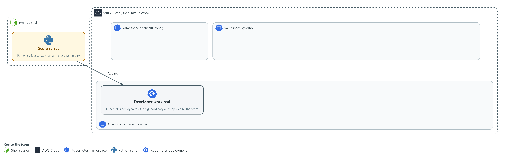

- Before any guardrail, the score script in your lab shell applies each developer workload to a new namespace, gr-before. You save the script and measure this baseline.

#### 1a. Save the score script

You will now make score.py in a folder for this module.

- Paste the whole block at once.
- The only output is the line count.

```bash
mkdir -p /workspace/cps-5
cd /workspace/cps-5
cat > score.py <<'EOF'
import glob, json, os, subprocess, sys

NS, DIR = sys.argv[1], sys.argv[2]

def run(*args):
    return subprocess.run(["oc", *args], capture_output=True, text=True)

def compliant(spec):
    def safe(c):
        sc = c.get("securityContext", {})
        return (sc.get("allowPrivilegeEscalation") is False
                and "ALL" in sc.get("capabilities", {}).get("drop", [])
                and c.get("resources", {}).get("limits", {}).get("memory"))
    return (not spec.get("hostNetwork")
            and spec.get("securityContext", {}).get("runAsNonRoot") is True
            and all(safe(c) for c in spec["containers"]))

def first_try(path):
    if run("apply", "-n", NS, "-f", path).returncode:
        return False
    name = os.path.basename(path)[:-5]
    out = run("get", "deployment", name, "-n", NS, "-o", "json").stdout
    return compliant(json.loads(out)["spec"]["template"]["spec"])

ordinary = sorted(glob.glob(DIR + "/ok-*.yaml"))
unsafe = sorted(glob.glob(DIR + "/bad-*.yaml"))
passed = sum(first_try(p) for p in ordinary)
refused = sum(bool(run("apply", "-n", NS, "-f", p).returncode) for p in unsafe)
print(f"ordinary workloads that passed first try: {passed} of {len(ordinary)} ({100 * passed // len(ordinary)} percent)")
print(f"manual edits needed: {len(ordinary) - passed}")
print(f"unsafe workloads refused: {refused} of {len(unsafe)}")
EOF
wc -l score.py
```

**Expected output:**

```
Example only. The count is the number of lines you pasted.
31 score.py
```

| Part | What it does | Why you run it |
| --- | --- | --- |
| mkdir -p ... && cd ... | Makes the folder for this module if it is not there and moves into it. The folder persists between lab sessions. | Every block starts in the folder that holds its files, so it works on its own. |
| cat > score.py <<'EOF' ... EOF | Writes everything between the first line and the line EOF into score.py. The quotes around EOF keep every dollar sign and bracket exactly as typed. | You need no editor: one paste makes the whole file. |
| NS, DIR = sys.argv[1], sys.argv[2] | The namespace to test and the folder of test workloads, both given on the command line. | The same script runs again in Step 5 on other namespaces, so these come from the command line. |
| def run(*args) | Runs oc with the given arguments and keeps the answer. | One helper runs every oc command, so the rest of the script stays short. |
| def compliant(spec) | The baseline in code: not host network, runs as non-root, no privilege escalation, all capabilities dropped, a memory limit on every container. | Writing the baseline as code makes it exact, and the same test measures before and after. |
| def first_try(path) | Applies one workload. It counts only if it is accepted and the stored workload meets the baseline, with no edit by a person. | A workload counts only if no person had to edit it, which is the measure this module is about. |
| glob(DIR + "/ok-*.yaml") | The ordinary workloads. The unsafe ones start with bad. | Separating the two sets lets the script measure two different goals. |
| passed = sum(...) | How many ordinary workloads passed first try. | This number should rise after the guardrails. |
| refused = sum(...) | How many unsafe workloads the cluster refused. | This number should reach every unsafe workload, because none of them should ever get in. |
| manual edits needed | The ordinary workloads that a person would have had to fix. | Turns the result into the work a developer would have had to do by hand. |

#### 1b. Fetch the twelve workloads and measure the baseline

You will now copy the twelve supplied workloads into a folder, make a namespace the ordinary way, and run your score script on it.

- Run this block before the guardrails exist: after Step 4 the numbers would differ.

```bash
mkdir -p /workspace/cps-5 && cd /workspace/cps-5
mkdir -p corpus
oc extract configmap/workload-corpus -n guardrails-lab --to=corpus --confirm
oc get project gr-before >/dev/null 2>&1 || oc new-project gr-before
python3 score.py gr-before corpus
oc get resourcequota,networkpolicy -n gr-before -o name | wc -l
```

**Expected output:**

```
Example only. The extract step prints one file name per workload.
(twelve file names, ok-*.yaml and bad-*.yaml)
Now using project "gr-before" on server "<api url>".
(more advice lines from oc)
ordinary workloads that passed first try: 2 of 8 (25 percent)
manual edits needed: 6
unsafe workloads refused: 0 of 4
0
```

| Part | What it does | Why you run it |
| --- | --- | --- |
| mkdir -p ... && cd ... | Makes the folder for this module if it is not there and moves into it. The folder persists between lab sessions. | Every block starts in the folder that holds its files, so it works on its own. |
| oc extract configmap/workload-corpus --to=corpus --confirm | Writes the twelve supplied workloads into the corpus folder. --confirm lets it overwrite files from an earlier run. | The twelve test workloads are supplied, so every learner is measured on the same set. |
| oc get project gr-before ... \|\| oc new-project gr-before | Makes the namespace only if it is not there yet, so the block can run twice. | A namespace made the ordinary way shows what a developer gets with no guardrails. |
| python3 score.py gr-before corpus | Runs your script. | Gives the before numbers you compare against in Step 5. |
| ... \| wc -l | Counts the protection objects the namespace got on its own. | Counts what the platform added by itself. Zero shows nothing is inherited yet. |

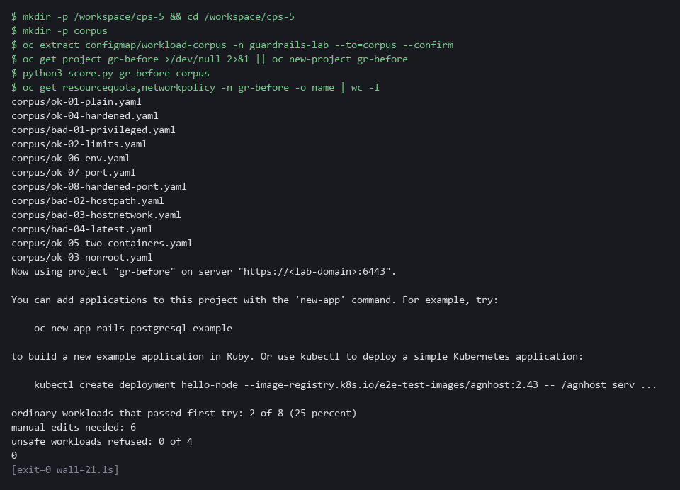

> **YOUR TURN:** Paste the first block to make score.py, then run the second block. Read all four numbers.

> **CHECKPOINT:** Two of eight ordinary workloads pass first try (25 percent), six edits are needed, no unsafe workload is refused, and the object count is 0.

> **TAKEAWAY:** Read all four numbers: they show the namespace has no guardrails yet.

**How this meets the control**

- **CM-2:** The score script holds the baseline as code. Running it on a namespace with no guardrails gives the before numbers that Step 5 is compared with.

### Step 2. Build the project template (CM-2 Baseline Configuration, SC-6 Resource Availability)

**Learning point: Adding a quota to the default project template and naming it in the cluster setting makes every new project request carry a resource cap.**

- OpenShift builds a new namespace from a project request template.
- Start from the default project request template and add a quota.
- The template is inactive until a cluster setting names it, which restarts the API server; Steps 3 and 4 do not wait for it.

What this step adds (thick lines and outlines are new):

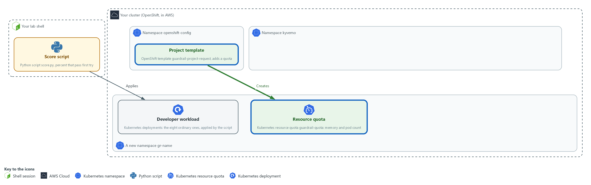

- A project template saved in the namespace openshift-config adds a quota to every namespace made with a project request.

#### 2a. Save the quota file

You will now make quota.yaml in the folder for this module.

- Paste the whole block at once.
- The text ${PROJECT_NAME} is typed as it is: OpenShift fills it in for each new project.

```bash
mkdir -p /workspace/cps-5
cd /workspace/cps-5
cat > quota.yaml <<'EOF'
apiVersion: v1
kind: ResourceQuota
metadata:
  name: guardrail-quota
  namespace: ${PROJECT_NAME}
spec:
  hard:
    pods: "10"
    requests.memory: 1Gi
    limits.memory: 2Gi
EOF
wc -l quota.yaml
```

**Expected output:**

```
Example only.
10 quota.yaml
```

| Part | What it does | Why you run it |
| --- | --- | --- |
| mkdir -p ... && cd ... | Makes the folder for this module if it is not there and moves into it. The folder persists between lab sessions. | Every block starts in the folder that holds its files, so it works on its own. |
| cat > quota.yaml <<'EOF' ... EOF | Writes everything between the first line and the line EOF into quota.yaml. The quotes around EOF keep every dollar sign and bracket exactly as typed. | You need no editor: one paste makes the whole file. |
| kind: ResourceQuota ... hard | A cap on pods and total memory for the whole namespace. The lab chooses the values. | A quota is the first protection the template carries, so every new project starts with a cap. |
| namespace: ${PROJECT_NAME} | A template parameter (a placeholder). OpenShift fills in the name of the new namespace. | One template serves every project, so the name has to be filled in for each. |

#### 2b. Build the template and switch it on

You will now build the project template from the default one plus your quota, save it, and tell the cluster to use it.

```bash
cd /workspace/cps-5
oc adm create-bootstrap-project-template -o json > template.json
oc create --dry-run=client -f quota.yaml -o json > quota.json
jq --slurpfile q quota.json '.metadata.name = "guardrail-project-request" | .objects += $q' template.json > guardrail-template.json
oc apply -n openshift-config -f guardrail-template.json
oc patch project.config.openshift.io cluster --type=merge -p '{"spec":{"projectRequestTemplate":{"name":"guardrail-project-request"}}}'
```

**Expected output:**

```
Example only. Three of the commands save to files and print nothing. On a second run the template shows configured, not created.
template.template.openshift.io/guardrail-project-request created
project.config.openshift.io/cluster patched
```

| Part | What it does | Why you run it |
| --- | --- | --- |
| cd ... | Moves into the module folder, where quota.yaml is. | Every block starts in the folder that holds its files, so it works on its own. |
| oc adm create-bootstrap-project-template -o json | Prints the default template as JSON. | Starts from the default template, so everything OpenShift normally adds is kept. |
| oc create --dry-run=client -f quota.yaml -o json | Turns your quota file into JSON without saving it. | The template is JSON, so the quota is turned into the same form to be added to it. |
| jq --slurpfile q quota.json '... .objects += $q' | Renames the template and adds your quota to its list of objects. | Joins your quota to the default template and gives it a new name, so the original stays unchanged. |
| oc apply -n openshift-config | Saves the template. OpenShift reads templates for projects from this namespace. | The cluster looks for the project template in this namespace, so it has to be saved here. |
| oc patch project.config.openshift.io cluster | Tells the cluster to use your template for every new project. It also starts the API server restart that picks up the change. Carry on with Step 3 while it runs. | Saving the template does nothing alone. This setting makes new projects use it. |

> **SECURITY:** This setting is cluster-wide. Every new project, in the lab or not, gets the quota until you reset this module with the lab reset command.

> **YOUR TURN:** Paste the first block to make quota.yaml, then run the second block.

> **CHECKPOINT:** The apply command prints that the template was created, and the patch command prints that the cluster setting was patched. The API server keeps restarting in the background.

> **TAKEAWAY:** The API server restarts when you name the template; Steps 3 and 4 do not need it, and Step 5 waits for it.

**How this meets the controls**

- **CM-2:** The project template is part of the baseline for every project request, kept as a file that can go into version control.
- **SC-6:** The quota in the template caps pods and memory, so every new project inherits a limit.

### Step 3. Generate default-deny and a fallback quota with Kyverno (SC-7 Boundary Protection, SC-6 Resource Availability)

**Learning point: Two Kyverno generate policies give every new gr- namespace a default-deny rule that repairs itself when deleted, and a fallback quota for namespaces that skipped the template.**

- A template runs only for project requests; a namespace made any other way misses it.
- Kyverno generate policies run for every namespace.
- The default-deny here uses synchronize on, so a deletion is undone.

What this step adds (thick lines and outlines are new):

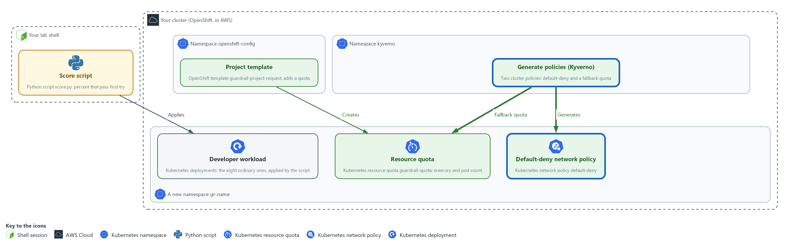

- Kyverno generate policies add the default-deny rule to every new gr- namespace, and the quota to ones that bypass the template.

#### 3a. Read the extra permission for Kyverno

You will now read the cluster role that lab start put in your module folder as kyverno-rbac.yaml.

- The role lets the Kyverno service that creates objects manage network policies and quotas, and nothing else.

```bash
cd /workspace/cps-5
cat kyverno-rbac.yaml
```

**Expected output:**

```
Example only. The file as supplied, 13 lines. The first lines:
apiVersion: rbac.authorization.k8s.io/v1
kind: ClusterRole
metadata:
  name: gr-kyverno-generate
(the rest of the file)
```

| Part | What it does | Why you run it |
| --- | --- | --- |
| cd ... | Moves into the module folder, where kyverno-rbac.yaml is. | Every block starts in the folder that holds its files, so it works on its own. |
| cat kyverno-rbac.yaml | Prints the file. | You read what you are about to give Kyverno before you apply it. |
| rbac.kyverno.io/aggregate-to-background-controller | A label that adds this role's rules to the Kyverno service that creates objects. | The Kyverno service that creates objects needs these rights, and the label is how the extra role reaches it. |
| networkpolicies, resourcequotas | Only the two kinds the policies generate. No wildcard. | Rights only for what the policies generate, so Kyverno gets nothing it does not need. |
| verbs | Six named verbs. Creating, reading, changing and removing, so synchronize can repair an object. | Synchronize deletes and updates objects to repair them, so those verbs are needed as well as create. |

#### 3b. Save the default-deny policy

You will now make generate-deny.yaml in the folder for this module.

- Paste the whole block at once.

```bash
mkdir -p /workspace/cps-5
cd /workspace/cps-5
cat > generate-deny.yaml <<'EOF'
apiVersion: kyverno.io/v1
kind: ClusterPolicy
metadata:
  name: gr-generate-deny
spec:
  rules:
    - name: default-deny
      match:
        any:
          - resources: {kinds: ["Namespace"], names: ["gr-*"]}
      generate:
        apiVersion: networking.k8s.io/v1
        kind: NetworkPolicy
        name: default-deny
        namespace: "{{request.object.metadata.name}}"
        synchronize: true
        data:
          spec:
            podSelector: {}
            policyTypes: ["Ingress", "Egress"]
EOF
wc -l generate-deny.yaml
```

**Expected output:**

```
Example only.
20 generate-deny.yaml
```

| Part | What it does | Why you run it |
| --- | --- | --- |
| mkdir -p ... && cd ... | Makes the folder for this module if it is not there and moves into it. The folder persists between lab sessions. | Every block starts in the folder that holds its files, so it works on its own. |
| cat > generate-deny.yaml <<'EOF' ... EOF | Writes everything between the first line and the line EOF into generate-deny.yaml. The quotes around EOF keep every dollar sign and bracket exactly as typed. | You need no editor: one paste makes the whole file. |
| names: ["gr-*"] | Scopes the policy to namespaces whose name starts with gr-, so the rest of the lab is untouched. | Keeps the lab policies away from the rest of the cluster. |
| generate ... kind: NetworkPolicy | Creates a default-deny network policy in the new namespace. | This is how every new namespace gets a closed network baseline, however it was made. |
| {{request.object.metadata.name}} | The name of the namespace that triggered the policy. | One policy serves every namespace, so the target namespace is taken from the request. |
| synchronize: true | If anyone deletes or edits the generated policy, Kyverno puts it back. | Default-deny must never be removed, so it is put back if deleted. |

#### 3c. Save the fallback quota policy

You will now make generate-quota.yaml in the folder for this module.

- Paste the whole block at once.

```bash
mkdir -p /workspace/cps-5
cd /workspace/cps-5
cat > generate-quota.yaml <<'EOF'
apiVersion: kyverno.io/v1
kind: ClusterPolicy
metadata:
  name: gr-generate-quota
spec:
  rules:
    - name: quota-without-template
      match:
        any:
          - resources: {kinds: ["Namespace"], names: ["gr-*"]}
      exclude:
        any:
          - resources: {annotations: {openshift.io/requester: "?*"}}
      generate:
        apiVersion: v1
        kind: ResourceQuota
        name: guardrail-quota
        namespace: "{{request.object.metadata.name}}"
        synchronize: false
        data:
          spec:
            hard: {pods: "10", requests.memory: 1Gi, limits.memory: 2Gi}
EOF
wc -l generate-quota.yaml
```

**Expected output:**

```
Example only.
22 generate-quota.yaml
```

| Part | What it does | Why you run it |
| --- | --- | --- |
| mkdir -p ... && cd ... | Makes the folder for this module if it is not there and moves into it. The folder persists between lab sessions. | Every block starts in the folder that holds its files, so it works on its own. |
| cat > generate-quota.yaml <<'EOF' ... EOF | Writes everything between the first line and the line EOF into generate-quota.yaml. The quotes around EOF keep every dollar sign and bracket exactly as typed. | You need no editor: one paste makes the whole file. |
| exclude ... openshift.io/requester | Skips namespaces that came through a project request, which the template already covers. | Namespaces from a project request already got a quota from the template. Skipping them avoids two quotas. |
| synchronize: false | The quota is created once, so a team can ask to change it through a reviewed change. | A team may need a different quota, so it is created once and then left alone. |
| hard: {pods, requests.memory, limits.memory} | The same caps as the template quota: ten pods and 1Gi and 2Gi of memory. | Both creation paths give the same cap. |

#### 3d. Apply the permission, prove it, then apply the generate policies

You will now apply the extra permission, ask the cluster whether Kyverno now has it, and apply the generate policies.

```bash
cd /workspace/cps-5
oc apply -f kyverno-rbac.yaml
sleep 10
oc auth can-i create networkpolicies --as=system:serviceaccount:kyverno:kyverno-background-controller -n gr-before
oc apply -f generate-deny.yaml -f generate-quota.yaml --dry-run=server
oc apply -f generate-deny.yaml -f generate-quota.yaml
oc get clusterpolicy | grep -e '^NAME' -e '^gr-'
```

**Expected output:**

```
Example only. The cluster may print a deprecation warning for ClusterPolicy. That is expected.
clusterrole.rbac.authorization.k8s.io/gr-kyverno-generate created
yes
clusterpolicy.kyverno.io/gr-generate-deny created (server dry run)
clusterpolicy.kyverno.io/gr-generate-quota created (server dry run)
(the same two lines again, without the dry run note)
(a table with the two gr- policies; the ready column says True. Policies from other modules are filtered out by grep)
```

| Part | What it does | Why you run it |
| --- | --- | --- |
| cd ... | Moves into the module folder, where the policy files are. | Every block starts in the folder that holds its files, so it works on its own. |
| oc apply -f kyverno-rbac.yaml, sleep 10 | Saves the extra permission first and gives the cluster a few seconds to add it to the Kyverno service. | The permission must exist before the policies, because Kyverno checks it when it accepts them. |
| oc auth can-i create networkpolicies --as=... | Proves the Kyverno service now has the permission. It must answer yes before you go on. | Proves the permission reached Kyverno. Applying policies without it would fail later without a clear sign. |
| --dry-run=server | Asks the cluster to check the policy file without saving it. | Catches a mistake in the policy file before it is saved. |
| oc get clusterpolicy \| grep ... | Lists the policies and whether each is ready. grep keeps the header and only the policies whose names start with gr-, because the cluster may hold policies from other modules. | Shows whether Kyverno accepted both policies. |

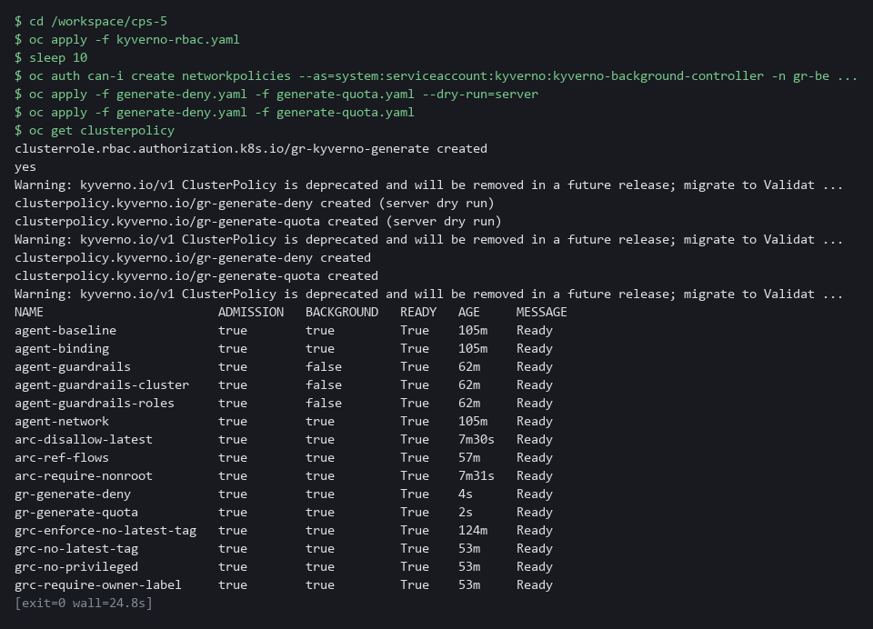

> **NOTE:** If can-i answers no, the label did not reach Kyverno on this version: do not widen the role, read the Kyverno cluster roles with oc get clusterrole | grep kyverno and use the label they carry.

> **YOUR TURN:** Read kyverno-rbac.yaml, paste the two policy files, then run the last block.

> **CHECKPOINT:** can-i answers yes, and gr-generate-deny and gr-generate-quota are listed.

> **TAKEAWAY:** Confirm Kyverno has the permission before applying the policies: a generate policy that cannot create its object fails silently.

**How this meets the controls**

- **SC-7:** The generate policy creates a default-deny network policy in every new gr- namespace and puts it back if it is deleted.
- **SC-6:** The second generate policy gives a quota to namespaces that skipped the template, so every creation path has one.

### Step 4. Mutate to safe defaults and validate against unsafe settings (CM-7 Least Functionality, SC-6 Resource Availability)

**Learning point: A mutate policy adds safe settings ordinary workloads omitted, and validate policies refuse what no default can fix, including images from unapproved registries whose allow-list you write yourself.**

- A mutate policy adds the settings a developer forgot; it never overrides a deliberate choice.
- The validate policies refuse what no default can fix, running after mutation.
- You paste the mutate and host-access policies, and write the registry allow-list from the description in 4d.

What this step adds (thick lines and outlines are new):

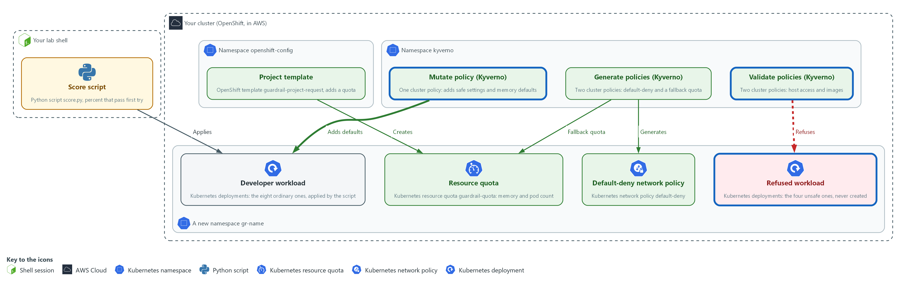

- A mutate policy adds safe settings to workloads in the gr- namespaces, and validate policies refuse unsafe ones there.

#### 4a. Save the mutate policy

You will now make mutate-safe-defaults.yaml in the folder for this module.

- Paste the whole block at once.

```bash
mkdir -p /workspace/cps-5
cd /workspace/cps-5
cat > mutate-safe-defaults.yaml <<'EOF'
apiVersion: kyverno.io/v1
kind: ClusterPolicy
metadata:
  name: gr-mutate-safe-defaults
spec:
  rules:
    - name: add-safe-defaults
      match:
        any:
          - resources: {kinds: ["Pod"], namespaces: ["gr-*"]}
      mutate:
        patchStrategicMerge:
          spec:
            securityContext:
              +(runAsNonRoot): true
              +(seccompProfile):
                type: RuntimeDefault
            containers:
              - (name): "*"
                securityContext:
                  +(allowPrivilegeEscalation): false
                  +(capabilities):
                    drop: ["ALL"]
                resources:
                  +(requests):
                    +(memory): 64Mi
                  +(limits):
                    +(memory): 256Mi
EOF
wc -l mutate-safe-defaults.yaml
```

**Expected output:**

```
Example only.
28 mutate-safe-defaults.yaml
```

| Part | What it does | Why you run it |
| --- | --- | --- |
| mkdir -p ... && cd ... | Makes the folder for this module if it is not there and moves into it. The folder persists between lab sessions. | Every block starts in the folder that holds its files, so it works on its own. |
| cat > mutate-safe-defaults.yaml <<'EOF' ... EOF | Writes everything between the first line and the line EOF into mutate-safe-defaults.yaml. The quotes around EOF keep every dollar sign and bracket exactly as typed. | You need no editor: one paste makes the whole file. |
| kinds: ["Pod"], namespaces: ["gr-*"] | Applies to pods in the covered namespaces. | Mutation happens as pods are created, so it is aimed at pods in the covered namespaces. |
| +(runAsNonRoot): true | The plus in brackets means add this setting only if it is not already there. | Fills the gap for developers who forgot, without overriding anyone who chose a value. |
| - (name): "*" | Matches every container in the pod, including a second one. | A pod may have more than one container, and each needs the same settings. |
| +(allowPrivilegeEscalation), +(capabilities) | Adds the no-escalation setting and drops every extra power. | Adds the settings the baseline code in Step 1 checks, so ordinary workloads pass first try. |
| +(requests), +(limits) | Adds default memory values, which the lab chooses, to any container that has none. | The quota refuses a container with no memory limit, so a default keeps ordinary workloads accepted. |

#### 4b. Save the host-access validate policy

You will now make validate-host-access.yaml in the folder for this module.

- Paste the whole block at once.

```bash
mkdir -p /workspace/cps-5
cd /workspace/cps-5
cat > validate-host-access.yaml <<'EOF'
apiVersion: kyverno.io/v1
kind: ClusterPolicy
metadata:
  name: gr-validate-host-access
spec:
  rules:
    - name: no-privilege-or-host-access
      match:
        any:
          - resources: {kinds: ["Pod"], namespaces: ["gr-*"]}
      validate:
        failureAction: Enforce
        message: "Privileged containers, host networking and host paths are not allowed."
        pattern:
          spec:
            =(hostNetwork): "false"
            =(volumes):
              - X(hostPath): "null"
            containers:
              - =(securityContext):
                  =(privileged): "false"
EOF
wc -l validate-host-access.yaml
```

**Expected output:**

```
Example only.
21 validate-host-access.yaml
```

| Part | What it does | Why you run it |
| --- | --- | --- |
| mkdir -p ... && cd ... | Makes the folder for this module if it is not there and moves into it. The folder persists between lab sessions. | Every block starts in the folder that holds its files, so it works on its own. |
| cat > validate-host-access.yaml <<'EOF' ... EOF | Writes everything between the first line and the line EOF into validate-host-access.yaml. The quotes around EOF keep every dollar sign and bracket exactly as typed. | You need no editor: one paste makes the whole file. |
| failureAction: Enforce | Refuse the request. Audit would only report it. | Refusing is the point. A report-only mode would let the unsafe workload start. |
| =(hostNetwork): "false" | If the field is present it must be false. The =( ) marks an optional field. | Host networking breaks the network boundary of the namespace, so it is refused. |
| X(hostPath): "null" | A volume may not have a hostPath field at all. A host path mounts a node folder into the pod. | A host path lets a pod read or change files on the node, which no default can make safe. |
| =(privileged): "false" | A container may not ask for privileged mode. | Privileged mode gives a container node-level power. |

#### 4c. Save the first part of the image policy

You will now make the first part of a policy with two rules as the file validate-images.yaml.

- The first rule, no-latest-tag, is complete: it is your model for the next block.
- The second rule, approved-registry, stops after its message, because you write its pattern yourself.
- Paste the whole block at once.

```bash
mkdir -p /workspace/cps-5
cd /workspace/cps-5
cat > validate-images.yaml <<'EOF'
apiVersion: kyverno.io/v1
kind: ClusterPolicy
metadata:
  name: gr-validate-images
spec:
  rules:
    - name: no-latest-tag
      match:
        any:
          - resources: {kinds: ["Pod"], namespaces: ["gr-*"]}
      validate:
        failureAction: Enforce
        message: "The latest tag is not allowed. Use a fixed version."
        pattern:
          spec:
            containers:
              - image: "!*:latest"
    - name: approved-registry
      match:
        any:
          - resources: {kinds: ["Pod"], namespaces: ["gr-*"]}
      validate:
        failureAction: Enforce
        message: "Images must come from the lab registry or registry.access.redhat.com."
EOF
wc -l validate-images.yaml
```

**Expected output:**

```
Example only. The count is the number of lines you pasted.
24 validate-images.yaml
```

| Part | What it does | Why you run it |
| --- | --- | --- |
| mkdir -p ... && cd ... | Makes the folder for this module if it is not there and moves into it. The folder persists between lab sessions. | Every block starts in the folder that holds its files, so it works on its own. |
| cat > validate-images.yaml <<'EOF' ... EOF | Writes everything between the first line and the line EOF into validate-images.yaml. The quotes around EOF keep every dollar sign and bracket exactly as typed. | You need no editor: one paste makes the whole file. |
| image: "!*:latest" | Refuses any image (the packaged files a container starts from) whose name ends in :latest, a tag that moves to whatever was pushed last. | A moving tag means you cannot say which version is running, so a fixed version is required. Its shape is the model for your rule. |
| - name: approved-registry ... message | The start of the second rule: which pods it covers, that it refuses, and the message a developer reads. The pattern is missing on purpose. | You write the part that decides which registries are allowed. |

#### 4d. Your turn: write the registry allow-list

You will now write the rest of the approved-registry rule: its pattern, the shape that an image name must match.

- The rule must admit an image whose name starts with ${REGISTRY_HOST}/ or with registry.access.redhat.com/.
- The rule must refuse every other registry.
- The rule must also refuse a name such as registry.access.redhat.com.example.org, which only starts with the approved name, and a name with no registry at all.
- The rule must check init containers (containers that run first, before the main ones) as well as containers.
- The no-latest-tag rule above is your model: same shape, different value.
- For init containers, use the =( ) form you met as =(hostNetwork) in the host-access policy, which checks the field only if the pod has it.
- In an image pattern, a star matches any run of characters and a bar means or.
- Type ${REGISTRY_HOST} exactly as written, because the apply block in 4f fills it in.
- Type this block yourself instead of pasting it, and put your own lines where the comment is.
- Do not open the folder reference until you have tried and run the check.
- Type the two lines that start with cd and cat, then press Enter after the cat line.
- Type your lines using spaces only, with the word pattern: in the same column as pattern: in the no-latest-tag rule.
- Finish your lines with a line that says EOF alone.
- Run the check in the next block. To start over, paste the block before this one again: it makes the file from scratch.

```bash
cd /workspace/cps-5
cat >> validate-images.yaml <<'EOF'
# Type your pattern lines here, then delete this line.
EOF
```

**Expected output:**

```
Example only. Nothing is printed. Your lines are now at the end of validate-images.yaml.
```

| Part | What it does | Why you run it |
| --- | --- | --- |
| cd ... | Moves into the module folder, where validate-images.yaml is. | Every block starts in the folder that holds its files, so it works on its own. |
| cat >> validate-images.yaml <<'EOF' | Adds the lines you type to the end of the file, up to the line EOF. Two arrows add to the file instead of replacing it. | Your rule continues the file the previous block made. |
| # Type your pattern lines here ... | A comment that stands where your lines go. A comment does nothing in YAML, so if you leave it, the rule has no pattern and the check says so. | It marks the gap that is yours to fill. |

#### 4e. Check your rule against six image names

You will now run a supplied script, placed in your folder by lab start.

- The script reads your rule and tests six image names against it, without touching the cluster.
- If a line says BAD, change your lines and try again.
- If the script says it cannot find the rule, validate-images.yaml is probably empty: paste the first block again.

```bash
cd /workspace/cps-5
python3 check-registry.py validate-images.yaml
```

**Expected output:**

```
Example only. The second image name begins with your own registry name.
allow  admitted ok  registry.access.redhat.com/ubi9/ubi-minimal:9.5
allow  admitted ok  <REGISTRY_HOST>/team/app:1.0
refuse refused  ok  docker.io/library/busybox:1.36
refuse refused  ok  quay.io/team/app:1.0
refuse refused  ok  registry.access.redhat.com.example.org/app:1.0
refuse refused  ok  busybox:1.36
samples handled as expected: 6 of 6
```

| Part | What it does | Why you run it |
| --- | --- | --- |
| cd ... | Moves into the module folder, where check-registry.py is. | Every block starts in the folder that holds its files, so it works on its own. |
| python3 check-registry.py validate-images.yaml | Finds the approved-registry rule in your file, reads its image pattern and tests six names. | You see at once whether your pattern admits what it should and refuses what it should, before anything reaches the cluster. |
| allow ... admitted ok | A name that must be admitted, and it was. | The positive check: the allow-list does not block the registries you approved. |
| refuse ... refused ok | A name that must be refused, and it was. | The negative check: the third and fourth are other registries, the fifth only looks like an approved one, the sixth has no registry. |
| samples handled as expected: 6 of 6 | The total. Any other number means a line above says BAD. | Do not apply the policy until this says 6 of 6. |
| Problem: ... | Printed if the rule does not check both init containers and containers, or the two image lines differ. | The spec asks for both, with the same allow-list. |

#### 4f. Apply the mutate and validate policies

You will now fill in the registry name, check the three policies with a dry run, apply them, list all policies, and read your approved-registry pattern back from the cluster.

```bash
cd /workspace/cps-5
envsubst '${REGISTRY_HOST}' < validate-images.yaml > validate-images-ready.yaml
oc apply -f mutate-safe-defaults.yaml -f validate-host-access.yaml -f validate-images-ready.yaml --dry-run=server
oc apply -f mutate-safe-defaults.yaml -f validate-host-access.yaml -f validate-images-ready.yaml
oc get clusterpolicy | grep -e '^NAME' -e '^gr-'
oc get clusterpolicy gr-validate-images -o jsonpath='{.spec.rules[1].validate.pattern}{"\n"}'
```

**Expected output:**

```
Example only.
clusterpolicy.kyverno.io/gr-mutate-safe-defaults created (server dry run)
clusterpolicy.kyverno.io/gr-validate-host-access created (server dry run)
clusterpolicy.kyverno.io/gr-validate-images created (server dry run)
(the same three lines again, without the dry run note)
(a table with the five gr- policies; the ready column says True. Policies from other modules are filtered out by grep)
(your approved-registry pattern, as the cluster stored it)
```

| Part | What it does | Why you run it |
| --- | --- | --- |
| cd ... | Moves into the module folder, where the policy files are. | Every block starts in the folder that holds its files, so it works on its own. |
| envsubst '${REGISTRY_HOST}' < validate-images.yaml > validate-images-ready.yaml | Writes a copy of the file with the registry name filled in. Naming the one variable keeps envsubst from touching anything else. | The policy needs the real registry name, and the lab variable holds it. |
| -f mutate-safe-defaults.yaml -f validate-host-access.yaml -f validate-images-ready.yaml | Applies the mutate policy and the two validate policies. | Applies the three policies together after a dry run has checked them. |
| oc get clusterpolicy gr-validate-images -o jsonpath=... | Prints the pattern of the second rule, the one you wrote, as the cluster stored it. | Proves the rule running in the cluster is yours and not only a file in your folder. |
| oc get clusterpolicy \| grep ... | Lists all five gr- policies (grep hides policies from other modules). Each should show ready. | Shows that all five policies, the two generate policies and these three, are accepted. |

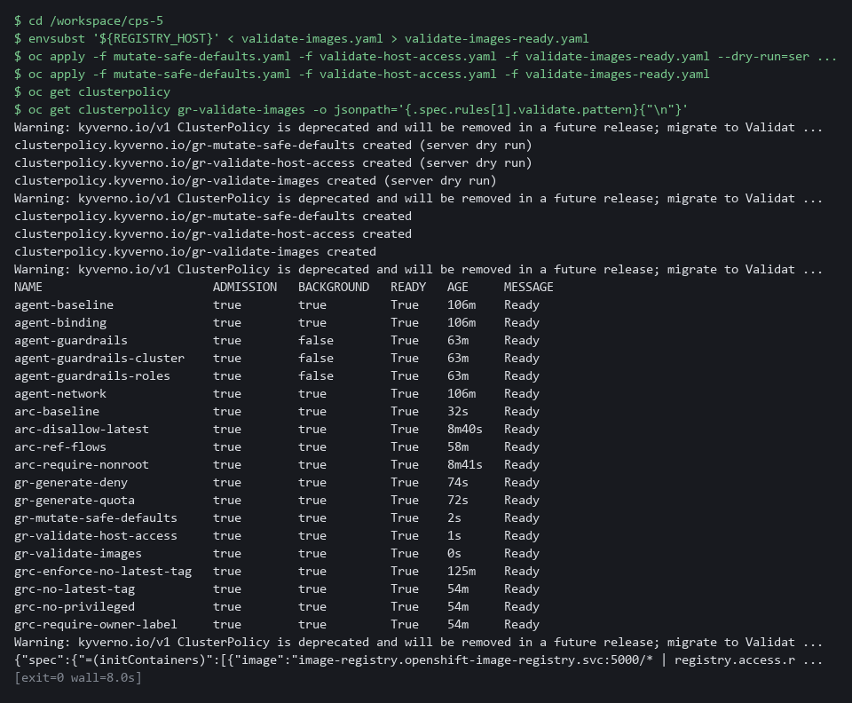

#### 4g. Compare your rule with the reference answer

You will now compare your rule with the finished one that lab start placed in the folder reference, after your own rule has passed the check and been applied.

- A difference is not a fault if your check said 6 of 6: for example, the two names can be in the other order.

```bash
cd /workspace/cps-5
diff validate-images.yaml reference/validate-images-answer.yaml && echo same as the reference
```

**Expected output:**

```
Example only. If your file is the same, only the last line prints. Otherwise diff prints the lines that differ, marked < for yours and > for the reference.
same as the reference
```

| Part | What it does | Why you run it |
| --- | --- | --- |
| cd ... | Moves into the module folder, where validate-images.yaml and the folder reference are. | Every block starts in the folder that holds its files, so it works on its own. |
| diff validate-images.yaml reference/validate-images-answer.yaml | Compares the two files line by line and prints only the lines that differ. It prints nothing and succeeds when they are the same. | Shows what you did differently, so you can judge whether it is a mistake or a different valid choice. |
| && echo same as the reference | Prints the words only when diff found no difference. | A clear sign that you matched the reference. |

> **TIP:** Run a new validate policy in Audit mode first in a real environment, so you count what it would refuse before it refuses anything. This module checks the registry name only; checking a signature needs a signed image and a key, which the lab does not provide.

> **YOUR TURN:** Paste the first three blocks (mutate-safe-defaults.yaml, validate-host-access.yaml and the first part of validate-images.yaml). Then type the registry allow-list yourself, run the check until it says 6 of 6, apply the policies, and last compare with the reference.

> **CHECKPOINT:** Your check printed 6 of 6, five policies are listed and ready, and you have compared your rule with the reference.

> **TAKEAWAY:** Run the check-registry script until it says 6 of 6 before applying the policy.

**How this meets the controls**

- **CM-7:** The validate policies refuse privileged containers, host networking, host paths and the latest tag, and the allow-list you write refuses images from unapproved registries.
- **SC-6:** The mutate policy adds default memory requests and limits, so the quota accepts ordinary workloads.

### Step 5. Measure again on both creation paths (CM-2 Baseline Configuration, CM-7 Least Functionality, SC-7 Boundary Protection)

**Learning point: Running the same score script on a project-request namespace and a directly made one shows whether the guardrails work on every creation path.**

- Run the same script on two new namespaces: one made with a project request and one made directly.
- A direct namespace skips the template, so only Kyverno protects it.

What this step adds (thick lines and outlines are new):

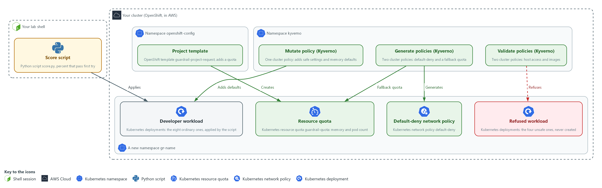

- You run the same score script from your lab shell again on two new namespaces, one for each creation path, and compare with Step 1.

#### 5a. Make two new namespaces and measure both

You will now wait for the API server restart to finish, make one namespace with a project request and one directly, and run your score script on each.

```bash
cd /workspace/cps-5
sleep 30
oc wait clusteroperator/openshift-apiserver --for=condition=Progressing=False --timeout=10m
oc get project gr-after >/dev/null 2>&1 || oc new-project gr-after
oc get namespace gr-direct >/dev/null 2>&1 || oc create namespace gr-direct
sleep 15
for ns in gr-after gr-direct; do echo "== $ns"; python3 score.py $ns corpus; oc get resourcequota,networkpolicy -n $ns -o name | wc -l; done
```

**Expected output:**

```
Example only.
clusteroperator.config.openshift.io/openshift-apiserver condition met
Now using project "gr-after" on server "<api url>".
namespace/gr-direct created
== gr-after
ordinary workloads that passed first try: 8 of 8 (100 percent)
manual edits needed: 0
unsafe workloads refused: 4 of 4
2
== gr-direct
ordinary workloads that passed first try: 8 of 8 (100 percent)
manual edits needed: 0
unsafe workloads refused: 4 of 4
2
```

| Part | What it does | Why you run it |
| --- | --- | --- |
| cd ... | Moves into the module folder, where score.py and the corpus folder are. | Every block starts in the folder that holds its files, so it works on its own. |
| sleep 30, oc wait ... Progressing=False | The API server restart that Step 2 started must be finished, or the new project could be built from the old template. The pause lets the restart start if it has not yet; by now it has usually finished and the wait returns at once. | A project made before the restart finishes could miss the template, which would spoil the comparison. |
| oc get project gr-after ... \|\| oc new-project gr-after | A namespace through a project request, made only if it is not there yet. The template adds the quota, and Kyverno adds default-deny. | Tests the project request path, where the template and Kyverno both act. |
| oc get namespace gr-direct ... \|\| oc create namespace gr-direct | A namespace with no project request, made only if it is not there yet. Kyverno adds both. | Tests the path that skips the template, where only Kyverno protects. |
| sleep 15 | Gives Kyverno time to create the objects. | Generation is not instant, and counting too early would show zero. |
| for ns in ...; do ... done | Runs the same score and the same object count on each namespace. | Using the same script on both paths makes the numbers comparable with each other and with Step 1. |

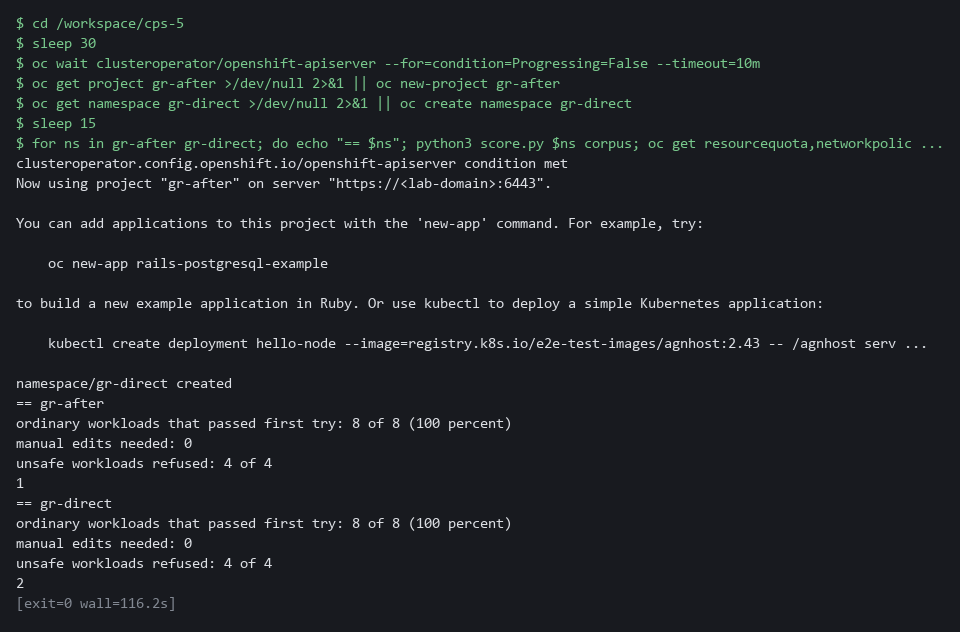

> **YOUR TURN:** Run the commands and read each line.

> **CHECKPOINT:** In both namespaces: 8 of 8 ordinary workloads pass first try (100 percent), 0 manual edits, 4 of 4 unsafe workloads refused, and 2 protection objects were created by the platform.

> **TAKEAWAY:** Read all four numbers from each namespace: both creation paths are protected.

**How this meets the controls**

- **CM-2:** The same score script runs on a project-request namespace and a directly made one, and the numbers are compared with Step 1.
- **CM-7:** The script applies the four unsafe workloads to each namespace and counts the refusals.
- **SC-7:** The object count shows that a default-deny rule exists on both creation paths.

## Section 4. Verify It Works

### Test 1 (positive). An unsafe workload is refused with a clear message (CM-7 Least Functionality)

- The score script hides the refusal text, so you read it once here.
- The workload asks for the host network, so only the validate policy stands in the way.

```bash
cd /workspace/cps-5
oc apply -n gr-after -f corpus/bad-03-hostnetwork.yaml
oc get deployment bad-03-hostnetwork -n gr-after
```

**Expected output:**

```
Example only. The wording differs between releases. A warning that the pod would violate PodSecurity baseline (hostNetwork=true) may print first. It is only a warning; the Kyverno refusal below is the one that stops the request.
Error from server: error when creating "corpus/bad-03-hostnetwork.yaml": admission webhook "validate.kyverno.svc-fail" denied the request:
resource Deployment/gr-after/bad-03-hostnetwork was blocked due to the following policies
gr-validate-host-access:
  autogen-no-privilege-or-host-access: 'validation error: Privileged containers, host networking and host paths are not allowed. rule autogen-no-privilege-or-host-access failed at path /spec/template/spec/hostNetwork/'
Error from server (NotFound): deployments.apps "bad-03-hostnetwork" not found
```

| Part | What it does | Why you run it |
| --- | --- | --- |
| cd ... | Moves into the module folder, where the corpus folder is. | The block works on its own. |
| oc apply -n gr-after -f corpus/bad-03-... | Tries to create the workload that asks for the node's network. | Only the validate policy stands in the way, so a refusal proves it works. |
| denied the request ... gr-validate-host-access | The message names the policy and the rule that refused it. | A refusal that names its rule can be understood and fixed. |
| NotFound | The workload does not exist afterward. | Proves the refusal left nothing behind. |

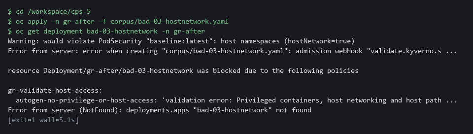

> **CHECKPOINT:** The request is refused with the policy message, and the workload does not exist afterward.

**How this meets the control**

- **CM-7:** The refusal message names the policy, and the missing workload shows nothing was saved.

### Test 2 (negative). A deleted default-deny comes back, a deleted quota does not (SC-7 Boundary Protection, SC-6 Resource Availability)

- You delete the generated default-deny in the direct namespace and the template quota in the project namespace.
- A synchronized object is repaired and an object created once is not, which is the trade-off chosen in Steps 2 and 3.

```bash
oc delete networkpolicy default-deny -n gr-direct
oc delete resourcequota guardrail-quota -n gr-after
sleep 15
oc get networkpolicy -n gr-direct -o name
oc get resourcequota -n gr-after -o name | wc -l
```

**Expected output:**

```
Example only. The two delete commands also print a deleted line each.
networkpolicy.networking.k8s.io/default-deny
0
```

| Part | What it does | Why you run it |
| --- | --- | --- |
| oc delete networkpolicy default-deny -n gr-direct | Deletes the generated rule in the directly made namespace. | The generate policy has synchronize on, so Kyverno should put it back. |
| oc delete resourcequota guardrail-quota -n gr-after | Deletes the template quota in the project-request namespace. | The template runs once, so nothing should put this back. |
| sleep 15 | Gives Kyverno time to repair. | Repair is not instant. |
| networkpolicy.networking.k8s.io/default-deny | The deleted rule is back. | Proves the closed baseline repairs itself. |
| 0 | No quota exists in gr-after. | Shows the cost of a quota a team can ask to change. |

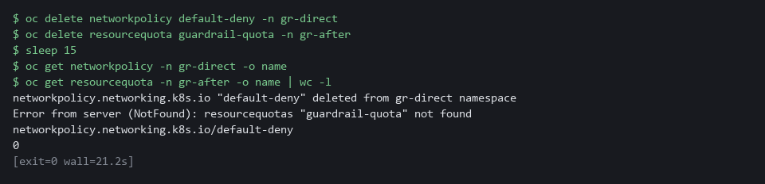

> **CHECKPOINT:** The default-deny is back, and the quota count is 0. The quota stays deleted, which is the cost of making it editable. A team that must not lose its quota can move it to a synchronized generate rule; a quota change then needs a policy change.

**How this meets the controls**

- **SC-7:** A deleted default-deny comes back, which shows the closed baseline repairs itself.
- **SC-6:** A deleted template quota stays deleted, which is the trade-off chosen so a team can ask to change it.

### Test 3 (negative). An image from an unapproved registry is refused, one from an approved registry is admitted (CM-7 Least Functionality)

- The approved image must be admitted and the unapproved one refused by the registry rule.
- The allowed and blocked deployments both use fixed tags and zero replicas, so the tag rule cannot be the reason and nothing is pulled.

```bash
oc create deployment allowed-web -n gr-after --image=registry.access.redhat.com/ubi9/ubi-minimal:9.5 --replicas=0
oc create deployment blocked-web -n gr-after --image=docker.io/library/busybox:1.36 --replicas=0
oc get deployment allowed-web -n gr-after -o name
oc get deployment blocked-web -n gr-after -o name
oc delete deployment allowed-web -n gr-after --ignore-not-found
```

**Expected output:**

```
Example only. The wording differs between releases.
deployment.apps/allowed-web created
error: failed to create deployment: admission webhook "validate.kyverno.svc-fail" denied the request:
resource Deployment/gr-after/blocked-web was blocked due to the following policies
gr-validate-images:
  autogen-approved-registry: 'validation error: Images must come from the lab registry or registry.access.redhat.com. ...'
deployment.apps/allowed-web
Error from server (NotFound): deployments.apps "blocked-web" not found
deployment.apps "allowed-web" deleted
```

| Part | What it does | Why you run it |
| --- | --- | --- |
| oc create deployment allowed-web ... --image=registry.access.redhat.com/... | Creates a workload with no running copies whose image comes from an approved registry. | The registry rule must let an approved name through, or it is too tight. |
| oc create deployment blocked-web ... --image=docker.io/... | Creates a workload whose image comes from a public registry. The tag is fixed, so only the registry rule can refuse it. | Shows the allow-list refuses what is not on it. |
| gr-validate-images ... autogen-approved-registry | The message names the policy and the rule. | Proves the registry rule did the refusing, not the tag rule. |
| oc delete deployment allowed-web | Removes the test workload. | Leaves the namespace as it was, and makes the test safe to run twice. |

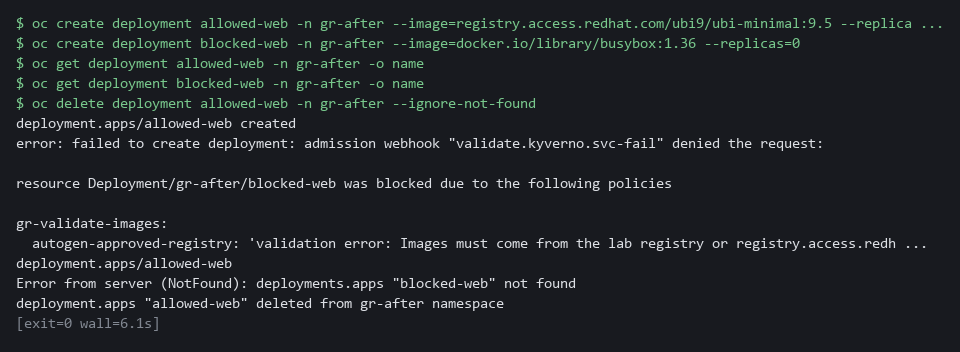

> **CHECKPOINT:** allowed-web is created and blocked-web is refused with a message that names gr-validate-images and the approved-registry rule. blocked-web does not exist afterward. If blocked-web is admitted, the registry rule is not in force: run oc get clusterpolicy gr-validate-images and read its status.

**How this meets the control**

- **CM-7:** The approved image is admitted and the public one is refused with a message that names the policy.

## Section 5. What Each Control Is For

### Control mapping

| Control | What it requires, in plain words | Tool or service | Where this module covers it |
| --- | --- | --- | --- |
| CM-2 Baseline Configuration | Develop, document and keep a current baseline under configuration control, and review and update it. | The OpenShift project request template and Kyverno policies, measured by the score script. Explained in sections 2.1 and 2.2. | Section 3, Steps 2 to 4: the template and policies are the baseline for every new namespace. Section 3, Steps 1 and 5: the score script measures it. |
| CM-7 Least Functionality | Provide only the capabilities the mission needs, and prohibit or restrict the use of other functions, ports, protocols and services. | Kyverno validate policies. Explained in section 2.1. | Section 3, Step 4: refuse privileged, host-access, moving-tag and unapproved-registry workloads. Section 4, Test 1: a refusal. Section 4, Test 3: an image from outside the approved registries. |
| SC-7 Boundary Protection | Control traffic at the boundaries. The quoted requirement is from the SC-7(5) enhancement: deny traffic by default and allow it only by exception. | A Kyverno generate policy that creates a Kubernetes NetworkPolicy. Explained in section 2.1. | Section 3, Step 3: generate a default-deny rule in every new namespace, after proving Kyverno has the permission it needs. Section 4, Test 2: a deleted default-deny comes back. |
| SC-6 Resource Availability | Protect the availability of resources by priority or quota. | A Kubernetes ResourceQuota from the project template or a Kyverno generate policy, and a Kyverno mutate policy for default memory values. Explained in section 2.1. | Section 3, Steps 2 and 3: give each new namespace a quota. Section 3, Step 4: add default memory values to every container. Section 4, Test 2: a deleted quota is not restored. |

### What each control is for

Each table below says what the control is trying to prevent and how this module's tool meets it.

#### CM-2 Baseline Configuration

| Question | Answer |
| --- | --- |
| Control Intent | Each team builds its namespaces its own way, so nobody can say what the baseline is or whether a new namespace matches it. |
| The operational question | What does a new namespace look like on its first minute, and what would show that it drifted? |
| What evidence proves it | The template and policy files in version control, and the score and object counts for a freshly made namespace. |
| How much is enough | The baseline is code, it is applied automatically, and its effect is measured. NIST leaves the review frequency to the organization. |
| How the tool in this module satisfies it | A project template and five ClusterPolicy objects, which are the object type Kyverno uses for one policy (Steps 2 to 4), and a score script (Steps 1 and 5). |

#### CM-7 Least Functionality

| Question | Answer |
| --- | --- |
| Control Intent | A developer in a hurry asks for node-level power or host access, and nothing stops the request. |
| The operational question | What happens to a workload that asks for more than it should, and does an ordinary workload still get through without edits? |
| What evidence proves it | Counts from the score script for ordinary and unsafe workloads, before and after. |
| How much is enough | Unsafe requests are refused by the cluster and ordinary ones pass first try. The organization defines which capabilities are mission essential. |
| How the tool in this module satisfies it | A mutate policy that adds safe settings, and two validate policies that refuse unsafe ones, including the registry allow-list you write yourself for images from outside the approved registries (Step 4). |

#### SC-7 Boundary Protection

| Question | Answer |
| --- | --- |
| Control Intent | A namespace is made without a network rule and stays open until somebody notices. |
| The operational question | Does every new namespace start with traffic denied, and does a deleted rule come back? |
| What evidence proves it | The count of network policies in a new namespace on each creation path, and a deletion test. |
| How much is enough | Default-deny is generated for every namespace and kept in sync, so deleting it is undone. |
| How the tool in this module satisfies it | A Kyverno generate policy with synchronize on (Step 3), tested by deleting the rule (Test 2). |

#### SC-6 Resource Availability

| Question | Answer |
| --- | --- |
| Control Intent | A namespace has no cap, so one workload can starve the others on the node. |
| The operational question | What is the most memory a new namespace may use, and does each container have a limit? |
| What evidence proves it | The quota object in a new namespace and the limits on the workloads after admission. |
| How much is enough | NIST leaves the resources and the method to the organization. The lab chooses memory and a pod count, and sets default memory values on any container that lacks them. |
| How the tool in this module satisfies it | A quota from the template (Step 2) or a generate policy (Step 3), and default memory values from the mutate policy (Step 4). |

## Section 6. Next Steps

### Using this in other environments

- Works as is on any OpenShift 4.x cluster with Kyverno 1.19.x and the OVN-Kubernetes network plugin. Do not use Kyverno 1.20 or later without rewriting the policies as ValidatingPolicy, MutatingPolicy and GeneratingPolicy.
- Change these lab values: the namespace prefix gr-, the registry allow-list (REGISTRY_HOST), and the resource values in the quota.
- The project request template is OpenShift-specific. On plain Kubernetes replace it with a Namespace admission webhook or a generate policy that runs for every namespace.
- Kyverno generate, mutate and validate policies work on any Kubernetes distribution. The score script uses oc; port it to kubectl for other platforms.

The table shows what changes on each platform:

| Check | In this lab (OpenShift) | On other Kubernetes | What you change |
| --- | --- | --- | --- |
| Project template | oc adm create-bootstrap-project-template, saved in openshift-config | No equivalent confirmed. Use a generate policy that runs on namespace creation. | Replace the check. |
| Kyverno generate (default-deny) | ClusterPolicy with generate and synchronize: true | Same, on any Kubernetes with Kyverno 1.19 | Nothing if Kyverno is installed. |
| Kyverno generate (quota) | ClusterPolicy, exclude by openshift.io/requester annotation | Remove the exclude clause (no project request on plain Kubernetes) | Remove or change the exclude. |
| Kyverno mutate (safe defaults) | ClusterPolicy, namespaces: [gr-*] | Same; scope to your chosen namespace pattern | The namespace pattern. |
| Kyverno validate (host-access, images) | ClusterPolicy, failureAction: Enforce | Same | Nothing. |
| Score script | python3 score.py (uses oc) | Port to kubectl | Replace oc with kubectl. |

> **TIP:** Next module: AID-5 Safe Adoption Pattern for Agents: CPS-5 is the last module of the cloud and platform security dimension, so move to level 5 of the AI development dimension and apply the same guardrail idea to an agent.

<details>
<summary><strong>Section 7. Terms</strong></summary>

Each term is also explained the first time it appears. In Word, hover over an underlined term to see its meaning, or Ctrl+click it to jump to this table.

| Term | Plain meaning |
| --- | --- |
| Admission controller | A gate in the cluster that checks every create or change request before it is saved, and can change or refuse it. |
| Allow-list | A list of the only things permitted. Anything not on it is refused. |
| Annotation | A key=value note on a cluster object. It is not used to pick objects out. OpenShift writes a requester annotation on a namespace made with a project request. |
| API server | The part of the cluster that receives every request to create, change or read an object. |
| Audit mode | A policy setting that records what the policy would refuse, without refusing it. |
| AWS | Amazon Web Services, the cloud your lab runs in. |
| Baseline | The agreed starting configuration that the system is expected to match. |
| Capabilities | The special powers, such as changing network settings, that a Linux process can hold. Dropping all capabilities removes them. |
| Cluster | A group of servers that work together as one system. Here it is your own OpenShift cluster in AWS. |
| Cluster role | A named list of what an identity may do across the cluster. |
| ClusterPolicy | The Kyverno object type that holds one policy and applies to the whole cluster. |
| Config map | A stored set of small files or settings that the cluster keeps and can hand to a program. |
| Container | A sealed box that holds one program and everything it needs to run, so it runs the same way anywhere. |
| Controller | A program in the cluster that keeps the real state matching what you asked for. |
| Corpus | The set of twelve test workloads the lab supplies, so every learner is measured on the same files. |
| Cosign | A tool that signs container images and checks their signatures. |
| Default-deny | A network policy that selects every pod and lists no allowed traffic, so everything is blocked until another rule allows it. |
| Deployment | A cluster object that keeps a set number of copies of a program running and replaces them when you change it. |
| diff | A command that shows the differences between two files. |
| Drift | When the real system no longer matches what the files say it should be. |
| First-try pass | A workload that is accepted and meets the baseline on the first apply, with no edits by a person. |
| Generate policy | A Kyverno policy that creates other objects, for example a network policy in each new namespace. With synchronize on it also puts the object back if someone deletes it. |
| grep | A command that prints only the lines that match a pattern. |
| Header | A line of extra information sent with a web request, such as a sign-in token. |
| Heredoc | A way to make a file by pasting its text between a first line such as cat > name <<'EOF' and a last line that says EOF. |
| Host networking | A pod setting that puts the pod on the node's own network instead of a network of its own. |
| Host path | A volume that mounts a folder of the node into the pod, so the pod can read or change the node's files. |
| Image | The packaged files a container starts from. |
| Init container | A container in a pod that runs first and finishes before the main containers start. |
| jq | A command-line tool that reads JSON and picks out the fields you ask for. |
| JSON | A plain-text data format of names and values written inside curly braces. oc can print it and jq can read it. |
| kubectl | The standard Kubernetes command-line tool. oc does the same jobs and more on OpenShift. |
| Kubernetes | The open-source system that runs and manages containers across servers. OpenShift is built on it. |
| Kyverno | A free, open source admission controller that reads policies written in YAML. |
| Label | A key=value tag on a cluster object, used to pick objects out. |
| mkdir | A command that makes a new folder. |
| Mutate policy | A Kyverno policy that changes a request, for example adding safe settings, before it is saved. |
| Namespace | A named section of the cluster that keeps workloads apart. OpenShift also calls it a project. |
| NetworkPolicy | A rule about which traffic pods may send and receive. |
| NIST | The US National Institute of Standards and Technology. It publishes the security control catalog these modules cite. |
| Node | One server in the cluster. Your lab cluster has a single node. |
| Non-root | Running as an ordinary user instead of the all-powerful root user, so a flaw in the program gives an attacker less. |
| oc | The OpenShift command-line tool. You type oc, then a verb such as get, then what it acts on. |
| OpenShift | The Red Hat platform your lab cluster runs on. It is Kubernetes with extra security and tools built in. |
| OVN-Kubernetes | The network plugin that OpenShift uses by default. It carries pod traffic and enforces network policies. |
| Pattern | The shape in a Kyverno validate policy that a request must match. A star stands for any text and a bar means or. |
| Pipeline | An automated sequence of tasks that runs without a person at the keyboard. |
| Pod | The smallest running unit on the cluster: one or more containers together. |
| Policy | A rule that Kyverno checks, written in YAML. Each policy generates, changes or refuses something. |
| Privileged | A container setting that gives the container the same power as the node it runs on. |
| Project | OpenShift's name for a namespace. A project request is the request OpenShift uses to create one, for example the oc new-project command. |
| Project template | A set of objects that OpenShift creates in every namespace made with a project request (oc new-project). |
| Python | A programming language. The score script is a short Python script that needs nothing installed. |
| Quota | A cap on what a whole namespace may use. |
| RBAC | Role-based access control: permissions are given to roles, and roles are given to users or programs. |
| Registry | A server that stores container images. |
| Replica | One running copy of a program. |
| Resource quota | A limit on the total resources a namespace may use. |
| Role | A list of actions a user or program may take on named kinds of objects. |
| Route | An OpenShift object that gives a program inside the cluster an address reachable from outside. |
| Rule | A written condition that a tool checks. |
| Script | A text file of code that the computer runs from top to bottom. |
| Selector | A rule that picks objects by their labels. |
| Signature | A value made with a private key that shows who made something and that it was not changed. |
| Synchronize | A setting on a generate policy. With it on, Kyverno puts the generated object back if someone deletes or edits it. |
| Tag | The version name at the end of an image name, such as :latest. The latest tag moves to whatever was pushed last. |
| Template | A file with blanks that are filled in when it is used. |
| Validate policy | A Kyverno policy that refuses a request that breaks a rule. |
| Version control | A system such as Git that stores every change to files, so you can review and undo them. |
| Webhook | An address that another program calls to send it a message when something happens. |
| Wildcard | A star in a name pattern. It stands for any run of characters, so registry.access.redhat.com/* matches every image under that registry. |
| Workload | A program the cluster runs. Running workloads is what the cluster is for. |
| YAML | A plain-text format for settings: lines of name: value, with indentation to show what belongs to what. |

</details>
