# ENG-0: Terminal, Git and Your Lab

| Item | Detail |
| --- | --- |
| Sequence | Module 1 of 29 in the recommended order |
| Timed work | About 40 minutes |
| Standalone start | `lab start eng-0` |
| Combined start | Continue from the end state of the previous module |
| Tools | lab shell, oc, git, Gitea (free, open source), curl, jq |
| Prerequisites | A running lab and the lab command on your laptop. No other module is needed. |

## Section 1. Module Overview

- Purpose: build the working habits every engineering module relies on: using the terminal, git, oc and YAML, and reading error messages.
- You open lab shell, clone and change a repository on Gitea, ask the cluster questions with oc, and fix a broken YAML file with a dry run.
- You finish by reading and running one script that checks every platform tool and reports one line for each.

- **Skill:** Move around the terminal, make and change files, use git with a server, ask the cluster questions with oc, read a YAML error, and read and run a health check script.
- **Tools:** `lab shell` gives every learner the same terminal, `git` and Gitea keep and share your files with a history, `oc` asks the cluster what is running, `curl` and `jq` ask the Gitea server for its newest commit, and a shell script checks every platform tool.
- **Security Function:** Proves what is running. The health check reports UP or DOWN for each platform tool and exits with a non-zero code when anything is down, and git history records who changed what.

## Section 2. The Tools

### Tools used in this module

Each tool name links to its official overview. The table columns say how each tool is used in the lab and why the lab uses it instead of another way of doing the same job.

| Tool (overview link) | What it is | Used in this lab | Why this tool |
| --- | --- | --- | --- |
| [lab shell](https://docs.podman.io/en/latest/markdown/podman-run.1.html) | The lab's prebuilt tools container, started with the lab shell command. It has oc, git, jq, curl and the other tools installed, so commands behave the same on every laptop. (No vendor page exists for it; the link is the Podman run reference.) | You open it, make a folder, read and write small files, and run every other command in this module from it. | Every command in every module runs inside it, so the instructions are identical on Mac and Windows and you install nothing on your laptop. |
| [oc](https://docs.redhat.com/en/documentation/openshift_container_platform/4.22/html/cli_tools/openshift-cli-oc) | The OpenShift command-line tool for creating and managing applications and projects from a terminal. | You run read-only oc commands, read the YAML they return and read an error message. | It is the one command that talks to the cluster, so every module uses it to ask what is true and to make changes. You sign in once, and it works on OpenShift objects as well as standard Kubernetes ones. Unlike clicking in the web console, a command can be pasted, repeated and checked by a test. |
| [Git](https://git-scm.com/about) | Version control that stores repository history. | You clone the sandbox repository, edit a file, commit and push the change. | It keeps scripts and settings with a history, so every change has a record of who made it and when, and a mistake can be undone. |
| [Gitea](https://docs.gitea.com/) | A lightweight self-hosted git server. | The in-lab git server that holds the sandbox repository you clone and push to. | It gives the lab a git server of its own, so you can push and review changes without an outside account. |
| [curl](https://curl.se/docs/manpage.html) | Command-line tool for transferring data over URLs, used here to call web endpoints. | Calls the Gitea web interface to read the latest commit and confirm your push arrived. | It calls a web address from the terminal, so you can check what a service really returns instead of trusting a screen. |
| [jq](https://jqlang.org/) | Command-line JSON processor. | Filters JSON replies so you read one field instead of a long reply. | It picks one field out of a long JSON reply, so a test can read a single value. |

### How it fits together

#### What you touch in this module

- Lab (test) setup: you type everything in lab shell, and one learner cluster holds the git server and the platform tools.
- In production, the git server and the platform tools are shared services that people reach with their own sign-in, not a cluster built for one learner.
- Each step below adds one part, drawn with thick lines.

How the lab is set up, and why:

- Lab shell, on your computer, holds every command you need, so nothing is installed and the steps are the same on Mac and Windows.
- Your own OpenShift cluster, in AWS, is a real platform you can change or break without affecting anyone else.
- Commands in lab shell reach the cluster over the network, signed in with a credential the lab gives you.
- Gitea and the platform tools run inside the cluster, so every module starts from the same place.

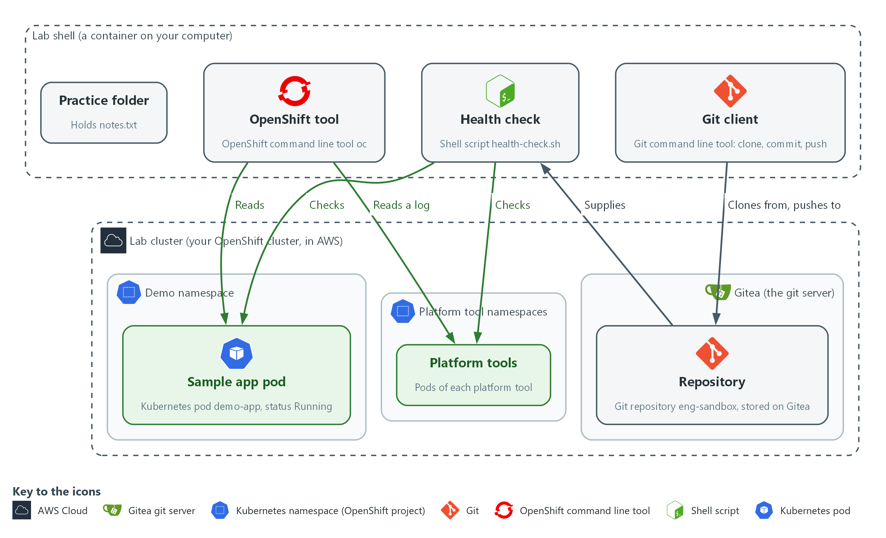

- **1. Practice folder:** a folder you make in lab shell that holds notes.txt.
- **2. Git client:** the git command in lab shell. It clones from the repository and pushes your change back, on the branch named main.
- **3. OpenShift tool:** the oc command in lab shell. It reads the demo-app pod and the log of one pod of a platform tool (Kyverno).
- **4. Health check:** the script health-check.sh, which comes from the repository and checks the pods of each platform tool and of the sample app.
- **5. Repository:** the eng-sandbox folder and its history, stored on the Gitea server, not on your laptop, until you clone it.
- **6. Gitea:** the git server that runs inside your lab cluster. Git is the tool; Gitea is the server it talks to.
- **7. Lab cluster:** your own OpenShift cluster in AWS. It holds Gitea, the sample app and the platform tools.
- **8. Sample app pod:** the demo-app pod in the demo namespace, status Running. A pod is the smallest running unit on the cluster.
- **9. Platform tools:** the pods of each platform tool, in their own namespaces, such as the log store and the pipeline engine.

Where each part runs, and why:

| Part | Where it runs | Why it is built this way |
| --- | --- | --- |
| Lab shell | A container on your laptop | Same tools and same steps on Mac and Windows, nothing to install, and the lab sets your variables and sign-in for you. |
| Lab cluster | OpenShift on one node in AWS | A real platform to learn on. It is yours alone, so you can change it, break it and reset it, and lab down removes it so it stops costing money. |
| Gitea | Inside the cluster | A git server you control, so you can push and review changes without an outside account. |
| Platform tools | Inside the cluster | Tools such as log storage, pipelines, policy and scanning run beside your work, so later modules build on tools that are already there. |
| The connection | The network, from lab shell to the cluster's API | One sign-in and one command (oc) work for every module. In this lab the cluster's address is reachable from the internet so your laptop needs no VPN, and credentials control access. A production system would usually keep it private. |

### 2.1 The terminal and lab shell

- A terminal takes one line at a time, runs it, and prints the answer.
- Mac and Windows commands differ, so lab shell (a prebuilt container) gives everyone the same tools.
- The lab keeps passwords and tokens in variables, so you never type or save one.
- Lab shell runs on your computer, and the commands you type in it act on the cluster in AWS (see the picture above).

These keys and commands are the ones you use most:

| Key or command | What it does |
| --- | --- |
| Up arrow | Brings back the last command so you can fix a typo instead of retyping. |
| Tab | Finishes a word for you. If nothing happens, press Tab twice to see the choices. |
| Ctrl+C | Stops a command that is running or stuck. It is safe. |
| pwd | Prints where you are (the current directory). |
| ls -l | Lists what is in the current directory, one line per item. |
| cd NAME | Moves into the directory called NAME. cd .. moves up one level. |
| cat FILE | Prints a file on the screen. cat -n numbers the lines. |

### 2.2 Files, oc and git

- oc is the command-line tool for OpenShift, and it tells you which workloads (programs the cluster runs, such as demo-app) are up.
- Most oc commands are a verb plus what it acts on: get lists, describe explains, logs prints what a program wrote.
- git records the history of a folder: clone copies a repository, commit saves a snapshot, and push sends it back.
- The git server in this lab is Gitea, which runs inside your lab cluster.

These commands answer the questions you ask most:

| Command | What it answers |
| --- | --- |
| oc get pods -n NAME | Which pods are in this namespace, and are they ready? |
| oc describe pod POD | Why is this pod in this state? The Events at the end often say. |
| oc logs POD | What did the program print? An empty answer is normal for a quiet program. |
| git status | What has changed since the last commit? |
| git diff | Exactly which lines changed? |

### 2.3 Reading YAML and error messages

YAML describes settings to the cluster. Three rules cover almost everything you will read. Use spaces, never the Tab key. The notes after each arrow are explanations, not part of the file.

```text
name: demo-app           <- rule 1: a setting called name, value demo-app
labels:                  <- rule 2: the indented lines below belong to labels
  app: demo-app
ports:                   <- rule 3: each hyphen starts one item in a list
  - 8080
  - 8443
```

- The two-space indent is the only thing that puts app: demo-app under labels, so check the spaces.
- An error message is information, not failure.
- The first words say which tool complained. The end usually says what is wrong and where, often with a line number.

### Design decisions

#### Token reaches git through a credential helper

- How: Git gets the Gitea user name and token from a one-line credential helper that reads GITEA_USER and GITEA_TOKEN from the variables the lab sets. The helper is passed once with the clone command and then saved in the repository settings as variable names, not values.
- Why: The token value is never typed or written to a file, so a commit or a copied folder cannot leak it, and the lab sets the variables for every learner.
- Alternatives: Advantage of putting the token in the clone address or in a stored credentials file: it is the simplest thing to type and needs no helper. Drawback: the token then lands in shell history or on disk, and git keeps it in the repository settings.

## Section 3. Implement

- Start: type `lab start eng-0` in the terminal on your own computer (PowerShell on Windows, Terminal on Mac), not in the lab shell.
- Enter lab shell with `lab shell`. Every other command in this module runs inside lab shell.
- If a step fails: run `lab reset eng-0` on your own computer and repeat the step once. If it still fails, copy the whole command and error and ask your AI assistant. Do not skip the step.

### Before you start: install the lab command and start the lab

Steps 1 to 4 run inside lab shell, which works only after you install the lab command and start your lab in AWS. Do this part once, typing in PowerShell on Windows (not Git Bash) or Terminal on Mac, never inside lab shell.

You need these before you start:

- The training folder, downloaded to this computer. Unzip it if it came as a zip file. It is the folder that contains the lab folder, the modules folder and README.md.
- Python 3.10 or newer. The first block checks it.
- Docker (Docker Desktop on Windows or Mac), open and running, or Podman. The first block checks it.
- An AWS account you are allowed to spend in, with credentials saved on this laptop under a profile name. Use a lab account, not a production one. The profile name is the word in square brackets in the file .aws\credentials or .aws\config in your user folder.
- A Red Hat pull secret: a small file OpenShift needs to install. Download it from console.redhat.com and save it as pull-secret.json (the settings block says where).
- A public Route 53 hosted zone (a domain name managed in AWS) in that same AWS account. The cluster gets its address from it.
- A budget. The whole track is estimated at about $18 of AWS cost, and the lab bills by the hour until you run lab down.

#### Install: Check your tools, then install the lab command and build the tools container

You will now move into the training folder, check that Python and Docker work, install the lab command and build the container that lab shell opens.

- First, replace the path in the first line with the folder you downloaded and unzipped (the folder that contains the lab folder).
- Paste the whole block below into the terminal.
- Finally, if your terminal says lab is not recognized, close PowerShell, open a new window, and try again.

```powershell
cd "C:\path\to\Engineering Leveling Training"
python --version
docker --version
pip install -e ./lab
lab build-image
```

**Expected output:**

```
Example only. python --version shows 3.10 or higher, and docker --version shows a version number. pip reports that lab was installed. The image build downloads about 400 MB, can take several minutes, and ends without an error.
```

| Part | What it does | Why you run it |
| --- | --- | --- |
| cd "C:\path\to\..." | Moves the terminal into the training folder. | pip and lab need to see the lab folder from here. |
| python --version | Prints the Python version. | The lab command needs Python 3.10 or newer. |
| docker --version | Prints the Docker version. | If this fails, install Docker Desktop and open it. lab build-image and lab shell both need a running container engine. |
| pip install -e ./lab | Installs the lab command so it runs from the lab folder. The -e keeps it pointed there, which lab build-image needs to find its files. | Without it your terminal does not know the word lab. |
| lab build-image | Builds the tools container (oc, git, jq, curl and the rest). | lab shell opens this container, so it must exist first. |

#### Mac Install: Check your tools, then install the lab command and build the tools container

Mac version of the Windows block above, using Terminal and bash commands.

- First, open Terminal and replace the path in the first line with the training folder you downloaded and unzipped.
- Paste the whole block below into the terminal.
- Finally, if Terminal says lab is not found, close it, open a new window, and try again.

```bash
cd "/path/to/Engineering Leveling Training"
python3 --version
docker --version
pip3 install -e ./lab
lab build-image
```

**Expected output:**

```
Example only. python3 --version shows 3.10 or higher, and docker --version shows a version number. pip reports that lab was installed. The image build downloads about 400 MB, can take several minutes, and ends without an error.
```

| Part | What it does | Why you run it |
| --- | --- | --- |
| cd "/path/to/..." | Moves the terminal into the training folder. | pip and lab need to see the lab folder from here. |
| python3 --version | Prints the Python version. | The lab command needs Python 3.10 or newer. |
| docker --version | Prints the Docker version. | If this fails, install Docker Desktop and open it. |
| pip3 install -e ./lab | Installs the lab command so it runs from the lab folder. | Without it your terminal does not know the word lab. |
| lab build-image | Builds the tools container (oc, git, jq, curl and the rest). | lab shell opens this container, so it must exist first. |

#### Cost Guard: Deploy the cost guard (optional but recommended, once per AWS account)

You will now deploy the cost guard, a small set of AWS resources that warns you about an idle lab and can pause it.

- The cost guard starts in dry-run mode: it emails what it would do and changes nothing until you turn dry run off.
- Why: without it, a lab you walk away from keeps billing at about $0.77 an hour (an estimate). The commands lab pause, lab resume, lab keep and lab pull also do not work.
- When: deploy it once per AWS account and region, not once per lab. Skip this block if it is already deployed or if you will always run lab down when you stop.
- Risk: the build role of the cost guard has broad permissions, so use a dedicated lab account, never one that holds other work.
- Before you run it: terraform version must print a version. Use the same AWS profile and email as in the settings block, and sign in to AWS first if your profile needs it.

```powershell
$env:AWS_PROFILE = "your-aws-profile"
cd terraform\guard
terraform init
terraform apply -var region=us-east-1 -var alert_email=you@example.com
terraform output -raw guard_bucket
terraform output -raw budget_topic_arn
cd ..\..
```

**Expected output:**

```
Example only. terraform apply shows a plan and asks you to type yes. It ends with Apply complete and lists the outputs. The last two commands print the bucket name (starts with lab-guard-) and the topic address (starts with arn:aws:sns). Copy both for the next block. AWS also emails you a subscription message: open it and click Confirm subscription, or no guard email will reach you.
```

| Part | What it does | Why you run it |
| --- | --- | --- |
| $env:AWS_PROFILE | Names the AWS credentials Terraform uses. | The guard must be created in the lab account, not another one. |
| cd terraform\guard | Moves into the guard's folder. | Terraform reads the guard files from the folder it runs in. |
| terraform init | Downloads the Terraform plugins the guard needs. | terraform apply cannot run until this has finished. |
| terraform apply -var region=... -var alert_email=... | Creates the guard: a bucket, notification topics, a scheduled function and a build project. Type yes when it asks. | The region must match your lab region, and the email gets the guard's warnings. |
| terraform output -raw guard_bucket | Prints the guard bucket name. | Each lab needs it to register with the guard. |
| terraform output -raw budget_topic_arn | Prints the budget topic address. | The lab sends its spend alerts there. |
| cd ..\.. | Moves back to the training folder. | The next block and lab up run from there. |

#### Mac Cost Guard: Deploy the cost guard (optional but recommended)

Mac version of the Windows guard block above, using Terminal and bash commands.

- Use the same AWS profile and email as in the settings block, and sign in to AWS first if your profile needs it.
- Terraform must be installed; terraform version must print a version.

```bash
export AWS_PROFILE="your-aws-profile"
cd terraform/guard
terraform init
terraform apply -var region=us-east-1 -var alert_email=you@example.com
terraform output -raw guard_bucket
terraform output -raw budget_topic_arn
cd ../..
```

**Expected output:**

```
Example only. terraform apply shows a plan and asks you to type yes. It ends with Apply complete and lists the outputs. The last two commands print the bucket name (starts with lab-guard-) and the topic address (starts with arn:aws:sns). Copy both for the next block. AWS also emails you a subscription message: open it and click Confirm subscription, or no guard email will reach you.
```

| Part | What it does | Why you run it |
| --- | --- | --- |
| export AWS_PROFILE | Names the AWS credentials Terraform uses. | The guard must be created in the lab account, not another one. |
| cd terraform/guard | Moves into the guard's folder. | Terraform reads the guard files from the folder it runs in. |
| terraform init | Downloads the Terraform plugins the guard needs. | terraform apply cannot run until this has finished. |
| terraform apply -var region=... -var alert_email=... | Creates the guard: a bucket, notification topics, a scheduled function and a build project. Type yes when it asks. | The region must match your lab region, and the email gets the guard's warnings. |
| terraform output -raw guard_bucket | Prints the guard bucket name. | Each lab needs it to register with the guard. |
| terraform output -raw budget_topic_arn | Prints the budget topic address. | The lab sends its spend alerts there. |
| cd ../.. | Moves back to the training folder. | The next block and lab up run from there. |

#### Lab Settings: Set your lab settings and check them with a dry run

You will now give the lab the settings it needs to build in AWS, then check them without building anything.

- First, save your pull secret as pull-secret.json in the lab-workspace folder. The second line of the block creates that folder.
- Change the quoted values to yours: your AWS profile name, a short lab name, a destroy date a few days from today, and your email.
- Next, if your AWS account has more than one public Route 53 zone, add one more line, $env:BASE_DOMAIN = "your-zone-name", before lab up --dry-run.
- Finally, paste the block. The two guard lines are optional but recommended; leave them out if you skipped the guard block.
- Settings last only for this PowerShell window, so paste them again if you open a new one.

```powershell
$env:AWS_PROFILE = "your-aws-profile"
New-Item -ItemType Directory -Force "$HOME\lab-workspace"
$env:PULL_SECRET_FILE = "$HOME\lab-workspace\pull-secret.json"
$env:TF_VAR_lab_id = "eng-yourname"
$env:TF_VAR_region = "us-east-1"
$env:TF_VAR_destroy_after = "2026-11-20"
$env:TF_VAR_alert_email = "you@example.com"
$env:TF_VAR_guard_bucket = "paste-the-guard-bucket-name"
$env:TF_VAR_guard_budget_topic_arn = "paste-the-budget-topic-arn"
lab up --dry-run
```

**Expected output:**

```
Example only. The dry run prints what lab up would do and changes nothing. Read it for an error about a missing setting or file, and fix that before you go on.
```

| Part | What it does | Why you run it |
| --- | --- | --- |
| $env:AWS_PROFILE | Names the AWS credentials to use. | lab up passes your credentials into the container by name, so it has to know which profile is yours. |
| New-Item ... lab-workspace | Creates the lab-workspace folder in your user folder if it is not there. | The pull secret and your lab files live there. Keep it on a local folder, not one synced by OneDrive. |
| $env:PULL_SECRET_FILE | The path to your Red Hat pull secret file. | The OpenShift install needs it. lab up refuses to start without it and never prints it. |
| $env:TF_VAR_lab_id | A short name for your lab. | It goes into resource names and tags, so you can find and remove everything the lab creates. |
| $env:TF_VAR_region | The AWS region to build in. | Every resource is created there. |
| $env:TF_VAR_destroy_after | A date in the form YYYY-MM-DD. | The lab is removed after this date if you have not run lab down, which caps the cost. Terraform rejects any other date format. |
| $env:TF_VAR_alert_email | The address for budget and cost-guard warnings. | You hear about an idle or expensive lab before the bill arrives. |
| $env:TF_VAR_guard_bucket | The guard bucket name from the guard block. Optional but recommended: leave this line and the next one out if you skipped the guard. | It registers your lab with the guard so the guard can warn you about it and pause it. |
| $env:TF_VAR_guard_budget_topic_arn | The budget topic address from the guard block. | The lab needs it whenever the guard bucket is set, and refuses to plan without it. |
| lab up --dry-run | Shows what lab up would do and changes nothing. | It catches a missing setting before anything costs money. |

#### Mac Lab Settings: Set your lab settings and check them with a dry run

Mac version of the Windows block above, using Terminal and bash commands.

- First, save your pull secret as pull-secret.json in the lab-workspace folder. The second line creates that folder.
- Change the quoted values to yours: your AWS profile name, a short lab name, a destroy date a few days from today, and your email.
- Next, if your AWS account has more than one public Route 53 zone, add one more line, export BASE_DOMAIN="your-zone-name", before lab up --dry-run.
- Finally, paste the block. The two guard lines are optional but recommended; leave them out if you skipped the guard block.
- Settings last only for this Terminal window, so paste them again if you open a new one.

```bash
export AWS_PROFILE="your-aws-profile"
mkdir -p "$HOME/lab-workspace"
export PULL_SECRET_FILE="$HOME/lab-workspace/pull-secret.json"
export TF_VAR_lab_id="eng-yourname"
export TF_VAR_region="us-east-1"
export TF_VAR_destroy_after="2026-11-20"
export TF_VAR_alert_email="you@example.com"
export TF_VAR_guard_bucket="paste-the-guard-bucket-name"
export TF_VAR_guard_budget_topic_arn="paste-the-budget-topic-arn"
lab up --dry-run
```

**Expected output:**

```
Example only. The dry run prints what lab up would do and changes nothing. Read it for an error about a missing setting or file, and fix that before you go on.
```

| Part | What it does | Why you run it |
| --- | --- | --- |
| export AWS_PROFILE | Names the AWS credentials to use. | lab up passes your credentials into the container by name. |
| mkdir -p ... lab-workspace | Creates the lab-workspace folder if it is not there. | The pull secret and your lab files live there. |
| export PULL_SECRET_FILE | The path to your Red Hat pull secret file. | lab up refuses to start without it and never prints it. |
| export TF_VAR_lab_id | A short name for your lab. | It goes into resource names and tags. |
| export TF_VAR_region | The AWS region to build in. | Every resource is created there. |
| export TF_VAR_destroy_after | A date in the form YYYY-MM-DD. | The lab is removed after this date if you have not run lab down. |
| export TF_VAR_alert_email | The address for budget and cost-guard warnings. | You hear about an idle or expensive lab before the bill arrives. |
| export TF_VAR_guard_bucket | The guard bucket name from the guard block. Optional but recommended: leave this line and the next one out if you skipped the guard. | It registers your lab with the guard so the guard can warn you about it and pause it. |
| export TF_VAR_guard_budget_topic_arn | The budget topic address from the guard block. | The lab needs it whenever the guard bucket is set, and refuses to plan without it. |
| lab up --dry-run | Shows what lab up would do and changes nothing. | It catches a missing setting before anything costs money. |

#### Settings File: Save the settings in a file so you do not paste them every time

You will now save the settings above in a file, then load that file at the start of each session instead of pasting them.

- The file holds no passwords.
- First, run the first line. Notepad opens and offers to create the file. Paste the settings lines into it (not the lab up --dry-run line), save, and close. Keep it in lab-workspace, not in a folder that OneDrive syncs.
- If your AWS profile needs a sign-in, run aws sso login --profile your-aws-profile.
- Next, run the second line. Windows blocks script files by default; this line allows scripts in this one window only and changes nothing permanent. Run it each time before loading the file, or loading fails with a red error that says running scripts is disabled on this system.
- Finally, run the third line to load the file. The dot and space at the start matter. Run it each time you open a new PowerShell window.

```powershell
notepad "$HOME\lab-workspace\lab-env.ps1"
Set-ExecutionPolicy -Scope Process -ExecutionPolicy Bypass
. "$HOME\lab-workspace\lab-env.ps1"
```

**Expected output:**

```
Example only. Notepad opens. The second line prints nothing. Check that it worked with Get-ChildItem Env:TF_VAR_*, which lists your settings.
```

| Part | What it does | Why you run it |
| --- | --- | --- |
| notepad ...lab-env.ps1 | Opens the settings file for editing, creating it the first time. | One saved copy replaces pasting the same lines every session. |
| Set-ExecutionPolicy -Scope Process -ExecutionPolicy Bypass | Lets this PowerShell window run script files. It lasts only until you close the window. | Windows blocks .ps1 files by default, so the next line would fail without it. |
| . "$HOME\lab-workspace\lab-env.ps1" | Runs the file in this window so its settings stay set. | Without the leading dot and space the settings vanish when the file ends. |

#### Mac Settings File: Save the settings in a file so you do not paste them every time

Mac version of the Windows block above, using Terminal and bash commands.

- First, run the first line. nano opens the file. Paste the settings lines (not the lab up --dry-run line), press Control-O then Enter to save, and Control-X to leave.
- If your AWS profile needs a sign-in, run aws sso login --profile your-aws-profile.
- Finally, run the second line to load the file. Run it each time you open a new Terminal window.

```bash
nano "$HOME/lab-workspace/lab-env.sh"
source "$HOME/lab-workspace/lab-env.sh"
```

**Expected output:**

```
Example only. nano opens. The second line prints nothing. Check that it worked with env | grep TF_VAR, which lists your settings.
```

| Part | What it does | Why you run it |
| --- | --- | --- |
| nano ...lab-env.sh | Opens the settings file for editing, creating it the first time. | One saved copy replaces pasting the same lines every session. |
| source ...lab-env.sh | Runs the file in this window so its settings stay set. | A plain run would set them in a throwaway shell that ends right away. |

#### AWS Sign-in: If your AWS profile signs in with SSO, give the container temporary keys

You will now give lab shell temporary keys.

- Lab shell runs in a container that cannot see your AWS sign-in, so an SSO profile (single sign-on) fails there with the error that the config profile could not be found.
- Copy temporary keys into this PowerShell window and drop the profile name.
- Skip this block if your credentials are plain access keys.
- The keys are secrets: do not paste or print them.
- The keys expire, often after about an hour, so run these lines again right before lab up and whenever you see an expired-token error.

```powershell
aws sso login --profile your-aws-profile
aws configure export-credentials --profile your-aws-profile --format powershell | Invoke-Expression
Remove-Item Env:AWS_PROFILE
$env:AWS_DEFAULT_REGION = "us-east-1"
lab shell
aws sts get-caller-identity
```

**Expected output:**

```
Example only. The first line opens your browser to sign in. The next three print nothing. Inside lab shell, the last command prints your AWS account number; type exit to leave lab shell. If it says the profile could not be found, you skipped the Remove-Item line.
```

| Part | What it does | Why you run it |
| --- | --- | --- |
| aws sso login --profile ... | Signs you in to AWS through your browser. | The temporary keys come from this sign-in, and it expires. |
| aws configure export-credentials ... \| Invoke-Expression | Copies temporary keys into this window's settings. | The container reads keys from settings; it cannot read your sign-in. |
| Remove-Item Env:AWS_PROFILE | Removes the profile name from this window. | The container cannot find that profile, so it would stop with an error. |
| $env:AWS_DEFAULT_REGION | Sets the AWS region for the container. | The profile that normally supplies the region is no longer used. |
| lab shell | Opens the tools container. | It is the quickest way to test the keys, before anything costs money. |
| aws sts get-caller-identity | Prints which AWS account the keys belong to. | It confirms the lab will build in the account you meant. |

#### Mac AWS Sign-in: If your AWS profile signs in with SSO, give the container temporary keys

Mac version of the Windows block above, using Terminal and bash commands.

- The keys are secrets: do not paste or print them.
- The keys expire, often after about an hour, so run these lines again right before lab up.

```bash
aws sso login --profile your-aws-profile
eval "$(aws configure export-credentials --profile your-aws-profile --format env)"
unset AWS_PROFILE
export AWS_DEFAULT_REGION="us-east-1"
lab shell
aws sts get-caller-identity
```

**Expected output:**

```
Example only. The first line opens your browser to sign in. The next three print nothing. Inside lab shell, the last command prints your AWS account number; type exit to leave lab shell. If it says the profile could not be found, you skipped the unset line.
```

| Part | What it does | Why you run it |
| --- | --- | --- |
| aws sso login --profile ... | Signs you in to AWS through your browser. | The temporary keys come from this sign-in, and it expires. |
| eval "$(aws configure export-credentials ...)" | Copies temporary keys into this window's settings. | The container reads keys from settings; it cannot read your sign-in. |
| unset AWS_PROFILE | Removes the profile name from this window. | The container cannot find that profile, so it would stop with an error. |
| export AWS_DEFAULT_REGION | Sets the AWS region for the container. | The profile that normally supplies the region is no longer used. |
| lab shell | Opens the tools container. | It is the quickest way to test the keys, before anything costs money. |
| aws sts get-caller-identity | Prints which AWS account the keys belong to. | It confirms the lab will build in the account you meant. |

#### Lab Build: Build your lab and load this module

You will now build your lab in AWS and load the starting state for this module.

- lab up costs money and asks you to type yes.
- First, finish the settings step above, in the same PowerShell or Terminal window.
- Run the commands below. Keep the window open until lab up finishes.
- Mint mode: to install quickly, the lab runs OpenShift in mint mode. lab up creates one long-term access key for a lab-only AWS user, and the cluster stores it as a secret. That key does not expire. In a shared or long-lived account it is a risk, so use a dedicated lab account.
- Finally, run lab down when you stop. It deletes the user and its keys and stops the billing.

```powershell
lab up
lab start eng-0
```

**Expected output:**

```
Example only. lab up finishes after the cluster install (roughly one to one and a half hours, an estimate), then lab start reports that eng-0 is loaded.
```

| Part | What it does | Why you run it |
| --- | --- | --- |
| lab up | Builds your lab in AWS and installs the cluster. Type yes when it asks. | The module needs a running cluster to work against. |
| lab start eng-0 | Loads the starting state for this module. | It creates the sandbox repository and the demo app that the steps use. |

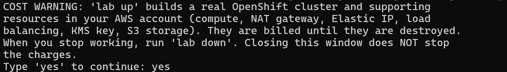

> **CHECKPOINT:** The lab command runs, lab up has finished, and lab start eng-0 has reported success. Run lab down whenever you stop, or the lab keeps billing.

### Step 1. Open lab shell, move around and write small files

**Learning point: Opening lab shell, then making, reading, copying and deleting a small file, shows how the terminal behaves and where your work is kept between sessions.**

- lab shell is where every later command runs.
- You learn to open lab shell, see where you are, make a folder, and read and write a small file.

What this step adds (thick lines and outlines are new):

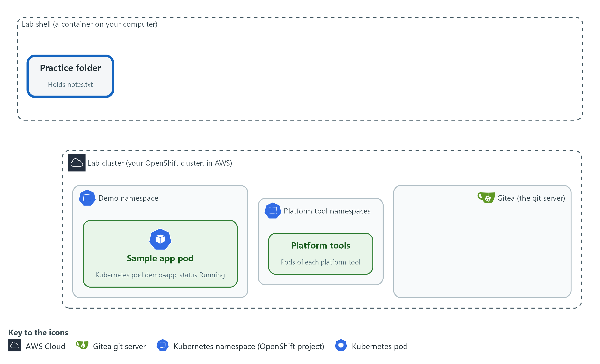

- You open lab shell and make a practice folder with a small file in it.

#### 1a. Open the lab shell

You will now open lab shell, the tools container.

- Every command in this module, and in the modules after it, runs inside lab shell.
- Type this command in the terminal where you started the lab.

```bash
lab shell
```

**Expected output:**

```
Example only. Your prompt changes to show you are now inside the lab shell.
```

| Part | What it does | Why you run it |
| --- | --- | --- |
| lab | The lab helper program installed with the lab. | It is the entry point for every lab action, so you learn the word you will type most. |
| shell | Tells it to open the tools container. Your prompt changes to show you are inside. | Every command in this module and the ones after it runs inside the container, so the first thing to do is get inside it. |

#### 1b. Look around, then make and change a small file

You will now make a practice folder and a small file, then read, copy and delete it.

```bash
pwd
echo "$LAB_ID"
mkdir -p ~/eng-practice
cd ~/eng-practice
printf 'line one\n' > notes.txt
echo "line two" >> notes.txt
cat notes.txt
wc -l notes.txt
grep two notes.txt
cp notes.txt notes-copy.txt
ls -l
rm notes-copy.txt
ls
```

**Expected output:**

```
Example only. Your folder and lab name will differ.
<your current folder>
<your lab name>
line one
line two
2 notes.txt
line two
(ls -l lists notes.txt and notes-copy.txt)
notes.txt
```

| Part | What it does | Why you run it |
| --- | --- | --- |
| pwd | Prints your current directory, so you know where you are. | Always know which directory you are in before you create or delete anything. |
| echo "$LAB_ID" | Prints a variable. The dollar sign means use the value of. LAB_ID names your lab. | Confirms the lab set your variables, and shows how you read a variable without ever typing a secret. |
| mkdir -p ~/eng-practice | Makes a directory named eng-practice in your home directory (the tilde ~ means home). -p means no error if it already exists. Your home directory is kept on your computer, in the lab-workspace folder, so files you save there are still there the next time you open lab shell. | Gives you a safe practice folder so nothing you do touches real files, and keeps your work between sessions. |
| cd ~/eng-practice | Moves into it. | Commands act on the current directory, so you move there before making files. |
| printf 'line one\n' > notes.txt | Writes the words line one into a new file. The > sends the output into the file and replaces what was there. The \n ends the line. | Shows how to create a file from the terminal, which every later module does with scripts and settings. |
| echo "line two" >> notes.txt | Adds a second line. The >> appends instead of replacing. | Shows the difference between replacing and appending, a mix-up that can destroy an evidence file. |
| cat notes.txt | Prints the file. | Reading a file back is how you check what a command really wrote. |
| wc -l notes.txt | Counts the lines in the file. | Counting lets you check a result without reading all of it, for example how many findings a scan returned. |
| grep two notes.txt | Prints only the lines that contain the word two. | Finding the one line you need in a long output is the most common reading skill in these modules. |
| cp notes.txt notes-copy.txt | Copies the file. | Copying before you change a file keeps a way back. |
| ls -l | Lists both files with their sizes. | Confirms both files exist and how big they are before you delete one. |
| rm notes-copy.txt | Deletes the copy. There is no recycle bin, so check the name before you press Enter. | Practice deleting on a copy so you learn the care it needs on files that matter. |
| ls | Shows that only notes.txt is left. | Check the result of every change; here, that only the original is left. |

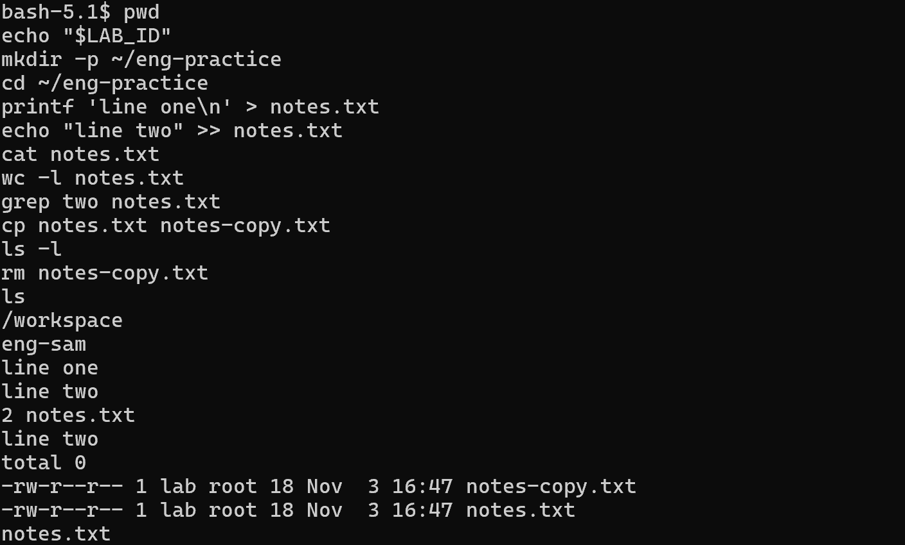

#### 1c. Make a file with several lines

You will now make a file by pasting its whole text in one go.

- Most later modules give you a file this way (the trick is called a heredoc), so learn it now.
- Paste the whole block at once into lab shell.

```bash
cd ~/eng-practice
cat > shopping.txt <<'EOF'
milk
bread
EOF
cat shopping.txt
wc -l shopping.txt
```

**Expected output:**

```
Example only.
milk
bread
2 shopping.txt
```

| Part | What it does | Why you run it |
| --- | --- | --- |
| cd ~/eng-practice | Moves into the practice folder. | The new file is made in the folder you are standing in, so go there first. |
| cat > shopping.txt <<'EOF' | Starts a file called shopping.txt. Everything you type after this line, up to the line that says EOF, goes into the file. The quotes around EOF keep the text exactly as typed. | This is how you make a file of any length with only a paste, so you do not need an editor. |
| milk and bread | The text of the file, one line each. | Whatever sits between the first line and EOF is saved as it is, including spaces at the start of a line. YAML needs those spaces. |
| EOF | Ends the file. It must stand alone at the start of its own line. | Without it the shell keeps waiting for more text. If that happens, type EOF on a new line and press Enter. |
| cat shopping.txt | Prints the file you just made. | Read a file back to check it holds what you meant. |
| wc -l shopping.txt | Counts the lines: 2. | A quick check that nothing was lost in the paste. |

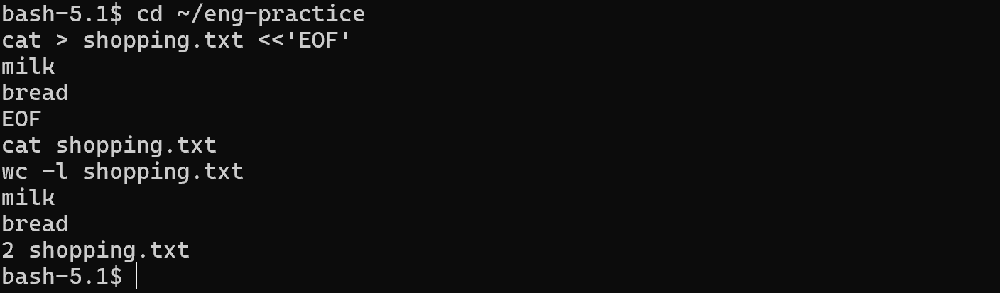

> **SECURITY:** Never print a variable whose name contains PASSWORD or TOKEN. Printing one puts it on screen and in your terminal history.

> **TIP:** Typed something wrong? Press Up arrow, fix the line, press Enter. Press Tab while typing a long name to finish it.

> **CHECKPOINT:** cat shows two lines, wc says 2, the last ls lists only notes.txt, and shopping.txt holds milk and bread.

> **TAKEAWAY:** Know which directory you are in before you create or delete anything.

### Step 2. Clone, edit, commit and push with the in-lab git server

**Learning point: Cloning, committing and pushing, then asking Gitea for its newest commit, shows how a change travels from your folder to the server and how to prove it arrived.**

- You will now copy the sandbox repository from Gitea (the lab's git server), change a file, send the change back, and then confirm on the server that it arrived.
- Git keeps a record of every change, which is why later modules store their scripts and settings in it.

What this step adds (thick lines and outlines are new):

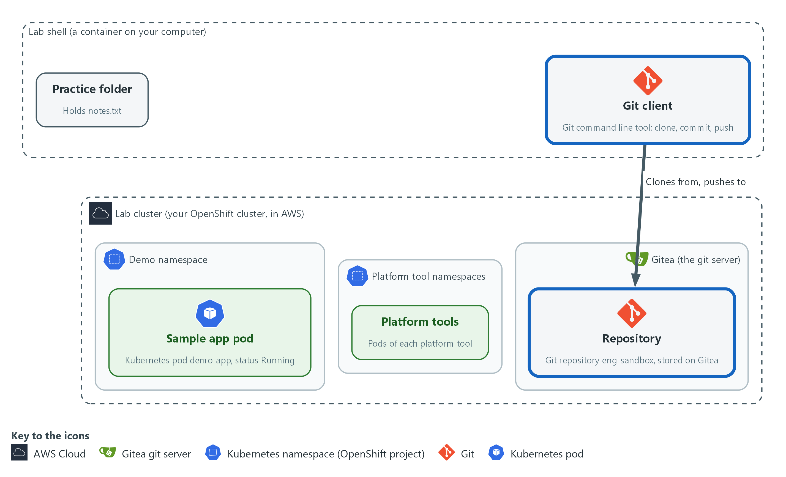

- Git copies the sandbox repository from Gitea, and you push one change back to that same repository on Gitea.

#### 2a. Copy the sandbox repository from Gitea

You will now copy the eng-sandbox repository from the lab git server (Gitea) into your practice folder and tell git who you are.

- The copy is a working copy, and every commit you make carries your name.

```bash
cd ~/eng-practice
git -c 'credential.helper=!f() { echo username=$GITEA_USER; echo password=$GITEA_TOKEN; }; f' clone "$GITEA_URL/$GITEA_USER/eng-sandbox.git"
cd eng-sandbox
git config credential.helper '!f() { echo username=$GITEA_USER; echo password=$GITEA_TOKEN; }; f'
git config user.name "$GITEA_USER"
git config user.email "$GITEA_USER@example.invalid"
ls
git log --oneline
```

**Expected output:**

```
Example only. Your commit code will differ.
Cloning into 'eng-sandbox'...
README.md  broken.yaml  health-check.sh
<hash> <newest commit message>
<hash> ... (a few older commit lines; the sandbox holds several commits, so your list will be longer than one line)
```

| Part | What it does | Why you run it |
| --- | --- | --- |
| git -c '...' clone URL | Copies the repository eng-sandbox from Gitea into a new folder. The -c part gives git a helper for this one command that prints your Gitea user name and token when git asks for them. | Later modules keep scripts and settings in git, so you start by getting a working copy from the lab's server. |
| cd eng-sandbox | Moves into the copy. | git commands act on the repository you are standing in. |
| git config credential.helper ... | Saves the same helper in this repository so push works. The file stores the variable names, not the token value. | Lets push sign in without you typing the token, so the token never lands in a file or on screen. |
| git config user.name / user.email | Tells git who you are, so each commit carries a name. The address is a placeholder that stays inside this repository. | Every commit records who made it, and git refuses to commit without a name. |
| ls | Lists the files that came with the repository: README.md, broken.yaml and health-check.sh. | See what came with the repository before you change anything. |
| git log --oneline | Lists the snapshots, newest first, one line each. | The history is the record of who changed what and when, which is why git is used for scripts and evidence. |

#### 2b. Change a file, save it and send it to Gitea

You will now add a line to the README, look at the change, save it as a commit and push it.

- A commit is a saved snapshot with a message; a push sends it to Gitea so other people, and the automated checks in later modules, can see it.
- Work inside the eng-sandbox folder.

```bash
echo "Checked by $GITEA_USER during ENG-0." >> README.md
git status
git diff
git add README.md
git commit -m "Add a line to the README"
git push origin main
```

**Expected output:**

```
Example only. Your commit code will differ.
On branch main
(git status lists README.md as modified)
(git diff shows your new line marked with a plus sign)
[main <hash>] Add a line to the README
 1 file changed, 1 insertion(+)
(the push prints the remote address and ends with main -> main)
```

| Part | What it does | Why you run it |
| --- | --- | --- |
| echo ... >> README.md | Adds one line to the end of the README. | Make a small, harmless change to practice the save cycle. |
| git status | Shows README.md as modified: git sees a change it is not saving yet. | Check what git sees before you save, so you do not commit a file by accident. |
| git diff | Shows the exact lines added, marked with a plus sign. | Read the exact change before you save it, the habit that catches mistakes and stray secrets. |
| git add README.md | Marks the file to be saved in the next snapshot. | Choose which changes go into the snapshot; nothing is saved without this. |
| git commit -m ... | Saves the snapshot with a short message after -m. | The message is the record a reviewer reads later. |
| git push origin main | Sends the snapshot to the remote named origin (Gitea), on the branch named main. | Gitea is where other people and the automated checks in later modules can see your change. |

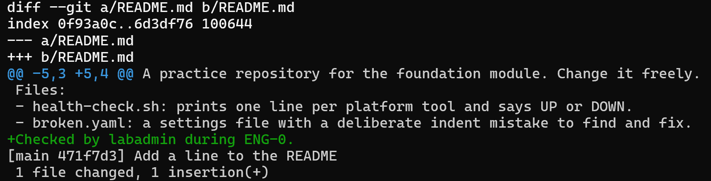

#### 2c. Check from the server side that the push arrived

You will now ask Gitea itself for its newest commit and for the last line of the README it now holds.

- Asking the server proves the push reached it, not only your own copy.
- A pass prints Add a line to the README, then Checked by and your user name.

```bash
curl -s -H "Authorization: token $GITEA_TOKEN" \
  "$GITEA_URL/api/v1/repos/$GITEA_USER/eng-sandbox/commits?limit=1" | jq -r '.[0].commit.message'
curl -s -H "Authorization: token $GITEA_TOKEN" \
  "$GITEA_URL/api/v1/repos/$GITEA_USER/eng-sandbox/raw/README.md?ref=main" | tail -n 1
```

**Expected output:**

```
Example only. Your user name will differ.
Add a line to the README
Checked by <your user> during ENG-0.
```

| Part | What it does | Why you run it |
| --- | --- | --- |
| curl -s -H ... /commits?limit=1 | Asks the Gitea API (the web addresses that programs use to talk to Gitea) for the newest commit. The header carries the token without printing it. | Confirms from the server's side that your push arrived, instead of trusting your own screen. |
| jq -r '.[0].commit.message' | Picks the message of the first commit from the answer. | Shows how to pull one field out of a long JSON reply, which most later checks do. |
| curl ... /raw/README.md?ref=main \| tail -n 1 | Asks Gitea for the README as it is on the main branch, then keeps only its last line. | Shows the file as the server holds it, so you see your line without a web login. |

> **NOTE:** The lab sets GITEA_URL, GITEA_USER and GITEA_TOKEN for you. A small helper gives the token to git only when git asks, so the token is never written into a file.

> **SECURITY:** Never put a password or token in a file you commit. Git keeps every version forever, so deleting it later does not remove it from the history.

> **CHECKPOINT:** The first curl prints Add a line to the README, and the second prints Checked by and your user name.

> **TAKEAWAY:** A push is proven only when the server itself shows the change.

### Step 3. Ask the cluster questions with oc, and read YAML and an error

**Learning point: Asking the cluster read-only questions and checking a broken YAML file with a dry run shows how to find a mistake before it reaches the cluster.**

- Most of these modules start by asking the cluster what is true and reading the answer.
- The oc commands here only read, so they change nothing.
- You then practice reading a YAML error and fixing it, using broken.yaml, the settings file that came with the repository.

What this step adds (thick lines and outlines are new):

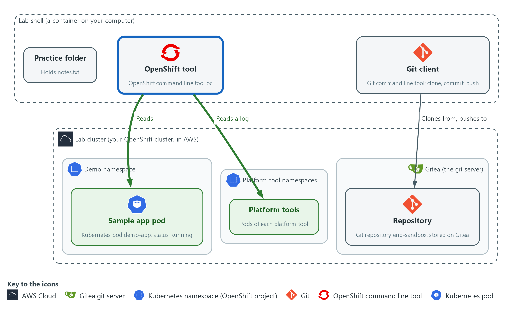

- The oc tool asks the cluster what is running: it reads the sample pod and the log of one platform tool pod.

#### 3a. Ask the cluster who you are and what is running

You will now run read-only oc commands that list projects and pods and show logs.

- Most later modules start by asking the cluster what is running, so this is the habit they rely on.

```bash
oc whoami
oc projects
oc get pods -n demo
oc describe pod -n demo -l app=demo-app | head -n 20
oc logs -n demo -l app=demo-app --tail=5
pod=$(oc get pods -n kyverno -o name | head -n 1)
oc logs -n kyverno "$pod" --tail=3
```

**Expected output:**

```
Example only. Your names and ages will differ.
<your user name>
(a list of projects that includes demo)
NAME  READY  STATUS  RESTARTS  AGE
demo-app-<hash>  1/1  Running  <n>  <age>
(describe prints several sections; the Events are at the end)
(the demo app is quiet, so its logs may print nothing)
(the last three lines of a busy kyverno pod)
```

| Part | What it does | Why you run it |
| --- | --- | --- |
| oc whoami | Prints who the cluster thinks you are. | Before you ask the cluster anything, confirm who it thinks you are; a wrong login explains many surprises. |
| oc projects | Lists the projects (namespaces) you can see. Find demo in the list. | Learn which namespaces you can see, which tells you what you are allowed to ask about. |
| oc get pods -n demo | Lists the pods in the namespace demo. -n means namespace. Read READY and STATUS. | The fastest check that a workload is running: read READY and STATUS. |
| oc describe pod ... -l app=demo-app | Explains the pod picked by the label app=demo-app. A label is a tag on an object. head -n 20 keeps the first twenty lines. | When something is not as expected, the Events at the end often say why. |
| oc logs ... --tail=5 | Prints the last five lines the program wrote. The demo pod is quiet, so an empty answer is correct. | Shows what a program wrote; an empty answer tells you the program is quiet, not broken. |
| pod=$(oc get pods -n kyverno ...) | Stores the name of the first pod in kyverno in a variable. The dollar and parentheses run a command and keep its output. | Saves a pod name so the next command can use it without you copying a long name. |
| oc logs -n kyverno "$pod" --tail=3 | Prints the last three lines of that pod. This one is busy, so you see text. | Compare with the quiet demo pod: a busy pod shows text, so you learn what normal looks like for each. |

#### 3b. Read the broken settings file and let oc find the error

You will now print a settings file with line numbers and ask oc to check it without applying it.

- A dry run vets a file before it can touch the cluster, whoever wrote it.
- Work inside the eng-sandbox folder.

```bash
cd ~/eng-practice/eng-sandbox
cat -n broken.yaml
oc apply --dry-run=client -f broken.yaml
```

**Expected output:**

```
Example only. The wording comes from oc.
(the file is printed with a line number on each line)
error: error parsing broken.yaml: ... line <n>: ...
```

| Part | What it does | Why you run it |
| --- | --- | --- |
| cat -n broken.yaml | Prints the settings file with line numbers. Look at the indent of each line: one line starts one space in, where the lines around it start at zero or two. | Line numbers let you match the file to the error message that comes next. |
| oc apply --dry-run=client -f broken.yaml | Asks oc to read the file and check it without sending it anywhere. A dry run changes nothing. The error names a line number, which can be the line just above the real mistake. | A free way to find a mistake in a settings file before it can affect the cluster; the error names the line. |

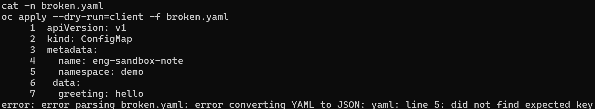

#### 3c. Fix the indentation, check it with the cluster, then undo

You will now fix the one-space mistake, ask the cluster to check the file without applying it, and restore the original.

- The server dry run is stricter than the client dry run in 3b.
- Stay in the same folder.

```bash
sed -i 's/^ data:/data:/' broken.yaml
git diff
oc apply --dry-run=server -f broken.yaml
git restore broken.yaml
```

**Expected output:**

```
Example only. (sed prints nothing)
(git diff shows the one line changed)
configmap/eng-sandbox-note created (server dry run)
(git restore prints nothing)
```

| Part | What it does | Why you run it |
| --- | --- | --- |
| sed -i 's/^ data:/data:/' broken.yaml | Edits the file in place: a line that starts with one space and then data: loses the space. | Fixes the one indentation mistake the error pointed at. |
| git diff | Shows the one line you changed. | Confirms you changed only that line and nothing else. |
| oc apply --dry-run=server -f broken.yaml | Asks the cluster itself to check the file and say what it would do, without doing it. | The cluster checks the fixed file against its own rules, which catches problems the local check cannot. For example, a namespace that does not exist passes the local check but fails here. |
| git restore broken.yaml | Puts the broken file back, so the repository stays as it was and you can practice again. | Resets the file so you can repeat the exercise, and shows how git undoes a change. |

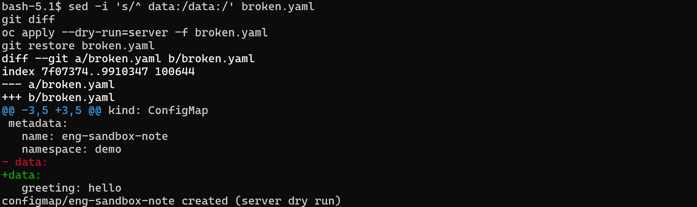

> **NOTE:** A dry-run answer ends with (dry run) or (server dry run), as in created (server dry run). Nothing was created. If you run oc apply without a dry run, the cluster does change.

> **CHECKPOINT:** The first dry run fails with a line number at or just above the one-space line (line 6 of the file); the second says configmap/eng-sandbox-note created (server dry run).

> **TAKEAWAY:** Read the error, find the line, and dry-run a file before you apply it.

### Step 4. Read and run the platform health check

**Learning point: Reading health-check.sh and then running it shows how one script turns many cluster questions into one UP or DOWN line per tool and an exit code.**

- The engineering modules build on tools that must already be running: Loki, Grafana, Mattermost, Gitea, Tekton pipelines, Kyverno, the Trivy operator, Falco and the log collector.
- The repository you cloned holds one script that checks every tool in that list and prints one line each.
- Read the script line by line before you run it, then run it.

What this step adds (thick lines and outlines are new):

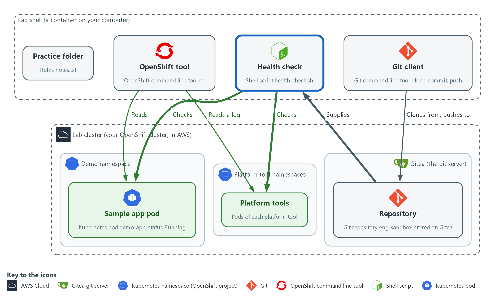

- The health check script from the repository asks each platform tool whether its pods are running.

#### 4a. Print the health check script to read it

You will now print the health check script with line numbers so you can read it before you run it.

- Work inside the eng-sandbox folder.

```bash
cd ~/eng-practice/eng-sandbox
cat -n health-check.sh
```

**Expected output:**

```
Example only. The script text is printed with a number on each line. The table below explains the parts that matter.
(the numbered lines of the shell script)
```

| Part | What it does | Why you run it |
| --- | --- | --- |
| lines 3 and 4: set -u, down=0 | set -u stops the script if it uses a variable that was never set. down counts the tools that are not healthy. | Sets up the counter that decides whether the whole check passes. |
| lines 6 to 9: report() | A function (a named group of commands) that prints one line: UP or DOWN, the tool, its namespace, and a short detail. Any state other than UP adds one to down. | One place formats every result, so all the lines look the same and are easy to scan. |
| lines 11 to 15: check() and its oc and jq lines | Takes a name, a namespace and part of a pod name. It asks oc for the pods in that namespace as JSON. Then jq keeps the pods whose name matches and skips pods that finished a one-time job. It prints two numbers: how many pods, and how many of them are not Running or have a container that is not ready. | The core of the script: ask the cluster for a tool's pods and count them. |
| lines 16 to 19: the first if | If oc printed nothing, the namespace could not be read, so the tool is reported DOWN and the function stops with return. | A tool whose namespace cannot be read must be reported down, not skipped. |
| lines 20 to 27: read and the second if | The read line splits the two numbers into two variables, the pod count and the not-ready count. The if branches then decide. No pods at all is DOWN. Any pod not ready is DOWN. Otherwise the tool is UP. | A tool is up only if it has pods and none of them is not ready. |
| lines 30 to 39: the check lines | One line per tool, with the namespace and the part of the pod name to match. A dot matches every pod in the namespace. A tool with several pods is UP only when all of them are ready. | One line per platform tool; adding a tool to the check means adding a line. |
| lines 41 to 46: the final if | Prints a summary. The exit 1 gives the script a non-zero exit code when anything is down, so another program can tell. | The exit code lets other scripts and pipelines use this check to stop on a failure. |

#### 4b. Run the health check and confirm your work

You will now run the script you just read, print its exit code, and check that your commit is the newest and nothing is left unsaved.

- Stay in the same folder.

```bash
bash health-check.sh
echo "exit code: $?"
git log --oneline -n 2
git status --short
```

**Expected output:**

```
Example only. Your pod counts and commit codes will differ.
UP    <tool>  <namespace>  <n> pods ready
(ten lines like this: nine platform tools and the sample app)
All tools up.
exit code: 0
a1b2c3d Add a line to the README
9f8e7d6 Add the platform health check
(git status prints nothing)
```

| Part | What it does | Why you run it |
| --- | --- | --- |
| bash health-check.sh | Runs the script with bash. It only reads from the cluster. | Runs the whole check in one command and gives you one line per tool. |
| echo "exit code: $?" | Prints the exit code of the script. The question mark variable holds the exit code of the last command. | Shows how a script tells other programs whether it passed: 0 for yes, anything else for no. |
| git log --oneline -n 2 | Shows the two newest snapshots. | Your commit is the top line, and the health check commit is below it. |
| git status --short | Lists files with unsaved changes. Nothing is printed when everything is saved. | An empty answer means you left no loose change behind. |

> **NOTE:** The script matches pods by namespace and part of the pod name. If a tool shows DOWN, run oc get pods -n NAMESPACE for that line and read the STATUS column before you decide anything. If every pod there looks healthy, the check may be matching the wrong name: say so to the lab team.

> **CHECKPOINT:** Ten lines are printed, one for each of nine platform tools and one for the sample app, then All tools up. and exit code 0. Your commit is on top of the log, and git status prints nothing.

> **TAKEAWAY:** A script's exit code tells other programs whether the check passed.

## Section 4. Next Steps

### Using this in other environments

- Linux commands, git and curl port as is. The Gitea steps work against any git server that accepts a user name and a token.
- The oc steps work on any OpenShift 4.x cluster. On other Kubernetes platforms, oc becomes kubectl.
- Change these lab values first: the variables GITEA_URL, GITEA_USER and GITEA_TOKEN, the namespace demo, and the namespaces named in health-check.sh.
- lab shell and the lab command only exist in the lab. Elsewhere, open a terminal that has git, curl, jq and a kubeconfig (the file that holds your cluster address and sign-in).

The table shows what changes on each platform:

| Check | In this lab (OpenShift) | On other platforms | What you change |
| --- | --- | --- | --- |
| Shell | lab shell, with LAB_ID and the Gitea variables set for you | Any terminal with the same tools | Set the variables yourself, or use your own git host. |
| Git clone, commit, push | Gitea at GITEA_URL, token through a credential helper | Any git host that accepts a token | The address and the token variables. |
| Server-side check | curl to the Gitea API under /api/v1/repos | The host's own API, or git log on a fresh clone | Replace the check. |
| Cluster questions | oc whoami, oc projects, oc get pods -n demo | kubectl get namespaces, kubectl get pods -n your-namespace | The tool name and the namespace. |
| YAML check | oc apply --dry-run=client and --dry-run=server | kubectl apply --dry-run=client and --dry-run=server | The tool name. |
| health-check.sh | Reads pods in the lab's tool namespaces | The same script, with your namespaces | The namespace and pod name patterns. |

> **TIP:** Next module: ENG-1, the second foundation module. After it you can start at level 2 in any dimension: GRC, vulnerability management, security data and incident response, cloud and platform security, AI development, or architecture and design. Each one starts with its own lab start command.

<details>
<summary><strong>Section 5. Command List (optional)</strong></summary>

- You do not need this section.
- The Command List lists every command from the steps above, in order and with no explanation, for repeating the module or finding a command fast.
- The commands for Step 1 onward run in lab shell; the first command of Step 1 opens it.

#### Start: on your computer

```bash
lab up
lab start eng-0
```

#### Step 1. Open lab shell, move around and write small files

```bash
lab shell

pwd
echo "$LAB_ID"
mkdir -p ~/eng-practice
cd ~/eng-practice
printf 'line one\n' > notes.txt
echo "line two" >> notes.txt
cat notes.txt
wc -l notes.txt
grep two notes.txt
cp notes.txt notes-copy.txt
ls -l
rm notes-copy.txt
ls

cd ~/eng-practice
cat > shopping.txt <<'EOF'
milk
bread
EOF
cat shopping.txt
wc -l shopping.txt
```

#### Step 2. Clone, edit, commit and push with the in-lab git server

```bash
cd ~/eng-practice
git -c 'credential.helper=!f() { echo username=$GITEA_USER; echo password=$GITEA_TOKEN; }; f' clone "$GITEA_URL/$GITEA_USER/eng-sandbox.git"
cd eng-sandbox
git config credential.helper '!f() { echo username=$GITEA_USER; echo password=$GITEA_TOKEN; }; f'
git config user.name "$GITEA_USER"
git config user.email "$GITEA_USER@example.invalid"
ls
git log --oneline

echo "Checked by $GITEA_USER during ENG-0." >> README.md
git status
git diff
git add README.md
git commit -m "Add a line to the README"
git push origin main

curl -s -H "Authorization: token $GITEA_TOKEN" \
  "$GITEA_URL/api/v1/repos/$GITEA_USER/eng-sandbox/commits?limit=1" | jq -r '.[0].commit.message'
curl -s -H "Authorization: token $GITEA_TOKEN" \
  "$GITEA_URL/api/v1/repos/$GITEA_USER/eng-sandbox/raw/README.md?ref=main" | tail -n 1
```

#### Step 3. Ask the cluster questions with oc, and read YAML and an error

```bash
oc whoami
oc projects
oc get pods -n demo
oc describe pod -n demo -l app=demo-app | head -n 20
oc logs -n demo -l app=demo-app --tail=5
pod=$(oc get pods -n kyverno -o name | head -n 1)
oc logs -n kyverno "$pod" --tail=3

cd ~/eng-practice/eng-sandbox
cat -n broken.yaml
oc apply --dry-run=client -f broken.yaml

sed -i 's/^ data:/data:/' broken.yaml
git diff
oc apply --dry-run=server -f broken.yaml
git restore broken.yaml
```

#### Step 4. Read and run the platform health check

```bash
cd ~/eng-practice/eng-sandbox
cat -n health-check.sh

bash health-check.sh
echo "exit code: $?"
git log --oneline -n 2
git status --short
```

#### When you stop: on your computer, not in lab shell

```bash
lab down
```

</details>

<details>
<summary><strong>Section 6. Terms</strong></summary>

Each term is also explained the first time it appears. In Word, hover over an underlined term to see its meaning, or Ctrl+click it to jump to this table.

| Term | Plain meaning |
| --- | --- |
| API | A set of web addresses that programs use to ask a service questions and get answers. |
| AWS | Amazon Web Services, the cloud your lab runs in. |
| Branch | A separate line of changes in git. The main branch is the agreed version. |
| Clone | Copy a repository from a server to your folder. |
| Cluster | A group of servers that work together as one system. Here it is your own OpenShift cluster in AWS. |
| Command | One line you type that tells the computer to do one thing. |
| Commit | One saved snapshot in git, with a short message. |
| Config map | A cluster object that holds plain settings (not secrets) as named values or files, so a program can read them. |
| Container | A sealed box that holds one program and everything it needs to run, so it runs the same way anywhere. |
| Controller | A program in the cluster that keeps the real state matching what you asked for. |
| Credential | A secret that proves who you are, such as a password, token or key. |
| Credential helper | A small command that git runs to get your user name and token when it needs to sign in, so you never type them. |
| Deployment | A cluster object that keeps a set number of copies of a program running. |
| diff | A command that shows the differences between two files. |
| Directory | A folder. The terminal is always in one directory, called the current directory. |
| Dry run | A check that reads and validates a file without making any change. |
| Evidence | Saved records that show a system is set up and behaving as claimed. |
| Exit code | A number a command leaves behind when it ends. 0 means success; anything else means a problem. |
| Falco | A tool that watches what programs do on a node and raises an alert when the behavior looks wrong. |
| Function (shell) | A named group of commands in a script that you can call by name. |
| Git | A tool that records the history of a folder of files. |
| Gitea | A git server that runs in your lab. It holds the repositories you clone and push to. |
| Grafana | The dashboard and alerting tool in the lab. It reads logs from Loki. |
| grep | A command that prints only the lines that match a pattern. |
| Header | A line of extra information sent with a web request, such as a sign-in token. |
| Heredoc | A way to make a file by pasting its text between a first line such as cat > name <<'EOF' and a last line that says EOF. |
| Home directory | Your own folder inside lab shell, written ~. It is kept in the lab-workspace folder on your computer, so what you save there stays between sessions. |
| Image | A packaged copy of a program and everything it needs to run. A container starts from an image. |
| jq | A tool that picks one value out of JSON text. |
| JSON | A text format for data, made of names and values in braces. |
| Kubernetes | The open-source system that runs and manages containers across servers. OpenShift is built on it. |
| Kyverno | A policy engine for the cluster. It checks, changes or blocks objects against rules you write. |
| Label | A key=value tag on a cluster object, used to pick objects, such as app=demo-app. |
| Loki | The log store in the lab. You search it with LogQL. |
| Mattermost | The chat tool in the lab, where alerts and messages go. |
| mkdir | A command that makes a new folder. |
| Namespace | A named section of the cluster that keeps workloads apart. OpenShift also calls it a project. |
| Node | One server in the cluster. |
| oc | The command-line tool for OpenShift. You type oc to ask the cluster questions. |
| OpenShift | The Red Hat platform your lab cluster runs on. It is Kubernetes with extra security and tools built in. |
| Operator | A program that installs and looks after another tool inside the cluster. |
| Pipeline | A set of automated steps that run in order, such as scan, check and sign. |
| Pod | The smallest running unit on the cluster: one or more containers together. |
| Policy | A set of rules written down so that a tool can enforce them. |
| printf | A command that prints text in a set format. |
| Push | Send your saved commits to the remote repository. |
| pwd | A command that prints the folder you are in. |
| Remote | A copy of the repository on another server. Here the remote is Gitea. |
| Repository | A folder whose history git tracks, so you can see what changed and when. |
| Role | A list of actions a user or program may take on named kinds of objects. |
| Rule | A written condition that a tool checks. |
| Scan | A check of software or settings against a list of known problems. The scan reports what it finds. |
| Script | A text file of commands that the computer runs from top to bottom. |
| Secret | A cluster object that holds a sensitive value such as a password or token, kept apart from ordinary settings. |
| sed | A command that edits text as it passes through, often to replace one string with another. |
| Signature | A value made with a private key that shows who made something and that it was not changed. |
| SSO | Single sign-on: one sign-in that works for many tools. |
| Tekton | The pipeline engine in OpenShift Pipelines. It runs each pipeline step in a container. |
| Terminal | A window where you type commands and read the answers. |
| Terraform | A tool that builds infrastructure from files that describe it. |
| Token | A long secret string that works like a password for one program. Gitea gives you one so git can prove who you are when it sends a change. Anyone who holds it can act as you, so never print it or commit it. |
| Training folder | The folder you downloaded to your computer. It holds the lab folder, the modules and the README. |
| Trivy | A scanner that finds known vulnerabilities and bad settings in code, images and files. |
| URL | A web address, such as https://example.com/page. |
| Variable | A named value the lab sets for you, such as LAB_ID. The dollar sign in front of a name means use its value. |
| Workload | A program that runs on the cluster, such as the sample app demo-app. Running workloads is what the cluster is for. |
| YAML | A plain-text format for settings: lines of name: value, with indentation to show what belongs to what. |

</details>
