# ENG-1: How Traffic Moves

| Item | Detail |
| --- | --- |
| Sequence | Module 2 of 29 in the recommended order |
| Timed work | About 60 minutes (45 hands-on, 15 verify) |
| Standalone start | `lab start eng-1` |
| Combined start | Continue from the end state of the previous module |
| Tools | lab shell, oc, curl, OpenSSL, Python 3, jq, NetworkPolicy |
| Prerequisites | ENG-0 Terminal, Git and Your Lab (typing commands in lab shell, reading oc output, and making a file with a heredoc) |

## Section 1. Module Overview

- Purpose: learn how traffic moves between a pod, a Service and the outside, and how to tell where a blocked call stopped. Later network rules in this track depend on it.
- You build hop_check.py, a script that makes a call from inside the cluster and names the kind of failure it saw.
- You run the commands by hand in lab shell, break the path on purpose, and fix it using only the curl exit code and what the cluster shows.

- **Skill:** Read an address and an address range. Follow a name through cluster DNS and a Service to a pod. Read where encryption ends on the way in from outside. Tell a missing name, a refused port and a dropped call apart.
- **Tools:** `oc` reads addresses and runs commands inside pods. `curl` makes the call, and its exit code names the failure. `openssl` shows the certificate the router presents. `jq` picks single values out of JSON. Python 3 checks address ranges and runs the hop check. A NetworkPolicy is the rule you find and fix.
- **Security Function:** Detects which hop stopped a call. The exit code and the cluster's own state show whether a name failed, a port refused or a network policy dropped the call. The certificate shows who vouches for the router.

## Section 2. The Tools

### Tools used in this module

Each tool name links to its official overview. The table columns say how each tool is used in the lab and why the lab uses it instead of another way of doing the same job.

| Tool (overview link) | What it is | Used in this lab | Why this tool |
| --- | --- | --- | --- |
| [lab shell](https://docs.podman.io/en/latest/markdown/podman-run.1.html) | The lab's prebuilt tools container, started with the lab shell command. It has oc, git, jq, curl and the other tools installed, so commands behave the same on every laptop. (No vendor page exists for it; the link is the Podman run reference.) | You run every command from it, and use oc exec to run curl inside a pod from it. | Every command in every module runs inside it, so the instructions are identical on Mac and Windows and you install nothing on your laptop. |
| [oc](https://docs.redhat.com/en/documentation/openshift_container_platform/4.22/html/cli_tools/openshift-cli-oc) | The OpenShift command-line tool for creating and managing applications and projects from a terminal. | You read pod and Service addresses, read the cluster address ranges, create a Route and run commands inside the client pod. | It is the one command that talks to the cluster, so every module uses it to ask what is true and to make changes. You sign in once, and it works on OpenShift objects as well as standard Kubernetes ones. Unlike clicking in the web console, a command can be pasted, repeated and checked by a test. |
| [curl](https://curl.se/docs/manpage.html) | Command-line tool for transferring data over URLs, used here to call web endpoints. | Makes every call, from inside the client pod, and its exit code names the kind of failure. | It calls a web address from the terminal, so you can check what a service really returns instead of trusting a screen. |
| [OpenSSL](https://docs.openssl.org/master/man1/openssl/) | Command-line tool for keys, certificates and testing TLS connections. | Connects to the router like a browser and prints the subject, issuer and dates of the certificate. | It is the standard tool for looking at keys and certificates, so you can see for yourself what a certificate says and whether a connection is encrypted. |
| [Python 3](https://docs.python.org/3/tutorial/introduction.html) | General-purpose language, used here for small helper scripts. | Checks with a few lines whether an address falls inside an address range. | Python reads and writes JSON easily and is already in the lab shell, so a small script needs nothing installed. |
| [jq](https://jqlang.org/) | Command-line JSON processor. | Picks single fields, such as the target port, out of long replies. | It picks one field out of a long JSON reply, so a test can read a single value. |
| [NetworkPolicy](https://docs.redhat.com/en/documentation/openshift_container_platform/4.22/html/network_security/network-policy) | Rules for which pods may talk to which. Once a policy selects a pod, it accepts only what the policies allow. | A deny policy and an allow policy that you read to find why the call fails, then fix. | It is the built-in way to limit which pods can talk to which, so you need no extra product to show what a blocked connection looks like. |

### How it fits together

#### How a request travels in this module

- The picture shows the lab (test) setup.
- A client pod calls the web pod by name, and a network policy can drop the call.
- In production the router presents a certificate that your organization's own certificate authority issued.
- The network policy box is drawn in every picture, but the policies exist only from Step 4.
- Each step below adds one part, drawn with thick lines.

How the lab is set up, and why:

- A request in a cluster does not go straight from one program to another.
- A name becomes an address, the address leads to a pod, and every rule on the way must let the call through.
- The lab splits the name, address, pod and rules into separate objects so you can look at each one.
- Everything sits in its own namespace, net-lab, so you can break it and fix it without touching anything else.
- lab shell stays outside the cluster: you read the cluster with oc and run curl inside the client pod, so you see the connection the way a pod sees it.
- Later modules write rules for exactly these connections, so this picture is the map for them.

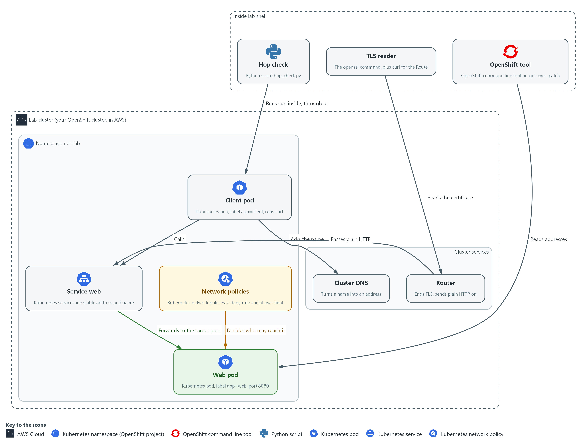

- **1. OpenShift tool:** the oc command. It reads addresses and runs commands inside pods.
- **2. TLS reader:** the openssl command. It connects like a browser and shows the certificate the server presents.
- **3. Hop check:** the Python script you write in Step 5. It runs curl inside the client pod and names the failure it sees.
- **4. Client pod:** the pod that makes the calls. It carries the label app=client.
- **5. Web pod:** the pod that answers. It carries the label app=web and listens on port 8080.
- **6. Service web:** one stable address and name in front of the web pod.
- **7. Network policies:** rules that list which pods may reach the web pod. Once one exists, everything not listed is dropped.
- **8. Router:** receives traffic from outside, ends the encryption and passes plain HTTP to the Service. It holds the certificate.
- **9. Cluster DNS:** the lookup service that turns a name such as web into an address.

Where each part runs, and why:

| Part | Where it runs | Why it is built this way |
| --- | --- | --- |
| Client pod | In the net-lab namespace | It sends the calls. Running curl inside a pod shows what that pod can really reach, which your laptop cannot show. |
| Web pod | In the net-lab namespace | A small web server on port 8080, the thing being called. |
| Service web | In the net-lab namespace | Gives the web pod an address and a name that stay the same when the pod is replaced. |
| Cluster DNS | A service inside the cluster | Answers name lookups for every pod, so callers use names and never pod addresses. |
| Router and Route | Inside the cluster, reachable from outside | The only way in from outside in this lab. It is where the encrypted connection from outside ends. |
| Network policy | In the net-lab namespace, added in Step 4 | Does not exist at the start, so the path works. Step 4 adds it, the path fails, and you find out why. |

### 2.1 Addresses, ranges and ports

- Every pod and every Service has its own IP address, a number such as 10.1.2.3 that finds one pod or Service on the network.
- A port is a number that picks one program at that address, so a call is always an address plus a port, such as 10.1.2.3 port 8080.
- Web calls use TCP, which opens a connection before it sends anything, so a call can fail while the connection is being opened.
- A range such as 10.1.0.0/16 (CIDR) means every address that starts with 10.1. Network rules name whole ranges this way.
- The cluster gives pods addresses from one range and Services addresses from another, so the range tells you which kind of object an address belongs to.
- A pod gets a new address when it is replaced, but its Service keeps the same one, which is why callers use the Service.

### 2.2 Names, DNS and Services

- A pod calls a name, not an address. Cluster DNS, the cluster's lookup service, answers a Service name with the Service address.
- Inside the same namespace the short name web works. From another namespace use web.net-lab, or the whole name web.net-lab.svc.cluster.local.
- The file /etc/resolv.conf in each pod lists the endings the pod adds to a short name such as web until one resolves.
- A name that does not exist gives no address, so the call never starts and curl ends with exit code 6. A call that starts and gets no answer ends with a different code, so the code tells you which failure you have.

### 2.3 Getting in from outside, and where TLS ends

- Traffic that crosses the edge of the cluster is north-south traffic. In OpenShift it arrives at the router. The router reads the host name and sends the call to the Service that a Route names.
- Traffic between pods is east-west traffic. It does not pass through the router.

A Route can end TLS in three ways.

- Edge: the router decrypts and passes plain HTTP to the pod.
- Passthrough: the router passes the encrypted bytes straight to the pod.
- Re-encrypt: the router decrypts, then encrypts again to the pod.

In this module the Route uses edge, so the call is not encrypted between the router and the pod. Where encryption ends is the first question to ask about any path.

### 2.4 Reading a failed call

A failed call is not a mystery: curl's exit code tells you how far the call got. Read the number first, then decide where to look. The table lists the five codes this module uses.

| curl exit code | What it means | Where to look |
| --- | --- | --- |
| 0 | The call worked. The answer may still be an error page, so read the status code too. | The status code: 200 means the server answered normally. |
| 6 | The name did not resolve. | The spelling of the name, the namespace, and cluster DNS. |
| 7 | The machine answered, but nothing listens on that port. | The Service target port, and the port the pod really listens on. |
| 28 | No answer came back in time. A dropped connection ends this way. | Network policies and labels, and whether the pod exists. |
| 60 | The server's certificate is not trusted by this machine. | Who issued the certificate, and whether this machine trusts that issuer. |

### Design decisions

#### Diagnose with curl and its exit codes, run from inside a pod

- How: Every call in this module is curl, run inside the client pod with oc exec. The curl exit code names the kind of failure: 6 for a name that did not resolve, 7 for a refused connection, 28 for a timeout.
- Why: curl is already in the tools container and in the client image, so nothing has to be installed, and a call from inside the pod shows what the pod can really reach, which a call from your laptop cannot.
- Alternatives: Advantage of dedicated tools such as dig (looks up names), a port scanner (tests which ports answer) or a packet capture (records raw network traffic): more detail about each step. Drawback: they are not in the tools image, a packet capture needs extra privileges on the node, and an exit code is easier for a beginner to read.

## Section 3. Implement

- Start: type `lab start eng-1` in the terminal on your own computer (PowerShell on Windows, Terminal on Mac), not in the lab shell.
- Enter lab shell with `lab shell`. Every other command in this module runs inside lab shell.
- If a step fails: run `lab reset eng-1` on your own computer and repeat the step once. If it still fails, copy the whole command and error and ask your AI assistant. Do not skip the step.

### Step 1. Read the addresses and the ranges they come from

**Learning point: Listing the pods and the Service, reading the cluster's two address ranges and testing each address against its range in Python shows which kind of object an address belongs to.**

- You list the pods and the Service, then read the two address ranges the cluster uses.
- You check each address against its range with a few lines of Python.
- Nothing in this step changes the cluster.

What this step adds (thick lines and outlines are new):

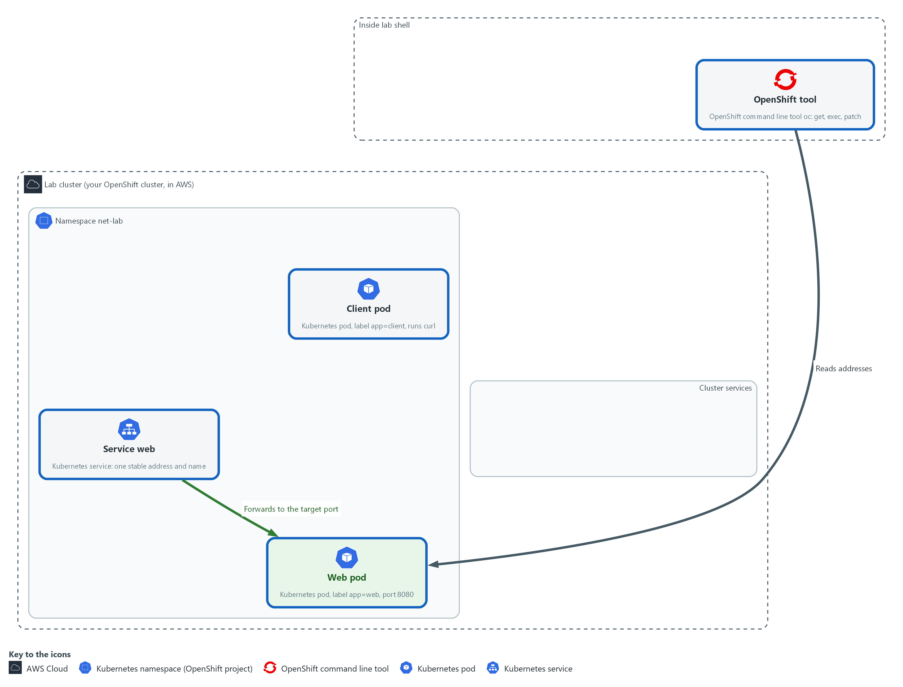

- You read the addresses of the pods and the Service, and the address ranges the cluster uses for them.

#### 1a. List the pods, the Service, and the address ranges

You will now list what exists in the net-lab namespace and ask the cluster for its address ranges.

- The commands below only read; they change nothing.

```bash
oc get pods -n net-lab -o wide
oc get service web -n net-lab
oc get endpointslices -n net-lab -l kubernetes.io/service-name=web
oc get network.config cluster -o json | jq -r '.spec.clusterNetwork[0].cidr, .spec.serviceNetwork[0]'
```

**Expected output:**

```
Example only. Your addresses will differ.
NAME  READY  STATUS  RESTARTS  AGE  IP  NODE ...
client-<hash>  1/1  Running ...  <pod address>
web-<hash>  1/1  Running ...  <pod address>
NAME  TYPE  CLUSTER-IP  EXTERNAL-IP  PORT(S)  AGE
web  ClusterIP  <service address>  <none>  8080/TCP  <age>
(the endpoint slice lists the web pod address with port 8080)
<pod range>
<service range>
```

| Part | What it does | Why you run it |
| --- | --- | --- |
| oc get pods -n net-lab -o wide | Lists the two pods. The wide view adds the IP column, the pod address. | Shows that each pod has its own address, which is the starting fact for every network rule. |
| oc get service web -n net-lab | Shows the Service. CLUSTER-IP is the Service address and PORT(S) is the port callers use. | The Service address is the one callers use. It stays the same when the pod is replaced. |
| oc get endpointslices ... -l kubernetes.io/service-name=web | Lists where the Service really sends traffic: the web pod address and port. | Shows the last hop, from the Service to a pod. A Service with no endpoint sends traffic nowhere. |
| oc get network.config cluster -o json \| jq -r ... | Asks the cluster for the address range it gives pods and the range it gives Services, and prints both. | Ranges tell you what kind of thing an address is, which you need to read any rule that names a range. |

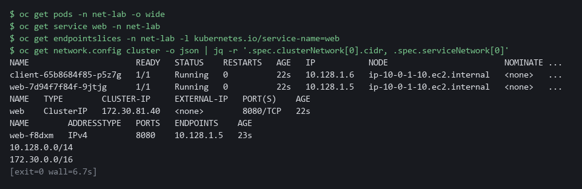

#### 1b. Check with Python that each address is in its range

You will now save the addresses and ranges in variables and ask Python whether each address falls inside a range.

```bash
pod_ip=$(oc get pod -n net-lab -l app=web -o jsonpath='{.items[0].status.podIP}')
svc_ip=$(oc get service web -n net-lab -o jsonpath='{.spec.clusterIP}')
pod_range=$(oc get network.config cluster -o json | jq -r '.spec.clusterNetwork[0].cidr')
svc_range=$(oc get network.config cluster -o json | jq -r '.spec.serviceNetwork[0]')
python3 -c 'import ipaddress,sys; print(sys.argv[1], "is in", sys.argv[2], ":", ipaddress.ip_address(sys.argv[1]) in ipaddress.ip_network(sys.argv[2]))' "$pod_ip" "$pod_range"
python3 -c 'import ipaddress,sys; print(sys.argv[1], "is in", sys.argv[2], ":", ipaddress.ip_address(sys.argv[1]) in ipaddress.ip_network(sys.argv[2]))' "$svc_ip" "$svc_range"
python3 -c 'import ipaddress,sys; print(sys.argv[1], "is in", sys.argv[2], ":", ipaddress.ip_address(sys.argv[1]) in ipaddress.ip_network(sys.argv[2]))' "$pod_ip" "$svc_range"
```

**Expected output:**

```
Example only. Your addresses will differ.
<pod address> is in <pod range> : True
<service address> is in <service range> : True
<pod address> is in <service range> : False
```

| Part | What it does | Why you run it |
| --- | --- | --- |
| pod_ip=$(oc get pod ... jsonpath ...) | Stores the web pod address in a variable. The jsonpath part picks one field out of the pod. | Saves the address so the next commands can use it without you copying it. |
| svc_ip=$(oc get service web ...) | Stores the Service address in a variable. | You compare it with the pod address in a moment. |
| pod_range=... and svc_range=... | Store the two ranges that the cluster printed. | Keeps the ranges in variables so the checks below are short. |
| python3 -c '...' "$pod_ip" "$pod_range" | Asks Python whether the pod address falls inside the pod range and prints True or False. | Checks a range with code, so you do not work it out by eye. |
| python3 -c '...' "$svc_ip" "$svc_range" | Same check for the Service address and the Service range. It should print True. | Confirms a Service address comes from the other range. |
| python3 -c '...' "$pod_ip" "$svc_range" | Checks the pod address against the Service range. It should print False. | A check that comes out False proves the check can say no. It also shows the two kinds of address are separate. |

> **NOTE:** The addresses and ranges on your cluster differ from the examples in this module. Read yours.

> **CHECKPOINT:** The first two Python lines print True, the third prints False, and the endpoint slice shows the web pod address with port 8080.

> **TAKEAWAY:** An address tells you what kind of object it belongs to, and only the Service address stays the same when the pod is replaced.

### Step 2. Follow a name through DNS to the Service

**Learning point: Calling the same Service by four names shows that the short, namespace and full names all reach it, and that a misspelled name fails before any connection starts, with curl exit code 6.**

- curl runs inside the client pod, so you see the call the way a pod sees it.
- The exit code tells you what kind of failure each call was.

What this step adds (thick lines and outlines are new):

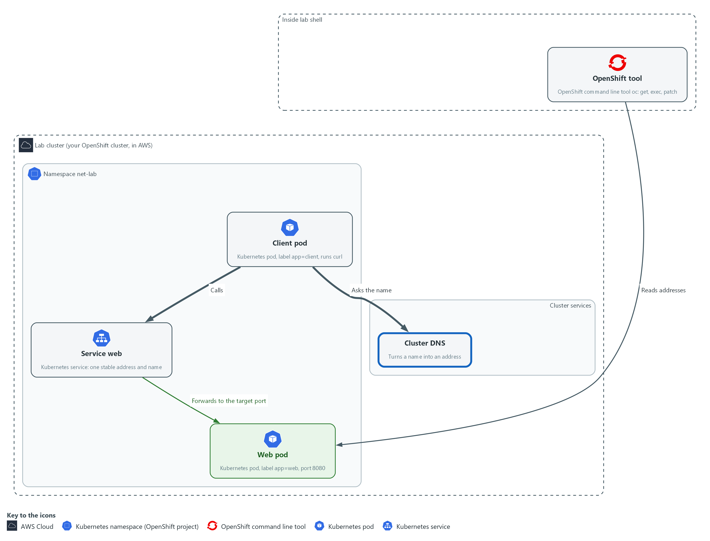

- The client asks cluster DNS for the name web, gets the Service address, and calls it. A name that does not exist fails here.

#### 2a. Call the Service by four names

You will now read the pod's DNS settings and call the web Service by four names, one misspelled.

```bash
oc exec -n net-lab deploy/client -- cat /etc/resolv.conf
for name in web web.net-lab web.net-lab.svc.cluster.local web-typo; do
  printf '%s: ' "$name"
  oc exec -n net-lab deploy/client -- curl -s -m 5 -o /dev/null -w '%{http_code}' "http://$name:8080/" 2>/dev/null || printf ' (curl exit %s)' "$?"
  echo
done
```

**Expected output:**

```
Example only. Your addresses and search endings will differ.
search net-lab.svc.cluster.local svc.cluster.local cluster.local ...
nameserver <dns address>
web: 200
web.net-lab: 200
web.net-lab.svc.cluster.local: 200
web-typo: 000 (curl exit 6)
```

| Part | What it does | Why you run it |
| --- | --- | --- |
| oc exec ... -- cat /etc/resolv.conf | Runs cat inside the client pod. The file lists the DNS server the pod asks (nameserver) and the endings it tries on a short name (search). | Shows where names get resolved and why the short name web works from this namespace. |
| for name in ...; do ... done | Repeats the lines inside once for each of four names. | One loop tests every spelling the same way, so the only thing that differs is the name. |
| printf '%s: ' "$name" | Prints the name being tested, with no new line. | Labels each result so you can tell the calls apart. |
| oc exec ... -- curl -s -m 5 -o /dev/null -w '%{http_code}' URL 2>/dev/null | Runs curl inside the client pod. -s is quiet, -m 5 gives up after 5 seconds, -o /dev/null throws the page away, and -w prints only the status code. 2>/dev/null hides the extra line oc prints about a failed call, so each result stays on one line. | You get one short result per call: a status code, or 000 when no answer came. |
| \|\| printf ' (curl exit %s)' "$?" | If the call failed, prints curl's exit code. The two vertical bars mean or: run this only when the left side failed. | The exit code names the kind of failure, which is the whole point of this step. |

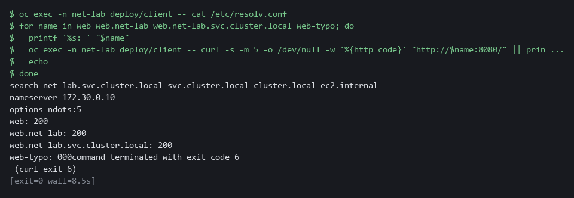

#### 2b. Watch one call step by step

You will now repeat one call with curl in verbose mode and keep only the lines that show its steps.

```bash
oc exec -n net-lab deploy/client -- curl -sv -m 5 -o /dev/null http://web:8080/ 2>&1 | grep -E 'Trying|Connected|HTTP/'
```

**Expected output:**

```
Example only. Your address and server name will differ.
*   Trying <service address>:8080...
* Connected to web (<service address>) port 8080 (#0)
> GET / HTTP/1.1
< HTTP/1.0 200 OK
< Server: SimpleHTTP/0.6 Python/3.11.13
(the version and the extra Server line depend on the web server)
```

| Part | What it does | Why you run it |
| --- | --- | --- |
| curl -sv ... 2>&1 \| grep -E '...' | Shows curl's own account of the call, then keeps only the lines that matter. Trying shows the address it looked up and Connected shows the connection opened. The line starting > GET is the request, and the line starting < HTTP is the answer. | Shows the order of events in one call: name, address, connection, answer. Each can fail separately. |

> **NOTE:** oc prints a line starting command terminated with exit code for each failed call. That is oc passing along curl's exit code.

> **CHECKPOINT:** The first three names print 200. web-typo prints 000 and curl exit 6, and the Trying address matches the Service address.

> **TAKEAWAY:** A name that does not resolve fails differently from a call that gets no answer, and the exit code says which.

### Step 3. Add a Route and read where TLS ends

**Learning point: Creating an edge Route and reading the certificate the router presents shows where encryption stops and why a machine rejects a certificate whose issuer it does not trust.**

- People and outside systems come in through the router, not by pod name.
- You create a Route, read the certificate the router presents, and see that encryption stops at the router.

What this step adds (thick lines and outlines are new):

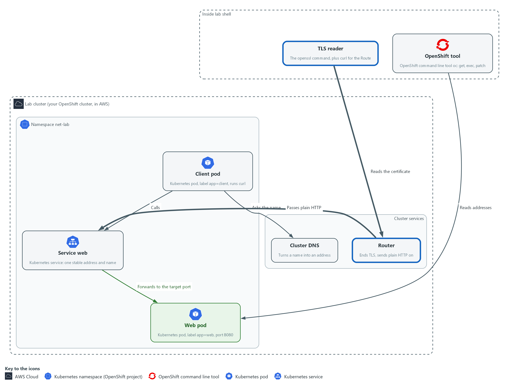

- You add a Route. The router takes the encrypted connection from outside and passes plain HTTP to the Service.

#### 3a. Create a Route and read how it ends TLS

You will now create a Route for the web Service and read back its host name and how it ends TLS.

```bash
oc create route edge web --service=web --port=8080 -n net-lab || true
host=$(oc get route web -n net-lab -o jsonpath='{.spec.host}')
echo "$host"
oc get route web -n net-lab -o json | jq -r '.spec.tls.termination'
```

**Expected output:**

```
Example only. Your host name will differ.
route.route.openshift.io/web created
<route host name>
edge
```

| Part | What it does | Why you run it |
| --- | --- | --- |
| oc create route edge web --service=web --port=8080 | Creates a Route named web. Edge means the router ends TLS. It points at the Service web, port 8080. The \|\| true after it keeps the step safe to run twice. | A Route is how a Service becomes reachable from outside, and edge is the simplest way to see where TLS ends. |
| host=$(oc get route web ... jsonpath ...) | Stores the host name the cluster gave the Route. | The host name is what outside callers use, and what the certificate must match. |
| echo "$host" | Prints it. | Confirms you have a name to connect to. |
| oc get route web ... \| jq -r '.spec.tls.termination' | Prints how the Route ends TLS. It should say edge. | Reads the setting back from the cluster instead of trusting the command you typed. |

#### 3b. Read the certificate and test trust

You will now read the certificate the router presents and call the Route over HTTPS, first with the certificate check and then without it.

```bash
host=$(oc get route web -n net-lab -o jsonpath='{.spec.host}')
openssl s_client -connect "$host:443" -servername "$host" </dev/null 2>/dev/null | openssl x509 -noout -subject -issuer -dates
env -u CURL_CA_BUNDLE -u SSL_CERT_FILE curl -s -o /dev/null "https://$host/"
echo "curl exit: $?"
curl -sk -o /dev/null -w '%{http_code}\n' "https://$host/"
```

**Expected output:**

```
Example only. Your names and dates will differ.
subject=<name in the certificate>
issuer=<who issued it>
notBefore=<date>
notAfter=<date>
curl exit: 60
200
```

| Part | What it does | Why you run it |
| --- | --- | --- |
| host=$(oc get route web ...) | Reads the Route host name again, so this block works on its own. | A block that needs a value must set it, in case you opened a new lab shell. |
| openssl s_client -connect "$host:443" -servername "$host" </dev/null | Opens a TLS connection to the router the way a browser would, tells it which host name you want (-servername), and closes at once because the input is empty. | Gets the certificate the router presents, without a browser. |
| 2>/dev/null \| openssl x509 -noout -subject -issuer -dates | Hides error messages, then prints four facts from the certificate: who it names (subject), who issued it (issuer), and the dates it is valid from and to. | Subject, issuer and dates are what you check on any certificate. |
| env -u CURL_CA_BUNDLE -u SSL_CERT_FILE curl -s -o /dev/null "https://$host/" | Calls the Route over HTTPS and checks the certificate the way a browser does. env -u removes the two settings that point curl at the lab's trusted issuers, because the lab shell normally trusts the lab router certificate and the call would succeed. | Shows what a machine does when it does not trust the issuer. |
| echo "curl exit: $?" | Prints the exit code of that call. 60 means the certificate is not trusted by the default list curl now uses, which does not include the lab issuer. | Tells you whether the check passed without reading the page. |
| curl -sk ... -w '%{http_code}\n' | The same call with -k, which skips the certificate check, and prints the status code. | Proves the Route works even though the check failed. Use -k to look, never to decide that something is safe. |

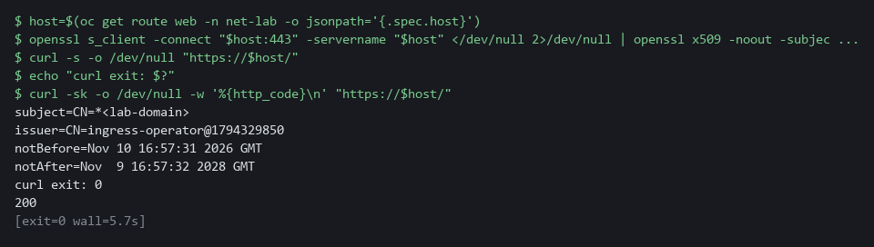

> **NOTE:** With an edge Route, the connection is encrypted from the caller to the router. After the router the call to the pod is plain HTTP. Passthrough and re-encrypt Routes work differently, as section 2.3 says.

> **SECURITY:** -k tells curl to ignore a bad certificate. Use it only to look at something in the lab. A check that uses -k cannot tell a real server from an impostor.

> **CHECKPOINT:** The Route says edge, openssl prints a subject, issuer and dates, and the status code with -k is 200.

> **TAKEAWAY:** With an edge Route, encryption stops at the router, and a certificate check fails when the machine does not trust the issuer.

### Step 4. Find the blocked hop

**Learning point: Applying a supplied fault and reading the exit code after each fix shows how to tell a dropped call (28) from a refused port (7), and that fixing the first fault can reveal the second.**

- Lab start copied break.yaml and allow-client.yaml to the net folder in your home folder (~/net).
- Apply break.yaml first and read it only after you have found both mistakes.
- One mistake drops the call and the other sends it to the wrong port, so the second hides behind the first.

What this step adds (thick lines and outlines are new):

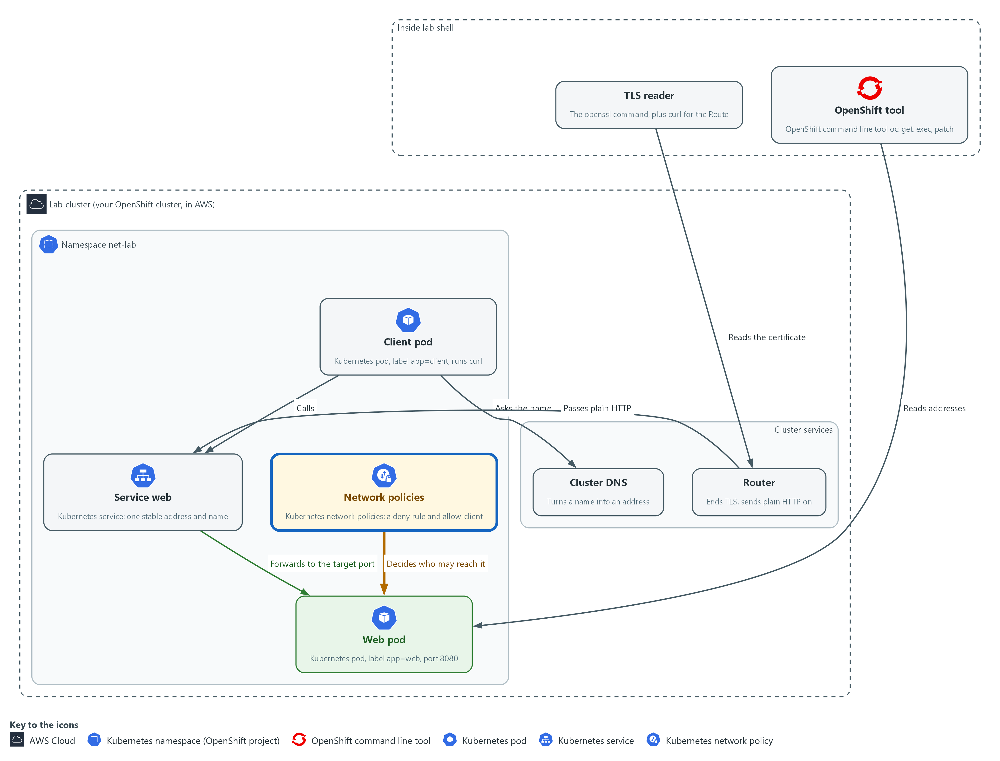

- A network policy now drops the call, and a wrong port sends it nowhere. You find both.

#### 4a. Apply the fault and see how the call fails

You will now apply the supplied fault file without reading it and repeat the call from the client pod.

```bash
oc apply -f ~/net/break.yaml
oc exec -n net-lab deploy/client -- curl -s -m 5 -o /dev/null -w '%{http_code}\n' http://web:8080/
echo "exit: $?"
```

**Expected output:**

```
Example only. (oc lists the policies and the Service it created or changed)
000command terminated with exit code 28
exit: 28
```

| Part | What it does | Why you run it |
| --- | --- | --- |
| oc apply -f ~/net/break.yaml | Applies the supplied file. It adds network policies and changes the Service. Do not read it yet. | Creates the fault you are about to find, so you work from symptoms and not from the answer. |
| oc exec ... -- curl -s -m 5 ... http://web:8080/ | The same call as in Step 2, from the client pod to the Service. | Shows what the fault looks like from the caller. Compare it to Step 2. |
| echo "exit: $?" | Prints the exit code of the call. | 28 means no answer in time, which points at a drop and not at a missing name or port. |

#### 4b. Compare the policies with the pod labels

You will now list the network policies and the pod labels, then read the allow rule.

- The commands below only read; they change nothing.

```bash
oc get networkpolicy -n net-lab
oc get pods -n net-lab --show-labels
oc describe networkpolicy allow-client -n net-lab
```

**Expected output:**

```
Example only. NAME  POD-SELECTOR  AGE
(two policies: one that denies callers and allow-client)
(the pods are listed with their labels)
(describe shows which label the allow rule lets in)
```

| Part | What it does | Why you run it |
| --- | --- | --- |
| oc get networkpolicy -n net-lab | Lists the policies. There are two: one that denies all callers, and one meant to allow the client. | A timeout points at a policy, so list them first. |
| oc get pods -n net-lab --show-labels | Lists the pods with their labels. Read the label on the client pod. | A policy picks pods by label, so the label on the caller is the first thing to compare. |
| oc describe networkpolicy allow-client -n net-lab | Explains the allow rule. Find which label it allows. | Putting the two labels side by side shows the mismatch without guessing. |

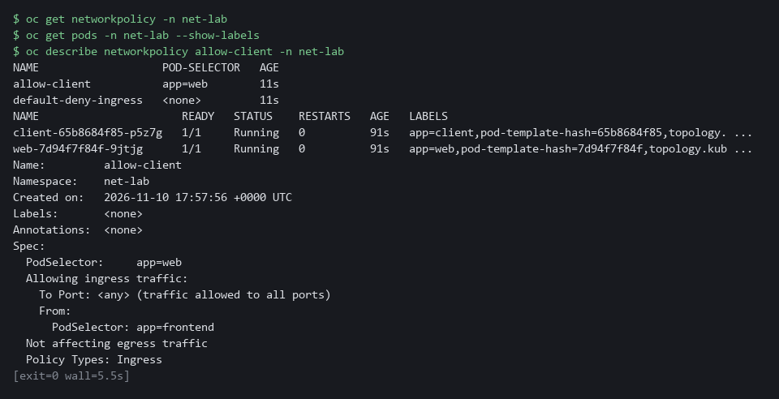

#### 4c. Fix the allow rule and repeat the call

You will now change the allow rule so it lets in the label the client pod really has, then repeat the call.

```bash
oc patch networkpolicy allow-client -n net-lab --type=merge -p '{"spec":{"ingress":[{"from":[{"podSelector":{"matchLabels":{"app":"client"}}}]}]}}'
oc exec -n net-lab deploy/client -- curl -s -m 5 -o /dev/null -w '%{http_code}\n' http://web:8080/
echo "exit: $?"
```

**Expected output:**

```
Example only. networkpolicy.networking.k8s.io/allow-client patched
(the call prints 000)
command terminated with exit code 7
exit: 7
```

| Part | What it does | Why you run it |
| --- | --- | --- |
| oc patch networkpolicy allow-client ... -p '{...}' | Changes the allow rule so it allows pods labeled app=client. The part after -p is JSON that replaces the ingress list. | Fixes the first mistake with the smallest change: the label the rule allows. |
| oc exec ... curl ... | Repeats the call. | A fix is not proven until the same call is repeated. |
| echo "exit: $?" | Prints the exit code. It should now be 7. | The code changed from 28 to 7, so the first mistake is fixed and a different one is showing. The machine answers, but nothing listens on that port. |

#### 4d. Fix the Service port and repeat the call

You will now compare the Service target port with the port the pod listens on, fix the Service, and repeat the call.

```bash
oc get service web -n net-lab -o json | jq '.spec.ports'
oc get pod -n net-lab -l app=web -o json | jq '.items[0].spec.containers[0].ports'
oc patch service web -n net-lab --type=merge -p '{"spec":{"ports":[{"port":8080,"targetPort":8080}]}}'
oc exec -n net-lab deploy/client -- curl -s -m 5 -o /dev/null -w '%{http_code}\n' http://web:8080/
echo "exit: $?"
```

**Expected output:**

```
Example only. (the Service ports, with its targetPort)
(the container ports, with the port the pod listens on)
service/web patched
200
exit: 0
```

| Part | What it does | Why you run it |
| --- | --- | --- |
| oc get service web ... \| jq '.spec.ports' | Prints the Service port settings. Read targetPort, the port the Service sends calls to. | A refused connection points at the port, so read where the Service sends the call. |
| oc get pod ... \| jq '.items[0].spec.containers[0].ports' | Prints the port the web container declares it listens on. | Compare this with targetPort. They should be the same. |
| oc patch service web ... -p '{...}' | Sets the Service target port to 8080, the port the pod listens on. | Fixes the second mistake. |
| oc exec ... curl ... / echo "exit: $?" | Repeats the call and prints the exit code. | Proves both fixes: the call should print 200 and the exit code should be 0. |

> **NOTE:** Once a network policy selects a pod, everything it does not list is dropped. The deny policy selects every pod in net-lab, including the web pod, so the Route from Step 3 is cut off as well.

> **CHECKPOINT:** The exit code goes from 28, to 7, to 0, and the last call prints 200.

> **TAKEAWAY:** The exit code moving from 28 to 7 to 0 tells you which hop you fixed each time.

### Step 5. Write the hop check

**Learning point: Saving and running hop_check.py makes the diagnosis you did by hand repeatable: the script makes the call from the client pod and prints OK or the name of the failure.**

- You save hop_check.py in the net folder in your home directory.
- hop_check.py is short on purpose, because later modules reuse it.

What this step adds (thick lines and outlines are new):

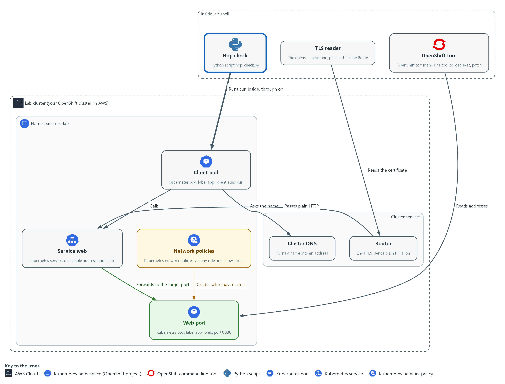

- A script you write runs the same call from the client and names which kind of failure it saw.

#### 5a. Save the hop check script

You will now save the script as hop_check.py in the net folder in your home directory.

- Paste all the lines at once into the lab shell; the paste prints nothing.

```bash
mkdir -p ~/net
cd ~/net
cat > hop_check.py <<'EOF'
import subprocess
import sys

MEANING = {
    6: ("DNS", "the name did not resolve"),
    7: ("REFUSED", "nothing listens on that port (check the Service targetPort)"),
    28: ("TIMEOUT", "no answer in 5 seconds (check network policy and labels)"),
}


def call(url):
    cmd = ["oc", "exec", "-n", "net-lab", "deploy/client", "--", "curl", "-s", "-m", "5",
           "-o", "/dev/null", "-w", "%{http_code}", url]
    done = subprocess.run(cmd, stdout=subprocess.PIPE, stderr=subprocess.DEVNULL, universal_newlines=True)
    return done.returncode, done.stdout.strip()


def main(argv):
    if len(argv) != 2:
        print("usage: python3 hop_check.py URL")
        return 2
    rc, code = call(argv[1])
    if rc == 0:
        print("OK       %s answered %s" % (argv[1], code))
        return 0
    name, hint = MEANING.get(rc, ("OTHER", "curl exit %d" % rc))
    print("%-8s %s: %s" % (name, argv[1], hint))
    return 1


sys.exit(main(sys.argv))
EOF
```

**Expected output:**

```
Example only. Nothing is printed. To check the file, run wc -l ~/net/hop_check.py: it holds 31 lines.
```

| Part | What it does | Why you run it |
| --- | --- | --- |
| mkdir -p ~/net, cd ~/net | Makes sure the net folder exists and moves into it. | The file is made in the folder you stand in. |
| cat > hop_check.py <<'EOF' ... EOF | Saves everything between the first and last line as hop_check.py. The quotes around EOF keep every character as typed. | No editor is needed; the paste is the whole file. |
| MEANING | Maps curl exit codes 6, 7 and 28 to a short name and a hint on where to look. | Keeps the hints from section 2.4 for those three codes in one place, so changing a hint means changing one line. |
| call(url) | Runs curl inside the client pod with oc exec, keeps the status code it prints, and returns it with curl's exit code. Error output is thrown away because the script reports its own message. | The call is made from where the caller really is, so the result matches what a pod sees. |
| the run call inside call(url) | Runs the command as a list of words, with no shell, so nothing in the address can be read as a command. | The address comes from you, and passing words as a list is the safe way to hand it to another program. |
| if rc == 0 ... print | Exit code 0 prints OK and the status code. Any other code prints its name and hint from MEANING, or OTHER if it is not in the table. | Turns a number into a name and a next step. |
| return 0 / return 1 | Exits 0 only when the call worked, and 1 for every failure. A missing address exits 2. | Other scripts and checks can use this one to decide pass or fail. |

#### 5b. Run the hop check on the working path

You will now run the script you saved on the path that works.

```bash
python3 ~/net/hop_check.py http://web:8080/
echo "exit code: $?"
```

**Expected output:**

```
Example only. Your status code can differ.
OK       http://web:8080/ answered 200
exit code: 0
```

| Part | What it does | Why you run it |
| --- | --- | --- |
| python3 ~/net/hop_check.py http://web:8080/ | Runs the script on the working path. It should print OK. | A first run on a path you know works shows the script can say yes. |
| echo "exit code: $?" | Prints the exit code of the script. 0 means pass. | Confirms the exit code matches the message. |

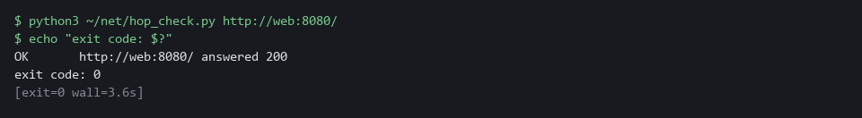

> **CHECKPOINT:** The script prints OK and the line shows the status code 200. The exit code is 0.

> **TAKEAWAY:** A script that names the failure turns a curl exit code into a next step.

## Section 4. Verify It Works

### Test 1 (positive). The check says OK on the working path and DNS on a name that does not exist

- Run the check on the path that works, then on a misspelled name, because a check that has only said yes is not proven.
- The check must name the right kind of failure each time.

```bash
python3 ~/net/hop_check.py http://web:8080/
echo "exit code: $?"
python3 ~/net/hop_check.py http://web-typo:8080/
echo "exit code: $?"
```

**Expected output:**

```
Example only. The status code can differ.
OK       http://web:8080/ answered 200
exit code: 0
DNS      http://web-typo:8080/: the name did not resolve
exit code: 1
```

| Part | What it does | Why you run it |
| --- | --- | --- |
| python3 ~/net/hop_check.py http://web:8080/ | Runs the check on the working path. | It should say OK: a check must be able to say yes. |
| OK ... answered 200 / exit code: 0 | The call worked and the script exits 0. | The message and the exit code agree. |
| http://web-typo:8080/ | Runs the check on a name that does not exist. | The fault is a name that cannot be resolved. |
| DNS ... / exit code: 1 | The script names the kind of failure and exits 1. | Proves the check tells a name failure from other failures. |

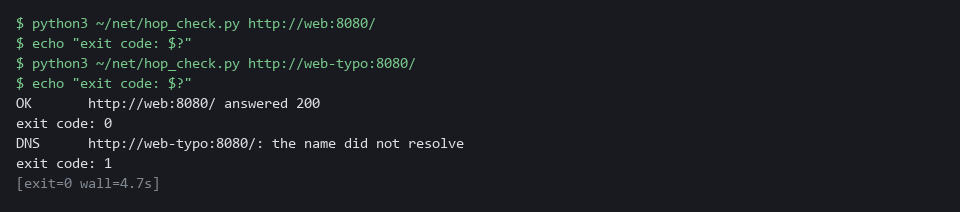

> **CHECKPOINT:** The first call prints OK and exit code 0. The misspelled name prints DNS and exit code 1.

### Test 2 (negative). Remove the allow rule, watch the check name a timeout, then restore it

- Delete the allow rule.
- The deny policy remains, so the call must be dropped.
- Run the check and see it name the problem, then put the rule back from the supplied file and see it pass.

```bash
oc delete networkpolicy allow-client -n net-lab --ignore-not-found
python3 ~/net/hop_check.py http://web:8080/
echo "exit code: $?"
oc apply -f ~/net/allow-client.yaml
python3 ~/net/hop_check.py http://web:8080/
echo "exit code: $?"
```

**Expected output:**

```
Example only. The status code can differ.
networkpolicy.networking.k8s.io "allow-client" deleted from net-lab namespace
TIMEOUT  http://web:8080/: no answer in 5 seconds (check network policy and labels)
exit code: 1
networkpolicy.networking.k8s.io/allow-client created
OK       http://web:8080/ answered 200
exit code: 0
```

| Part | What it does | Why you run it |
| --- | --- | --- |
| oc delete networkpolicy allow-client ... | Removes the allow rule. The deny policy stays, so calls are dropped. | This is the failure the check must notice. |
| TIMEOUT ... / exit code: 1 | The check names a timeout and exits 1. | A dropped call ends as a timeout, not a missing name. |
| oc apply -f ~/net/allow-client.yaml | Puts the correct allow rule back from the supplied file. | Restores the lab so you can repeat the test. |
| OK ... / exit code: 0 | The same call passes again. | Proves the check follows the real state of the path. |

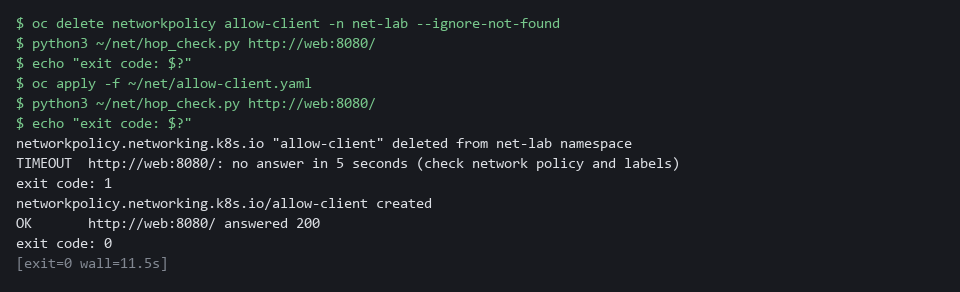

> **CHECKPOINT:** While the allow rule is gone the check prints TIMEOUT and exit code 1. After you restore it the same call prints OK and exit code 0.

## Section 5. Next Steps

### Using this in other environments

- Pods, Services, endpoint slices, cluster DNS, network policies and curl exit codes are standard Kubernetes behavior and port as is, with kubectl in place of oc.
- The Route and the router are OpenShift only. Other platforms use an Ingress or a Gateway API route, served by that platform's own controller.
- The address ranges are read from the OpenShift network.config object. Other platforms keep them in the cloud provider's settings or the cluster's network plugin settings.
- Change these lab values first: the namespace net-lab, the pod labels app=web and app=client, the Route host name, and the files in ~/net.

The table shows what changes on each platform:

| Check | In this lab (OpenShift) | On other platforms | What you change |
| --- | --- | --- | --- |
| Pod and Service addresses | oc get pods -o wide, oc get service, oc get endpointslices | The same with kubectl | The tool name. |
| Address ranges | oc get network.config cluster | The cloud provider's cluster network settings | Read the ranges from there instead. |
| DNS and calls from a pod | oc exec deploy/client with curl | kubectl exec deploy/client with curl | The tool name. |
| Route and TLS | oc create route edge, then openssl s_client to the route host | An Ingress or Gateway API route, then openssl s_client to its host | Replace the Route object and read the host from your Ingress. |
| Blocked hop | NetworkPolicy allow-client, applied with oc | The same object, if the network plugin enforces policies | The tool name. Also confirm your network plugin enforces policies. |
| hop_check.py | Runs curl in the client pod with oc exec | The same with kubectl exec | Replace oc with kubectl in the script. |

> **TIP:** Next module: GRC-2 Run Evidence Collection: collect and check evidence for a control with commands you run yourself.

<details>
<summary><strong>Section 6. Terms</strong></summary>

Each term is also explained the first time it appears. In Word, hover over an underlined term to see its meaning, or Ctrl+click it to jump to this table.

| Term | Plain meaning |
| --- | --- |
| Address range | A block of addresses written as CIDR, such as 10.1.0.0/16. |
| AWS | Amazon Web Services, the cloud your lab runs in. |
| Certificate | A signed file that a server presents to prove its identity. It names the server, who issued it and when it expires. |
| Certificate authority | An organization that issues and signs certificates, so others can trust them. |
| CIDR | A way to write a range of addresses: an address, a slash and a number. 10.1.0.0/16 means every address that starts with 10.1. |
| Cluster | The group of servers that runs your lab and the programs in it. |
| Connection refused | The machine answered, but nothing was listening on that port. |
| Container | A sealed box that holds one program and everything it needs to run. |
| Controller | A program in the cluster that keeps the real state matching what you asked for. |
| DNS | The lookup service that turns a name into an address. |
| Drop | When a network rule discards a connection without any reply. The caller sees only a timeout. |
| East-west traffic | Traffic between pods inside the cluster. |
| Edge route | A Route where the router ends TLS and passes plain HTTP to the pod. |
| Encryption | Scrambling data so that only someone with the right key can read it. |
| Endpoint | One address and port that something listens on, such as a pod behind a Service or a URL path that returns data. |
| Endpoint slice | The list of pod addresses and ports that a Service sends traffic to. |
| Evidence | Saved records that show a system is set up and behaving as claimed. |
| Exit code | A number a command leaves behind when it ends. 0 means success; curl uses other numbers to say what went wrong. |
| Gateway API | A Kubernetes way to route outside traffic to Services, used where there is no OpenShift Route. |
| grep | A command that prints only the lines that match a pattern. |
| Heredoc | A shell way to write a multi-line file: type text until a marker line such as EOF. |
| Hop | One stage a call passes through on its way, such as the name lookup, the Service or the pod. |
| HTTP | The protocol that web pages and web APIs use. HTTPS is the encrypted form. |
| Image | A packaged copy of a program and everything it needs to run. A container starts from an image. |
| Ingress | The way traffic from outside the cluster reaches a program inside it. |
| IP address | A number that identifies one machine or pod on a network, such as 10.1.2.3. |
| jq | A tool that picks values out of JSON text. |
| JSON | A text format for data, made of names and values in braces. |
| kubectl | The standard Kubernetes command-line tool. oc does the same jobs and adds OpenShift features. |
| Kubernetes | The open-source system that runs and manages containers across servers. OpenShift is built on it. |
| Label | A key=value tag on a cluster object, such as app=web. Services and policies pick pods by label. |
| mkdir | A command that makes a new folder. |
| Name resolution | Turning a name into an address by asking DNS. |
| Namespace | A named section of the cluster that holds a set of related parts. |
| Network policy | A cluster rule that lists which pods may talk to a pod. A pod that no policy selects accepts everyone. |
| Node | One server in the cluster. |
| North-south traffic | Traffic that crosses the edge of the cluster, in or out. |
| oc | The command-line tool for OpenShift. You type oc to ask the cluster questions. |
| OpenShift | The Red Hat platform your lab cluster runs on. It is Kubernetes with extra security and tools built in. |
| Passthrough route | A Route where the router passes the encrypted bytes to the pod without opening them. |
| Pod | The smallest thing the cluster runs: one or more containers that run together and share one network address. |
| Policy | A set of rules written down so that a tool can enforce them. |
| Port | A number that picks one program on a machine. Web servers often listen on port 80, 443 or 8080. |
| printf | A command that prints text in a set format. |
| Provider | The company or plug-in that supplies a platform, such as a cloud provider or a Terraform provider. |
| Re-encrypt route | A Route where the router ends TLS, then encrypts again to the pod. |
| Route | An OpenShift object that makes a Service reachable from outside the cluster under a host name. |
| Router | The part of OpenShift that receives traffic from outside and sends it to the right Service. |
| Rule | A written condition that a tool checks. |
| Script | A text file of commands that a computer runs in order. |
| Service | A cluster object that gives a group of pods one stable address and name, even when the pods are replaced. |
| Status code | A three-digit number in a web reply. 200 means the server answered normally. |
| Target port | The port a Service sends calls to on the pod. It must match the port the pod listens on. |
| TCP | The kind of connection that web traffic uses. It sets up a connection, delivers data in order, and tells you if the other side refuses. |
| Timeout | No answer came back in the time allowed. A dropped connection usually ends this way. |
| TLS | The encryption used for secure web connections (the S in HTTPS). It also proves who the server is. |
| URL | A web address, such as https://example.com/page. |
| YAML | A plain-text format for settings: lines of name: value, with indentation to show what belongs to what. |

</details>
