# GRC-2: Run Evidence Collection (CA-7, CM-6, SC-13)

| Item | Detail |
| --- | --- |
| Sequence | Module 3 of 32 in the recommended order |
| Timed work | About 68 minutes (49 hands-on, 19 verify) |
| Standalone start | `lab start grc-2` |
| Combined start | Continue from the end state of the previous module |
| Tools | OpenShift Container Platform, OpenShift Pipelines (Tekton), Kyverno (free, open source), oc, tkn, jq, Python 3 |
| Prerequisites | ENG-0 Terminal, Git and Your Lab (typing commands in lab shell, reading oc get output, and what a pod and a namespace are) |

## Section 1. Module Overview

- Purpose: show, on a given day, that the system still matches what its documents say (CA-7, CM-6, SC-13).
- The collector is a script the lab supplies. It reads four things from the cluster: the FIPS setting, the required namespaces, the Kyverno policies and the API audit profile.
- You run the collector by hand, then through a pipeline, and read every field of the evidence file.

- **Skill:** Run a script that collects evidence from the cluster, read it field by field, and write a check of your own.
- **Tools:** `oc` reads the cluster, `jq` picks values out of the evidence, a Python collector script asks the questions, OpenShift Pipelines (Tekton) runs it without a person, and a config map holds the script on the cluster.
- **Security Function:** Detects configuration drift. Dated evidence shows whether the FIPS setting, the Kyverno policies and the API audit profile still match the documents. A run that could not read everything is marked incomplete instead of passing.
- **NIST CA-7 Continuous Monitoring:** OpenShift Pipelines runs the collector without a person. Each run is one pass of monitoring, and its time and complete flag show how recent and how complete it was.
- **NIST CM-6 Configuration Settings:** The collector records the settings in force, the Kyverno policies and the API audit profile. Your own check counts pods that do not require a non-root user, a setting a secure configuration baseline can require.
- **NIST SC-13 Cryptographic Protection:** The collector records whether the cluster is set to use FIPS-validated cryptography, and Step 4 compares that setting with what the node reports.

## Section 2. The Tools

### Tools used in this module

Each tool name links to its official overview. The table columns say how each tool is used in the lab and why the lab uses it instead of another way of doing the same job.

| Tool (overview link) | What it is | Used in this lab | Why this tool |
| --- | --- | --- | --- |
| [OpenShift Container Platform](https://docs.redhat.com/en/documentation/openshift_container_platform/4.22/html/overview/ocp-overview) | A Kubernetes container platform for running and managing containerized applications. | The cluster the evidence collector asks questions of, using only read commands. | It is the platform the whole lab runs on, so every module works on the same real cluster, with the same kinds of objects a production OpenShift system has. |
| [OpenShift Pipelines (Tekton)](https://docs.redhat.com/en/documentation/openshift_container_platform/4.22/html/pipelines/index) | Kubernetes-native CI/CD built on Tekton. | Runs the same collector as a pipeline with no person at the keyboard. | It runs automated tasks inside the cluster, so you can see a check run with no person at the keyboard and under its own limited identity. A script run from a laptop could not show that. |
| [Kyverno](https://kyverno.io/docs/) | A policy engine that checks and enforces rules on Kubernetes resources. | One check in the collector lists the Kyverno cluster policies. | It is the policy engine the lab already uses to check and enforce rules on cluster objects, so there are real policies to count and read as evidence. It is free and open source. |
| [oc](https://docs.redhat.com/en/documentation/openshift_container_platform/4.22/html/cli_tools/openshift-cli-oc) | The OpenShift command-line tool for creating and managing applications and projects from a terminal. | The collector is a set of oc get commands. You also use oc to fetch it from its config map. | It is the one command that talks to the cluster, so every module uses it to ask what is true and to make changes. You sign in once, and it works on OpenShift objects as well as standard Kubernetes ones. Unlike clicking in the web console, a command can be pasted, repeated and checked by a test. |
| [tkn](https://docs.redhat.com/en/documentation/openshift_container_platform/4.22/html/cli_tools/pipelines-cli-tkn) | Command-line tool for managing pipelines, runs and tasks. | Starts the evidence pipeline and follows its run. | It starts and reads pipeline runs from the terminal, so the same shell you use for everything else drives the pipeline. The other way is the web console, which cannot be pasted into a step. |
| [jq](https://jqlang.org/) | Command-line JSON processor. | Reads the evidence file the collector writes and picks out single checks. | It picks one field out of a long JSON reply, so a test can read a single value. |
| [Python 3](https://docs.python.org/3/tutorial/introduction.html) | General-purpose language, used here for small helper scripts. | Runs collect_facts.py, the collector, and saves its output in a file. | Python reads and writes JSON easily and is already in the lab shell, so a small script needs nothing installed. |

### How it fits together

#### One collector, two ways to run it

- Lab (test) setup: the same collector runs from your lab shell and from a pipeline, and both produce the same kind of evidence file.
- The numbers on the arrows show the order, 1 to 8.
- Each step below adds one part, drawn with thick lines.

How the lab is set up, and why:

- You type in lab shell, a container on your computer.
- Everything except lab shell runs on your cluster in AWS.
- In production the same pipeline runs on a schedule and the evidence goes to protected storage; the lab keeps it simple.
- One stored script feeds both runs, so the results compare line for line.
- The node sits outside the picture because a configured setting only says what the cluster intends, so Step 4 asks the node's kernel.

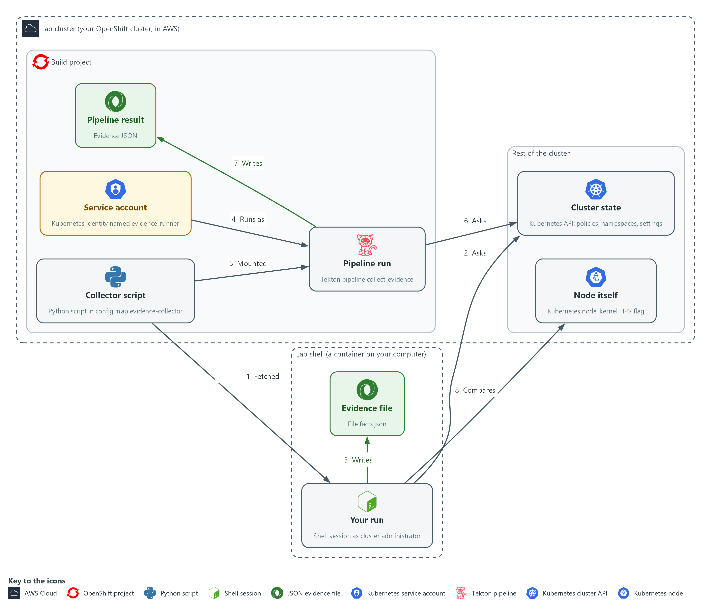

- **1. Collector script:** the Python script kept in the config map evidence-collector. You copy it into lab shell in Step 1 (arrow 1), and the pipeline run mounts the same copy (arrow 5).
- **2. Your run:** the shell session where you run the script as cluster administrator. It reads the cluster state with oc get (arrow 2) and never changes it.
- **3. Evidence file:** facts.json in your workspace, where your run saves its answers (arrow 3).
- **4. Service account:** evidence-runner, an identity for a program that can only get and list (arrow 4).
- **5. Pipeline run:** the Tekton pipeline collect-evidence, which runs as that service account with no person at the keyboard and reads the same cluster state (arrow 6).
- **6. Pipeline result:** the evidence JSON the pipeline run keeps in the run's record (arrow 7).
- **7. Cluster state:** the Kubernetes API, which answers questions about policies, namespaces and settings.
- **8. Node itself:** the Kubernetes node, whose kernel reports the real FIPS flag. Step 4 compares it with your evidence (arrow 8).

Where each part runs, and why:

| Part | Where it runs | Why it is built this way |
| --- | --- | --- |
| Lab shell | A container on your computer | You run the collector by hand here, as administrator, to see what a complete run looks like. |
| Collector script | A config map named evidence-collector in the build namespace | One stored copy feeds both runs, so the results can be compared line for line. |
| Pipeline run | Pods in the build namespace, started with OpenShift Pipelines | Shows how the check would run on a schedule with nobody at the keyboard. |
| Service account evidence-runner | The build namespace | Automation gets a written, limited identity that can only get and list, instead of borrowing a person's access. |
| Evidence | facts.json in your workspace, and a result on the pipeline run | Both are plain JSON, so you can compare them with a single command. |
| Node | The cluster's one server, reached with oc debug | The node's kernel reports what is really running, which a configured setting cannot prove on its own. |

### 2.1 The collector and the pipeline (CA-7 Continuous Monitoring)

- The collector is a Python script. For each check it calls `oc` to ask the cluster one question and keeps one fact.
- A failed check is recorded as an error and the others still run, so one problem does not hide the rest.
- The collector prints the evidence as one line of JSON.
- In lab shell you run the collector as yourself, with your own admin login.
- In a Tekton pipeline the collector runs in a pod as a service account. Its permissions are written down and can be limited, so automation uses one.

#### CA-7: Continuous Monitoring

*The control asks the organization to choose system-level metrics, set how often to monitor them, and carry out ongoing monitoring, analysis, response and reporting. This is done using:*

- The collector script: asks four chosen questions.
- OpenShift Pipelines (Tekton): runs the collector without a person, so it can be put on a schedule.
- The collected_at time and the complete flag in each evidence file: show how fresh the evidence is and whether every check answered.

### 2.2 What each field proves (CM-6 Configuration Settings, SC-13 Cryptographic Protection)

#### CM-6: Configuration Settings

*The control asks the organization to establish and document settings that reflect the most restrictive mode consistent with operational requirements, implement them, approve any deviations, and monitor and control changes to them. This is done using:*

- The kyverno-policies check: records how many policies exist and how many are ready.
- The audit-profile check: records which audit profile the API server uses, which is one setting. The evidence file tags it AU-12, a control this module does not teach.
- Dated evidence files: a later change shows up when two runs are compared.

#### SC-13: Cryptographic Protection

*The control asks the organization to determine where cryptography is used and to implement the type required for each use. This is done using:*

- The fips-configured check: reads the newest rendered-master MachineConfig and records whether FIPS mode is requested.
- Step 4: compares the configured FIPS value with the node, so a configured setting is not mistaken for one that is running.

What the picture shows:

- Each field in the evidence file backs one control.
- The second line of each box says what the field proves and what it does not.
- This is the lab (test) evidence file; in production the same fields would sit in evidence kept in protected storage.

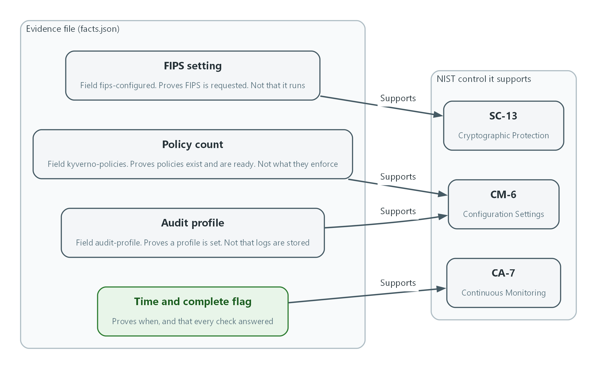

- **1. FIPS setting:** the fips-configured field. It shows the cluster is set to use FIPS-validated cryptography, and Step 4 checks the node.
- **2. Policy count:** the kyverno-policies field. It records the policies in force at the time of the run.
- **3. Audit profile:** the audit-profile field. It records the audit setting in force at the time of the run.
- **4. Time and complete flag:** collected_at and complete. They show how recent the monitoring pass was and whether every check answered.
- **5. SC-13:** Cryptographic Protection, supported by the FIPS setting.
- **6. CM-6:** Configuration Settings, supported by the policy count and the audit profile.
- **7. CA-7:** Continuous Monitoring, supported by the time and complete flag.

> **IN PRODUCTION:** In the real environment evidence files are signed and stored where the collector cannot change them, and a missing or incomplete run raises an alert. Later modules build those parts. Here you only read the file.

### Design decisions

#### A failed check is recorded, not fatal

- How: The collector runs each check in its own try block and marks a failed check as error with a null value. It then prints one JSON line with a complete flag and an error list.
- Why: A half-finished file with an honest error list is more useful than a crash. The complete flag lets a reader reject a partial run even when the pipeline shows green.
- Alternatives: Advantage of stopping at the first failed check: the pipeline turns red and nobody can mistake the run for a good one. Drawback: every check after the failure is lost, so the evidence cannot show which other facts were readable.

#### One script, run by hand and by a limited service account

- How: The script is stored once in a config map. A pipeline mounts it and runs as a service account that may only get and list, and you also run the same file yourself as administrator to compare the two results.
- Why: Automation needs a named identity whose permissions are written down and can be limited. One script means the manual and automated results can be compared line for line.
- Alternatives: Advantage of running the pipeline with an administrator login: nothing can fail for lack of access. Drawback: the evidence then hides what the scheduled identity can really read, and the run carries far more rights than it needs.

#### Compare the configured FIPS flag with the node

- How: Step 4 reads the configured flag recorded by the collector and the kernel's own answer from a node, and compares the two.
- Why: The configured value shows intent while the kernel value shows what is running, and a mismatch is exactly the case where the evidence would mislead.
- Alternatives: Advantage of trusting the configured flag alone: it needs only read access and no shell on a node. Drawback: it cannot catch a node built from the wrong image. The node check can, but it needs an administrator shell, which is acceptable only in the lab.

## Section 3. Implement

- Start: type `lab start grc-2` in the terminal on your own computer (PowerShell on Windows, Terminal on Mac), not in the lab shell.
- Enter lab shell with `lab shell`. Every other command in this module runs inside lab shell.
- If a step fails: run `lab reset grc-2` on your own computer and repeat the step once. If it still fails, copy the whole command and error and ask your AI assistant. Do not skip the step.

### Step 1. Fetch and read the collector

**Learning point: Get a copy of the collector so you can run it yourself in Step 2 and add your own check in Step 5. Reading it first shows it only reads the cluster.**

#### 1a. Fetch the script and check that it only reads

You will now copy the collector script from the cluster into a folder, then check it.

```bash
mkdir -p /workspace/grc-2 && cd /workspace/grc-2
oc get configmap evidence-collector -n build -o jsonpath='{.data.collect_facts\.py}' > collect_facts.py
wc -l collect_facts.py
grep -c '"get"' collect_facts.py
grep -n -e 'apply' -e 'delete' -e 'create' collect_facts.py
```

**Expected output:**

```
Example only. Your numbers may differ a little.
52 collect_facts.py
4
(the last command prints nothing)
```

| Part | What it does | Why you run it |
| --- | --- | --- |
| mkdir -p ... && cd ... | Makes a folder for this module and moves into it, so files from other modules cannot collide with yours. The folder persists between lab sessions. | A folder of your own keeps this module's files apart from other modules, so you can find them again. |
| oc get configmap evidence-collector | Reads the config map (a stored file the cluster keeps) that holds the script file collect_facts.py. | The script lives on the cluster, so you fetch the exact copy the pipeline will run. |
| jsonpath='{.data.collect_facts\.py}' | Picks out the file named collect_facts.py from the config map. The backslash is needed because the file name has a dot. | A config map can hold several files; this picks the one you want. |
| wc -l | Counts the lines in the script. | A quick size check: a short script is easier to read and to trust. |
| grep -c '"get"' | Counts the places the script calls oc get. | Confirms the script does what you expect, which is asking questions with oc get. |
| grep -n -e apply -e delete -e create | Looks for any command that changes the cluster. Nothing should match, so the output is empty. | The safety check before running anything: nothing in it should change the cluster. |

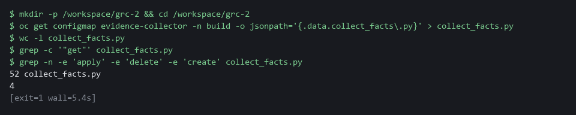

#### 1b. Read the script you fetched

You will now read the file you saved as collect_facts.py.

- Reading collect_facts.py needs no typing, and it prints nothing.

Look for these as you read:

- Every command starts with oc get. Find oc_json(): it builds the command from get plus the name of one thing to read. Nothing in the file creates, changes or deletes anything.
- Look at the four small functions, one per check: fips_configured, required_namespaces, kyverno_policies and audit_profile. Each asks the cluster one question and keeps one fact from the answer.
- Look at the try and except around each check. A check that fails is recorded as an error and the others still run, so one problem does not hide the rest.
- Look at the last lines: complete is true only when no check failed, and the result prints as one line of JSON.

```python
import json
import subprocess
from datetime import datetime, timezone

REQUIRED_NAMESPACES = ["demo", "build", "kyverno"]


def oc_json(*args):
    run = subprocess.run(["oc", *args, "-o", "json"], capture_output=True, text=True)
    if run.returncode != 0:
        raise RuntimeError(run.stderr.strip()[:300] or "oc failed")
    return json.loads(run.stdout)


def fips_configured():
    items = oc_json("get", "machineconfigs")["items"]
    rendered = [i for i in items if i["metadata"]["name"].startswith("rendered-master-")]
    newest = max(rendered, key=lambda i: i["metadata"]["creationTimestamp"])
    return {"machineconfig": newest["metadata"]["name"], "fips": newest["spec"].get("fips") is True}


def required_namespaces():
    names = {i["metadata"]["name"] for i in oc_json("get", "namespaces")["items"]}
    return {"required": len(REQUIRED_NAMESPACES), "missing": [n for n in REQUIRED_NAMESPACES if n not in names]}


def kyverno_policies():
    items = oc_json("get", "clusterpolicies.kyverno.io")["items"]
    ready = [i for i in items if any(c.get("type") == "Ready" and c.get("status") == "True" for c in i.get("status", {}).get("conditions", []))]
    return {"total": len(items), "ready": len(ready)}


def audit_profile():
    return oc_json("get", "apiservers.config.openshift.io", "cluster")["spec"].get("audit", {}).get("profile", "Default")


CHECKS = [
    ("fips-configured", "SC-13", fips_configured),
    ("required-namespaces", "CM-8", required_namespaces),
    ("kyverno-policies", "CM-6", kyverno_policies),
    ("audit-profile", "AU-12", audit_profile),
]

checks, errors = [], []
for check_id, control, collect in CHECKS:
    try:
        checks.append({"id": check_id, "control": control, "status": "collected", "value": collect()})
    except Exception as problem:
        checks.append({"id": check_id, "control": control, "status": "error", "value": None})
        errors.append({"id": check_id, "error": str(problem)[:300]})
stamp = datetime.now(timezone.utc).strftime("%Y-%m-%dT%H:%M:%SZ")
print(json.dumps({"schema": "evidence-v1", "collected_at": stamp, "complete": not errors, "checks": checks, "errors": errors}, separators=(",", ":")))

```

| Part | What it does | Why you run it |
| --- | --- | --- |
| REQUIRED_NAMESPACES | The namespaces (named workspaces in the cluster) the check expects to find. | Shows which part of the cluster the check treats as required, so you know what missing means. |
| oc_json() | Runs one oc get command and returns its JSON answer. A failed command raises an error with the first part of the message. | Every check goes through this one function, so reading it once explains how all four ask their questions. |
| fips_configured() | Finds the newest rendered-master MachineConfig and reads its fips field. This is the configured flag. | Step 4 compares it with the node, so know where it comes from. |
| required_namespaces() | Lists all namespaces and reports which required ones are missing. | Shows how a check can fail with a list of what is missing, not a bare yes or no. |
| kyverno_policies() | Counts the Kyverno policies and how many have a Ready condition set to True. | Shows exactly what ready means in the count, which tells you what the number does and does not prove. |
| audit_profile() | Reads the API server audit profile. If none is set, the default is Default. | Shows the fallback when no setting exists, so you can tell a default from a chosen value. |
| CHECKS | The list of checks: an id, the control the check informs, and the function that answers it. | One place lists every check and the control it informs; adding a check means adding a line here. |
| try / except | Runs each check on its own. A failure becomes status error and an entry in errors, and the loop carries on. | This is why a failed check does not stop the run: read it to see how an error becomes evidence. |
| complete: not errors | True only when the error list is empty. | The one line that decides whether a reader can trust the file as a whole. |
| print(json.dumps(...)) | Prints one line of JSON. The pipeline keeps that line as its result. | The output is a single line so a pipeline can keep it as a result. |

> **CHECKPOINT:** The script has about 52 lines, calls oc get in four places, and the search for apply, delete and create prints nothing.

> **TAKEAWAY:** A script that produces evidence is part of the control. Read it before you trust what it says.

### Step 2. Run the collector from the lab shell and read the evidence (CA-7 Continuous Monitoring, CM-6 Configuration Settings, SC-13 Cryptographic Protection)

**Learning point: Running the collector produces the evidence: dated facts about the cluster, plus a flag that says whether every check answered.**

- Run the collector as yourself first: in lab shell your login is the cluster administrator, so every check should succeed.
- Save the collector output in facts.json, then ask jq one question at a time.

What this step adds (thick lines and outlines are new):

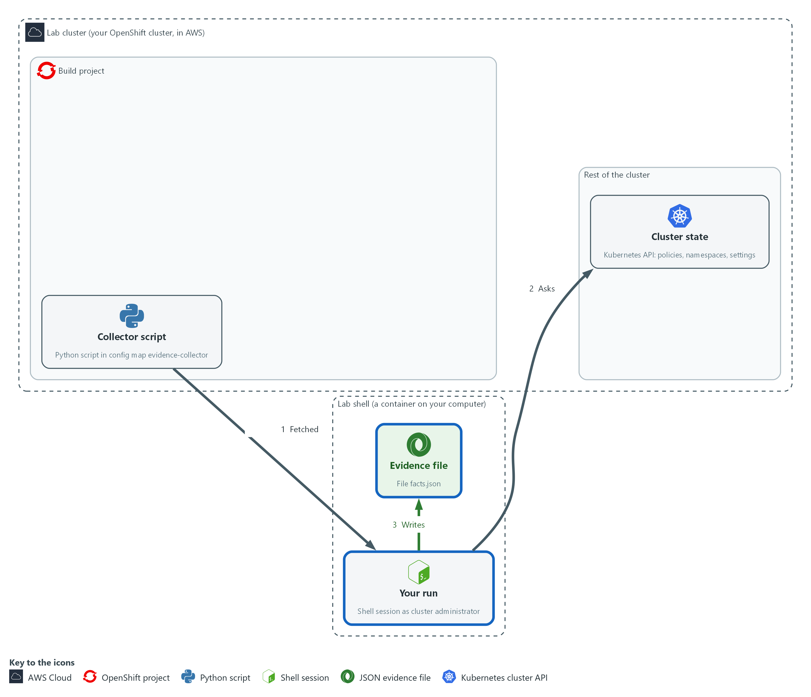

- You run the script from the lab shell as the cluster administrator and keep the evidence file it prints.

#### 2a. Run the collector as yourself and read the evidence

You will now run the script once as yourself, keep its output in facts.json, and ask jq four questions about that file.

```bash
cd /workspace/grc-2
python3 collect_facts.py > facts.json
jq '{schema, collected_at, complete}' facts.json
jq -r '.checks[] | [.id, .control, .status] | @tsv' facts.json
jq -c '.checks[] | select(.id=="fips-configured") | .value' facts.json
jq -c '.checks[] | select(.id=="kyverno-policies") | .value' facts.json
```

**Expected output:**

```
Example only. Your time and names will differ.
{
  "schema": "evidence-v1",
  "collected_at": "2026-11-01T20:30:00Z",
  "complete": true
}
fips-configured	SC-13	collected
required-namespaces	CM-8	collected
kyverno-policies	CM-6	collected
audit-profile	AU-12	collected
{"machineconfig":"rendered-master-<hash>","fips":true}
{"total":<n>,"ready":<n>}
(<n> is a number; the checkpoint says what it should be)
```

| Part | What it does | Why you run it |
| --- | --- | --- |
| cd (the module folder) | Moves into the module folder from Step 1, where collect_facts.py is. | Relative file names only work in the folder that holds them. |
| python3 collect_facts.py > facts.json | Runs the script and keeps its one line of output in a file. | Run it as yourself first, as administrator, so you see what a complete run looks like before you see an incomplete one. |
| jq '{schema, collected_at, complete}' | Shows the three fields that describe the run itself. | Read the facts about the run before the facts about the cluster: when it ran and whether it finished. |
| @tsv | Prints one tab-separated line per check: the id, the control it informs, and whether it was collected or errored. The tags CM-8 (required-namespaces) and AU-12 (audit-profile) belong to controls this module does not teach; they are only labels on the checks. | One line per check shows at a glance which were collected and which failed. |
| select(.id=="fips-configured") | Picks one check by name and prints only its value. | Reads one check's value so you can match it against the table of what each field proves. |

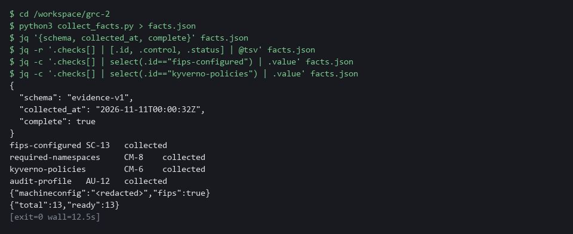

> **CHECKPOINT:** complete is true, all four checks say collected, fips is true, and the policy count is at least 1.

> **TAKEAWAY:** A file with a time and complete=true is evidence. A file without them is only output.

**How this meets the controls**

- **CA-7:** Each run is one pass of monitoring. collected_at and complete in facts.json are its record.
- **CM-6:** The kyverno-policies and audit-profile values are settings as they stand now. Reading them records what is in force, not whether it is the most restrictive choice.
- **SC-13:** The fips-configured value is a claim about configuration. Step 4 checks it against the node.

### Step 3. Run the same collector in a pipeline (CA-7 Continuous Monitoring)

**Learning point: Running the collector in a pipeline as a read-only service account shows how evidence is collected without a person, and what that account can and cannot read.**

- The pipeline is how the collector runs on a schedule, with no person at a keyboard.
- The pipeline runs as the service account evidence-runner, which can only read what the collector asks for.
- Look at the pipeline before you start it.

What this step adds (thick lines and outlines are new):

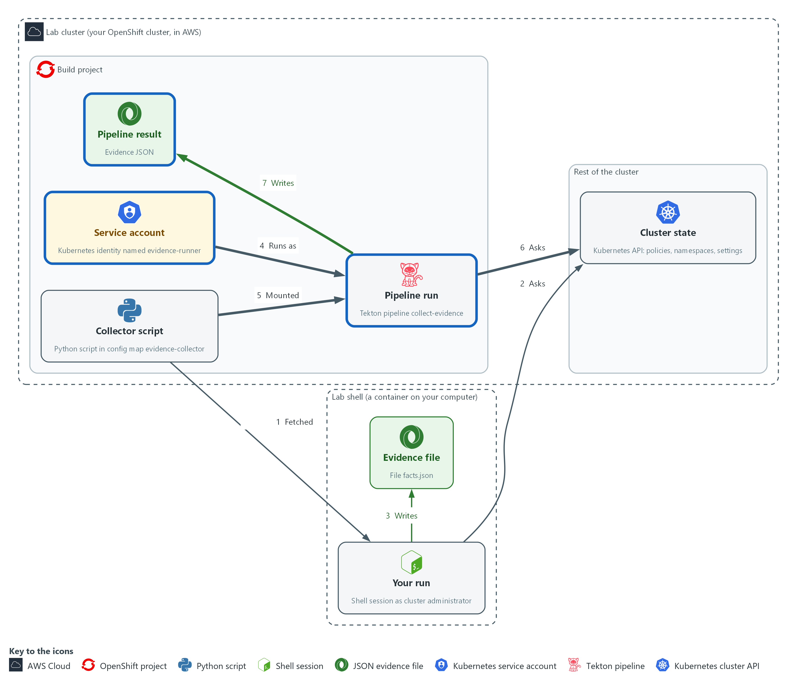

- A pipeline runs the same script as a limited service account and keeps the evidence as a pipeline result.

#### 3a. Look at the pipeline and the account before you start it

You will now read what the pipeline will do and what its service account may read, without changing anything.

```bash
tkn pipeline describe collect-evidence -n build
oc get clusterrole evidence-reader -o jsonpath='{range .rules[*]}{.resources}{" "}{.verbs}{"\n"}{end}'
```

**Expected output:**

```
Example only. The layout comes from tkn and oc.
tkn lists the pipeline name, its parameters (inputs), its workspaces (shared folders) and one task named collect.
["namespaces"] ["get","list"]
(every line of the role ends in get and list, never create, update or delete)
```

| Part | What it does | Why you run it |
| --- | --- | --- |
| tkn pipeline describe | Shows the pipeline's parameters (inputs), workspaces (shared folders) and tasks. There is one task, collect. | Look at what a pipeline will do before you start it, as you did with the script. |
| oc get clusterrole evidence-reader | Shows what the service account may read. Every rule lists get and list only. | Confirms the account can only read; that limit is why automation can be trusted to run unattended. |
| jsonpath range | Prints one line per rule: the resources and the verbs. | Prints a short list you can read in seconds instead of the whole role object. |

#### 3b. Start the pipeline, read its evidence and compare it with Step 2

You will now start one run as the service account, save its evidence in pipeline-evidence.json and compare it with facts.json from Step 2.

- The first run pulls two public images, so the cluster needs internet and it can take a minute.

```bash
cd /workspace/grc-2
tkn pipeline start collect-evidence -n build -s evidence-runner \
  -w name=script,config=evidence-collector --showlog
RUN=$(tkn pipelinerun describe --last -n build -o jsonpath='{.metadata.name}')
oc get pipelinerun "$RUN" -n build -o jsonpath='{.status.results[?(@.name=="evidence")].value}' | tee pipeline-evidence.json | jq .
diff <(jq -S 'del(.collected_at)' facts.json) <(jq -S 'del(.collected_at)' pipeline-evidence.json) && echo same
```

**Expected output:**

```
Example only. Your time will differ.
(the task log streams, then the run ends as Succeeded)
{
  "schema": "evidence-v1",
  "collected_at": "2026-11-01T20:34:00Z",
  "complete": true,
  "checks": [ ...the same four checks as facts.json... ],
  "errors": []
}
same
```

| Part | What it does | Why you run it |
| --- | --- | --- |
| cd (the module folder) | Moves into the module folder, where the evidence file will be saved. | The saved file must land beside facts.json. |
| tkn pipeline start collect-evidence | Starts one run of the pipeline. | Runs the collector the way a schedule would, with no person at the keyboard. |
| -s evidence-runner | Runs the tasks as that service account, not as you. | The run uses the limited account, so it shows what automation can really read, not what you can. |
| (images, nothing to type) | The task first copies the oc program out of the public image quay.io/openshift/origin-cli:4.22.0, then runs the script in the public image registry.access.redhat.com/ubi9/python-312:1. | No image is built or pushed by the lab. Both come from public registries with a fixed version, so every learner runs the same tools. |
| -w name=script,config=evidence-collector | Gives the task the config map as a read-only folder, so the script is mounted, not copied. | Mounting the config map means the pipeline runs the same script you read, not a copy that could differ. |
| --showlog | Streams the task log while it runs. | Watching the log shows whether the run is progressing or stuck. |
| describe --last | Finds the name of the run you just made. | You need the run's name to read its result. |
| status.results | The values the run kept. The one named evidence is the collector's single line of JSON. | The evidence is kept in the run's record, which is where the next step and later modules read it. |
| tee pipeline-evidence.json | Saves that line in a file as well as passing it on to jq. | A saved copy lets you read the result again without running the pipeline a second time. |
| diff <(...) <(...) && echo same | Compares the evidence from Step 2 with this evidence, leaving out collected_at, which always differs. It prints same when everything else matches and the differing lines when it does not. | It answers the Step 2 versus Step 3 question with one word instead of reading two files by eye. |

> **CHECKPOINT:** The pipeline run succeeds, its evidence has complete true, and the last command prints same. If it prints lines instead, the pipeline and your run disagree: read them before you go on.

> **TAKEAWAY:** Least privilege applies to the collector too: it can read the system and cannot change it.

**How this meets the control**

- **CA-7:** The pipeline run is the same pass without a person, so it can be scheduled.

### Step 4. Check one field against its source (SC-13 Cryptographic Protection)

**Learning point: Comparing the configured FIPS setting with what the node reports shows that a setting alone does not prove what is running.**

- The fips-configured check reads the configured setting, not what is running.
- Ask the node (one server in the cluster) what its kernel is actually doing, and compare.
- The configured setting and the running state can differ, for example after a node was built from the wrong image.

What this step adds (thick lines and outlines are new):

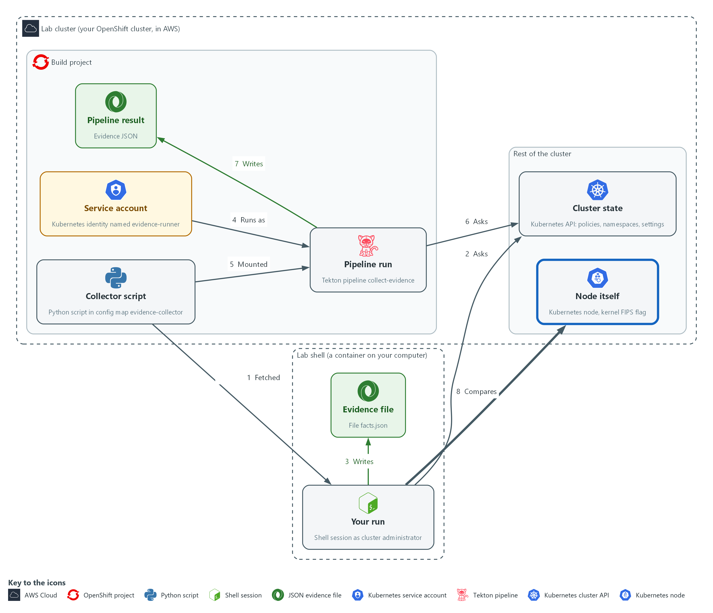

- You compare one field in the evidence with the node itself, to see what the field really proves.

#### 4a. Ask the node itself and compare

You will now ask the node for its own FIPS state and print the setting the collector recorded.

- oc debug opens a short shell on the node, runs one command and exits.

```bash
cd /workspace/grc-2
NODE=$(oc get nodes -o jsonpath='{.items[0].metadata.name}')
oc debug node/$NODE -- chroot /host cat /proc/sys/crypto/fips_enabled
jq -c '.checks[] | select(.id=="fips-configured") | .value.fips' facts.json
```

**Expected output:**

```
Example only. Lines from oc debug about starting and removing a pod may also appear. The kernel line and the jq line should agree.
1
true
```

| Part | What it does | Why you run it |
| --- | --- | --- |
| cd (the module folder) | Moves into the module folder, where facts.json is. | The jq line at the end reads facts.json from here. |
| NODE=$(oc get nodes ...) | Names the first node. On a single-node cluster this is the only one. | You need the node's name to ask it a question. |
| oc debug node/$NODE -- chroot /host | Opens a short-lived shell on the node, then runs one command in the node's own file system. | The configured flag is a claim; the node itself is the only place to check what it is doing. |
| cat /proc/sys/crypto/fips_enabled | The kernel's own answer: 1 means FIPS mode is on. | The kernel reports its own FIPS state, which is the fact the configured flag is only evidence for. |
| jq ... .value.fips | The configured flag the collector recorded. | Prints the configured flag so you can compare the two side by side. |

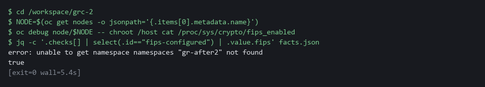

> **SECURITY:** oc debug node opens a shell on a cluster node with administrator rights. In the lab you do this on purpose and read one file. Never use it to change anything. If you are not an administrator, ask one to run it.

> **CHECKPOINT:** The kernel prints 1 and the collector recorded true. If they disagree, stop and report both values to the cluster administrator.

> **TAKEAWAY:** Check a claim against a second source before you file it as evidence.

**How this meets the control**

- **SC-13:** The node's answer (1 means FIPS mode is on) is the fact and the collector's value is evidence about it. If they disagree, a person has to find out which is wrong.

### Step 5. Write one check of your own (CM-6 Configuration Settings)

**Learning point: Writing a check that counts deployments whose pods are not required to run as non-root, and testing it two ways shows how to extend the collector with a question your team asks.**

- Each check in the collector is one small function that asks the cluster one question.
- You will write one more: deployments whose pods do not require a non-root user.
- You read the deployments (what the team declared) because OpenShift adds a non-root setting to running pods on its own.
- A container running as root gives an attacker more room if it is compromised.
- Look at the data, write the check, test it two ways (a right answer, and a broken question that must fail cleanly).

#### 5a. Look at the data before you write

You will now print the security settings the two sample deployments in grc2-workloads declare for their pods.

- You read the deployments and not the running pods because OpenShift adds its own non-root setting to a running pod, which hides what the team declared.
- The output shows where the non-root setting lives before you write code that reads it, and nothing changes in the cluster.

```bash
cd /workspace/grc-2
oc get deployments -n grc2-workloads -o json | jq '.items[] | {name: .metadata.name, pod: .spec.template.spec.securityContext, containers: [.spec.template.spec.containers[] | {name, securityContext}]}'
oc explain pod.spec.securityContext.runAsNonRoot
```

**Expected output:**

```
Example only. One deployment has "runAsNonRoot": true under pod. The other has no runAsNonRoot anywhere.
{
  "name": "legacy-batch",
  "pod": { "seccompProfile": { "type": "RuntimeDefault" } },
  ...
}
{
  "name": "payments-api",
  "pod": { "runAsNonRoot": true, ... },
  ...
}
(then the description of the runAsNonRoot field)
```

| Part | What it does | Why you run it |
| --- | --- | --- |
| cd (the module folder) | Moves into the module folder from Step 1. | Every file in this step sits beside collect_facts.py. |
| oc get deployments -n grc2-workloads -o json | Prints every deployment in the sample namespace as JSON. A deployment holds the pod template the team wrote. | The template is what the team declared. Your check reads this same JSON, so this is the data it will see. |
| jq '.items[] \| {name, pod, containers}' | Keeps only the deployment name, the pod-level security settings in its template and each container's security settings. | Shows where runAsNonRoot can be set: on the pod, or on each container. |
| oc explain pod.spec.securityContext.runAsNonRoot | Prints what the field means, straight from the cluster. | You can look up any field the same way, without guessing. |

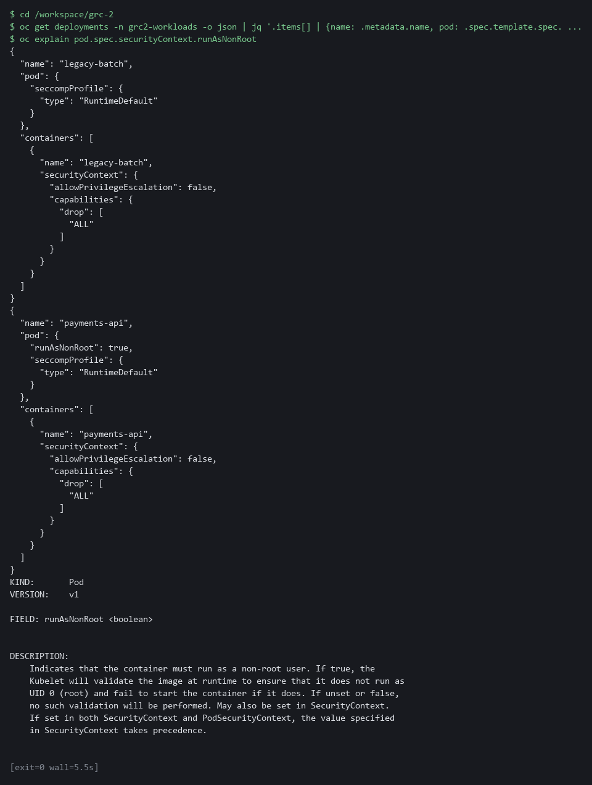

#### 5b. Write the check

You will now save a short function in my_check.py.

- One line is yours to write: replace the marked line in the command below before you press Enter.
- A deployment enforces non-root when runAsNonRoot is true in its pod template, or on every container in the template (under spec.template.spec).
- Hint: kyverno_policies in Step 1 shows how to keep items that meet a condition.

```bash
cd /workspace/grc-2
cat > my_check.py <<'EOF'
def root_pods():
    items = oc_json("get", "deployments", "-n", "grc2-workloads")["items"]
    risky = []  # replace this line with your own: keep the deployments whose pod template does not enforce non-root
    return {"total": len(items), "without_non_root": len(risky), "names": sorted(d["metadata"]["name"] for d in risky)}
EOF
cat my_check.py
test -s my_check.py && echo "ok: my_check.py has content" || echo "EMPTY: write my_check.py again"
```

**Expected output:**

```
Example only. The file prints back with your line where the marked one was, then ok.
def root_pods():
    items = oc_json("get", "deployments", "-n", "grc2-workloads")["items"]
    risky = <your line>
    return {"total": len(items), "without_non_root": len(risky), "names": sorted(d["metadata"]["name"] for d in risky)}
ok: my_check.py has content
```

| Part | What it does | Why you run it |
| --- | --- | --- |
| cd (the module folder) | Moves into the module folder from Step 1. | The new file must sit beside collect_facts.py. |
| cat > my_check.py <<'EOF' | Writes everything up to the line EOF into a file named my_check.py. | There is no editor in lab shell, so you write a file this way, as in ENG-0. |
| oc_json("get", "deployments", "-n", "grc2-workloads") | Uses the collector's own helper to run oc get deployments in the sample namespace and read the JSON answer. | Your check asks its question the same way the other four do. |
| risky = [] ... | The line you write. It must keep the deployments whose pod template does not enforce non-root. | This is the one decision in the function: what counts as not enforcing non-root. |
| return {...} | Gives back the deployment count, the risky count and the risky deployment names. | A check returns facts as a small dictionary, so the evidence file can show them. |
| test -s my_check.py ... | Says ok if the file has content and EMPTY if it has none. | Pasting the heredoc twice leaves the file empty, and the next step then fails with a confusing error. |

#### 5c. Add your check to a copy of the collector and compare with the cluster

You will now build a copy of the collector that also runs your check.

- You then compare its answer with the deployments' own settings.
- collect_facts.py is not changed.
- A NameError means my_check.py is probably empty: write it again.

```bash
cd /workspace/grc-2
python3 - <<'EOF'
src = open('collect_facts.py').read()
mine = open('my_check.py').read()
src = src.replace('CHECKS = [', mine + '\n\n\nCHECKS = [\n    ("root-pods", "CM-6", root_pods),', 1)
open('my_collect.py', 'w').write(src)
EOF
python3 my_collect.py > my-facts.json
jq -c '.checks[] | select(.id=="root-pods") | .value' my-facts.json
oc get deployments -n grc2-workloads -o json | jq -r '.items[] | [.metadata.name, (.spec.template.spec.securityContext.runAsNonRoot // "unset")] | @tsv'
```

**Expected output:**

```
Example only.
{"total":2,"without_non_root":1,"names":["legacy-batch"]}
legacy-batch	unset
payments-api	true
(the deployment shown as unset in the last two lines must be the one listed in names)
```

| Part | What it does | Why you run it |
| --- | --- | --- |
| python3 - <<'EOF' ... EOF | A short script that copies collect_facts.py to my_collect.py, with your function added and one new line in the list of checks. | Your check runs inside the same loop as the others, so a failure of yours is recorded the same way. |
| python3 my_collect.py > my-facts.json | Runs your copy and keeps its evidence in my-facts.json. | A separate file keeps your test run apart from the Step 2 evidence. |
| select(.id=="root-pods") | Prints only your check's value. | You read the one fact you added. |
| ... \| @tsv | Lists each deployment and the pod-level runAsNonRoot setting in its template, or unset. | A known answer from a different route to compare against: the deployment marked unset must be the one your check lists. If not, your line is wrong. |

#### 5d. Break the question on purpose and check that it fails cleanly

You will now ask for a resource that does not exist.

- The collector must record an error instead of crashing.
- A check that cannot run must say so, because a crash or a made-up number looks like clean evidence.
- Nothing in the cluster changes.

```bash
cd /workspace/grc-2
sed 's/"get", "deployments"/"get", "nonexistent"/' my_collect.py > my_collect_bad.py
python3 my_collect_bad.py | jq '{complete, root_pods: (.checks[] | select(.id=="root-pods") | .status)}'
```

**Expected output:**

```
Example only.
{
  "complete": false,
  "root_pods": "error"
}
```

| Part | What it does | Why you run it |
| --- | --- | --- |
| sed 's/"get", "deployments"/"get", "nonexistent"/' | Makes a copy of your collector that asks for a resource called nonexistent, which does not exist. | A check that cannot run must say so. This proves yours does. |
| complete | False when any check failed. | A reader must not take an incomplete run as a clean one. |
| root_pods: ... .status | Your check's status. It must say error, not collected. | An error recorded honestly is better evidence than a crash or a made-up number. |

#### 5e. Compare your line with the reference answer (after you tried)

Do this only after your check gave the right result.

- You will now print the reference version of the function and compare it with yours.

```bash
oc get configmap evidence-reference -n build -o jsonpath='{.data.my_check\.py}'
```

**Expected output:**

```
Example only. Yours may be written differently and still be right.
def root_pods():
    items = oc_json("get", "deployments", "-n", "grc2-workloads")["items"]
    risky = [d for d in items if not (d["spec"]["template"]["spec"].get("securityContext", {}).get("runAsNonRoot") is True or all(c.get("securityContext", {}).get("runAsNonRoot") is True for c in d["spec"]["template"]["spec"]["containers"]))]
    return {"total": len(items), "without_non_root": len(risky), "names": sorted(d["metadata"]["name"] for d in risky)}
```

| Part | What it does | Why you run it |
| --- | --- | --- |
| oc get configmap evidence-reference | Reads the config map that holds the reference answer. | It is stored on the cluster so it stays out of your way until you ask. |
| jsonpath='{.data.my_check\.py}' | Picks out the file my_check.py. The backslash is needed because the file name has a dot. | Prints only the function, as in Step 1. |

> **CHECKPOINT:** Your check lists the same deployment that the last command shows as unset, the broken copy shows complete false with root_pods error and no crash; compare your line with the reference only after it works.

> **TAKEAWAY:** A check you cannot break on purpose is a check you cannot trust: prove it fails cleanly.

**How this meets the control**

- **CM-6:** Your check records one more setting in force, whether pods require a non-root user, in the same form as the other checks.

## Section 4. Verify It Works

### Test 1 (positive). The collected evidence can be found and read again (CA-7 Continuous Monitoring)

- Evidence is useful only if you can find it again.
- Evidence sits in two places: files in your folder, and the result stored on each pipeline run.
- Check that each file shows when it was collected and whether it is complete, and that each pipeline run shows which account ran it.

```bash
cd /workspace/grc-2
for f in facts.json pipeline-evidence.json; do
  echo "== $f"
  jq -r '[.collected_at, .complete] | @tsv' "$f"
done
tkn pipelinerun list -n build
for RUN in $(oc get pipelinerun -n build -o jsonpath='{.items[*].metadata.name}'); do
  echo "== $RUN"
  oc get pipelinerun "$RUN" -n build -o jsonpath='{.spec.taskRunTemplate.serviceAccountName}'; echo
  oc get pipelinerun "$RUN" -n build -o jsonpath='{.status.conditions[0].reason}'; echo
  oc get pipelinerun "$RUN" -n build -o jsonpath='{.status.results[?(@.name=="evidence")].value}' | jq -r '[.collected_at, .complete] | @tsv'
done
```

**Expected output:**

```
Example only. Times and run names differ.
(each line is collected_at, a tab, then complete)
== facts.json
2026-11-06T14:02:11Z	true
== pipeline-evidence.json
2026-11-06T14:12:03Z	true
NAME                      STARTED        DURATION   STATUS
collect-evidence-run-x7k  5 minutes ago  22s        Succeeded
== collect-evidence-run-x7k
evidence-runner
Succeeded
2026-11-06T14:12:03Z	true
```

| Part | What it does | Why you run it |
| --- | --- | --- |
| cd (the module folder) | Moves into the module folder, where the evidence files are. | The files from the earlier steps sit here. |
| for f in ...; jq ... collected_at ... complete | Prints when each file was collected and whether every check was answered. | A reader needs both before trusting a file. |
| tkn pipelinerun list -n build | Lists every pipeline run with its age and result. | The run history shows how often evidence was collected. |
| serviceAccountName ... conditions[0].reason | Prints which account ran each pipeline and how it ended. | Ties each piece of evidence to the identity that gathered it. |
| status.results[?(@.name=="evidence")].value | Reads the evidence stored on the run record. | The cluster keeps it, so you can read it again later without running anything. |

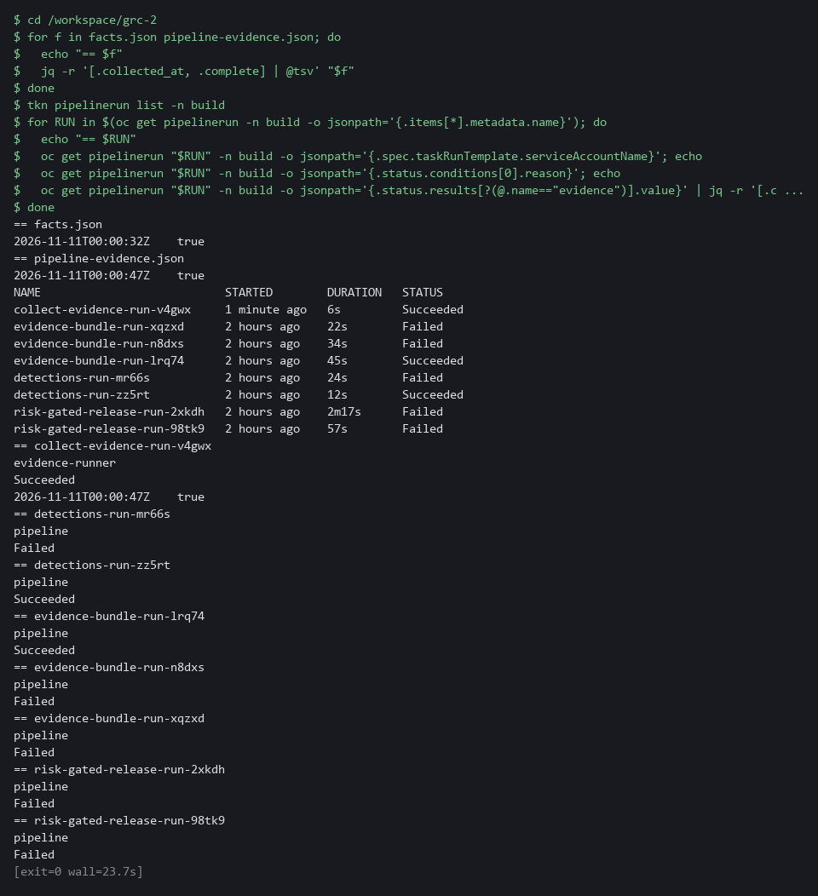

> **CHECKPOINT:** Both files show a collected_at time and complete true, and the pipeline run lists evidence-runner as the account that ran it, with the same complete and collected_at values as pipeline-evidence.json.

**How this meets the control**

- **CA-7:** Evidence that can be found again, with its time and complete flag, shows that monitoring ran and when.

### Test 2 (negative). A run with too little access is incomplete, even though the pipeline is green (CA-7 Continuous Monitoring)

- Run the same pipeline as evidence-limited, an account that can read namespaces and policies but not node or API server settings.
- The pipeline reports success because the script handled the failures.
- The evidence is where the failure shows.

```bash
cd /workspace/grc-2
tkn pipeline start collect-evidence -n build -s evidence-limited \
  -w name=script,config=evidence-collector --showlog > /dev/null
RUN=$(tkn pipelinerun describe --last -n build -o jsonpath='{.metadata.name}')
oc get pipelinerun "$RUN" -n build -o jsonpath='{.status.conditions[0].reason}{"\n"}'
oc get pipelinerun "$RUN" -n build -o jsonpath='{.status.results[?(@.name=="evidence")].value}' > limited-evidence.json
jq -r '"complete=\(.complete)"' limited-evidence.json
jq -r '.checks[] | "\(.id) \(.status)"' limited-evidence.json
jq -r '.errors[] | "\(.id): \(.error)"' limited-evidence.json
```

**Expected output:**

```
Example only. The wording of the errors depends on your cluster.
Succeeded
complete=false
fips-configured error
required-namespaces collected
kyverno-policies collected
audit-profile error
fips-configured: Error from server (Forbidden): machineconfigs.machineconfiguration.openshift.io is forbidden: User "system:serviceaccount:build:evidence-limited" cannot list resource "machineconfigs" in API group "machineconfiguration.openshift.io" at the cluster scope
audit-profile: Error from server (Forbidden): apiservers.config.openshift.io "cluster" is forbidden: User "system:serviceaccount:build:evidence-limited" cannot get resource "apiservers" in API group "config.openshift.io" at the cluster scope
```

| Part | What it does | Why you run it |
| --- | --- | --- |
| cd (the module folder) | Moves into the module folder, where limited-evidence.json will be saved. | The saved file must land beside your other evidence. |
| tkn pipeline start ... -s evidence-limited | Runs the same pipeline as the account that cannot read node configuration or API server settings. The log is thrown away. | The failure to look for is a green run with missing evidence. |
| conditions[0].reason | Prints how the pipeline run ended: Succeeded. | The pipeline is green because the script records its failures instead of stopping. |
| complete=false | The evidence says it is incomplete. | This flag, not the green run, tells you the evidence cannot be filed. |
| fips-configured error / audit-profile error | Two checks could not be read; the other two were collected. | Shows exactly which facts are missing. |
| Forbidden ... cannot list resource | Each error names the permission the account lacks. | That text is what you send to the cluster administrator to ask for access. |

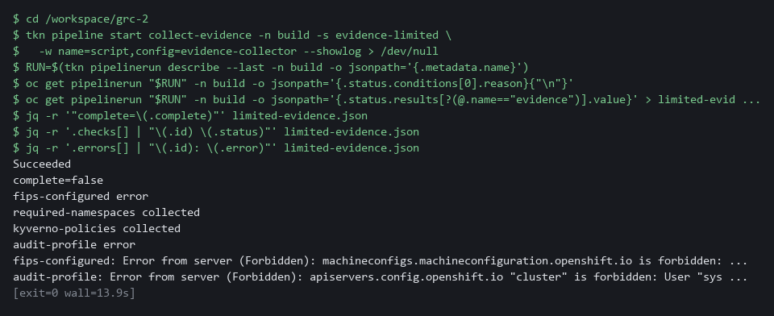

> **CHECKPOINT:** The run says Succeeded but complete is false. Two checks are collected and two are errors, and each error names the missing permission. Do not file this evidence. Send the two error lines to the cluster administrator, ask for the access and run the collector again afterwards. Never work around it by running as yourself and calling the limited run done.

**How this meets the control**

- **CA-7:** The limited account cannot read node or API server settings, so the evidence is marked incomplete even though the pipeline is green. A gap is not read as a clean result.

## Section 5. What Each Control Is For

### Control mapping

| Control | What it requires, in plain words | Tool or service | Where this module covers it |
| --- | --- | --- | --- |
| CA-7 Continuous Monitoring | Keep monitoring the metrics the system team chose, on a schedule, and report what the monitoring finds. | The collector script, run by hand and by the OpenShift Pipelines (Tekton) pipeline collect-evidence. Explained in Section 2.1. | Section 3, Steps 2 and 3: run the collector from the lab shell, then in the pipeline. Step 3 also checks that the pipeline evidence is complete and recent. |
| CM-6 Configuration Settings | Settings reflect the most restrictive mode consistent with operational requirements, deviations are approved, and changes to them are monitored and controlled. | Kyverno policies and the OpenShift API server audit profile, read by the collector with oc. Explained in Section 2.2. | Section 3, Step 2: the kyverno-policies and audit-profile checks record settings that are in force, and you read them. |
| SC-13 Cryptographic Protection | Cryptography in the system is of the type the requirement names. | OpenShift FIPS mode, read from the machine configuration by the collector with oc. Explained in Section 2.2. | Section 3, Step 2: the fips-configured check records whether the cluster is set to use validated cryptography. Section 3, Step 4: you compare it with the node. |

### What each control is for

Each table below says what the control is trying to prevent and how this module's tool meets it.

#### CA-7 Continuous Monitoring

| Question | Answer |
| --- | --- |
| Control Intent | The system drifts from its approved state and nobody notices until the next review. |
| The operational question | If a monitored setting changed an hour ago, is there evidence from after the change, or only from before it? |
| What evidence proves it | Evidence files with a time on each that say which checks ran, which succeeded, and what each one found. |
| How much is enough | Monitoring runs at a set frequency, covers the chosen metrics, and says when it could not collect something. NIST leaves the frequencies organization-defined. The lab treats evidence older than 24 hours as stale. |
| How the tool in this module satisfies it | The collector records a time, a complete flag and an error list (Steps 2 and 3). |

#### CM-6 Configuration Settings

| Question | Answer |
| --- | --- |
| Control Intent | A setting that was hardened is loosened, and the record still says it is hardened. |
| The operational question | Which settings are in force right now, and when was that last checked? |
| What evidence proves it | The current value of each setting, with the time it was read. |
| How much is enough | Each recorded setting has a value and a time, and is a fact about the moment it was read. NIST leaves the common secure configurations organization-defined. |
| How the tool in this module satisfies it | The kyverno-policies and audit-profile checks (Step 2) read two settings from the live cluster. |

#### SC-13 Cryptographic Protection

| Question | Answer |
| --- | --- |
| Control Intent | The system claims to use validated cryptography but some part of it does not. |
| The operational question | Is the cluster configured for validated cryptography, and does a node agree? |
| What evidence proves it | The configured FIPS flag and the flag the node itself reports. |
| How much is enough | NIST leaves the cryptographic uses organization-defined. The configured flag shows intent and the node flag shows what is running, so both are needed. |
| How the tool in this module satisfies it | The fips-configured check records the configured flag. Step 4 reads the node flag and compares them. |

## Section 6. Next Steps

### Using this in other environments

- Works as is on any OpenShift 4.x cluster that has OpenShift Pipelines and Kyverno, plus a read-only service account and cluster role set up as the lab start state does.
- Change these lab values first: the build namespace, the required-namespaces list, the grc2-workloads namespace in your check, and the two public images (mirror them on a cluster with no internet).
- On other Kubernetes platforms two checks are OpenShift-only and must be replaced. The rest port with a rename from oc to kubectl.
- The collector only runs read commands, so it is safe to point at a real cluster. Production also needs signed evidence in protected storage and an alert when a run is missing or incomplete.

The table shows what changes on each platform:

| Check | In this lab (OpenShift) | On other Kubernetes | What you change |
| --- | --- | --- | --- |
| required-namespaces | oc get namespace | kubectl get namespace | The tool name and the list of names. |
| kyverno-policies | oc get clusterpolicy | The same, if Kyverno is installed | Nothing. |
| Workloads without non-root (Step 5) | oc get deployments in grc2-workloads | kubectl get deployments in your namespaces | The tool name and the namespace. |
| fips-configured | The newest rendered-master MachineConfig | No equivalent. Read the node kernel FIPS flag, or the provider's FIPS setting | Replace the check. |
| audit-profile | The APIServer object in config.openshift.io | The provider's audit-log setting, or the API server audit flags | Replace the check. |
| Pipeline | OpenShift Pipelines (Tekton) | Tekton, or any scheduled job that runs the same script | Swap the runner. The script stays the same. |

> **TIP:** Next module: GRC-3 Automate Evidence Collection: write your own collector for three controls, add a time stamp and a hash, and pass it through an automated review before it runs on a schedule.

<details>
<summary><strong>Section 7. Command List (optional)</strong></summary>

- This optional list holds every command from the steps, in order, with no explanation.
- Use it to repeat the module or find a command fast.
- Everything after the first group runs in lab shell.

#### Start: on your computer

```bash
lab start grc-2
lab shell
```

#### Step 1. Fetch and read the collector

```bash
mkdir -p /workspace/grc-2 && cd /workspace/grc-2
oc get configmap evidence-collector -n build -o jsonpath='{.data.collect_facts\.py}' > collect_facts.py
wc -l collect_facts.py
grep -c '"get"' collect_facts.py
grep -n -e 'apply' -e 'delete' -e 'create' collect_facts.py
```

#### Step 2. Run the collector from the lab shell and read the evidence

```bash
cd /workspace/grc-2
python3 collect_facts.py > facts.json
jq '{schema, collected_at, complete}' facts.json
jq -r '.checks[] | [.id, .control, .status] | @tsv' facts.json
jq -c '.checks[] | select(.id=="fips-configured") | .value' facts.json
jq -c '.checks[] | select(.id=="kyverno-policies") | .value' facts.json
```

#### Step 3. Run the same collector in a pipeline

```bash
tkn pipeline describe collect-evidence -n build
oc get clusterrole evidence-reader -o jsonpath='{range .rules[*]}{.resources}{" "}{.verbs}{"\n"}{end}'

cd /workspace/grc-2
tkn pipeline start collect-evidence -n build -s evidence-runner \
  -w name=script,config=evidence-collector --showlog
RUN=$(tkn pipelinerun describe --last -n build -o jsonpath='{.metadata.name}')
oc get pipelinerun "$RUN" -n build -o jsonpath='{.status.results[?(@.name=="evidence")].value}' | tee pipeline-evidence.json | jq .
diff <(jq -S 'del(.collected_at)' facts.json) <(jq -S 'del(.collected_at)' pipeline-evidence.json) && echo same
```

#### Step 4. Check one field against its source

```bash
cd /workspace/grc-2
NODE=$(oc get nodes -o jsonpath='{.items[0].metadata.name}')
oc debug node/$NODE -- chroot /host cat /proc/sys/crypto/fips_enabled
jq -c '.checks[] | select(.id=="fips-configured") | .value.fips' facts.json
```

#### Step 5. Write one check of your own

```bash
cd /workspace/grc-2
oc get deployments -n grc2-workloads -o json | jq '.items[] | {name: .metadata.name, pod: .spec.template.spec.securityContext, containers: [.spec.template.spec.containers[] | {name, securityContext}]}'
oc explain pod.spec.securityContext.runAsNonRoot

cd /workspace/grc-2
cat > my_check.py <<'EOF'
def root_pods():
    items = oc_json("get", "deployments", "-n", "grc2-workloads")["items"]
    risky = []  # replace this line with your own: keep the deployments whose pod template does not enforce non-root
    return {"total": len(items), "without_non_root": len(risky), "names": sorted(d["metadata"]["name"] for d in risky)}
EOF
cat my_check.py
test -s my_check.py && echo "ok: my_check.py has content" || echo "EMPTY: write my_check.py again"

cd /workspace/grc-2
python3 - <<'EOF'
src = open('collect_facts.py').read()
mine = open('my_check.py').read()
src = src.replace('CHECKS = [', mine + '\n\n\nCHECKS = [\n    ("root-pods", "CM-6", root_pods),', 1)
open('my_collect.py', 'w').write(src)
EOF
python3 my_collect.py > my-facts.json
jq -c '.checks[] | select(.id=="root-pods") | .value' my-facts.json
oc get deployments -n grc2-workloads -o json | jq -r '.items[] | [.metadata.name, (.spec.template.spec.securityContext.runAsNonRoot // "unset")] | @tsv'

cd /workspace/grc-2
sed 's/"get", "deployments"/"get", "nonexistent"/' my_collect.py > my_collect_bad.py
python3 my_collect_bad.py | jq '{complete, root_pods: (.checks[] | select(.id=="root-pods") | .status)}'

oc get configmap evidence-reference -n build -o jsonpath='{.data.my_check\.py}'
```

#### Verify. The collected evidence can be found and read again

```bash
cd /workspace/grc-2
for f in facts.json pipeline-evidence.json; do
  echo "== $f"
  jq -r '[.collected_at, .complete] | @tsv' "$f"
done
tkn pipelinerun list -n build
for RUN in $(oc get pipelinerun -n build -o jsonpath='{.items[*].metadata.name}'); do
  echo "== $RUN"
  oc get pipelinerun "$RUN" -n build -o jsonpath='{.spec.taskRunTemplate.serviceAccountName}'; echo
  oc get pipelinerun "$RUN" -n build -o jsonpath='{.status.conditions[0].reason}'; echo
  oc get pipelinerun "$RUN" -n build -o jsonpath='{.status.results[?(@.name=="evidence")].value}' | jq -r '[.collected_at, .complete] | @tsv'
done
```

#### Verify. A run with too little access is incomplete, even though the pipeline is green

```bash
cd /workspace/grc-2
tkn pipeline start collect-evidence -n build -s evidence-limited \
  -w name=script,config=evidence-collector --showlog > /dev/null
RUN=$(tkn pipelinerun describe --last -n build -o jsonpath='{.metadata.name}')
oc get pipelinerun "$RUN" -n build -o jsonpath='{.status.conditions[0].reason}{"\n"}'
oc get pipelinerun "$RUN" -n build -o jsonpath='{.status.results[?(@.name=="evidence")].value}' > limited-evidence.json
jq -r '"complete=\(.complete)"' limited-evidence.json
jq -r '.checks[] | "\(.id) \(.status)"' limited-evidence.json
jq -r '.errors[] | "\(.id): \(.error)"' limited-evidence.json
```

#### When you stop: on your computer, not in lab shell

```bash
lab down
```

</details>

<details>
<summary><strong>Section 8. Terms</strong></summary>

Each term is also explained the first time it appears. In Word, hover over an underlined term to see its meaning, or Ctrl+click it to jump to this table.

| Term | Plain meaning |
| --- | --- |
| API server | The part of the cluster that receives every request, including each oc command, and decides whether to allow it. |
| Audit profile | A setting for how much detail the API server records in its audit log. |
| AWS | Amazon Web Services, the cloud your lab runs in. |
| Baseline | The agreed starting configuration that the system is expected to match. |
| Check | One question the collector asks, with its answer or its error. |
| CLI | Command-line interface: a program you use by typing commands. |
| Cluster | A group of servers that work together as one system. Here it is your own OpenShift cluster in AWS. |
| Cluster policy | A Kyverno policy that applies to the whole cluster. |
| Cluster role | A named list of what an identity may do across the cluster, for example only read. |
| Collector | A short program that asks the system questions and writes the answers down. Here it reads four things from the cluster and saves them as evidence. |
| Complete flag | A field that says whether every check produced an answer. |
| Config map | A stored file or setting that the cluster keeps and can hand to a program. |
| Container | A sealed box that holds one program and everything it needs to run. |
| diff | A command that shows the differences between two files. |
| Drift | When the real system no longer matches what the files say it should be. |
| Evidence | A saved answer to a question about the system, with the time it was collected. |
| Evidence file | The JSON the collector prints: a time, a complete flag, a list of checks and a list of errors. |
| FIPS mode | A setting that makes a system use cryptography validated against a US government standard. |
| Function | A named block of code that does one job and gives back an answer. Each check in the collector is one function. |
| grep | A command that prints only the lines that match a pattern. |
| Hash | A short fixed-length fingerprint of data. If the data changes, the hash changes. |
| Heredoc | A shell way to write a multi-line file: type text until a marker line such as EOF. |
| Image | A packaged copy of a program and everything it needs to run. A container starts from an image. |
| jq | A tool that picks one value out of JSON text. |
| JSON | A plain-text format for data: names and values written inside curly braces. |
| Kernel | The core of a node's operating system. It can report its own FIPS state. |
| Kubernetes | The open-source system that runs and manages containers across servers. OpenShift is built on it. |
| Kyverno | A policy engine that checks and enforces rules on cluster objects. |
| Label | A key=value tag on a cluster object, used to pick objects, such as app=demo-app. |
| Least privilege | Giving a program only the access it needs. |
| MachineConfig | The OpenShift object that holds node settings, including the FIPS flag. |
| mkdir | A command that makes a new folder. |
| Namespace | A named section of the cluster that keeps workloads apart. OpenShift also calls it a project. |
| NIST | The US National Institute of Standards and Technology. It publishes the security control catalog these modules cite. |
| Node | One server in the cluster. Your lab cluster has a single node. |
| oc | The command-line tool for OpenShift. You type oc to ask the cluster questions. |
| OpenShift | The Red Hat platform your lab cluster runs on. It is Kubernetes with extra security and tools built in. |
| Pipeline | An automated sequence of tasks. Each task runs in its own pod. |
| Pipeline result | A small value a pipeline run keeps in its record after it finishes. |
| PipelineRun | One execution of a Tekton pipeline. |
| Pod | The smallest running unit on the cluster: one or more containers together. |
| Policy | A rule the cluster checks. Kyverno is the tool that holds the policies in this lab. |
| Provider | The company or plug-in that supplies a platform, such as a cloud provider or a Terraform provider. |
| Registry | A server that stores container images. |
| Role | A list of actions a user or program may take on named kinds of objects. |
| Route | An OpenShift object that gives a program inside the cluster an address reachable from outside. |
| Rule | A written condition that a tool checks. |
| runAsNonRoot | A pod or container setting that makes the cluster refuse to start it as the root user (the all-powerful administrator account on Linux). A pod that does not set it is not required to run as non-root. |
| Runner | The program or container that carries out the steps of a pipeline. |
| Schema | The expected shape of data: which fields it has and what type each one is. |
| Script | A text file of commands that a computer runs in order. |
| sed | A command that edits text as it passes through, often to replace one string with another. |
| Service account | An identity for a program instead of a person. |
| Signature | A value made with a private key that shows who made something and that it was not changed. |
| Stale evidence | Evidence older than the limit the team set, so it no longer proves anything about now. |
| Tekton | The pipeline engine inside OpenShift Pipelines. It runs each task of a pipeline in its own pod. |
| Template | A file with blanks that are filled in when it is used. |
| tkn | The command-line tool for Tekton. You type tkn to start and read pipeline runs. |
| TSV | Tab-separated values: a table written as text, with a tab between columns. |
| YAML | A plain-text format for settings: lines of name: value, with indentation to show what belongs to what. |

</details>
