# GRC-4: Evidence in the Delivery Pipeline (SA-11, SI-7, CM-6)

| Item | Detail |
| --- | --- |
| Sequence | Module 17 of 29 in the recommended order |
| Timed work | About 73 minutes (50 hands-on, 23 verify) |
| Standalone start | `lab start grc-4` |
| Combined start | Continue from the end state of the previous module |
| Tools | OpenShift Pipelines (Tekton), Trivy (free, open source), Kyverno (free, open source), Cosign (free, open source), OpenSSL, oc, tkn, jq |
| Prerequisites | ENG-0 Terminal, Git and Your Lab (typing commands in lab shell, reading oc output, and making a file with a heredoc) |

## Section 1. Module Overview

- Purpose: produce tamper-evident proof per release showing the image was scanned, the change was policy-checked, and both passed (SA-11, SI-7, CM-6).
- The pipeline has three tasks. One scans the image with Trivy, one asks Kyverno about a candidate change in a dry run, and one signs an evidence bundle with Cosign.
- A failing scan or a refused change stops the pipeline before a bundle exists.
- You verify the bundle from the lab shell with the public key alone, so the check does not depend on the pipeline.

- **Skill:** Build a three-task pipeline that scans an image, checks a candidate change against policy, and signs one evidence bundle per passing run.
- **Tools:** Trivy scans images for known flaws; Kyverno checks candidate changes through a server-side dry run; Cosign signs the evidence bundle with a key kept as a cluster secret.
- **Security Function:** Produces tamper-evident proof per release. A failing scan or a refused change stops the pipeline before a bundle exists, so every bundle describes a passing run.
- **NIST SA-11 Developer Testing and Evaluation:** Trivy runs on every pipeline run. A HIGH or CRITICAL finding stops the run. The findings count and a hash of the report go into the bundle.
- **NIST SI-7 Software, Firmware, and Information Integrity:** Cosign signs the bundle with an evidence key. Anyone with the public key can verify the bundle is unchanged. A changed bundle fails verification.
- **NIST CM-6 Configuration Settings:** A server-side dry run asks Kyverno whether a candidate change would be admitted. The answer is recorded in the bundle and a refused change stops the run.

## Section 2. The Tools

### Tools used in this module

Each tool name links to its official overview. The table columns say how each tool is used in the lab and why the lab uses it instead of another way of doing the same job.

| Tool (overview link) | What it is | Used in this lab | Why this tool |
| --- | --- | --- | --- |
| [OpenShift Pipelines (Tekton)](https://docs.redhat.com/en/documentation/openshift_container_platform/4.22/html/pipelines/index) | Kubernetes-native CI/CD built on Tekton. | Runs the pipeline of three tasks: scan, policy check and signed bundle. | It runs automated tasks inside the cluster, so you can see a check run with no person at the keyboard and under its own limited identity. A script run from a laptop could not show that. |
| [Trivy](https://trivy.dev/) | Scans images, code and clusters for known flaws and misconfigurations. | Scans the image; a serious finding stops the pipeline. | It scans images and clusters for known flaws and bad settings from the command line and is free and open source, so the same scan can run by hand and in a pipeline. |
| [Kyverno](https://kyverno.io/docs/) | A policy engine that checks and enforces rules on Kubernetes resources. | The policy check asks the cluster whether a candidate Deployment would be admitted. | It is the policy engine the lab already uses to check and enforce rules on cluster objects, so there are real policies to count and read as evidence. It is free and open source. |
| [Cosign](https://docs.sigstore.dev/cosign/signing/overview/) | Signs container images and verifies the signature. | Signs the evidence bundle with a new key and verifies it with the public key. | It signs an image and checks the signature, so the cluster can refuse an image nobody vouched for. It is free and open source. |
| [OpenSSL](https://docs.openssl.org/master/man1/openssl/) | Command-line tool for keys, certificates and testing TLS connections. | Makes the random password for the signing key. | It is the standard tool for looking at keys and certificates, so you can see for yourself what a certificate says and whether a connection is encrypted. |
| [oc](https://docs.redhat.com/en/documentation/openshift_container_platform/4.22/html/cli_tools/openshift-cli-oc) | The OpenShift command-line tool for creating and managing applications and projects from a terminal. | Applies the tasks and pipeline and asks the cluster the admission question as a dry run. | It is the one command that talks to the cluster, so every module uses it to ask what is true and to make changes. You sign in once, and it works on OpenShift objects as well as standard Kubernetes ones. Unlike clicking in the web console, a command can be pasted, repeated and checked by a test. |
| [tkn](https://docs.redhat.com/en/documentation/openshift_container_platform/4.22/html/cli_tools/pipelines-cli-tkn) | Command-line tool for managing pipelines, runs and tasks. | Starts the pipeline run and follows it. | It starts and reads pipeline runs from the terminal, so the same shell you use for everything else drives the pipeline. The other way is the web console, which cannot be pasted into a step. |
| [jq](https://jqlang.org/) | Command-line JSON processor. | Reads the JSON bundle and counts blocking findings. | It picks one field out of a long JSON reply, so a test can read a single value. |

### How it fits together

#### One run, three checks, one signed bundle

- Lab (test) setup: Each run scans the image, asks Kyverno whether a candidate change would be admitted, and signs one evidence bundle.
- In production the signing key lives in a key management service, bundles are stored where they cannot be edited after they are written, and verification runs in a separate system.
- Each step below adds one part, drawn with thick lines.

How the lab is set up, and why:

- You work in the lab shell on your laptop, as in the foundation module, and you start the pipeline and check its output from there.
- This module adds a pipeline of three tasks to the build project on the cluster.
- Proof about a release should come from the same automated path that handles the release, not from a person typing it in.
- The policy task does not create anything in the demo namespace.
- The policy task asks Kyverno, which runs in its own project, whether the cluster would admit a candidate change.
- Kyverno's answer comes from the same rules that apply at deploy time.
- The signing key is a secret in the build project.
- The signing key is separate from any release key, so a leak of one cannot spoil the other.
- The bundle and its signature stay on the pipeline run in the build project.
- You verify the bundle and its signature in the lab shell with the public key only, so the check does not depend on anything the pipeline controls.

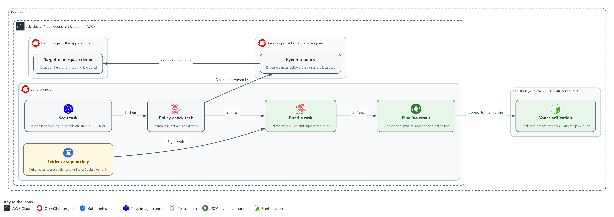

- **1. Evidence signing key:** a Cosign key pair stored as a secret in the build project; the bundle task signs with it.
- **2. Scan task:** runs Trivy on the image and stops the run on any HIGH or CRITICAL finding.
- **3. Policy check task:** sends the candidate change to the cluster as a server-side dry run and creates nothing.
- **4. Bundle task:** runs only after both checks pass, builds one evidence bundle and signs it with the evidence key.
- **5. Pipeline result:** the bundle and its signature, kept on the pipeline run record in the build project.
- **6. Kyverno policy:** the rule that refuses the latest tag; it answers the dry run from the policy check task.
- **7. Target namespace demo:** the namespace the candidate change is judged for; nothing is created in it.
- **8. Your verification:** your lab shell copies the bundle and signature and checks them with the public key alone.

Where each part runs, and why:

| Part | Where it runs | Why it is built this way |
| --- | --- | --- |
| Pipeline and its three tasks | The build namespace, run by OpenShift Pipelines | Proof about a release comes from the automated path that handles the release, not from a person typing it in. |
| Signing key | A secret in the build namespace | The bundle task can sign without a person holding the private key, and the key stays separate from any release key. |
| Policy check | A dry run sent from the build namespace to the cluster, answered by Kyverno in its own namespace | It asks the question the cluster will ask at deploy time and creates nothing in the demo namespace. |
| Bundle and signature | Results on the pipeline run in the build namespace | The run record outlives the pods, so an auditor can read the bundle after the run. |
| Verification | The lab shell on your laptop | Checking with the public key outside the pipeline means a compromised pipeline cannot vouch for itself. |

### 2.1 Why one signed bundle (SA-11 Developer Testing and Evaluation)

- A pipeline produces many pieces of proof: a scan report, a policy answer, a run name, a time.
- A bundle collects the facts into one small file; a signature makes any later edit visible.
- A reader can check the bundle with a public key alone, without trusting the person who hands it over.
- A failed check stops the run, so no bundle exists for it and every bundle describes a passing run.

#### SA-11: Developer Testing and Evaluation

*The control asks the organization to require the developer to plan and carry out ongoing security and privacy testing, to produce evidence of the results, to have a verifiable flaw remediation process, and to correct the flaws that testing finds. NIST leaves the testing frequency and depth organization-defined. This is done using:*

- Trivy in the scan task: scans the image on every run and writes the report.
- The gate step of the scan task: stops the run when the report holds any HIGH or CRITICAL finding.
- The evidence bundle: records the findings count and a hash of the report, so the result stays with the run.
- The developer: fixes the flaws the scan finds, because the pipeline supplies the testing and the evidence and not the fix.

The table shows four design choices in this module, the two options for each, and which one the module uses:

| Choice | Option A | Option B | What this module does |
| --- | --- | --- | --- |
| Signing key | Reuse the release signing key | A separate evidence key | A separate key, so evidence signing and release signing can be rotated and revoked on their own |
| Policy check | Read Kyverno reports | Dry-run the change against the policy | Dry run, because reports exist only after an object does (Step 2 proves it) |
| Failure behavior | Write a bundle that says failed | Write no bundle | Write no bundle, so every bundle that exists describes a passing run |
| Image reference | A tag | A digest | A digest, so the bundle names exactly what was scanned |

### 2.2 What the signature does and does not prove (SI-7 Software, Firmware, and Information Integrity)

- The signature proves the bundle is byte-for-byte what the pipeline signed.
- The signature does not prove the scan was thorough, the pipeline was configured correctly, or the private key was never copied.
- The key is a plain cluster secret in the lab, a shortcut a real system would replace with a key management service.
- Verification must run outside the pipeline so a compromised pipeline cannot vouch for itself.

#### SI-7: Software, Firmware, and Information Integrity

*The control asks the organization to use integrity verification tools to detect unauthorized changes to organization-defined software, firmware and information, and to take organization-defined actions when one is detected. Here the information is the evidence bundle. This is done using:*

- Cosign in the bundle task: signs the bundle with the evidence key, so a changed bundle no longer matches its signature.
- The verify step of the bundle task and your own check in the lab shell: confirm the signature with the public key, and a changed bundle fails.
- The lab's chosen action: a bundle that fails verification is not used as evidence.

### 2.3 How the policy check works without changing anything (CM-6 Configuration Settings)

- A server-side dry run sends the manifest to the cluster API without saving anything.
- Kyverno checks the request and returns a refusal or an approval.
- A server-side dry run sees only policies in Enforce mode.
- A policy in Audit mode lets the request through, so a dry run of a breaking change still succeeds.

#### CM-6: Configuration Settings

*The control asks the organization to establish and document configuration settings at the most restrictive mode consistent with operational requirements, implement them, approve any deviations, and monitor and control changes to them. Here the setting is that a Deployment may not use the latest image tag. This is done using:*

- The Kyverno policy grc-enforce-no-latest-tag in Enforce mode: implements the setting by refusing a Deployment that uses the latest tag.
- The policy task: asks the cluster the deploy-time question with a server-side dry run that creates nothing.
- The evidence bundle: records the answer, and a refused change stops the run.

> **IN PRODUCTION:** In the real environment the signing key lives in a key management service. Bundles are stored where they cannot be edited after they are written, and verification runs in a separate system before a release is accepted. The lab uses a cluster secret and your own shell.

### Design decisions

#### Policy check by server-side dry run

- How: The policy task runs a short script you write: it sends the candidate manifest to the cluster with a server-side dry run, records the answer and message in a file, and fails the task if the change was denied.
- Why: The dry run asks the same admission question the cluster will ask at deploy time and stops a bad change before any object exists, while policy reports exist only for objects that were already created.
- Alternatives: Advantage of reading policy reports instead: the pipeline needs no permission to dry-run in the target namespace. Drawback: a report appears only after the object exists, so the bad change is already in the cluster when anyone learns of it. Cost of the dry run: it sees only policies in Enforce mode.

#### A failed run leaves no bundle

- How: Each task fails the run when its check fails, so the bundle task never starts and the pipeline keeps no bundle and no signature.
- Why: Every bundle that exists then describes a passing run, and a reader never has to inspect a field to learn whether a run passed.
- Alternatives: Advantage of writing a signed bundle that records the failure: the failed attempt itself becomes evidence an auditor can trace. Drawback: readers must check a status field in every bundle, and one careless consumer could treat any signed bundle as a pass.

#### A separate evidence key, verified outside the pipeline

- How: The pipeline signs the bundle with a key made only for evidence and held as a cluster secret. You verify the bundle from the lab shell with the public key alone.
- Why: A separate key can be rotated or revoked without touching release signing, and verification outside the pipeline means a compromised pipeline cannot vouch for itself.
- Alternatives: Advantage of reusing the release signing key: one less secret to protect and rotate. Drawback: a single leak would spoil both evidence and releases. The lab keeps the key as a plain secret, a shortcut a real system would replace with a key management service.

## Section 3. Implement

- Start: type `lab start grc-4` in the terminal on your own computer (PowerShell on Windows, Terminal on Mac), not in the lab shell.
- Enter lab shell with `lab shell`. Every other command in this module runs inside lab shell.
- If a step fails: run `lab reset grc-4` on your own computer and repeat the step once. If it still fails, copy the whole command and error and ask your AI assistant. Do not skip the step.

### Step 1. Make the evidence signing key and check the ingredients (SI-7 Software, Firmware, and Information Integrity, SA-11 Developer Testing and Evaluation)

**Learning point: Making the evidence key pair and running a trial scan shows what the pipeline will sign and what the gate will see before anything is built.**

- Make a key pair used only for evidence and keep the public half in your lab shell.
- Check the tools: the signing task uses two Cosign flags, and your Cosign release must accept them.
- The scan count tells you what the pipeline gate will see.

What this step adds (thick lines and outlines are new):

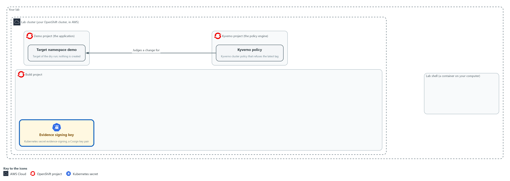

- You create a signing key for evidence as a secret in the build project, keep the public half in a file in your lab shell, and check the scanner and the signing flags.

#### 1a. Make the signing key and check the tools

You will now make a signing key for evidence, save its public half in a file, and check that Kyverno, Cosign and Trivy are ready.

- The step needs the lab shell to reach the internet (Trivy downloads its database).
- Running the block again is safe, but it replaces the key, so bundles you made earlier no longer verify with the new public key.

```bash
mkdir -p /workspace/grc-4
cd /workspace/grc-4
oc get pods -n kyverno
oc get clusterpolicy grc-enforce-no-latest-tag
oc delete secret evidence-signing -n build --ignore-not-found
COSIGN_PASSWORD="$(openssl rand -base64 24)" cosign generate-key-pair k8s://build/evidence-signing
oc get secret evidence-signing -n build -o jsonpath='{.data.cosign\.pub}' | base64 -d > cosign.pub
head -n 1 cosign.pub
cosign sign-blob --use-signing-config=false --tlog-upload=false --help > /dev/null && echo flags-accepted
IMAGE=$(oc get pods -n demo -l app=evidence-app -o jsonpath='{.items[0].status.containerStatuses[0].imageID}')
echo "$IMAGE"
trivy image --quiet --severity HIGH,CRITICAL --format json "$IMAGE" | jq '[.Results[]?.Vulnerabilities[]?] | length'
```

**Expected output:**

```
Example only. Your names, digest and count will differ.
(the pods in the kyverno namespace, all Running)
NAME  ADMISSIONS  BACKGROUND  VALIDATE ACTION  READY ...
grc-enforce-no-latest-tag  ...  Enforce  true ...
(Cosign reports that it created the secret evidence-signing in the build namespace)
-----BEGIN PUBLIC KEY-----
flags-accepted
<image reference>@sha256:<digest>
<n>
```

| Part | What it does | Why you run it |
| --- | --- | --- |
| mkdir -p ... && cd ... | Makes a folder for this module and moves into it, so files from other modules cannot collide with yours. The folder persists between lab sessions. | The key, the public key file and your notes for this module stay in one folder, apart from other modules. |
| oc get pods -n kyverno | Confirms the policy engine is running. | The policy check in Step 2 needs Kyverno running, so you confirm it now and not halfway through a pipeline run. |
| `oc get clusterpolicy grc-enforce-no-latest-tag` | Shows the policy the lab created. The READY column should be true. | The pipeline will ask this policy about a bad change, so you check that it exists and is ready before you rely on it. |
| oc delete secret evidence-signing --ignore-not-found | Removes a key left from an earlier attempt, so the next command does not fail because the secret already exists. No output is fine. | A leftover key from an earlier attempt would make the next command fail, so you clear the way first. |
| COSIGN_PASSWORD=... cosign generate-key-pair k8s://build/evidence-signing | Makes a key pair and stores it as the secret evidence-signing. The password is random, lives for this one command, and is stored only in the secret. | The pipeline needs a private key of its own to sign with. A new pair keeps evidence signing apart from any release key. |
| base64 -d > cosign.pub | Decodes the public key into a file. Secrets are stored base64-encoded, a text encoding that is not encryption. | You verify later with the public key alone, so you take that half out of the cluster and keep it in a file. |
| head -n 1 cosign.pub | Prints the first line of the public key file. | A key file starts with BEGIN PUBLIC KEY; an empty answer means the key was not saved. |
| cosign sign-blob ... --help && echo flags-accepted | Checks that your Cosign release accepts the two flags that turn off the public transparency log. An unknown flag error means the release does not fit this module. | The signing task uses these two flags, so you find out now whether your release accepts them and not in the middle of a run. |
| IMAGE=$(oc get pods ...) | Reads the exact image digest the evidence application is running, not a tag that could move. | You scan and sign evidence about one exact image, so you name it by its digest, which cannot move. |
| trivy image ... \| jq length | Counts HIGH and CRITICAL findings in that image. This is the number the gate will see. | If the image already has blocking findings, the good run in Step 4 would correctly stop, so you learn the number now. |

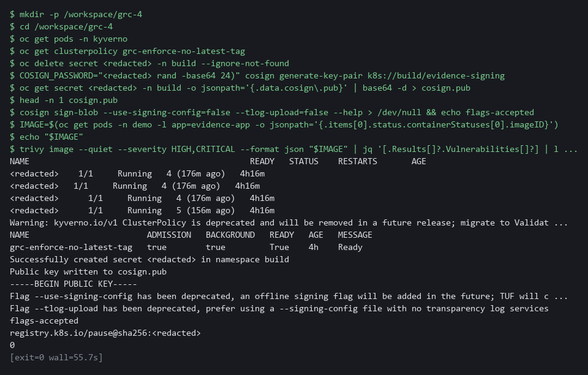

> **SECURITY:** The private key is stored as an ordinary cluster secret in the lab. Anyone who can read secrets in the build project can read it. Keep that access to the pipeline and its administrators, and move the key to a key management service in the real environment.

> **YOUR TURN:** Run the block. Read the count Trivy prints. A nonzero count is a real result and means the good run in Step 4 will correctly stop. If the count is not zero, tell your AI assistant the number before you go on.

> **CHECKPOINT:** The policy shows READY true, the flag check prints flags-accepted, cosign.pub starts with BEGIN PUBLIC KEY, and IMAGE ends in a `sha256` digest.

> **TAKEAWAY:** A separate key for evidence means signing and release can be rotated and revoked on their own.

**How this meets the controls**

- **SI-7:** You make a key pair used only for evidence and check that Cosign accepts the signing flags. The public half stays in your lab shell for later verification.
- **SA-11:** You run Trivy once on the demo image to see what the pipeline gate will see. The count tells you whether the good run in Step 4 will pass.

### Step 2. Decide how the policy check runs, using the cluster's own answers (CM-6 Configuration Settings)

**Learning point: Testing both ways of asking Kyverno about a bad change before the object exists shows which option works in a pipeline.**

Test the dry run and the policy report on the bad candidate; only the dry run answers before the object exists.

What this step adds (thick lines and outlines are new):

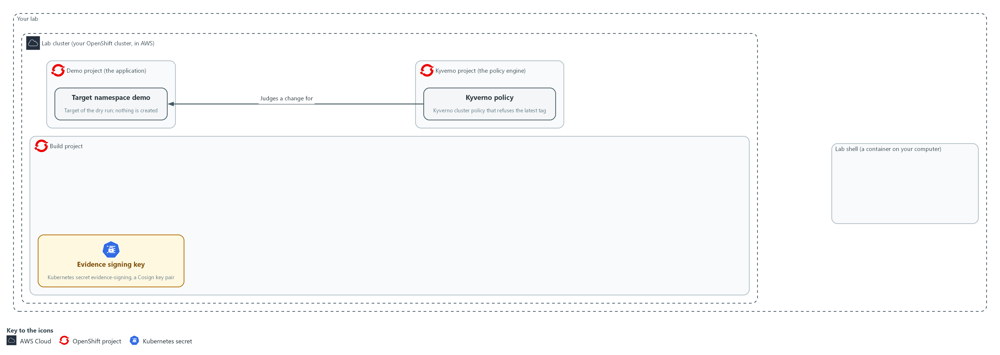

- You test the policy check two ways against a bad change and keep the one that stops it before anything is created in the demo namespace.

#### 2a. Try both ways of asking Kyverno about the bad change

You will now check the policy mode, copy the bad candidate out of the cluster, and ask about it in two ways.

- The lab stored the bad candidate in the config map candidate-manifests.
- Nothing is created.

```bash
cd /workspace/grc-4
oc get clusterpolicy grc-enforce-no-latest-tag -o jsonpath='{.spec.rules[0].validate.failureAction}{"\n"}'
oc get configmap candidate-manifests -n build -o jsonpath='{.data.bad\.yaml}' > bad.yaml
oc apply --dry-run=server -n demo -f bad.yaml
oc get policyreports.wgpolicyk8s.io -n demo -o json | jq '[.items[] | select((.scope.name // "") | startswith("candidate-app"))] | length'
```

**Expected output:**

```
Example only. The wording comes from Kyverno and your release.
Enforce
Error from server: ... denied the request ... grc-enforce-no-latest-tag ...
0
```

| Part | What it does | Why you run it |
| --- | --- | --- |
| cd (the module folder) | Moves into the module folder from Step 1. | bad.yaml is saved here, beside your other files. |
| jsonpath ... failureAction | Prints the policy's mode. Enforce means a breaking request is refused. Audit would only record it. | Only a policy in Enforce mode refuses a bad change, so you check the mode before you judge either option. |
| oc get configmap candidate-manifests ... > bad.yaml | Copies the bad candidate out of the cluster so you can see it and use it. | You need the bad candidate in a file so you can test both options against the same change. |
| oc apply --dry-run=server | Option one: asks the cluster to process the change without saving it. The Kyverno answer comes back as an error. | This is the option that can stop a bad change before it exists, so you see what it says about this one. |
| `oc get policyreports.wgpolicyk8s.io ... \| jq length` | Option two: counts the policy reports whose scope (the object a report is about) is the candidate. A report exists only for an object that already exists, so a bad change that was never created has none. The reports of other workloads are not counted. | This is the other option, and the count shows it has nothing to say about a change that was never created. |

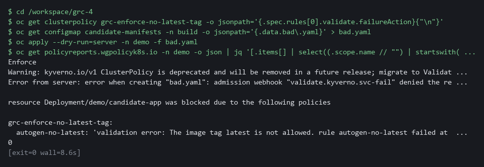

> **YOUR TURN:** Run the block and read what each option told you about the bad change.

> **CHECKPOINT:** The mode is Enforce, the dry run is refused with a message that names `grc-enforce-no-latest-tag`, and the report count for the candidate is 0 because nothing was created. The dry run is the option that stops a bad change before it exists, so the pipeline uses it.

> **TAKEAWAY:** A dry run stops a bad change before it exists; a policy report appears only after.

**How this meets the control**

- **CM-6:** The dry run is refused with a message naming the policy. The report count is zero because nothing was created.

### Step 3. Save the tasks, and write the policy check script yourself (SA-11 Developer Testing and Evaluation, CM-6 Configuration Settings, SI-7 Software, Firmware, and Information Integrity)

**Learning point: Saving the three tasks and writing the policy check script builds the pipeline's core: a gate that stops the run before any bundle exists.**

- Each task can be read and reused on its own.
- A task that exits with an error stops the pipeline there.
- The scan fails on a finding; the policy task fails on a refusal; the bundle task signs and verifies in the same run.

What this step adds (thick lines and outlines are new):

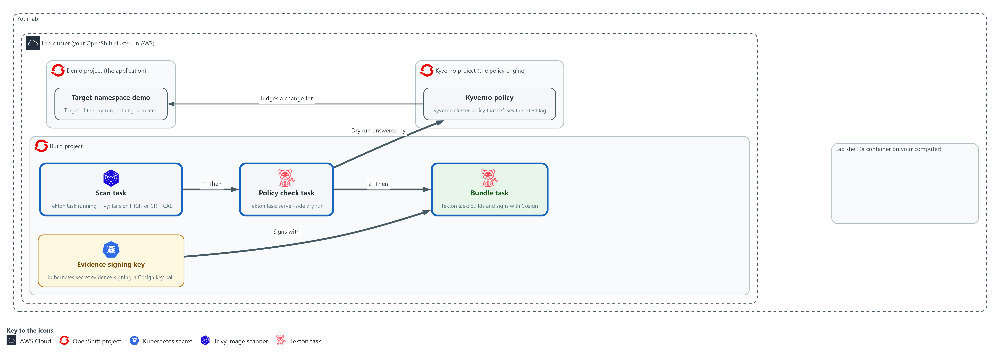

- The three tasks are saved in the build project: scan, policy check, and bundle with signature.

#### 3a. Save the scan task

You will now save this YAML as evidence-scan.yaml in the module folder.

- Paste all the lines at once into the lab shell.
- The file uses spaces only, never tabs.

```bash
cd /workspace/grc-4
cat > evidence-scan.yaml <<'EOF'
apiVersion: tekton.dev/v1
kind: Task
metadata:
  name: evidence-scan
  namespace: build
spec:
  params:
    - name: image-ref
    - name: severity
      default: "HIGH,CRITICAL"
  workspaces:
    - name: evidence
  steps:
    - name: scan
      image: ghcr.io/aquasecurity/trivy:0.76.1
      env:
        - name: TRIVY_CACHE_DIR
          value: $(workspaces.evidence.path)/.trivy
      script: |
        #!/bin/sh
        rm -f $(workspaces.evidence.path)/*.json
        trivy image --no-progress --severity $(params.severity) --format json --output $(workspaces.evidence.path)/trivy.json $(params.image-ref)
    - name: gate
      image: registry.access.redhat.com/ubi9/python-312:1
      script: |
        #!/usr/bin/env python3
        import json
        report = json.load(open("$(workspaces.evidence.path)/trivy.json"))
        count = sum(len(r.get("Vulnerabilities") or []) for r in report.get("Results") or [])
        print("blocking findings:", count)
        raise SystemExit(1 if count else 0)
EOF

```

**Expected output:**

```
Example only. Saving the file prints nothing.
```

| Part | What it does | Why you run it |
| --- | --- | --- |
| cd (the module folder) | Moves into the module folder. | The file is made in the folder you stand in. |
| cat > evidence-scan.yaml <<'EOF' ... EOF | Saves everything between the first and last line as the file. The quotes around EOF keep the dollar signs for Tekton to fill in. | No editor is needed; the paste is the whole file. |
| params severity | Which severities count as blocking. The default is HIGH and CRITICAL. | The blocking level is a parameter, so a run can use a stricter or looser level without editing the task. |
| workspaces evidence | The shared folder tasks use to hand files to each other. | The later tasks read the scan report from here, so the report must sit on a folder they share. |
| the Trivy image line | The public Trivy image, at a fixed version. | Nothing is built by the lab, and every learner scans with the same version. |
| rm -f ...*.json | Clears files left by an earlier run, so old evidence cannot be mistaken for new. | The bundle will carry a hash of this report, so a report left from another run could make wrong evidence look right. |
| TRIVY_CACHE_DIR ... .trivy | Keeps the downloaded vulnerability database in the shared folder, so the next run reuses it. The rm line only removes json files, so the database stays. | Downloading the database on every run is slow, so keeping it on the shared folder makes later runs quick. |
| trivy image ... --format json --output | Scans the image and keeps the report as trivy.json. The severity filter means the file holds only the blocking findings. | The bundle needs the report to hash, and the gate step needs it to count. |
| gate step: the Python lines | Reads the report, adds up the findings and exits with an error if the count is above zero. | This is the step that makes a serious finding stop the run before any bundle exists. |

#### 3b. Get the policy check task

You will now copy the policy check task out of the config map and print it.

- The lab supplies the task, and the last step of the task runs a Python file called admit.py, which you write in the next blocks.

```bash
cd /workspace/grc-4
oc get configmap policy-kit -n build -o jsonpath='{.data.evidence-policy\.yaml}' > evidence-policy.yaml
cat evidence-policy.yaml
```

**Expected output:**

```
Example only. The first lines of the file are shown; the rest follows the same layout.
apiVersion: tekton.dev/v1
kind: Task
metadata:
  name: evidence-policy
  namespace: build
spec:
  ...
```

| Part | What it does | Why you run it |
| --- | --- | --- |
| cd (the module folder) | Moves into the module folder. | The file is saved in the folder you stand in. |
| oc get configmap policy-kit ... > evidence-policy.yaml | Copies the task file out of the config map policy-kit into a file. | The task is supplied, so you read it and apply it and do not retype it. |
| workspaces candidate | A read-only folder that holds the candidate manifests. | The task must read the change it is asked about, and it should not be able to alter it. |
| get-oc step | Copies the oc program out of the public image quay.io/openshift/origin-cli:4.22.0 into a shared folder. | The Python image has no oc, so oc is brought in this way. |
| env MANIFEST, CANDIDATE, EVIDENCE | Hands your script three environment variables: the manifest name, the candidate folder and the evidence folder. | Your script reads plain variables and needs no Tekton syntax. |
| volumes admit-script, and command python3 /admit/admit.py | Mounts a config map called admit-script as the folder /admit and runs admit.py from it. You create that config map from your file below. | The task runs your script, so what you write is what the pipeline does. |

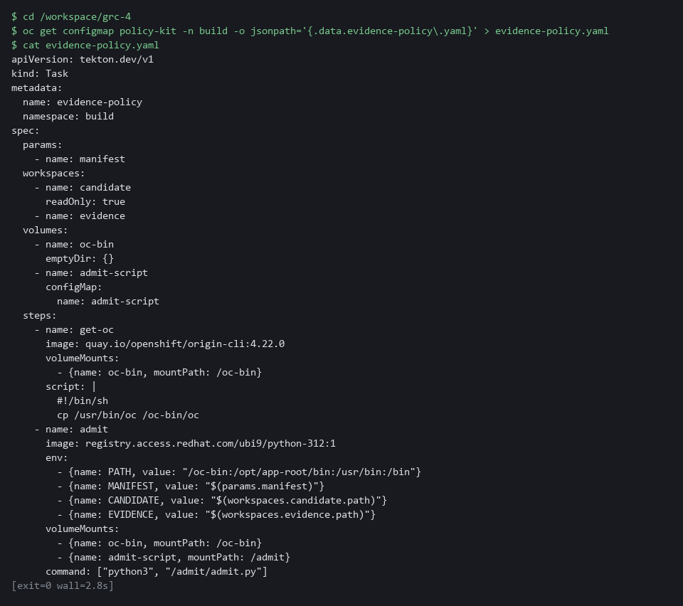

#### 3c. Start admit.py with the supplied first lines

You will now save the supplied first lines of admit.py.

- The supplied lines read the environment variables and build the path of the candidate file.
- The block after this one is yours.
- The block prints ok when the file has content.

```bash
cd /workspace/grc-4
cat > admit.py <<'EOF'
import json
import os
import subprocess

manifest = os.environ["MANIFEST"]
path = os.environ["CANDIDATE"] + "/" + manifest
EOF
test -s admit.py && echo ok || echo EMPTY

```

**Expected output:**

```
Example only.
ok
```

| Part | What it does | Why you run it |
| --- | --- | --- |
| `import json, os, subprocess` | Loads the three Python tools the script needs: JSON text, environment variables and running another program (`subprocess`). | Your lines use all three. |
| test -s admit.py && echo ok \|\| echo EMPTY | Prints ok if admit.py has content and EMPTY if it has none. | A failed paste can leave the file empty. If EMPTY shows, paste the block again. |
| manifest = os.environ["MANIFEST"] | Reads the candidate file name, for example good.yaml. | The same script then works for any candidate. |
| path = ... | Joins the candidate folder and the file name. | This is the file you hand to oc. |

#### 3d. Your part: write the dry run and the result (about 10 minutes)

You will now write the dry run and the result in your own lines.

- The spec is in the comment lines of this block.
- Do not paste the block as it stands, because the comment lines add nothing to admit.py.
- Type your own lines in place of the comment lines inside the heredoc (the text between the two EOF lines), and keep the first and last lines of the block.
- The command cat >> adds your lines to the end of admit.py.
- Use run, result and text as the names, because the next block uses result and text.
- Do not open the reference answer yet: try first.
- The last line of the block prints the size of admit.py in bytes.

```bash
cd /workspace/grc-4
cat >> admit.py <<'EOF'
# Your lines go here (about four). Use these names, the last two lines need them:
#   run     the result of running: oc apply --dry-run=server -n demo -f <path>
#           (capture the output as text)
#   result  "admitted" if the exit code of run is 0, otherwise "denied"
#   text    json.dumps of a dictionary with the keys manifest, result, message
#           (message is the output and the error text of run joined together)
# Then write text to the file policy-check.json in the folder named by EVIDENCE.
EOF
wc -c admit.py

```

**Expected output:**

```
Example only. The size is larger than it was after the first block.
412 admit.py
```

| Part | What it does | Why you run it |
| --- | --- | --- |
| cat >> admit.py <<'EOF' ... EOF | Adds what you type to the end of admit.py. The single > in the first block started the file; this one adds to it. | Your lines come after the supplied first lines and before the supplied last lines. |
| wc -c admit.py | Prints the size of admit.py in bytes. | If the size did not grow, your lines were not saved; type the block again. |
| run | The finished process of oc apply with --dry-run=server, -n demo and -f path. Use `subprocess.run` with `capture_output=True` and `text=True`. | The cluster, through Kyverno, answers whether it would admit the change, and nothing is created. |
| result | The word admitted when `run.returncode` is 0, otherwise denied. | The bundle records a clear word and not only an exit code. |
| text | json.dumps of a dictionary with manifest, result and message (`run.stdout` plus `run.stderr`). | The bundle task reads manifest and result from this file, so the key names must match. |
| write to policy-check.json | Writes text to the file policy-check.json in the folder named by the EVIDENCE variable. | The record must exist even when the change is denied, so it is written before the script can exit. |

#### 3e. Finish admit.py with the supplied last lines

You will now add the supplied last two lines to admit.py.

- The first of the two lines prints your record, and the second fails the task when the change was denied.

```bash
cd /workspace/grc-4
cat >> admit.py <<'EOF'
print(text)
raise SystemExit(0 if result == "admitted" else 1)
EOF

```

**Expected output:**

```
Example only. Saving the lines prints nothing.
```

| Part | What it does | Why you run it |
| --- | --- | --- |
| print(text) | Shows the record in the task log. | You read the answer in the log of the run. |
| raise SystemExit(0 if result == "admitted" else 1) | Ends the script with success for an admitted change and an error for a denied one. | A denied change must stop the run, so that no bundle is made for it. |

#### 3f. Save the bundle task

You will now save this YAML as evidence-bundle.yaml in the module folder.

- Paste all the lines at once into the lab shell.

```bash
cd /workspace/grc-4
cat > evidence-bundle.yaml <<'EOF'
apiVersion: tekton.dev/v1
kind: Task
metadata:
  name: evidence-bundle
  namespace: build
spec:
  params:
    - name: run
    - name: image-ref
  workspaces:
    - name: evidence
    - name: signing
      readOnly: true
  results:
    - name: bundle
    - name: signature
  steps:
    - name: assemble
      image: registry.access.redhat.com/ubi9/python-312:1
      workingDir: $(workspaces.evidence.path)
      script: |
        #!/usr/bin/env python3
        import hashlib
        import json
        from datetime import datetime, timezone
        raw = open("trivy.json", "rb").read()
        findings = sum(len(r.get("Vulnerabilities") or []) for r in json.loads(raw).get("Results") or [])
        policy = json.load(open("policy-check.json"))
        bundle = {"run": "$(params.run)", "image": "$(params.image-ref)",
                  "collected_at": datetime.now(timezone.utc).strftime("%Y-%m-%dT%H:%M:%SZ"),
                  "scan": {"sha256": hashlib.sha256(raw).hexdigest(), "blocking_findings": findings},
                  "policy": {"manifest": policy["manifest"], "result": policy["result"]}}
        open("bundle.json", "w").write(json.dumps(bundle, separators=(",", ":")))
    - name: sign
      image: ghcr.io/sigstore/cosign/cosign:v3.1.4
      workingDir: $(workspaces.evidence.path)
      env:
        - name: COSIGN_PASSWORD
          valueFrom:
            secretKeyRef: {name: evidence-signing, key: cosign.password}
      securityContext:
        runAsUser: 65532
      command: ["/ko-app/cosign"]
      args: ["sign-blob", "--yes", "--key", "$(workspaces.signing.path)/cosign.key", "--use-signing-config=false", "--tlog-upload=false", "--bundle", "bundle.sigstore.json", "bundle.json"]
    - name: verify
      image: ghcr.io/sigstore/cosign/cosign:v3.1.4
      workingDir: $(workspaces.evidence.path)
      command: ["/ko-app/cosign"]
      args: ["verify-blob", "--key", "$(workspaces.signing.path)/cosign.pub", "--bundle", "bundle.sigstore.json", "--insecure-ignore-tlog=true", "bundle.json"]
    - name: publish
      image: registry.access.redhat.com/ubi9/python-312:1
      workingDir: $(workspaces.evidence.path)
      securityContext:
        runAsUser: 65532
      script: |
        #!/usr/bin/env python3
        import json
        open("$(results.bundle.path)", "w").write(open("bundle.json").read())
        signature = json.load(open("bundle.sigstore.json"))
        open("$(results.signature.path)", "w").write(json.dumps(signature, separators=(",", ":")))
EOF

```

**Expected output:**

```
Example only. Saving the file prints nothing.
```

| Part | What it does | Why you run it |
| --- | --- | --- |
| results bundle, signature | The two values the task hands back to the pipeline. | The pipeline can only keep a value that a task returns, so the task names the two values it hands back. |
| assemble step: the SHA-256 call | The fingerprint of the scan report, so the bundle commits to the exact report. | The bundle holds a hash and not the whole report, so a reader can later check the report against it. |
| assemble step: json.dumps(bundle, separators=...) | Builds the bundle as one compact line: run name, image, time, the scan summary and the policy result. | One compact line gives the signature a single exact set of bytes to cover, and gives a reader the facts in one place. |
| secretKeyRef cosign.password | Gives Cosign the key password from the secret. | The key password must never sit in a file or on a command line, so the task takes it from the secret. |
| sign step: cosign sign-blob --bundle | Signs the bundle file and writes the signature, with the digest it covers, to the signature file. It runs in the public cosign image. | This is the step that makes any later edit to the bundle detectable. |
| verify step: cosign verify-blob --bundle | Checks the signature right away. A failure here stops the run. | A bad signature should stop the run at once, before a bundle that cannot be verified is kept. |
| publish step | Hands the bundle and its signature to the pipeline as results. | Results are how the pipeline keeps the bundle and signature after the pod is gone, so you read them back from the run record. |

#### 3g. Save your script, check and apply the three tasks

You will now save admit.py as the config map admit-script, check the scan task file with a dry run, apply all three task files, and list the tasks.

- Running the block again after you change admit.py updates the script.

```bash
cd /workspace/grc-4
oc create configmap admit-script -n build --from-file=admit.py --dry-run=client -o yaml | oc apply -f -
oc get configmap admit-script -n build
oc apply -f evidence-scan.yaml --dry-run=server
oc apply -f evidence-scan.yaml -f evidence-policy.yaml -f evidence-bundle.yaml
tkn task list -n build
```

**Expected output:**

```
Example only. Your ages will differ.
configmap/admit-script created
NAME  DATA  AGE
admit-script  1  <age>
task.tekton.dev/evidence-scan created (server dry run)
task.tekton.dev/evidence-scan created
task.tekton.dev/evidence-policy created
task.tekton.dev/evidence-bundle created
NAME  DESCRIPTION  AGE
evidence-bundle  ...  <age>
evidence-policy  ...  <age>
evidence-scan  ...  <age>
```

| Part | What it does | Why you run it |
| --- | --- | --- |
| cd (the module folder) | Moves into the module folder, where the files are. | oc reads the files from here. |
| oc create configmap admit-script ... \| oc apply -f - | Stores your admit.py as a config map. The dry-run create plus apply means a second run just updates it. | The policy task mounts this config map and runs your script from it. |
| oc get configmap admit-script | Reads the config map back from the cluster. DATA 1 means admit.py is in it. | The output shows the cluster holds your script. DATA 0 or an error means admit.py was empty; rewrite it. |
| --dry-run=server | Asks the cluster to check the file without saving it. | A mistake in the file shows up now, before anything is saved. |
| oc apply -f ... -f ... -f ... | Saves all three tasks. Each YAML above is its own file. Applying again just updates them. | The pipeline in Step 4 refers to these tasks by name, so they must exist first. |
| tkn task list | Lists the saved tasks. Your three should be there. | It confirms all three tasks were saved before you wire them together. |

#### 3h. Check your script on the good candidate

You will now run the policy check task alone on the good candidate, whose answer you already know: admitted.

- The step needs the cluster to reach the internet the first time, because it pulls two public images.
- If the task fails at once with a Python error, admit.py is probably empty or incomplete: rewrite it.
- On the first run the log can stop early at "Waiting for logs..." while the images download.
- The task still finishes: follow it with tkn taskrun logs --last -f -n build.

```bash
cd /workspace/grc-4
tkn task start evidence-policy -n build -s pipeline \
  -p manifest=good.yaml \
  -w name=candidate,config=candidate-manifests \
  -w name=evidence,claimName=evidence-work \
  --showlog
```

**Expected output:**

```
Example only. Your run name and message will differ.
TaskRun started: evidence-policy-run-<id>
[admit] {"manifest": "good.yaml", "result": "admitted", "message": "deployment.apps/candidate-app created (server dry run)\n"}
```

| Part | What it does | Why you run it |
| --- | --- | --- |
| cd (the module folder) | Moves into the module folder. | Every block starts from a known folder. |
| tkn task start evidence-policy | Runs only the policy check task, once. | You test your script alone before it sits inside the pipeline. |
| -s pipeline | Runs it as the pipeline service account, which may dry-run changes in the demo namespace. | The dry run needs rights in the demo namespace. |
| -p manifest=good.yaml | Asks about the good candidate, which uses a fixed image tag and not latest. | The right answer is known: admitted. |
| -w name=candidate,config=candidate-manifests | Gives the task the candidate manifests as a read-only folder. | The task reads the change from here. |
| -w name=evidence,claimName=evidence-work | Gives the task the shared evidence folder. The lab created this storage, named evidence-work, for you. | Your script writes policy-check.json here. |
| [admit] {..."result": "admitted"...} | The line your print(text) wrote. The result must be admitted. | This is the positive check against the known answer. The negative check is Test 4. |

#### 3i. Only after you have tried: the reference answer

You will now read the reference answer, but only after you have tried to write your own lines and run the check above.

- If your script did not print admitted, compare it with this one, find the difference, fix your admit.py, and run the previous blocks again.
- Your script matches the reference if it behaves the same way, even when the wording differs.

```bash
cd /workspace/grc-4
oc get configmap policy-kit -n build -o jsonpath='{.data.admit\.reference\.py}' > admit.reference.py
cat admit.reference.py
```

**Expected output:**

```
Example only. The file is about 11 lines and ends with:
print(text)
raise SystemExit(0 if result == "admitted" else 1)
```

| Part | What it does | Why you run it |
| --- | --- | --- |
| oc get configmap policy-kit ... > admit.reference.py | Copies the reference answer out of the config map into a file named admit.reference.py. Your own admit.py is not changed. | You compare behavior with a working version, and your file stays yours. |
| cat admit.reference.py | Prints the reference answer. | Compare the oc call, the result word, the keys of the dictionary and the file name with yours. |

> **TIP:** Keep these files in git so changes to the pipeline are reviewed like any other change (CM-3).

> **YOUR TURN:** Paste the scan task and the bundle task. Copy out the policy task, write your own lines in admit.py from the spec, then save the script, apply the three tasks and run the policy check on the good candidate. Open the reference answer only after you have tried.

> **CHECKPOINT:** tkn lists evidence-scan, evidence-policy and evidence-bundle, and the policy check run alone prints a record with result admitted for good.yaml.

> **TAKEAWAY:** Each task exits with an error on failure, so the bundle task only starts after both checks pass.

**How this meets the controls**

- **SA-11:** The scan task fails the run on any HIGH or CRITICAL finding. The bundle task puts a hash of the report into the bundle.
- **CM-6:** You write the dry-run script. It records the answer in policy-check.json and fails the task on a denial.
- **SI-7:** The bundle task signs the bundle and verifies its own signature. The signature covers the exact bytes.

### Step 4. Wire the pipeline, run it, and read the bundle (SA-11 Developer Testing and Evaluation, CM-6 Configuration Settings, SI-7 Software, Firmware, and Information Integrity)

**Learning point: Running the full pipeline on a good image and candidate produces one signed bundle and stores it on the run record.**

- The pipeline orders the tasks and passes shared folders between them.
- The pipeline keeps the bundle and signature as its results, and an auditor reads them from the run record after the pods are gone.

What this step adds (thick lines and outlines are new):

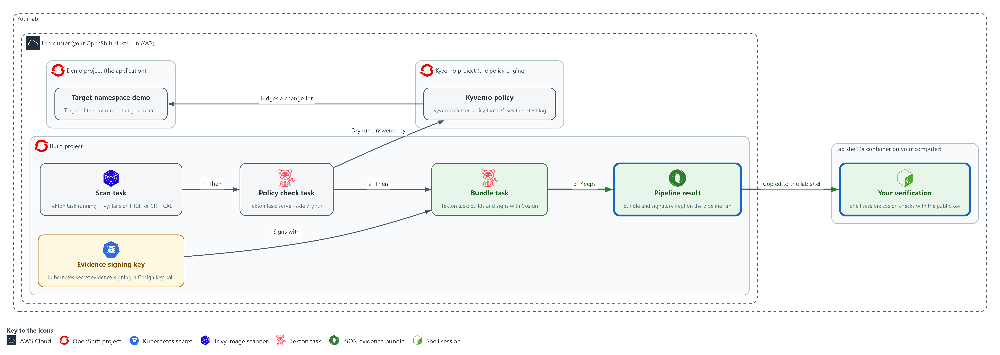

- The pipeline wires the tasks in order and keeps the bundle and its signature as results on the run record in the build project. You copy them into your lab shell and verify them there.

#### 4a. Save the pipeline

You will now save this YAML as evidence-bundle-pipeline.yaml in the module folder.

- Paste all the lines at once into the lab shell.

```bash
cd /workspace/grc-4
cat > evidence-bundle-pipeline.yaml <<'EOF'
apiVersion: tekton.dev/v1
kind: Pipeline
metadata:
  name: evidence-bundle
  namespace: build
spec:
  params:
    - name: image-ref
    - name: manifest
      default: good.yaml
  workspaces:
    - name: evidence
    - name: candidate
    - name: signing
  tasks:
    - name: scan
      taskRef:
        name: evidence-scan
      params:
        - {name: image-ref, value: $(params.image-ref)}
      workspaces:
        - {name: evidence, workspace: evidence}
    - name: policy
      runAfter: ["scan"]
      taskRef:
        name: evidence-policy
      params:
        - {name: manifest, value: $(params.manifest)}
      workspaces:
        - {name: candidate, workspace: candidate}
        - {name: evidence, workspace: evidence}
    - name: bundle
      runAfter: ["policy"]
      taskRef:
        name: evidence-bundle
      params:
        - {name: run, value: $(context.pipelineRun.name)}
        - {name: image-ref, value: $(params.image-ref)}
      workspaces:
        - {name: evidence, workspace: evidence}
        - {name: signing, workspace: signing}
  results:
    - name: bundle
      value: $(tasks.bundle.results.bundle)
    - name: signature
      value: $(tasks.bundle.results.signature)
EOF

```

**Expected output:**

```
Example only. Saving the file prints nothing.
```

| Part | What it does | Why you run it |
| --- | --- | --- |
| cat > evidence-bundle-pipeline.yaml <<'EOF' ... EOF | Saves everything between the first and last line as the file. | No editor is needed; the paste is the whole file. |
| params image-ref, manifest | What to scan and which candidate to check. The default candidate is the good one. | The pipeline runs on any image and any candidate, so these are inputs and are not fixed in the file. |
| workspaces | The shared evidence folder, the candidate manifests and the signing secret. | Each task gets only the folders it needs, and the signing key reaches only the bundle task. |
| runAfter | Puts the tasks in order: scan, then policy, then bundle. A failed task means the later ones never start. | The order is the rule: the bundle comes last, so it can exist only after both checks pass. |
| $(context.pipelineRun.name) | The name of this run, written into the bundle so the bundle names the run that made it. | A reader can later tie a bundle to the exact run that made it. |
| results | Exposes the bundle and the signature in the run record. | The run record is where you and an auditor read the bundle and signature after the pods are gone. |

#### 4b. Run the pipeline and copy out the bundle

You will now apply the pipeline, run it on the demo image with the good candidate, and copy the bundle and its signature out of the run record.

- The step needs the cluster to reach the internet: the first run pulls four public images and the Trivy database, which can take a few minutes.

```bash
cd /workspace/grc-4
IMAGE=$(oc get pods -n demo -l app=evidence-app -o jsonpath='{.items[0].status.containerStatuses[0].imageID}')
oc apply -f evidence-bundle-pipeline.yaml --dry-run=server
oc apply -f evidence-bundle-pipeline.yaml
tkn pipeline start evidence-bundle -n build -s pipeline \
  -p image-ref="$IMAGE" \
  -p manifest=good.yaml \
  -w name=evidence,claimName=evidence-work \
  -w name=candidate,config=candidate-manifests \
  -w name=signing,secret=evidence-signing \
  --showlog
RUN=$(tkn pipelinerun describe --last -n build -o jsonpath='{.metadata.name}')
oc get pipelinerun "$RUN" -n build -o jsonpath='{.status.results[?(@.name=="bundle")].value}' > bundle.json
oc get pipelinerun "$RUN" -n build -o jsonpath='{.status.results[?(@.name=="signature")].value}' > bundle.sigstore.json
test -s bundle.json || echo "bundle.json is empty: the run did not finish, read its log with tkn pipelinerun logs $RUN -n build"
```

**Expected output:**

```
Example only. Your run name and times will differ.
pipeline.tekton.dev/evidence-bundle created (server dry run)
pipeline.tekton.dev/evidence-bundle created
(the task logs stream: scan, then policy, then bundle; the scan log ends with: blocking findings: 0)
(the last three commands print nothing when the run succeeded; they save bundle.json and bundle.sigstore.json and check that the first is not empty)
```

| Part | What it does | Why you run it |
| --- | --- | --- |
| cd (the module folder) | Moves into the module folder. | The bundle and signature files are saved here. |
| IMAGE=$(oc get pods ...) | Reads the evidence application's image digest again, so the block also works in a new lab shell. | A new lab shell does not remember the earlier value, so the block sets it again. |
| oc apply --dry-run=server, then oc apply | Checks and saves the pipeline. | The pipeline refers to the tasks you saved, so a mistake in this file should show before the run begins. |
| tkn pipeline start evidence-bundle | Starts one run. | This is the run that produces the bundle you verify next. |
| -s pipeline | Runs it as the pipeline service account, which can dry-run changes in the demo namespace. | The policy task needs rights in the demo namespace to ask its dry-run question, and this account has them. |
| -p image-ref="$IMAGE" | The exact image digest from Step 1. | The bundle must name exactly what was scanned, so the run gets the digest and not a tag. |
| -w name=evidence,claimName=evidence-work | The shared storage evidence-work, which the lab created. It carries files between the tasks. | The three tasks hand files to each other through this folder. |
| -w name=candidate,config=candidate-manifests | The candidate manifests as a read-only folder. | The policy task reads the change it checks from here. |
| -w name=signing,secret=evidence-signing | The signing key secret. | Only the bundle task needs the key, and this is how it reaches it. |
| jsonpath status.results | Reads the bundle and the signature out of the run record into two files. | You verify the bundle from your lab shell, so you copy it and its signature out of the run record into two files. |

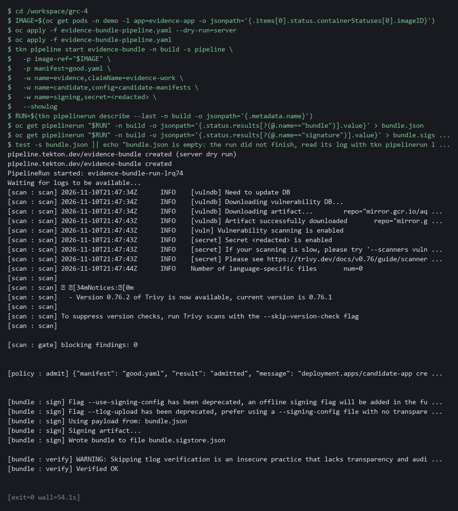

> **YOUR TURN:** Paste the pipeline file, then apply it and run it. Test 1 prints the bundle fields.

> **CHECKPOINT:** All three tasks finish and bundle.json and the signature file exist. Test 1 shows your image, a time, blocking_findings 0 and policy result admitted.

> **TAKEAWAY:** An auditor reads the bundle and signature from the run record, not from your lab shell.

**How this meets the controls**

- **SA-11:** The run scans the image and keeps the findings count and a report hash in the bundle. Bundle and signature stay on the run record.
- **CM-6:** The run asks Kyverno about the good candidate. The admission answer is recorded in the bundle.
- **SI-7:** The run signs the bundle and keeps signature and bundle on the run record. You copy both to your lab shell.

## Section 4. Verify It Works

### Test 1 (positive). The bundle verifies with the public key, outside the pipeline (SI-7 Software, Firmware, and Information Integrity)

- The pipeline checked its own signature, which proves only that it can read its own work.
- Verify from the lab shell with the public key alone, so the check depends on nothing the pipeline controls.

```bash
cd /workspace/grc-4
cosign verify-blob --key cosign.pub --bundle bundle.sigstore.json --insecure-ignore-tlog=true bundle.json
jq '{run, image, collected_at, blocking: .scan.blocking_findings, policy: .policy.result}' bundle.json
```

**Expected output:**

```
Example only. Names and times will differ.
Verified OK
{
  "run": "evidence-bundle-run-x7k2p",
  "image": "registry.k8s.io/pause@sha256:3f1c0a9e5b7d2c4a8e6f1b0d9c3a7e5f2b4d6c8a0e1f3b5d7c9a1e3f5b7d9c0a",
  "collected_at": "2026-10-29T21:40:07Z",
  "blocking": 0,
  "policy": "admitted"
}
```

| Part | What it does | Why you run it |
| --- | --- | --- |
| cd (the module folder) | Moves into the module folder, where bundle.json and the signature file from Step 4 are. | Both commands read those files. |
| cosign verify-blob --key cosign.pub --bundle ... | Checks the signature on bundle.json with the public key alone. The log check is skipped because the lab does not use a transparency log. | The check depends on nothing the pipeline controls. |
| Verified OK | The bundle is exactly what was signed. | Any other answer means the bundle cannot be trusted. |
| jq '{run, image, ...}' | Prints the main fields of the bundle: run name, image, time, blocking findings and the policy answer. | Shows what the signature vouches for. |

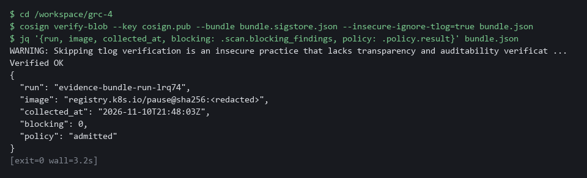

> **CHECKPOINT:** Cosign prints Verified OK, and the bundle names your image digest, a recent time, zero blocking findings and an admitted change.

**How this meets the control**

- **SI-7:** You verify the bundle from the lab shell with the public key alone, outside the pipeline. Verified OK means the bundle is exactly what was signed.

### Test 2 (negative). A changed bundle fails verification (SI-7 Software, Firmware, and Information Integrity)

Change the time in a copy of the bundle and verify the copy; the signature covered the original bytes, so verification must fail.

```bash
cd /workspace/grc-4
sed 's/"collected_at":"[^"]*"/"collected_at":"2030-01-01T00:00:00Z"/' bundle.json > tampered.json
diff bundle.json tampered.json | head -n 2
cosign verify-blob --key cosign.pub --bundle bundle.sigstore.json --insecure-ignore-tlog=true tampered.json
```

**Expected output:**

```
Example only. The exact wording depends on your Cosign release.
1c1
< {"run":"...",...,"collected_at":"2026-10-29T21:40:07Z",...}
Error: ... (a signature mismatch message, for example: invalid signature when validating ASN.1 encoded signature; it may not name tampered.json)
```

| Part | What it does | Why you run it |
| --- | --- | --- |
| cd (the module folder) | Moves into the module folder. | The copy is made beside the real bundle. |
| sed ... > tampered.json | Makes a copy with the time changed to the year 2030, the edit someone would make to pass old evidence off as new. | The signature must detect this tampering. |
| diff bundle.json tampered.json \| head -n 2 | Shows the changed line. | Confirms the copy really differs. |
| cosign verify-blob ... tampered.json | Verifies the copy with the same command as before. | Verification of the copy must fail: the signature covered the original bytes. |

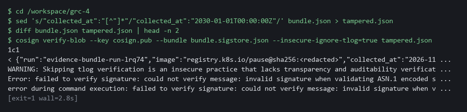

> **CHECKPOINT:** Verification fails with an error about the signature or the digest. `diff` shows the changed time. If it prints Verified OK, the bundle is not protected and you must stop and report it.

**How this meets the control**

- **SI-7:** A changed copy of the bundle fails verification because the signature covered the original bytes. The lab's action on a failure is that the bundle is not used as evidence.

### Test 3 (negative). A failing scan stops the pipeline and leaves no bundle (SA-11 Developer Testing and Evaluation)

- Run the same pipeline on an old image with known serious flaws.
- The step needs the cluster to reach the internet (it pulls the old image and the Trivy database).
- The scan must fail, the later tasks must never start, and the run record must hold no bundle at all.

```bash
cd /workspace/grc-4
tkn pipeline start evidence-bundle -n build -s pipeline \
  -p image-ref="docker.io/library/nginx:1.16" \
  -p manifest=good.yaml \
  -w name=evidence,claimName=evidence-work \
  -w name=candidate,config=candidate-manifests \
  -w name=signing,secret=evidence-signing \
  --showlog || true
RUN=$(tkn pipelinerun describe --last -n build -o jsonpath='{.metadata.name}')
oc get pipelinerun "$RUN" -n build -o jsonpath='{.status.conditions[0].reason}{"\n"}'
oc get taskrun -n build -l tekton.dev/pipelineRun=$RUN -o jsonpath='{range .items[*]}{.metadata.labels.tekton\.dev/pipelineTask} {.status.conditions[0].reason}{"\n"}{end}'
oc get pipelinerun "$RUN" -n build -o jsonpath='{.status.results}{"\n"}'
```

**Expected output:**

```
Example only. Counts and run names will differ.
[scan : gate] blocking findings: <a long count, over a hundred>
Failed
scan StepFailed
(empty line: the run has no results)
```

| Part | What it does | Why you run it |
| --- | --- | --- |
| tkn pipeline start ... nginx:1.16 \|\| true | Runs the pipeline on an old image. The \|\| true keeps the block going when the run fails, which is what should happen. | The run is meant to fail. |
| conditions[0].reason | Prints how the run ended: Failed. | The run must not succeed. |
| get taskrun ... pipelineTask | Lists the tasks that started and how they ended: only scan, StepFailed (Tekton's word for a task whose step failed). | The policy and bundle tasks never started. |
| status.results | Prints the results of the run. They are empty. | No bundle exists, so nothing can claim this image passed. |

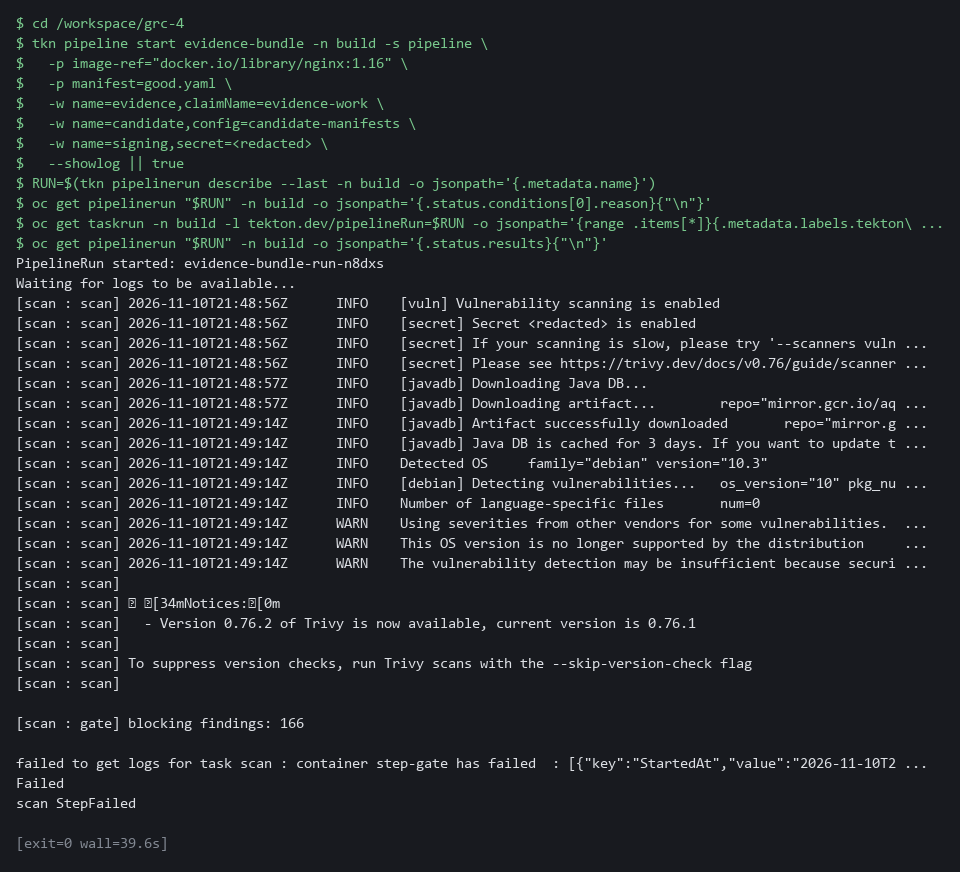

> **CHECKPOINT:** The run reason is Failed, only the scan task exists and its reason is StepFailed, and the results are empty. No bundle was made, so no bundle can claim this image passed.

**How this meets the control**

- **SA-11:** An old image with known serious flaws fails the scan, so the later tasks never start. The run record holds no bundle, so no evidence can claim the image passed.

### Test 4 (negative). A change that breaks policy stops the pipeline (CM-6 Configuration Settings)

- Run the pipeline on the good image but with the bad candidate, the Deployment that uses the latest tag.
- The scan will pass, the policy task must record the denial and fail, and the bundle task must never start.

```bash
cd /workspace/grc-4
IMAGE=$(oc get pods -n demo -l app=evidence-app -o jsonpath='{.items[0].status.containerStatuses[0].imageID}')
tkn pipeline start evidence-bundle -n build -s pipeline \
  -p image-ref="$IMAGE" \
  -p manifest=bad.yaml \
  -w name=evidence,claimName=evidence-work \
  -w name=candidate,config=candidate-manifests \
  -w name=signing,secret=evidence-signing \
  --showlog || true
RUN=$(tkn pipelinerun describe --last -n build -o jsonpath='{.metadata.name}')
oc get taskrun -n build -l tekton.dev/pipelineRun=$RUN -o jsonpath='{range .items[*]}{.metadata.labels.tekton\.dev/pipelineTask} {.status.conditions[0].reason}{"\n"}{end}'
oc get pipelinerun "$RUN" -n build -o jsonpath='{.status.results}{"\n"}'
```

**Expected output:**

```
Example only. The wording depends on your Kyverno release.
(the policy task log shows a denial message that names grc-enforce-no-latest-tag)
(two lines, in either order)
scan Succeeded
policy StepFailed
(empty line: the run has no results)
```

| Part | What it does | Why you run it |
| --- | --- | --- |
| IMAGE=$(oc get pods ...) | Reads the demo image digest again, so the block works on its own. | The scan should pass on this image. |
| tkn pipeline start ... bad.yaml \|\| true | Runs the pipeline with the candidate that uses the latest tag. The \|\| true keeps the block going when the run fails. | The run is meant to fail at the policy task. |
| get taskrun ... pipelineTask | Lists the tasks that started: scan Succeeded, policy StepFailed, and no bundle task. | The bundle task must never start after a refusal. |
| status.results | Prints the results of the run. They are empty. | No bundle exists for a refused change. |

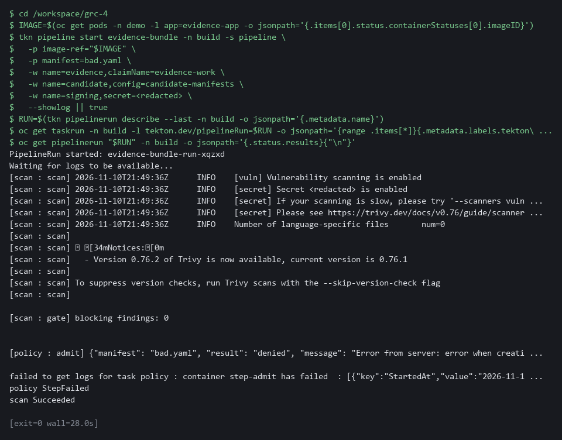

> **CHECKPOINT:** The scan succeeded, the policy task failed (StepFailed), no bundle task exists and the results are empty. In the log, the message names the policy `grc-enforce-no-latest-tag`.

**How this meets the control**

- **CM-6:** The bad candidate that uses the latest tag is refused by the policy task, so the bundle task never starts. The output is a refused change and no bundle.

## Section 5. What Each Control Is For

### Control mapping

| Control | What it requires, in plain words | Tool or service | Where this module covers it |
| --- | --- | --- | --- |
| SA-11 Developer Testing and Evaluation | The people who build the system test it, keep proof of the testing, and fix what the tests find. | Trivy, run by the scan task of an OpenShift Pipelines (Tekton) pipeline. Explained in section 2.1. | Section 3, Step 3: the scan task is a gate. Section 3, Step 4: the scan result is kept in the bundle. Section 4, Test 3: a failing scan stops the run. |
| SI-7 Software, Firmware, and Information Integrity | Detect unauthorized changes to software and information, and act when one is found. | Cosign, which signs the bundle in the bundle task. Explained in section 2.2. | Section 3, Steps 1 and 3: you make the evidence key and save the task that signs. Section 3, Step 4: the bundle is signed. Section 4, Test 1: the bundle verifies. Section 4, Test 2: a changed bundle fails verification. |
| CM-6 Configuration Settings | Settings are implemented as approved and changes to them are controlled. | Kyverno, asked through a server-side dry run in the policy task. Explained in section 2.3. | Section 3, Step 2: you choose the dry run. Section 3, Step 3: the policy task asks Kyverno whether a candidate change would be admitted. Section 3, Step 4: the run records the policy result in the bundle. Section 4, Test 4: a bad change is refused. |

### What each control is for

Each table below says what the control is trying to prevent and how this module's tool meets it.

#### SA-11 Developer Testing and Evaluation

| Question | Answer |
| --- | --- |
| Control Intent | A release goes out with a known serious flaw, or the test result sits only in a log nobody can find. |
| The operational question | For this release, which scan ran, what did it find, and can the answer be produced without rerunning anything? |
| What evidence proves it | A bundle per run that holds the findings count, a hash of the scan output and the image reference. |
| How much is enough | The scan runs on every run, a HIGH or CRITICAL finding stops the run, and the result is kept with the run. NIST leaves the testing frequency and depth organization-defined. |
| How the tool in this module satisfies it | Trivy runs in the scan task (Step 3). The count and a hash of the report go into the bundle (Step 3 and Step 4). |

#### SI-7 Software, Firmware, and Information Integrity

| Question | Answer |
| --- | --- |
| Control Intent | Evidence is edited after the fact, for example to make an old result look recent, and nobody can tell. |
| The operational question | If one character in a stored bundle changed, would anything notice? |
| What evidence proves it | The signature, the public key, and a verification that fails on a changed bundle. |
| How much is enough | Each bundle is signed by a key kept for the pipeline, and anyone with the public key can check it. NIST leaves the actions on a detected change organization-defined; here the bundle is not used as evidence. |
| How the tool in this module satisfies it | Cosign signs the bundle with a key held as a secret in the build project (Steps 1, 3 and 4). |

#### CM-6 Configuration Settings

| Question | Answer |
| --- | --- |
| Control Intent | A change that breaks a rule, such as using the latest tag, reaches production because the rule was only written down. |
| The operational question | Would the cluster accept this change, and do we know that before the change is made? |
| What evidence proves it | The admission result for the candidate change, recorded in the bundle. |
| How much is enough | The cluster enforces the rule, and the pipeline asks it the same question it will ask at deploy time, changing nothing while it asks. |
| How the tool in this module satisfies it | A server-side dry run of the candidate manifest against the Kyverno policy (Steps 2 and 3). |

## Section 6. Next Steps

### Using this in other environments

- Works on any Kubernetes cluster with OpenShift Pipelines (Tekton), Trivy, Kyverno in Enforce mode, and Cosign 3.x.
- Change these lab values first: the build namespace, the pipeline service account, the evidence volume name, and the evidence-signing secret name.
- The signing key is a plain cluster secret in the lab. Replace it with a key management service in production.
- The policy check uses oc apply --dry-run=server; replace oc with kubectl on non-OpenShift clusters.

The table shows what changes on each platform:

| Check/part | In this lab (OpenShift) | On other Kubernetes | What you change |
| --- | --- | --- | --- |
| Image scan | Trivy in a pipeline pod, pulls its database from the internet | Trivy, Grype, or any scanner that exits non-zero on a finding | The scanner image and the report format parsed by the gate step. |
| Policy check | oc apply --dry-run=server against Kyverno in Enforce mode | kubectl apply --dry-run=server with Kyverno; for OPA/Gatekeeper, replace the check | Replace oc with kubectl; ensure the admission webhook is in Enforce mode. |
| Signing | cosign sign-blob --tlog-upload=false with a cluster secret | Cosign with a key management service key, or sigstore with a transparency log | The key reference and whether to upload to a log. |
| Bundle storage | Tekton pipeline result (compact JSON) | Any artifact store: OCI registry, S3, or a git-managed file | The publish step in the bundle task. |
| Verification | cosign verify-blob --key cosign.pub in the lab shell | Same command in a separate system outside the pipeline | Nothing if Cosign 3.x is available; the key path. |

> **TIP:** Next module: GRC-5 Continuous Control Monitoring Design: turn policy reports and cluster state into machine-readable results, detect drift against a baseline, and measure how much of a team's control set has fresh, automated evidence.

<details>
<summary><strong>Section 7. Terms</strong></summary>

Each term is also explained the first time it appears. In Word, hover over an underlined term to see its meaning, or Ctrl+click it to jump to this table.

| Term | Plain meaning |
| --- | --- |
| Admission controller | A cluster component that can accept or refuse a request before the object is created. |
| Artifact | A file produced by a build or a step, such as an image, a report or a log. |
| Audit mode | A policy setting that lets a request through and only records a report afterward. |
| AWS | Amazon Web Services, the cloud your lab runs in. |
| Base64 | A text encoding for binary data. It is not encryption. |
| Baseline | The agreed starting configuration that the system is expected to match. |
| Candidate | A change you are checking before it is made. Here it is a Deployment file that nothing has created yet. |
| CLI | Command-line interface: a program you use by typing commands. |
| Cluster | A group of servers that work together as one system. Here it is your own OpenShift cluster in AWS. |
| Cluster policy | A Kyverno policy that applies to the whole cluster. |
| Commit | One saved snapshot in git, with a short message. |
| Config map | A stored file or setting that the cluster keeps and can hand to a program. |
| Container | A sealed box that holds one program and everything it needs to run. |
| Cosign | A free tool that signs and verifies images and other files. |
| Deployment | A cluster object that keeps a set of pods running from one image. |
| diff | A command that shows the differences between two files. |
| Digest | A fixed fingerprint of an image's exact contents. A tag can move to a different image. A digest cannot. |
| Drift | When the real system no longer matches what the files say it should be. |
| Dry run | Asking the cluster to check a request as if it were real, without saving anything. |
| Enforce mode | A policy setting that refuses a request that breaks the rule. |
| Environment variable | A named value that a program can read when it starts, such as MANIFEST. |
| Evidence | Saved records that show a system is set up and behaving as claimed. |
| Evidence bundle | One file that holds the results of a run and the facts about it, signed so a change can be detected. |
| Exit code | A number a command returns when it ends. Zero means success. Any other number means failure. |
| Gate | A check that stops the pipeline if it fails. |
| Hash | A fixed-length fingerprint of content. The same content always gives the same hash. |
| Heredoc | A way to save typed text into a file from the shell: everything between the first EOF line and the last EOF line becomes the file. |
| Image | A packaged copy of a program with everything it needs. The cluster starts pods from images. |
| Image tag | A label on an image, such as latest. A tag can be moved to a different image. |
| jq | A command-line tool that reads and picks fields out of JSON. |
| JSON | A plain-text format for data: names and values written inside curly braces. |
| Key | A secret value that locks or unlocks encrypted data, or proves who you are. |
| Key management service | A managed system that holds keys and signs on request without exposing the private key. |
| Kubernetes | The open-source system that runs and manages containers across servers. OpenShift is built on it. |
| Kyverno | A policy engine that can refuse requests to the cluster. |
| Log | A line of text that a program saves about what happened. |
| Manifest | A file that describes an object for the cluster, such as a Deployment. |
| mkdir | A command that makes a new folder. |
| Namespace | A named section of the cluster that keeps workloads apart. OpenShift also calls it a project. |
| NIST | The US National Institute of Standards and Technology. It publishes the security control catalog these modules cite. |
| oc | The OpenShift command-line tool. It sends your commands to the cluster. |
| OpenShift | The Red Hat platform your lab cluster runs on. It is Kubernetes with extra security and tools built in. |
| openssl | A command-line tool for cryptography. Here it makes a random password for the signing key. |
| Pipeline | An automated sequence of tasks. Each task runs in its own pod. |
| Pipeline result | A small value a run keeps in its record after it finishes. |
| Pipeline run | One execution of a pipeline. Its record keeps the status and the results. |
| Pod | One running copy of a program inside the cluster. |
| Policy | A rule the cluster checks. Kyverno holds the policies in this lab. |
| Policy report | A list of the results Kyverno recorded when it checked objects against its policies. |
| Public and private key | A linked pair. The private key signs, and the public key checks. |
| Registry | A server that stores container images. |
| Remediate | Fix a finding, for example by upgrading a package or changing a setting. |
| Rule | A written condition that a tool checks. |
| Scan | A check of software or settings against a list of known problems. The scan reports what it finds. |
| Secret | A protected cluster object that holds sensitive values such as a key. |
| sed | A command that edits text as it passes through, often to replace one string with another. |
| Service account | An identity for a program instead of a person. |
| Severity | How serious a flaw is: LOW, MEDIUM, HIGH or CRITICAL. |
| Signature | A value made with a private key that proves who produced a file and that it was not changed. |
| Signed | Marked with a digital signature, which shows who made it and that it was not changed. |
| Tamper-evident | Built so that any change to it can be seen afterward. |
| Task | One stage of a pipeline. It runs its steps in a pod and can pass or fail. |
| TaskRun | One execution of a single Tekton task. |
| Tekton | The pipeline engine inside OpenShift Pipelines. |
| tkn | The command-line tool for OpenShift Pipelines. It starts and reads pipeline runs. |
| Transparency log | A public record of signatures. The lab does not use one. |
| Trivy | A free scanner for known flaws in container images. |
| Vulnerability | A known flaw in software that an attacker might use. |
| Webhook | An address that another program calls to send it a message when something happens. |
| Workspace (Tekton) | A shared folder or mounted secret that tasks in a pipeline can use. |
| YAML | A plain-text format for settings, written as indented lines of name and value. Cluster objects are described in it. |

</details>
