# GRC-5: Continuous Control Monitoring Design (CA-7, CM-6, CM-3)

| Item | Detail |
| --- | --- |
| Sequence | Module 24 of 29 in the recommended order |
| Timed work | About 60 minutes (41 hands-on, 19 verify) |
| Standalone start | `lab start grc-5` |
| Combined start | Continue from the end state of the previous module |
| Tools | Kyverno policy reports (free, open source), python3, jq, oc |
| Prerequisites | ENG-0 Terminal, Git and Your Lab (typing commands in lab shell, reading oc get output, and making a file with a heredoc) |

## Section 1. Module Overview

- Purpose: answer three monitoring questions continuously (coverage, freshness, and drift) for one team namespace (CA-7, CM-6, CM-3).
- Three Python scripts read Kyverno policy reports, snapshot cluster objects, and compute coverage and age numbers.
- A scope file lists the controls in scope and the policy that gives evidence for each; another team changes this file and the namespace name in the job file.
- A CronJob in the build project runs all three scripts every 15 minutes and writes results to a volume.

- **Skill:** Build and run three scripts that turn Kyverno policy reports and cluster state into assessment-results JSON, a drift comparison, and coverage numbers, then deploy them as a scheduled job.
- **Tools:** `oc` reads the cluster and `jq` picks fields out of its JSON replies; a Python converter script reads Kyverno policy reports; a drift script compares live state with a baseline; a measure script computes coverage and age.
- **Security Function:** Answers three questions continuously: which controls have automated evidence, how old is it, and has the cluster state drifted from the approved baseline.
- **NIST CA-7 Continuous Monitoring:** A CronJob runs all three scripts every 15 minutes. Each run writes results and three numbers: coverage, freshness and oldest age. Controls with no evidence stay in the denominator so the gap shows.
- **NIST CM-6 Configuration Settings:** The drift script compares live deployments, role bindings and network policies against a baseline. Any difference is named. A missing baseline reports unknown, never no drift.
- **NIST CM-3 Configuration Change Control:** The baseline is the approved state, kept as a config map a reviewer can read. A difference names a change that did not arrive through the reviewed path.

## Section 2. The Tools

### Tools used in this module

Each tool name links to its official overview. The table columns say how each tool is used in the lab and why the lab uses it instead of another way of doing the same job.

| Tool (overview link) | What it is | Used in this lab | Why this tool |
| --- | --- | --- | --- |
| [Kyverno policy reports](https://kyverno.io/docs/policy-reports/) | Kyverno records pass and fail results for existing resources as report objects in the cluster. | The machine-made results that convert.py turns into standard assessment JSON. | Kyverno saves pass and fail results as objects in the cluster, so a policy check leaves evidence you can read later, not only a message at the time. |
| [Python 3](https://docs.python.org/3/tutorial/introduction.html) | General-purpose language, used here for small helper scripts. | Runs convert.py, drift.py and measure.py. | Python reads and writes JSON easily and is already in the lab shell, so a small script needs nothing installed. |
| [jq](https://jqlang.org/) | Command-line JSON processor. | Reads the converted results. | It picks one field out of a long JSON reply, so a test can read a single value. |
| [oc](https://docs.redhat.com/en/documentation/openshift_container_platform/4.22/html/cli_tools/openshift-cli-oc) | The OpenShift command-line tool for creating and managing applications and projects from a terminal. | Reads the policy reports and runs the monitor as a scheduled job. | It is the one command that talks to the cluster, so every module uses it to ask what is true and to make changes. You sign in once, and it works on OpenShift objects as well as standard Kubernetes ones. Unlike clicking in the web console, a command can be pasted, repeated and checked by a test. |

### How it fits together

#### Cluster state in, three numbers out

- Lab (test) setup: a scheduled job reads the policy reports and cluster state of one team namespace.
- In production the baseline changes through a reviewed pull request, results go to storage that cannot be edited after writing, and a GitOps tool shows drift as a built-in feature.
- Each step below adds one part, drawn with thick lines.

How the lab is set up, and why:

- You work with the three scripts in the lab shell on your computer, the same workspace you used in the foundation module and in the earlier GRC modules.
- This module adds a monitor that runs in the build project on the cluster and looks at one other project, the demo project, which stands for a team's own namespace.
- The reports and the live objects stay in the demo project, because that is where Kyverno already records its results and where the team's objects live, so the monitor reads them and never copies or changes them.
- The scripts, the scope file and the baseline are stored as config maps in the build project, so a second team can copy the monitor and change little besides the scope file.
- The scheduled job runs as a service account that can only read the demo project, so a fault in a script cannot change the team's objects.
- Results go to their own volume so each run leaves a record that outlives its pod.

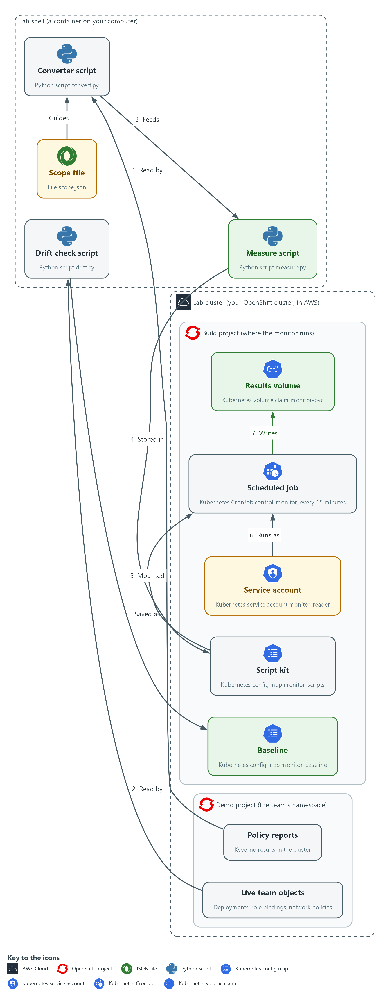

- **1. Scope file:** lists the controls to monitor, the policy that gives evidence for each, and the freshness limit.
- **2. Policy reports:** the results Kyverno records for objects in the demo namespace; the converter reads them.
- **3. Converter script:** turns the policy reports into assessment-results style JSON with observations and findings.
- **4. Live team objects:** deployments, role bindings and network policies in the demo namespace right now.
- **5. Drift check script:** takes a snapshot of the live objects and compares them with the approved baseline.
- **6. Baseline:** a saved snapshot of the approved state, kept as a config map in the build project.
- **7. Measure script:** reads the converter's results file and prints coverage, freshness and age numbers.
- **8. Script kit:** a config map in the build project that holds the three scripts and the scope file.
- **9. Service account:** the read-only identity monitor-reader that the scheduled job runs as.
- **10. Scheduled job:** a CronJob that mounts the script kit and runs all three scripts every 15 minutes.
- **11. Results volume:** each run writes its own set of result files here.

Where each part runs, and why:

| Part | Where it runs | Why it is built this way |
| --- | --- | --- |
| Converter, drift check and measure scripts | Config map monitor-scripts in the build namespace, run by the scheduled job | The job needs the scripts inside the cluster, and one config map lets a second team copy the whole monitor. |
| Scope file | In the same config map as the scripts | It is the one team-specific part, so changing it is all another team has to do. |
| Baseline | Config map monitor-baseline in the build namespace | The approved state is a visible object that a reviewer can read and approve. |
| Scheduled job | A CronJob in the build namespace | A monitor you run by hand is only a report, so the cluster starts it on a timetable. |
| Service account monitor-reader | The build namespace, with read access to the demo namespace only | The monitor can see the team's objects but cannot change them. |
| Results volume | Volume claim monitor-pvc in the build namespace | Each run leaves its own files that outlive the pod. |

### 2.1 Three questions, three numbers (CA-7 Continuous Monitoring)

- The monitor answers three questions: how much of the control set has automated evidence, how fresh is it, and has anything drifted.
- Freshness gets two numbers, a percent and the oldest age. Drift is a true, false or null answer, not a number.
- A single pass or fail hides the cases that matter most.
- A control with no evidence looks the same as a passing control if only failures are counted.
- The monitor keeps controls with no evidence in the denominator, so the gap stays visible.

#### CA-7: Continuous Monitoring

*The control asks the organization to develop a system-level continuous monitoring strategy and carry it out: choose metrics, set frequencies for monitoring and assessment, assess and monitor on an ongoing basis, analyze the results, respond, and report. NIST leaves the metrics and frequencies organization-defined. This is done using:*

- The scope file: lists the controls to monitor and the policy that gives evidence for each.
- The scheduled job: a CronJob that runs the three scripts and produces the results and the three numbers (automated evidence, freshness, drift).
- The schedule and the freshness limit: the 15-minute schedule and the 120-minute limit are the lab's own values, not requirements.

The table shows the four monitoring questions and their numbers:

| Question | Number | How it is computed | What a bad value means |
| --- | --- | --- | --- |
| Is it automated? | automated_percent | Controls with at least one finding, over controls in scope | Part of the control set depends on people remembering |
| Is it current? | fresh_percent | Controls whose newest observation is within the freshness limit | Evidence exists but may no longer describe the system |
| How old is the worst? | oldest_age_minutes | Largest evidence age across controls with evidence | A collector may have stopped |
| Has it changed? | drift | True, false, or null (unknown) from the baseline comparison | Null means the answer is not known, not that nothing changed |

### 2.2 Design choices and what each one trades

- The scope file separates the team-specific part from the code, so a second team changes one file.
- The scope file must be reviewed like code: a wrong entry makes the numbers wrong without any script failing.
- A control with an empty policy list stays in scope and counts against the automated share.
- Removing a control from the scope would raise the coverage number and hide the gap.
- A short freshness limit raises false alarms, because one missed run flags a control. A long limit hides a collector that has stopped.
- The lab uses 120 minutes with a 15-minute schedule, so about 8 runs can fail before a control goes stale.

### 2.3 Drift detection and its blind spots (CM-6 Configuration Settings, CM-3 Configuration Change Control)

- The drift check records deployment images and security context, role binding roles and subjects, and network policy settings.
- A change to a config map or secret is invisible to the drift check.
- The list of what the snapshot holds is itself a design decision to review.
- Fields that change on their own, such as a restart count, are left out to keep the output readable.

#### CM-6: Configuration Settings

*The control asks the organization to establish and document configuration settings, implement them, approve deviations, and monitor and control changes to them. This is done using:*

- The drift script: snapshots deployments, role bindings and network policies and compares them with the baseline, naming what was added, removed or changed.
- The baseline config map: holds the approved settings the snapshot is compared with.
- The null answer: a missing baseline gives unknown, never no drift.

#### CM-3: Configuration Change Control

*The control asks the organization to review proposed configuration-controlled changes, approve or disapprove them, and implement only approved changes. This is done using:*

- The baseline config map monitor-baseline: holds the approved state where a reviewer can read it.
- The drift script: reports any difference from the baseline as a change that did not arrive through the approved path.
- The limit: the monitor finds such a change after the fact and does not review or block it.

> **IN PRODUCTION:** In the real environment the baseline lives in a git repository and changes through a reviewed pull request, results go to storage that cannot be edited after writing, and a GitOps tool such as Argo CD shows drift as a built-in feature. The lab uses a config map so the comparison logic is visible.

### Design decisions

#### A scope file whose entries stay in the denominator

- How: A scope file lists each control and the policies that count as its evidence, and every percentage is computed over that list. A control with an empty policy list stays in scope and appears under no evidence.
- Why: A second team adopts the monitor by editing one file, and the gap stays visible instead of vanishing from the numbers.
- Alternatives: Advantage of counting only controls that already have evidence: the coverage number looks better and needs no scope file. Drawback: it hides exactly the gaps the measure exists to expose, and the number rises whenever a control is dropped.

#### Drift against a reviewed baseline, with unknown kept separate

- How: The drift script snapshots deployments, role bindings and network policies and compares them with a baseline stored as a config map. When the baseline is missing it prints null with a reason, never false.
- Why: Unknown must not read as no drift, and a config map makes the approved state a visible object that a reviewer can approve.
- Alternatives: Advantage of a GitOps tool that reconciles live state against a repository: drift is shown and can be corrected automatically. Drawback: it adds a controller and a repository process to learn and run, and automatic correction can erase the evidence of the change.

#### Evidence age comes from the recorded result time

- How: The converter takes each observation time from the timestamp Kyverno records on each result, not from the moment the script ran. The output follows the main shape of an assessment-results model.
- Why: Age then reflects how old the evidence really is, which is what the freshness limit needs to judge.
- Alternatives: Advantage of stamping observations with the script's own run time: it is simple and every observation looks fresh. Drawback: that makes stale evidence look current and defeats the freshness measure.

## Section 3. Implement

- Start: type `lab start grc-5` in the terminal on your own computer (PowerShell on Windows, Terminal on Mac), not in the lab shell.
- Enter lab shell with `lab shell`. Every other command in this module runs inside lab shell.
- If a step fails: run `lab reset grc-5` on your own computer and repeat the step once. If it still fails, copy the whole command and error and ask your AI assistant. Do not skip the step.

### Step 1. Choose the scope and look at what the cluster already records (CA-7 Continuous Monitoring)

**Learning point: Reading the policy reports and saving scope.json fixes the denominator for every percentage the monitor will produce.**

- Start from the evidence that exists.
- The scope file links each control to a policy.
- A control with no policy stays in the denominator and shows as a gap.

What this step adds (thick lines and outlines are new):

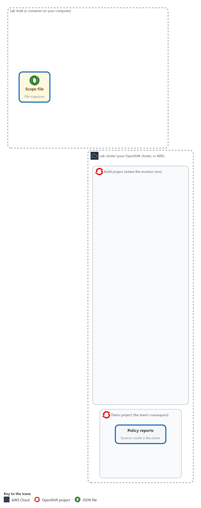

- You decide which controls are in scope and which policy gives evidence for each, and save that as scope.json in your lab shell. Two controls will have none, on purpose.

#### 1a. List the policies and read the reports

You will now make a working folder, then list the Kyverno policies and read the policy reports (the results Kyverno recorded about objects).

- The last command reads every result for the demo namespace.
- The commands only read, so running them again is safe.

```bash
mkdir -p /workspace/grc-5/monitor-work
cd /workspace/grc-5/monitor-work
oc get clusterpolicy
oc get policyreports.wgpolicyk8s.io -n demo -o json | jq '[.items[].results[]? | {policy, result}] | group_by(.policy) | map({policy: .[0].policy, results: map(.result)})'
```

**Expected output:**

```
Example only. Your policies and results will differ. (A Kyverno deprecation warning may print before the policy list.)
NAME  ADMISSIONS  BACKGROUND  VALIDATE ACTION  READY ...
(the policies, including grc-no-latest-tag, grc-no-privileged and grc-require-owner-label)
[
  {
    "policy": "<policy name>",
    "results": [ "<result>", "..." ]
  }
]
(one entry for each policy that has reported)
```

| Part | What it does | Why you run it |
| --- | --- | --- |
| mkdir -p ... ; cd ... | Makes a working folder and moves into it. | All the scripts and results for this module sit in one folder, apart from other modules. |
| oc get clusterpolicy | Lists the policies Kyverno enforces or audits. Their names go in the scope file. | The scope file names policies, so you need to see which ones exist before you write it. |
| `oc get policyreports.wgpolicyk8s.io -n demo -o json` \| jq ... | Reads the policy reports of the team namespace as JSON, then keeps the policy name and result and groups them by policy. | These reports are the evidence the monitor will use. Grouping by policy shows which policies produce results at all, so you can match each one to a control. |

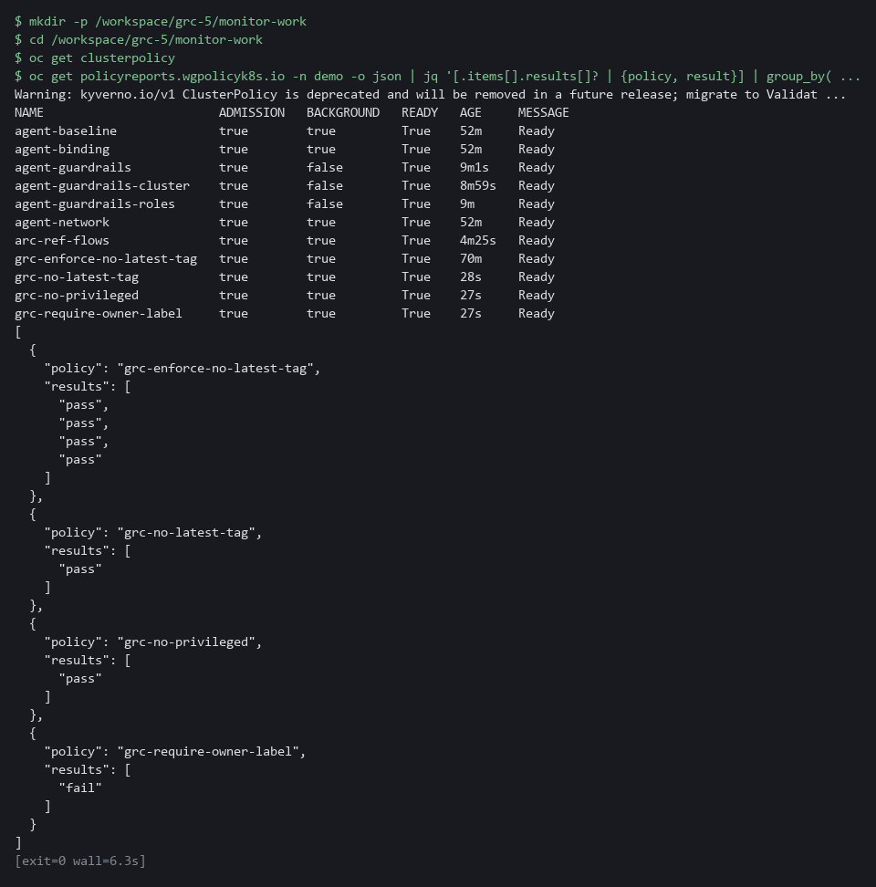

#### 1b. Save the scope file

You will now save this JSON as scope.json in the monitor-work folder.

- Paste all the lines at once into the lab shell.

```bash
cd /workspace/grc-5/monitor-work
cat > scope.json <<'EOF'
{
  "max_age_minutes": 120,
  "controls": [
    {"id": "CM-6", "policies": ["grc-no-latest-tag"]},
    {"id": "CM-7", "policies": ["grc-no-privileged"]},
    {"id": "CM-8", "policies": ["grc-require-owner-label"]},
    {"id": "SI-7", "policies": ["grc-require-signed-images"]},
    {"id": "SA-11", "policies": []}
  ]
}
EOF

```

**Expected output:**

```
Example only. Saving the file prints nothing.
```

| Part | What it does | Why you run it |
| --- | --- | --- |
| cd (the working folder) | Moves into the working folder from the block above. | The file is made in the folder you stand in. |
| cat > scope.json <<'EOF' ... EOF | Saves everything between the first and last line as scope.json. The quotes around EOF keep every character as typed. | No editor is needed; the paste is the whole file. |
| max_age_minutes | The freshness limit. Evidence older than this does not count as current. | A monitor must say how old is too old. Putting the number in a file makes it a reviewed choice and not a hidden one. |
| controls | One entry per control in scope, in the order you want them reported. | This list is the denominator for every percentage later, so a control left out here is also left out of the numbers. |
| id | The control the entry is about. | The measure script matches findings to controls by this ID. |
| policies | The Kyverno policies whose results count as evidence for that control. An empty list means no automated evidence yet. | This links each control to a machine source. An empty list is how you record that no machine evidence exists yet. |

> **YOUR TURN:** Run the first block, then paste the second.

> **CHECKPOINT:** The policy list shows at least the three policies `grc-no-latest-tag`, `grc-no-privileged` and `grc-require-owner-label` (a policy left from another module may also be listed), the report summary shows results for them, and scope.json exists. SI-7 names a signed-images policy that this lab does not create, and SA-11 lists none, so those two controls have no evidence, on purpose.

> **TAKEAWAY:** Start from the evidence that exists, not from the control list.

**How this meets the control**

- **CA-7:** You save scope.json with the controls in scope, the policy for each, and the freshness limit. Two controls have no policy on purpose, so the gap shows in the numbers.

### Step 2. Convert policy reports into assessment-results JSON (CA-7 Continuous Monitoring)

**Learning point: Running the converter turns Kyverno results into standard-shaped observations and findings that other tools can read.**

- Policy reports are Kyverno-specific.
- The converter turns them into assessment-results style JSON other tools can read.
- The first block reads the cluster, the second builds findings from observations, and the third runs the converter.

What this step adds (thick lines and outlines are new):

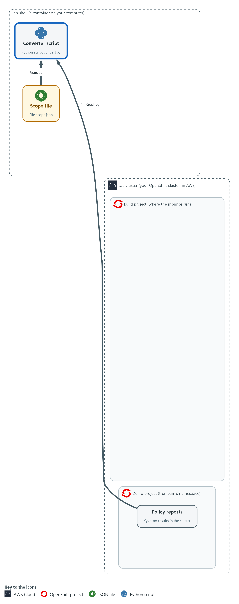

- A converter script in your lab shell reads the policy reports from the demo namespace and writes assessment-results style JSON to a file in your lab shell, with observations and findings.

#### 2a. Save the first part of the converter

You will now save this first part as convert_a.py in the monitor-work folder.

- The second part follows in the next block.
- Paste all the lines at once into the lab shell.

```bash
cd /workspace/grc-5/monitor-work
cat > convert_a.py <<'EOF'
import json
import subprocess
import sys
import uuid
from datetime import datetime, timezone

NAMESPACE, SCOPE = sys.argv[1], json.load(open(sys.argv[2]))
TIME = "%Y-%m-%dT%H:%M:%SZ"


def now():
    return datetime.now(timezone.utc).strftime(TIME)


def observations():
    cmd = ["oc", "get", "policyreports.wgpolicyk8s.io", "-n", NAMESPACE, "-o", "json"]
    run = subprocess.run(cmd, capture_output=True, text=True, check=True)
    found = []
    for report in json.loads(run.stdout)["items"]:
        for r in report.get("results", []):
            what = report.get("scope") or (r.get("resources") or [{}])[0]
            seen = datetime.fromtimestamp(r["timestamp"]["seconds"], timezone.utc)
            found.append({
                "uuid": str(uuid.uuid4()),
                "description": f"{r['policy']} on {what.get('kind')}/{what.get('name')}: {r['result']}",
                "methods": ["TEST"],
                "collected": seen.strftime(TIME),
                "props": [{"name": "policy", "value": r["policy"]}, {"name": "result", "value": r["result"]}],
            })
    return found
EOF

```

**Expected output:**

```
Example only. Saving the file prints nothing.
```

| Part | What it does | Why you run it |
| --- | --- | --- |
| cd (the working folder) | Moves into the working folder. | The file is made in the folder you stand in. |
| cat > convert_a.py <<'EOF' ... EOF | Saves everything between the first and last line as convert_a.py. | No editor is needed; the paste is the whole file. |
| NAMESPACE, SCOPE = ... | Reads the namespace and the scope file from the command line. | The same script then works for any team, because the namespace and the scope arrive as inputs. |
| now() | The current time in UTC (the world standard time), to the second. | Several parts of the output need the current time, so one helper gives them all the same format. |
| observations() | Runs oc, walks every result in every report, and builds one observation per result. | This is the part that touches the cluster, so keeping it in one function makes the rest easy to read and to test. |
| check=True | A failed oc call stops the script. | Silence would look like a healthy system, so the script must stop when it cannot read the reports. |
| scope | Per-resource reports name the object in the report's scope field, not in each result, so the description takes the kind and name from there. | Without this the description would not say which object a result is about, and a reader could not trace it. |
| timestamp seconds | Uses the time Kyverno recorded for the result, not the time you ran the script. That is what makes the age honest. | The freshness number in Step 4 is honest only if it is based on when Kyverno checked and not on when you ran this script. |

#### 2b. Add the second part of the converter

You will now save the second part as convert_b.py, then join both parts into convert.py.

- Paste all the lines at once into the lab shell.

```bash
cd /workspace/grc-5/monitor-work
cat > convert_b.py <<'EOF'
def prop(item, name):
    return next(p["value"] for p in item["props"] if p["name"] == name)


def finding(control, observed):
    mine = [o for o in observed if prop(o, "policy") in control["policies"]]
    if not mine:
        return None
    bad = any(prop(o, "result") in ("fail", "error", "warn") for o in mine)
    state = "not-satisfied" if bad else "satisfied"
    target = {"type": "objective-id", "target-id": control["id"].lower(), "status": {"state": state}}
    return {"uuid": str(uuid.uuid4()), "title": control["id"], "target": target,
            "related-observations": [{"observation-uuid": o["uuid"]} for o in mine]}


observed = observations()
findings = [f for f in (finding(c, observed) for c in SCOPE["controls"]) if f]
run = {"uuid": str(uuid.uuid4()), "title": "Monitoring run for " + NAMESPACE, "start": now(),
       "end": now(), "observations": observed, "findings": findings}
metadata = {"title": "Team control monitoring", "last-modified": now(), "version": "1"}
print(json.dumps({"assessment-results": {"uuid": str(uuid.uuid4()), "metadata": metadata, "results": [run]}}))
EOF
cat convert_a.py convert_b.py > convert.py

```

**Expected output:**

```
Example only. Saving the files prints nothing.
```

| Part | What it does | Why you run it |
| --- | --- | --- |
| cat > convert_b.py <<'EOF' ... EOF | Saves the second part as convert_b.py. | No editor is needed; the paste is the whole file. |
| cat convert_a.py convert_b.py > convert.py | Joins the two parts, first part first. It replaces convert.py each time, so repeating the step never doubles the code. | The converter is one complete script. |
| prop() | Reads one named property from an observation. | Both the finding and later steps need to read a property, so one helper does it. |
| finding() | For one control, collects the observations of its policies. With none, it returns nothing, so that control gets no finding. | This is where the evidence for one control becomes a conclusion about that control. |
| any(... in ("fail", "error", "warn")) | One bad result makes the control not satisfied. Skipped results are neither good nor bad here. | In this monitor one bad result is enough to mark the control not satisfied, so a failure cannot be averaged away. |
| related-observations | Links the finding to the facts behind it, so a reader can trace a conclusion to its evidence. | A reader who doubts a conclusion can follow the link to the facts behind it. |
| the last lines | Builds the result, wraps it with the metadata, and prints one JSON document. | The output is one document that other tools can read, and the numbers in Step 4 come from this file. |

#### 2c. Run the converter and read the findings

You will now check convert.py, run it on the demo namespace, and print each finding.

```bash
cd /workspace/grc-5/monitor-work
python3 -m py_compile convert.py
python3 convert.py demo scope.json > results.json
jq '."assessment-results".results[0].findings[] | {title, state: .target.status.state, evidence: (."related-observations" | length)}' results.json
```

**Expected output:**

```
Example only. Your counts will differ.
(py_compile prints nothing)
{
  "title": "CM-6",
  "state": "<state>",
  "evidence": <n>
}
(a block like this for CM-7, then CM-8 with state not-satisfied; no block for SI-7 or SA-11)
```

| Part | What it does | Why you run it |
| --- | --- | --- |
| cd (the working folder) | Moves into the working folder. | The scripts and scope.json are found from here. |
| py_compile | Checks the file is valid Python. It prints nothing when it is. | A typing mistake is easier to find here than in the output of a run. |
| python3 convert.py demo scope.json > results.json | Runs the converter for the demo namespace and saves the result. | This produces the results.json file that the measure script reads in Step 4. |
| jq ... findings[] | Prints one block per finding: the control, its state, and how many observations back it. | You check the conclusions against what you expect before anything else uses them. |

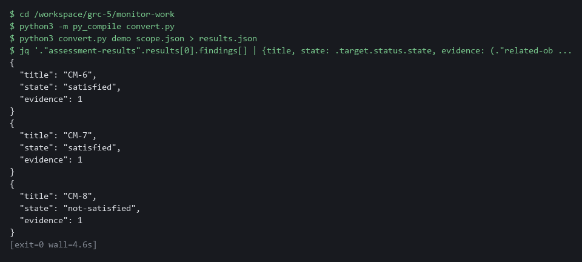

> **YOUR TURN:** Paste the two file blocks in order, then run the commands.

> **CHECKPOINT:** Findings appear for CM-6, CM-7 and CM-8 only, each with at least one observation. SI-7 and SA-11 have no finding. CM-8 reads not-satisfied because the lab's demo-app deployment has no owner label.

> **TAKEAWAY:** Each observation carries the time Kyverno recorded, so the age measurement is honest.

**How this meets the control**

- **CA-7:** Each Kyverno result becomes an observation, and each control becomes a finding. The output is results.json, which the measure script reads.

### Step 3. Capture a baseline and detect drift (CM-6 Configuration Settings, CM-3 Configuration Change Control)

**Learning point: Taking the baseline and writing the compare function makes the drift check name any difference from the approved state.**

- The drift script has two modes: snapshot and compare.
- The baseline is kept as a config map so a reviewer can read it.
- You write the compare function that decides what counts as drift.

What this step adds (thick lines and outlines are new):

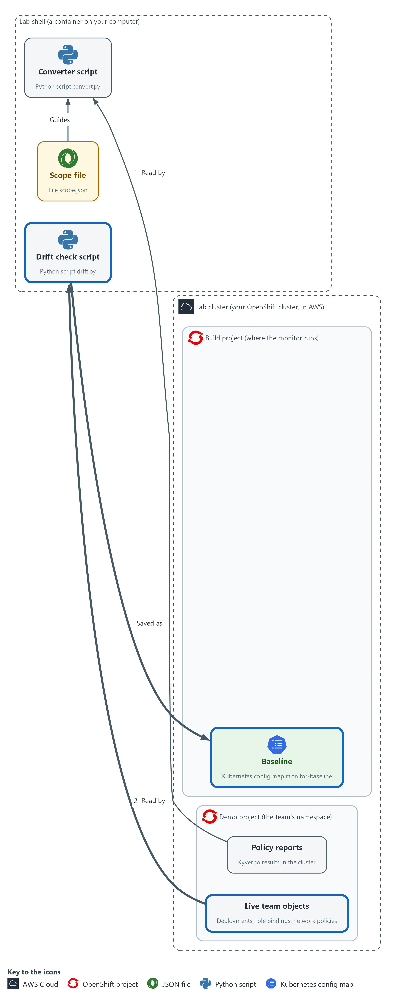

- A snapshot of approved state is saved as the baseline in a config map in the build project. A drift check script compares that baseline with the live objects in the demo namespace. You write its compare function yourself.

#### 3a. Save the supplied parts of the drift check

You will now save two supplied files in the monitor-work folder: drift_a.py (takes the snapshot) and drift_b.py (the last part, which reads the baseline file and calls compare).

- The compare function goes between them, and you write it in the next block.
- Paste all the lines at once into the lab shell.

```bash
cd /workspace/grc-5/monitor-work
cat > drift_a.py <<'EOF'
import json
import subprocess
import sys

MODE, NAMESPACE = sys.argv[1], sys.argv[2]


def listing(kind):
    cmd = ["oc", "get", kind, "-n", NAMESPACE, "-o", "json"]
    return json.loads(subprocess.run(cmd, capture_output=True, text=True, check=True).stdout)["items"]


def snapshot():
    state = {}
    for item in listing("deployments"):
        pod = item["spec"]["template"]["spec"]
        images = sorted(c["image"] for c in pod["containers"])
        state["deployment/" + item["metadata"]["name"]] = {"images": images, "security": pod.get("securityContext", {})}
    for item in listing("rolebindings"):
        subjects = sorted(s["kind"] + "/" + s["name"] for s in item.get("subjects", []))
        state["rolebinding/" + item["metadata"]["name"]] = {"role": item["roleRef"]["name"], "subjects": subjects}
    for item in listing("networkpolicies"):
        state["networkpolicy/" + item["metadata"]["name"]] = item["spec"]
    return state
EOF
cat > drift_b.py <<'EOF'
if MODE == "snapshot":
    print(json.dumps(snapshot(), sort_keys=True))
else:
    try:
        baseline = json.load(open(sys.argv[3]))
    except OSError:
        print(json.dumps({"drift": None, "reason": "no baseline"}))
    else:
        print(json.dumps(compare(baseline, snapshot())))
EOF

```

**Expected output:**

```
Example only. Saving the files prints nothing.
```

| Part | What it does | Why you run it |
| --- | --- | --- |
| cd (the working folder) | Moves into the working folder. | The files are made in the folder you stand in. |
| cat > drift_a.py <<'EOF' ... EOF | Saves the first part as drift_a.py. | No editor is needed; the paste is the whole file. |
| MODE, NAMESPACE | snapshot or compare, and the namespace to look at. | One script serves both jobs, taking the baseline and comparing with it, so the two always look at the same things. |
| listing(kind) | Runs oc for one kind of object and returns the list. | The snapshot reads three kinds of object, and this helper keeps that repeated work in one place. |
| snapshot() | Builds one dictionary of the state worth watching: deployment images and security context, role binding role and subjects, and network policy specs. Each key is an object name such as rolebinding/extra-admin. | What goes into the snapshot decides what drift can be seen, so this is the function to review. You will compare two of these dictionaries. |
| sorted(...) | Sorts lists so the same state always produces the same text. | Two snapshots of the same state must give the same text, or every comparison would report a false change. |
| cat > drift_b.py <<'EOF' ... EOF | Saves the last part as drift_b.py. It prints a snapshot, or reads the baseline file and prints what compare returns. | The baseline is made by the same code that is later compared with it, so the two always match in shape. |
| except OSError | If the baseline file is missing, the answer is null with a reason. Unknown is never reported as no drift. | A monitor that cannot compare must not say that all is well. |

#### 3b. Write the compare function (your turn)

You will now write the compare function yourself.

- Spec: compare(base, now) gets two snapshots, each a dictionary of object name to settings.
- base is the approved one and now is the live one.
- compare returns a dictionary with four fields in this order: drift, added, removed, changed.
- added lists names that are in now only.
- removed lists names that are in base only.
- changed lists names that are in both but whose settings differ.
- All three lists are sorted.
- drift is true when any of the three lists has an item, and false when all are empty.
- The line for added is done for you as the example.
- Replace each of the three dotted placeholders (written as three dots in the code) with your own expression.
- Hint: a.keys() - b.keys() is the names in a that are not in b.
- Hint: a.keys() & b.keys() is the names in both.
- Hint: base[k] != now[k] is true when the settings differ.
- Allow about ten minutes.
- If a placeholder is left in, the check fails with an error that mentions ellipsis, which is the Python name for the three dots.
- Running the command again replaces the file.

```bash
cd /workspace/grc-5/monitor-work
cat > compare.py <<'EOF'
def compare(base, now):
    added = sorted(now.keys() - base.keys())
    removed = ...
    changed = ...
    drift = ...
    return {"drift": drift, "added": added, "removed": removed, "changed": changed}
EOF
test -s compare.py && echo ok || echo EMPTY

```

**Expected output:**

```
Example only.
ok
```

| Part | What it does | Why you run it |
| --- | --- | --- |
| cat > compare.py <<'EOF' ... EOF | Saves the function as compare.py. The quotes around EOF keep every character as typed. | No editor is needed; the command is the whole file. |
| test -s compare.py && echo ok \|\| echo EMPTY | Prints ok if compare.py has content and EMPTY if it has none. | Pasting the block twice can leave the file empty. If EMPTY shows, type the block again. |
| added = sorted(now.keys() - base.keys()) | Done for you: the names in now that are not in base, sorted. | A new object that the baseline never approved is the clearest kind of drift. |
| removed = ... | Yours: the names in base that are not in now, sorted. | An approved object that has gone is also a difference. |
| changed = ... | Yours: names in both whose settings differ, sorted. | The object is still there but is no longer as approved. |
| drift = ... | Yours: true when any of the three lists has an item. | This single answer is the one the schedule and the team lead read first. |
| return {...} | Done for you: the four fields in a fixed order. | Other scripts read these field names, so they must not change. |

#### 3c. Check your function on sample data

You will now save a short check and run it.

- The check gives your function two small snapshots where you know the answer: one object changed, one added, one removed, and then the same snapshot compared with itself.
- The check does not touch the cluster.

```bash
cd /workspace/grc-5/monitor-work
cat > check_compare.py <<'EOF'
import json
from compare import compare

base = {"deployment/a": {"images": ["x:1"]}, "rolebinding/b": {"role": "view"}, "networkpolicy/c": {}}
now = {"deployment/a": {"images": ["x:2"]}, "rolebinding/d": {"role": "edit"}, "networkpolicy/c": {}}
print(json.dumps(compare(base, now)))
print(json.dumps(compare(base, base)))
EOF
python3 check_compare.py
```

**Expected output:**

```
Example only. The check has a known answer, so your two lines should match these exactly.
{"drift": true, "added": ["rolebinding/d"], "removed": ["rolebinding/b"], "changed": ["deployment/a"]}
{"drift": false, "added": [], "removed": [], "changed": []}
```

| Part | What it does | Why you run it |
| --- | --- | --- |
| cat > check_compare.py <<'EOF' ... EOF | Saves the check as check_compare.py. | A known answer lets you test your function without a cluster. |
| base = ... now = ... | Two sample snapshots: deployment/a changes its image, rolebinding/b is gone, rolebinding/d is new, networkpolicy/c is the same. | Each of the four fields is exercised once, so a mistake in any one shows. |
| python3 check_compare.py | Prints compare(base, now), then compare(base, base). | The second line must be false with three empty lists, which proves that no change is not reported as drift. |

#### 3d. Reference answer (open only after you have tried)

You will now open the reference answer, but only after you have tried.

- Do not run the reference block until you have run the check on your own version.
- If your output matches the known answer, run the reference block to compare your lines with the reference.
- If you are stuck after trying, run the reference block to see one working version, then retype compare.py in your own way and run the check again.
- Running the reference block again is safe.

```bash
mkdir -p /workspace/grc-5/reference
oc extract configmap/monitor-kit -n build --keys=compare-reference.py --to=/workspace/grc-5/reference --confirm
cat /workspace/grc-5/reference/compare-reference.py
```

**Expected output:**

```
Example only. Your own lines can differ and still be right if the check output matches.
(a line for the file written)
def compare(base, now):
    added = sorted(now.keys() - base.keys())
    removed = sorted(base.keys() - now.keys())
    changed = sorted(k for k in base.keys() & now.keys() if base[k] != now[k])
    drift = bool(added or removed or changed)
    return {"drift": drift, "added": added, "removed": removed, "changed": changed}
```

| Part | What it does | Why you run it |
| --- | --- | --- |
| mkdir -p (the reference folder) | Makes a separate folder for the answer. | Keeps the reference away from your own compare.py, so it cannot overwrite your work. |
| oc extract configmap/monitor-kit ... --keys=compare-reference.py | Writes the supplied reference file out of the kit config map that the start state stored. | The answer is kept in the cluster, so you open it only on purpose. |
| cat .../compare-reference.py | Prints the reference function. | You compare it with yours. A different but correct version is fine if the check passes. |

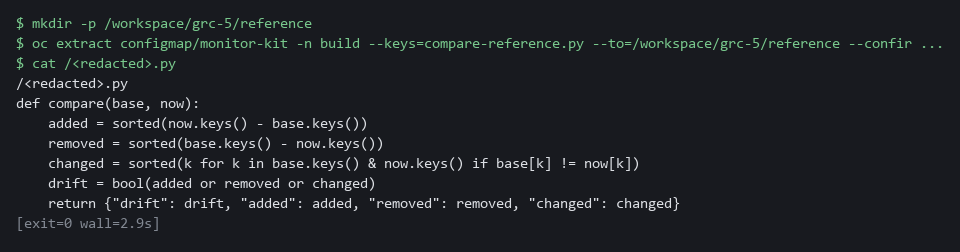

#### 3e. Join the parts, take the baseline and compare with it

You will now join drift_a.py, your compare.py and drift_b.py into drift.py, check it, save a snapshot as the approved baseline, store it as a config map, and compare.

- Running this block again replaces the baseline.
- An error right after the join usually means compare.py is empty: write it again.

```bash
cd /workspace/grc-5/monitor-work
cat drift_a.py compare.py drift_b.py > drift.py
python3 -m py_compile drift.py
python3 drift.py snapshot demo > baseline.json
oc create configmap monitor-baseline -n build --from-file=baseline.json --dry-run=client -o yaml | oc apply -f -
python3 drift.py compare demo baseline.json
```

**Expected output:**

```
Example only. (py_compile prints nothing)
configmap/monitor-baseline created (or configured when you repeat the step)
{"drift": false, "added": [], "removed": [], "changed": []}
```

| Part | What it does | Why you run it |
| --- | --- | --- |
| cd (the working folder) | Moves into the working folder. | The parts are found from here. |
| cat drift_a.py compare.py drift_b.py > drift.py | Joins the three parts, in that order. It replaces drift.py each time, so repeating the step never doubles the code. | The compare function must come before the part that calls it. The drift check is one complete script. |
| drift.py snapshot demo > baseline.json | Saves the current state as the approved baseline. | This is the state you are treating as approved, and everything later is compared with it. |
| oc create configmap monitor-baseline ... \| oc apply -f - | Stores the baseline in the cluster so the scheduled job can read it. Going through apply means a repeat run replaces the baseline instead of failing. | The scheduled job runs inside the cluster and cannot see files in your lab shell, so the baseline is stored as a config map. |
| drift.py compare demo baseline.json | Compares live state with the baseline you just took, using your function. | Nothing has changed yet, so a false answer here shows the comparison works before you test it with a change. |

> **YOUR TURN:** Paste the first block. Then write compare.py yourself and check it on the sample data. Open the reference only after you have tried. Then run the last block.

> **CHECKPOINT:** Your check prints the two known-answer lines exactly as shown. If the check fails with an error that mentions ellipsis, a ... was left in. The compare against the live cluster then prints drift false with empty added, removed and changed lists.

> **TAKEAWAY:** A missing baseline must report unknown, never no drift.

**How this meets the controls**

- **CM-6:** You take a snapshot and store it as the baseline, so drift is false until something changes. Any difference is named.
- **CM-3:** The baseline is the approved state, kept in a config map a reviewer can read. A difference names a change that skipped review.

### Step 4. Measure coverage and evidence age (CA-7 Continuous Monitoring)

**Learning point: Running the measure script on the results file turns per-control findings into three numbers a team lead can track.**

- Findings are per control; a team lead needs totals.
- The script reads the converter output and the scope, so its denominator is always the scope.
- The script reports three numbers and the names behind each.

What this step adds (thick lines and outlines are new):

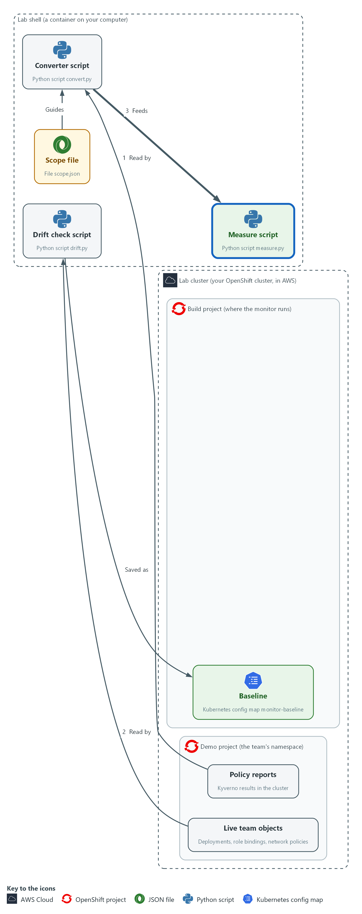

- A measure script reads the converter's file and the scope file in your lab shell and prints the percent of controls with automated evidence, the percent that is fresh, and the oldest evidence age.

#### 4a. Fetch the supplied measure script and run it

You will now write the supplied script measure.py into your folder, check it, and run it on the results from Step 2.

- You wrote the compare function yourself.
- measure.py is supplied, so you fetch it and run it.
- Running this block again is safe.

```bash
cd /workspace/grc-5/monitor-work
oc extract configmap/monitor-kit -n build --keys=measure.py --to=. --confirm
python3 -m py_compile measure.py
python3 measure.py results.json scope.json | jq .
```

**Expected output:**

```
Example only. Your time and ages will differ.
(a line for the file written)
{
  "as_of": "<time>",
  "controls_in_scope": 5,
  "automated_percent": 60,
  "fresh_percent": 60,
  "oldest_age_minutes": <n>,
  "no_evidence": ["SI-7", "SA-11"],
  "stale": [],
  "not_satisfied": ["CM-8"]
}
```

| Part | What it does | Why you run it |
| --- | --- | --- |
| cd (the working folder) | Moves into the working folder, where results.json from Step 2 is. | The script reads results.json and scope.json from here. |
| oc extract configmap/monitor-kit ... --keys=measure.py | Writes the supplied measure.py into the current folder. | The script is supplied, so you fetch it instead of retyping it. |
| run, scope, as_of (inside measure.py) | Loads the results, the scope, and the time to measure against. A third argument overrides the time so you can test aging. | Reading the scope as well as the results means the denominator is the scope and not whatever happened to produce evidence. |
| age_minutes() and fresh (inside measure.py) | Age is the minutes since the newest observation for a control. Fresh means that age is within the freshness limit. | A control is fresh only when something recent supports it, and a control with no evidence still counts in the total, so the gap shows in the numbers. |
| measure.py results.json scope.json \| jq . | Measures the run you saved in Step 2 against the scope and prints the numbers readably. | You can check the numbers against your own scope file. |

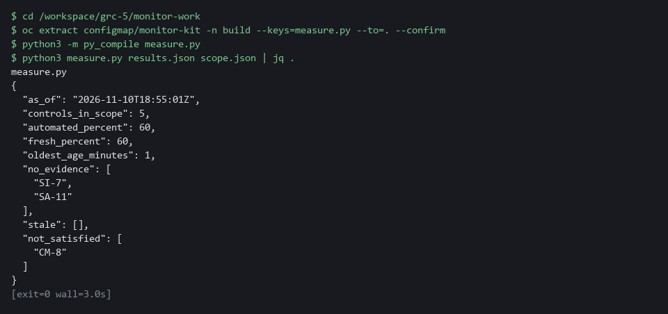

> **YOUR TURN:** Run the block and read the numbers.

> **CHECKPOINT:** controls_in_scope is 5 and automated_percent is 60. no_evidence lists SI-7 and SA-11, and not_satisfied lists CM-8.

> **TAKEAWAY:** Controls with no evidence stay in the denominator so the gap shows in the numbers.

**How this meets the control**

- **CA-7:** The script prints three numbers and the names behind them. Controls with no evidence stay in the count.

### Step 5. Run it on a schedule and make it reusable (CA-7 Continuous Monitoring)

**Learning point: Applying the CronJob and running it once shows the monitor producing its three outputs on a schedule from approved scripts.**

- A monitor you run by hand is a report, so the cluster runs it on a timetable.
- The job file is supplied, so you do not read it line by line.
- The CronJob runs in a public Python image and first copies the oc program out of a public OpenShift CLI image.
- The CronJob mounts the config map monitor-scripts at /scripts.
- The config map monitor-scripts holds the scripts and the scope file.
- The lab start already created the service account monitor-reader, which can only read the team namespace, and the volume claim monitor-pvc.
- Each run writes its own files to the volume claim monitor-pvc at /out.
- The CronJob runs convert, then measure, then drift, in that order, because the measure script reads the file the converter wrote.
- The scripts and the baseline are mounted read-only, so the job cannot change them.
- A second team gets the same monitor by changing the scope file and the namespace name in the job file.

What this step adds (thick lines and outlines are new):

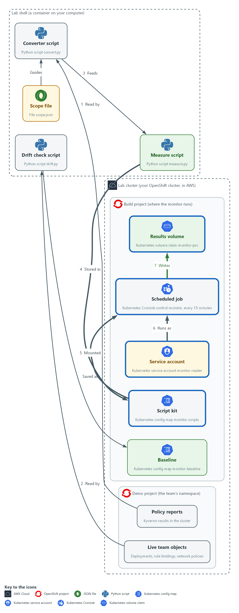

- You pack the scripts and scope file into a config map in the build project. A scheduled job mounts it, runs all three scripts every 15 minutes as a read-only service account, and writes the results to the results volume. Other teams reuse it by changing the scope file and the namespace name.

#### 5a. Store the scripts, apply the supplied job and run it once

You will now write the supplied job file, control-monitor.yaml, into your folder, store your scripts and scope in a config map, apply the job, and start one run by hand.

- Step 5 needs the cluster to reach the internet: the first run pulls two public images, which can take a minute.

```bash
cd /workspace/grc-5/monitor-work
oc extract configmap/monitor-kit -n build --keys=control-monitor.yaml --to=. --confirm
oc create configmap monitor-scripts -n build --from-file=convert.py --from-file=drift.py --from-file=measure.py --from-file=scope.json --dry-run=client -o yaml | oc apply -f -
oc get configmap monitor-scripts -n build -o jsonpath='{.data.drift\.py}' | grep -c 'def compare'
oc apply -f control-monitor.yaml
oc delete job monitor-first -n build --ignore-not-found
oc create job monitor-first --from=cronjob/control-monitor -n build
oc wait --for=condition=complete job/monitor-first -n build --timeout=180s
```

**Expected output:**

```
Example only. Your names will differ.
(a line naming control-monitor.yaml)
configmap/monitor-scripts created
1
cronjob.batch/control-monitor created
job.batch/monitor-first created
job.batch/monitor-first condition met
```

| Part | What it does | Why you run it |
| --- | --- | --- |
| cd (the working folder) | Moves into the working folder. | The scripts and the job file are found from here. |
| oc extract configmap/monitor-kit ... --keys=control-monitor.yaml | Writes the supplied control-monitor.yaml into the current folder. | The job file is supplied, so you fetch it instead of writing it. |
| oc create configmap monitor-scripts ... \| oc apply -f - | Packs the scripts and the scope file into one object the job mounts at /scripts. Going through apply means a repeat run replaces it. | The job needs the scripts inside the cluster, and one config map keeps them with the scope file, so a second team changes one place. |
| oc get configmap monitor-scripts ... \| grep -c 'def compare' | Reads drift.py back out of the cluster and counts the lines that define compare. It prints 1. | It shows the job will run your compare function. 0 means the stored drift.py lacks it; redo Step 3. |
| oc apply -f control-monitor.yaml | Saves the CronJob. | The job runs the three scripts from the config map on a schedule. |
| oc delete job monitor-first ... --ignore-not-found | Removes a manual job left from an earlier run, if there is one. | Lets you run this block twice. |
| oc create job monitor-first --from=cronjob/... | Starts one run now without waiting for the schedule. | You can read the numbers now instead of waiting up to 15 minutes. |
| oc wait --for=condition=complete | Waits up to three minutes for the run to finish. The first run is slower because the images are pulled. | The log is complete only when the job has finished. |

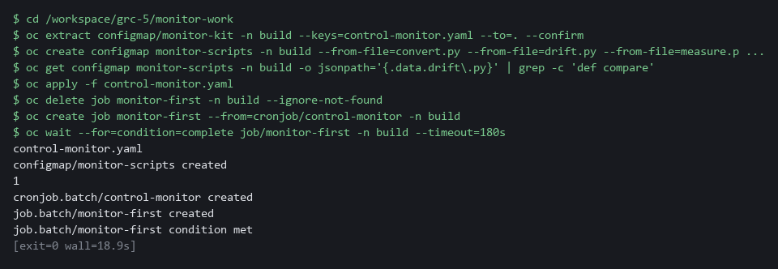

> **YOUR TURN:** Run the commands. The job runs the three scripts from the config map and writes its results to the results volume.

> **CHECKPOINT:** The job completes. Its log, with the numbers, is read in the first Verify step.

> **TAKEAWAY:** A second team gets the same monitor by changing the scope file and the namespace name.

**How this meets the control**

- **CA-7:** The job runs the three scripts every 15 minutes as a read-only service account. Each run leaves its own result files.

## Section 4. Verify It Works

### Test 1 (positive). The monitor reports the numbers you expect (CA-7 Continuous Monitoring)

- Read the log of the scheduled run and compare it with the numbers worked out here.
- Five controls are in scope and three have a policy that reports results, so the share with automated evidence is 3 of 5.
- The freshness limit is 120 minutes, so with recent reports every control that has evidence is fresh.

```bash
oc logs job/monitor-first -c monitor -n build | jq -c .
```

**Expected output:**

```
Example only. Ages and names will differ.
{"as_of":"2026-10-29T21:45:02Z","controls_in_scope":5,"automated_percent":60,"fresh_percent":60,"oldest_age_minutes":14,"no_evidence":["SI-7","SA-11"],"stale":[],"not_satisfied":["CM-8"]}
{"drift":false,"added":[],"removed":[],"changed":[]}
```

| Part | What it does | Why you run it |
| --- | --- | --- |
| oc logs job/monitor-first -c monitor -n build | Prints what the scheduled run wrote (-c monitor picks the main container, so no Defaulted container line appears first): the measurement, then the drift result. | You read the real output of the scheduled run, not a copy. |
| \| jq -c . | Prints each JSON line on one line. | Easy to compare with the numbers worked out above. |
| automated_percent 60, fresh_percent 60 | Three of five controls have evidence and all three are fresh. | A number you cannot explain means the monitor is not yet trustworthy. |
| no_evidence SI-7, SA-11 / not_satisfied CM-8 | The controls with no evidence are named, and CM-8 fails because the lab's demo-app deployment has no owner label. | The gaps and the failures have names, so an owner can act. |

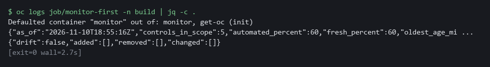

> **CHECKPOINT:** The first line shows 60 and 60, SI-7 and SA-11 under no_evidence, and CM-8 under not_satisfied. The second line is the drift result and shows drift false.

**How this meets the control**

- **CA-7:** The control asks for monitoring whose results can be read and reported. You read the log of the scheduled run and compare it with the numbers worked out above: 3 of 5 controls with automated evidence, all fresh, and the two without named.

### Test 2 (negative). An unapproved change is detected as drift (CM-6 Configuration Settings, CM-3 Configuration Change Control)

- Add a role binding the baseline does not know about, as someone might do by hand in a hurry.
- The next run uses the compare function you wrote and must report the binding by name.
- Then remove the extra role binding so the lab returns to the approved state.

```bash
oc create rolebinding extra-admin --clusterrole=admin --user=contractor -n demo --dry-run=client -o yaml | oc apply -f -
oc delete job monitor-drift -n build --ignore-not-found
oc create job monitor-drift --from=cronjob/control-monitor -n build
oc wait --for=condition=complete job/monitor-drift -n build --timeout=120s
oc logs job/monitor-drift -c monitor -n build | jq -c 'select(.drift != null)'
oc delete rolebinding extra-admin -n demo
```

**Expected output:**

```
Example only. (oc also prints created, condition met and deleted lines around it.)
{"drift":true,"added":["rolebinding/extra-admin"],"removed":[],"changed":[]}
```

| Part | What it does | Why you run it |
| --- | --- | --- |
| oc create rolebinding extra-admin ... | Adds a role binding the baseline does not know about. Going through apply keeps a repeat run safe. | This is the unapproved change the monitor must find. |
| oc delete job monitor-drift ... ; oc create job ... | Starts a fresh monitor run now. | You do not wait for the schedule. |
| jq -c 'select(.drift != null)' | Keeps only the drift line of the log. | The measurement line has no drift field. |
| added: rolebinding/extra-admin | The drift result names the new binding. | A change is reported by name. |
| oc delete rolebinding extra-admin | Removes the extra binding. | Returns the namespace to the approved state. |

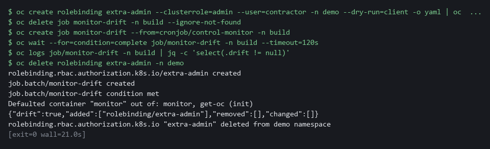

> **CHECKPOINT:** drift is true and the added list names rolebinding/extra-admin. If drift is false, either the snapshot cannot see role bindings or your compare function in Step 3 is wrong; run its sample check again.

**How this meets the controls**

- **CM-6:** The control asks that changes to settings be monitored. You add a role binding that is not in the baseline and the drift list must name it.
- **CM-3:** The control asks that only approved changes be implemented. The unapproved role binding is reported by name after the fact; reporting does not block it, so review stays a human step.

### Test 3 (negative). Old evidence stops counting as current (CA-7 Continuous Monitoring)

- Evidence that is three hours old should not be reported as fresh just because it exists.
- Measure the same results as if it were three hours later and check that every control with evidence goes stale while coverage stays the same.

```bash
cd /workspace/grc-5/monitor-work
LATER=$(date -u -d '+3 hours' +%Y-%m-%dT%H:%M:%SZ)
python3 measure.py results.json scope.json "$LATER" | jq -c '{automated_percent, fresh_percent, stale}'
```

**Expected output:**

```
Example only.
{"automated_percent":60,"fresh_percent":0,"stale":["CM-6","CM-7","CM-8"]}
```

| Part | What it does | Why you run it |
| --- | --- | --- |
| cd (the working folder) | Moves into the working folder, where results.json and scope.json are. | measure.py reads them from here. |
| LATER=$(date -u -d '+3 hours' ...) | Works out the time three hours from now. | The test measures the same results as if it were later. |
| measure.py results.json scope.json "$LATER" | Measures against that later time. | The third argument overrides the time, so aging can be tested without waiting. |
| fresh_percent 0, stale CM-6 CM-7 CM-8 | Every control with evidence is now too old to count. | Old evidence must stop counting as current, while coverage stays 60. |

> **CHECKPOINT:** automated_percent stays 60 while fresh_percent falls to 0 and the three controls are listed as stale. If fresh_percent stays at 60, age is not being checked.

**How this meets the control**

- **CA-7:** The control asks for monitoring that stays current. You measure the same results as if it were three hours later: every control with evidence goes stale while coverage stays the same.

### Test 4 (negative). A missing baseline reports unknown, not no drift (CM-6 Configuration Settings)

- If the baseline is deleted or the mount fails, the monitor must say it cannot tell.
- Point the drift check at a file that does not exist.

```bash
cd /workspace/grc-5/monitor-work
python3 drift.py compare demo /nonexistent/baseline.json
```

**Expected output:**

```
Example only.
{"drift": null, "reason": "no baseline"}
```

| Part | What it does | Why you run it |
| --- | --- | --- |
| cd (the working folder) | Moves into the working folder, where drift.py is. | The script is found from here. |
| drift.py compare demo /nonexistent/baseline.json | Compares live state with a baseline file that does not exist. | The fault is a missing baseline. |
| "drift": null, "reason": "no baseline" | The answer is unknown, with a reason. | A monitor that cannot compare must say so and must never say false. |

> **CHECKPOINT:** drift is null with the reason no baseline. It must never print false here: a monitor that reports no drift when it has nothing to compare would hide the worst case.

**How this meets the control**

- **CM-6:** The control asks that changes to settings be monitored. You point the drift check at a missing baseline file and the answer must be null with a reason, never false.

## Section 5. What Each Control Is For

### Control mapping

| Control | What it requires, in plain words | Tool or service | Where this module covers it |
| --- | --- | --- | --- |
| CA-7 Continuous Monitoring | A monitoring strategy exists, controls are assessed on an ongoing basis, and results are reported. | A CronJob that runs three Python scripts over Kyverno policy reports. Explained in sections 2.1 and 2.2. | Section 3, Steps 2 and 4: the converter and the measure script produce the results and the numbers. Section 3, Step 5: a CronJob runs them on a schedule. Section 4, Tests 1 and 3: you read the numbers and see old evidence stop counting as current. |
| CM-6 Configuration Settings | Settings are implemented as approved, and changes to them are monitored and controlled. | The drift script and a baseline kept in a config map. Explained in section 2.3. | Section 3, Step 3: the drift script compares live settings with the baseline. Section 4, Test 2: an unapproved change is found. Section 4, Test 4: a missing baseline reports unknown. |
| CM-3 Configuration Change Control | Changes to the system are reviewed and approved before they are made. | The baseline config map monitor-baseline and the drift script. Explained in section 2.3. | Section 3, Step 3: the baseline is the approved state. Section 4, Test 2: a difference from it is reported by name. |

### What each control is for

Each table below says what the control is trying to prevent and how this module's tool meets it.

#### CA-7 Continuous Monitoring

| Question | Answer |
| --- | --- |
| Control Intent | A control is assessed once, then silently stops working, and nobody learns until the next assessment. |
| The operational question | For each control, is there machine-made evidence, and how old is it right now? |
| What evidence proves it | Assessment-results style JSON per run, and a measurement with coverage, freshness and oldest age. |
| How much is enough | Every control in scope either has evidence newer than the freshness limit or is listed as having none. NIST leaves the frequency and metrics organization-defined. The lab runs every 15 minutes and accepts evidence up to 120 minutes old, which are lab values. |
| How the tool in this module satisfies it | The converter (Step 2), the measure script (Step 4) and the scheduled job (Step 5). |

#### CM-6 Configuration Settings

| Question | Answer |
| --- | --- |
| Control Intent | A setting is changed by hand and nobody notices, because the only record is the original build. |
| The operational question | Does the live state still equal the approved state? |
| What evidence proves it | The drift result: whether anything differs, and the names of what was added, removed or changed. |
| How much is enough | The comparison is automated, runs on a schedule, and names every difference. A missing baseline reports unknown. |
| How the tool in this module satisfies it | The drift script (Step 3), compared against a baseline kept as a config map. |

#### CM-3 Configuration Change Control

| Question | Answer |
| --- | --- |
| Control Intent | Changes reach the cluster by a path that skips review. |
| The operational question | Is every difference from the baseline a change someone approved? |
| What evidence proves it | A baseline that was itself reviewed, and a drift list that is empty or matched to approvals. |
| How much is enough | The baseline changes only through the same review as any other change. A difference with no matching approval is a finding. |
| How the tool in this module satisfies it | The baseline config map and the drift script (Step 3). Review of the baseline file is the one human step. |

## Section 6. Next Steps

### Using this in other environments

- Works on any Kubernetes cluster with Kyverno that produces PolicyReports (API group wgpolicyk8s.io).
- Change these lab values first: the demo namespace, the build namespace, the schedule (*/15 * * * * is a lab value), the freshness limit in scope.json, and the monitor-scripts config map.
- The drift check reads deployments, role bindings and network policies. Add or remove kinds by editing the snapshot function in drift.py.
- On GitOps clusters the drift check is redundant; use the GitOps tool's own drift view and keep only the coverage and age measurement.

The table shows what changes on each platform:

| Check/part | In this lab (OpenShift + Kyverno) | On other Kubernetes | What you change |
| --- | --- | --- | --- |
| Policy reports | Kyverno PolicyReports in API group wgpolicyk8s.io | Any tool that writes PolicyReports | Nothing if the report format matches; otherwise rewrite the observations() function. |
| Drift check | oc get deployments/rolebindings/networkpolicies in the team namespace | kubectl get with the same resource kinds | Replace oc with kubectl. |
| Baseline | Config map monitor-baseline in the build namespace | Git-managed file or any config store | The load path and the oc apply command that stores it. |
| Scheduled job | Kubernetes CronJob in the build namespace | Any scheduler that can mount a config map and a volume | The job spec and namespace names. |
| Measure script | Python script reading assessment-results style JSON | Any language; the JSON shape is documented in the script | Nothing if Python 3 is available. |

> **TIP:** This is the last module in the GRC engineering dimension. Next module: VM-5 Risk-Based Gate in Delivery: start the vulnerability management dimension at its top level by building a gate in delivery that decides by risk.

<details>
<summary><strong>Section 7. Terms</strong></summary>

Each term is also explained the first time it appears. In Word, hover over an underlined term to see its meaning, or Ctrl+click it to jump to this table.

| Term | Plain meaning |
| --- | --- |
| Assessment results | A standard way to write down what was checked and what was found. In OSCAL, a result holds observations and findings. |
| Assessment-results style JSON | JSON shaped like the OSCAL assessment-results model, as used in this module. It is not checked against the full standard. |
| Audit mode | A policy setting that lets a request through and only records a report afterward. |
| AWS | Amazon Web Services, the cloud your lab runs in. |
| Baseline | A saved copy of the approved settings that live state is compared against. |
| CLI | Command-line interface: a program you use by typing commands. |
| Cluster | A group of servers that work together as one system. Here it is your own OpenShift cluster in AWS. |
| Cluster policy | A Kyverno policy that applies to the whole cluster. |
| Config map | A stored file or setting that the cluster keeps and can hand to a program. |
| Container | A sealed box that holds one program and everything it needs to run. |
| Continuous monitoring | Checking controls on a schedule so problems appear in hours, not at the next yearly assessment. |
| Control | A written requirement for how a system is protected or run. Each one has an ID and a name. |
| Controller | A program in the cluster that keeps the real state matching what you asked for. |
| Coverage | The share of controls in scope that have automated evidence. |
| CronJob | A cluster object that starts a job on a repeating schedule. |
| Denominator | The total a percentage is taken out of. Here it is every control in the scope file. |
| Deployment | A cluster object that keeps a set of pods running from one image. |
| Dictionary | A Python collection of names, each with a value. Here each name is an object such as rolebinding/extra-admin and its value is that object's settings. |
| Drift | Any difference between live state and the baseline. |
| Evidence | A saved answer to a question about the system, with the time it was collected. |
| Evidence age | How many minutes ago the newest observation for a control was collected. |
| Finding | A conclusion about a control, such as satisfied or not satisfied, that points at the observations behind it. |
| Freshness limit | The oldest age you accept for evidence to still count as current. |
| Function | A named piece of code that takes inputs and gives back an answer. You write the compare function in Step 3. |
| GitOps | A way of running a cluster in which the approved state lives in a git repository and a tool keeps the cluster equal to it. |
| grep | A command that prints only the lines that match a pattern. |
| Heredoc | A shell way to write a multi-line file: type text until a marker line such as EOF. |
| Image | A packaged copy of a program and everything it needs to run. A container starts from an image. |
| Job | A one-off piece of work the cluster runs once, to the end. |
| jq | A command-line tool that reads and picks fields out of JSON. |
| JSON | A plain-text format for data: names and values written inside curly braces. |
| Kubernetes | The open-source system that runs and manages containers across servers. OpenShift is built on it. |
| Kyverno | A policy engine that checks cluster objects against rules. |
| Label | A name and value attached to a cluster object, such as an owner. |
| Machine-readable | Written so that a program can read it without a person, for example as JSON. |
| mkdir | A command that makes a new folder. |
| Mount | To make a config map or volume appear as files inside a running pod. |
| Namespace | A named section of the cluster that keeps workloads apart. OpenShift also calls it a project. |
| Network policy | A rule that limits which pods may talk to which. |
| NIST | The US National Institute of Standards and Technology. It publishes the security control catalog these modules cite. |
| Observation | One fact that was collected, with the time it was collected. |
| oc | The OpenShift command-line tool. It sends your commands to the cluster. |
| OpenShift | The Red Hat platform your lab cluster runs on. It is Kubernetes with extra security and tools built in. |
| OSCAL | A set of standard data formats for security controls and their assessment. |
| Pod | One running copy of a program inside the cluster. |
| Policy | A rule the cluster checks. Kyverno holds the policies in this lab. |
| Policy report | A list of the results Kyverno recorded when it checked objects against its policies. |
| Pull request | A request to merge one branch into another, where others can review the change first. |
| Python | A programming language. The scripts in this module are written in it. |
| Role | A list of actions a user or program may take on named kinds of objects. |
| Role binding | An object that gives a user or service account a role in one namespace. |
| Scan | A check of software or settings against a list of known problems. The scan reports what it finds. |
| Schema | The expected shape of data: which fields it has and what type each one is. |
| Scope file | A small file that lists the controls a team monitors and the policy that gives evidence for each. |
| Secret | A cluster object that holds a sensitive value such as a password or token, kept apart from ordinary settings. |
| Security context | Settings on a pod that limit what its programs may do. |
| Service account | An identity for a program instead of a person. |
| Signature | A value made with a private key that shows who made something and that it was not changed. |
| Snapshot | A saved copy of the state of chosen objects at one moment. |
| Stale evidence | Evidence older than the freshness limit, so it no longer describes the system now. |
| Timestamp | The date and time recorded for an event. |
| Volume claim | A request for disk space that lasts longer than one pod. |
| YAML | A plain-text format for settings: lines of name: value, with indentation to show what belongs to what. |

</details>
