# IAC-1: Run a Supplied Baseline as Code (CM-2, CM-3, CM-6)

| Item | Detail |
| --- | --- |
| Sequence | Module 9 of 29 in the recommended order |
| Timed work | About 62 minutes (45 hands-on, 17 verify) |
| Standalone start | `lab start iac-1` |
| Combined start | Continue from the end state of the previous module |
| Tools | OpenShift Container Platform, Terraform (free, open source), Ansible (free, open source), oc, jq |
| Prerequisites | ENG-0 Terminal, Git and Your Lab (typing commands in lab shell, oc get, and reading what a command prints) |

## Section 1. Module Overview

- Purpose: keep a system's settings in files that people can review and run again, so the approved state can be shown and a change made by hand can be found (CM-2, CM-3, CM-6).
- What you work with: supplied Terraform files that build a namespace with a pod limit, a default-deny network policy and a read-only role, and an Ansible playbook that adds a service account and a settings record. You write no files.
- How you run it: read each file, apply a saved Terraform plan, change one setting by hand and find it, run the playbook twice, and read what each tool reports.

- **Skill:** Fetch supplied Terraform and Ansible files, read them, run them against the cluster, and read what each tool reports before and after it acts. You write no files.
- **Tools:** `terraform` builds the namespace, quota, network policy and role from files. `ansible-playbook` adds a service account and a settings record. `oc` reads and edits the cluster, `jq` picks values out of a saved plan, and the supplied `summary.sh` asks both tools whether the cluster still matches its files.
- **Security Function:** Detects drift and blocks unreviewed change. A saved plan lists every create, update and destroy before anything is applied, and a plan that would remove the default-deny network policy is stopped instead of applied.
- **NIST CM-2 Baseline Configuration:** The Terraform folder and the Ansible playbook are the baseline. A Terraform plan with no changes and an Ansible check-mode run with changed=0 show that the cluster matches it.
- **NIST CM-3 Configuration Change Control:** `terraform plan` with a plan file writes every proposed change down before it happens, and applying that exact file makes only the changes you read.
- **NIST CM-6 Configuration Settings:** Terraform drift detection and Ansible check mode find a setting changed by hand, applying the files puts it back, and `terraform validate` rejects a file with a misspelled setting.

## Section 2. The Tools

### Tools used in this module

Each tool name links to its official overview. The table columns say how each tool is used in the lab and why the lab uses it instead of another way of doing the same job.

| Tool (overview link) | What it is | Used in this lab | Why this tool |
| --- | --- | --- | --- |
| [OpenShift Container Platform](https://docs.redhat.com/en/documentation/openshift_container_platform/4.22/html/overview/ocp-overview) | A Kubernetes container platform for running and managing containerized applications. | The cluster every command in this module runs against. | It is the platform the whole lab runs on, so every module works on the same real cluster, with the same kinds of objects a production OpenShift system has. |
| [Terraform](https://developer.hashicorp.com/terraform/intro) | Builds and changes infrastructure from files, and compares the files with what exists. | Builds the namespace, quota, network policy and role from files, and shows a plan before any change. | It states the wanted infrastructure in files and shows a plan before changing anything, so a change can be reviewed and drift can be detected by comparing the files with the live system. |
| [Ansible](https://docs.ansible.com/ansible/latest/getting_started/introduction.html) | Runs playbooks, which are lists of tasks that put a system into a stated state. | Adds the service account and the settings record by running a playbook. | It runs a list of tasks that put a system into a stated state and can test them without changing anything, so the same baseline can be applied repeatedly. |
| [oc](https://docs.redhat.com/en/documentation/openshift_container_platform/4.22/html/cli_tools/openshift-cli-oc) | The OpenShift command-line tool for creating and managing applications and projects from a terminal. | Reads and edits the cluster, so you can see what the tools built and make a change by hand. | It is the one command that talks to the cluster, so every module uses it to ask what is true and to make changes. You sign in once, and it works on OpenShift objects as well as standard Kubernetes ones. Unlike clicking in the web console, a command can be pasted, repeated and checked by a test. |
| [jq](https://jqlang.org/) | Command-line JSON processor. | Picks values out of the saved plan. | It picks one field out of a long JSON reply, so a test can read a single value. |

### How it fits together

#### Two tools, one baseline, one namespace

- Lab (test) setup: the supplied files sit in a config map, and you run Terraform and Ansible by hand from the lab shell against your own cluster.
- In production the files live in a version-controlled repository.
- A pipeline runs the tools after a second person approves the change, and the Terraform state is kept in protected storage.
- Each step below adds one part, drawn with thick lines.

How the lab is set up, and why:

- Everything you type runs in the lab shell, and the cluster holds one namespace named iac-lab.
- The supplied files sit in a config map so every learner starts from the same text, and you fetch them into your own folder before you run anything.
- Terraform keeps a state file of what it built, which is how it can tell later what has changed.
- Ansible keeps no such file and asks the cluster each time, which is why it gets a separate job in the same namespace.
- The summary script only asks questions, so it can run at any moment without changing anything.

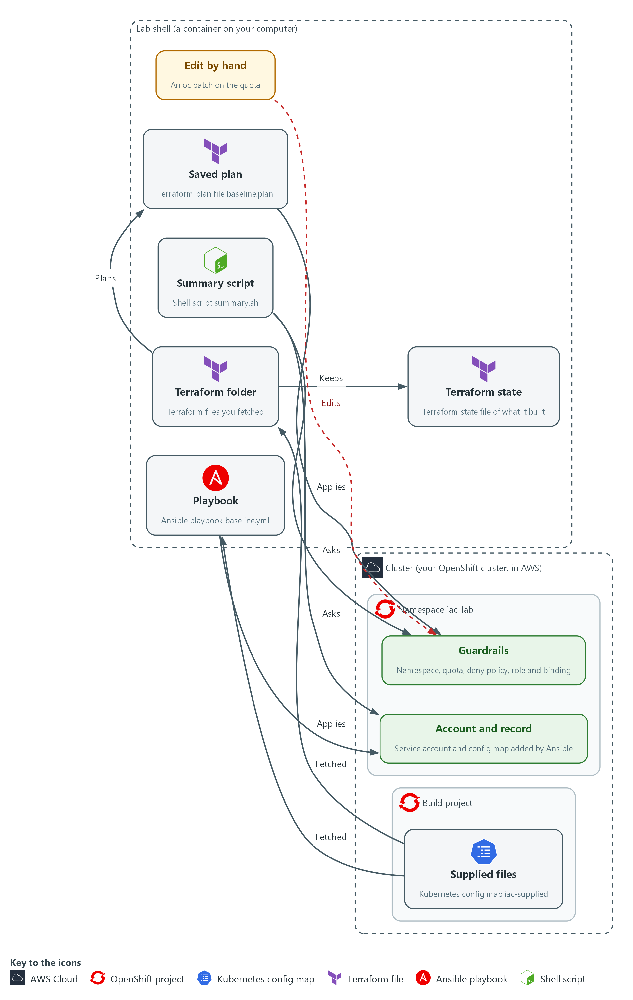

- **1. Supplied files:** a config map in the build project that holds the Terraform files, the playbook and the summary script.
- **2. Terraform folder:** the Terraform files you fetch into the lab shell and run Terraform on.
- **3. Saved plan:** the file baseline.plan, the exact list of changes Terraform worked out and you read before applying.
- **4. Terraform state:** the file where Terraform remembers what it built, so it can tell later what has changed.
- **5. Guardrails:** the namespace, quota, deny policy, role and binding that the saved plan builds in iac-lab.
- **6. Edit by hand:** an oc patch on the quota, a change the files do not describe. The next plan shows it as drift.
- **7. Playbook:** the Ansible file baseline.yml, which adds a service account and a settings record. Running it again changes nothing.
- **8. Account and record:** the service account and config map that the playbook adds to iac-lab.
- **9. Summary script:** summary.sh, which asks each tool whether the cluster still matches its files.

Where each part runs, and why:

| Part | Where it runs | Why it is built this way |
| --- | --- | --- |
| Lab shell | A container on your laptop | You run Terraform and Ansible from here, so nothing is installed on the cluster. |
| Config map iac-supplied | The build namespace on the cluster | One stored copy means every learner reads and runs identical files. |
| Namespace iac-lab | Created by Terraform in Step 2 | Everything the module builds lives here, so the reset can remove it in one step. |
| Terraform state | File terraform.tfstate in /workspace/iac-1/baseline | Terraform compares it with the cluster to find drift. |
| Ansible playbook | File baseline.yml in /workspace/iac-1 | A task list that is safe to run again. |

### 2.1 Settings kept in files (CM-2 Baseline Configuration)

- Settings typed into a system one at a time leave no record of what was meant. Keeping them in files that tools read (infrastructure as code) makes the files the record. A second person can read them before anything runs.
- The same files can be run again to repair a system that has changed, which makes the baseline something you can point to.
- The baseline in this module is small: a namespace (a named section of the cluster), a limit on pods, a rule that blocks all network traffic by default, and a read-only role.

#### CM-2: Baseline Configuration

*The control asks the organization to develop, document and maintain a current baseline configuration of the system under configuration control, and to review and update it at an organization-defined frequency, when organization-defined circumstances require it, and when components are installed or upgraded. NIST leaves the review frequency organization-defined; FedRAMP assigns at least annually and when a significant change occurs. This module does not run that review. This is done using:*

- The supplied Terraform folder describes the namespace, quota, network policy and role the cluster should hold.
- The Ansible playbook baseline.yml describes the service account and settings record the cluster should hold.
- A Terraform plan with no changes and an Ansible check-mode run with changed=0 show that the cluster matches both sets of files at the time of the run.
- People decide what belongs in the baseline, because the tools only report whether the cluster matches it.

The table compares settings typed by hand with settings kept in files:

| Typed by hand | Kept in files |
| --- | --- |
| No record of what was meant | The files are the record |
| A second person cannot read it first | A second person can read the plan first |
| A change cannot be repaired the same way twice | The same files can be run again |
| Drift is found by luck | A tool compares the files with the system |

### 2.2 Two tools, two styles (CM-6 Configuration Settings)

- Terraform is declarative: the files describe the end state, and Terraform works out the steps. It keeps a state file of what it built.
- When Terraform runs, it reads the real system and compares it with the files and the state. It then prints a plan: the list of creates, updates and destroys it would make.
- A provider is the plug-in that lets Terraform talk to one kind of system. Here it is the Kubernetes provider.
- Ansible runs a playbook, a list of tasks written in YAML (a plain-text format that uses indentation). Each task says what the system should look like, for example that a service account exists.
- Ansible asks the system and acts only if the answer differs. A playbook is therefore idempotent (safe to run again): the second run finds nothing to change and says so.
- Check mode makes Ansible report what it would change without changing it.

#### CM-6: Configuration Settings

*The control asks the organization to establish and document configuration settings that reflect the most restrictive mode consistent with operational requirements, to implement them, to approve deviations, and to monitor and control changes to them. This is done using:*

- The Terraform files set a pod limit and a default-deny network policy, and a plan shows any of those settings that was changed by hand.
- The Ansible playbook with check mode reports a setting in its tasks that no longer matches.
- terraform validate rejects a file with a misspelled setting name before anything runs.

The lab baseline is an example and is not a recognized secure configuration. Choosing the right values is a judgement for the system owner.

The table compares how Terraform and Ansible each remember, show and report changes:

|  | Terraform | Ansible |
| --- | --- | --- |
| The file says | The end state | The tasks to run |
| Remembers | A state file | Nothing; it asks the system each time |
| Shows changes first with | terraform plan | --check --diff |
| Reports nothing to do with | Exit code 0 from terraform plan -detailed-exitcode | changed=0 in the recap |
| Sees a hand edit when | The setting is in its files | The setting is in its playbook |

### 2.3 Read a plan before you apply it (CM-3 Configuration Change Control)

- A plan is the tool telling you what it is about to do. Every line has an action: create (add something), update (change something) or destroy (remove something).
- A destroy you did not expect is a stop. Do not apply, do not try to fix it yourself, and tell the person who owns the files.
- Terraform can save a plan to a file and apply only that file, so the plan you read is the plan that runs. If the cluster changed in between, Terraform refuses instead of guessing.
- You read a saved plan as text, and as JSON (a plain-text format for data) with jq, so a script could count the actions.

#### CM-3: Configuration Change Control

*The control asks the organization to review proposed configuration-controlled changes, approve or disapprove them with explicit consideration for security and privacy impact analyses, and implement the approved ones. This is done using:*

- terraform plan with a plan file writes the proposed change to a file before anything happens.
- terraform show and jq print the saved plan as text and as a count of actions, so a person can review it.
- terraform apply with the saved plan file makes only the changes that were read.

Who approves is the team's own process, so this module teaches the reading step and the stop.

The table lists each plan action, what it means and what to do:

| Plan action | Meaning | What to do |
| --- | --- | --- |
| create | Something new will be added | Check it is on your list |
| update | Something that exists will be changed | Read what changes and from what to what |
| destroy | Something that exists will be removed | If it is not expected, stop and escalate |
| no-op | Nothing will happen to it | Nothing; it already matches |

> **IN PRODUCTION:** In the real environment the plan is stored with the review of the change, and a person other than the author approves it before apply runs. Here you read it yourself.

### Design decisions

#### Read a saved plan, and apply only that plan

- How: Terraform writes the plan to a file, you read it as text and as JSON, and the apply command is given that file.
- Why: The plan you reviewed is then the plan that runs, and a script can count the destroys before a person decides.
- Alternatives: The advantage of applying straight from the files is that it is one command with no file to carry around. The drawback is that the changes can differ from what you read if the cluster or the files change in between.

#### Use two tools in one namespace, each with its own set of objects

- How: Terraform builds the guardrails, and Ansible adds the account and the record. Each tool only manages what its own files describe.
- Why: It shows the two styles side by side, and shows that a tool cannot see a change to an object it does not manage.
- Alternatives: The advantage of one tool for everything is one place to look and no gaps between tools. The drawback is that it hides the difference between a tool that remembers state and a tool that asks each time.

## Section 3. Implement

- Start: type `lab start iac-1` in the terminal on your own computer (PowerShell on Windows, Terminal on Mac), not in the lab shell.
- Enter lab shell with `lab shell`. Every other command in this module runs inside lab shell.
- If a step fails: run `lab reset iac-1` on your own computer and repeat the step once. If it still fails, copy the whole command and error and ask your AI assistant. Do not skip the step.

### Step 1. Fetch and read the supplied Terraform folder (CM-2 Baseline Configuration)

**Learning point: Fetching and reading the files shows what the baseline will build before anything touches the cluster, and init and validate prove the files are well formed.**

- The lab keeps the supplied files in a config map (a named set of small files that the cluster stores).
- Fetch the supplied files into a folder of your own, read the Terraform files, then let Terraform check the folder without touching the cluster.

What this step adds (thick lines and outlines are new):

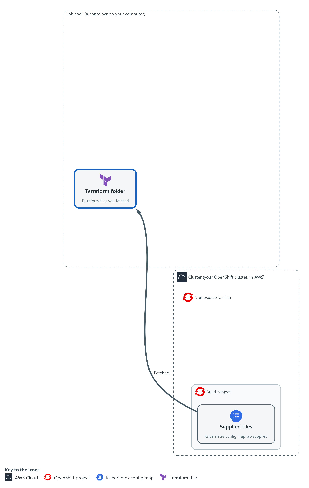

- You fetch the supplied Terraform files and check them without touching the cluster.

#### 1a. Fetch the supplied files into your own folder

You will now copy the supplied files from the cluster into a folder, then list them.

- Running these commands again is harmless.
- Starting the module again with lab start or lab reset deletes the folder /workspace/iac-1 and the Terraform state in it.

```bash
mkdir -p /workspace/iac-1/baseline && cd /workspace/iac-1
oc get configmap iac-supplied -n build -o json > supplied.json
for f in main.tf variables.tf versions.tf risky.tfvars; do jq -j --arg k "$f" '.data[$k]' supplied.json > baseline/$f; done
for f in baseline.yml broken-main.tf.txt summary.sh; do jq -j --arg k "$f" '.data[$k]' supplied.json > $f; done
ls baseline
wc -l baseline/main.tf
```

**Expected output:**

```
Example only. Your line count may differ a little.
main.tf
risky.tfvars
variables.tf
versions.tf
64 baseline/main.tf
```

| Part | What it does | Why you run it |
| --- | --- | --- |
| mkdir -p ... && cd /workspace/iac-1 | Makes a folder for this module and moves into it, so files from other modules cannot collide with yours. | A folder of your own keeps this module's files and Terraform's state together, so a reset can remove them in one step. |
| oc get configmap iac-supplied ... > supplied.json | Reads the whole config map as JSON and saves it in a file. | One read of the cluster, then everything else comes from the saved copy. |
| for f in main.tf ...; do jq -j ... | Repeats one jq command for each file name. jq picks out the text stored under that name and writes it to a file with the same name. | The config map holds every supplied file under its own name, so you pick them out by name. |
| jq -j --arg k "$f" '.data[$k]' | Prints the stored text exactly as it is, with no extra line at the end. | Exact text matters: a changed file would be a different baseline. |
| ls baseline / wc -l | Lists the Terraform files and counts the lines in the main one. | A quick check that the files arrived and the main file is the size you expect. |

#### 1b. Read the main file

You will now read baseline/main.tf, the file you just saved.

- You read this file and do not type it.

Look for these as you read:

- Five blocks that start with the word resource. Each names a kind of object (the first word in quotes) and a name that Terraform uses inside its own files (the second word).
- The file holds no commands and no steps. It lists what should exist, and Terraform works out how to get there, which is what declarative means.
- The default-deny block has a count line. It builds the policy once when the switch is true and not at all when it is false, so one value can switch the protection off.
- The role binding gives the read-only role to a service account named report-reader. This module does not create that account with Terraform. Step 4 adds it with Ansible.

```hcl
resource "kubernetes_namespace_v1" "lab" {
  metadata {
    name = var.namespace
  }
}

resource "kubernetes_resource_quota_v1" "limits" {
  metadata {
    name      = "baseline-quota"
    namespace = kubernetes_namespace_v1.lab.metadata[0].name
  }

  spec {
    hard = {
      pods = var.pod_limit
    }
  }
}

resource "kubernetes_network_policy_v1" "default_deny" {
  count = var.enable_default_deny ? 1 : 0

  metadata {
    name      = "default-deny"
    namespace = kubernetes_namespace_v1.lab.metadata[0].name
  }

  spec {
    pod_selector {}
    policy_types = ["Ingress", "Egress"]
  }
}

resource "kubernetes_role_v1" "reader" {
  metadata {
    name      = "config-reader"
    namespace = kubernetes_namespace_v1.lab.metadata[0].name
  }

  rule {
    api_groups = [""]
    resources  = ["configmaps"]
    verbs      = ["get", "list"]
  }
}

resource "kubernetes_role_binding_v1" "reader" {
  metadata {
    name      = "config-reader-binding"
    namespace = kubernetes_namespace_v1.lab.metadata[0].name
  }

  role_ref {
    api_group = "rbac.authorization.k8s.io"
    kind      = "Role"
    name      = kubernetes_role_v1.reader.metadata[0].name
  }

  subject {
    kind      = "ServiceAccount"
    name      = "report-reader"
    namespace = kubernetes_namespace_v1.lab.metadata[0].name
  }
}

```

**Expected output:**

```
Nothing prints. This block is for reading.
```

| Part | What it does | Why you run it |
| --- | --- | --- |
| kubernetes_namespace_v1 "lab" | The namespace that holds everything else. Its name comes from a variable. | Everything the baseline builds lives in one namespace, so it is easy to look at and to remove. |
| kubernetes_resource_quota_v1 "limits" | A limit on how many pods the namespace may run. The limit comes from a variable. | A quota stops one namespace from using more than its share. |
| kubernetes_namespace_v1.lab.metadata[0].name | A reference to the name of the namespace. Terraform learns from it that the namespace must exist first. | References are how Terraform knows the order to build things in. |
| count = var.enable_default_deny ? 1 : 0 | Builds the default-deny policy once if the switch is true and not at all if it is false. | A switch like this is a place where a protection can be turned off by changing one value. |
| pod_selector {} | An empty selector, which means every pod in the namespace. | A default-deny policy applies to all pods, so nothing is missed. |
| policy_types = ["Ingress", "Egress"] | Blocks traffic coming in and going out, because no allow rules are listed. | With no allow rules, blocking both directions leaves only what you allow on purpose later. |
| kubernetes_role_v1 "reader" | A role that may only get and list config maps. | Read-only is the smallest access that still lets the account do a job. |
| kubernetes_role_binding_v1 "reader" | Gives that role to the service account report-reader in this namespace. | A role does nothing until it is bound to an identity. |

#### 1c. Read the variables and the provider settings

You will now read variables.tf and versions.tf, two more files you saved, shown one after the other.

- You read these files and do not type them.

Look for these as you read:

- Three variables with default values: the namespace name, the pod limit and the default-deny switch. A variable file can give a variable a different value. Test 2 in Section 4 does exactly that.
- The provider settings pin one exact version, point at the lab kubeconfig (the file that tells a tool how to reach the cluster) and list the annotations and labels the platform adds to the namespace, which Terraform must ignore.

```hcl
variable "namespace" {
  type    = string
  default = "iac-lab"
}

variable "pod_limit" {
  type    = string
  default = "10"
}

variable "enable_default_deny" {
  type    = bool
  default = true
}

terraform {
  required_version = ">= 1.11"

  required_providers {
    kubernetes = {
      source  = "hashicorp/kubernetes"
      version = "3.4.0"
    }
  }
}

provider "kubernetes" {
  config_path = "/workspace/.lab/kubeconfig"

  ignore_annotations = ["openshift[.]io/.*", "security[.]openshift[.]io/.*"]
  ignore_labels      = ["pod-security[.]kubernetes[.]io/.*", "security[.]openshift[.]io/.*", "openshift-pipelines[.]tekton[.]dev/.*"]
}

```

**Expected output:**

```
Nothing prints. This block is for reading.
```

| Part | What it does | Why you run it |
| --- | --- | --- |
| variable "namespace" | The name of the namespace, default iac-lab. | One place to see and change the name. |
| variable "pod_limit" | The pod limit as text, default 10. | The quota value comes from here, so a changed value shows up as a change in the plan. |
| variable "enable_default_deny" | The switch for the default-deny policy, default true. | Protections that can be switched need a default that keeps them on. |
| required_version | Terraform must be this version or newer. | A file that says which tool version it needs fails early if the tool is too old. |
| version = "3.4.0" | Pins the provider to exactly one version. | The same files give the same result because the provider does not change underneath them. |
| config_path | The lab kubeconfig, the file that says how to reach your cluster and as whom. | Without it the provider would have to guess which cluster to change. |
| ignore_annotations / ignore_labels | Tells the provider to leave alone the annotations and labels that OpenShift and OpenShift Pipelines add to the namespace by themselves. | Without it every plan would try to strip them, and the plan would never report "no changes" even when nothing was changed by hand. |

#### 1d. Initialize the folder and validate it

You will now let Terraform prepare the folder and check that the files are well formed.

- Terraform init and validate do not change the cluster.

```bash
cd /workspace/iac-1/baseline
terraform init -input=false
terraform validate
```

**Expected output:**

```
Example only. The wording of the init lines may differ. A yellow warning about an incomplete lock file is normal in this lab, because the provider comes from a local copy.
Initializing the backend...
Initializing provider plugins...
- Installing hashicorp/kubernetes v3.4.0...
Warning: Incomplete lock file information for providers
Terraform has been successfully initialized!
Success! The configuration is valid.
```

| Part | What it does | Why you run it |
| --- | --- | --- |
| cd /workspace/iac-1/baseline | Moves into the Terraform folder. Every Terraform command below runs here. | Terraform reads the files in the folder it runs in. |
| terraform init -input=false | Sets up the folder: installs the provider the files ask for, from a copy kept in the lab, and never asks a question. | Nothing can run until the provider is installed. The lab keeps a local copy, so no internet is needed. |
| terraform validate | Checks that the files are well formed and that every setting is one the provider knows. | A typo is found here, before the cluster is touched. |

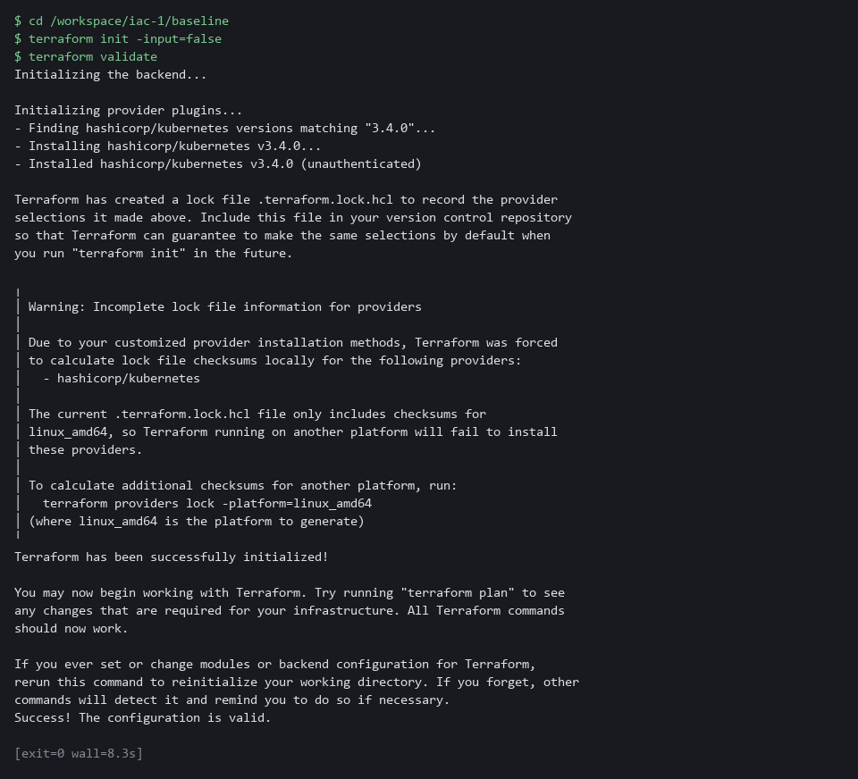

> **YOUR TURN:** Run the first block and read the next two. Find the line that can switch the default-deny policy off. Then run the last block.

> **CHECKPOINT:** baseline holds four files, init says it was successfully initialized, and validate says the configuration is valid. If validate prints an error, stop, copy the whole command and the error and ask your AI assistant.

> **TAKEAWAY:** The files are the baseline, so read them before you run them.

**How this meets the control**

- **CM-2:** The supplied files are the baseline, and reading them first is how you know what it says. The init and validate commands show the files are well formed before the cluster is touched.

### Step 2. Plan, read the plan, apply the saved plan (CM-3 Configuration Change Control, CM-2 Baseline Configuration)

**Learning point: Saving, reading and applying one plan file shows how a reviewed change reaches the cluster with nothing added in between.**

- Terraform can show you what it would do before it does it.
- Save the Terraform plan to a file, read it, count the actions, and apply that exact file.
- If the plan says anything you do not expect, you stop here.

What this step adds (thick lines and outlines are new):

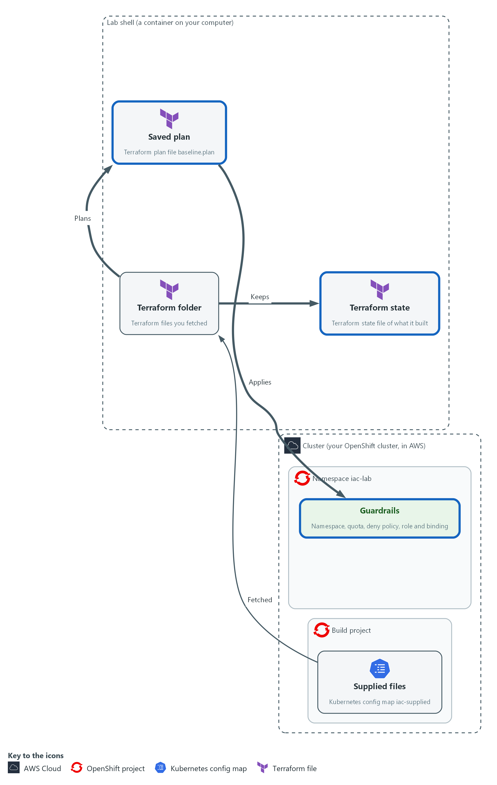

- Terraform writes a saved plan, you read it, and applying that exact plan builds the baseline.

#### 2a. Write a plan to a file and read it

You will now ask Terraform what it would do, save the answer in baseline.plan, and read it as a count and as a list.

- Nothing is created yet.

```bash
cd /workspace/iac-1/baseline
terraform plan -input=false -out=baseline.plan
terraform show -json baseline.plan | jq -c '[.resource_changes[].change.actions[]] | group_by(.) | map({(.[0]): length}) | add'
terraform show -json baseline.plan | jq -r '.resource_changes[] | "\(.change.actions | join(",")) \(.address)"'
```

**Expected output:**

```
Example only. The plan text above the summary is long, and it is not shown here.
Plan: 5 to add, 0 to change, 0 to destroy.
Saved the plan to: baseline.plan
{"create":5}
create kubernetes_namespace_v1.lab
create kubernetes_network_policy_v1.default_deny[0]
create kubernetes_resource_quota_v1.limits
create kubernetes_role_binding_v1.reader
create kubernetes_role_v1.reader
```

| Part | What it does | Why you run it |
| --- | --- | --- |
| cd /workspace/iac-1/baseline | Moves into the Terraform folder. | Terraform reads the files in the folder it runs in. |
| terraform plan -input=false -out=baseline.plan | Works out the changes, prints them, and saves them in a file. | The saved file is the change you will review and then apply. Nothing is changed yet. |
| terraform show -json baseline.plan | Prints the saved plan as JSON, a form a script can read. | Text is for people to read. JSON lets a command count and filter. |
| jq -c '[.resource_changes[].change.actions[]] \| group_by(.) \| map(...) \| add' | Collects every action in the plan, groups equal ones and counts each group. | A one-line count: here five creates and nothing else. |
| jq -r '.resource_changes[] \| ...' | Prints one line per object: its action, then its name. | You see which object gets which action, and can check each one against the file you read. |

#### 2b. Apply the saved plan and look at the result

You will now apply the plan you just read, and nothing else, and then look at what exists.

- If you run these commands a second time, Terraform says the saved plan is stale, which only means it was applied already.

```bash
cd /workspace/iac-1/baseline
terraform apply -input=false baseline.plan
oc get namespace iac-lab
oc get resourcequota,networkpolicy,role,rolebinding -n iac-lab
```

**Expected output:**

```
Example only. Your ages will differ, and OpenShift adds a few role bindings of its own.
Apply complete! Resources: 5 added, 0 changed, 0 destroyed.
NAME      STATUS   AGE
iac-lab   Active   10s
resourcequota/baseline-quota
networkpolicy.networking.k8s.io/default-deny
role.rbac.authorization.k8s.io/config-reader
rolebinding.rbac.authorization.k8s.io/config-reader-binding
```

| Part | What it does | Why you run it |
| --- | --- | --- |
| cd /workspace/iac-1/baseline | Moves into the Terraform folder. | The saved plan is a file in this folder. |
| terraform apply -input=false baseline.plan | Applies the saved plan. Because a plan file is named, Terraform does not ask for approval or work out a new plan. | Only the changes you read are made. If the cluster changed since the plan, Terraform refuses instead of guessing. |
| oc get namespace iac-lab | Shows the namespace Terraform created. | Proof from the cluster itself, not from Terraform's own report. |
| oc get resourcequota,networkpolicy,role,rolebinding -n iac-lab | Lists the four kinds of object the baseline built in that namespace. | Checks the other four objects exist, by asking the cluster. |

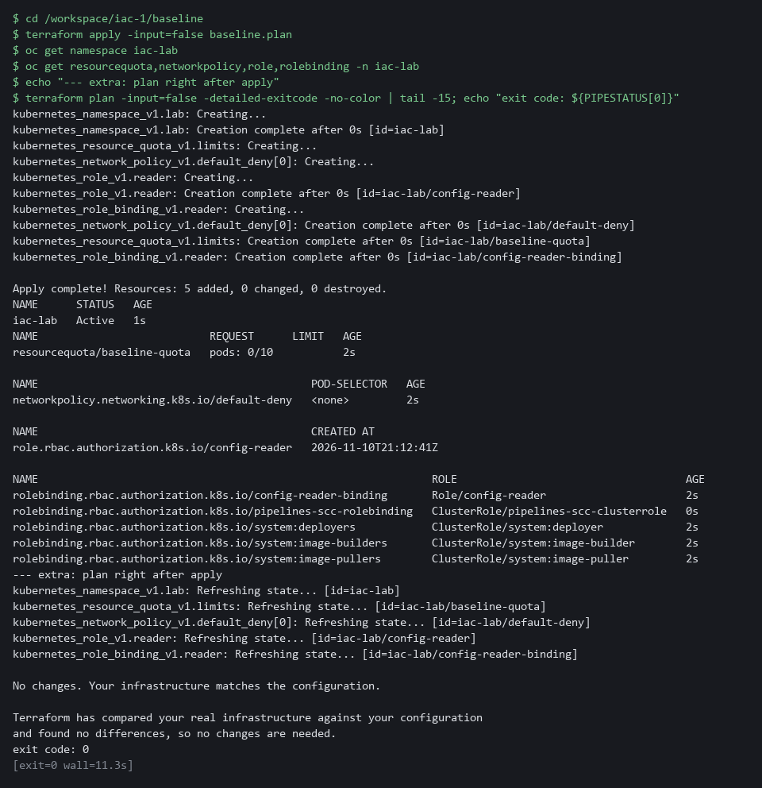

> **SECURITY:** Apply only a plan you have read. Applying a plan without reading it is the same as typing the changes without looking.

> **YOUR TURN:** Run both blocks. Check that every line of the plan matches a resource in main.tf.

> **CHECKPOINT:** The plan says 5 to add, 0 to change and 0 to destroy. The apply says 5 added, and oc shows the namespace, the quota, the network policy, the role and the role binding.

> **TAKEAWAY:** A saved plan makes the change you reviewed the change that runs.

**How this meets the controls**

- **CM-3:** The plan lists every change before it happens, and you read it as text and count it with jq. Applying the saved plan makes only the reviewed changes.
- **CM-2:** Applying the files builds the baseline in the namespace, and the last commands show the objects the files describe.

### Step 3. Make a change by hand, find it and repair it (CM-6 Configuration Settings)

**Learning point: Changing a setting by hand and then asking Terraform for a plan shows how drift is detected and how the files repair it.**

- Settings drift when someone changes the system by hand.
- Change the quota with oc, then ask Terraform what it sees.
- With the option -detailed-exitcode, exit code 0 means no changes and 2 means changes.

What this step adds (thick lines and outlines are new):

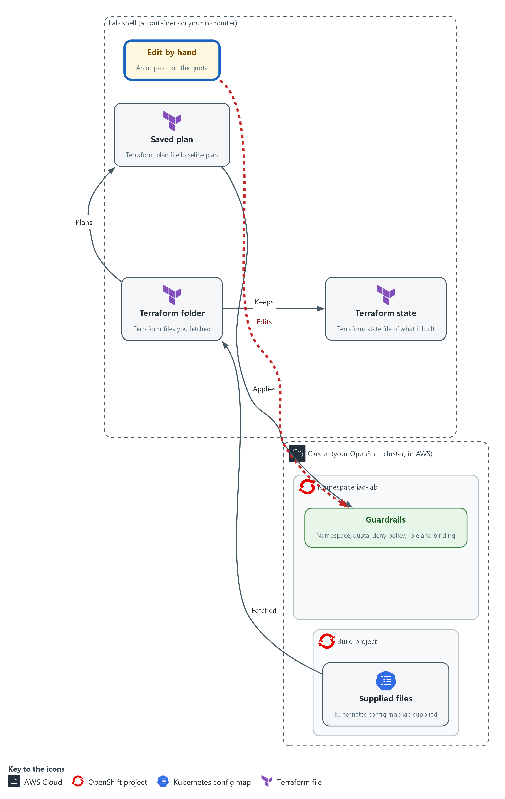

- A hand edit moves the cluster away from the files, and Terraform shows what it would change back.

#### 3a. Change the quota by hand

You will now raise the pod limit from 10 to 50 with oc, the way someone might in a hurry.

```bash
cd /workspace/iac-1/baseline
oc patch resourcequota baseline-quota -n iac-lab --type merge -p '{"spec":{"hard":{"pods":"50"}}}'
oc get resourcequota baseline-quota -n iac-lab -o jsonpath='{.spec.hard.pods}{"\n"}'
```

**Expected output:**

```
Example only.
resourcequota/baseline-quota patched
50
```

| Part | What it does | Why you run it |
| --- | --- | --- |
| cd /workspace/iac-1/baseline | Moves into the Terraform folder. | The next block plans from this folder, so start every block here. |
| oc patch resourcequota baseline-quota | Changes one field of the quota directly on the cluster. | This is the drift: the cluster now differs from the files, and no file records why. |
| --type merge -p '{...}' | The change to make, written as JSON: pods becomes 50. | A one-line change is exactly how drift happens in real life. |
| jsonpath='{.spec.hard.pods}' | Prints only the pod limit. | Confirms the cluster really holds 50 now. |

#### 3b. Ask Terraform what it sees

You will now run a plan again.

- Terraform reads the real objects first, so it should notice the hand edit.

```bash
cd /workspace/iac-1/baseline
terraform plan -input=false -detailed-exitcode -out=repair.plan
echo "exit code: $?"
terraform show -no-color repair.plan | grep -E 'will be|pods'
terraform show -json repair.plan | jq -c '[.resource_changes[] | select(.change.actions != ["no-op"]) | {address, actions: .change.actions}]'
```

**Expected output:**

```
Example only. The exact lines depend on the provider.
Plan: 0 to add, 1 to change, 0 to destroy.
exit code: 2
  # kubernetes_resource_quota_v1.limits will be updated in-place
          ~ "pods" = "50" -> "10"
[{"address":"kubernetes_resource_quota_v1.limits","actions":["update"]}]
```

| Part | What it does | Why you run it |
| --- | --- | --- |
| cd /workspace/iac-1/baseline | Moves into the Terraform folder. | Terraform reads the files in the folder it runs in. |
| -detailed-exitcode | Makes the command exit with 0 when there is nothing to do, 2 when there are changes, and 1 when something is wrong. | A script can act on the exit code without reading the text. |
| -out=repair.plan | Saves this plan too. | Same rule as before: you apply the plan you read. |
| echo "exit code: $?" | Prints the exit code of the plan command, the one just before it. | Shows the signal a script would use. Here it is 2, which means changes. |
| grep -E 'will be\|pods' | Keeps only the lines that name the object being changed and the pod values. | Cuts a long plan down to the lines that tell you what Terraform wants to change back. |
| select(.change.actions != ["no-op"]) | Keeps only the objects that have an action other than doing nothing. | Leaves the one object that differs, with its action. |

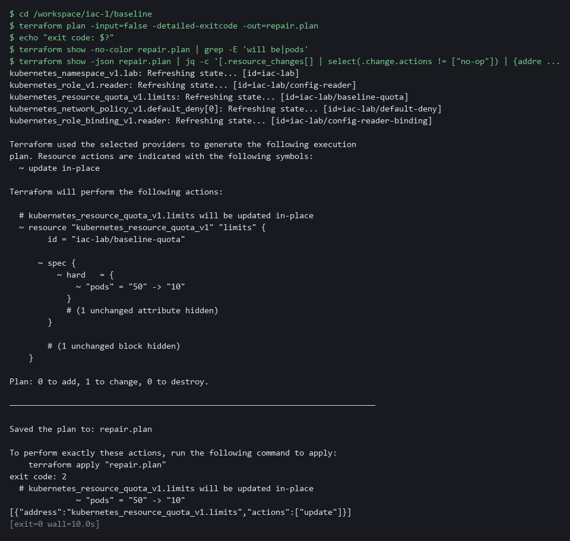

#### 3c. Repair the change and check again

You will now apply the repair plan, which puts the limit back, and then check that Terraform sees no differences.

- If the repair plan was already applied, Terraform says the saved plan is stale and the last check still shows exit code 0.

```bash
cd /workspace/iac-1/baseline
terraform apply -input=false repair.plan
oc get resourcequota baseline-quota -n iac-lab -o jsonpath='{.spec.hard.pods}{"\n"}'
terraform plan -input=false -detailed-exitcode > /dev/null; echo "exit code: $?"
```

**Expected output:**

```
Example only.
Apply complete! Resources: 0 added, 1 changed, 0 destroyed.
10
exit code: 0
```

| Part | What it does | Why you run it |
| --- | --- | --- |
| cd /workspace/iac-1/baseline | Moves into the Terraform folder. | The repair plan is a file in this folder. |
| terraform apply -input=false repair.plan | Applies the one update you read. | The repair is the reviewed plan, not another hand edit. |
| oc get resourcequota ... jsonpath | Prints the pod limit from the cluster. | Proof from the cluster itself: it is back to 10. |
| terraform plan ... > /dev/null; echo ... | Runs a plan, hides its text, and prints the exit code. | Exit code 0 means the cluster matches the files again. |

> **NOTE:** Ansible in Step 4 does not know about this quota, because the playbook does not mention it. Each tool only knows about what its own files describe.

> **YOUR TURN:** Run the three blocks in order. Say out loud what the plan wanted to change before you apply it.

> **CHECKPOINT:** The first plan exits with 2 and names one update on the quota, from 50 to 10. After the repair the limit is 10 and the plan exits with 0.

> **TAKEAWAY:** A hand change that no file records is found by the next plan.

**How this meets the control**

- **CM-6:** A hand edit to the quota is a change nobody reviewed, and the next plan finds it. Applying the repair puts the setting back to the value in the files.

### Step 4. Run the supplied playbook with Ansible (CM-2 Baseline Configuration)

**Learning point: Running a playbook in check mode, for real and then again shows how Ansible adds objects and reports that a second run changes nothing.**

- Terraform built the guardrails.
- The playbook adds the account that the role binding names, and a small settings record.
- Read the playbook, run it in check mode so nothing changes, run it for real, then run it again.

What this step adds (thick lines and outlines are new):

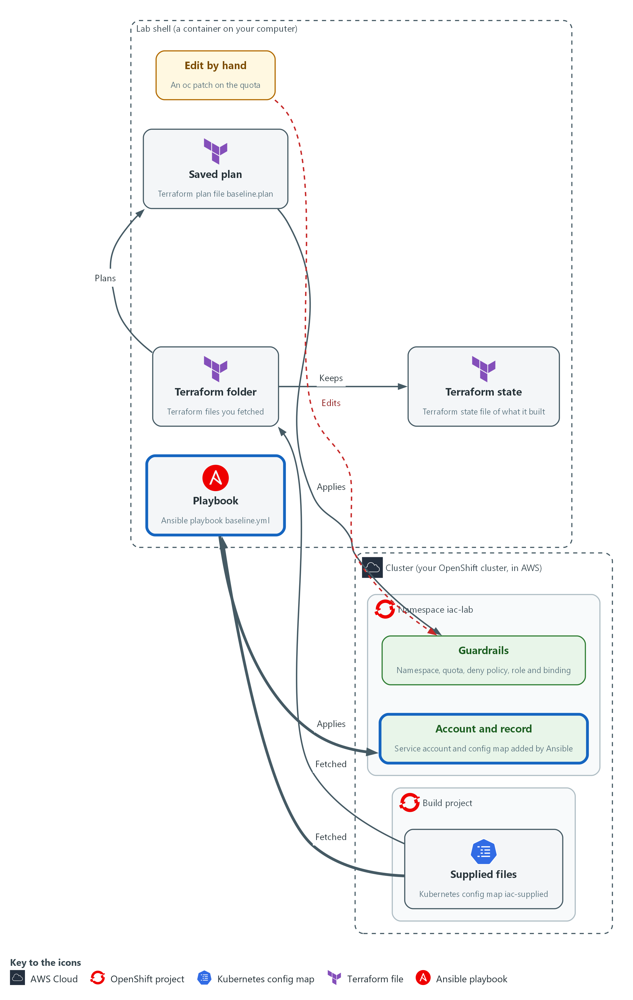

- Ansible adds a service account and a settings record, and a second run changes nothing.

#### 4a. Read the playbook

You will now read baseline.yml, the file you saved in your folder.

- You read this file and do not type it.

Look for these as you read:

- The playbook has two tasks, and each says what should exist, with the word present, not a command to run.
- The hosts line says localhost and the connection is local: the playbook runs here, in the lab shell, and talks to the cluster over the network.
- module_defaults gives the module the lab kubeconfig, so each task does not repeat it.
- The namespace comes from a variable that is set once at the top (target_ns, not namespace, which Ansible reserves for its own use).

```yaml
---
- name: Add the service account and the settings record to iac-lab
  hosts: localhost
  connection: local
  gather_facts: false
  vars:
    ansible_python_interpreter: "{{ ansible_playbook_python }}"
    target_ns: iac-lab
  module_defaults:
    kubernetes.core.k8s:
      kubeconfig: /workspace/.lab/kubeconfig
  tasks:
    - name: Service account report-reader exists
      kubernetes.core.k8s:
        state: present
        definition:
          apiVersion: v1
          kind: ServiceAccount
          metadata:
            name: report-reader
            namespace: "{{ target_ns }}"

    - name: Settings record exists
      kubernetes.core.k8s:
        state: present
        definition:
          apiVersion: v1
          kind: ConfigMap
          metadata:
            name: settings-record
            namespace: "{{ target_ns }}"
          data:
            baseline: iac-1

```

**Expected output:**

```
Nothing prints. This block is for reading.
```

| Part | What it does | Why you run it |
| --- | --- | --- |
| hosts: localhost / connection: local | Runs the tasks on this machine instead of logging in to another one. | Nothing here needs another machine. The module only talks to the cluster. |
| ansible_python_interpreter | Tells Ansible to use the same Python that Ansible itself runs on, which has the Kubernetes package. | Without it Ansible could pick a Python that lacks the package and every task would fail. |
| module_defaults ... kubeconfig | Gives every task of that module the lab kubeconfig. | One place to say how to reach the cluster. |
| kubernetes.core.k8s ... state: present | Asks the module to make sure the object in definition exists as written. | present means ensure, not create. If it is already there as written, nothing changes. |
| kind: ServiceAccount, name: report-reader | The account that the Terraform role binding names. | Adds the identity that the read-only role was bound to. |
| kind: ConfigMap, name: settings-record | A small config map with one value, baseline: iac-1. | A second object, so the run has more than one thing to check. |

#### 4b. Run it in check mode first

You will now run the playbook with the check option, which reports what would change and changes nothing.

```bash
cd /workspace/iac-1
ansible-playbook -i localhost, baseline.yml --check --diff
oc get serviceaccount report-reader -n iac-lab --ignore-not-found
```

**Expected output:**

```
Example only. The recap line is the one to read.
PLAY [Add the service account and the settings record to iac-lab] *****
TASK [Service account report-reader exists] ****
changed: [localhost]
TASK [Settings record exists] ****
changed: [localhost]
PLAY RECAP *****
localhost : ok=2 changed=2 unreachable=0 failed=0 skipped=0 rescued=0 ignored=0
(the last command prints nothing, because nothing was created)
```

| Part | What it does | Why you run it |
| --- | --- | --- |
| ansible-playbook -i localhost, baseline.yml | Runs the playbook. The text after -i is a list of one machine, localhost (the comma matters). | Tells Ansible which machine to run on without an inventory file. |
| --check | Runs every task as a rehearsal and reports whether it would change something. | You see what would change and the cluster stays as it is. |
| --diff | Also prints before and after for objects that already exist. | For brand-new objects there is no before, so you see no diff here. Step 5 shows one. |
| oc get serviceaccount ... --ignore-not-found | Asks the cluster for the account and prints nothing if it is not there. | Proof that check mode really created nothing. |

#### 4c. Run it for real, then run it again

You will now run the playbook twice, keeping only the recap line each time, and then look at what exists.

- If you run this block again, both runs show changed=0, because the objects already exist.

```bash
cd /workspace/iac-1
ansible-playbook -i localhost, baseline.yml | grep -E '^localhost'
ansible-playbook -i localhost, baseline.yml | grep -E '^localhost'
oc get serviceaccount,configmap -n iac-lab
```

**Expected output:**

```
Example only.
localhost : ok=2 changed=2 unreachable=0 failed=0 skipped=0 rescued=0 ignored=0
localhost : ok=2 changed=0 unreachable=0 failed=0 skipped=0 rescued=0 ignored=0
serviceaccount/report-reader
configmap/settings-record
```

| Part | What it does | Why you run it |
| --- | --- | --- |
| cd /workspace/iac-1 | Moves into the folder that holds baseline.yml. | The playbook is a file in this folder. |
| grep -E '^localhost' | Keeps only the recap line, which starts with the machine name. | The recap is where you read how many tasks changed something. |
| first run: changed=2 | Both objects were missing, so both tasks changed something. | The playbook did what it was asked to. |
| second run: changed=0 | Both objects already matched, so no task changed anything. | This is idempotent: running it again does no harm and says so. |
| oc get serviceaccount,configmap -n iac-lab | Lists the objects. OpenShift also adds a few of its own. | Confirms the cluster holds the account and the record. |

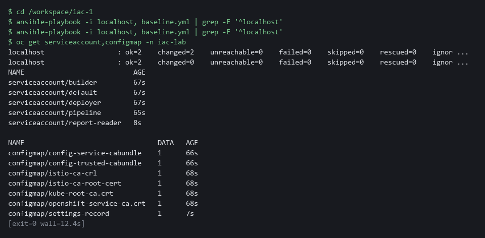

> **YOUR TURN:** Run all three blocks. Read the two recap lines.

> **CHECKPOINT:** Check mode changes nothing and shows changed=2. The first real run shows changed=2. The second real run shows changed=0.

> **TAKEAWAY:** A recap of changed=0 on a second run means the playbook is safe to repeat.

**How this meets the control**

- **CM-2:** A playbook that is safe to run again keeps the settings it describes in place without harm. The recap line changed=0 shows the system already matches.

### Step 5. Compare what each tool says (CM-6 Configuration Settings)

**Learning point: Asking both tools the same question side by side shows that each tool only sees the objects its own files describe.**

- Each tool reports that nothing needs doing in its own way: Terraform with exit code 0, Ansible with changed=0.
- Read the supplied summary script, run it when everything matches, change one thing by hand, and run it again to see which tool notices.

What this step adds (thick lines and outlines are new):

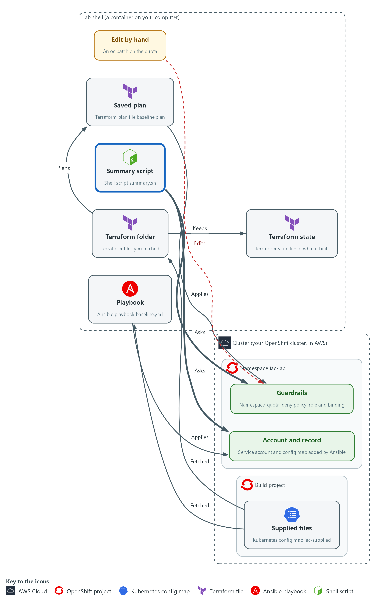

- A summary script asks each tool the same question, whether the cluster matches the files.

#### 5a. Read the summary script

You will now read summary.sh, the file you saved in your folder.

- You read this file and do not type it.

Look for these as you read:

- The script only asks questions: a Terraform plan and an Ansible check run. Nothing in it applies or changes anything.
- Terraform answers with an exit code, and the script turns that number into a sentence.
- Ansible answers with the changed count in its recap line, and the script pulls that number out with grep and sed.

```bash
#!/usr/bin/env bash
# One line per tool: does the cluster match the files? Reads only and changes nothing.
cd /workspace/iac-1/baseline || exit 1
terraform plan -input=false -detailed-exitcode > /dev/null 2>&1
tf=$?
tfmsg="terraform: the cluster matches the files (exit code 0)"
if test "$tf" -eq 2; then
  tfmsg="terraform: the cluster differs from the files (exit code 2)"
fi
if test "$tf" -eq 1; then
  tfmsg="terraform: could not check (exit code 1)"
fi
echo "$tfmsg"
cd /workspace/iac-1 || exit 1
changed=$(ansible-playbook -i localhost, baseline.yml --check | grep -E "^localhost" | sed -E "s/.*changed=([0-9]+).*/\1/")
echo "ansible: ${changed:-unknown} change(s) the playbook would make"

```

**Expected output:**

```
Nothing prints. This block is for reading.
```

| Part | What it does | Why you run it |
| --- | --- | --- |
| terraform plan -detailed-exitcode > /dev/null 2>&1 | Runs a plan, throws its text away, and keeps only the exit code. | The exit code is the answer. The text is not needed here. |
| tf=$? | Saves the exit code in a variable. | The next lines test it, and the variable keeps the number. |
| if test "$tf" -eq 2 | Runs the lines inside only when the exit code is 2, which means changes. | Turns a number into a sentence a person can read. |
| ansible-playbook ... --check \| grep -E "^localhost" \| sed ... | Runs the playbook in check mode, keeps the recap line, and cuts out the changed number. | Check mode makes sure the script cannot change the cluster. |
| ${changed:-unknown} | Uses the number, or the word unknown if it could not be read. | A script that cannot find the answer should say so instead of printing nothing. |

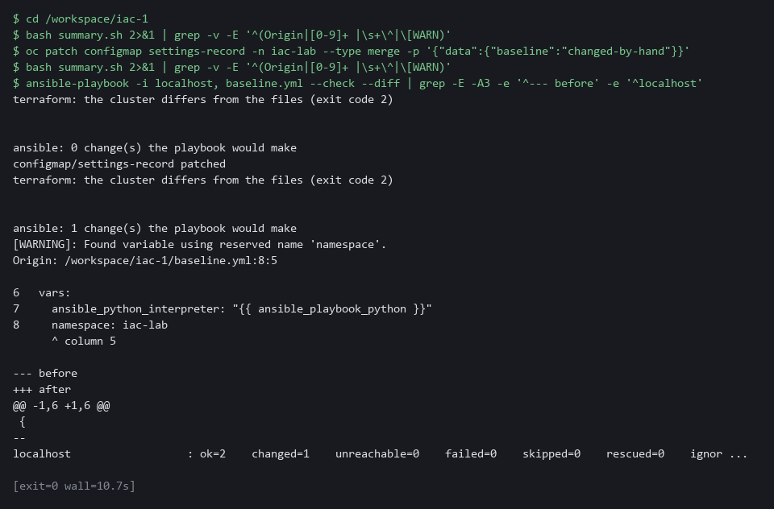

#### 5b. Run the summary, change something by hand, run it again

You will now run the summary, change the settings record by hand, and run the summary again.

```bash
cd /workspace/iac-1
bash summary.sh
oc patch configmap settings-record -n iac-lab --type merge -p '{"data":{"baseline":"changed-by-hand"}}'
bash summary.sh
ansible-playbook -i localhost, baseline.yml --check --diff | grep -E -e '^--- before' -e 'baseline' -e '^localhost'
```

**Expected output:**

```
Example only. The layout of the diff may differ.
terraform: the cluster matches the files (exit code 0)
ansible: 0 change(s) the playbook would make
configmap/settings-record patched
terraform: the cluster matches the files (exit code 0)
ansible: 1 change(s) the playbook would make
(then the diff, which includes the lines with "baseline" in them: one showing changed-by-hand and one showing iac-1)
```

| Part | What it does | Why you run it |
| --- | --- | --- |
| bash summary.sh | Runs the supplied script. It prints one line per tool. | The two lines are the answer, side by side. |
| oc patch configmap settings-record ... | Changes the value in the settings record by hand. | The settings record is in the playbook but not in the Terraform files. |
| second bash summary.sh | Runs the same script again. | Terraform still says it matches, because it does not know about the record. Ansible says one change. |
| --check --diff \| grep ... | Shows what Ansible would change back, keeping the lines with baseline in them: the before and after values. | For an object that already exists you get a diff, so you can see what was changed. |

#### 5c. Repair the record and run the summary once more

You will now run the playbook for real to put the record back, and then run the summary.

```bash
cd /workspace/iac-1
ansible-playbook -i localhost, baseline.yml | grep -E '^localhost'
bash summary.sh
```

**Expected output:**

```
Example only.
localhost : ok=2 changed=1 unreachable=0 failed=0 skipped=0 rescued=0 ignored=0
terraform: the cluster matches the files (exit code 0)
ansible: 0 change(s) the playbook would make
```

| Part | What it does | Why you run it |
| --- | --- | --- |
| cd /workspace/iac-1 | Moves into the folder that holds baseline.yml and summary.sh. | Both files are in this folder. |
| ansible-playbook ... \| grep -E '^localhost' | Runs the playbook for real and keeps the recap line. One task changed. | The playbook repairs the record from the files. |
| bash summary.sh | Asks both tools again. | Both say the cluster matches. Each tool only sees what its own files describe. |

> **YOUR TURN:** Run the blocks in order. Read, for each tool, what it said before the hand change and after it.

> **CHECKPOINT:** Before the hand change, both tools say the cluster matches. After it, Terraform still says it matches and Ansible reports one change. After the repair both say it matches again.

> **TAKEAWAY:** A tool cannot report drift in an object it does not manage.

**How this meets the control**

- **CM-6:** The supplied summary script asks each tool the same question, whether the cluster matches its files. You see both answers before and after a hand change.

## Section 4. Verify It Works

### Test 1 (positive). Both tools report no changes (CM-2 Baseline Configuration)

- After the work, the cluster should match both sets of files.
- Ask each tool, and look at the objects the baseline is supposed to protect.

```bash
cd /workspace/iac-1/baseline
terraform plan -input=false -detailed-exitcode -no-color | grep -E 'No changes|Plan:'
terraform plan -input=false -detailed-exitcode > /dev/null; echo "terraform exit code: $?"
cd /workspace/iac-1
ansible-playbook -i localhost, baseline.yml --check | grep -E '^localhost'
oc get networkpolicy default-deny -n iac-lab -o jsonpath='{.spec.policyTypes}{"\n"}'
```

**Expected output:**

```
Example only. Your wording may differ a little.
No changes. Your infrastructure matches the configuration.
terraform exit code: 0
localhost : ok=2 changed=0 unreachable=0 failed=0 skipped=0 rescued=0 ignored=0
["Ingress","Egress"]
```

| Part | What it does | Why you run it |
| --- | --- | --- |
| cd /workspace/iac-1/baseline | Moves into the Terraform folder. | Terraform reads the files in the folder it runs in. |
| terraform plan ... \| grep -E 'No changes\|Plan:' | Plans again and keeps the line that says whether anything would change. | No changes means the cluster matches the Terraform files. |
| terraform plan ... > /dev/null; echo ... | Plans again, hides the text and prints the exit code. 0 is expected. | The exit code is the answer a script would use. |
| cd /workspace/iac-1 / ansible-playbook ... --check \| grep ... | Runs the playbook in check mode and keeps the recap line. changed=0 is expected. | changed=0 means the cluster matches the playbook, and check mode cannot change anything. |
| oc get networkpolicy default-deny ... jsonpath | Prints the traffic directions the policy blocks. | Proves from the cluster itself that the protection is in place. |

> **CHECKPOINT:** Terraform exits with 0, the Ansible recap shows changed=0, and the default-deny policy blocks traffic in both directions.

**How this meets the control**

- **CM-2:** Terraform and Ansible each compare the cluster with their files after the work is done and each reports no differences, which is the evidence that the running system matches the baseline.

### Test 2 (negative). A plan that removes the default-deny policy is a stop (CM-3 Configuration Change Control)

- A supplied variable file claims to be a small tidy-up.
- Copy the folder so your real state stays safe, run a plan with that file, and count the destroys.
- You do not apply the plan.

```bash
cd /workspace/iac-1
cat baseline/risky.tfvars
rm -rf risky && cp -r baseline risky && cd risky
terraform init -input=false > /dev/null
terraform plan -input=false -no-color -var-file=risky.tfvars -out=risky.plan | grep '^Plan:'
terraform show -json risky.plan | jq -c '[.resource_changes[] | select(.change.actions | index("delete")) | .address]'
terraform show -json risky.plan | jq '[.resource_changes[] | select(.change.actions | index("delete"))] | length'
oc get networkpolicy default-deny -n iac-lab
```

**Expected output:**

```
Example only. The exact lines depend on your cluster.
# A supplied change request for the baseline.
enable_default_deny = false
Plan: 0 to add, 0 to change, 1 to destroy.
["kubernetes_network_policy_v1.default_deny[0]"]
1
NAME           POD-SELECTOR   AGE
default-deny   <none>         12m
```

| Part | What it does | Why you run it |
| --- | --- | --- |
| cat baseline/risky.tfvars | Prints the supplied variable file. It sets enable_default_deny to false. | Read a supplied file before you let a tool use it. |
| rm -rf risky && cp -r baseline risky && cd risky | Makes a fresh copy of the folder and moves into it. | Your real state stays safe, and the test can be run again. |
| terraform init ... > /dev/null | Prepares the copy and hides the text. | The copy needs the provider before it can plan. |
| terraform plan ... -no-color -var-file=risky.tfvars -out=risky.plan \| grep '^Plan:' | Plans with the supplied file, without color codes so grep can find the line, and keeps the summary line. 1 to destroy is expected. | The plan shows the damage before anything is applied. |
| terraform show -json risky.plan \| jq ... index("delete") | Lists the objects that would be destroyed, then counts them. | Names the protection that would go: the default-deny policy. |
| oc get networkpolicy default-deny -n iac-lab | Asks the cluster for the policy. It is still there. | Proves nothing was applied. |

> **CHECKPOINT:** The plan says 1 to destroy, the object named is the default-deny policy, and the policy still exists on the cluster because you did not apply. This is a stop. Do not run terraform apply. Send risky.tfvars and the line Plan: 0 to add, 0 to change, 1 to destroy to the file owner, and ask whether removing the policy was intended.

**How this meets the control**

- **CM-3:** The supplied variable file would remove the default-deny policy, and the plan shows it as a destroy. Reading the plan lets you stop before the protection is gone.

### Test 3 (negative). A file with a typo is rejected before anything runs (CM-6 Configuration Settings)

- A supplied file has a spelling mistake in a setting name.
- See what a failure looks like, which command found it, and what its exit code says.

```bash
cd /workspace/iac-1
rm -rf broken && mkdir broken
cp baseline/versions.tf baseline/variables.tf broken/ && cp broken-main.tf.txt broken/main.tf
cd broken
terraform init -input=false > /dev/null
terraform validate -no-color; echo "exit code: $?"
```

**Expected output:**

```
Example only. The line number and wording may differ.
Error: Unsupported argument

  on main.tf line 3, in resource "kubernetes_namespace_v1" "lab":
   3:     nmae = var.namespace

An argument named "nmae" is not expected here. Did you mean "name"?
exit code: 1
```

| Part | What it does | Why you run it |
| --- | --- | --- |
| rm -rf broken && mkdir broken | Makes a clean folder for the test. | The test can be run again, and your real folder stays as it is. |
| cp ... broken/ && cp broken-main.tf.txt broken/main.tf | Copies the good files, then the supplied bad main file as main.tf. | Only the main file has the mistake. |
| terraform init ... > /dev/null | Prepares the folder and hides the text. | validate needs the provider. |
| terraform validate -no-color; echo ... | Checks the files. An error and exit code 1 are expected. | A mistake is caught before the cluster is touched. |

> **CHECKPOINT:** validate prints an error that names the file, the line and the misspelled argument, and the exit code is 1. Send the error text to the file owner instead of fixing the file yourself. Exit code 1 here means the command could not do its job. In a plan run with -detailed-exitcode, exit code 2 means changes.

**How this meets the control**

- **CM-6:** A misspelled setting name cannot say what was intended, and validate refuses the file before the cluster is touched. The error names the file, the line and the misspelled argument.

## Section 5. What Each Control Is For

### Control mapping

| Control | What it requires, in plain words | Tool or service | Where this module covers it |
| --- | --- | --- | --- |
| CM-2 Baseline Configuration | Keep a current baseline of the system under configuration control, and review and update it at an organization-defined frequency, when organization-defined circumstances require it and when components are installed or upgraded. NIST leaves the frequency organization-defined; FedRAMP assigns at least annually and when a significant change occurs. | A supplied Terraform folder and an Ansible playbook, run from the lab shell. Explained in Section 2.1 and Section 2.2. | Section 3, Steps 1, 2 and 4: you read the files that hold the baseline and run them. Section 4, Test 1: both tools report that the cluster matches the files. |
| CM-3 Configuration Change Control | Review proposed changes before they are made, and then make only the approved ones. | terraform plan with a saved plan file, read with terraform show and jq. Explained in Section 2.3. | Section 3, Steps 2 and 3: you read the plan and apply only the saved plan. Section 4, Test 2: you find a plan that removes a protection and stop. |
| CM-6 Configuration Settings | Set settings in the most restrictive mode consistent with operational requirements, and monitor and control changes to them. FedRAMP requires the DoD STIGs for configuration settings, then CIS Level 2 guidelines where no STIG exists. | Terraform drift detection and the Ansible check mode, read with the summary script. Explained in Section 2.2 and Section 2.3. | Section 3, Steps 3 and 5: a hand change is found by each tool and repaired. Section 4, Test 3: a file with a typo is rejected before anything runs. |

### What each control is for

Each table below says what the control is trying to prevent and how this module's tool meets it.

#### CM-2 Baseline Configuration

| Question | Answer |
| --- | --- |
| Control Intent | The settings on record and the settings really in force drift apart, so nobody can say what the approved state is. |
| The operational question | Is there one current baseline in files that can be reviewed, and does the running system match it right now? |
| What evidence proves it | The files themselves, and a plan or a check that says the cluster matches them, with the time it ran. |
| How much is enough | NIST asks for a current baseline under configuration control and leaves the review frequency organization-defined. The lab treats one run that shows no differences in both tools as the proof for this module. |
| How the tool in this module satisfies it | The Terraform folder and the playbook are the baseline. The plan and the check mode show whether the cluster matches (Steps 2, 4 and 5). |

#### CM-3 Configuration Change Control

| Question | Answer |
| --- | --- |
| Control Intent | A change is applied without anyone seeing what it does, or a change quietly removes a protection. |
| The operational question | Before this change is applied, can a person see exactly what it will add, change and remove? |
| What evidence proves it | The saved plan, which lists every action before anything happens, and the fact that the plan applied is the plan that was read. |
| How much is enough | NIST asks that proposed changes be reviewed and approved or disapproved with security impact in mind. This module teaches the reading step. Who approves is the team's own process, which the lab does not define. |
| How the tool in this module satisfies it | terraform plan -out, terraform show, and applying only the saved plan (Steps 2 and 3, Test 2). |

#### CM-6 Configuration Settings

| Question | Answer |
| --- | --- |
| Control Intent | A hardened setting is changed by hand, and the record still says it is hardened. |
| The operational question | Which settings are in force right now, and are they the approved values? |
| What evidence proves it | Plan or check output that names each setting that differs, from a run made after the change. |
| How much is enough | NIST asks that changes to settings be monitored and controlled, and leaves the common secure configurations organization-defined. FedRAMP requires the DoD STIGs for configuration settings, then CIS Level 2 guidelines where no STIG exists. The small baseline here is a lab example and is not a recognized secure configuration. |
| How the tool in this module satisfies it | Drift in Step 3 and the side-by-side summary in Step 5. |

## Section 6. Next Steps

### Using this in other environments

- The Terraform files, the Ansible playbook and summary.sh manage standard Kubernetes objects: a namespace, a quota, a network policy, a role and a role binding. They work on any Kubernetes cluster you can reach with a kubeconfig.
- Change these lab values first: the kubeconfig path /workspace/.lab/kubeconfig in the Terraform provider block and in the playbook, and the namespace iac-lab.
- The files come from the config map iac-supplied in the build namespace. Elsewhere, keep them in a folder or in git.
- The Terraform provider and the Ansible collection must be installed. The lab ships them offline, so on other systems terraform init needs a provider registry or a mirror.

The table shows what changes on each platform:

| Check | In this lab (OpenShift) | On other platforms | What you change |
| --- | --- | --- | --- |
| Supplied files | oc get configmap iac-supplied -n build | A folder or a git repository | Replace the fetch step. |
| Terraform provider | hashicorp/kubernetes from a filesystem mirror, kubeconfig at /workspace/.lab/kubeconfig | The same provider from a registry or mirror | The config_path value. |
| Ansible tasks | kubernetes.core.k8s with kubeconfig /workspace/.lab/kubeconfig | The same collection and module | The kubeconfig path. |
| Reading objects | oc get and oc patch in iac-lab | kubectl get and kubectl patch | The tool name. |
| Namespace defaults | OpenShift adds its own labels, annotations and role bindings to a new namespace | A plain Kubernetes namespace has none of these | The ignore_annotations and ignore_labels lists in the provider block. |

> **TIP:** Next module: IAC-2 Deliver a Baseline as Code with Terraform: you write the baseline as Terraform files yourself, pass the change through an automated review gate, apply it, and check for drift.

<details>
<summary><strong>Section 7. Terms</strong></summary>

Each term is also explained the first time it appears. In Word, hover over an underlined term to see its meaning, or Ctrl+click it to jump to this table.

| Term | Plain meaning |
| --- | --- |
| Annotation | A note attached to a cluster object that tools can read. Unlike a label, it is not used to pick objects. |
| Ansible | A tool that reads a playbook, a list of tasks, and runs them. |
| AWS | Amazon Web Services, the cloud your lab runs in. |
| Baseline | The agreed set of settings a system should have. |
| Check mode | An Ansible mode that reports what would change and changes nothing. |
| Cluster | A group of servers that work together as one system. Here it is your own OpenShift cluster in AWS. |
| Config map | A named set of small files that the cluster stores. The supplied files for this module are kept in one. |
| Container | A sealed box that holds one program and everything it needs to run. |
| Declarative | Describing the end state you want and letting the tool work out the steps. |
| Default deny | A network policy that blocks all traffic, so only traffic that is allowed on purpose gets through. |
| diff | A command that shows the differences between two files. |
| Drift | A difference between the files and the real system, usually caused by a change made by hand. |
| Exit code | A number a command returns when it ends. Zero usually means no problem. |
| FedRAMP | The US program that sets security requirements for cloud services used by the federal government. |
| grep | A command that prints only the lines that match a pattern. |
| Idempotent | Safe to run again: if the system already matches, running it changes nothing. |
| Infrastructure as code | Keeping the settings of a system in files that tools read, so the settings can be reviewed, stored and run again. |
| Ingress | The way traffic from outside the cluster reaches a program inside it. |
| Inventory | A list of the parts of a system; in Ansible, the machines a playbook runs against. |
| jq | A tool that picks values out of JSON text. |
| JSON | A plain-text format for data: names and values written inside curly braces. |
| Kubeconfig | The file that tells a tool how to reach the cluster and as whom. |
| Kubernetes | The open-source system that runs and manages containers across servers. OpenShift is built on it. |
| Label | A key=value tag on a cluster object, used to pick objects, such as app=demo-app. |
| Merge | Combine the changes from one git branch into another. |
| mkdir | A command that makes a new folder. |
| Namespace | A named section of the cluster that keeps workloads apart. OpenShift also calls it a project. |
| Network policy | A rule about which pods may send or receive traffic. |
| NIST | The US National Institute of Standards and Technology. It publishes the security control catalog these modules cite. |
| oc | The OpenShift command-line tool. You type oc, then a verb such as get, then what it acts on. |
| OpenShift | The Red Hat platform your lab cluster runs on. It is Kubernetes with extra security and tools built in. |
| Pipeline | A set of automated steps that run in order, such as scan, check and sign. |
| PipelineRun | One execution of a Tekton pipeline. |
| Plan | Terraform's list of the actions it would take: create, update or destroy. |
| Playbook | An Ansible file that lists the tasks to run. |
| Pod | The smallest running unit on the cluster: one or more containers together. |
| Policy | A set of rules written down so that a tool can enforce them. |
| Provider | The plug-in that lets Terraform talk to one kind of system. Here it is the Kubernetes provider. |
| Recap | The summary Ansible prints at the end of a run, with a count of changed tasks for each machine. |
| Registry | A server that stores container images. |
| Resource quota | A limit on how much a namespace may use, for example how many pods it may run. |
| Role | A list of actions a user or program may take on named kinds of objects. |
| Role and role binding | A role lists what an identity may do. A role binding gives that role to an identity. |
| Role binding | Gives a role to a user, group or service account. |
| Rule | A written condition that a tool checks. |
| Saved plan | A plan written to a file, so applying it makes exactly the changes you read. |
| sed | A command that edits text as it passes through, often to replace one string with another. |
| Selector | A rule that picks objects by their labels. |
| Service account | An identity for a program instead of a person. |
| State file | The file where Terraform remembers what it built. |
| STIG | Security Technical Implementation Guide: a DoD checklist of settings for one product. |
| Tekton | The pipeline engine in OpenShift Pipelines. It runs each pipeline step in a container. |
| Terraform | A tool that reads files describing the end state you want and works out the changes needed to get there. |
| Variable | A named value in a Terraform file. A variable file can give it a different value. |

</details>
