# IAC-2: Deliver a Baseline as Code with Terraform (CM-2, CM-3, CM-6)

| Item | Detail |
| --- | --- |
| Sequence | Module 18 of 32 in the recommended order |
| Timed work | About 67 minutes (49 hands-on, 18 verify) |
| Standalone start | `lab start iac-2` |
| Combined start | Continue from the end state of the previous module |
| Tools | Terraform (with the hashicorp/kubernetes provider), Gitea (in-lab git server), OpenShift Pipelines (Tekton), OpenShift Container Platform, oc, git, jq, python3, tkn (Tekton command-line tool) |
| Prerequisites | ENG-0 Terminal, Git and Your Lab (typing commands in lab shell, making a file with a heredoc, git clone, commit and push, oc basics), IAC-1 Run a Supplied Baseline as Code (running Terraform: init, validate, plan with a saved plan file, reading the plan as JSON with jq, applying a saved plan, and checking for drift with the plan exit code) |

## Section 1. Module Overview

- Purpose: keep the namespace baseline as reviewed files (CM-2), change it only through a gate (CM-3), and detect drift from the files (CM-6).
- You write the namespace, network policy and role in Terraform, write a plan gate, and deliver the change through a Gitea pull request with a Tekton gate task.
- You apply the saved plan, then write a drift check and prove it notices a hand edit.

- **Skill:** Write a Kubernetes namespace baseline as Terraform files, write a plan gate, deliver the change through a review gate on Gitea with a Tekton task, apply the reviewed plan, and check for drift.
- **Tools:** `terraform` (with the hashicorp/kubernetes provider) writes, plans and applies the baseline. `git` records the files, and Gitea holds the repository and enforces branch protection. `python3` runs the plan gate. OpenShift Pipelines (Tekton) runs the gate task, started with `tkn`. `jq` reads the plan and the Gitea replies as JSON. `oc` reads and patches objects on the OpenShift cluster. A drift check script answers with an exit code.
- **Security Function:** Keeps the namespace baseline as reviewed, versioned files; blocks changes with wildcards, cluster-admin bindings or missing security objects; detects when the running namespace drifts from the files.
- **NIST CM-2 Baseline Configuration:** The baseline is five resource blocks in three Terraform files kept in a Gitea repository; a pull request is how the baseline changes and the history shows what it was before.
- **NIST CM-3 Configuration Change Control:** The plan gate refuses wildcards and cluster-admin bindings; Gitea branch protection makes the gate result binding; only an approved plan is applied.
- **NIST CM-6 Configuration Settings:** The drift check runs terraform plan with -detailed-exitcode and exits 0 for no drift, 2 for drift and 1 for an error, so a person or a schedule can act on the answer.

## Section 2. The Tools

### Tools used in this module

Each tool name links to its official overview. The table columns say how each tool is used in the lab and why the lab uses it instead of another way of doing the same job.

| Tool (overview link) | What it is | Used in this lab | Why this tool |
| --- | --- | --- | --- |
| [Terraform](https://developer.hashicorp.com/terraform/intro) | Builds and changes infrastructure from files, and compares the files with what exists. | Writes, plans and applies the baseline through the hashicorp/kubernetes provider. | It states the wanted infrastructure in files and shows a plan before changing anything, so a change can be reviewed and drift can be detected by comparing the files with the live system. |
| [Gitea](https://docs.gitea.com/) | A lightweight self-hosted git server. | Holds the repository and enforces branch protection, so a change needs a pull request. | It gives the lab a git server of its own, so you can push and review changes without an outside account. |
| [OpenShift Pipelines (Tekton)](https://docs.redhat.com/en/documentation/openshift_container_platform/4.22/html/pipelines/index) | Kubernetes-native CI/CD built on Tekton. | Runs the plan gate as a pipeline task. | It runs automated tasks inside the cluster, so you can see a check run with no person at the keyboard and under its own limited identity. A script run from a laptop could not show that. |
| [OpenShift Container Platform](https://docs.redhat.com/en/documentation/openshift_container_platform/4.22/html/overview/ocp-overview) | A Kubernetes container platform for running and managing containerized applications. | The cluster every command in this module runs against. | It is the platform the whole lab runs on, so every module works on the same real cluster, with the same kinds of objects a production OpenShift system has. |
| [oc](https://docs.redhat.com/en/documentation/openshift_container_platform/4.22/html/cli_tools/openshift-cli-oc) | The OpenShift command-line tool for creating and managing applications and projects from a terminal. | Reads and patches objects on the cluster, for example to cause drift. | It is the one command that talks to the cluster, so every module uses it to ask what is true and to make changes. You sign in once, and it works on OpenShift objects as well as standard Kubernetes ones. Unlike clicking in the web console, a command can be pasted, repeated and checked by a test. |
| [Git](https://git-scm.com/about) | Version control that stores repository history. | Records the Terraform files and the branch you push. | It keeps scripts and settings with a history, so every change has a record of who made it and when, and a mistake can be undone. |
| [jq](https://jqlang.org/) | Command-line JSON processor. | Reads the plan and the Gitea replies as JSON. | It picks one field out of a long JSON reply, so a test can read a single value. |
| [Python 3](https://docs.python.org/3/tutorial/introduction.html) | General-purpose language, used here for small helper scripts. | Runs the plan gate that reads the plan and refuses an unsafe change. | Python reads and writes JSON easily and is already in the lab shell, so a small script needs nothing installed. |
| [tkn](https://docs.redhat.com/en/documentation/openshift_container_platform/4.22/html/cli_tools/pipelines-cli-tkn) | Command-line tool for managing pipelines, runs and tasks. | Starts the pipeline run and follows it. | It starts and reads pipeline runs from the terminal, so the same shell you use for everything else drives the pipeline. The other way is the web console, which cannot be pasted into a step. |

### How it fits together

#### A baseline reaches the cluster only through a reviewed plan

- In the lab (test) setup, you write the baseline as Terraform files and save a plan; thick lines mark new parts.
- A gate you wrote checks the plan on your own machine and then in the cluster before a merge, and a drift check later compares the cluster with the files.
- In production a pipeline with Terraform in its image makes the plan itself, and the git server and pipeline are the organization's approved services.

How the lab is set up, and why:

- You write the Terraform files, run the gate and run Terraform in the lab shell on your laptop, the same workspace as the earlier modules.
- A plan is something you should read yourself before anyone else reviews it.
- Gitea, the lab's git server, holds the files and the gate script and applies the rule that main changes only through a pull request that passed the gate.
- The gate task runs in the build project on the cluster, outside the repository.
- The task reads the gate from main and the plan from the branch, so a change cannot edit the gate that judges it.
- Terraform is not inside the cluster, so the task cannot make a plan itself.
- The task checks the plan.json that you generated and committed.
- You apply the same saved plan afterwards.
- The baseline objects live in one namespace, iac-lab, so a mistake in this module stays inside it.
- The drift check asks Terraform whether that namespace still matches the files.

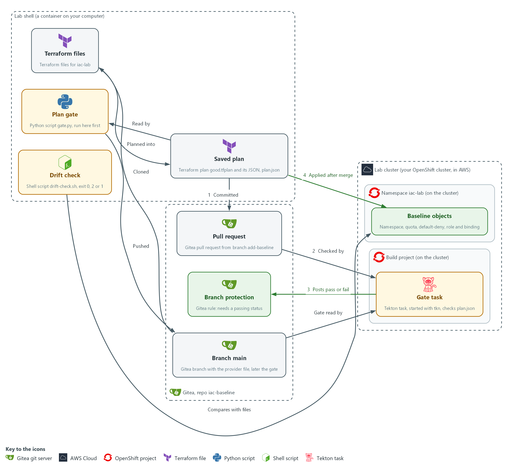

- **1. Branch main:** the Gitea branch that holds the provider file and, later, the gate.
- **2. Terraform files:** the files in your lab shell that describe the namespace iac-lab and the objects in it, cloned from Gitea.
- **3. Saved plan:** good.tfplan and its JSON copy, plan.json. Nothing reaches the cluster yet.
- **4. Plan gate:** gate.py, a Python script that reads plan.json and fails on a wildcard, a cluster-admin binding, a missing network policy or quota, or an empty input. You run it in the lab shell first and then push it to main.
- **5. Pull request:** you commit the Terraform files and plan.json on the branch add-baseline and open a pull request on Gitea (flow 1).
- **6. Gate task:** a Tekton task in the build project, started with tkn, that checks plan.json from the pull request with the gate from main (flow 2).
- **7. Branch protection:** the Gitea rule that merges only when the gate task posts a pass (flow 3). After the merge, you apply the same saved plan from the lab shell (flow 4).
- **8. Baseline objects:** the namespace, quota, default-deny policy, role and binding that Terraform builds in iac-lab.
- **9. Drift check:** drift-check.sh in the lab shell, which asks Terraform whether the cluster still matches the files and ends with exit code 0, 2 or 1.

Where each part runs, and why:

| Part | Where it runs | Why it is built this way |
| --- | --- | --- |
| Lab shell | A container on your laptop | You read each plan and run the gate here first, so a mistake costs nothing and nothing reaches Gitea until the plan looks right. |
| Repository iac-baseline | On Gitea, the git server inside the lab | Every change to the baseline is a pull request, so it can be reviewed and its history kept. |
| Branch protection | A rule on the repository on Gitea | It turns the gate from advice into a requirement, even for an administrator. |
| Gate task | A Tekton task in the build project | It runs outside the repository, so an author cannot edit the gate in the pull request it judges. |
| Namespace iac-lab | On the cluster | One namespace keeps the baseline, and any mistake, in one place. |
| Drift check | A script in your lab shell | It answers one question with an exit code, so a person or a schedule can act on it. |

### 2.1 The baseline as files, and a plan before every change (CM-2 Baseline Configuration, CM-6 Configuration Settings)

- Terraform reads text files that describe the objects you want, compares them with what exists, and works out the changes.
- A provider is a plugin that lets Terraform talk to one kind of system.
- Each resource block describes one object, and Terraform keeps its record of the objects in a state file.
- A baseline kept as files can be reviewed, versioned and rebuilt.
- A plan shows the changes before they happen, and making a plan changes nothing.
- A saved plan makes the apply do exactly what was reviewed and nothing else.

#### CM-2: Baseline Configuration

*The control asks the organization to develop, document and maintain under configuration control a current baseline configuration of the system. This is done using:*

- Terraform files: describe the five baseline objects (namespace, quota, network policy, role and binding) in three files.
- A Gitea repository keeps the files and their history, and a pull request is how the baseline changes.
- A saved plan records the exact changes for each version of the baseline.

#### CM-6: Configuration Settings

*The control asks the organization to establish and document configuration settings, implement them, and monitor and control changes to them. NIST leaves the common secure configurations organization-defined. FedRAMP requires the DoD STIGs for configuration settings, then CIS Level 2 guidelines where no STIG exists. This module controls changes to settings and does not choose them. This is done using:*

- Terraform files state the quota limits, the default-deny rule and the role verbs, and applying the saved plan puts those settings on the cluster.
- drift-check.sh, built on terraform plan -detailed-exitcode, notices a setting changed outside the files and exits with 2.

The table shows which commands change the cluster:

| Command | What it does | Does it change the cluster? |
| --- | --- | --- |
| terraform init | Loads the provider the files ask for | No |
| terraform plan -out FILE | Works out the changes and saves them to a file | No |
| terraform show -json FILE | Prints a saved plan as JSON | No |
| terraform apply FILE | Makes exactly the changes in the saved plan | Yes |

### 2.2 Why a plan gate, and what it can and cannot see (CM-3 Configuration Change Control)

- A plan gate is a script that reads a saved plan as JSON and exits with an error when the plan would create something the rules forbid.
- The plan gate fails on a wildcard in a role, a binding to cluster-admin, no default-deny network policy, no resource quota, and an empty input.
- The gate treats an empty input as a failure, so a broken step can never look like a pass.
- A reviewer can miss a star in a long list, and a script does not get tired.
- The gate runs on your machine first, then again in the cluster where you cannot skip it.
- Gitea branch protection makes the gate's result binding.

#### CM-3: Configuration Change Control

*The control asks the organization to review proposed configuration-controlled changes and approve or disapprove them with explicit consideration of security and privacy impact, document the decisions, and implement only the approved changes. This is done using:*

- The plan gate, gate.py reads the saved plan as data and fails on a wildcard, a cluster-admin binding, a missing default-deny policy or quota, or an empty input.
- The Tekton gate task runs the gate in the cluster on the pull request and posts a pass or fail on the commit, which is the recorded decision.
- Gitea branch protection makes a passing gate status a condition for merging, even for an administrator.
- A saved Terraform plan is applied only after the merge, so only the approved change is implemented.
- A person reviews the pull request, and the gate supports the control and does not replace that review.

> **IN PRODUCTION:** In the real environment a pipeline with Terraform in its image makes the plan itself, so the plan cannot be edited by hand. The lab commits your plan.json because Terraform is not in the cluster.

### 2.3 Drift and the exit code (CM-6 Configuration Settings)

- Drift is a difference between the files and the running system.
- terraform plan reads the live objects, compares them with the files, and with -detailed-exitcode reports the result as an exit code.
- A person with access can change a setting on the cluster, and the files will still look right.
- Asking Terraform every so often is the cheapest way to notice drift.
- The exit code lets a script or a schedule act on the answer without reading the plan.

The table shows what each exit code means:

| Exit code | Meaning | What you do |
| --- | --- | --- |
| 0 | No changes: the cluster matches the files | Nothing |
| 2 | Changes: the cluster differs from the files | Read the plan, then revert the hand edit or turn it into a reviewed change |
| 1 | Error: Terraform could not finish | Read the message and fix the cause before trusting any answer |

### Design decisions

#### Gate the committed plan.json, and apply the same saved plan

- How: Terraform is not inside the cluster, so the gate task cannot make a plan. It checks the plan.json that you generated from good.tfplan and committed, and before you apply you compare good.tfplan with that file.
- Why: The cluster gets a gate that you cannot skip, with nothing more than Python in its image, and the comparison makes the gate's verdict apply to the plan that is applied.
- Alternatives: The alternative is a pipeline image that holds Terraform, the provider and cluster credentials, so the pipeline makes the plan itself. The advantage is that nobody can hand-edit the artifact that is judged. The drawback is a new image to build and keep current, and a pipeline that holds credentials able to change the cluster.

#### Read the gate from main and the plan from the branch

- How: The gate task fetches gate.py from main and plan.json from the commit under review. Branch protection then makes the task's status a condition for merging.
- Why: A change cannot rewrite the rules that judge it, because the gate on main changed only through an earlier reviewed merge.
- Alternatives: The alternative is to keep a copy of the gate inside every branch. The advantage is that the gate and the files travel together and are always the same version. The drawback is that an author can weaken the gate in the same pull request that it judges.

## Section 3. Implement

- Start: type `lab start iac-2` in the terminal on your own computer (PowerShell on Windows, Terminal on Mac), not in the lab shell.
- Enter lab shell with `lab shell`. Every other command in this module runs inside lab shell.
- If a step fails: run `lab reset iac-2` on your own computer and repeat the step once. If it still fails, copy the whole command and error and ask your AI assistant. Do not skip the step.

### Step 1. Get a working copy and write the namespace and quota (CM-2 Baseline Configuration)

**Learning point: Cloning the repository and writing the namespace and quota as a Terraform file starts the baseline as a versioned document that Terraform can plan and apply.**

- The repository on Gitea (the git server in your lab) already holds the provider file, which names the plugin Terraform loads and the kubeconfig (the file that holds the cluster address and your login) it uses.
- You clone the repository, which copies it to your lab shell.
- You then load the provider and write the first two resources.
- Step 2 checks them with the rest.

What this step adds (thick lines and outlines are new):

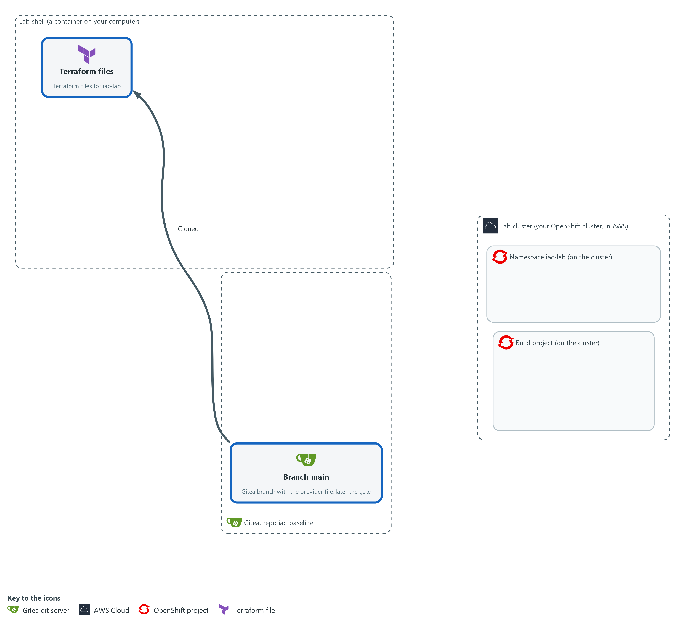

- You clone the repository from Gitea into your lab shell and write the first Terraform file, for the namespace and its resource quota. Nothing is sent to the cluster.

#### 1a. Clone the repository and load the provider

You will now make a working folder, clone the repository from Gitea, tell git who you are, read the provider file and load the provider.

- If you run the block again, the clone is skipped because the folder is already there.
- Starting the module again with lab start or lab reset deletes this folder and everything in it.

```bash
mkdir -p /workspace/iac-2 && cd /workspace/iac-2
test -d iac-baseline || git -c 'credential.helper=!f() { echo username=$GITEA_USER; echo password=$GITEA_TOKEN; }; f' clone "$GITEA_URL/$GITEA_USER/iac-baseline.git"
cd iac-baseline
git config credential.helper '!f() { echo username=$GITEA_USER; echo password=$GITEA_TOKEN; }; f'
git config user.name "$GITEA_USER"
git config user.email "$GITEA_USER@example.invalid"
cat providers.tf
terraform init -input=false
```

**Expected output:**

```
Example only. Your output will differ.
Cloning into 'iac-baseline'...
terraform {
  required_providers {
    kubernetes = {
      source  = "hashicorp/kubernetes"
      version = "3.4.0"
    }
  }
}
...
Terraform has been successfully initialized!
```

| Part | What it does | Why you run it |
| --- | --- | --- |
| mkdir -p ... && cd ... | Makes a folder for this module and moves into it. The folder stays until you start the module again. | Keeps the state file, the plans and the clone together, so the reset can remove them in one go. |
| test -d iac-baseline \|\| git -c '...' clone | Copies the repository from Gitea into the folder iac-baseline, unless the folder is already there. The -c part gives git a helper for this one command that prints your Gitea user name and token when git asks for them. | The baseline must end up in this repository, so you start from a working copy of it. The check makes a second run harmless. |
| git config credential.helper ... | Saves the same helper in this repository, so push works later. The file keeps the variable names and not the token value. | Lets git sign in to Gitea without you typing the token, so the token never lands in a file or on screen. |
| git config user.name / user.email | Tells git who you are, so each commit carries a name. The address is a placeholder that stays inside this repository. | Every commit records who made it, and git refuses to commit without a name. |
| cat providers.tf | Prints the supplied provider file. It asks for the Kubernetes provider, version 3.4.0, and points it at your kubeconfig. | You should know which plugin and which version Terraform will load and which cluster it will talk to. |
| terraform init -input=false | Loads the provider named in the files into a hidden folder. -input=false means never stop to ask a question. | Nothing else works until the provider is loaded. The lab holds a copy of the provider, so no internet is needed. |

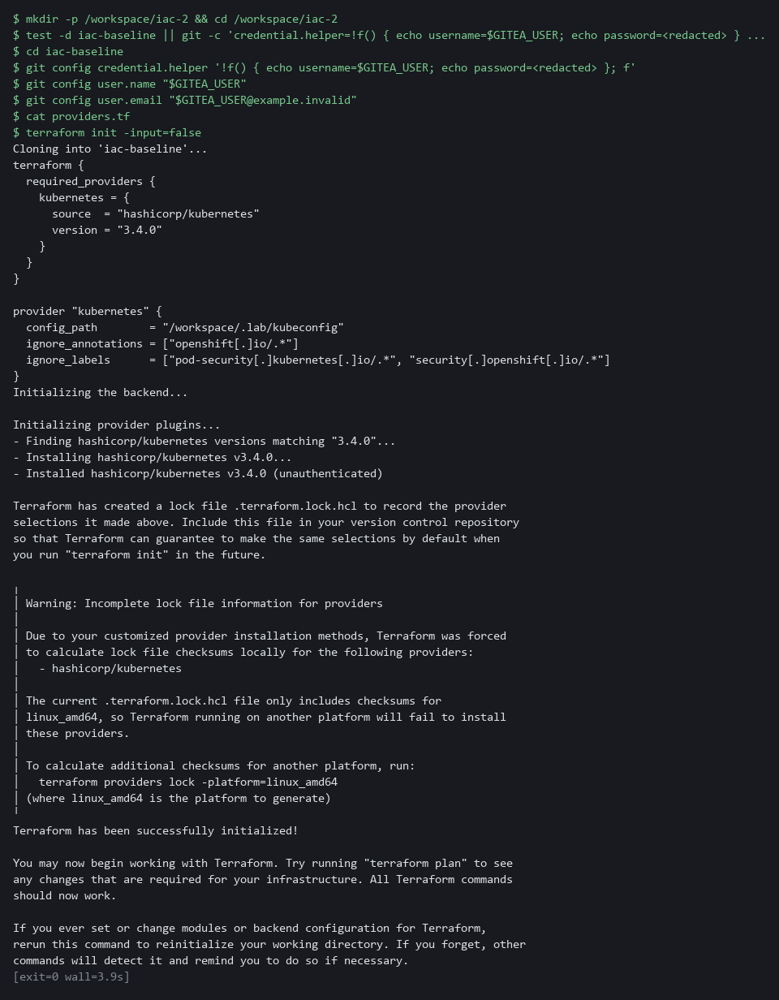

#### 1b. Save the namespace and quota file

You will now create the file namespace.tf in the folder iac-baseline with the namespace and its resource quota.

- Paste all of it into the lab shell at once.

```bash
cd /workspace/iac-2/iac-baseline
cat > namespace.tf <<'EOF'
resource "kubernetes_namespace_v1" "lab" {
  metadata {
    name = "iac-lab"
    labels = {
      baseline     = "v1"
      "managed-by" = "terraform"
    }
  }
}

resource "kubernetes_resource_quota_v1" "lab" {
  metadata {
    name      = "lab-quota"
    namespace = kubernetes_namespace_v1.lab.metadata[0].name
  }

  spec {
    hard = {
      pods              = "10"
      "requests.cpu"    = "2"
      "requests.memory" = "4Gi"
    }
  }
}
EOF
test -s namespace.tf && echo ok || echo EMPTY
```

**Expected output:**

```
Example only. A file that was written prints ok. The next block uses it.
```

| Part | What it does | Why you run it |
| --- | --- | --- |
| cd ... / cat > namespace.tf <<'EOF' ... EOF; test -s namespace.tf | Moves into the repository folder and writes everything up to the line EOF into the file namespace.tf. The quotes around EOF keep every character as typed. Running it again replaces the file with the same text. Then test -s prints ok, or EMPTY when the file has no content. | A heredoc makes a whole file with a paste, so you need no editor. |
| resource "kubernetes_namespace_v1" "lab" | Describes one namespace. The first name is the kind of object, the second is a name Terraform uses inside the files. | A resource block is the unit Terraform plans, so each object gets its own block. |
| name = "iac-lab" | The real name of the namespace on the cluster. | The gate, the drift check and the oc commands all refer to this name. |
| labels = { ... } | Two labels (short tags) on the namespace: baseline and managed-by. | A label tells anyone who runs oc get namespace that Terraform owns this object and which baseline version it follows. |
| kubernetes_resource_quota_v1 | Describes a resource quota, a cap on what the namespace may use. | A runaway workload cannot use the whole cluster. The gate in Step 3 requires a quota to be present. |
| namespace = kubernetes_namespace_v1.lab.metadata[0].name | Takes the namespace name from the namespace resource instead of typing it again. | Terraform sees the link and creates the namespace first. Typing the name twice would hide that order. |
| hard = { ... } | The limits: at most 10 pods, and totals for requested processor and memory. | The lab picks these values. They are small on purpose, and an organization sets its own. |

> **YOUR TURN:** Run the two blocks in order.

> **CHECKPOINT:** init prints Terraform has been successfully initialized, and the second block prints ok. If init fails, copy the whole command and the error and ask your AI assistant.

> **TAKEAWAY:** git records who made each change, and the repository is where the baseline starts.

**How this meets the control**

- **CM-2:** Cloning the repository and saving the namespace and quota as a Terraform file starts the baseline under configuration control. Nothing is in the cluster yet.

### Step 2. Add the default-deny policy, the role and the binding (CM-6 Configuration Settings)

**Learning point: Adding the network policy, the binding and the minimal role, and saving plan.json, produces the artifact the gate will check and the saved plan the apply will use.**

- The rest of the baseline is a network policy that blocks everything until a reviewed rule allows more (the idea behind SC-7 Boundary Protection), and a role that grants only reading of pods (the idea behind AC-6 Least Privilege).
- You paste the network policy and the binding, write the rule of the role yourself from its first lines and a short spec, save a plan for all five objects, check your rule in it, and turn the plan into plan.json, the file the gate will read.

What this step adds (thick lines and outlines are new):

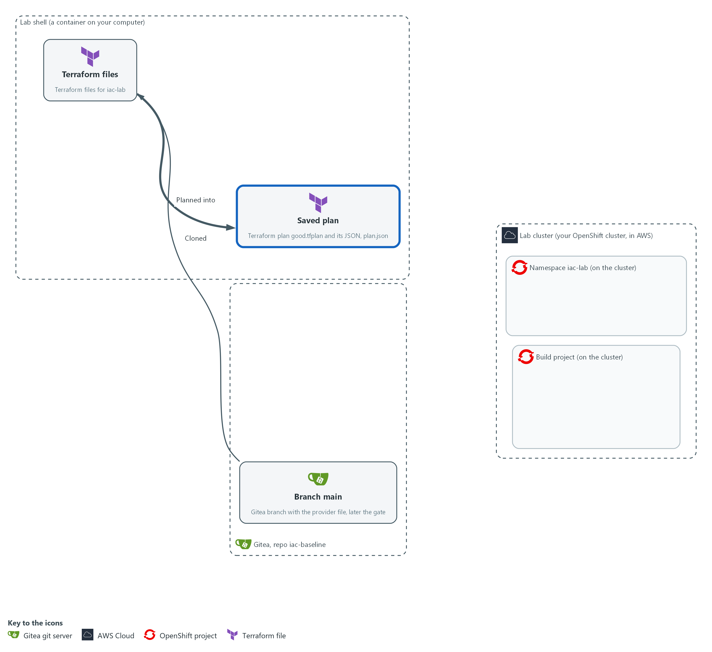

- You add the default-deny network policy and the binding, and you write the rule of the minimal role yourself. Terraform saves a plan for all five objects, you test your rule in it, and you turn it into a JSON file, plan.json.

#### 2a. Save the default-deny network policy

You will now create the file network.tf in the folder iac-baseline with the network policy.

- Paste all of it into the lab shell at once.

```bash
cd /workspace/iac-2/iac-baseline
cat > network.tf <<'EOF'
resource "kubernetes_network_policy_v1" "default_deny" {
  metadata {
    name      = "default-deny"
    namespace = kubernetes_namespace_v1.lab.metadata[0].name
  }

  spec {
    pod_selector {}
    policy_types = ["Ingress", "Egress"]
  }
}
EOF
test -s network.tf && echo ok || echo EMPTY
```

**Expected output:**

```
Example only. A file that was written prints ok. The third block of this step uses it.
```

| Part | What it does | Why you run it |
| --- | --- | --- |
| cd ... / cat > network.tf <<'EOF' ... EOF; test -s network.tf | Moves into the repository folder and writes everything up to the line EOF into the file network.tf. Then test -s prints ok, or EMPTY when the file has no content. | A heredoc makes a whole file with a paste, so you need no editor. |
| kubernetes_network_policy_v1 | Describes a NetworkPolicy, a rule about which traffic pods may send and receive. | This is the object that holds the network rule. |
| pod_selector {} | An empty selector, which matches every pod in the namespace. | Matching every pod makes the rule cover the whole namespace, including pods created later. |
| policy_types = ["Ingress", "Egress"] | Covers traffic arriving (ingress) and traffic leaving (egress). | Naming both directions blocks traffic on arrival and on departure. |
| no ingress or egress block | No traffic is allowed. A pod that is selected and has no allow rule is cut off. | An empty allow list is what makes the policy deny. Allowed flows are added later as separate reviewed rules. |

#### 2b. Save the binding and the start of the role

You will now create the file access.tf in the folder iac-baseline.

- The file access.tf holds the binding (finished) and the first lines of the role (unfinished: the rule is yours to write in the next block).
- Paste all of it into the lab shell at once.
- Terraform will not accept the file until you finish the role.

```bash
cd /workspace/iac-2/iac-baseline
cat > access.tf <<'EOF'
resource "kubernetes_role_binding_v1" "reader" {
  metadata {
    name      = "pod-reader"
    namespace = kubernetes_namespace_v1.lab.metadata[0].name
  }

  role_ref {
    api_group = "rbac.authorization.k8s.io"
    kind      = "Role"
    name      = kubernetes_role_v1.reader.metadata[0].name
  }

  subject {
    kind      = "ServiceAccount"
    name      = "default"
    namespace = kubernetes_namespace_v1.lab.metadata[0].name
  }
}

resource "kubernetes_role_v1" "reader" {
  metadata {
    name      = "pod-reader"
    namespace = kubernetes_namespace_v1.lab.metadata[0].name
  }

EOF
test -s access.tf && echo ok || echo EMPTY
```

**Expected output:**

```
Example only. A file that was written prints ok. The next block adds to it.
```

| Part | What it does | Why you run it |
| --- | --- | --- |
| cd ... / cat > access.tf <<'EOF' ... EOF; test -s access.tf | Moves into the repository folder and writes everything up to the line EOF into the file access.tf. Running it again starts the file over. Then test -s prints ok, or EMPTY when the file has no content. | A heredoc makes a whole file with a paste, so you need no editor. Starting over is how you retry the exercise. |
| kubernetes_role_binding_v1 | Describes the binding, the link that gives a role to an account. | A role grants nothing until a binding gives it to someone. |
| role_ref { ... } | The role being granted: the one below, named through its resource. | Ties the binding to this role and not to a broader one such as cluster-admin. |
| subject { ... } | The one account that receives the role: the default service account of the namespace. | Names exactly who gets the access, so no other account gains it. |
| kubernetes_role_v1 "reader" { metadata { ... } | Starts the role: its resource, its name pod-reader and its namespace. The resource is left open, with no rule and no closing brace. | This is the pattern you complete. The name pod-reader and the Terraform name reader are what the binding and the tests refer to. |

#### 2c. Your turn: write the rule of the role

You will now write the rule of the role yourself, the one part of the module you write.

- Do not paste this block as it stands: it has three blanks, written ___.
- Type the lines into the lab shell yourself, and put the right values between the square brackets.
- A value is a word in double quotes, and several values are separated by commas.
- The role must let the account read pods, which means get and list on pods, in this namespace.
- The role must refuse everything else: no other kind of object, no create, update or delete, and no star.
- Pods belong to the core group (the group of built-in kinds of object), which Terraform writes as two double quotes with nothing between them.
- The command adds your lines to the end of access.tf.
- If you make a mistake, run the previous block again to start the file over.
- Give it about ten minutes, and open the reference answer in the last block of this step only after you have tried.

```bash
cd /workspace/iac-2/iac-baseline
cat >> access.tf <<'EOF'
  rule {
    api_groups = [___]
    resources  = [___]
    verbs      = [___]
  }
}
EOF
```

**Expected output:**

```
Example only. Adding to a file prints nothing. The next block checks your work.
```

| Part | What it does | Why you run it |
| --- | --- | --- |
| cat >> access.tf <<'EOF' ... EOF | Adds the text up to the line EOF to the end of access.tf, after the role's first lines. >> adds to a file and > replaces it. | Your lines complete the role that the previous block started. |
| rule { ... } | One rule: a set of allowed actions on one set of objects. A role is a list of these. | One rule keeps the role easy to read and easy to check. |
| api_groups = [___] | Fill in the group the objects belong to. For pods that is the core group, written as two double quotes. | A rule names the group, the kind and the actions, so each of the three blanks matters. |
| resources = [___] | Fill in the kind of object: pods and nothing else. | Secrets or any other kind would give the account more than it needs. |
| verbs = [___] | Fill in the actions: get and list, and nothing else. Do not write a star. | A star would let the account do anything, and the gate in Step 3 refuses it. |
| } (the last line) | Closes the role resource that the previous block left open. | Without it Terraform cannot read the file. |

#### 2d. Check your rule and write plan.json

You will now check the files, save a plan for all five objects, write it out as plan.json and test your rule against the spec.

- Nothing is sent to the cluster.
- If validate or plan fails right after the paste, a file may be empty (a heredoc pasted twice): look for EMPTY above and write it again.
- If validate prints an error, read the line number it gives, start access.tf over with the first block of this step and the rule again, and run this block again.

```bash
cd /workspace/iac-2/iac-baseline
terraform fmt -check
terraform validate
terraform plan -out good.tfplan -input=false
terraform show -json good.tfplan > plan.json
jq -r '.resource_changes[] | "\(.change.actions[0]) \(.type) \(.name)"' plan.json
jq '.resource_changes[] | select(.type == "kubernetes_role_v1") | .change.after.rule | length == 1 and (.[0] | .api_groups == [""] and .resources == ["pods"] and (.verbs | sort) == ["get", "list"])' plan.json
```

**Expected output:**

```
Example only. Your output will differ.
Success! The configuration is valid.
...
Plan: 5 to add, 0 to change, 0 to destroy.
Saved the plan to: good.tfplan
create kubernetes_namespace_v1 lab
create kubernetes_network_policy_v1 default_deny
create kubernetes_resource_quota_v1 lab
create kubernetes_role_binding_v1 reader
create kubernetes_role_v1 reader
true
```

| Part | What it does | Why you run it |
| --- | --- | --- |
| cd /workspace/iac-2/iac-baseline | Moves into the repository folder. | Terraform reads the files in the folder you stand in. |
| terraform fmt -check | Checks that the file is laid out the standard way. It prints nothing when it is. | A fixed layout keeps later changes small and easy to read in a pull request. |
| terraform validate | Checks the files for mistakes in names and arguments, without contacting the cluster. | Catches a typo before a plan does, and tells you where it is. |
| terraform plan -out good.tfplan | Saves a plan for the whole folder, now five objects. | This file is the one you will apply in Step 4, after review. The name says it is the good one. |
| terraform show -json good.tfplan > plan.json | Writes the saved plan as JSON into the file plan.json. | The gate reads this file, and so does the gate task in the cluster, which has no Terraform. |
| jq -r ... plan.json | Lists the action, type and name of each change. | Five creates and nothing else is what a first plan of this baseline should show. |
| select(.type == "kubernetes_role_v1") \| .change.after.rule \| length == 1 and (...) | Picks the role from the plan and tests your rule against the spec: exactly one rule, the core group, pods only, and the verbs get and list (in any order). Prints true or false. | The plan shows what the cluster would get, so this tests your work as it would arrive. false means a blank is wrong: read the rule again against the spec. |

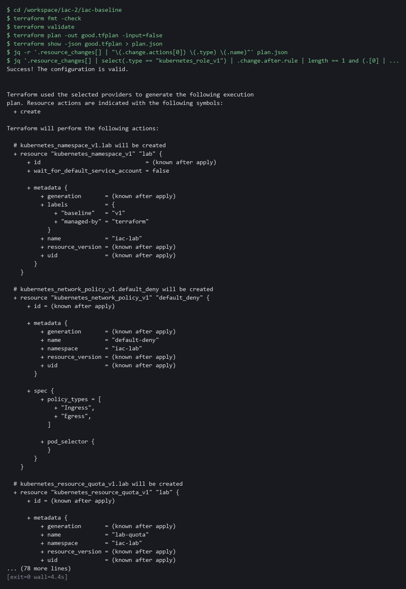

#### 2e. Only after you tried: compare with the reference answer

You will now compare your access.tf with the reference answer.

- Do not run this block until you have tried to write the rule yourself and the check printed true, or you are stuck after about ten minutes.
- The start state put a finished access.tf in /workspace/iac-2/answers, and the block compares that file with yours.
- Differences in spacing or in the order of get and list are fine.
- A line that differs in a value is not fine.

```bash
diff /workspace/iac-2/answers/access.answer.tf /workspace/iac-2/iac-baseline/access.tf && echo "your access.tf matches the reference"
```

**Expected output:**

```
Example only. If your file matches, only the message prints. If not, diff prints the differing lines: a line starting with < is the reference and a line starting with > is yours.
your access.tf matches the reference
```

| Part | What it does | Why you run it |
| --- | --- | --- |
| diff REFERENCE YOURS | Compares two files line by line and prints the lines that differ. It prints nothing and succeeds when they are the same. | Shows exactly which line of your rule differs from the known answer. |
| && echo ... | Prints the message only when diff found no differences. | No message means a difference: read the diff lines, fix your rule, and run the check block again. |

> **TIP:** Read the plan before you move on. The most useful habit in this module is to look at what a plan would do before anything else touches it.

> **YOUR TURN:** Run the first two blocks to make network.tf and the start of access.tf, write your rule with the third block, then run the fourth block to check it. Open the last block only after you have tried.

> **CHECKPOINT:** The plan shows 5 to add, the list shows five creates, and the last line prints true: your rule allows get and list on pods and nothing else.

> **TAKEAWAY:** The jq check on the role proves the plan would apply get and list on pods and nothing else.

**How this meets the control**

- **CM-6:** The network policy, the binding and your own role rule put the settings in files, with only get and list on pods. The plan of five objects shows those settings before anything is applied.

### Step 3. Save the plan gate and run it on the good plan (CM-3 Configuration Change Control)

**Learning point: Saving a gate that reads plan.json and fails on wildcards, cluster-admin bindings and missing security objects, and running it on the good plan and on an empty input, proves it passes what it should and fails what it should.**

- Put the gate in place before anything is reviewed, so the review has a rule to apply.
- The script reads plan.json from standard input (the stream a program reads its data from) and prints one FAIL line for each broken rule.
- The script uses only what Python already has, so it runs in your lab shell and later in the cluster.

What this step adds (thick lines and outlines are new):

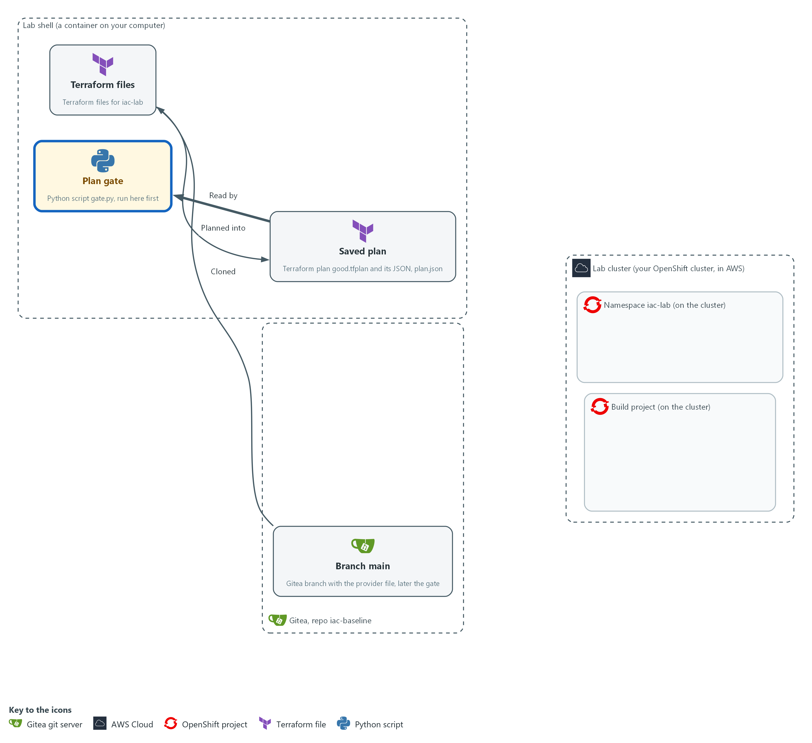

- You save the plan gate, a Python script that reads plan.json and fails on a wildcard, a cluster-admin binding, a missing network policy or quota, or an empty input. You run it on your own machine first.

#### 3a. Save the plan gate as gate.py

You will now create the file gate.py, a short Python script, in the folder iac-baseline.

- Paste all of it into the lab shell at once.

```bash
cd /workspace/iac-2/iac-baseline
cat > gate.py <<'EOF'
import json, sys

def first(value):
    return (value or [{}])[0]

def is_deny(after):
    spec = first(after.get("spec"))
    sel = first(spec.get("pod_selector"))
    return (not sel.get("match_labels") and not sel.get("match_expressions")
            and set(spec.get("policy_types") or []) == {"Ingress", "Egress"}
            and not spec.get("ingress") and not spec.get("egress"))

def problems(resources):
    live = [r for r in resources if "delete" not in r["change"]["actions"]]
    def of(*kinds):
        return [r["change"]["after"] or {} for r in live if r["type"] in kinds]
    for a in of("kubernetes_role_v1", "kubernetes_cluster_role_v1"):
        for rule in a.get("rule") or []:
            for field in ("verbs", "resources", "api_groups"):
                if "*" in (rule.get(field) or []):
                    yield "wildcard in %s of %s" % (field, first(a["metadata"])["name"])
    for a in of("kubernetes_role_binding_v1", "kubernetes_cluster_role_binding_v1"):
        if first(a.get("role_ref")).get("name") == "cluster-admin":
            yield "cluster-admin bound by " + first(a["metadata"])["name"]
    if not any(is_deny(a) for a in of("kubernetes_network_policy_v1")):
        yield "no default-deny network policy"
    if not any(first(a.get("spec")).get("hard") for a in of("kubernetes_resource_quota_v1")):
        yield "no resource quota"
try:
    plan = json.load(sys.stdin)
except ValueError:
    plan = {}
resources = plan.get("resource_changes") or []
found = list(problems(resources)) if resources else ["empty plan input"]
for line in found:
    print("FAIL", line)
print("gate:", "FAIL" if found else "PASS")
sys.exit(1 if found else 0)
EOF
test -s gate.py && echo ok || echo EMPTY
```

**Expected output:**

```
Example only. A file that was written prints ok. The next block runs it.
```

| Part | What it does | Why you run it |
| --- | --- | --- |
| cd ... / cat > gate.py <<'EOF' ... EOF; test -s gate.py | Moves into the repository folder and writes everything up to the line EOF into the file gate.py. Then test -s prints ok, or EMPTY when the file has no content. | A heredoc makes a whole file with a paste, so you need no editor. |
| def first(value) | Returns the first item of a list, or an empty object when the list is empty or missing. | Terraform writes every block as a list of one object in its JSON, so each rule needs this helper to reach the values. |
| def is_deny(after) | Says whether a network policy selects every pod, covers both directions and allows nothing. | A policy with a selector or an allow rule is not default-deny, so the gate must look at all four facts. |
| live = [... "delete" not in ...] | Keeps every resource that will exist after the plan, including ones the plan leaves unchanged. | A plan that touches only a role must still show the policy and quota that stay in place, so unchanged resources count. |
| "*" in (rule.get(field) or []) | A star in the verbs, resources or api_groups of a role rule. | A star would let the account do anything, which is the opposite of a minimal role. |
| get("name") == "cluster-admin" | Refuses a binding that hands out cluster-admin. | That role would hand over every permission at once, so the gate refuses it by name. |
| yield "no default-deny network policy" | Reports when no policy in the plan is a default-deny. | A missing rule is as dangerous as a wrong one, so the gate also checks that required objects exist. |
| yield "no resource quota" | Reports when no quota with limits is in the plan. | Without a quota the namespace has no cap, so the baseline is incomplete. |
| json.load(sys.stdin) | Reads the whole plan from standard input as JSON. | Reading from standard input lets the same script run on a file here and on a downloaded file in the cluster. |
| except ValueError: plan = {} | Treats input that is not JSON, including no input at all, as an empty plan. | A broken pipe or an empty file must end in a failure, not a crash that someone might read as a pass. |
| ... if resources else ["empty plan input"] | Fails when the plan lists no resources. | A gate that passes on nothing would hide a broken step, so an empty input is a failure. |
| print("FAIL", line) | Prints one line for each broken rule. | The person who reads the pipeline log sees the reason in plain words. |
| sys.exit(1 if found else 0) | Exits with 1 when anything failed and 0 when nothing did. | A pipeline and a protected branch can only act on a failure if the script says so with its exit code. |

#### 3b. Run the gate on the good plan and on an empty input

You will now run your gate on the plan you saved, and then on an input that holds nothing useful.

```bash
cd /workspace/iac-2/iac-baseline
python3 gate.py < plan.json; echo "exit code: $?"
echo '{}' | python3 gate.py; echo "exit code: $?"
```

**Expected output:**

```
Example only.
gate: PASS
exit code: 0
FAIL empty plan input
gate: FAIL
exit code: 1
```

| Part | What it does | Why you run it |
| --- | --- | --- |
| cd /workspace/iac-2/iac-baseline | Moves into the repository folder. | The gate and the plan are files in this folder. |
| python3 gate.py < plan.json | Runs the gate with the plan as its input. | This is the same call the gate task makes in the cluster. |
| echo "exit code: $?" | Prints the exit code of the last command. $? is the exit code of the last command. | Shows the result the way a pipeline would see it, as a number. |
| echo '{}' \| python3 gate.py | Feeds the gate a JSON object with no plan inside. | You must see a gate fail on a bad input before you trust it to pass a good one. |

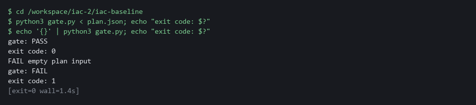

> **YOUR TURN:** Run the first block to make gate.py, then run the second block.

> **CHECKPOINT:** The good plan prints gate: PASS with exit code 0, and the empty input prints FAIL empty plan input with exit code 1. If the good plan fails, read the FAIL lines: they name the rule.

> **TAKEAWAY:** A gate that has never failed proves nothing; run it on a bad input before you trust it.

**How this meets the control**

- **CM-3:** The gate reads the plan as data and fails on the rules you chose. Its pass or fail and exit code let a pipeline act on the result.

### Step 4. Deliver the change through review, then apply the saved plan (CM-3 Configuration Change Control, CM-2 Baseline Configuration)

**Learning point: Protecting main, running the gate task in the cluster and merging on a pass shows that the gate is a requirement and not advice, even for an administrator.**

- The gate only matters if skipping it is impossible, so you first put the gate on main and tell Gitea that main accepts a change only through a pull request with a passing status, even for an administrator.
- You then push the branch, start the gate task in the cluster, merge on a pass, check that the plan you will apply is the one that was reviewed, and apply it.

What this step adds (thick lines and outlines are new):

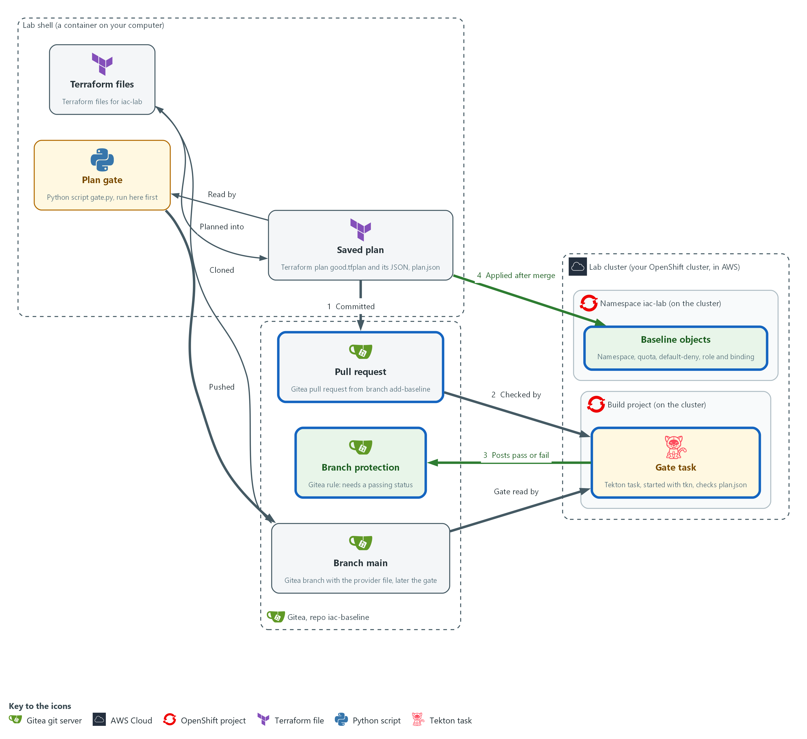

- You push the gate to main and protect main, then push a branch with the Terraform files and plan.json. A gate task in the build project fetches plan.json and the gate and posts a pass or fail on the commit. Gitea merges only on a pass, and then you apply the same saved plan to the cluster.

#### 4a. Put the gate on main and protect main

You will now push your gate to main, then ask the Gitea API to protect main so a change merges only with a passing gate status.

- You can run this block again; an old protection rule is removed and made again.

```bash
cd /workspace/iac-2/iac-baseline
git add gate.py
git commit -m "Add the plan gate" || true
git push origin main
curl -s -o /dev/null -X DELETE -H "Authorization: token $GITEA_TOKEN" -H "Content-Type: application/json" "$GITEA_URL/api/v1/repos/$GITEA_USER/iac-baseline/branch_protections/main"
curl -s -X POST -H "Authorization: token $GITEA_TOKEN" -H "Content-Type: application/json" "$GITEA_URL/api/v1/repos/$GITEA_USER/iac-baseline/branch_protections" -d '{"rule_name":"main","enable_push":false,"enable_status_check":true,"status_check_contexts":["iac-plan-gate"],"block_admin_merge_override":true}' | jq '{rule_name, enable_push, enable_status_check, status_check_contexts}'
```

**Expected output:**

```
Example only. Your commit details will differ.
(git prints the commit and the push result)
{
  "rule_name": "main",
  "enable_push": false,
  "enable_status_check": true,
  "status_check_contexts": [
    "iac-plan-gate"
  ]
}
```

| Part | What it does | Why you run it |
| --- | --- | --- |
| cd /workspace/iac-2/iac-baseline | Moves into the repository folder. | git and the files are in this folder. |
| git add gate.py / git commit / git push origin main | Records the gate and sends it to main on Gitea. Nothing else is added. On a second run there is nothing new to record, and \|\| true lets the block go on. | The gate task reads the gate from main, so it must be there first. It goes in before the protection exists, because after that nobody can push to main directly. |
| curl -X DELETE .../branch_protections/main | Removes an older protection rule on main, if there is one. The output is thrown away. | Making a rule that already exists fails, so a second run starts clean. |
| curl -X POST .../branch_protections | Creates the protection rule through the Gitea API (the web interface for programs). | This turns the gate from advice into a requirement. |
| enable_push false | Nobody can push straight to main. | Without this a change could skip the pull request and the gate. |
| status_check_contexts | The name of the status the gate task posts: iac-plan-gate. | It must match the posted name, or Gitea would wait for a status that never arrives. |
| block_admin_merge_override | Administrators follow the same rule. | Your own token belongs to an administrator, so without this you could merge past a failing gate and the tests would prove nothing. |

#### 4b. Push a branch and open a pull request

You will now put your files and plan.json on a branch, send it to Gitea and open a pull request.

```bash
cd /workspace/iac-2/iac-baseline
git checkout -B add-baseline
git add namespace.tf network.tf access.tf plan.json
git commit -m "Add the iac-lab baseline and its reviewed plan" || true
git push -f origin add-baseline
curl -s -o /dev/null -X POST -H "Authorization: token $GITEA_TOKEN" -H "Content-Type: application/json" "$GITEA_URL/api/v1/repos/$GITEA_USER/iac-baseline/pulls" -d '{"head":"add-baseline","base":"main","title":"Add the iac-lab baseline"}'
curl -s -H "Authorization: token $GITEA_TOKEN" "$GITEA_URL/api/v1/repos/$GITEA_USER/iac-baseline/pulls?state=open" | jq -r '.[] | "pull request \(.number): \(.title)"'
```

**Expected output:**

```
Example only. Your branch details will differ.
(git prints the new branch and the push result)
pull request 1: Add the iac-lab baseline
```

| Part | What it does | Why you run it |
| --- | --- | --- |
| cd /workspace/iac-2/iac-baseline | Moves into the repository folder. | git and the files are in this folder. |
| git checkout -B add-baseline | Makes a branch for your change, or resets it if it exists. A branch is a line of work in git. | The change must travel as a pull request, so it needs a branch of its own and cannot go onto main. |
| git add namespace.tf network.tf access.tf plan.json | Records the three Terraform files and the plan.json. State and plan files stay out because of .gitignore. | plan.json is the artifact the gate checks, so it must travel with the files it describes. |
| git push -f origin add-baseline | Sends the branch to Gitea. -f lets a second run replace the branch. | The gate task reads plan.json from this commit on Gitea. |
| curl -X POST .../pulls | Opens a pull request, a proposed change that others review. The output is thrown away. | Gitea merges only through a pull request, so you open one. |
| curl .../pulls?state=open \| jq ... | Lists the open pull requests with their numbers. | Shows that the pull request exists. The next block looks its number up again. |

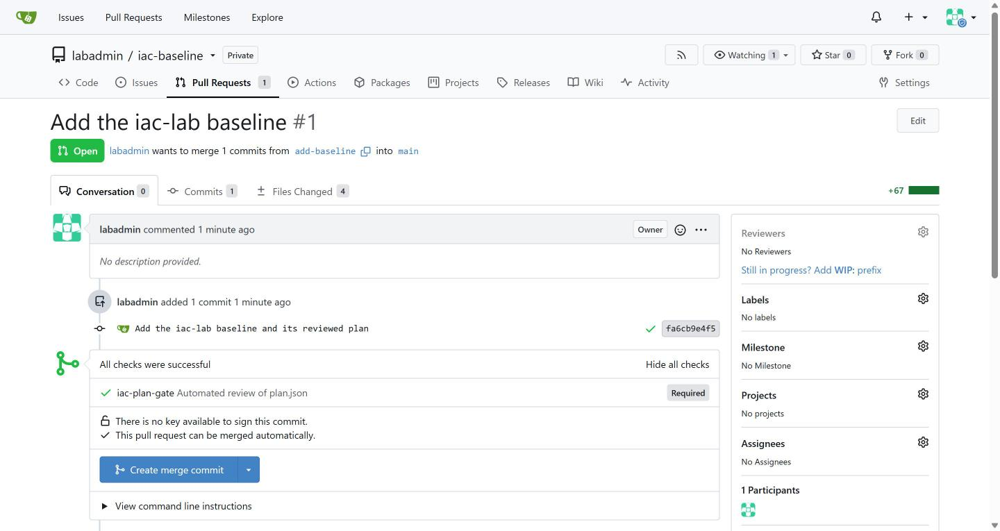

#### 4c. Run the gate task and merge on a pass

You will now start the gate task in the cluster, read the status it posts, and try to merge.

- The cluster pulls the Python image from registry.access.redhat.com, so the cluster needs internet access.

```bash
cd /workspace/iac-2/iac-baseline
git checkout add-baseline
SHA=$(git rev-parse HEAD)
PR=$(curl -s -H "Authorization: token $GITEA_TOKEN" "$GITEA_URL/api/v1/repos/$GITEA_USER/iac-baseline/pulls?state=open" | jq -r 'map(select(.head.ref == "add-baseline"))[0].number')
tkn pipeline start iac-plan-gate -n build -p sha="$SHA" -p tools-image=registry.access.redhat.com/ubi9/python-312:1-1762230134 -s pipeline --showlog || true
curl -s -H "Authorization: token $GITEA_TOKEN" "$GITEA_URL/api/v1/repos/$GITEA_USER/iac-baseline/commits/$SHA/status" | jq -r '.statuses[] | "\(.context) \(.status)"'
curl -s -o /dev/null -w "%{http_code}\n" -X POST -H "Authorization: token $GITEA_TOKEN" -H "Content-Type: application/json" "$GITEA_URL/api/v1/repos/$GITEA_USER/iac-baseline/pulls/$PR/merge" -d '{"do":"merge"}'
```

**Expected output:**

```
Example only. Your run name and the merge code will differ.
...
[check : check] gate: PASS
...
iac-plan-gate success
200
```

| Part | What it does | Why you run it |
| --- | --- | --- |
| cd ... / git checkout add-baseline | Moves into the repository folder and onto the branch you pushed. | The commit you check must be the one on your branch. |
| SHA=$(git rev-parse HEAD) | Keeps the identifier of your commit, which the gate's status is attached to. | The result is stored against this commit, so you need its identifier to look it up. |
| PR=$(curl ... \| jq ...) | Looks up the number of the open pull request from the branch add-baseline. | Gitea merges by pull request number. Looking it up here means this block works on its own. |
| tkn pipeline start iac-plan-gate -n build | Starts the gate pipeline in the build project. The task fetches gate.py from main and plan.json from your commit and runs the gate. | You start the gate by hand, so you see its log and no webhook is needed. |
| -p sha="$SHA" -p tools-image=... | Tells the pipeline which commit to check and which image to run in. The image is a public Red Hat Python image with a fixed version, and it also holds curl. | The task must read your commit, not whatever is newest. |
| -s pipeline --showlog | Runs as the service account pipeline and prints the log until the run ends. | Waiting here means the status exists when you ask for it. |
| ... \|\| true | Lets the command line go on even if the run failed. | A failed gate is a result to read, not a reason to stop the block. |
| commits/$SHA/status | Asks Gitea for the statuses on your commit. | This is the verdict that branch protection acts on. |
| pulls/$PR/merge | Tries to merge. Gitea allows it only if the required status passed. | Trying the merge is the real test, because it shows Gitea accepting a change that passed. |

#### 4d. Check that the saved plan is the reviewed plan, then apply it

You will now bring the merged main into your folder, prove that the plan you will apply is the plan that was reviewed, and apply it.

```bash
cd /workspace/iac-2/iac-baseline
git checkout main
git pull origin main
terraform show -json good.tfplan | diff - plan.json && echo "saved plan matches the reviewed plan"
terraform apply good.tfplan || echo "apply stopped: if it says the saved plan is stale, it was already applied"
oc get namespace iac-lab -L baseline
```

**Expected output:**

```
Example only. Your times and output will differ.
(git prints the update)
saved plan matches the reviewed plan
kubernetes_namespace_v1.lab: Creating...
...
Apply complete! Resources: 5 added, 0 changed, 0 destroyed.
NAME      STATUS   AGE   BASELINE
iac-lab   Active   5s    v1
```

| Part | What it does | Why you run it |
| --- | --- | --- |
| cd /workspace/iac-2/iac-baseline | Moves into the repository folder. | The saved plan and the files are in this folder. |
| git checkout main / git pull origin main | Moves to main and fetches what Gitea merged. | From here on you work from the approved files, not from your branch. |
| terraform show -json good.tfplan \| diff - plan.json | Prints the saved plan as JSON and compares it with the plan.json that was committed and checked. diff prints nothing and succeeds only when they are identical. | The gate checked plan.json, so you must be sure that good.tfplan is the very plan behind it. Without this check the gate would judge a file that the apply never uses. |
| && echo ... | Prints the message only when the comparison succeeded. | No message means the plans differ: stop, and plan again. |
| terraform apply good.tfplan \|\| echo ... | Makes exactly the changes in the saved plan. It asks no question, because a saved plan is already approved. If you run it a second time, Terraform refuses the plan as stale, which only means it was applied already. | Applying the saved plan, and not a fresh plan, is what keeps the apply to what was reviewed. |
| oc get namespace iac-lab -L baseline | Asks the cluster for the namespace and shows the baseline label as a column. | Proves the object exists on the cluster, not only in Terraform's state. |

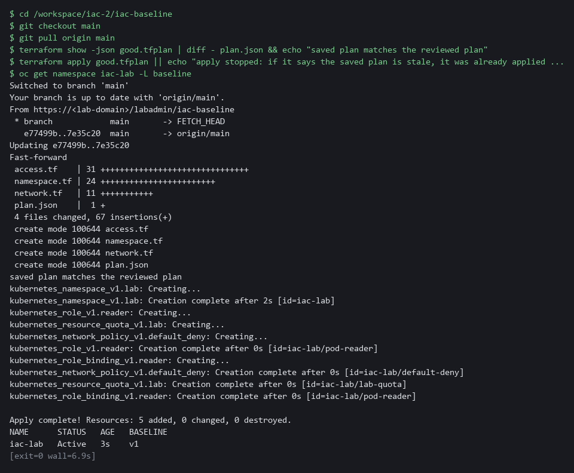

> **SECURITY:** Never apply a plan that you did not check against plan.json. If the saved plan and the committed plan differ, the gate approved something other than what you are about to apply.

> **YOUR TURN:** Run the four blocks in order.

> **CHECKPOINT:** The status iac-plan-gate is success, the merge returns 200, the comparison prints the match message, and the apply creates 5 resources.

> **TAKEAWAY:** Apply the saved plan, not a fresh plan, so the apply does exactly what the gate approved.

**How this meets the controls**

- **CM-3:** Protecting main, pushing plan.json on a branch, running the gate task and merging only on a pass means only the approved change is applied. The result is a merged change, a status on the commit and a baseline in the cluster.
- **CM-2:** The files reach main only through a pull request, and the apply uses the plan that was reviewed. The cluster then matches the files on main.

### Step 5. Write the drift check and run it (CM-6 Configuration Settings)

**Learning point: Writing a drift check that exits 0, 2 or 1 based on terraform plan -detailed-exitcode gives a person or a schedule a machine-readable answer about whether the cluster still matches the files.**

- The baseline has to stay true after the apply, and terraform plan with -detailed-exitcode compares the files with the live objects and gives the answer as its exit code.
- The script drift-check.sh wraps that command, prints a short line, and passes the exit code on, so a schedule can use it as easily as you can.

What this step adds (thick lines and outlines are new):

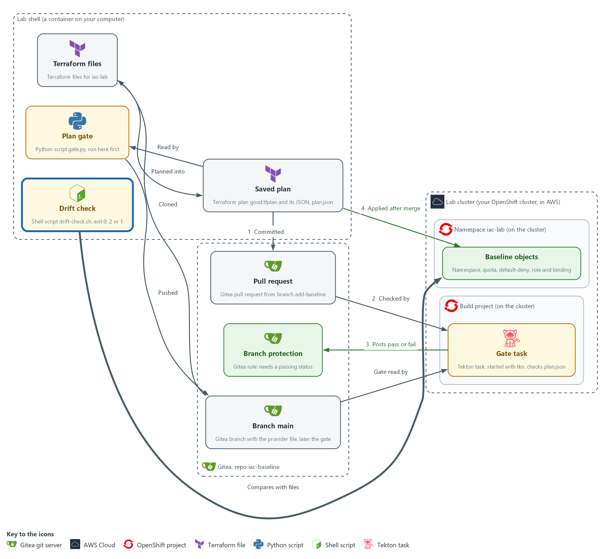

- A drift check script in your lab shell asks Terraform whether the cluster still matches the files.

#### 5a. Save the drift check script

You will now create the file drift-check.sh, a short shell script, in the folder iac-baseline.

- Paste all of it into the lab shell at once.
- drift-check.sh is for you and is not committed.

```bash
cd /workspace/iac-2/iac-baseline
cat > drift-check.sh <<'EOF'
#!/bin/sh
terraform plan -detailed-exitcode -input=false -lock=false -no-color > drift.txt
code=$?
if test "$code" = 0; then echo "drift: none"; fi
if test "$code" = 2; then echo "drift: FOUND"; grep '^  # ' drift.txt; fi
if test "$code" = 1; then echo "drift: check failed, read drift.txt"; fi
exit $code
EOF
test -s drift-check.sh && echo ok || echo EMPTY
```

**Expected output:**

```
Example only. A file that was written prints ok. The next block uses it.
```

| Part | What it does | Why you run it |
| --- | --- | --- |
| cd ... / cat > drift-check.sh <<'EOF' ... EOF; test -s drift-check.sh | Moves into the repository folder and writes everything up to the line EOF into the file drift-check.sh. The quotes around EOF keep the dollar signs as typed. Then test -s prints ok, or EMPTY when the file has no content. | A heredoc makes a whole file with a paste, so you need no editor. |
| terraform plan -detailed-exitcode ... | Makes a plan that is never saved and ends with exit code 0, 1 or 2 as the table in section 2.3 says. | The exit code is the answer, so the script needs nothing else from Terraform. |
| -lock=false | Does not lock the state while it reads. | A check that only reads should never block a real change. |
| > drift.txt / code=$? | Keeps the plan text in a file and the exit code in a variable. | You can read the details afterwards, and the exit code survives the next commands. |
| if test "$code" = 2; then ... | On 2 prints drift: FOUND and the lines of the plan that name each changed object. | A person sees which object differs without reading the whole plan. |
| if test "$code" = 1 | On 1 says the check itself failed. | An error must never look like no drift. |
| exit $code | Ends with the same exit code that Terraform gave. | A schedule or a person can act on the number without parsing text. |

> **TIP:** If the first run, in Test 1, says drift: FOUND and you changed nothing, read drift.txt. The cluster may add labels or annotations of its own to a new namespace, and the ignore lists in providers.tf may not cover them. Copy the whole attribute name and the plan text from drift.txt and ask your AI assistant.

> **YOUR TURN:** Run the block to save the script. Test 1 runs it.

> **CHECKPOINT:** The block prints ok, so drift-check.sh is saved. Test 1 runs it for the first time.

> **TAKEAWAY:** Exit 0 means the cluster matches the files; exit 2 means drift was found and needs a decision.

**How this meets the control**

- **CM-6:** The script asks Terraform whether the cluster still matches the files and answers with an exit code. A person or a schedule can act on that code.

## Section 4. Verify It Works

### Test 1 (positive). The baseline is applied and matches the files (CM-2 Baseline Configuration, CM-6 Configuration Settings)

An apply that printed success is only a claim, so you ask the cluster what it holds and what the account can do, then ask Terraform whether anything differs.

```bash
cd /workspace/iac-2/iac-baseline
oc get resourcequota,networkpolicy,role,rolebinding -n iac-lab
SA=system:serviceaccount:iac-lab:default
oc auth can-i get pods -n iac-lab --as=$SA
oc auth can-i delete pods -n iac-lab --as=$SA
bash drift-check.sh; echo "exit code: $?"
```

**Expected output:**

```
Example only. Names and ages will differ. OpenShift and OpenShift Pipelines add five role bindings of their own, so your list has more bindings than the one in the files.
NAME                       AGE   REQUEST ...
resourcequota/lab-quota    4m    pods: 0/10, requests.cpu: 0/2, ...
NAME                                   POD-SELECTOR   AGE
networkpolicy.../default-deny          <none>         4m
role.../pod-reader                     4m
rolebinding.../pod-reader              4m
rolebinding.../openshift-pipelines-edit    4m
rolebinding.../pipelines-scc-rolebinding   4m
rolebinding.../system:deployers        4m
rolebinding.../system:image-builders   4m
rolebinding.../system:image-pullers    4m
yes
no
drift: none
exit code: 0
```

| Part | What it does | Why you run it |
| --- | --- | --- |
| cd /workspace/iac-2/iac-baseline | Moves into the repository folder. | The drift check script and the Terraform files are in this folder. |
| oc get resourcequota,networkpolicy,role,rolebinding -n iac-lab | Lists the quota, the network policy, the role and the bindings in the namespace, including five that the platform adds. | Shows that the objects exist on the cluster and not only in Terraform's state. |
| SA=system:serviceaccount:iac-lab:default | Names the account that the binding gives the role to. | The next two commands test what this account may do. |
| oc auth can-i get pods ... --as=$SA | Asks the cluster whether that account may read pods. yes is expected. | Proves the role grants what it should. |
| oc auth can-i delete pods ... --as=$SA | Asks whether the account may delete pods. no is expected. | Proves the role grants nothing more. |
| bash drift-check.sh; echo "exit code: $?" | Runs the drift check and prints its exit code. 0 means the cluster matches the files. | Closes the loop: the files, the cluster and the check agree. |

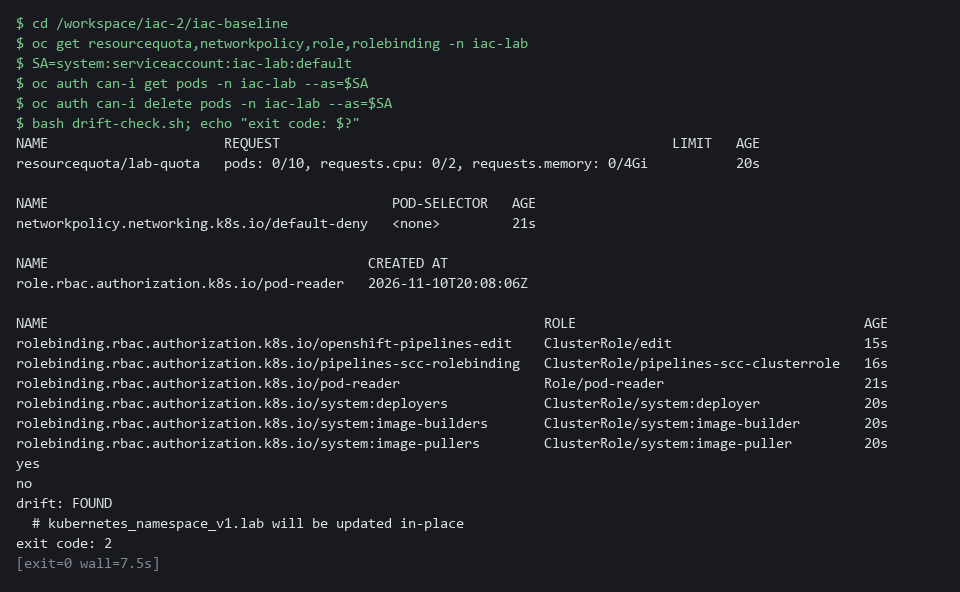

> **CHECKPOINT:** The quota, the policy, the role and the bindings are listed, reading pods is yes, deleting pods is no, and the drift check exits 0.

**How this meets the controls**

- **CM-2:** Reading the five objects from the cluster and running the drift check shows the cluster holds the baseline in the files. The evidence is the object list and an exit code of 0.
- **CM-6:** Asking what the default service account may do and running the drift check shows the settings are in force and unchanged. The evidence is one yes, one no and an exit code of 0.

### Test 2 (negative). A wildcard role is blocked and nothing is applied (CM-3 Configuration Change Control)

- A gate that has never failed is untested.
- Change the role to allow every verb, plan it, and send it through the same pull request and gate as Step 4.
- The gate must fail on your machine, fail in the cluster, and Gitea must refuse the merge.
- The role in the cluster must not change, because nothing is applied.

```bash
cd /workspace/iac-2/iac-baseline
git checkout -f main
git checkout -B wildcard-role
sed -i -E 's/^( *verbs *= *).*/\1["*"]/' access.tf
terraform plan -out bad.tfplan -input=false > /dev/null
terraform show -json bad.tfplan > plan.json
python3 gate.py < plan.json; echo "exit code: $?"
git add access.tf plan.json
git commit -m "Test: wildcard verbs"
git push -f origin wildcard-role
SHA=$(git rev-parse HEAD)
curl -s -o /dev/null -X POST -H "Authorization: token $GITEA_TOKEN" -H "Content-Type: application/json" "$GITEA_URL/api/v1/repos/$GITEA_USER/iac-baseline/pulls" -d '{"head":"wildcard-role","base":"main","title":"Test: wildcard verbs"}'
PR=$(curl -s -H "Authorization: token $GITEA_TOKEN" "$GITEA_URL/api/v1/repos/$GITEA_USER/iac-baseline/pulls?state=open" | jq -r 'map(select(.head.ref == "wildcard-role"))[0].number')
tkn pipeline start iac-plan-gate -n build -p sha="$SHA" -p tools-image=registry.access.redhat.com/ubi9/python-312:1-1762230134 -s pipeline --showlog || true
curl -s -H "Authorization: token $GITEA_TOKEN" "$GITEA_URL/api/v1/repos/$GITEA_USER/iac-baseline/commits/$SHA/status" | jq -r '.statuses[] | "\(.context) \(.status)"'
curl -s -o /dev/null -w "%{http_code}\n" -X POST -H "Authorization: token $GITEA_TOKEN" -H "Content-Type: application/json" "$GITEA_URL/api/v1/repos/$GITEA_USER/iac-baseline/pulls/$PR/merge" -d '{"do":"merge"}'
curl -s -X PATCH -H "Authorization: token $GITEA_TOKEN" -H "Content-Type: application/json" "$GITEA_URL/api/v1/repos/$GITEA_USER/iac-baseline/pulls/$PR" -d '{"state":"closed"}' | jq -r '.state'
oc get role pod-reader -n iac-lab -o jsonpath='{.rules[0].verbs}'; echo
git checkout -f main
rm -f bad.tfplan
```

**Expected output:**

```
Example only. The refusal code depends on your Gitea release. Tekton also prints that the task check has failed and that it could not get the logs; both are expected when the gate fails.
FAIL wildcard in verbs of pod-reader
gate: FAIL
exit code: 1
...
[check : check] FAIL wildcard in verbs of pod-reader
[check : check] gate: FAIL
task check has failed ... failed to get logs for task check
iac-plan-gate failure
405
closed
["get","list"]
```

| Part | What it does | Why you run it |
| --- | --- | --- |
| git checkout -f main / git checkout -B wildcard-role | Goes back to main, then makes the branch wildcard-role from it, or resets it if it exists. | The test starts from the approved files every time. |
| sed -i ... access.tf | Replaces the verbs line of the role in access.tf with a star, whatever spelling you used for get and list. | This is the bad change: a role that allows every action. |
| terraform plan -out bad.tfplan / terraform show -json ... > plan.json | Plans the bad change and writes it as plan.json. | The gate reads this plan.json, so it must describe the bad change. |
| python3 gate.py < plan.json; echo ... | Runs the gate on your machine. FAIL and exit code 1 are expected. | The gate has to fail on the bad plan before you trust it in the cluster. |
| git push -f origin wildcard-role | Sends the bad branch to Gitea. -f lets a second run replace it. | The cluster gate reads the plan from the commit on Gitea. |
| curl -X POST .../pulls / PR=$(curl ... \| jq ...) | Opens a pull request for the bad branch and looks up its number. | The merge is attempted by pull request number. |
| tkn pipeline start iac-plan-gate ... | Runs the gate task in the cluster on the bad commit. | The same gate, run where you cannot skip it. |
| curl .../commits/$SHA/status | Prints the status the task posted: failure is expected. | This is the verdict branch protection acts on. |
| curl -X POST .../pulls/$PR/merge | Tries to merge and prints only the HTTP code. A 4xx code, not 200, is expected. | Proves Gitea refuses the change even though your token belongs to an administrator. |
| curl -X PATCH ... closed | Closes the test pull request. | Leaves no open request behind. |
| oc get role pod-reader ... jsonpath | Prints the verbs of the role in the cluster. Only get and list are expected. | Proves nothing reached the cluster. |

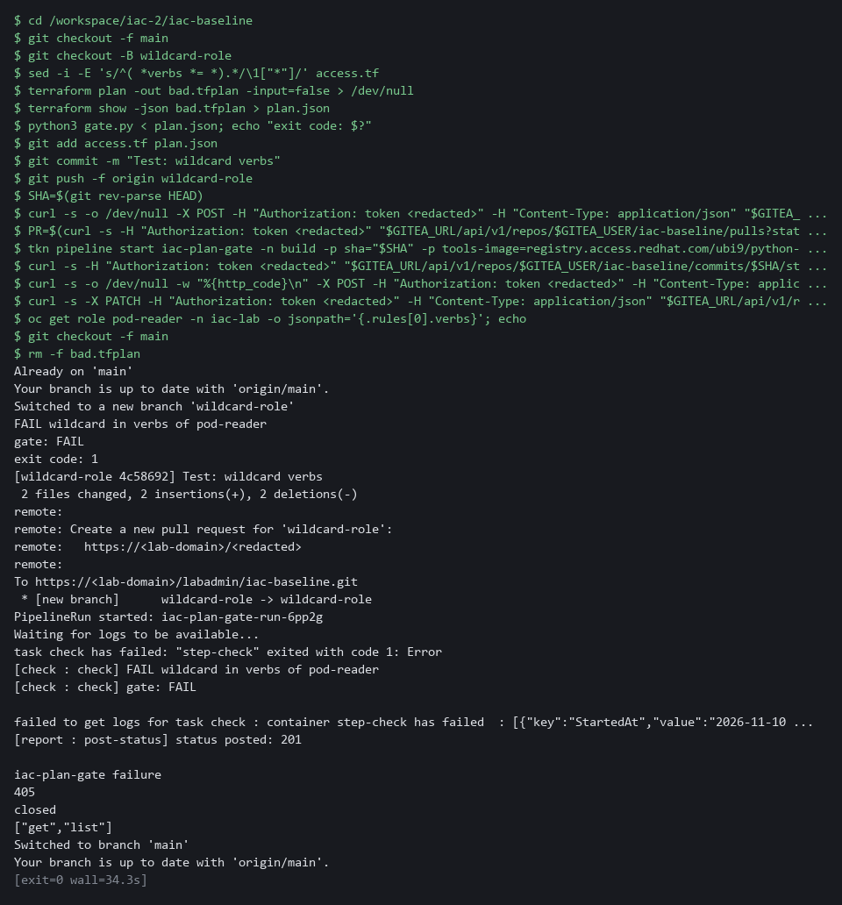

> **CHECKPOINT:** The gate fails on your machine and in the cluster, the merge is refused with a 4xx code and not 200, and the role in the cluster still shows only get and list. If the merge is allowed, the branch protection from Step 4 is not in place: fix that before you trust the gate.

**How this meets the control**

- **CM-3:** Pushing a role that grants every verb and trying to merge it shows a disapproved change is not implemented. The result is a failed gate, a refused merge and an unchanged role.

### Test 3 (negative). A hand edit is caught by the drift check (CM-6 Configuration Settings)

- Changing a setting on the cluster without touching the files is what drift is, and the drift check must notice it.
- You then put the value back and check that the cluster returns to a match.

```bash
cd /workspace/iac-2/iac-baseline
oc patch resourcequota lab-quota -n iac-lab --type merge -p '{"spec":{"hard":{"pods":"50"}}}'
bash drift-check.sh; echo "exit code: $?"
oc patch resourcequota lab-quota -n iac-lab --type merge -p '{"spec":{"hard":{"pods":"10"}}}'
bash drift-check.sh; echo "exit code: $?"
```

**Expected output:**

```
Example only. The first lines depend on the Terraform release.
resourcequota/lab-quota patched
drift: FOUND
  # kubernetes_resource_quota_v1.lab will be updated in-place
exit code: 2
resourcequota/lab-quota patched
drift: none
exit code: 0
```

| Part | What it does | Why you run it |
| --- | --- | --- |
| cd /workspace/iac-2/iac-baseline | Moves into the repository folder. | The drift check script is in this folder. |
| oc patch resourcequota lab-quota ... pods 50 | Changes the pod limit of the quota on the cluster by hand, without touching the files. | This is drift: the cluster no longer matches the files. |
| bash drift-check.sh; echo ... | Runs the drift check. drift: FOUND, the name of the quota and exit code 2 are expected. | Proves the check notices a hand edit. |
| oc patch resourcequota lab-quota ... pods 10 | Puts the limit back to the value in the files. | Returns the cluster to the baseline. |
| bash drift-check.sh (second run) | Runs the check again. drift: none and exit code 0 are expected. | Proves the cluster matches the files again. |

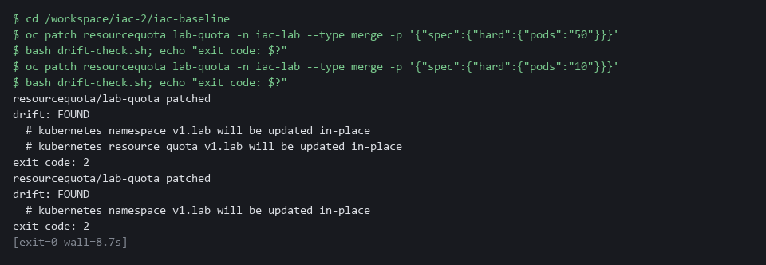

> **CHECKPOINT:** The first check exits 2 and names kubernetes_resource_quota_v1.lab. After the revert it exits 0. In a real system you would not revert by hand: you would either set the files to the new value through a pull request, or let a reviewed apply restore the old one.

**How this meets the control**

- **CM-6:** Changing the pod limit by hand and running the drift check shows a change to a setting is noticed. The check exits 2 and names the quota, then exits 0 after you revert.

## Section 5. What Each Control Is For

### Control mapping

| Control | What it requires, in plain words | Tool or service | Where this module covers it |
| --- | --- | --- | --- |
| CM-2 Baseline Configuration | Develop, document and maintain a current baseline configuration of the system under configuration control. Here the baseline is the Terraform files, kept in a git repository with its history. NIST leaves the review frequency organization-defined; FedRAMP assigns at least annually and when a significant change occurs. | Terraform files in a Gitea repository, with a saved plan for every change. Explained in section 2.1. | Section 3, Steps 1 and 2: write the baseline as files and plan it. Step 4: the files reach main through a pull request. Section 4, Test 1. |
| CM-3 Configuration Change Control | Review proposed configuration-controlled changes and approve or disapprove them before they are implemented. Here a gate and a protected branch decide, and only an approved plan is applied. | The plan gate script, a Tekton gate task, Gitea branch protection and a saved Terraform plan. Explained in section 2.2. | Section 3, Step 3: save and run the gate. Step 4: the gate task blocks or allows the merge and the saved plan is applied after it. Section 4, Test 2. |
| CM-6 Configuration Settings | Establish and implement configuration settings, and monitor and control changes to them. The requirement covered is item d: here a drift check watches for changes made outside the files. | A drift check built on terraform plan -detailed-exitcode. Explained in section 2.3. | Section 3, Step 5: save the drift check. Section 4, Tests 1 and 3: it exits 0 on a match and 2 after a hand edit. |

### What each control is for

Each table below says what the control is trying to prevent and how this module's tool meets it.

#### CM-2 Baseline Configuration

| Question | Answer |
| --- | --- |
| Control Intent | Nobody can say what the baseline of a namespace is, so a rebuild or a review has nothing to compare against. |
| The operational question | Where is the current baseline written down, who changed it last, and does the running namespace match it? |
| What evidence proves it | The Terraform files and their git history, the saved plan for each change, and a drift check that exits 0. |
| How much is enough | The baseline is complete as files, and changes to it keep a history. NIST leaves the review frequency organization-defined; FedRAMP assigns at least annually and when a significant change occurs. This module does not run that review. |
| How the tool in this module satisfies it | Terraform files in Gitea (Steps 1, 2 and 4) and the drift check (Step 5). |

#### CM-3 Configuration Change Control

| Question | Answer |
| --- | --- |
| Control Intent | A change that grants too much, such as a wildcard role, reaches the cluster because nobody reviewed it. |
| The operational question | Which changes are controlled, who or what approves them, and can a refused change still be applied? |
| What evidence proves it | The gate result recorded on the commit, the refused merge for a bad change, and the saved plan that was applied. |
| How much is enough | The gate refuses the rules it was written for and the protected branch makes its result binding. A person still reviews the pull request: the gate supports the control and does not replace review. |
| How the tool in this module satisfies it | The plan gate (Step 3), the gate task and branch protection (Step 4), and the negative test that a wildcard role is refused. |

#### CM-6 Configuration Settings

| Question | Answer |
| --- | --- |
| Control Intent | Someone changes a setting by hand on the cluster, and nobody notices because the files still look right. |
| The operational question | Does the running namespace still hold the settings in the files, and how soon would a hand edit be noticed? |
| What evidence proves it | The exit code of the drift check: 0 for a match, 2 for a difference. |
| How much is enough | The check runs on demand and answers with an exit code. NIST leaves the common secure configurations organization-defined. FedRAMP requires the DoD STIGs for configuration settings, then CIS Level 2 guidelines where no STIG exists. This module controls changes to settings and does not choose them; its small baseline is a lab example, not one of those configurations. |
| How the tool in this module satisfies it | The drift check script (Step 5) and the negative test that a hand edit exits 2. |

## Section 6. Next Steps

### Using this in other environments

- The commands work as is on any OpenShift cluster that has OpenShift Pipelines, Gitea and the lab's branch-protection and gate-task setup.
- Change these lab values first: the Gitea server address and repository name, the build project, and the ignore_annotations and ignore_labels lists in providers.tf for your cluster's annotations.
- On other Kubernetes platforms the hashicorp/kubernetes provider works the same way; replace oc commands with kubectl equivalents.
- The plan gate gate.py and the drift check are plain Python and shell, so they need only Terraform and Python 3 in the shell.

The table shows what changes on each platform:

| Part | In this lab (OpenShift) | On other Kubernetes | What you change |
| --- | --- | --- | --- |
| Terraform provider | hashicorp/kubernetes 3.4.0, kubeconfig at /workspace/.lab/kubeconfig | Same provider, different kubeconfig path | config_path in providers.tf. |
| Git server | Gitea inside the lab cluster | Any git server (GitHub, GitLab) | Clone URL and credential helper. |
| Gate task | Tekton task iac-plan-gate in project build | Any CI/CD pipeline that runs Python | Task YAML and pipeline start command. |
| Branch protection | Gitea branch_protections API | GitHub/GitLab branch protection API | API endpoint and JSON payload. |
| Drift check | terraform plan -detailed-exitcode with the lab kubeconfig | Same | Kubeconfig path and lock strategy. |
| oc commands | oc get, oc auth can-i, oc patch | kubectl equivalents | Replace oc with kubectl. |

> **TIP:** Next module: IAC-3 Terraform or Ansible: Choose by Evidence: you meet the same baseline written with Ansible, compare it with Terraform through the same tests, and choose from what you measured.

<details>
<summary><strong>Section 7. Terms</strong></summary>

Each term is also explained the first time it appears. In Word, hover over an underlined term to see its meaning, or Ctrl+click it to jump to this table.

| Term | Plain meaning |
| --- | --- |
| Annotation | A note attached to a cluster object that tools can read. Unlike a label, it is not used to pick objects. |
| Ansible | A tool that changes systems by running a playbook, a list of tasks. |
| API | A set of web addresses that a program calls to do what a person would do in a web page. Here the Gitea API protects the branch and opens pull requests. |
| Apply | The Terraform command that makes the changes in a plan. |
| Artifact | A file produced by a build or a step, such as an image, a report or a log. |
| AWS | Amazon Web Services, the cloud your lab runs in. |
| Baseline | The agreed secure configuration of a system. Here it is the five objects in the Terraform files. |
| Branch | A line of work in git. A change travels on its own branch until it is merged. |
| Branch protection | A Gitea rule that limits how a branch may change. |
| Cluster | A group of servers that work together as one system. Here it is your own OpenShift cluster in AWS. |
| cluster-admin | The built-in role that allows every action on every object. |
| Commit | One recorded set of changes in git, with a message and an identifier. |
| Commit status | A pass or fail mark that a tool attaches to one commit in Gitea. |
| Config map | A cluster object that holds plain settings (not secrets) as named values or files, so a program can read them. |
| Container | A sealed box that holds one program and everything it needs to run. |
| Core group | The set of built-in kinds of object in Kubernetes, such as pods. A role rule names it with two double quotes and nothing between them. |
| Credential | A secret that proves who you are, such as a password, token or key. |
| Default-deny | A network policy that selects every pod and lists no allowed traffic, so everything is blocked until another rule allows it. |
| diff | A command that shows the differences between two files. |
| Drift | A difference between the files and the running system, usually caused by a hand edit. |
| Endpoint | One address and port that something listens on, such as a pod behind a Service or a URL path that returns data. |
| Evidence | Saved records that show a system is set up and behaving as claimed. |
| Exit code | A number a command leaves behind when it ends. 0 means success; any other number reports a failure or another result. |
| FedRAMP | The US program that sets security requirements for cloud services used by the federal government. |
| Git | A tool that records the history of a folder of files. |
| Gitea | A git server that runs inside the lab. It holds the repository you push to and the rules for its branches. |
| Heredoc | A way to make a file by pasting its text between a first line such as cat > name <<'EOF' and a last line that says EOF. With >> in place of >, the text is added to the end of an existing file. |
| HTTP | The protocol that web pages and web APIs use. HTTPS is the encrypted form. |
| Image | A packaged copy of a program and everything it needs to run. A container starts from an image. |
| Ingress | The way traffic from outside the cluster reaches a program inside it. |
| jq | A command-line tool that reads JSON and picks out the fields you ask for. |
| JSON | A plain-text data format of names and values. jq can read it. |
| Kubeconfig | The file that holds the cluster address and your login. The provider reads it to reach the cluster. |
| Kubernetes | The open-source system that runs and manages containers across servers. OpenShift is built on it. |
| Label | A key=value tag on a cluster object, used to pick objects, such as app=demo-app. |
| Merge | Combine the changes from one git branch into another. |
| mkdir | A command that makes a new folder. |
| Namespace | A named section of the cluster that keeps workloads and rules apart. |
| NetworkPolicy | A rule about which traffic pods may send and receive. |
| NIST | The US National Institute of Standards and Technology. It publishes the security control catalog these modules cite. |
| oc | The OpenShift command-line tool. You type oc, then a verb such as get, then what it acts on. |
| OpenShift | The Red Hat platform your lab cluster runs on. It is Kubernetes with extra security and tools built in. |
| Payload | The data carried inside a message or request. |
| Pipeline | An automated sequence of tasks that runs without a person at the keyboard. |
| Plan | The list of changes Terraform would make to bring the system in line with the files. Making a plan changes nothing. |
| Pod | The smallest running unit on the cluster: one or more containers together. |
| Policy | A set of rules written down so that a tool can enforce them. |
| Provider | A plugin that teaches Terraform how to talk to one kind of system. Here the Kubernetes provider talks to your cluster. |
| Pull request | A proposed change that others review before it joins a branch. |
| Python | A programming language. The plan gate is a short Python script that needs nothing added to the lab shell. |
| Reference answer | A finished file that the start state placed for you. You compare your work with it only after you tried. |
| Registry | A server that stores container images. |
| Repository | A folder of files whose history git records, kept on a server such as Gitea. |
| Resource | One object that Terraform manages, such as a namespace or a role. Each resource block in a file describes one. |
| Resource quota | A cap on what one namespace may use, such as the number of pods. |
| Review gate | A check that runs before work is accepted and fails when the work breaks a rule. |
| Role | A list of allowed actions on named kinds of object. |
| Role binding | The link that gives a role to an account. |
| Rule | A written condition that a tool checks. |
| Saved plan | A plan written to a file with -out. Applying that file makes exactly those changes and nothing else. |
| Script | A text file of commands or code that the computer runs from top to bottom. |
| Secret | A cluster object that holds a sensitive value such as a password or token, kept apart from ordinary settings. |
| sed | A command that edits text as it passes through, often to replace one string with another. |
| Selector | A rule that picks objects by their labels. |
| Service account | An identity that a program (not a person) uses to talk to the cluster. |
| State | Terraform's record of what it created. Here it is a local file in your working folder. |
| STIG | Security Technical Implementation Guide: a DoD checklist of settings for one product. |
| Tekton | The pipeline tool in OpenShift Pipelines. It runs tasks in pods on the cluster. |
| Terraform | A tool that creates and changes systems from text files. It compares the files with what exists and works out the changes. |
| tkn | The Tekton command-line tool. You type tkn, then what to start or read. |
| Token | A long secret string that works like a password for one program. Gitea gives you one so git and the gate task can prove who they are. Anyone who holds it can act as you, so never print it or commit it. |
| URL | A web address, such as https://example.com/page. |
| Variable | A named value in the shell. A dollar sign in front of the name means use its value. |
| Verb | One action in a role, such as get or list. |
| Webhook | An address that another program calls to send it a message when something happens. |
| Wildcard | The star (*) that stands for every verb or resource. |
| YAML | A plain-text format for settings: lines of name: value, with indentation to show what belongs to what. |

</details>
