# IAC-3: Terraform or Ansible: Choose by Evidence (CM-2, CM-3, CM-6)

| Item | Detail |
| --- | --- |
| Sequence | Module 26 of 32 in the recommended order |
| Timed work | About 63 minutes (50 hands-on, 13 verify) |
| Standalone start | `lab start iac-3` |
| Combined start | Continue from the end state of the previous module |
| Tools | Terraform (free), Ansible with the kubernetes.core collection and ansible-lint (free, open source), OpenShift Container Platform, oc, python3 |
| Prerequisites | IAC-1 Run a Supplied Baseline as Code (running a supplied Terraform baseline and a supplied playbook: plan -out, show -json, drift through plan -detailed-exitcode, ansible-playbook --check --diff, and changed=0 on a second run), ENG-0 Terminal, Git and Your Lab (typing commands in lab shell, making a file with a heredoc, running oc and reading its output) |

## Section 1. Module Overview

- Purpose: keep a namespace matching its approved baseline, run Terraform and Ansible side by side on your own cluster, and catch the change neither tool sees (CM-2, CM-3, CM-6).
- You build an Ansible playbook for the baseline, a conformance check and one combined gate script.
- You run them in the lab shell against your cluster, make hand changes, and finish with one passing test and two negative tests that the gate must catch.

- **Skill:** Write an Ansible playbook for a baseline that Terraform already holds, see which objects each tool can and cannot see, and close the gap with a conformance check you write. Then join all checks into one gate and prove it with one passing test and two negative tests.
- **Tools:** `terraform plan -detailed-exitcode` compares the Terraform code and its state file with the live namespace. `ansible-playbook --check` tests the playbook against the namespace without changing it, and `ansible-lint` checks its style. `oc` makes the hand changes in the tests and reads the live objects. `python3` runs `conformance.py`, which compares live objects with the playbook. `drift_check.sh` runs every check and ends with one exit code.
- **Security Function:** Detects a quota edited by hand, a deleted network policy and a role binding that no code lists, and blocks a wildcard role before it is applied. The combined gate exits non-zero on each of them.
- **NIST CM-2 Baseline Configuration:** Terraform code and an Ansible playbook hold the same five baseline objects, and each tool's check compares the live namespace with them.
- **NIST CM-3 Configuration Change Control:** The code mode of `conformance.py` reviews a proposed playbook and refuses a wildcard role before apply, and `drift_check.sh` gives a pipeline one exit code to stop on.
- **NIST CM-6 Configuration Settings:** The Terraform plan, the Ansible check and the live conformance check monitor the quota, the default-deny policy and the roles, and the combined check catches the role binding that neither tool lists.

## Section 2. The Tools

### Tools used in this module

Each tool name links to its official overview. The table columns say how each tool is used in the lab and why the lab uses it instead of another way of doing the same job.

| Tool (overview link) | What it is | Used in this lab | Why this tool |
| --- | --- | --- | --- |
| [Terraform](https://developer.hashicorp.com/terraform/intro) | Builds and changes infrastructure from files, and compares the files with what exists. | Compares the Terraform files and state with the live namespace and reports drift with an exit code. | It states the wanted infrastructure in files and shows a plan before changing anything, so a change can be reviewed and drift can be detected by comparing the files with the live system. |
| [Ansible](https://docs.ansible.com/ansible/latest/getting_started/introduction.html) | Runs playbooks, which are lists of tasks that put a system into a stated state. | Tests the playbook against the namespace without changing it. | It runs a list of tasks that put a system into a stated state and can test them without changing anything, so the same baseline can be applied repeatedly. |
| [ansible-lint](https://ansible.readthedocs.io/projects/lint/) | Checks Ansible playbooks for style problems and risky patterns. | Checks the playbook for style problems and risky patterns. | It catches style problems and risky patterns in a playbook before it runs, so review starts from a clean file. |
| [OpenShift Container Platform](https://docs.redhat.com/en/documentation/openshift_container_platform/4.22/html/overview/ocp-overview) | A Kubernetes container platform for running and managing containerized applications. | The cluster every command in this module runs against. | It is the platform the whole lab runs on, so every module works on the same real cluster, with the same kinds of objects a production OpenShift system has. |
| [oc](https://docs.redhat.com/en/documentation/openshift_container_platform/4.22/html/cli_tools/openshift-cli-oc) | The OpenShift command-line tool for creating and managing applications and projects from a terminal. | Makes the hand changes and reads the live objects. | It is the one command that talks to the cluster, so every module uses it to ask what is true and to make changes. You sign in once, and it works on OpenShift objects as well as standard Kubernetes ones. Unlike clicking in the web console, a command can be pasted, repeated and checked by a test. |
| [Python 3](https://docs.python.org/3/tutorial/introduction.html) | General-purpose language, used here for small helper scripts. | Runs the timing script and the conformance check that compares live objects with the playbook. | Python reads and writes JSON easily and is already in the lab shell, so a small script needs nothing installed. |

### How it fits together

#### One baseline, two tools, one gate

- In the lab (test) setup, a lab shell on your computer runs the tools against your own cluster.
- Terraform code and an Ansible playbook each hold the five baseline objects.
- You change the five objects by hand to test the tools, then add a check for what neither tool sees.
- In production a pipeline runs the same checks against the real cluster and nobody changes the objects by hand.
- New parts are drawn with thick lines.

How the lab is set up, and why:

- You work in lab shell on your laptop and send every command to your cluster, as in ENG-0.
- The baseline objects live in one namespace, iac-lab, so every change and every hand change you make stays inside it.
- The Terraform code, the playbook and your scripts sit together in one folder in your lab shell, because both tools run from there and read the cluster from the same kubeconfig file.
- The picture mentions a state file only on the Terraform side because only Terraform keeps one; you see this in Step 3.
- Only you edit the namespace by hand, in the two negative tests at the end, and each test puts the namespace back.

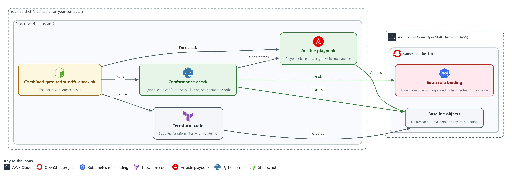

- **1. Your cluster:** your own OpenShift cluster in AWS, which holds the baseline objects and the hand changes.
- **2. Namespace iac-lab:** the named section of the cluster that holds the baseline objects.
- **3. Your lab shell:** the tools container on your laptop where you type every command.
- **4. Folder /workspace/iac-3:** the working folder in your lab shell that holds the Terraform code, the playbook and your scripts.
- **5. Baseline objects:** the namespace, the quota, the default-deny policy, the role and the role binding in namespace iac-lab, created by Terraform.
- **6. Extra role binding:** a role binding named extra-binding that you add by hand in Test 2 and that no code lists.
- **7. Terraform code:** the supplied files that created the baseline, with a state file that remembers the objects.
- **8. Ansible playbook:** the file baseline.yml that you write for the same objects. It keeps no state file.
- **9. Conformance check:** conformance.py lists the live role bindings and network policies and compares them with the names in the playbook.
- **10. Combined gate script drift_check.sh:** runs the code check, the Terraform plan, the Ansible check and the live check, and ends with one exit code.

Where each part runs, and why:

| Part | Where it runs | Why it is built this way |
| --- | --- | --- |
| Baseline objects | The namespace iac-lab | Terraform created them before you start, so you compare a second tool against a baseline that already exists. |
| Terraform code | The folder /workspace/iac-3/terraform in your lab shell | It is supplied and applied, so you spend your effort on the second tool and on the gap neither tool sees. |
| Ansible playbook | The folder /workspace/iac-3/ansible in your lab shell | You write it from the same object list, so the two tools declare the same thing. |
| Conformance check and drift_check.sh | The folder /workspace/iac-3 in your lab shell | They read live state and the playbook, so you can run them after every change. |

### 2.1 Two tools, one baseline (CM-2 Baseline Configuration)

- Terraform and Ansible can each hold the same baseline as code and apply it to a cluster.
- Keeping settings as files that a tool applies is called infrastructure as code.
- The baseline here is five objects in namespace iac-lab: the namespace, a resource quota, a default-deny network policy, a read-only role and a role binding.
- Terraform created the five objects before you start, and in Step 1 you write the Ansible version of them.
- Terraform and Ansible can each tell you whether the live namespace still matches the code, but they work in different ways.

#### CM-2: Baseline Configuration

*The control asks the organization to develop, document and maintain under configuration control a current baseline configuration of the system. NIST leaves the review frequency organization-defined; FedRAMP assigns at least annually and when a significant change occurs. This module does not run that review. This is done using:*

- Terraform code holds the five objects as files, with a state file, and its plan shows whether the live namespace still matches.
- The Ansible playbook holds the same five objects as tasks, and its check mode shows whether the live namespace still matches.

The table lists the differences between the tools that a command in this module can show, and where each one is shown:

| Property | Terraform | Ansible | Where you see it |
| --- | --- | --- | --- |
| What remembers the objects | A state file next to the code | Nothing between runs: it asks the cluster each time | Step 3: ls shows the state file and terraform state list reads it |
| Drift command and its exit code | plan -detailed-exitcode: 0 no changes, 2 changes, 1 error | --check: exit 0 whether or not changes are found; the changed count carries the answer | Step 2: the Terraform exit and the changed count; Section 4, Test 2 |
| Objects it can see | Only resources in its code | Only tasks in its playbook | Section 4, Test 2: the extra role binding |

### 2.2 What drift detection sees (CM-6 Configuration Settings)

- Drift is a difference between the code and the live objects.
- A quota edited by hand or a default-deny policy deleted by hand changes an object that both code bases list, so the Terraform plan and the Ansible check both report it.
- An extra role binding added by hand is an object that neither code base lists, so neither tool knows about it. Test 2 shows this.

#### CM-6: Configuration Settings

*The control asks the organization to establish and document configuration settings, and to monitor and control changes to them in accordance with organizational policies and procedures. The policies and procedures are the organization's, and FedRAMP requires the DoD STIGs for configuration settings, then CIS Level 2 guidelines where no STIG exists. The lab's small baseline is not one of those, so it chooses its own rule: any undeclared role binding or network policy is a finding. The settings here are the quota value, the default-deny rule and the read-only role. This is done using:*

- terraform plan -detailed-exitcode reports a change to any setting that the Terraform code lists.
- ansible-playbook --check reports a change to any setting that the playbook lists.
- The live check in conformance.py reports a role binding or network policy that no code declares.

### 2.3 Closing the gap, and refusing a risky change before apply (CM-3 Configuration Change Control)

- Terraform and Ansible look only at objects their code lists, so an object that is in no code is invisible to them.
- A conformance check turns the question around: it lists the live role bindings and network policies and fails on any that the code does not declare.
- The conformance check allows exactly five role bindings that the platform creates in every new namespace: openshift-pipelines-edit, pipelines-scc-rolebinding, system:deployers, system:image-builders and system:image-pullers.
- conformance.py also has a code mode that reads only the playbook. That mode fails when a role contains a wildcard, so a risky change stops before apply.
- ansible-lint does not catch a wildcard, because it checks the style and structure of the playbook and does not read what a role grants. Test 3 shows that.

#### CM-3: Configuration Change Control

*The control asks the organization to review proposed configuration-controlled changes to the system and approve or disapprove them, and to document and monitor those changes. Who approves is the organization's process and is not tested here. This is done using:*

- The code mode of conformance.py reviews the proposed playbook and disapproves a wildcard role before anything is applied.
- The live mode of conformance.py notices changes that skipped review.
- drift_check.sh runs both modes with the other checks and ends with one exit code that a pipeline can use to block a change.

### Design decisions

#### Run both tools in the gate and treat each code base as its own declaration

- How: drift_check.sh runs the Terraform plan and the Ansible check separately and turns their different exit codes into the same three words. Both tools see only the objects their code lists, so neither adds coverage for an object in no code, as Test 2 shows. Terraform also keeps a state file, a second record that must stay in step with the cluster, and Ansible keeps none.
- Why: The two code bases are two declarations of one baseline, and only a check by each tool against the live cluster exposes a difference between them.
- Alternatives: One tool as the single owner is the alternative. Its advantage is one code base to review and one fewer tool to run, but it gives no second opinion and leaves the gap for objects in no code open.

#### Add a live conformance check instead of a third tool

- How: conformance.py lists the live role bindings and network policies and fails on any name the playbook does not declare, except five role bindings the platform creates, allowed by exact name. It starts from what is live, so it does not depend on a code list.
- Why: Test 2 shows the gap is in what the tools look at, not in how well they look. A check that starts from the live list needs no state file.
- Alternatives: Importing every live object into the code is the alternative. Its advantage is that the tools would then see every object, but a hand change would become the new baseline unless a person reviews it.

#### Treat a check that could not run as a failure with its own exit code

- How: The script exits 0 for clean, 1 for drift or a violation, and 3 when any check could not run. Ansible check mode exits 0 even when it would change something, so the script reads the changed count from the recap, and a missing count is an error.
- Why: Reading a missing result as clean would hide exactly the failures a gate exists to catch.
- Alternatives: Using the first non-zero exit of any tool is the alternative. Its advantage is a shorter script. Its drawback is that Terraform exit 2 and Ansible exit 0 with changes would read differently to one gate, and a broken tool would look like drift.

## Section 3. Implement

- Start: type `lab start iac-3` in the terminal on your own computer (PowerShell on Windows, Terminal on Mac), not in the lab shell.
- Enter lab shell with `lab shell`. Every other command in this module runs inside lab shell.
- If a step fails: run `lab reset iac-3` on your own computer and repeat the step once. If it still fails, copy the whole command and error and ask your AI assistant. Do not skip the step.

### Step 1. Write the Ansible version of the baseline and lint it (CM-2 Baseline Configuration)

**Learning point: Reading what Terraform holds and writing the same five objects as a playbook gives you a second declaration of the baseline. Running the linter on it catches mistakes before anything is applied.**

- Terraform already created the baseline.
- The playbook uses the same objects and values, with the role's resources and verbs in sorted order, so the first run finds nothing to change.

What this step adds (thick lines and outlines are new):

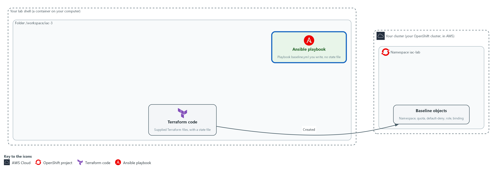

- Terraform code created the baseline objects in namespace iac-lab and keeps a state file. You write the Ansible playbook for the same objects and lint it. Ansible keeps no state file.

#### 1a. Read what Terraform holds

You will now move into your working folder, list the Terraform resources, and ask Terraform whether the live namespace still matches its code, without changing anything.

- Starting the module again with lab start or lab reset deletes the folder /workspace/iac-3, including every file you write in it, and builds the baseline again.

Look for these as you read:

- Five resource lines: the namespace, the quota, the default-deny policy, the role and the role binding. These are the five objects you must write in the playbook.
- Exit 0 means Terraform finds no difference.

```bash
cd /workspace/iac-3
ls
grep -n '^resource' terraform/main.tf
terraform -chdir=terraform plan -detailed-exitcode -input=false -no-color
echo "exit=$?"
```

**Expected output:**

```
Example only. Your output will differ in detail.
ansible  terraform
5:resource "kubernetes_namespace_v1" "iac_lab" {
(four more resource lines: quota, default_deny, role, role binding)
(refresh lines)
No changes. Your infrastructure matches the configuration.
exit=0
```

| Part | What it does | Why you run it |
| --- | --- | --- |
| cd /workspace/iac-3 and ls | Moves into the working folder and lists it. The folder ansible is empty; terraform holds the supplied code. | Every later command and script in this module runs from this folder. |
| grep -n '^resource' terraform/main.tf | Prints each line of the Terraform file that starts a resource, with its line number. | Gives you the list of objects the playbook must match. |
| terraform -chdir=terraform plan -detailed-exitcode ... | Compares the code and its state file with the live namespace. -input=false stops it asking questions; -no-color keeps the output plain. | Shows the starting point: the baseline is clean before you add anything. |
| echo "exit=$?" | Prints the exit code of the plan. 0 no changes, 2 changes, 1 error. | The exit code is what a script or a gate reads. |

#### 1b. Save the playbook

You will now create the file baseline.yml in the folder /workspace/iac-3/ansible with the playbook.

- Paste all of it into the lab shell at once.
- The text has spaces and no tabs, as YAML needs.

```bash
cd /workspace/iac-3
mkdir -p ansible
cat > ansible/baseline.yml <<'EOF'
---
- name: Apply the iac-lab baseline
  hosts: localhost
  connection: local
  gather_facts: false
  vars:
    baseline:
      - apiVersion: v1
        kind: Namespace
        metadata:
          name: iac-lab
      - apiVersion: v1
        kind: ResourceQuota
        metadata:
          name: iac-quota
          namespace: iac-lab
        spec:
          hard:
            pods: "10"
            requests.cpu: "2"
            requests.memory: 2Gi
            limits.cpu: "4"
            limits.memory: 4Gi
      - apiVersion: networking.k8s.io/v1
        kind: NetworkPolicy
        metadata:
          name: default-deny
          namespace: iac-lab
        spec:
          podSelector: {}
          policyTypes: [Ingress, Egress]
      - apiVersion: rbac.authorization.k8s.io/v1
        kind: Role
        metadata:
          name: iac-reader
          namespace: iac-lab
        rules:
          - apiGroups: [""]
            resources: [configmaps, pods, services]
            verbs: [get, list, watch]
      - apiVersion: rbac.authorization.k8s.io/v1
        kind: RoleBinding
        metadata:
          name: iac-reader-binding
          namespace: iac-lab
        roleRef:
          apiGroup: rbac.authorization.k8s.io
          kind: Role
          name: iac-reader
        subjects:
          - kind: ServiceAccount
            name: iac-viewer
            namespace: iac-lab
  tasks:
    - name: Apply each baseline object
      kubernetes.core.k8s:
        state: present
        definition: "{{ item }}"
      loop: "{{ baseline }}"
      loop_control:
        label: "{{ item.kind }}/{{ item.metadata.name }}"
EOF
```

**Expected output:**

```
Example only. Making a file prints nothing. The next block uses it.
```

| Part | What it does | Why you run it |
| --- | --- | --- |
| cd / mkdir -p ansible / cat > ansible/baseline.yml <<'EOF' ... EOF | Moves into the working folder, makes sure the folder ansible exists, and writes everything up to the line EOF into the file baseline.yml. The quotes around EOF keep every character as typed. | A heredoc makes a whole file with a paste, so you need no editor. |
| hosts: localhost and connection: local | Runs the tasks on your lab shell itself. The tasks talk to the cluster over the network. | No server needs to be reached: the cluster is the target, not a machine. |
| gather_facts: false | Skips collecting facts (details such as the operating system) about the machine. | The playbook does not use them, and skipping saves time in every check. |
| vars: baseline: (a list of five objects) | Writes each object as plain data: the same kind, name and values as the Terraform code. | One list of objects is the single place both the task and the conformance check read. |
| hard: pods, requests, limits | The quota values. Numbers are quoted so they stay text, as the cluster returns them. | A different value here would make the first run change something instead of finding it equal. |
| podSelector: {} and policyTypes: [Ingress, Egress] | Selects every pod and lists no allowed traffic, in both directions. | This is a default-deny rule: all traffic is blocked until another policy allows it. |
| rules: apiGroups, resources, verbs | A read-only role: get, list and watch on configmaps, pods and services. The names are in sorted order. | Read-only access, with no wildcard. The order matches what Terraform stored. |
| roleRef and subjects | The binding gives the role to the service account iac-viewer. | A role binding is how access is granted, which is why it is one of the two kinds the conformance check watches. |
| kubernetes.core.k8s with state: present | The module that creates an object if it is missing and changes it if it differs from the definition. | state: present is how a task states what should exist. Check mode uses the same task to report what would change. |
| loop: "{{ baseline }}" and the label | Runs the one task once for each object and prints Kind/name for each. | One task for five objects keeps the playbook short, and the label makes the output readable. |

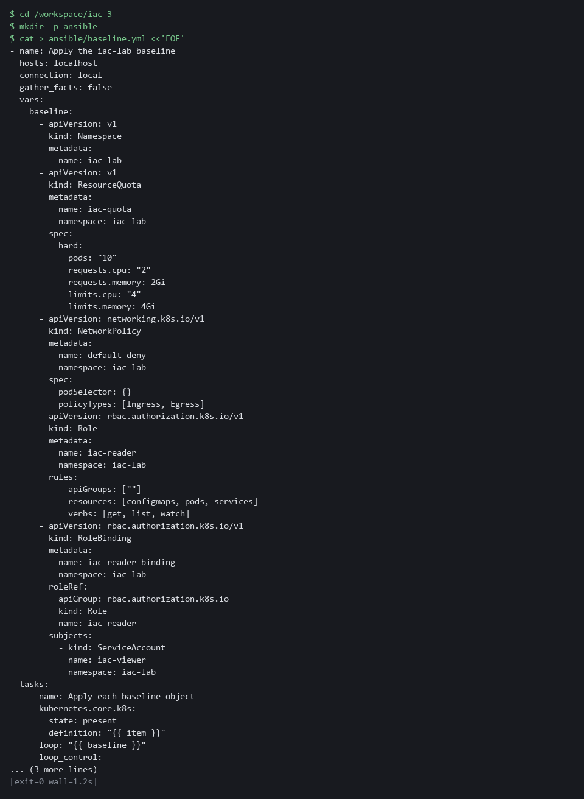

#### 1c. Check the syntax and lint the playbook

You will now ask Ansible whether the playbook parses and ask ansible-lint (the Ansible linter) whether it follows the usual rules, without touching the cluster.

```bash
cd /workspace/iac-3
ansible-playbook --syntax-check ansible/baseline.yml
ansible-lint ansible/baseline.yml
```

**Expected output:**

```
Example only. A WARNING line about the program search path (PATH) may appear first; it does not change the result.
playbook: ansible/baseline.yml
Passed: 0 failure(s), 0 warning(s) in 1 files processed of 1 encountered. Last profile that met the validation criteria was 'production'.
```

| Part | What it does | Why you run it |
| --- | --- | --- |
| cd /workspace/iac-3 | Moves into the working folder. | The playbook path below is relative to this folder. |
| ansible-playbook --syntax-check | Parses the playbook and stops. It runs no task. | Catches a typo or a bad indent before anything is applied. |
| ansible-lint ansible/baseline.yml | Reads the playbook and reports style and structure problems, such as a task with no name. | A lint pass is the cheapest first gate. Test 3 shows what it does not check. |

> **NOTE:** If ansible-lint reports a problem, read the line it names and fix that line in baseline.yml. A copy mistake in the indentation is the usual cause.

> **YOUR TURN:** Run the first block, run the second block to make ansible/baseline.yml, then run the third block.

> **CHECKPOINT:** Terraform plans no changes (exit=0). The syntax check prints the playbook path and ansible-lint reports 0 failures.

> **TAKEAWAY:** Two tools can only be compared fairly when they declare the same objects.

**How this meets the control**

- **CM-2:** Writing the playbook gives a second declaration of the baseline that you can check and apply.

### Step 2. Apply it and prove a second run changes nothing (CM-2 Baseline Configuration)

**Learning point: Deleting the quota and applying the playbook twice shows two things. The playbook restores an object that is missing, and it changes nothing when the namespace matches.**

- You delete the quota by hand and apply the playbook, which puts it back and reports changed=1.
- Applying once more reports changed=0 because everything now matches: the playbook is idempotent, which means safe to run again.
- Terraform then plans no changes, which shows the two tools agree.
- ansible-playbook --check, which the gate uses later, runs the same tasks and reports what would change without changing anything.

What this step adds (thick lines and outlines are new):

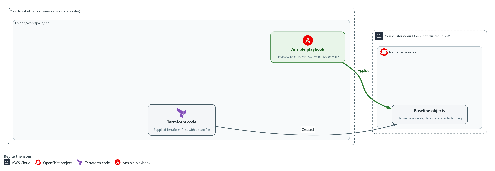

- The playbook applies to the namespace, finds that the objects already match, recreates a deleted one, and Terraform still plans no changes.

#### 2a. Delete the quota, apply twice, and ask Terraform

You will now delete the quota by hand, run the playbook twice and read only the PLAY RECAP line each time, then ask Terraform whether it still agrees with the cluster.

- If you run the block again, the delete finds nothing to remove and the playbook restores the quota once more.

Look for these as you read:

- changed=1 on the first run and changed=0 on the second: the playbook restored the quota, then found nothing more to do.
- Terraform exit=0 after Ansible recreated the quota: Terraform finds the object again by its name.

```bash
cd /workspace/iac-3
oc delete resourcequota iac-quota -n iac-lab --ignore-not-found
ansible-playbook ansible/baseline.yml | grep 'changed='
ansible-playbook ansible/baseline.yml | grep 'changed='
terraform -chdir=terraform plan -detailed-exitcode -input=false -no-color
echo "exit=$?"
```

**Expected output:**

```
Example only.
resourcequota "iac-quota" deleted
localhost : ok=1 changed=1 unreachable=0 failed=0 skipped=0 rescued=0 ignored=0
localhost : ok=1 changed=0 unreachable=0 failed=0 skipped=0 rescued=0 ignored=0
(refresh lines)
No changes. Your infrastructure matches the configuration.
exit=0
```

| Part | What it does | Why you run it |
| --- | --- | --- |
| cd /workspace/iac-3 | Moves into the working folder. | The playbook and the Terraform folder are found from here. |
| oc delete resourcequota iac-quota --ignore-not-found | Removes the quota by hand. If it is already gone, nothing happens. | Creates a real difference, so the playbook has something to fix. The flag makes a second run harmless. |
| ansible-playbook ... \| grep 'changed=' | Runs the playbook and prints only the recap line that holds the changed count. | The changed count is what tells you whether a run did anything. |
| terraform ... plan -detailed-exitcode | Asks Terraform whether the live namespace still matches its code. | Two tools manage the same objects, so you check that one did not leave the other out of step. |

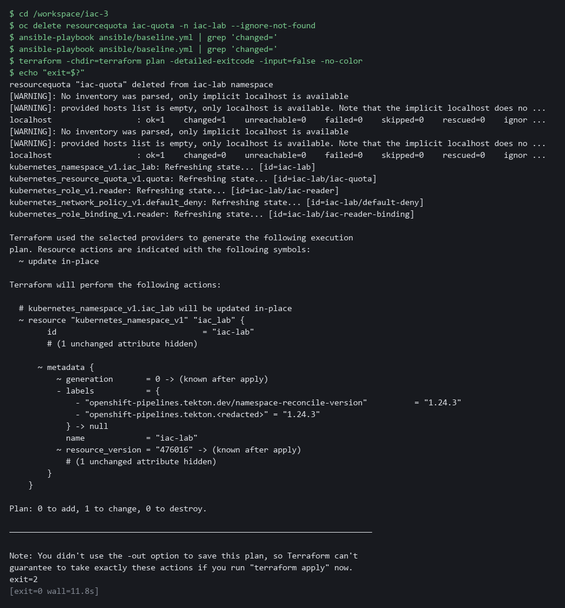

> **TIP:** The quota was recreated by Ansible, yet Terraform is satisfied. Terraform looks the object up by its name and namespace, so it does not matter which tool made it.

> **YOUR TURN:** Run the block.

> **CHECKPOINT:** The first run shows changed=1, the second shows changed=0, and the Terraform exit is 0.

> **TAKEAWAY:** A playbook that has never changed anything has not been tested.

**How this meets the control**

- **CM-2:** Deleting one object and applying again proves that the playbook restores the baseline and that Terraform still agrees with the cluster.

### Step 3. See what the tools list, then close the gap (CM-6 Configuration Settings, CM-3 Configuration Change Control)

**Learning point: Reading the state list shows why neither tool can see an extra binding added by hand, and the conformance check closes that gap by starting from what is live.**

- Terraform and Ansible look only at the objects their code lists, so a role binding added by hand is invisible to both; Test 2 proves it.
- Only a check that does not rely on the code's list adds coverage.
- First you see where each tool's list comes from, then you write that check.

What this step adds (thick lines and outlines are new):

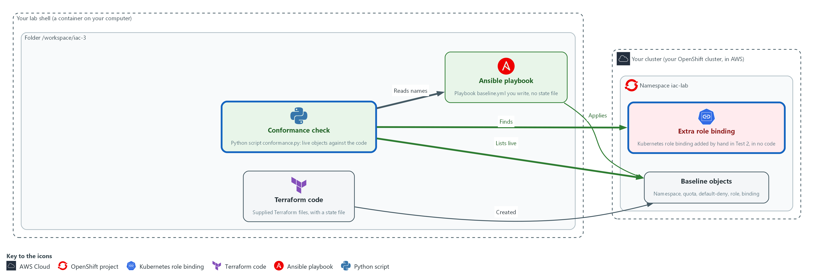

- A conformance check lists the live role bindings and network policies and compares them with the names in the playbook, so it finds an extra role binding that no code lists. Its code mode also reads the playbook before anything is applied.

#### 3a. See what each tool remembers

You will now list the files each tool keeps and ask Terraform which objects its state file records, without changing anything.

Look for these as you read:

- Terraform keeps a state file (terraform.tfstate). Ansible keeps nothing beyond the playbook.
- The state list names exactly five objects. An object added by hand, such as an extra role binding, would not be among them, so a plan could not see it. The playbook lists the same five objects.

```bash
cd /workspace/iac-3
ls -l terraform ansible
terraform -chdir=terraform state list
```

**Expected output:**

```
Example only.
ansible:
-rw-r--r--. 1 lab root 1400 baseline.yml

terraform:
-rw-r--r--. 1 lab root 3000 main.tf
-rw-r--r--. 1 lab root 7000 terraform.tfstate
kubernetes_namespace_v1.iac_lab
kubernetes_network_policy_v1.default_deny
kubernetes_resource_quota_v1.quota
kubernetes_role_binding_v1.reader
kubernetes_role_v1.reader
```

| Part | What it does | Why you run it |
| --- | --- | --- |
| cd /workspace/iac-3 | Moves into the working folder. | Both tool folders are found from here. |
| ls -l terraform ansible | Lists both folders with sizes. Hidden items such as the folder .terraform are not shown. | Shows the difference in what each tool leaves behind: a state file on one side, none on the other. |
| terraform ... state list | Prints every object recorded in the state file. | Proves the point: a tool only checks what it records or lists. |

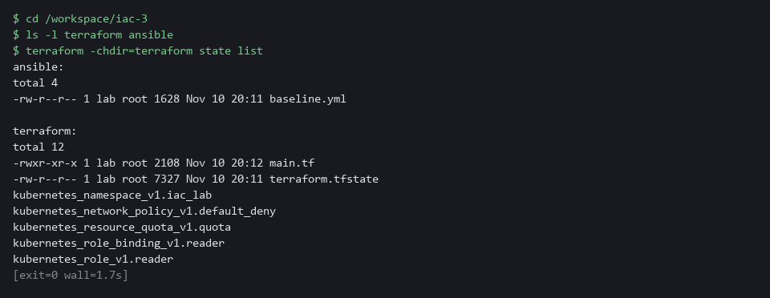

#### 3b. Save the conformance check

You will now create the file conformance.py, a Python script, in the folder /workspace/iac-3.

- Paste all of it into the lab shell at once.
- conformance.py prints nothing yet.

```bash
cd /workspace/iac-3
cat > conformance.py <<'EOF'
import json
import subprocess
import sys

import yaml

NS = "iac-lab"
PLAYBOOK = "/workspace/iac-3/ansible/baseline.yml"
CHECKED = ("RoleBinding", "NetworkPolicy")
PLATFORM = {
    "openshift-pipelines-edit",
    "pipelines-scc-rolebinding",
    "system:deployers",
    "system:image-builders",
    "system:image-pullers",
}


def declared(path):
    with open(path) as handle:
        return yaml.safe_load(handle)[0]["vars"]["baseline"]


def wildcard(role):
    keys = ("apiGroups", "resources", "verbs")
    return [r for r in role.get("rules", []) if any("*" in r.get(k, []) for k in keys)]


def check_code(path):
    objects = declared(path)
    return ["code: Role " + o["metadata"]["name"] + " uses a wildcard"
            for o in objects if o["kind"] == "Role" and wildcard(o)]


def check_live(path):
    names = {(o["kind"], o["metadata"]["name"]) for o in declared(path)}
    done = subprocess.run(["oc", "get", "rolebinding,networkpolicy,role", "-n", NS, "-o", "json"],
                          capture_output=True, text=True, check=True)
    problems = []
    for item in json.loads(done.stdout)["items"]:
        kind, name = item["kind"], item["metadata"]["name"]
        if kind in CHECKED and name not in PLATFORM and (kind, name) not in names:
            problems.append("live: " + kind + " " + name + " is not declared in code")
        if kind == "Role" and wildcard(item):
            problems.append("live: Role " + name + " uses a wildcard")
    return problems


mode = sys.argv[1] if len(sys.argv) > 1 else "all"
path = sys.argv[2] if len(sys.argv) > 2 else PLAYBOOK
problems = []
if mode in ("code", "all"):
    problems += check_code(path)
if mode in ("live", "all"):
    problems += check_live(path)
for line in problems:
    print("FAIL " + line)
print("conformance " + ("FAILED" if problems else "ok") + " (" + mode + ")")
sys.exit(1 if problems else 0)
EOF
```

**Expected output:**

```
Example only. Making a file prints nothing. The next block runs it.
```

| Part | What it does | Why you run it |
| --- | --- | --- |
| cd ... / cat > conformance.py <<'EOF' ... EOF | Moves into the working folder and writes everything up to the line EOF into the file conformance.py. | A heredoc makes a whole file with a paste, so you need no editor. |
| CHECKED and PLATFORM | The two kinds the check watches, and the five role bindings the platform creates in every new namespace. | Role bindings grant access and network policies control traffic. The five platform names are allowed by exact name, so a binding with any other name is a finding. |
| def declared(path) | Reads the playbook file with PyYAML (a Python library that reads YAML) and returns its list of five objects. | The playbook is the declared list, so there is one source of names. |
| def wildcard(role) | Returns the rules in a role that contain a star in the groups, resources or verbs. | A star grants every verb or every resource, which a read-only role must never do. |
| def check_code(path) | Reads only the playbook and reports any Role that has a wildcard. | This is the before-apply mode: it needs no cluster, so it can stop a risky change before it is applied. |
| def check_live(path) | Asks oc for the live role bindings, network policies and roles, and reports any binding or policy not declared, and any live role with a wildcard. | This closes the gap: it starts from what is live and not from what the code lists. |
| mode and path | The first argument picks code, live or all. The optional second names a playbook file. | Lets you check a proposed playbook file before it replaces the real one. |
| sys.exit(1 if problems else 0) | Exits 1 if anything was found and 0 if not. | A gate can only stop on a failure if the script reports one. |

#### 3c. Run the conformance check on the clean namespace

You will now run both modes of the check against the clean namespace and print its exit code.

```bash
cd /workspace/iac-3
python3 conformance.py
echo "exit=$?"
```

**Expected output:**

```
Example only.
conformance ok (all)
exit=0
```

| Part | What it does | Why you run it |
| --- | --- | --- |
| cd /workspace/iac-3 | Moves into the working folder. | The script finds the playbook from here. |
| python3 conformance.py | Runs both modes: the code check on the playbook and the live check on the namespace. | On a clean namespace both pass. |
| echo "exit=$?" | Prints the exit code of the script. | 0 means no findings. |

> **YOUR TURN:** Run the first block and note that both tools check only these five objects. Run the second block to make conformance.py, then run the last block.

> **CHECKPOINT:** The state list shows five objects. The check prints conformance ok (all) and exit=0.

> **TAKEAWAY:** A tool only checks what its code lists, so finding the rest needs a check that starts from the live objects.

**How this meets the controls**

- **CM-6:** The conformance check finds the role bindings and network policies that no code lists, which neither code base lists.
- **CM-3:** The code mode of the same script refuses a wildcard role before apply, which makes an automated review gate for the playbook.

### Step 4. Combine the checks into one gate (CM-3 Configuration Change Control, CM-6 Configuration Settings)

**Learning point: Joining the four checks into drift_check.sh gives a pipeline one exit code to act on, with a separate value for a check that could not run.**

- Four checks that you run by hand are checks that get skipped.
- One script runs them all and reports one exit code, with a separate exit code for a check that could not run, because that is not a pass.
- The code check runs first because it needs no cluster, and the live check runs last.

What this step adds (thick lines and outlines are new):

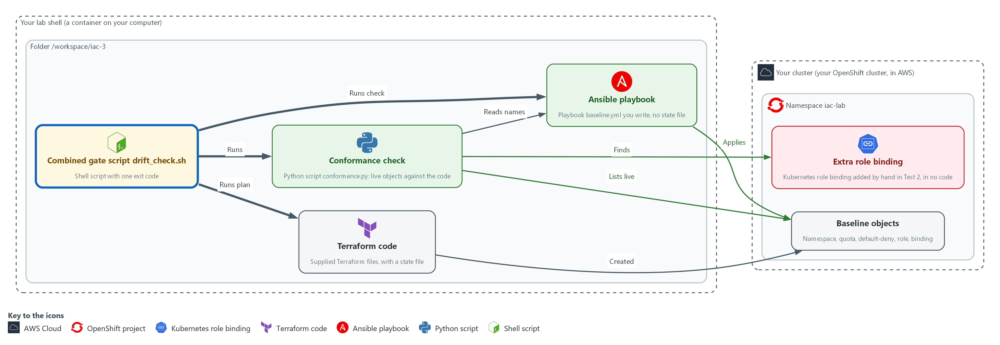

- One script, drift_check.sh, runs the code check, the Terraform plan, the Ansible check and the live check, and reports one exit code.

#### 4a. Save the combined gate

You will now create the file drift_check.sh, a shell script, in the folder /workspace/iac-3.

- Paste all of it into the lab shell at once.
- The quotes around EOF keep every dollar sign as typed.

```bash
cd /workspace/iac-3
cat > drift_check.sh <<'EOF'
#!/usr/bin/env bash
# Exit 0: clean. Exit 1: drift or a violation found. Exit 3: a check could not run.
cd /workspace/iac-3 || exit 3
logs=$(mktemp -d)
drift=0
broken=0

verdict() {  # check name, its exit code, the exit code that means drift
  case "$2" in
    0) echo "PASS  $1" ;;
    "$3") echo "DRIFT $1"; drift=1 ;;
    *) echo "ERROR $1 (exit $2)"; broken=1 ;;
  esac
}

python3 conformance.py code >"$logs/code.log"
verdict "code conformance" $? 1

terraform -chdir=terraform plan -detailed-exitcode -input=false -no-color >"$logs/tf.log" 2>&1
verdict "terraform plan" $? 2

ansible-playbook --check ansible/baseline.yml >"$logs/an.log" 2>&1
rc=$?
changed=$(grep -o 'changed=[0-9]*' "$logs/an.log" | cut -d= -f2)
if [ "$rc" -ne 0 ] || [ -z "$changed" ]; then
  verdict "ansible check" 99 1
elif [ "$changed" -gt 0 ]; then
  verdict "ansible check" 1 1
else
  verdict "ansible check" 0 1
fi

python3 conformance.py live >"$logs/live.log"
verdict "live conformance" $? 1

cat "$logs/code.log" "$logs/live.log" | grep '^FAIL'
[ "$broken" -eq 0 ] || exit 3
exit "$drift"
EOF
```

**Expected output:**

```
Example only. Making a file prints nothing. The next block runs it.
```

| Part | What it does | Why you run it |
| --- | --- | --- |
| cd ... / cat > drift_check.sh <<'EOF' ... EOF | Moves into the working folder and writes everything up to the line EOF into the file drift_check.sh. | A heredoc makes a whole file with a paste, so you need no editor. |
| cd /workspace/iac-3 \|\| exit 3 | Moves into the working folder, and exits 3 if that fails. | Every check uses paths in this folder, so a script that cannot get there has not checked anything. |
| verdict() { ... } | Takes a check name, the exit code of that check, and the exit code that means drift. Prints PASS, DRIFT or ERROR. | Terraform uses 2 for drift while the others use 1, so one helper turns each into the same three words. |
| python3 conformance.py code | The before-apply check on the playbook: drift means exit 1. | The cheapest check runs first and needs no cluster. |
| terraform ... plan -detailed-exitcode | The Terraform check: exit 2 means drift, and 1 or anything else is an error. | A plan that fails to run must not be read as clean. |
| ansible-playbook --check ... and grep changed= | Runs check mode and reads the changed count from the recap. A non-zero exit or a missing count is an error. A count above 0 is drift. | Check mode exits 0 even when it would change something, so the count is the only signal. |
| python3 conformance.py live | The live check: finds any undeclared role binding or network policy, or a wildcard role. | This is the only check that sees an object that no code lists. |
| cat ... \| grep '^FAIL' | Prints the FAIL lines from both conformance logs, which say what was found. | A DRIFT line says which check; a FAIL line says which object. |
| [ "$broken" -eq 0 ] \|\| exit 3 and exit "$drift" | Exits 3 if any check could not run, else exits 1 if any found drift, else 0. | Exit codes: 0 clean, 1 drift or a violation, 3 a check could not run. A gate never reads a broken check as clean. |

#### 4b. Run the gate on the clean namespace

You will now run the script and print its exit code.

```bash
cd /workspace/iac-3
bash drift_check.sh
echo "exit=$?"
```

**Expected output:**

```
Example only. A WARNING line about PATH may appear in the ansible output; it is kept in a log and not printed here.
PASS  code conformance
PASS  terraform plan
PASS  ansible check
PASS  live conformance
exit=0
```

| Part | What it does | Why you run it |
| --- | --- | --- |
| cd /workspace/iac-3 | Moves into the working folder. | The script moves there itself, but the file must be found first. |
| bash drift_check.sh | Runs the script with bash. | Runs all four checks in order. |
| echo "exit=$?" | Prints the exit code. | 0 here means every check passed. |

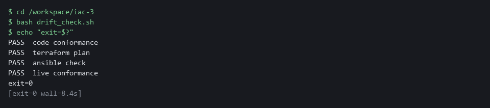

> **TIP:** To use this as a gate before an apply, run python3 conformance.py code ansible/baseline.yml && ansible-playbook ansible/baseline.yml. The apply happens only if the code check passes. CPS-4 is a good companion: it practices the same kind of live check on a workload.

> **YOUR TURN:** Run the first block to make drift_check.sh, then run the second block.

> **CHECKPOINT:** Four PASS lines and exit=0.

> **TAKEAWAY:** A check that could not run is not a pass.

**How this meets the controls**

- **CM-3:** One exit code from the combined script lets a pipeline block a change.
- **CM-6:** The script names each check in its output, so a finding says which check saw it, and its exit code separates clean, drift found and a check that could not run.

## Section 4. Verify It Works

### Test 1 (positive). The clean namespace passes every check (CM-2 Baseline Configuration)

A gate you have only seen fail is untested, so this test proves that it passes on the real baseline and that the objects are there.

```bash
cd /workspace/iac-3
bash drift_check.sh
echo "exit=$?"
oc get resourcequota,networkpolicy,role,rolebinding -n iac-lab
```

**Expected output:**

```
Example only.
PASS  code conformance
PASS  terraform plan
PASS  ansible check
PASS  live conformance
exit=0
NAME                       AGE   REQUEST ...
resourcequota/iac-quota    1h    pods: 0/10, ...
NAME                                   POD-SELECTOR   AGE
networkpolicy.../default-deny          <none>         1h
role.../iac-reader                     1h
rolebinding.../iac-reader-binding      Role/iac-reader   1h
(the platform adds five more bindings: openshift-pipelines-edit, pipelines-scc-rolebinding and three named system:...)
```

| Part | What it does | Why you run it |
| --- | --- | --- |
| cd /workspace/iac-3 | Moves into the working folder. | The gate script is a file in this folder. |
| bash drift_check.sh / echo ... | Runs the combined gate and prints its exit code. Four PASS lines and 0 are expected. | Every check agrees that the namespace matches the baseline. |
| oc get resourcequota,networkpolicy,role,rolebinding -n iac-lab | Lists the quota, the policy, the role and the binding in the namespace. | Proves from the cluster itself that the objects exist. |

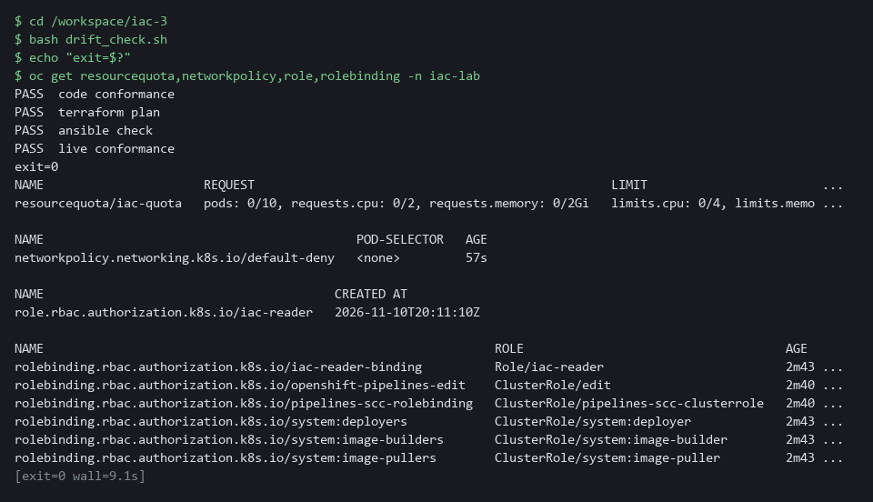

> **CHECKPOINT:** Four PASS lines, exit=0, and the quota, the policy, the role and the binding are listed.

**How this meets the control**

- **CM-2:** Exit code 0 and the listed quota, policy, role and binding show that the live namespace matches the baseline.

### Test 2 (negative). An extra role binding: each tool alone misses it, the gate does not (CM-6 Configuration Settings)

- You will now add the extra role binding yourself.
- The Terraform plan and the Ansible check should both say clean, because neither lists the binding, while the combined gate should fail and name it.
- You then remove the binding and run the gate again.

```bash
cd /workspace/iac-3
oc create rolebinding extra-binding --role=iac-reader --serviceaccount=iac-lab:iac-extra -n iac-lab --dry-run=client -o yaml | oc apply -f -
terraform -chdir=terraform plan -detailed-exitcode -input=false -no-color > /dev/null; echo "terraform exit=$?"
ansible-playbook --check ansible/baseline.yml | grep -o 'changed=[0-9]*'
bash drift_check.sh
echo "gate exit=$?"
oc delete rolebinding extra-binding -n iac-lab --ignore-not-found
bash drift_check.sh > /dev/null; echo "after cleanup exit=$?"
```

**Expected output:**

```
Example only.
rolebinding.rbac.authorization.k8s.io/extra-binding created
terraform exit=0
changed=0
PASS  code conformance
PASS  terraform plan
PASS  ansible check
DRIFT live conformance
FAIL live: RoleBinding extra-binding is not declared in code
gate exit=1
rolebinding.rbac.authorization.k8s.io "extra-binding" deleted
after cleanup exit=0
```

| Part | What it does | Why you run it |
| --- | --- | --- |
| cd /workspace/iac-3 | Moves into the working folder. | The Terraform folder, the playbook and the gate are found from here. |
| oc create rolebinding ... --dry-run=client -o yaml \| oc apply -f - | Adds the extra role binding. --dry-run=client -o yaml prints the object without creating it, and oc apply -f - creates it from that text, so a second run does not fail. | This is the hand change that no code lists. |
| terraform ... plan -detailed-exitcode ...; echo ... | Plans and prints only the exit code. 0 is expected. | Terraform does not know about the binding, so it sees no drift. |
| ansible-playbook --check ... \| grep -o 'changed=[0-9]*' | Runs check mode and prints the changed count. changed=0 is expected. | Ansible does not know about the binding either. |
| bash drift_check.sh / echo ... | Runs the whole gate. DRIFT live conformance, a FAIL line naming extra-binding and exit 1 are expected. | The live check starts from what exists, so it finds the binding. |
| oc delete rolebinding extra-binding ... / bash drift_check.sh | Removes the binding and runs the gate again. Exit 0 is expected. | Cleans up and proves the gate passes again. |

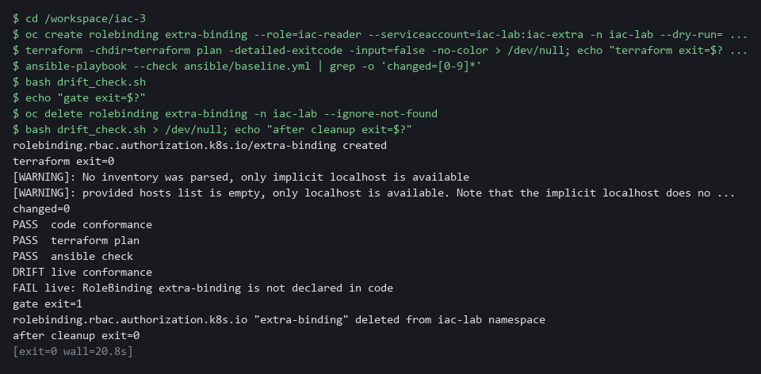

> **CHECKPOINT:** Terraform exits 0 and Ansible shows changed=0, so each alone misses the binding. The gate prints DRIFT for the live check, names extra-binding and exits 1. After the binding is deleted the gate exits 0.

**How this meets the control**

- **CM-6:** Two clean tool results next to one gate failure show why the live check is needed.

### Test 3 (negative). A wildcard role is refused before apply (CM-3 Configuration Change Control)

- You will now make a copy of the playbook in which the role allows every verb.
- ansible-lint passes on ansible/wild.yml, because the linter checks style and does not read what a role grants.
- The code check fails on ansible/wild.yml, and && (run the next command only if the first one succeeds) makes the apply run only if the check passes.
- The live role must be unchanged afterward.

```bash
cd /workspace/iac-3
sed 's/\[get, list, watch\]/["*"]/' ansible/baseline.yml > ansible/wild.yml
grep -n '"\*"' ansible/wild.yml
ansible-lint ansible/wild.yml
python3 conformance.py code ansible/wild.yml && ansible-playbook ansible/wild.yml
echo "gate exit=$?"
oc get role iac-reader -n iac-lab -o jsonpath='{.rules[0].verbs}{"\n"}'
rm -f ansible/wild.yml
```

**Expected output:**

```
Example only.
40:            verbs: ["*"]
Passed: 0 failure(s), 0 warning(s) in 1 files processed of 1 encountered. Last profile that met the validation criteria was 'production'.
FAIL code: Role iac-reader uses a wildcard
conformance FAILED (code)
gate exit=1
["get","list","watch"]
```

| Part | What it does | Why you run it |
| --- | --- | --- |
| cd /workspace/iac-3 | Moves into the working folder. | The playbook is found from here. |
| sed ... > ansible/wild.yml | Makes a copy of the playbook in which the verbs of the role are a star. | The real playbook stays as it is. |
| grep -n '"\*"' ansible/wild.yml | Prints the line of the copy that holds the star. | Shows the bad change before anything judges it. |
| ansible-lint ansible/wild.yml | Runs the linter on the copy. It passes. | The linter checks style and structure and does not read what a role grants. |
| python3 conformance.py code ansible/wild.yml && ansible-playbook ansible/wild.yml | Runs the code check on the copy. It fails, so the apply after && never runs. | This is the gate that stops the risky change before apply. |
| oc get role iac-reader ... jsonpath | Prints the verbs of the live role. get, list and watch are expected. | Proves nothing reached the cluster. |
| rm -f ansible/wild.yml | Removes the copy. | Leaves only the real playbook. The flag makes a second run harmless. |

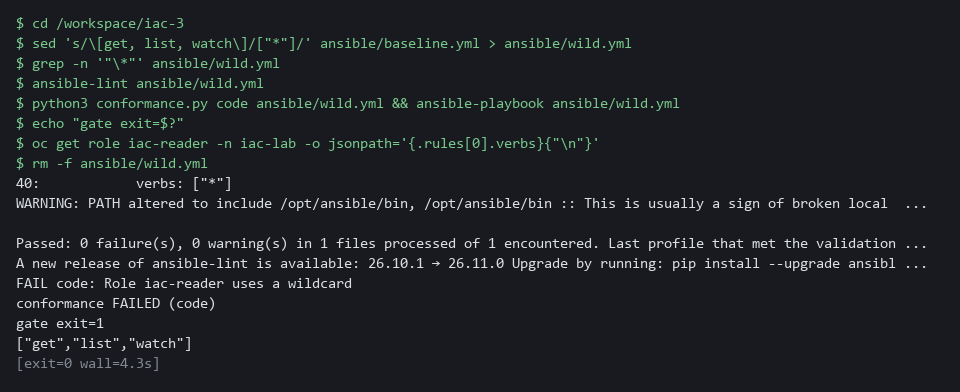

> **CHECKPOINT:** The line number shows the wildcard in the copy. ansible-lint passes, the code check fails, the apply does not run, and the live role still lists get, list and watch.

**How this meets the control**

- **CM-3:** The code check fails the wildcard role that the linter passed, so the apply never runs.

## Section 5. What Each Control Is For

### Control mapping

| Control | What it requires, in plain words | Tool or service | Where this module covers it |
| --- | --- | --- | --- |
| CM-2 Baseline Configuration | Keep a current baseline (the agreed starting configuration) under configuration control. NIST leaves the review frequency organization-defined; FedRAMP assigns at least annually and when a significant change occurs. | Terraform code and an Ansible playbook, each holding the same five objects. Explained in section 2.1. | Section 3, Steps 1 and 2: write the playbook for the baseline and prove that a second run changes nothing. Section 4, Test 1: the live namespace matches the baseline. |
| CM-3 Configuration Change Control | Review proposed changes and approve or disapprove them. Here the proposed change is a playbook, and a script that refuses a wildcard role reviews it automatically before anything is applied. | A before-apply code check in conformance.py, and drift_check.sh. Explained in section 2.3. | Section 3, Steps 3 and 4: write the code check and the combined gate. Section 4, Test 3: a wildcard role is refused before apply. |
| CM-6 Configuration Settings | Monitor and control changes to configuration settings. Here the settings are a quota value, a default-deny rule and a read-only role. FedRAMP requires the DoD STIGs for configuration settings, then CIS Level 2 guidelines where no STIG exists. | terraform plan -detailed-exitcode, ansible-playbook --check and a live conformance check. Explained in section 2.2. | Section 3, Steps 3 and 4: close the gap that neither tool sees, then combine the checks. Section 4, Test 2: an extra role binding is caught by the combined check only. |

### What each control is for

Each table below says what the control is trying to prevent and how this module's tool meets it.

#### CM-2 Baseline Configuration

| Question | Answer |
| --- | --- |
| Control Intent | The namespace slowly stops matching its baseline and nobody can say what the baseline was, or two copies of the baseline disagree. |
| The operational question | Is the baseline written down as code, and does the live namespace match it right now? |
| What evidence proves it | A clean Terraform plan, a playbook check with no changes, and the PLAY RECAP changed count. |
| How much is enough | The code lists every baseline object and both tools agree with the live namespace. NIST leaves the review frequency organization-defined; FedRAMP assigns at least annually and when a significant change occurs. This module does not run that review. |
| How the tool in this module satisfies it | The supplied Terraform code, the playbook you write (Step 1), and the proof that it converges (Step 2). |

#### CM-3 Configuration Change Control

| Question | Answer |
| --- | --- |
| Control Intent | A change reaches the namespace without review, either as a risky edit in code or as a hand change that bypasses the code. |
| The operational question | Would a risky proposed change be stopped before it is applied, and would a change made outside the code be noticed? |
| What evidence proves it | The result of the code check on a wildcard role, and the exit code of the combined check after a hand change. |
| How much is enough | A script refuses a wildcard role before apply. The lab does not decide who approves changes; that is the organization's process and is not tested here. |
| How the tool in this module satisfies it | The code check in conformance.py (Step 3) and drift_check.sh (Step 4). |

#### CM-6 Configuration Settings

| Question | Answer |
| --- | --- |
| Control Intent | A setting is changed by hand, such as a quota raised or a default-deny policy removed, and the tools that guard the baseline say nothing. |
| The operational question | Which objects can each tool see, which can it not see, and what covers the rest? |
| What evidence proves it | The exit code and FAIL line of the combined check after an extra role binding is added, and the state of the live namespace. |
| How much is enough | An extra role binding, which neither code base lists, is detected by the combined check. Where NIST leaves the policy to the organization, the lab chooses to fail on any undeclared role binding or network policy. |
| How the tool in this module satisfies it | The conformance check (Step 3) and drift_check.sh (Step 4). |

## Section 6. Next Steps

### Using this in other environments

- Terraform, ansible-playbook --check, conformance.py and drift_check.sh work against any Kubernetes cluster that your kubeconfig can reach.
- Change these lab values first: the folder /workspace/iac-3, the namespace iac-lab, and the kubeconfig path (the KUBECONFIG variable for oc and Ansible, config_path in terraform/main.tf).
- conformance.py allows five role bindings that OpenShift and OpenShift Pipelines create in every new namespace: openshift-pipelines-edit, pipelines-scc-rolebinding, system:deployers, system:image-builders and system:image-pullers. On other platforms remove them from the PLATFORM set, and add any binding your platform creates itself.
- The Terraform Kubernetes provider and the Ansible collection come already installed in the lab shell. Elsewhere, install them yourself, and install PyYAML for conformance.py.

The table shows what changes on each platform:

| Check | In this lab (OpenShift) | On other platforms | What you change |
| --- | --- | --- | --- |
| Terraform plan check | terraform plan -detailed-exitcode against the lab kubeconfig | The same command | The kubeconfig path. |
| Ansible check | ansible-playbook --check with kubernetes.core.k8s | The same command | The kubeconfig path. |
| Live conformance | conformance.py with the PLATFORM set of five OpenShift role bindings | The same script, with that set changed | The PLATFORM set in conformance.py. |
| Manual changes in the tests | oc delete resourcequota iac-quota | kubectl delete resourcequota iac-quota | The tool name. |
| drift_check.sh | Runs the code check, the plan, the Ansible check and the live check, then one exit code | The same script | Nothing, apart from the paths above. |

> **TIP:** Next module: CPS-5 Guardrails Developers Inherit: IAC-3 is the last module in the infrastructure as code dimension, and CPS-5 turns checks like these into defaults every new project receives.

<details>
<summary><strong>Section 7. Terms</strong></summary>

Each term is also explained the first time it appears. In Word, hover over an underlined term to see its meaning, or Ctrl+click it to jump to this table.

| Term | Plain meaning |
| --- | --- |
| Ansible | A tool that runs a list of tasks. Each task calls a module, a ready-made action that makes one thing true. It keeps no record between runs. |
| AWS | Amazon Web Services, the cloud your lab runs in. |
| Baseline | The agreed starting configuration that the system is expected to match. |
| Check mode | A way to run a playbook that reports what would change without changing anything. The command flag is --check. |
| Cluster | A group of servers that work together as one system. Here it is your own OpenShift cluster in AWS. |
| Collection | A package of ready-made Ansible actions called modules. kubernetes.core is the collection that talks to a Kubernetes or OpenShift cluster. |
| Config map | A cluster object that holds plain settings (not secrets) as named values or files, so a program can read them. |
| Conformance check | A script that lists what is live and fails on anything the code does not declare. |
| Container | A sealed box that holds one program and everything it needs to run. |
| Default-deny | A network policy that selects every pod and lists no allowed traffic, so everything is blocked until another rule allows it. |
| diff | A command that shows the differences between two files. |
| Drift | A difference between what the code says and what is live. |
| Evidence | Saved records that show a system is set up and behaving as claimed. |
| Exit code | A number a command leaves behind when it ends. 0 means success; anything else means a difference or a problem. |
| FedRAMP | The US program that sets security requirements for cloud services used by the federal government. |
| Gate | A check that stops a change from going further when it fails. |
| grep | A command that prints only the lines that match a pattern. |
| Heredoc | A way to make a file by pasting its text between a first line such as cat > name <<'EOF' and a last line that says EOF. |
| Idempotent | Safe to run again: a second run finds nothing to change and reports changed=0. |
| Image | A packaged copy of a program and everything it needs to run. A container starts from an image. |
| Infrastructure as code | Keeping the settings of a system as files that a tool applies, so the settings can be reviewed, repeated and compared with what is live. |
| Ingress | The way traffic from outside the cluster reaches a program inside it. |
| JSON | A plain-text data format of names and values written inside curly braces. oc can print it and a script can read it. |
| Kubeconfig | A file that tells a tool which cluster to talk to and how to sign in. The lab exports its path in the variable KUBECONFIG. |
| Kubernetes | The open-source system that runs and manages containers across servers. OpenShift is built on it. |
| Label | A key=value tag on a cluster object, used to pick objects, such as app=demo-app. |
| Linter | A tool that reads a file and reports mistakes in style and structure without running it. ansible-lint is the Ansible linter. |
| mkdir | A command that makes a new folder. |
| Namespace | A named section of the cluster that keeps objects apart. OpenShift also calls it a project. |
| Network policy | A rule about which traffic pods may send and receive. |
| NIST | The US National Institute of Standards and Technology. It publishes the security control catalog these modules cite. |
| oc | The OpenShift command-line tool. You type oc, then a verb such as get, then what it acts on. |
| OpenShift | The Red Hat platform your lab cluster runs on. It is Kubernetes with extra security and tools built in. |
| Pipeline | A set of automated steps that run in order, such as scan, check and sign. |
| PipelineRun | One execution of a Tekton pipeline. |
| Plan | Terraform's preview of what it would change. With -detailed-exitcode its exit code tells you whether anything differs. |
| PLAY RECAP | The summary Ansible prints at the end of a run. Its changed count is the number of tasks that changed something, or would have in check mode. |
| Playbook | An Ansible file, written in YAML, that lists the tasks to run and the machines or targets to run them on. |
| Pod | The smallest running unit on the cluster: one or more containers together. |
| Policy | A set of rules written down so that a tool can enforce them. |
| Provider | The company or plug-in that supplies a platform, such as a cloud provider or a Terraform provider. |
| Resource quota | A cluster object that caps what a namespace may use, such as the number of pods. |
| Role | A cluster object that lists which actions are allowed on which kinds of objects in a namespace. |
| Role binding | A cluster object that gives a role to a user, a group or a service account. |
| Rule | A written condition that a tool checks. |
| sed | A command that edits text as it passes through, often to replace one string with another. |
| Service account | An identity for a program instead of a person. |
| State file | A file Terraform keeps that records which live object belongs to each resource in its code. Without it Terraform does not know what it owns. |
| STIG | Security Technical Implementation Guide: a DoD checklist of settings for one product. |
| Tekton | The pipeline engine in OpenShift Pipelines. It runs each pipeline step in a container. |
| Terraform | A tool that reads files describing the objects you want, compares them with what exists, and creates or changes objects to match. |
| Verb | An action that a role allows, such as get, list or watch. |
| Wildcard | A star in a role rule that means every verb, every resource or every group. A role with a wildcard grants far more than a read-only role should. |
| YAML | A plain-text format for settings: lines of name: value, with indentation to show what belongs to what. |

</details>
