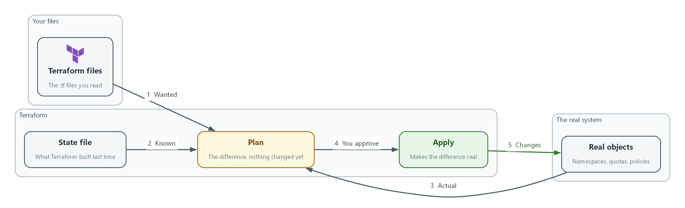
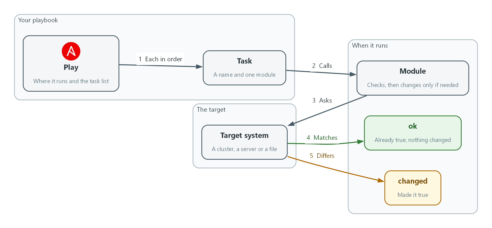
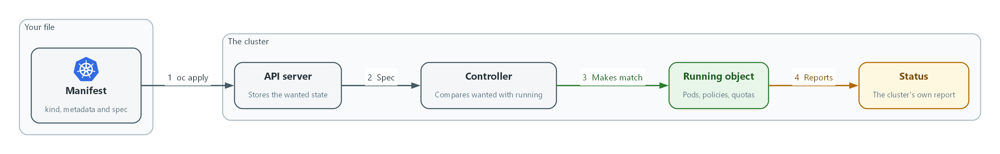
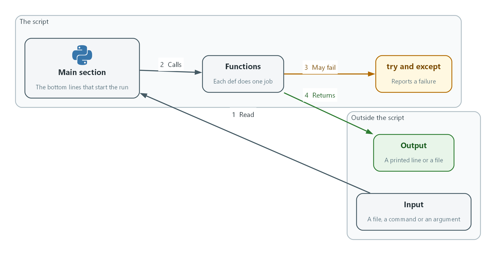
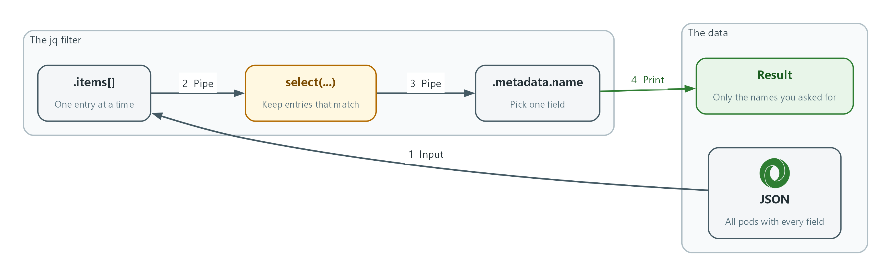
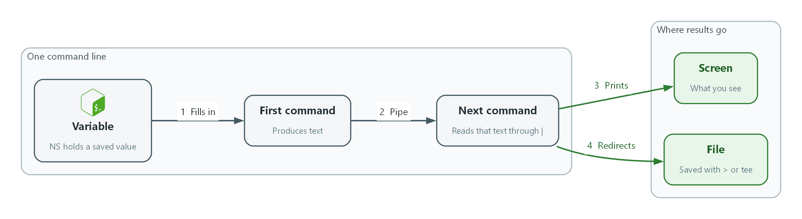

# How to Read the Tools

An aside for the training, not a module. Each page covers one tool: how to read a file, and how it works. You will not write these tools here; you will recognize them.

- Terraform, Ansible, Kubernetes YAML, Python, jq and Bash each get one page.
- Each page has five moves for reading, a small example with the lines explained, the commands that run it, and a picture of how it works.

## Terraform

---
Terraform files describe the objects you want. Terraform compares the files with what exists and changes only the difference.

#### How to read it

- Find the blocks: each block starts with a word such as resource, variable, output or data, then names in quotes, then braces.
- Read a resource block as 'make one object of this type, with these settings'. The first quoted name is the type; the second is your label for it.
- Follow the references: var.name is an input, and type.label.attribute is a setting taken from another object.
- Read a plan before anything else. A plus means create, a minus means destroy, a tilde means change in place, and minus-plus means replace.
- Remember the state file: it records what Terraform built, so a plan is a comparison of your files, the state and the real objects.

#### A small example

```hcl
variable "name" {
  type = string
}

resource "kubernetes_namespace_v1" "lab" {
  metadata {
    name = var.name
  }
}
```

- **variable:** an input with a type; a value comes from a file, the command line or a default.
- **resource:** one object; the settings inside the braces are what Terraform makes true.
- **var.name:** the input is used as the namespace name.

#### How it works



terraform init: downloads the providers the files need. terraform plan: shows the difference and changes nothing. terraform apply: makes the difference real and updates the state. Where you meet it: IAC-1, IAC-2 and IAC-3 run and review Terraform.

## Ansible

---
An Ansible playbook is a list of tasks run in order. Each task asks a module to make one thing true and reports whether it had to change anything.

#### How to read it

- Read the play first: hosts says where it runs, and tasks lists what it does, top to bottom.
- Read each task as its name, then its module, then the module's settings. The name says the intent in plain words.
- Look for conditions and variables: when skips a task, and double braces mark a value filled in at run time.
- Read the recap: ok means already true, changed means Ansible made it true, and failed means stop and read the message.
- Use check mode to preview: --check shows what would change without changing it, and ansible-lint reads the file for risky or sloppy tasks.

#### A small example

```yaml
- name: Baseline for the lab project
  hosts: localhost
  tasks:
    - name: Ensure the service account exists
      kubernetes.core.k8s:
        state: present
        kind: ServiceAccount
        name: lab-runner
        namespace: iac-lab
      when: create_account | default(true)
```

- **name (play):** what the whole play is for.
- **hosts:** where the tasks run; localhost means the machine running the playbook.
- **kubernetes.core.k8s:** the module; it does the work and reports ok or changed.
- **state, kind, name, namespace:** the settings that describe the wanted result.
- **when:** the task runs only if this is true.

#### How it works



ansible-playbook file.yml runs the playbook. Add --check to preview. ansible-lint file.yml reviews it without running it. Where you meet it: IAC-1 and IAC-3 run an Ansible playbook, and IAC-3 lints it.

## Kubernetes and OpenShift YAML

---
A manifest states what should exist. The cluster keeps comparing the file's spec with what is running and works to make them match.

#### How to read it

- Read the first two lines: apiVersion and kind tell you what type of object it is.
- Read metadata next: name, namespace and labels say which object it is and where it lives.
- Read spec as the wanted state. Everything the cluster should make true is under it.
- Follow the indentation: two spaces deeper means 'belongs to the line above', and a dash starts one item in a list.
- Read status, if you see it, as the cluster's own report. You never write status; the cluster fills it in.

#### A small example

```yaml
apiVersion: v1
kind: ResourceQuota
metadata:
  name: lab-quota
  namespace: iac-lab
spec:
  hard:
    pods: "10"
    requests.cpu: "2"
```

- **apiVersion and kind:** the object type, here a resource quota.
- **metadata:** the name and the project it belongs to.
- **spec.hard:** the wanted limits; the cluster refuses anything above them.

#### How it works



oc apply -f file.yaml sends the file. oc get <kind> <name> -o yaml shows the live object, including status. Where you meet it: Nearly every module applies or reads a manifest.

## Python

---
A Python script runs from the top. Reading it is following where data comes in, what each function does to it and what comes out.

#### How to read it

- Start at the bottom: the last lines, often under if __name__ == "__main__":, show what runs first.
- Read the imports at the top: they list the tools the script uses, such as json, subprocess or yaml.
- Read each def line as a name and its inputs; the first string inside, if any, says what it is for.
- Follow indentation: everything indented under if, for, try or def belongs to that line.
- Read try and except as 'attempt this, and say what to do if it fails'; a good script reports the failure instead of hiding it.

#### A small example

```python
import json
import subprocess

def get_quota(namespace):
    out = subprocess.run(["oc", "get", "quota", "-n", namespace, "-o", "json"],
                         capture_output=True, text=True, check=True)
    return json.loads(out.stdout)

if __name__ == "__main__":
    print(get_quota("iac-lab")["items"][0]["metadata"]["name"])
```

- **import:** the script uses JSON parsing and can run other commands.
- **def get_quota(namespace):** a function; the namespace is its input.
- **subprocess.run:** runs the oc command and captures its output; check=True raises an error if the command fails.
- **json.loads:** turns the text output into data the script can index.
- **if __name__ == "__main__":** the script starts here when run directly.

#### How it works



python3 script.py runs the script. python3 -m py_compile script.py checks the syntax without running it. Where you meet it: Short Python scripts appear in GRC, SDR, VM, CPS, AID and IAC modules.

## jq

---
jq reads JSON and keeps only the parts you ask for. A jq filter is a chain of small steps separated by pipes.

#### How to read it

- Read left to right: each | hands the result of one step to the next.
- Read .name as 'the field called name', and .items[] as 'every entry in the list called items'.
- Read select(condition) as 'keep the entries where the condition is true, drop the others'.
- Read braces as a new, smaller object: {name: .metadata.name} builds one with only that field.
- Check the flags: -r prints plain text without quotes, -c prints each result on one line, and -e makes jq exit with an error when the last result is false or null.

#### A small example

```bash
oc get pods -o json | jq -r '.items[] | select(.status.phase != "Running") | .metadata.name'
```

- **.items[]:** take each pod from the list.
- **select(.status.phase != "Running"):** keep only pods whose phase is not Running.
- **.metadata.name:** print only the pod's name.
- **-r:** print the names as plain text.

#### How it works



jq . file.json pretty-prints a file. Add a filter in single quotes to narrow it, and build it one pipe at a time. Where you meet it: Evidence, scan and policy checks in most modules use jq.

## Bash

---
A shell command is a program name followed by its options. Reading a line means splitting it into commands and following where the output goes.

#### How to read it

- Find the command: the first word is the program, and the words after it are its arguments.
- Split on | : each side is a separate command, and the left side's output feeds the right side.
- Spot redirects: > writes output to a file, >> adds to a file, and 2>&1 sends error messages along with normal output.
- Read $VARIABLE as a value saved earlier and $(command) as the output of another command, inserted here.
- Watch the joiners: && runs the next command only if this one succeeds, and a backslash at the end of a line continues the command on the next line.

#### A small example

```bash
NS=iac-lab
oc get pods -n "$NS" -o name \
  | sort \
  | tee pods.txt
echo "exit status: $?"
```

- **NS=iac-lab:** saves a value; later lines read it as $NS.
- **oc get pods ... -o name:** the first command, listing pod names.
- **| sort:** the left output is sorted.
- **| tee pods.txt:** shows the result and saves it in the file.
- **$?:** the exit status of the last command in the pipeline, here tee and not oc; 0 means success.

#### How it works



bash -n script.sh checks the syntax without running it. echo $? right after a command shows whether it succeeded. Where you meet it: Every module's steps run Bash commands in the lab shell.
