# SDR-2: Triage an Alert by Runbook (AU-6, IR-4, AU-5)

| Item | Detail |
| --- | --- |
| Sequence | Module 5 of 29 in the recommended order |
| Timed work | About 60 minutes (42 hands-on, 18 verify) |
| Standalone start | `lab start sdr-2` |
| Combined start | Continue from the end state of the previous module |
| Tools | Loki and Grafana (free, open source), Mattermost (free, open source), OpenShift Container Platform, oc, curl, jq, python3 |
| Prerequisites | ENG-0 Terminal, Git and Your Lab (you can open lab shell, type oc and jq commands, and read their output) |

## Section 1. Module Overview

- Purpose: make sure people review what monitoring raises, decide quickly whether it is real, and notice when logs are missing or late (AU-6, IR-4, AU-5).
- You use a runbook and supplied triage.py commands for three alert types: a privilege change, a burst of failed sign-ins and a shell opened in a pod.
- You run the commands, read the evidence, decide to close or escalate, post each decision to the alert channel, and then run the path and gap checks.

- **Skill:** Run supplied commands that gather the evidence behind four alerts, decide to close or escalate each one, post the decision, and check that the logs behind an empty search were really there.
- **Tools:** `python3 triage.py` (the supplied commands) searches Loki and prints the evidence and the checks. `oc` copies the runbook out of the cluster. `curl` and `jq` post each decision to the Mattermost alert channel. Loki stores the logs, Grafana raises the alerts and Mattermost holds the alert channel.
- **Security Function:** Detects whether an alert is expected or needs escalation, and detects missing or late logs, so an empty search is not read as proof that nothing happened.
- **NIST AU-6 Audit Record Review, Analysis, and Reporting:** `triage.py` prints the audit records behind each alert, and the decision you post to the Mattermost alert channel is the report.
- **NIST IR-4 Incident Handling:** The runbook (`triage.py` and its decision table) gives every analyst the same checks and the same outcomes for the detection and analysis phase.
- **NIST AU-5 Response to Audit Logging Process Failures:** `triage.py path` and `triage.py gaps` find a late log type and a span with no records, and you tell the platform team in the alert channel.

## Section 2. The Tools

### Tools used in this module

Each tool name links to its official overview. The table columns say how each tool is used in the lab and why the lab uses it instead of another way of doing the same job.

| Tool (overview link) | What it is | Used in this lab | Why this tool |
| --- | --- | --- | --- |
| [Grafana Loki](https://grafana.com/docs/loki/latest/) | Log storage that indexes only labels and keeps compressed log data in object storage. | Holds the audit and runtime records the supplied search commands read. | It stores logs cheaply and is free and open source, so the lab can keep the logs that detections and investigations need without a paid logging product. |
| [Grafana](https://grafana.com/docs/grafana/latest/) | Dashboards, log browsing and alerting. | Where the alerts the runbook covers are shown. | It is where you browse logs and build dashboards, so the data Loki stores becomes something you can look at and share. It is free and open source. |
| [Mattermost](https://docs.mattermost.com/developers/integrate/webhooks/incoming) | Open-source team chat. Incoming webhooks let tools post messages into a channel. | Where the alerts arrive and where your triage is reported. | It is chat you run yourself and can send messages to from a script, so an alert reaches a person without an outside chat account. |
| [OpenShift Container Platform](https://docs.redhat.com/en/documentation/openshift_container_platform/4.22/html/overview/ocp-overview) | A Kubernetes container platform for running and managing containerized applications. | The cluster whose audit records and pods the four alerts describe. | It is the platform the whole lab runs on, so every module works on the same real cluster, with the same kinds of objects a production OpenShift system has. |
| [oc](https://docs.redhat.com/en/documentation/openshift_container_platform/4.22/html/cli_tools/openshift-cli-oc) | The OpenShift command-line tool for creating and managing applications and projects from a terminal. | Extracts the runbook from its ConfigMap and checks the pods involved. | It is the one command that talks to the cluster, so every module uses it to ask what is true and to make changes. You sign in once, and it works on OpenShift objects as well as standard Kubernetes ones. Unlike clicking in the web console, a command can be pasted, repeated and checked by a test. |
| [curl](https://curl.se/docs/manpage.html) | Command-line tool for transferring data over URLs, used here to call web endpoints. | Calls the Loki and Mattermost web interfaces from the shell. | It calls a web address from the terminal, so you can check what a service really returns instead of trusting a screen. |
| [jq](https://jqlang.org/) | Command-line JSON processor. | Picks fields out of log records and the triage output. | It picks one field out of a long JSON reply, so a test can read a single value. |
| [Python 3](https://docs.python.org/3/tutorial/introduction.html) | General-purpose language, used here for small helper scripts. | Runs triage.py for each alert type (privilege, signin, shell, path, gaps). | Python reads and writes JSON easily and is already in the lab shell, so a small script needs nothing installed. |

### How it fits together

#### The path a log takes, and where the triage commands look

- Logs (lines of text that programs save about what happened) travel from the sources to the log collector (a program that reads them and sends them on), then to Loki (the log store).
- An alert (a message that says a rule matched) travels from Grafana (the tool that runs the rules) to the alert channel (a named chat room) in Mattermost (team chat).
- The triage script in your lab shell searches Loki, and you post each decision to the same channel.
- This diagram shows the lab (test) setup.
- In production the runbook is kept under change control and alerts also reach the people on call.
- Each step below adds one part, drawn with thick lines.

How the lab is set up, and why:

- You work in lab shell on your computer, the same tools container you opened in the foundation module, and everything you search runs inside your cluster (a group of servers that work together as one system).
- Logs are written on a node (one server in the cluster), a collector in the project openshift-logging sends them to Loki in the project siem, and Grafana, also in siem, runs alert rules over what Loki holds and posts each alert to Mattermost in the project chat (a project is a named section of the cluster, also called a namespace).
- This module adds that logging path and the alert channel to the lab layout the foundation module showed, because triage only makes sense when you can see where a record comes from.
- This module also adds the script triage.py, which you run in lab shell: it searches Loki over the network, and you post each decision to the alert channel with curl.
- The runbook is stored in the cluster as a ConfigMap (a named bundle of small files) so every learner gets the same copy, and you copy it into lab shell with oc.
- The path is split into separate stops on purpose, so when a search comes back empty you can test each stop in turn and find the one that failed.

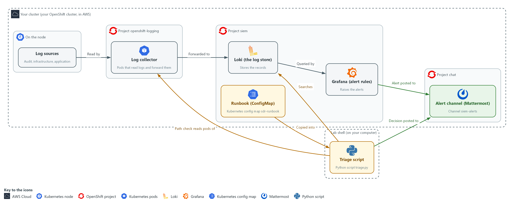

- **1. Log sources:** where logs are first written on a node. Audit, infrastructure and application logs start here.
- **2. Log collector:** pods in the project openshift-logging that read the logs and forward them to Loki.
- **3. Loki (the log store):** keeps every record so it can be searched. Triage searches here.
- **4. Grafana (alert rules):** queries Loki on a schedule and raises an alert when a rule matches.
- **5. Runbook (ConfigMap):** the ConfigMap sdr-runbook, which you copy into your lab shell with oc.
- **6. Alert channel (Mattermost):** the channel siem-alerts, where Grafana posts alerts and you post each decision.
- **7. Triage script:** triage.py in your lab shell. It searches Loki, and its path check also reads the pods of the log collector, so a gap can be located one hop (one stop on the path) at a time.

Where each part runs, and why:

| Part | Where it runs | Why it is built this way |
| --- | --- | --- |
| Log collector | Pods in the project openshift-logging (a pod is the smallest running unit on the cluster) | It reads logs where they are written, so no log source has to know about Loki. |
| Loki | The project siem | One store for every log type, so a single search can look across sources. |
| Grafana | The project siem, next to Loki | It queries Loki directly and posts the alerts that start your triage. |
| Alert channel | Mattermost in the project chat | People already read chat, so alerts and your decisions sit together in one place. |
| Runbook | A ConfigMap in the project siem | Every learner gets the same copy, and you copy it into lab shell with oc. |
| Triage script | Your lab shell | It reaches Loki over the network with the lab variables (named values the lab sets for you), so no password is typed. |

### 2.1 What triage decides (AU-6 Audit Record Review, Analysis, and Reporting, IR-4 Incident Handling)

- Triage is the first look at an alert: you fix nothing, and you collect the same facts every time.
- The outcome is one of two: close the alert as expected, or escalate it (hand it to someone with more authority, with the evidence).
- Without a fixed rule, real attacks get closed as noise and noise gets escalated until nobody trusts the channel.
- The commands print facts and the table below turns the facts into the outcome. The table is the lab's choice; a real team's runbook sets its own.

#### AU-6: Audit Record Review, Analysis, and Reporting

*The control asks the organization to review and analyze audit records at an organization-defined frequency for organization-defined inappropriate or unusual activity and its potential impact, to report findings to organization-defined personnel or roles, and to adjust the level of review when risk changes. This is done using:*

- triage.py: prints the audit records behind each alert and the checks to apply to them.
- The Mattermost alert channel: where each alert arrives and where you post one finding for it, which is the report.

#### IR-4: Incident Handling

*The control asks the organization to implement an incident handling capability that includes preparation, detection and analysis, containment, eradication, and recovery, and to make the rigor, intensity, scope and results of handling comparable and predictable. This module covers only detection and analysis. This is done using:*

- The runbook in the ConfigMap sdr-runbook: holds triage.py, which prints the same checks every time for an alert of the same type.
- The decision table: turns the checks into close or escalate, so two analysts reach the same outcome from the same evidence.

The table below shows how each finding leads to an outcome:

| Finding | Outcome | Why |
| --- | --- | --- |
| The change or person matches the approved list and the role (a named list of permissions) is not admin-level (full control) | Close and record | It was planned and low risk. |
| A source failed sign-in several times and then succeeded | Escalate now | The account may be taken over. |
| The actor is not on the approved list | Escalate | An unplanned action by a person. |
| The expected record is missing | Do not close. Check the path. Escalate as a logging gap if the path shows one | An empty search may mean the logs were not there. |

### 2.2 The path a log takes

- A log is written on a node (a server in the cluster) and read by a collector (a small program that sends logs onward). It is then stored in Loki, watched by Grafana and announced in Mattermost.
- Each stop on the path (node, collector, Loki, Grafana, Mattermost) is a hop, and each hop can fail on its own.
- When a search is empty, find which hop failed before you decide anything. The path check prints one line per hop.

The table below lists each hop, what it does and what its failure looks like:

| Hop | What it does | What a failure looks like |
| --- | --- | --- |
| Collector | Reads logs on each node and sends them to Loki | Fewer collector pods Running than nodes; every log type stops together |
| Loki | Stores and indexes the records | The ready check does not answer |
| Records in Loki | Hold the events you search for | A log type whose newest record is old (late), or a span with none (gap) |
| Grafana | Runs the alert rules | The health check does not answer; alerts stop without a sound |
| Mattermost | Shows the alert to people | The ping does not answer; alerts fire but nobody sees them |

### 2.3 Missing and late are different (AU-5 Response to Audit Logging Process Failures)

- A late log arrives eventually, so evidence for recent events is incomplete for now. A missing log never arrives, so a span of time has no evidence at all. Either way, do not trust an empty search.
- The lab chooses its own limits, not framework values: a log type is late when its newest record is more than 5 minutes old, and a gap is a span of more than 10 minutes with no record.
- The exercise records carry the labels lab_seed and seed_run so they do not mix with the real records of your cluster or with a copy left from an earlier lab start. A real search would not have these labels.
- The exercise records are fixed in time, so the path check measures their age from the moment the exercise started. On a real system the age is measured from now.

#### AU-5: Response to Audit Logging Process Failures

*The control asks the organization to alert organization-defined personnel or roles within an organization-defined time period when the audit logging process fails, and to take organization-defined additional actions. This is done using:*

- triage.py path: reads each hop of the log path and the age of the newest record of each log type, which finds a late log type.
- triage.py gaps: lists the spans with no records, using the lab limit of 10 minutes.
- The Mattermost alert channel: where you tell the platform team about the failure.

### Design decisions

#### Commands print facts and a table decides

- How: The supplied commands print the same CHECK lines for each alert type, and a decision table in the runbook turns those checks into close or escalate. The analyst posts one decision line per alert to the alert channel.
- Why: Comparable handling means two analysts reach the same outcome from the same evidence, and the decision stays with a person while the command only gathers facts.
- Alternatives: The advantage of letting the command close alerts by itself is that it is faster and fully consistent. The drawback is that one wrong rule would silently close a real attack, and nobody practices judgment.

#### Check the path before trusting an empty result

- How: The path check tests each hop from the collector to the chat channel and reads the age of the newest record per log type, and the gap check lists spans with no records. When the audit record is missing, the shell command exits with a non-zero code instead of guessing.
- Why: An empty search may only mean the logs were not there, and a late log and a missing log call for different responses.
- Alternatives: The advantage of treating no record as no event is that it is simple and fast. The drawback is that a logging failure then looks like a quiet night, which is the worst case for an audit trail.

## Section 3. Implement

- Start: type `lab start sdr-2` in the terminal on your own computer (PowerShell on Windows, Terminal on Mac), not in the lab shell.
- Enter lab shell with `lab shell`. Every other command in this module runs inside lab shell.
- If a step fails: run `lab reset sdr-2` on your own computer and repeat the step once. If it still fails, copy the whole command and error and ask your AI assistant. Do not skip the step.

### Step 1. Fetch the runbook and read the four alerts

**Learning point: Copying the runbook out of the cluster and printing the four alerts gives you the commands, the approved list and the alerts to triage.**

- The runbook files live in the cluster as a ConfigMap (a named bundle of small files).
- You extract them into your lab shell and read the four alerts that the start command posted to the alert channel in Mattermost.
- Each alert has an identifier such as A-101, a type and the time it was raised.

What this step adds (thick lines and outlines are new):

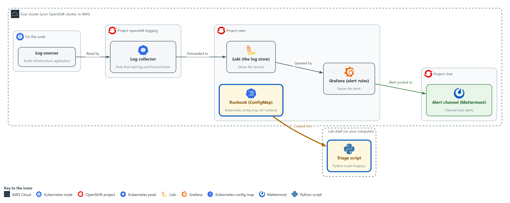

- You copy the runbook from the cluster into your lab shell with oc, and print the four alerts that were posted to the alert channel in Mattermost.

#### 1a. Fetch the runbook and look at it

You will now copy the runbook files from the cluster into a folder of your own, read the approved list and print the four alerts.

- You can run this block again; it overwrites the same files.

```bash
mkdir -p /workspace/sdr-2 && cd /workspace/sdr-2
oc extract configmap/sdr-runbook -n siem --to=. --confirm > /dev/null
ls
cat approved.json
python3 triage.py alerts
```

**Expected output:**

```
Example only. The order of the lines may differ.
anchor.txt  approved.json  lokilib.py  triage.py
{ ...the approved list: one privilege change and one person... }
ALERT   A-101  privilege-change     raised <time>  namespace=demo a role binding was created
(three more ALERT lines: A-102, A-103, A-104)
```

| Part | What it does | Why you run it |
| --- | --- | --- |
| mkdir -p ... && cd ... | Makes a folder for this module and moves into it, so files from other modules cannot collide with yours. The folder persists between lab sessions. | You run triage.py from this folder in every later step, so one known folder saves you hunting for the files. |
| oc extract configmap/sdr-runbook ... > /dev/null | Copies each file in the ConfigMap into the current folder and hides the list of file names it would print. --confirm lets it overwrite files from an earlier run. | The runbook is stored on the cluster so every learner gets the same copy. Copying it into lab shell is what lets you run it. |
| ls | Lists the files: triage.py is the supplied commands, approved.json the approved list, anchor.txt the exercise start time, `lokilib.py` the helper that searches Loki. | Check that all four files arrived before you try to run one of them. |
| cat approved.json | Prints the approved list: one privilege change (a grant of more permissions) and one person allowed to open a shell in the demo project. | Every alert is compared with this list, so read it now to know what counts as expected. |
| python3 triage.py alerts | Prints the four alerts that the start command posted to the alert channel: identifier, type, the time it was raised and the text of the alert. | You read the alerts here, so no Mattermost login is needed. Later steps call the same program, triage.py, for each alert. |

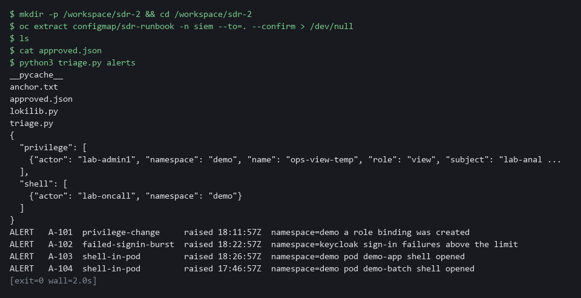

> **YOUR TURN:** Run the commands and read the four alerts, A-101 to A-104.

> **CHECKPOINT:** You have triage.py and approved.json in your folder, and the alerts command lists four alerts with their types.

> **TAKEAWAY:** Triage starts from the same runbook and the same alert list for everyone.

### Step 2. Triage the privilege-change alert (A-101) (AU-6 Audit Record Review, Analysis, and Reporting, IR-4 Incident Handling)

**Learning point: Running the privilege-change check prints the role binding behind A-101 and compares it with the approved list, so your decision rests on records and not on the alert text.**

- A privilege change is a grant of more permissions to someone.
- The supplied command searches the audit records (the cluster's record of every request) for role bindings created around the alert, prints who made them and compares the result with the approved list.
- The command also prints each search it runs, so you can see the LogQL (Loki's search language) used.

What this step adds (thick lines and outlines are new):


- The first triage command searches Loki for the audit record behind a privilege-change alert, and you post your decision to the alert channel.

#### 2a. Run the privilege-change checks for A-101

You will now run the supplied triage command for the first alert.

- The command only reads from Loki and prints facts.

```bash
cd /workspace/sdr-2
python3 triage.py privilege A-101
```

**Expected output:**

```
Example only. Times and names differ in your lab.
ALERT   A-101  type <alert type>  raised <time>
SEARCH  <the LogQL search it ran>
EVENT   <time>  <the role binding that was created, and who created it>
CHECK   <namespace>/<name> matches an approved change (actor, name, role, subject)   <yes or no>
CHECK   role is admin-level (admin or cluster-admin)   <yes or no>
```

| Part | What it does | Why you run it |
| --- | --- | --- |
| cd /workspace/sdr-2 | Moves into the module folder from step 1. | triage.py and its files are in that folder, so every block starts there. |
| python3 triage.py | Runs the supplied triage program. | This is the one program every triage step calls, so you meet its name before its options. |
| privilege A-101 | Tells it to triage a privilege-change alert with this identifier. | The word after the program name picks the kind of checks. The identifier names the alert, so the search is centered on the time it was raised. |

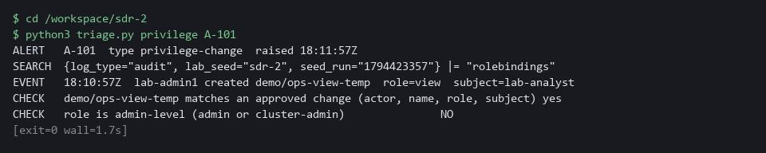

#### 2b. Post your decision for A-101

You will now write your decision as one line in the alert channel.

```bash
jq -n --arg t "A-101 CLOSE: matches the approved list; role is view, not admin-level" '{text:$t}' | curl -s -o /dev/null -w 'posted, HTTP %{http_code}\n' -H 'Content-Type: application/json' -d @- "$MM_WEBHOOK_URL"
```

**Expected output:**

```
Example only.
posted, HTTP 200
```

| Part | What it does | Why you run it |
| --- | --- | --- |
| jq -n --arg t ... '{text:$t}' | Builds the small message body that Mattermost expects, with your decision as the text. | Your decision has to be a short sentence in the shape the chat tool accepts. jq builds it safely, so a quote in your words cannot break the message. |
| curl -s -o /dev/null -w ... -d @- | Posts it and prints only the status code Mattermost answers with. 200 means the message was accepted into the channel. The address comes from the variable MM_WEBHOOK_URL (a webhook is an address that accepts messages), so no secret is typed. | Posting the decision is the record of your triage. Without it the alert has no outcome that anyone can check later. |

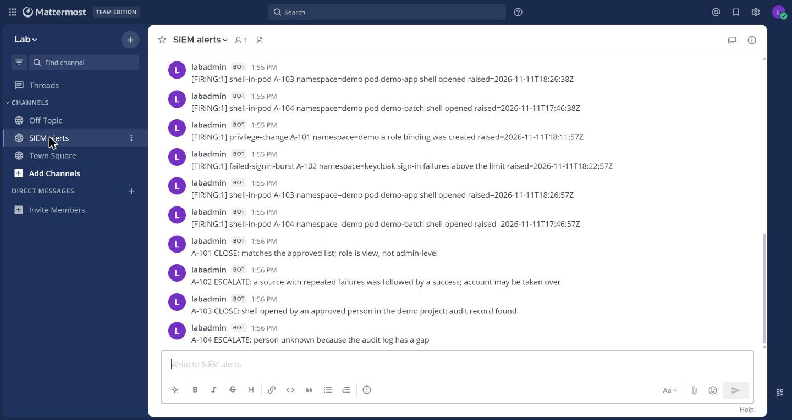

> **NOTE:** If you decide on a different outcome, change the words after the identifier.

> **YOUR TURN:** Run the first command and read every line. Decide using the table in 2.1. Then post your decision with the second command and check that it prints HTTP 200.

> **CHECKPOINT:** The CHECK lines show a match with the approved list and a role that is not admin-level, and the post prints HTTP 200.

> **TAKEAWAY:** Compare the alert with the approved list before you decide, and post the decision.

**How this meets the controls**

- **AU-6:** You run the search for the role binding behind alert A-101, read who made it, and post a finding to the alert channel. The posted line is the report.
- **IR-4:** The command prints the same checks for every privilege-change alert, and the decision table turns them into close or escalate. Your posted outcome lets another analyst check it.

### Step 3. Triage the failed sign-in burst (A-102) (AU-6 Audit Record Review, Analysis, and Reporting, IR-4 Incident Handling)

**Learning point: Grouping the sign-in records by account and source address shows whether failures from one source were followed by a success, which a single line cannot show.**

- A burst of failed sign-ins is many wrong passwords from one place in a short time, recorded by Keycloak, the lab's sign-in service.
- One burst of failures may be a mistyped password.
- A burst matters most when a success follows from the same source address (the network address the sign-in came from), because the guesser may have got in.
- The command groups the sign-in records by account and source address and shows whether a success came after the last failure.

What this step adds (thick lines and outlines are new):

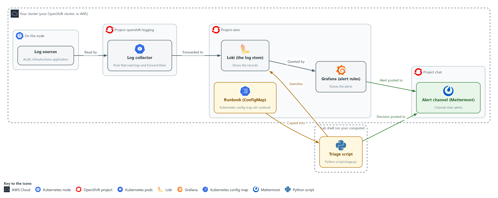

- The second command searches the sign-in records in Loki and compares failures with later successes, and you post your decision to the alert channel.

#### 3a. Run the failed sign-in checks for A-102

You will now run the supplied triage command for the second alert.

- The command reads the sign-in records in Loki and prints one row per account and source address.

```bash
cd /workspace/sdr-2
python3 triage.py signin A-102
```

**Expected output:**

```
Example only. Accounts, addresses and times differ in your lab.
ALERT   A-102  type <alert type>  raised <time>
SEARCH  <the LogQL search it ran>
<row 1: an account and address with 7 failures, LATER_SUCCESS <time>>
<row 2: an account and address with 3 failures, LATER_SUCCESS none>
CHECK   <last check line>   yes
```

| Part | What it does | Why you run it |
| --- | --- | --- |
| cd /workspace/sdr-2 | Moves into the module folder from step 1. | triage.py is in that folder. |
| signin A-102 | Searches the sign-in records around the alert and prints one row per account and source address. | One failed sign-in and a break-in can look alike in a single line. Grouping by account and address is what tells them apart. |

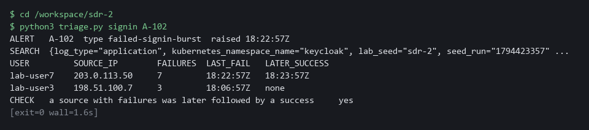

#### 3b. Post your decision for A-102

You will now write your escalation, with its reason, as one line in the alert channel.

```bash
jq -n --arg t "A-102 ESCALATE: a source with repeated failures was followed by a success; account may be taken over" '{text:$t}' | curl -s -o /dev/null -w 'posted, HTTP %{http_code}\n' -H 'Content-Type: application/json' -d @- "$MM_WEBHOOK_URL"
```

**Expected output:**

```
Example only.
posted, HTTP 200
```

| Part | What it does | Why you run it |
| --- | --- | --- |
| --arg t "A-102 ESCALATE ..." | The decision line. It names the alert, the outcome and the reason. | An escalation must carry its reason, so the person who receives it does not have to repeat your search. |

> **SECURITY:** Do not copy account names or addresses from an alert into places outside the alert channel. Say which row you mean by its position in the table.

> **YOUR TURN:** Run the first command. Look at both rows: one source has a time under LATER_SUCCESS, the other says none. Post your decision.

> **CHECKPOINT:** One row shows seven failures followed by a success from the same address, the other shows three failures and none, and the last CHECK line says yes.

> **TAKEAWAY:** A success after repeated failures from one source is escalated.

**How this meets the controls**

- **AU-6:** You read the sign-in records grouped by account and address, find the source whose failures were followed by a success, and post that finding to the alert channel.
- **IR-4:** The grouped rows and the last CHECK line apply a fixed rule: a success after repeated failures from one source is escalated. Your posted line gives the outcome and its reason.

### Step 4. Triage the shell opened in a pod (A-103) (AU-6 Audit Record Review, Analysis, and Reporting, IR-4 Incident Handling)

**Learning point: Pairing the Falco record with the audit record names the person who opened the shell, which neither record can do alone.**

- A shell opened inside a running pod lets a person run any command there.
- Two sources help: the runtime detector Falco says a shell was opened and in which pod, and the audit records say which person asked the cluster's API (the front door for requests to the cluster) to do it.
- The command pairs the Falco and audit records; if no audit record names the person, you cannot say who did it.

What this step adds (thick lines and outlines are new):


- The third command pairs a runtime shell record in Loki with the audit record that names the person.

#### 4a. Run the shell-in-a-pod checks for A-103

You will now run the supplied triage command for the third alert.

- The command pairs the Falco record with the audit record.

```bash
cd /workspace/sdr-2
python3 triage.py shell A-103
```

**Expected output:**

```
Example only. Times and the pod name differ in your lab.
ALERT   A-103  type shell-in-pod  raised <time>
SEARCH  <the search for the Falco record>
EVENT   <time>  shell in <namespace>/<pod> as <user>
SEARCH  <the search for the audit record>
CHECK   an API audit record names who opened the shell             yes
EVENT   <time>  <the person> ran exec on <pod>
CHECK   actor is on the approved shell list for <namespace>   <yes or no>
```

| Part | What it does | Why you run it |
| --- | --- | --- |
| cd /workspace/sdr-2 | Moves into the module folder from step 1. | triage.py is in that folder. |
| shell A-103 | Finds the Falco record, then the audit record for the same pod, and checks the person against the approved list. | Falco alone cannot say who opened the shell, and the audit record alone cannot say what ran. Pairing them is how you name the person. |

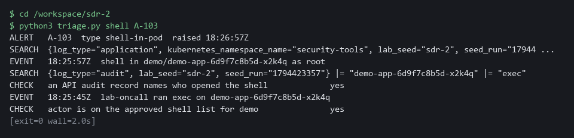

#### 4b. Post your decision for A-103

You will now write your decision as one line in the alert channel.

```bash
jq -n --arg t "A-103 CLOSE: shell opened by an approved person in the demo project; audit record found" '{text:$t}' | curl -s -o /dev/null -w 'posted, HTTP %{http_code}\n' -H 'Content-Type: application/json' -d @- "$MM_WEBHOOK_URL"
```

**Expected output:**

```
Example only.
posted, HTTP 200
```

| Part | What it does | Why you run it |
| --- | --- | --- |
| A-103 CLOSE | The decision line for an expected shell with a named, approved person. | You may close only because an approved person and an audit record were both found. The line says so, so a reviewer can check it. |

> **YOUR TURN:** Run the first command and read both searches it prints. Decide and post.

> **CHECKPOINT:** Both an audit record and a Falco record are found, the person is on the approved list, and the post prints HTTP 200.

> **TAKEAWAY:** Do not close a shell alert until an audit record names the person.

**How this meets the controls**

- **AU-6:** You pair the Falco record with the audit record that names the person, compare the person with the approved list, and post a finding to the alert channel.
- **IR-4:** The command always pairs the two sources and checks the approved list, so a close decision rests on named evidence. If no audit record names the person, the runbook rule is not to close the alert.

### Step 5. Find the missing logs (AU-5 Response to Audit Logging Process Failures)

**Learning point: The gap check lists a span of 28 minutes with no audit records, which shows that an empty search can mean the logs were never there.**

- Before you trust any empty result you must know the logs were there and the telemetry path (the route a log takes to where you search it) was healthy.
- The gap check lists spans with no records, and the path check (run in Verify) looks at every hop and reads the age of the newest record of each log type.
- Use the gap and path checks whenever a search finds less than the alert says it should.

What this step adds (thick lines and outlines are new):

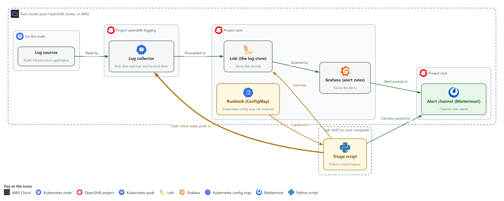

- The gap check searches Loki for spans with no records, and the path check in Verify walks every hop from the log collector to the alert channel and reads how old the newest record of each type is.

#### 5a. List the spans with no records

You will now ask triage.py for every span with no records.

```bash
cd /workspace/sdr-2
python3 triage.py gaps
```

**Expected output:**

```
Example only. Times differ in your lab, and other log types may be listed too.
GAP     audit          <start> to <end>  (28 minutes with no record)
(and an ok line for each log type without a gap)
```

| Part | What it does | Why you run it |
| --- | --- | --- |
| cd /workspace/sdr-2 | Moves into the module folder from step 1. | triage.py is in that folder. |
| triage.py gaps | Prints every span of more than 10 minutes with no record, for each log type. | An empty search only means something if the logs existed. This lists where they did not. |

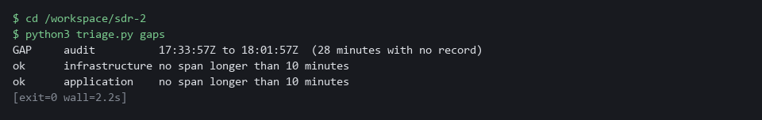

> **NOTE:** The late log type in this exercise is the infrastructure log, which the path check in Verify names. The rule for a late log is to carry on with the triage, note the lateness in your decision line, and tell the platform team.

> **YOUR TURN:** Run the command. Find the span that has no audit records.

> **CHECKPOINT:** The gap check lists a span of 28 minutes with no audit record.

> **TAKEAWAY:** An empty search proves nothing until you know the logs were there.

**How this meets the control**

- **AU-5:** The gap check lists spans with no records, and the path check in Verify tests every hop, so a failure of the logging process is noticed. The lab rule is to tell the platform team in the alert channel.

## Section 4. Verify It Works

### Test 1 (positive). The path check names the late log type (AU-5 Response to Audit Logging Process Failures)

- You checked your three decisions against the CHECK lines in Steps 2 to 4.
- A healthy path would print no LATE line.
- This exercise has one late log type, and finding it is the point.

```bash
cd /workspace/sdr-2
python3 triage.py path
```

**Expected output:**

```
Example only. The collector line depends on your cluster.
HOP 1 collector  1 of 1 pods Running
HOP 2 Loki       ready
HOP 3 audit          newest record 2 minutes old  ok
HOP 3 infrastructure newest record 24 minutes old  LATE
HOP 3 application    newest record 2 minutes old  ok
HOP 4 Grafana    answers
HOP 4 Mattermost answers
SUMMARY 1 hop(s) need attention
```

| Part | What it does | Why you run it |
| --- | --- | --- |
| cd /workspace/sdr-2 and python3 triage.py path | Moves into the module folder, then checks each hop in order: the collector pods, Loki, the newest record of each log type, then Grafana and Mattermost. | An empty search only means something if every hop works, so you check them before you trust it. |
| HOP 3 ... newest record N minutes old | How old the newest record of that log type is. More than 5 minutes (the lab limit) is marked LATE. | A late log type means recent events may not have arrived yet. |
| HOP 3 infrastructure ... LATE | The one late log type in this exercise. | Finding it is the point of the test. |
| SUMMARY 1 hop(s) need attention | The count of hops that failed or are late. | One is the expected answer here; a healthy path prints 0. |

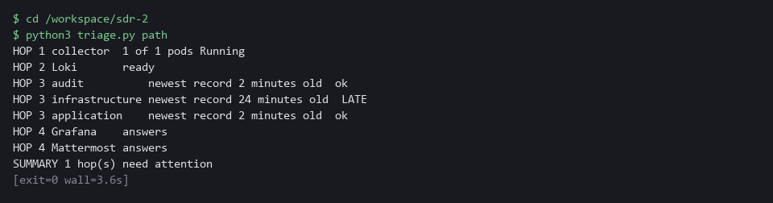

> **CHECKPOINT:** Only the infrastructure line says LATE, and the summary counts one hop needing attention.

**How this meets the control**

- **AU-5:** The path check reads each hop and the age of the newest record of each log type, and it marks the late one. Finding the late infrastructure log is the detection that must come before anyone can be alerted.

### Test 2 (negative). A missing log: the shell alert with no audit record (A-104) (AU-5 Response to Audit Logging Process Failures, IR-4 Incident Handling)

- You will now triage alert A-104, which is also a shell opened in a pod.
- For alert A-104 the audit record is missing, so the command stops with a non-zero exit code (a number a command leaves behind when it ends; 0 means success) instead of guessing.
- A good runbook step stops when evidence is missing, and the gap check then shows why.
- After the gap check, post an escalation with the same jq and curl command as in Step 3, with your words changed to say the person is unknown because the audit log has a gap.

```bash
cd /workspace/sdr-2
python3 triage.py shell A-104; echo "exit code $?"
python3 triage.py gaps | head -n 1
```

**Expected output:**

```
Example only. Times and the pod name differ in your lab.
ALERT   A-104  type shell-in-pod  raised <time>
SEARCH  {log_type="application", kubernetes_namespace_name="security-tools", lab_seed="sdr-2", seed_run="<run number>"} |= "Terminal shell"
EVENT   <time>  shell in demo/demo-batch-7f9c4d5b6-k2m8n as root
SEARCH  {log_type="audit", lab_seed="sdr-2", seed_run="<run number>"} |= "demo-batch-7f9c4d5b6-k2m8n" |= "exec"
CHECK   an API audit record names who opened the shell             NO
RESULT  no audit record. The person cannot be named. Run: python3 triage.py gaps
exit code 2
GAP     audit          <start> to <end>  (28 minutes with no record)
```

| Part | What it does | Why you run it |
| --- | --- | --- |
| python3 triage.py shell A-104; echo "exit code $?" | Runs the shell checks for the fourth alert, then prints the exit code. | The exit code shows that the command stopped instead of guessing. |
| CHECK ... NO | No audit record names who opened the shell. | Without it you cannot say who did it, so you must not close the alert. |
| exit code 2 | A non-zero number: evidence was missing. | A runbook step that stops with a non-zero code cannot be skipped by accident. |
| python3 triage.py gaps \| head -n 1 | Prints the first gap found, which is in the audit log. | It explains why the audit record is missing. |
| GAP audit ... (28 minutes with no record) | A span of 28 minutes with no audit record, which covers the time of the shell. | A logging gap, not a quiet night, is the reason; you escalate it. |

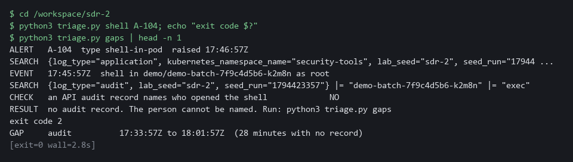

> **CHECKPOINT:** The shell was seen by Falco but no audit record names the person, and the gap check shows an audit span with no records that covers the time of the shell. Do not close it.

**How this meets the controls**

- **AU-5:** The shell command stops with a non-zero exit code instead of guessing, and the gap check shows the span with no audit records. You escalate it as a logging gap rather than closing the alert.
- **IR-4:** The runbook rule for a missing record is the same every time: do not close, check the path, and escalate. The exit code makes that rule hard to skip.

## Section 5. What Each Control Is For

### Control mapping

| Control | What it requires, in plain words | Tool or service | Where this module covers it |
| --- | --- | --- | --- |
| AU-6 Audit Record Review, Analysis, and Reporting | Review audit records for unusual activity, work out its impact, and report the findings to named people. | The supplied triage.py commands and the Mattermost alert channel. Explained in section 2.1. | Section 3, Steps 2 to 4: you review the records behind three alerts and post a finding for each in the alert channel. |
| IR-4 Incident Handling | Handle an incident through preparation, detection and analysis, containment, eradication and recovery, and keep the handling comparable and predictable. | The runbook, kept in the ConfigMap sdr-runbook, with its decision table. Explained in section 2.1. | Section 3, Steps 2 to 4: the detection and analysis phase, with a fixed set of checks and a fixed rule for what to do next. |
| AU-5 Response to Audit Logging Process Failures | When the logging process itself fails, alert named people within a set time. | The path check and the gap check in triage.py, which read Loki, Grafana and Mattermost. Explained in section 2.3. | Section 3, Step 5, and Section 4, Tests 1 and 2: what a late log type and a gap in a log type look like, and the rule to escalate. |

### What each control is for

Each table below says what the control is trying to prevent and how this module's tool meets it.

#### AU-6 Audit Record Review, Analysis, and Reporting

| Question | Answer |
| --- | --- |
| Control Intent | Alerts pile up in a channel, nobody can say which were real, and findings never reach the people who must act. |
| The operational question | Take the last alert. Who looked at the records behind it, what did they find, and where is that written down? |
| What evidence proves it | The alert, the search that was run, the finding, and a time-stamped decision posted where the named recipients read. |
| How much is enough | Every alert gets the same checks and a recorded outcome. NIST leaves the review frequency and the recipients organization-defined; FedRAMP sets the review frequency at least weekly. The lab reviews each alert as it arrives. |
| How the tool in this module satisfies it | The supplied commands print the evidence and the checks. You post one decision line per alert. |

#### IR-4 Incident Handling

| Question | Answer |
| --- | --- |
| Control Intent | Each person triages a different way, so two people reach different answers from the same evidence, and real incidents are closed as noise. |
| The operational question | Given the same alert, would any trained person on the team run the same checks and reach the same decision? |
| What evidence proves it | The runbook, the decision table, and decisions that match what the evidence shows. |
| How much is enough | Handling is comparable and predictable: fixed checks, fixed rules, recorded results. This module covers only detection and analysis. |
| How the tool in this module satisfies it | triage.py prints the same checks every time; the decision table turns the checks into close or escalate. |

#### AU-5 Response to Audit Logging Process Failures

| Question | Answer |
| --- | --- |
| Control Intent | A log source goes quiet, every search comes back empty, and the empty result is read as proof that nothing happened. |
| The operational question | If a search finds nothing, how do you know the logs were there to be searched? |
| What evidence proves it | A check of each hop of the path, the age of the newest record of each log type, and a search for spans with no records. |
| How much is enough | Failures are noticed and named people are told within a time period. NIST leaves both organization-defined. The lab treats more than 5 minutes without a record as late and a span of more than 10 minutes as a gap. |
| How the tool in this module satisfies it | triage.py path reads each hop and the age of each log type; triage.py gaps lists spans with no records. |

## Section 6. Next Steps

### Using this in other environments

- The triage script, the runbook files and the decision table are plain Python, curl and jq against the Loki, Grafana and Mattermost HTTP APIs, so they run anywhere those three answer.
- Change these lab values first: the LOKI_URL, LOKI_CA_FILE, LOKI_USER and LOKI_PASSWORD variables, GRAFANA_URL, MM_URL and MM_WEBHOOK_URL, and the channel name siem-alerts.
- The lab labels (kubernetes_namespace_name=security-tools, the lab_seed label) and the namespaces siem, openshift-logging and chat are lab choices. Your log store may use other label names and namespaces.
- The oc extract of the sdr-runbook ConfigMap and the collector pod check are cluster-specific. On other Kubernetes use kubectl, or keep the runbook files in git.

The table shows what changes on each platform:

| Check | In this lab (OpenShift) | On other platforms | What you change |
| --- | --- | --- | --- |
| Fetch the runbook | oc extract configmap/sdr-runbook -n siem | kubectl get configmap sdr-runbook -n <namespace> -o json, or read the files from git | The tool name and the namespace. |
| Searches in Loki | LogQL over the labels log_type, kubernetes_namespace_name, lab_seed and seed_run | The same LogQL if you run Loki. Another log store needs its own query language | The label names, and drop lab_seed and seed_run. |
| Collector hop in the path check | Pods in openshift-logging labeled app.kubernetes.io/component=collector | Your log shipper's pods or agent status | The namespace and the pod label. |
| Keycloak sign-in records | Application logs from the keycloak namespace, LOGIN_ERROR and LOGIN lines | The same lines if you run Keycloak. Another identity provider logs its own event names | The namespace and the event names. |
| Audit records | OpenShift API audit log in Loki | The provider's Kubernetes audit log, if it is collected | The label and field names. Replace the check if the audit log is not collected. |
| Falco shell record | Falco lines in Loki from the security-tools namespace | The same, if Falco ships to your log store | The namespace. |
| Alert channel | Mattermost webhook in MM_WEBHOOK_URL | Any chat tool with an incoming webhook | The URL variable and the JSON field the tool expects. |

> **TIP:** Next module: SDR-3 Investigate and Tune: investigate an alert in Loki yourself and tune the alert rule so it fires on real problems, not noise.

<details>
<summary><strong>Section 7. Terms</strong></summary>

Each term is also explained the first time it appears. In Word, hover over an underlined term to see its meaning, or Ctrl+click it to jump to this table.

| Term | Plain meaning |
| --- | --- |
| Alert | A message a monitoring tool sends when one of its rules matches. It tells a person to take a look. |
| API | The front door of a service, where programs send their requests. Every request to the cluster goes through its API. |
| Approved list | The short list of changes and people the lab treats as expected. An alert that matches it can be closed. |
| Audit record | One saved entry describing a request made to the cluster, with who asked, what, where and the result. |
| AWS | Amazon Web Services, the cloud your lab runs in. |
| Channel | A named chat room in Mattermost. The alert channel is called siem-alerts. |
| Cluster | A group of servers that work together as one system. Here it is your own OpenShift cluster. |
| Collector | A small program that reads the logs on each node and sends them on to Loki. |
| ConfigMap | A named bundle of small files stored in the cluster. The runbook is kept in one. |
| Container | A sealed box that holds one program and everything it needs to run. |
| Escalate | Hand the alert to someone with more authority or more access, with the evidence you found. |
| Evidence | Saved records that show a system is set up and behaving as claimed. |
| Exit code | A number a command leaves behind when it ends. 0 means success; anything else means a problem. |
| Falco | A free runtime detector that watches what programs do inside containers and writes a record when a rule matches. |
| FedRAMP | The US program that sets security requirements for cloud services used by the federal government. |
| Grafana | A free tool that draws charts and runs alert rules. A rule is a search that runs on a schedule and raises an alert when the result passes a limit. |
| Hop | One stop on the path a log takes, such as the collector or Loki. Each hop can fail on its own. |
| HTTP | The protocol that web pages and web APIs use. HTTPS is the encrypted form. |
| jq | A tool that builds or picks values in JSON text. Here it builds the message you post. |
| JSON | A text format for data, made of names and values in braces. |
| Keycloak | The sign-in service in the lab. It writes a log line for every failed and every successful sign-in. |
| Kubernetes | The open-source system that runs and manages containers across servers. OpenShift is built on it. |
| Label | A key=value tag on a cluster object, used to pick objects, such as app=demo-app. |
| Late log | A log type whose newest record is older than it should be, so recent events have not arrived yet. |
| Log | A line of text a program saves about something that happened, such as a sign-in or a request to the cluster. |
| LogQL | Loki's search language. A search names a label such as log_type and can then filter the lines. |
| Loki | A free log store. It keeps log lines and lets you search them. |
| Mattermost | A free team chat tool. In this lab it holds the alert channel, where alerts arrive and decisions are posted. |
| Missing log | A span of time in which a log type should have records and has none. |
| mkdir | A command that makes a new folder. |
| Namespace | A named section of the cluster that keeps workloads apart. OpenShift also calls it a project, as in project siem. |
| NIST | The US National Institute of Standards and Technology. It publishes the security control catalog these modules cite. |
| Node | One server in the cluster. Logs are first written on a node. |
| oc | The command-line tool for OpenShift. You type oc to ask the cluster questions. |
| OpenShift | The Red Hat platform your lab cluster runs on. It is Kubernetes with extra security and tools built in. |
| Operator | A program that installs and looks after another tool inside the cluster. |
| Pod | The smallest running unit on the cluster: one or more containers together. |
| Privilege change | Giving a person or program more permissions than before, such as granting a powerful role to an account. |
| Provider | The company or plug-in that supplies a platform, such as a cloud provider or a Terraform provider. |
| Query | A question you ask a data store, written in a query language, such as a log search. |
| Role | A named list of permissions. A role binding gives that list to an account. |
| Route | An OpenShift object that gives a program inside the cluster an address reachable from outside. |
| Rule | A written condition that a tool checks. |
| Runbook | A written list of exact steps, with the decision each result leads to. Here it is a set of commands plus a decision table. |
| Runtime | The time when a program is running, as opposed to when it is written or built. |
| Secret | A cluster object that holds a sensitive value such as a password or token, kept apart from ordinary settings. |
| Shell opened in a pod | A window for typing commands that someone opens inside a running pod. It lets a person run any command there. |
| Source address | The network address a request or sign-in came from. |
| Telemetry path | The route a log takes from where it is written to where you search it: source, collector, Loki, Grafana, Mattermost. |
| Timestamp | The date and time recorded for an event. |
| Triage | A quick first look at an alert to decide whether it is real, how urgent it is, and what happens next. |
| URL | A web address, such as https://example.com/page. |
| Variable | A named value the lab sets for you, such as MM_URL. A dollar sign before the name means use its value. |
| Webhook | An address that accepts a message sent to it. The lab gives you one for the alert channel in the variable MM_WEBHOOK_URL; anyone who holds it can post to the channel, so never print it. |

</details>
