# SDR-3: Investigate and Tune (SI-4, AU-6, IR-4)

| Item | Detail |
| --- | --- |
| Sequence | Module 12 of 29 in the recommended order |
| Timed work | About 69 minutes (50 hands-on, 19 verify) |
| Standalone start | `lab start sdr-3` |
| Combined start | Continue from the end state of the previous module |
| Tools | Loki LogQL (free, open source), Grafana alerting and dashboards (free, open source), OpenShift Container Platform, oc, curl, jq, python3 |
| Prerequisites | SDR-2 Triage an Alert by Runbook (you ran supplied LogQL searches and read their evidence; here you write your own), ENG-0 Terminal, Git and Your Lab (you can open lab shell, type commands, and read their output) |

## Section 1. Module Overview

- Purpose: analyze what monitoring found and keep the monitoring useful (SI-4, AU-6, IR-4).
- You investigate one seeded incident in Loki with your own searches and write six facts about it in findings.json.
- You tune the noisy alert rule failed-login-burst and its dashboard panel in Grafana, then run a review gate that replays recorded events against the result.

- **Skill:** Investigate a security incident in logs with your own searches and choose an alert threshold from the data. Apply it to a live alert rule and dashboard panel, and prove the result with a replay.
- **Tools:** Loki LogQL searches the stored sign-in and audit records. Grafana holds the alert rule and the dashboard panel you change. curl and jq call the Grafana API and read the answers. oc copies the review gate from the cluster, and Python runs the gate.
- **Security Function:** Detects attacks and keeps detection usable. The tuned rule stops firing on harmless noise but still fires on both real bursts, and a replay of recorded events proves it.
- **NIST SI-4 System Monitoring:** Loki searches and the Grafana alert rule failed-login-burst analyze the detected events, and you adjust the rule threshold and the dashboard panel to match what you found.
- **NIST AU-6 Audit Record Review, Analysis, and Reporting:** Your own LogQL searches over the audit records show what the taken-over account did, and findings.json states the impact.
- **NIST IR-4 Incident Handling:** The file findings.json and the review gate (review_gate.py) cover the detection and analysis phase and make the facts checkable.

## Section 2. The Tools

### Tools used in this module

Each tool name links to its official overview. The table columns say how each tool is used in the lab and why the lab uses it instead of another way of doing the same job.

| Tool (overview link) | What it is | Used in this lab | Why this tool |
| --- | --- | --- | --- |
| [LogQL](https://grafana.com/docs/loki/latest/query/) | Loki's query language for searching and filtering logs. | The query language you use to count failed sign-ins by source in Loki. | It is the query language Loki uses, so you need it to ask the stored logs a question and to write a detection. |
| [Grafana alerting](https://grafana.com/docs/grafana/latest/alerting/fundamentals/) | Rules that run a query on a schedule and send a notification when the result crosses a threshold. | Holds the alert rule and the dashboard panel; you set the same threshold in both. | It runs a log query on a schedule and notifies when the result crosses a limit, so a detection becomes an alert without writing a separate program. |
| [OpenShift Container Platform](https://docs.redhat.com/en/documentation/openshift_container_platform/4.22/html/overview/ocp-overview) | A Kubernetes container platform for running and managing containerized applications. | The cluster whose sign-in records you analyze. | It is the platform the whole lab runs on, so every module works on the same real cluster, with the same kinds of objects a production OpenShift system has. |
| [oc](https://docs.redhat.com/en/documentation/openshift_container_platform/4.22/html/cli_tools/openshift-cli-oc) | The OpenShift command-line tool for creating and managing applications and projects from a terminal. | Applies the changed rule and panel and fetches the review gate. | It is the one command that talks to the cluster, so every module uses it to ask what is true and to make changes. You sign in once, and it works on OpenShift objects as well as standard Kubernetes ones. Unlike clicking in the web console, a command can be pasted, repeated and checked by a test. |
| [curl](https://curl.se/docs/manpage.html) | Command-line tool for transferring data over URLs, used here to call web endpoints. | Sends the log queries to Loki. | It calls a web address from the terminal, so you can check what a service really returns instead of trusting a screen. |
| [jq](https://jqlang.org/) | Command-line JSON processor. | Counts and groups the query results. | It picks one field out of a long JSON reply, so a test can read a single value. |
| [Python 3](https://docs.python.org/3/tutorial/introduction.html) | General-purpose language, used here for small helper scripts. | Runs review_gate.py, which recomputes the facts and checks your threshold. | Python reads and writes JSON easily and is already in the lab shell, so a small script needs nothing installed. |

### How it fits together

#### From one noisy rule to a tuned rule that a gate checks

- You search the stored records in Loki (the log store) to understand the incident.
- You read the counts to choose a threshold (the count above which a rule fires).
- You change the alert rule (a saved search plus a limit) and the dashboard panel (one chart on a Grafana dashboard) in Grafana.
- A review gate (an automated check that passes or fails the work) then replays recorded events (sends them through Loki again) against the result.
- Each step below adds one part, drawn with thick lines.
- The lab (test) setup runs the gate by hand, while in production the rule would sit in version control and the gate would run on every change to it.

How the lab is set up, and why:

- You work in lab shell on your computer.
- Every search, change and check you run there reaches the cluster over the network with the lab variables (named values the lab sets for you), so no password is typed.
- Loki and Grafana both run in the project siem (a project is a named section of the cluster), the same place as in SDR-2.
- The records and the rule that watches them sit side by side in siem.
- The module adds three things: an alert rule and a dashboard panel in Grafana, which you change, and a review gate that runs in lab shell.
- The rule and the panel stay in Grafana.
- You change the live rule and panel through the Grafana API (the address programs use to give it commands), so what the gate tests is what really runs.
- The gate is stored in the cluster as a ConfigMap (a named bundle of small files) and copied into lab shell, so every learner tests with the same code.
- The gate replays recorded events into Loki, so nothing real is touched.
- Your findings file stays in lab shell because it is your own written work, which the gate compares with the records.

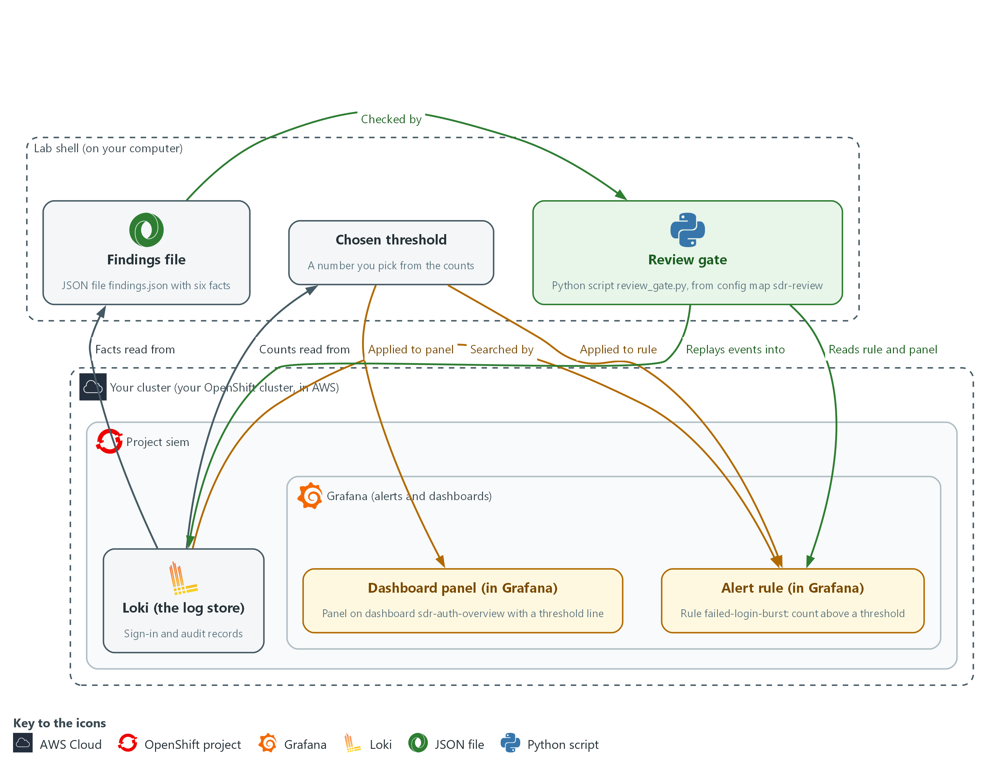

- **1. Loki (the log store):** holds the sign-in and audit records that you search, that the rule counts, and that the gate replays events into.
- **2. Alert rule (in Grafana):** the rule failed-login-burst, which fires when the failed sign-in count over 5 minutes is above its threshold.
- **3. Dashboard panel (in Grafana):** the chart on dashboard sdr-auth-overview that draws the same count with a red threshold line.
- **4. Findings file:** findings.json in lab shell, holding your six facts about the incident.
- **5. Chosen threshold:** the number you pick from the counts and apply to the rule and to the panel.
- **6. Review gate:** review_gate.py, supplied by the lab, which checks your findings, the rule and the panel, and replays recorded events against the rule.
- **7. Grafana (alerts and dashboards):** a free tool that runs alert rules and draws dashboards; the rule and the panel live in it.
- **8. Project siem:** the section of the cluster where Loki and Grafana run.
- **9. Your lab shell:** the tools container on your computer where you type every command.

Where each part runs, and why:

| Part | Where it runs | Why it is built this way |
| --- | --- | --- |
| Alert rule | Grafana, in the project siem | You change only its threshold, through the Grafana API, so the live rule is the one that gets tested. |
| Dashboard panel | Grafana, in the project siem | Whoever reads the dashboard sees a line. Changing it in the same step keeps the picture and the rule telling the same story. |
| Review gate | A ConfigMap in the project siem, run in lab shell | Everyone tests with the same code, and the gate fails loudly when work is not acceptable. |
| Replayed events | Loki, under a label (a tag on log lines) that exists only for that run | The gate can test the rule without touching any real record. |
| Findings file | Your lab shell | It is your own written work, kept next to your commands, for the gate to compare with the records. |

### 2.1 Noise, signal and the gap between them (SI-4 System Monitoring)

- A rule that counts events fires whenever the count is greater than its threshold, the number the rule compares the count with.
- Noise is a count that is high every day for harmless reasons; here it is a monitoring client with a wrong password.
- Signal is a count that rises because something real is happening; here it is a small burst (many failures from one place in a short time) of reconnaissance (early probing) before a larger attack.
- A threshold at or below the noise makes the rule fire all the time, so people stop reading it.
- A threshold above the weakest real event makes the rule miss that event.
- A good threshold sits in the gap between the highest noise and the lowest real event, with room on both sides.

#### SI-4: System Monitoring

*The control asks the organization to monitor the system to detect attacks and indicators of potential attacks against organization-defined monitoring objectives, to analyze detected events and anomalies, and to adjust the level of monitoring when risk changes. NIST leaves the monitoring objectives and techniques organization-defined; the lab objective is to fire on repeated failed sign-ins above the level normal noise reaches. This is done using:*

- Loki searches: let you analyze the failed sign-in records and tell noise from bursts.
- The Grafana alert rule failed-login-burst: watches for repeated failed sign-ins.
- The threshold change on the rule and the dashboard panel: adjusts the monitoring so it fires on the bursts and not on the noise.

The table shows what each threshold choice does and how the review gate judges it:

| Threshold choice | Effect | How the gate sees it |
| --- | --- | --- |
| At or below the noise level | Fires all day | Fails: the rule fires outside the real bursts |
| Between noise and the weakest real burst | Quiet normally, fires on both bursts | Passes |
| Above the weakest real burst | Quiet, but a real probe is missed | Fails: a real burst is not detected |

### 2.2 Replay is how you prove a rule (IR-4 Incident Handling)

- A rule tested only against live traffic is tested only on what happens today, so the review gate replays recorded events instead.
- To replay, the gate pushes recorded events into Loki under a label that exists only for that run.
- The gate then asks Loki to run your rule over the replayed hours minute by minute, and reports which minutes would have fired.
- A replay touches nothing real, because no other record carries the run label.
- The search part of an alert rule in Grafana counts the LOGIN_ERROR lines from Keycloak (the lab's sign-in service) in the last 5 minutes.
- The condition part fires when that count is greater than a number.
- Grafana runs the search on a schedule, typically every minute, and compares the result with the number; that number is the threshold you tune.
- The rule you edit is the live rule in Grafana, and the gate reads its search and threshold through the API, so what is tested is what runs.

#### IR-4: Incident Handling

*The control asks for an incident handling capability that includes preparation, detection and analysis, containment, eradication, and recovery, and for the rigor, intensity, scope and results of incident handling to be comparable and predictable across the organization. This module covers detection and analysis only. This is done using:*

- The file findings.json: holds six facts that you state from your own searches.
- The review gate (review_gate.py): recomputes those facts from the records and replays recorded events against the rule, so two analysts reach the same facts.

### 2.3 What the incident looks like in the records (AU-6 Audit Record Review, Analysis, and Reporting)

- A failed sign-in is a Keycloak line with type LOGIN_ERROR that names the source IP address and the account.
- A successful sign-in has type LOGIN.
- After a takeover (an attacker gaining control of an account), what the account does appears in the audit records (the cluster's record of every request) under its user name.
- LogQL (Loki's search language) can pull fields out of a line while it searches.
- A regexp stage (regexp is short for regular expression, a pattern that picks pieces out of text) takes named pieces from a line.
- A json stage takes fields from lines written as JSON.

#### AU-6: Audit Record Review, Analysis, and Reporting

*The control asks the organization to review and analyze audit records at an organization-defined frequency for organization-defined inappropriate or unusual activity and its potential impact, to report findings to organization-defined personnel or roles, and to adjust the level of review when risk changes. This is done using:*

- LogQL searches over the audit records: show what the taken-over account did after it signed in.
- The file findings.json: states the impact, such as how many secrets the account read.
- The review gate: recomputes those facts from the records and checks them.

### Design decisions

#### Threshold read from the data, between noise and the weakest burst

- How: You list the five-minute failure count for every minute over six hours. You read the most common value as the noise level and the peaks as the bursts. You set the threshold between them with room on both sides.
- Why: A threshold at or below the noise fires all day and one above the weakest real burst misses a probe.
- Alternatives: The advantage of an adaptive baseline that adjusts by itself is that it follows changing noise without manual retuning. The drawback is that it is harder to explain and test, and it can learn a slow attack as normal.

#### A replay gate that tests the rule that actually runs

- How: The review gate reads the live rule and panel through the Grafana API. It replays recorded events into Loki under a run label and checks minute by minute that the rule is quiet outside the bursts and fires in both.
- Why: The rule tested is the rule that runs, replay touches no real records, and the too-low and too-high values prove the gate can fail.
- Alternatives: The advantage of testing against live traffic is that no recorded data has to be built. The drawback is that it covers only what happens today, so a missed attack could go unproven for a long time.

## Section 3. Implement

- Start: type `lab start sdr-3` in the terminal on your own computer (PowerShell on Windows, Terminal on Mac), not in the lab shell.
- Enter lab shell with `lab shell`. Every other command in this module runs inside lab shell.
- If a step fails: run `lab reset sdr-3` on your own computer and repeat the step once. If it still fails, copy the whole command and error and ask your AI assistant. Do not skip the step.

### Step 1. Separate the noise from the bursts (SI-4 System Monitoring, IR-4 Incident Handling)

**Learning point: Counting failed sign-ins per address and account separates the steady monitoring client from the two bursts, so you know what to investigate.**

- lab start sdr-3 has loaded the exercise records into Loki.
- lab start sdr-3 also created the alert rule failed-login-burst, the dashboard sdr-auth-overview and the review gate in the ConfigMap sdr-review.
- The search below counts failed sign-ins per source IP address and account over the last 6 hours, so steady sources and bursts show up as different rows.
- The regexp stage pulls the address and account name out of each line so the counts can be grouped.
- The labels lab_seed and seed_run mark the exercise records of this module and of this lab start, so records from other modules or from an earlier lab start do not change your counts.
- The marks (`) around the pattern let you write double quotes inside it without escaping them.

What this step adds (thick lines and outlines are new):

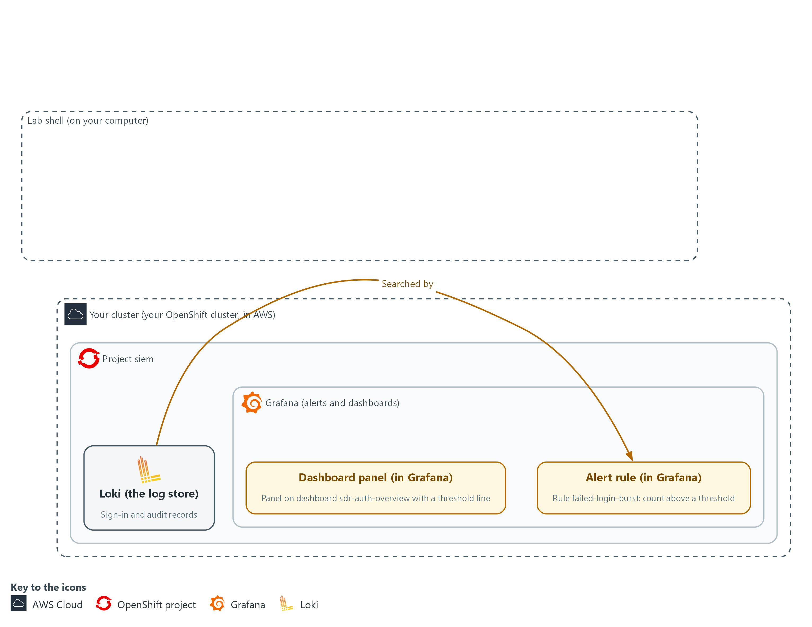

- You search the sign-in records in Loki from lab shell and separate steady noise (harmless failures that happen all day) from two bursts.

#### 1a. Count failed sign-ins per address and account

You will now make a folder for this module and ask Loki how many failed sign-ins each address and account had in the last 6 hours.

```bash
mkdir -p /workspace/sdr-3 && cd /workspace/sdr-3
RUN=$(oc get configmap sdr-review -n siem -o jsonpath='{.data.anchor\.txt}')
Q='sum by (ip, user) (count_over_time({lab_seed="sdr-3", seed_run="RUN_ID", log_type="application", kubernetes_namespace_name="keycloak"} |= "LOGIN_ERROR" | regexp `ipAddress="(?P<ip>[^"]+)".*username="(?P<user>[^"]+)"` [6h]))'
Q=${Q/RUN_ID/$RUN}
curl -sG --cacert "$LOKI_CA_FILE" -u "$LOKI_USER:$LOKI_PASSWORD" "$LOKI_URL/loki/api/v1/query" --data-urlencode "query=$Q" | jq -r '.data.result[] | [.metric.ip, .metric.user, .value[1]] | @tsv' | sort -k3 -n -r
```

**Expected output:**

```
Example only. Addresses, accounts and counts are placeholders except those the module names.
<monitoring address>	<account>	<large count>
<other address>	lab-user7	12
<other address>	lab-admin1	5
```

| Part | What it does | Why you run it |
| --- | --- | --- |
| mkdir -p ... && cd ... | Makes a folder for this module and moves into it, so files from other modules cannot collide with yours. The folder persists between lab sessions. | Every file you write in this module goes here, so the review gate can find them later. |
| RUN=$(oc get configmap sdr-review ...) | Reads the number of this lab start from the ConfigMap sdr-review. Every exercise record carries it as the label seed_run. | Records from an earlier lab start may still be stored. Adding seed_run to each search keeps their old lines out of your counts. |
| Q='...' and Q=${Q/RUN_ID/$RUN} | Stores the search in a variable, then puts your run number in place of the word RUN_ID. sum by (ip, user) adds the counts up per address and account. lab_seed="sdr-3" keeps out records that other modules loaded. | The search is long, so keeping it in a variable lets you reuse it without retyping. The two seed labels make sure you count only this module's exercise records. |
| \|= "LOGIN_ERROR" | Keeps only lines that contain LOGIN_ERROR, the failed sign-ins. | Failed sign-ins are the only lines you want here. Successes and other lines would hide the pattern you are looking for. |
| \| regexp `...` | Pulls the address into a label named ip and the account into a label named user. | Counting per address and account is what lets you tell the steady monitoring client from a real burst, so both must be separate labels. |
| count_over_time(... [6h]) | Counts the matching lines over the last 6 hours. | A long window shows the steady noise and both bursts together, so you can compare them side by side. |
| curl -sG ... /query | Sends the search to Loki. -G puts the search text in the web address; --data-urlencode makes it safe to send. | Loki answers over the network. This is how your lab shell asks it the question, and the lab variables supply the address and the sign-in. |
| jq -r ... @tsv | Prints address, account and count as three columns. | Loki's reply is long JSON. Three plain columns are quick to read and to compare. |
| sort -k3 -n -r | Orders the rows by the count, largest first. | With the largest count first, the steady noise sits at the top and the smaller bursts stand out below it. |

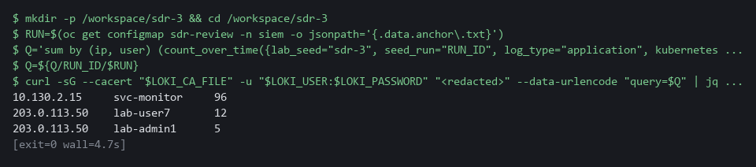

> **YOUR TURN:** Run the block. Note which source has by far the largest count, and which source has the two rows with small counts.

> **CHECKPOINT:** Three rows: a monitoring address with a large count, and one other address with two accounts, one with 12 failures and one with 5.

> **TAKEAWAY:** Grouping failures by source shows which are noise and which are an attack.

**How this meets the controls**

- **SI-4:** The control asks that detected events be analyzed. Here you count failed sign-ins per address and account in Loki and tell the steady monitoring client from the two bursts. The sorted list is the analysis that the threshold in Step 3 rests on.
- **IR-4:** The control asks for the detection and analysis phase of incident handling. This search is the detection step: it finds the address and account behind the bursts. Because the search is written out, another analyst can run it and see the same rows.

### Step 2. Follow the account and write the facts (AU-6 Audit Record Review, Analysis, and Reporting, IR-4 Incident Handling)

**Learning point: Listing what the taken-over account did, and counting its failures, first success and secret reads, gives you six facts that a script can check.**

- The address that had two rows with small counts in Step 1 is the one to follow.
- You find the successful sign-in that came after the 12 failures, and count what that account read in the audit records (the cluster's record of every request).
- You then state six facts in findings.json.
- Three of the six facts come from Step 1: the account name, the address and the other account.
- You read the other three values from the records with your own searches.

What this step adds (thick lines and outlines are new):

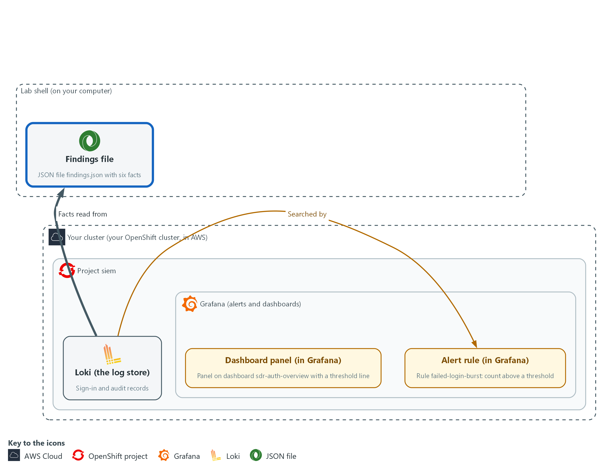

- You follow the compromised account into the audit records in Loki and write your facts to the file findings.json in lab shell.

#### 2a. List what the taken-over account did in the audit records

You will now set a start time and list every audit record made by the account from Step 1, in time order.

```bash
cd /workspace/sdr-3
START=$(date -d '6 hours ago' +%s)
RUN=$(oc get configmap sdr-review -n siem -o jsonpath='{.data.anchor\.txt}')
curl -sG --cacert "$LOKI_CA_FILE" -u "$LOKI_USER:$LOKI_PASSWORD" "$LOKI_URL/loki/api/v1/query_range" --data-urlencode 'query={lab_seed="sdr-3", seed_run="'"$RUN"'", log_type="audit"} | json | user_username="lab-user7"' --data-urlencode "start=$START" --data-urlencode 'limit=100' | jq -r '.data.result[].values[][1] | fromjson | [.stageTimestamp, .verb, .objectRef.resource, .objectRef.name] | @tsv' | sort
```

**Expected output:**

```
Example only. Times and object names differ in your lab.
<time>	<verb>	<resource>	<object name>
<time>	get	secrets	<object name>
(four of the lines are get requests on secrets)
```

| Part | What it does | Why you run it |
| --- | --- | --- |
| cd /workspace/sdr-3 | Moves into the module folder made in Step 1. | Files you save in this module must all be in one folder. |
| START=$(date -d '6 hours ago' +%s) | Stores the time 6 hours ago, because a range search without a start only looks back 1 hour. | The incident began earlier than the default window, so you widen the range before you search. |
| RUN=$(oc get configmap sdr-review ...) | Reads the number of this lab start from the ConfigMap sdr-review. Every exercise record carries it as the label seed_run. | Records from an earlier lab start may still be stored. Adding seed_run to each search keeps their old lines out of your counts. |
| {lab_seed="sdr-3", seed_run="$RUN", log_type="audit"} \| json \| user_username="lab-user7" | Reads this lab start's audit records and keeps those made by this account. The json stage turns user.username into the label user_username. | This lists everything the taken-over account did after it got in, which is the impact you must state. |
| fromjson | Turns the stored line back into fields so jq can pick them. | Audit lines are stored as text. Turning them back into fields lets you print only the few that matter. |
| [.stageTimestamp, .verb, ...] | Prints when, what kind of request, which kind of object and which object. | Time, action and object, in that order, read as a story of what the account touched. |

#### 2b. Count the facts and write findings.json

You will now count the failures, find the first success and count the secret reads, then save six facts in findings.json.

```bash
cd /workspace/sdr-3
START=$(date -d '6 hours ago' +%s)
RUN=$(oc get configmap sdr-review -n siem -o jsonpath='{.data.anchor\.txt}')
FAILED=$(curl -sG --cacert "$LOKI_CA_FILE" -u "$LOKI_USER:$LOKI_PASSWORD" "$LOKI_URL/loki/api/v1/query" --data-urlencode 'query=sum(count_over_time({lab_seed="sdr-3", seed_run="'"$RUN"'", log_type="application", kubernetes_namespace_name="keycloak"} |= "LOGIN_ERROR" |= "lab-user7" [6h]))' | jq -r '.data.result[0].value[1]')
SUCCESS=$(curl -sG --cacert "$LOKI_CA_FILE" -u "$LOKI_USER:$LOKI_PASSWORD" "$LOKI_URL/loki/api/v1/query_range" --data-urlencode 'query={lab_seed="sdr-3", seed_run="'"$RUN"'", log_type="application", kubernetes_namespace_name="keycloak"} |= `type="LOGIN"` |= "lab-user7"' --data-urlencode "start=$START" --data-urlencode 'limit=1' --data-urlencode 'direction=forward' | jq -r '.data.result[0].values[0][0] | tonumber / 1000000000 | floor | todate')
SECRETS=$(curl -sG --cacert "$LOKI_CA_FILE" -u "$LOKI_USER:$LOKI_PASSWORD" "$LOKI_URL/loki/api/v1/query" --data-urlencode 'query=sum(count_over_time({lab_seed="sdr-3", seed_run="'"$RUN"'", log_type="audit"} | json | user_username="lab-user7" | objectRef_resource="secrets" | verb="get" [6h]))' | jq -r '.data.result[0].value[1]')
jq -n --arg account lab-user7 --arg ip 203.0.113.50 --argjson failed "$FAILED" --arg success "$SUCCESS" --argjson secrets "$SECRETS" --arg other lab-admin1 '{account:$account, source_ip:$ip, failed_attempts:$failed, first_success_utc:$success, secrets_read:$secrets, other_account_targeted:$other}' > findings.json
cat findings.json
```

**Expected output:**

```
Example only. The success time is yours to read.
{
  "account": "lab-user7",
  "source_ip": "203.0.113.50",
  "failed_attempts": 12,
  "first_success_utc": "<time in UTC>",
  "secrets_read": 4,
  "other_account_targeted": "lab-admin1"
}
```

| Part | What it does | Why you run it |
| --- | --- | --- |
| cd /workspace/sdr-3, START=... and RUN=... | Moves into the module folder and sets the start time and the run number again. | A block must run on its own, even in a new lab shell, so it does not rely on the block before it. |
| FAILED=$(...) | Counts the failed sign-ins that name the account. Expect 12. | The failure count is the first fact for findings.json. The gate recomputes it, so it must come from the records and not from memory. |
| SUCCESS=$(...) | Finds the first sign-in with type LOGIN for the account and turns its time into a readable time in UTC (the world's standard time). direction=forward makes Loki return the oldest match first; the default is newest first. | The first success after the failures is the moment the account was taken over, so its time belongs in the findings. |
| SECRETS=$(...) | Counts requests of kind get on secrets by the account. A secret is a stored password or key. | How many secrets the account read is the impact of the takeover, the fact a report must neither overstate nor understate. |
| jq -n --arg ... --argjson ... | Builds the findings object. --arg passes text, --argjson passes a number. | Building the file with jq puts your values into valid JSON without typing quotes by hand, so the gate can read it. |
| > findings.json | Writes the object to a file. The gate reads this file. | The review gate in Step 5 reads this exact file name, so it has to be saved here. |

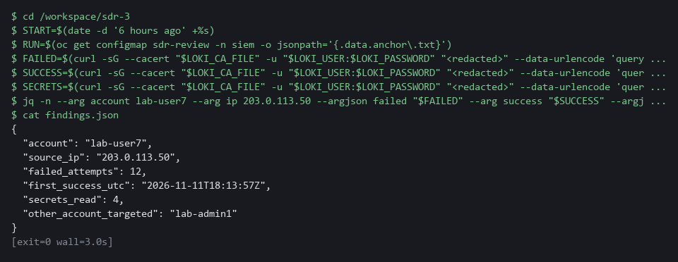

> **SECURITY:** The findings name an account and an address, so keep the file private. Never paste secret values you might find into it.

> **YOUR TURN:** Run both blocks. In the first, read the order of events: what the account touched after it signed in. In the second, check each value is not empty before you move on.

> **CHECKPOINT:** findings.json holds six values: the account, the address, 12 failures, a success time, 4 secret reads, and the other account that was probed.

> **TAKEAWAY:** State an incident's impact as numbers taken from the records.

**How this meets the controls**

- **AU-6:** The control asks for audit records to be reviewed for unusual activity and its potential impact. Here you list what the taken-over account did in the audit records and count its secret reads. The count goes into findings.json as the stated impact.
- **IR-4:** The control asks for results that are comparable and predictable. You turn your own searches into six facts in findings.json, each one something a script can recompute. Another analyst repeating your searches should reach the same values.

### Step 3. Read the counts and choose a threshold (SI-4 System Monitoring)

**Learning point: Reading the five-minute count for every minute shows the noise level and the height of both bursts, which gives you the range a threshold can sit in.**

- The rule counts failures in a 5-minute window, so you list that count for every minute over 6 hours.
- The most common value in that list is the noise level.
- Minutes whose count is above the noise level are the bursts.

What this step adds (thick lines and outlines are new):

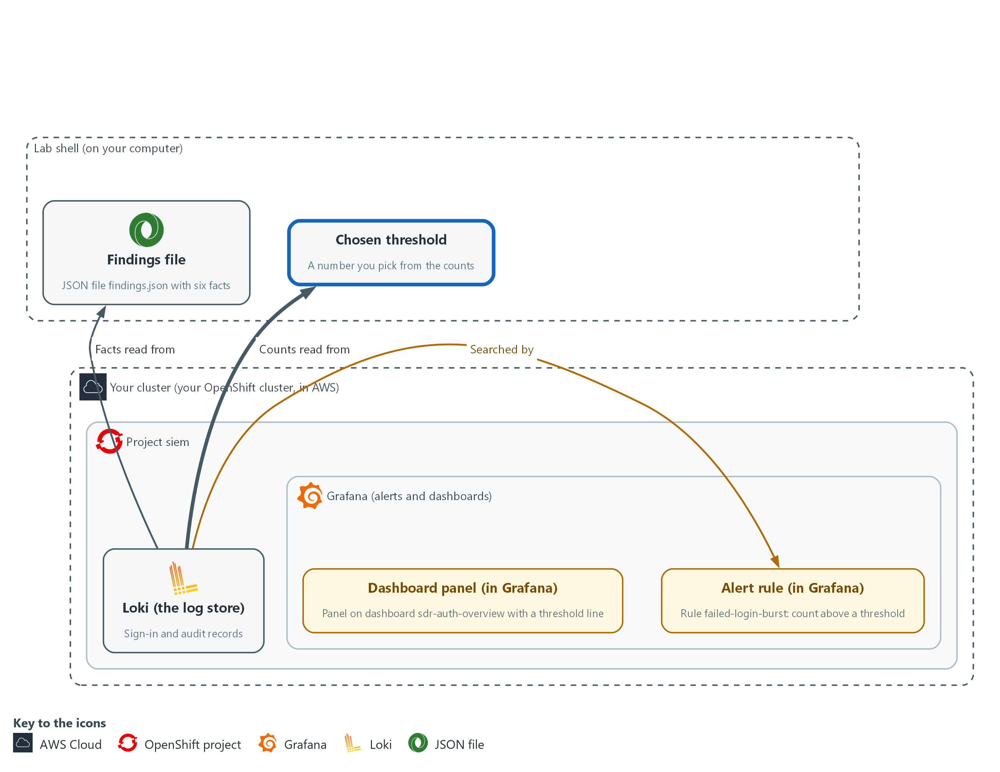

- You read the five-minute counts over six hours from Loki and pick a threshold between the noise and the weakest real burst.

#### 3a. Read the five-minute count for every minute

You will now save the five-minute failure count for each minute of the last 6 hours, then see how often each value occurs and when it goes above 4.

```bash
cd /workspace/sdr-3
START=$(date -d '6 hours ago' +%s)
RUN=$(oc get configmap sdr-review -n siem -o jsonpath='{.data.anchor\.txt}')
NOW=$(date +%s)
Q='sum(count_over_time({lab_seed="sdr-3", seed_run="RUN_ID", log_type="application", kubernetes_namespace_name="keycloak"} |= "LOGIN_ERROR" [5m]))'
Q=${Q/RUN_ID/$RUN}
curl -sG --cacert "$LOKI_CA_FILE" -u "$LOKI_USER:$LOKI_PASSWORD" "$LOKI_URL/loki/api/v1/query_range" --data-urlencode "query=$Q" --data-urlencode "start=$START" --data-urlencode "end=$NOW" --data-urlencode 'step=60' > counts.json
jq -r '.data.result[0].values[] | .[1]' counts.json | sort -n | uniq -c
jq -r '.data.result[0].values[] | select((.[1] | tonumber) > 4) | [(.[0] | todate), .[1]] | @tsv' counts.json
```

**Expected output:**

```
Example only. Counts and times differ in your lab.
<minutes> <value>
<minutes> 4
<minutes> <value>
(the value with the most minutes is the noise level)
<time>	<a value above 4>
(one group of times peaks near 9 and one near 16)
```

| Part | What it does | Why you run it |
| --- | --- | --- |
| cd /workspace/sdr-3 | Moves into the module folder, because counts.json is saved there. | A block must run on its own, so it starts by going to the folder. |
| RUN=$(oc get configmap sdr-review ...) | Reads the number of this lab start from the ConfigMap sdr-review. Every exercise record carries it as the label seed_run. | Records from an earlier lab start may still be stored. Adding seed_run to each search keeps their old lines out of your counts. |
| START=$(date -d '6 hours ago' +%s) | Sets the start of the range again, so the block also works if you opened a new lab shell since Step 2. | A fresh lab shell would not have this variable, so you set it again and the block runs on its own. |
| NOW=$(date +%s) | Stores the current time as the end of the range. | A range search needs an end as well as a start, and this fixes the end at the moment you run it. |
| sum(count_over_time(... [5m])) | The same count the rule makes: failed sign-ins in the last 5 minutes. | Your threshold applies to exactly this count, so you must look at the same number the rule looks at. |
| step=60 | Asks for one value per minute. | One value per minute matches how often the rule is checked, so you see every value the rule would see. |
| > counts.json | Saves the answer so two commands can read it. | Two commands below read the same answer, so one search is enough. |
| sort -n \| uniq -c | Counts how many minutes had each value. The biggest group is the noise level. | The most common value is the noise level, and a threshold must sit above it. |
| select((.[1] \| tonumber) > 4) | Lists only the minutes whose count was above 4, with their times. | These minutes are the bursts, with their times, so you can find the peak of each and choose a value below the smaller one. |

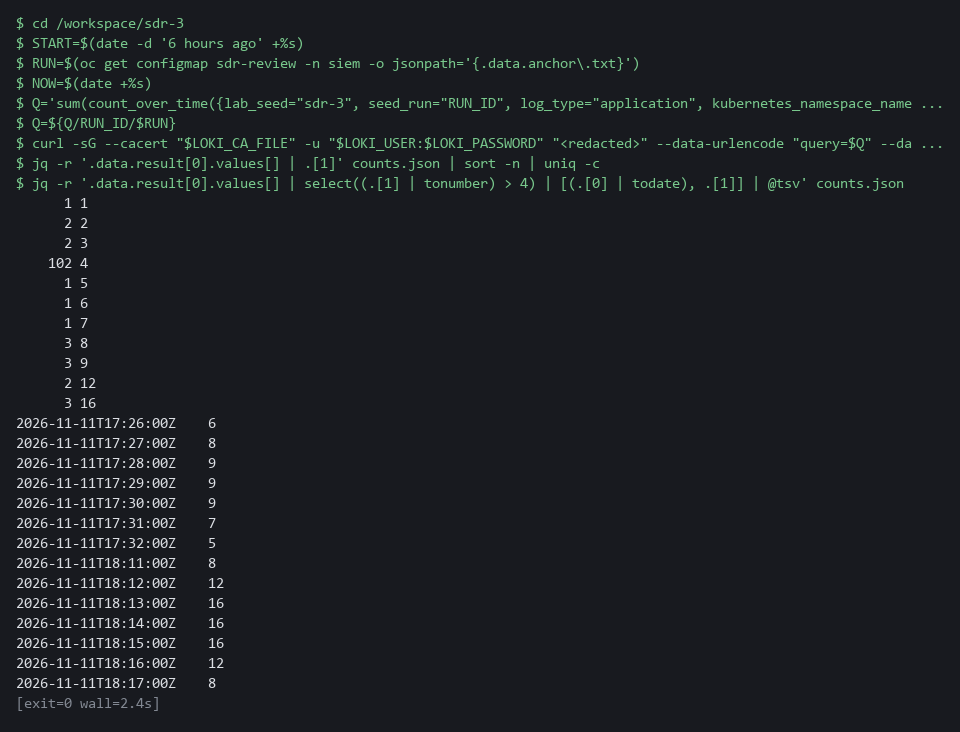

> **NOTE:** The rule fires when the count is greater than the threshold, so choose a value above the noise level and below the weakest burst, with room on both sides. A value too close to the noise level can fire on a window edge. You set your chosen value as THRESHOLD in Step 4.

> **YOUR TURN:** Run the block. Read the noise level, the peak of the smaller burst and the peak of the larger burst.

> **CHECKPOINT:** The most common value is 4, and two groups of minutes are above it, one peaking near 9 and one near 16 (a count one or two lower or higher is fine).

> **TAKEAWAY:** Choose a threshold from the data, between the noise and the weakest real burst.

**How this meets the control**

- **SI-4:** The control asks that detected events be analyzed and that monitoring be adjusted. Here you read the five-minute count for every minute, find the noise level and the two peaks, and choose a threshold between them. The chosen value is the adjustment you apply in Step 4.

### Step 4. Apply the threshold to the rule and the panel (SI-4 System Monitoring)

**Learning point: Sending your threshold to the rule and the panel through the Grafana API changes the live objects, so the rule stops firing on noise and the panel shows the same number.**

- The alert rule and the dashboard panel both carry the threshold, and the two must agree.
- A panel that draws its line at the old value misleads whoever reads it.
- For each one you fetch the object from the Grafana API, change only the threshold with jq, and send it back.
- The review gate in Step 5 checks that the rule and the panel match.

What this step adds (thick lines and outlines are new):

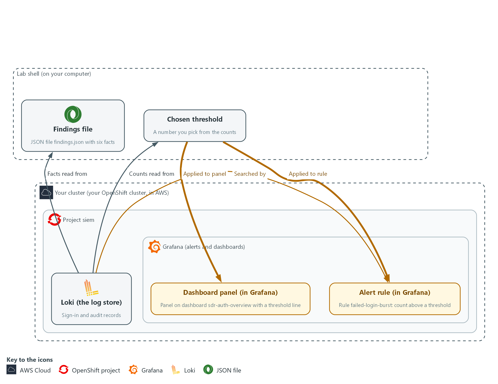

- You send the new threshold to the alert rule and to the dashboard panel in Grafana, so both show the same number.

#### 4a. Set the threshold on the alert rule

You will now look up the rule failed-login-burst, change only its threshold in a saved copy, and send the copy back to Grafana.

```bash
cd /workspace/sdr-3
THRESHOLD=6
RULE_UID=$(curl -s -u "$GRAFANA_USER:$GRAFANA_PASSWORD" "$GRAFANA_URL/api/v1/provisioning/alert-rules" | jq -r 'map(select(.title=="failed-login-burst"))[0].uid')
curl -s -u "$GRAFANA_USER:$GRAFANA_PASSWORD" "$GRAFANA_URL/api/v1/provisioning/alert-rules/$RULE_UID" | jq --argjson thr "$THRESHOLD" '.data[1].model.conditions[0].evaluator.params=[$thr]' > rule.json
curl -s -u "$GRAFANA_USER:$GRAFANA_PASSWORD" -X PUT -H 'Content-Type: application/json' -H 'X-Disable-Provenance: true' -d @rule.json "$GRAFANA_URL/api/v1/provisioning/alert-rules/$RULE_UID" | jq '{title, updated}'
```

**Expected output:**

```
Example only. The time will differ.
{
  "title": "failed-login-burst",
  "updated": "<time>"
}
```

| Part | What it does | Why you run it |
| --- | --- | --- |
| cd /workspace/sdr-3 | Moves into the module folder, because rule.json is saved there. | A block must run on its own, so it starts by going to the folder. |
| THRESHOLD=6 | Your chosen value. Change it if your reading of Step 3 says otherwise. | One variable feeds both the rule and the panel in this step, so they cannot end up with different numbers. |
| RULE_UID=$(...) | Finds the identifier of the rule named failed-login-burst. | The API addresses a rule by its identifier and not by its title, so you look the identifier up by title first. |
| jq --argjson thr ... .params=[$thr] | Replaces the number the rule compares against, leaving everything else as it was. | Only the threshold should change. Everything else in the rule must stay as the lab made it. |
| -X PUT ... -d @rule.json | Sends the whole changed rule back. X-Disable-Provenance lets the API change a rule that was made through the API. | The whole changed rule goes back, and that is what makes the new threshold live. |
| jq '{title, updated}' | Prints the rule name and update time to show the change was accepted. | A new update time is the proof that Grafana accepted the change, not just that the command ran. |

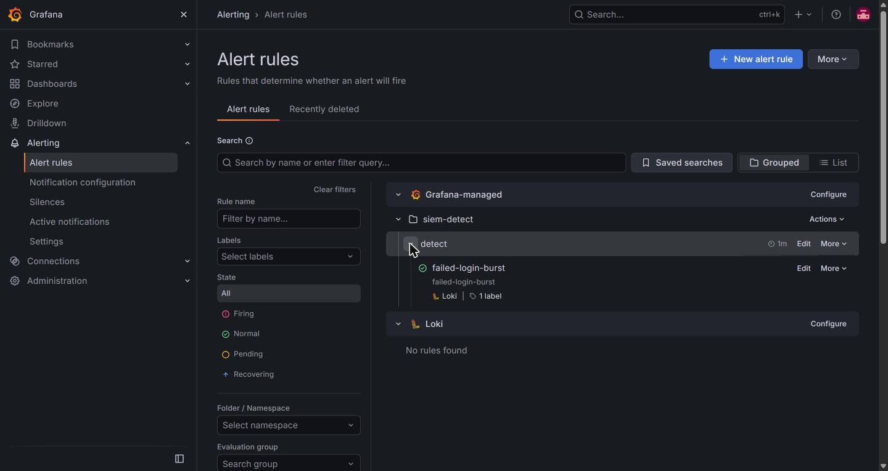

#### 4b. Set the same threshold on the dashboard panel

You will now fetch the dashboard, move its red threshold line to the same value, and save it.

```bash
cd /workspace/sdr-3
THRESHOLD=6
curl -s -u "$GRAFANA_USER:$GRAFANA_PASSWORD" "$GRAFANA_URL/api/dashboards/uid/sdr-auth-overview" | jq --argjson thr "$THRESHOLD" '.dashboard.panels[0].fieldConfig.defaults.thresholds.steps[1].value=$thr | {dashboard: .dashboard, folderUid: .meta.folderUid, overwrite: true, message: "match the alert threshold"}' > dash.json
curl -s -u "$GRAFANA_USER:$GRAFANA_PASSWORD" -H 'Content-Type: application/json' -d @dash.json "$GRAFANA_URL/api/dashboards/db" | jq '{status, version}'
curl -s -u "$GRAFANA_USER:$GRAFANA_PASSWORD" "$GRAFANA_URL/api/dashboards/uid/sdr-auth-overview" | jq '.dashboard.panels[0].fieldConfig.defaults.thresholds.steps[1].value'
```

**Expected output:**

```
Example only. The version number will differ.
{
  "status": "success",
  "version": <n>
}
6
```

| Part | What it does | Why you run it |
| --- | --- | --- |
| cd ... and THRESHOLD=6 | Moves into the module folder and sets the value again. Change 6 if you chose a different value in the block above. | A block must run on its own, so it does not rely on the one before it. |
| api/dashboards/uid/sdr-auth-overview | Fetches the dashboard that lab start made. | The panel is a separate object from the rule, so you fetch it before you change it. |
| ...thresholds.steps[1].value=$thr | Moves the red threshold line of the first panel to your value. | The red line is what a reader of the dashboard sees, so it has to match the rule's threshold. |
| {dashboard: .dashboard, folderUid: .meta.folderUid, overwrite: true, ...} | Wraps the dashboard in the shape the save call expects. folderUid keeps it in its current folder. overwrite replaces the stored version. | The save call needs the dashboard in a wrapper. Keeping the folder and the overwrite flag replaces the old copy in place. |
| api/dashboards/db | Saves the dashboard. | Saving is what makes the new red line appear on the dashboard. |
| the last curl ... .value | Reads the red line back from Grafana and prints its value. | You check the panel with a command, so no web login is needed. It must equal the rule threshold. |

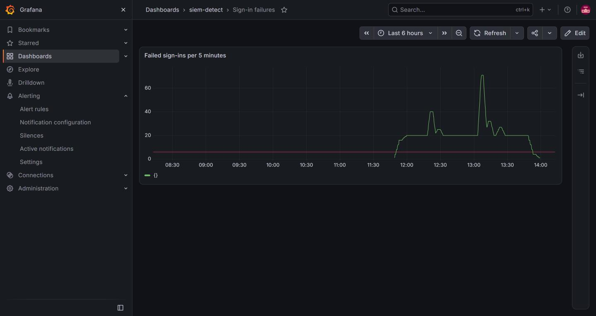

> **YOUR TURN:** Run both blocks. The last line the second block prints is the red line of the panel; it must equal your threshold.

> **CHECKPOINT:** The rule update prints the rule title with a new update time, the dashboard save prints status success, and the last line printed is your threshold.

> **TAKEAWAY:** Change the rule and its panel together so they tell the same story.

**How this meets the control**

- **SI-4:** The control asks that the monitoring be adjusted so it stays useful. Here you send your threshold to the live alert rule and to the dashboard panel through the Grafana API. The rule now ignores the noise, and the panel shows the same number.

### Step 5. Run the review gate (SI-4 System Monitoring, IR-4 Incident Handling)

**Learning point: Running the review gate replays recorded events against your tuned rule and checks your findings, so a pass is evidence and not opinion.**

- The review gate is supplied in the ConfigMap sdr-review, which you copy into lab shell.
- The gate reads findings.json and recomputes the correct facts from the exercise records.
- The gate also reads the live rule and panel, and replays the recorded sign-in events against the rule.
- The gate fails when the work is not acceptable, and each failed line says what to fix.

What this step adds (thick lines and outlines are new):

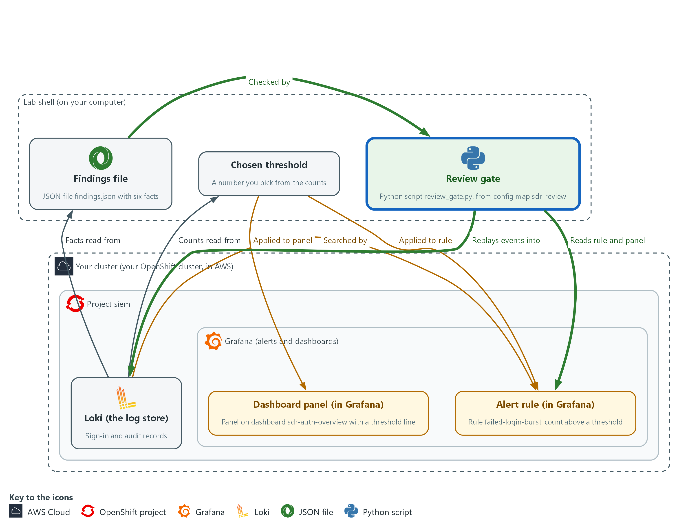

- The review gate in lab shell replays recorded events into Loki, reads the rule and the panel from Grafana, and checks your findings.json.

#### 5a. Fetch and run the review gate

You will now copy the review gate from the cluster and run it against your findings, the rule and the panel.

```bash
cd /workspace/sdr-3
oc extract configmap/sdr-review -n siem --to=. --confirm > /dev/null
python3 review_gate.py
```

**Expected output:**

```
Example only. The wording of each line comes from the gate.
PASS  <a line for each fact in findings.json>
PASS  noise: evaluations that fire outside the real bursts is 0  (0 minutes fired)
PASS  real burst 1 of 2 is detected
PASS  real burst 2 of 2 is detected
GATE PASSED
```

| Part | What it does | Why you run it |
| --- | --- | --- |
| cd /workspace/sdr-3 | Moves into the module folder, where findings.json is. | The gate reads findings.json from the folder it runs in. |
| oc extract configmap/sdr-review ... > /dev/null | Copies the gate and its helper files into the current folder, and hides the list of file names it would print. Your findings.json is not overwritten. | The lab supplies the gate and stores it in the cluster. Copying it into lab shell lets you run it. |
| python3 review_gate.py | Runs the gate. It exits with code 1 when any line fails. | The gate is the proof that your findings, rule and panel are acceptable. When one is not, it tells you what to fix. |

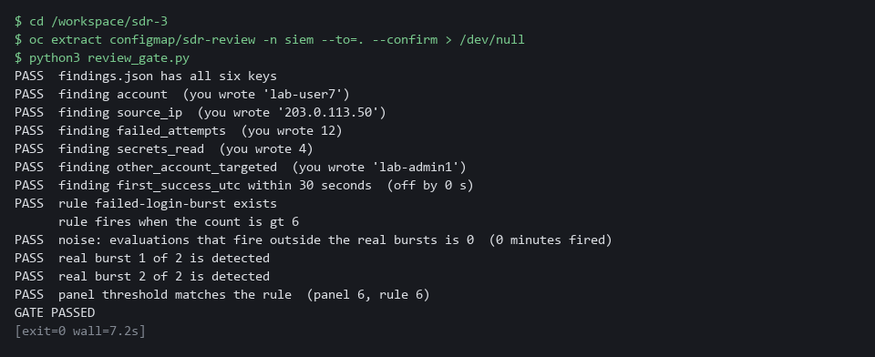

> **YOUR TURN:** Run the block. If a line says FAIL, read the words after it, fix that part, and run the gate again.

> **CHECKPOINT:** Every line says PASS, the noise line reports 0 minutes, both real bursts are detected, and the last line says GATE PASSED.

> **TAKEAWAY:** A rule is tuned only when a replay shows it is quiet on noise and fires on every real burst.

**How this meets the controls**

- **SI-4:** The control asks that monitoring keep detecting what matters. The gate replays recorded events against the live rule and checks that it is quiet outside the bursts and fires in both. A pass is the evidence that the tuned monitoring still works.
- **IR-4:** The control asks for results that are comparable and predictable. The gate recomputes the facts from the records and compares them with findings.json, so the check does not depend on who ran it. A failed line tells you which fact to recheck.

## Section 4. Verify It Works

### Test 1 (positive). The live rule has the tuned threshold and evaluates without error (SI-4 System Monitoring)

- The gate in Step 5 checked the panel against the rule, but it tests the rule's query in Loki, not the rule inside Grafana.
- Read the live rule back to see the tuned threshold, then ask Grafana for the health of the rule after its last evaluation, because a rule that saved but fails when it runs would never alert.
- Health can read unknown until the first evaluation after your change; if it does, run the last command again after a minute.

```bash
RULE_UID=$(curl -s -u "$GRAFANA_USER:$GRAFANA_PASSWORD" "$GRAFANA_URL/api/v1/provisioning/alert-rules" | jq -r 'map(select(.title=="failed-login-burst"))[0].uid')
curl -s -u "$GRAFANA_USER:$GRAFANA_PASSWORD" "$GRAFANA_URL/api/v1/provisioning/alert-rules/$RULE_UID" | jq -c '.data[1].model.conditions[0].evaluator'
curl -s -u "$GRAFANA_USER:$GRAFANA_PASSWORD" "$GRAFANA_URL/api/prometheus/grafana/api/v1/rules" | jq -c '.data.groups[].rules[] | select(.name=="failed-login-burst") | {name, health, lastError}'
```

**Expected output:**

```
Example only. The health value depends on the last evaluation.
{"params":[6],"type":"gt"}
{"name":"failed-login-burst","health":"ok","lastError":null}
```

| Part | What it does | Why you run it |
| --- | --- | --- |
| RULE_UID=$(...) | Looks up the identifier of the rule failed-login-burst. | The API finds a rule by its identifier, not its title. |
| ... \| jq -c '.data[1].model.conditions[0].evaluator' | Prints the comparison the live rule makes: greater than your threshold. | Reading the rule back from Grafana proves the change is live, not just sent. |
| {"params":[6],"type":"gt"} | The rule fires when the count is greater than 6. | It must show the value you chose. |
| {"name":...,"health":"ok",...} | The report from Grafana itself on whether the last run of the rule worked. lastError is null when there was no error. | A rule that saves but fails to run would never alert. If health says error, read lastError. |

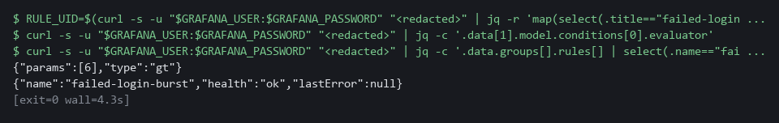

> **CHECKPOINT:** The rule shows your threshold (6 or your value), and its health is ok. A health of error, with a lastError text, means Grafana cannot run the rule: read the text before you go on.

**How this meets the control**

- **SI-4:** The control asks that monitoring be adjusted and then kept working. The gate replays events against the rule query in Loki, so it cannot show that Grafana itself runs the rule. This test reads the live rule back, then asks Grafana for the rule health, which must not be error.

### Test 2 (negative). Tune too little and too far, and watch the gate refuse both (SI-4 System Monitoring)

- A gate you have only seen pass is not proven, so this test makes it fail on purpose.
- Putting the old value 2 back brings the noise back, and setting 12 makes the rule quiet but loses the smaller real burst, so the gate must fail each time.
- The last value in the loop puts the work back as it was; if you chose a value other than 6 in Step 4, type yours in place of the final 6.

```bash
cd /workspace/sdr-3
RULE_UID=$(curl -s -u "$GRAFANA_USER:$GRAFANA_PASSWORD" "$GRAFANA_URL/api/v1/provisioning/alert-rules" | jq -r 'map(select(.title=="failed-login-burst"))[0].uid')
for THRESHOLD in 2 12 6; do
  curl -s -u "$GRAFANA_USER:$GRAFANA_PASSWORD" "$GRAFANA_URL/api/v1/provisioning/alert-rules/$RULE_UID" | jq --argjson thr "$THRESHOLD" '.data[1].model.conditions[0].evaluator.params=[$thr]' | curl -s -o /dev/null -u "$GRAFANA_USER:$GRAFANA_PASSWORD" -X PUT -H 'Content-Type: application/json' -H 'X-Disable-Provenance: true' -d @- "$GRAFANA_URL/api/v1/provisioning/alert-rules/$RULE_UID"
  echo "threshold $THRESHOLD"
  python3 review_gate.py | grep -E 'noise|real burst|GATE'
done
```

**Expected output:**

```
Example only. The numbers will differ.
threshold 2
FAIL  noise: evaluations that fire outside the real bursts is 0  (224 minutes fired)
PASS  real burst 1 of 2 is detected
PASS  real burst 2 of 2 is detected
GATE FAILED
threshold 12
PASS  noise: evaluations that fire outside the real bursts is 0  (0 minutes fired)
FAIL  real burst 1 of 2 is detected
PASS  real burst 2 of 2 is detected
GATE FAILED
threshold 6
PASS  noise: evaluations that fire outside the real bursts is 0  (0 minutes fired)
PASS  real burst 1 of 2 is detected
PASS  real burst 2 of 2 is detected
GATE PASSED
```

| Part | What it does | Why you run it |
| --- | --- | --- |
| cd /workspace/sdr-3 | Moves into the module folder, where the gate was copied. | The gate runs from there. |
| for THRESHOLD in 2 12 6; do ... done | Repeats the block for three values: too low, too high, and your working value. | Each value is sent to the live rule with the same call you used in Step 4. |
| python3 review_gate.py \| grep -E 'noise\|real burst\|GATE' | Runs the gate and keeps only the lines that matter. | You see the verdict for each value. |
| threshold 2 ... FAIL noise | At 2 the rule fires all day, so the noise line fails. | A rule that is too sensitive buries real alerts. |
| threshold 12 ... FAIL real burst 1 | At 12 the rule is quiet but misses the smaller real burst. | Quieting the rule too far loses a real attack. |
| threshold 6 ... GATE PASSED | Your working value passes again. | It puts the rule back as you tuned it. |

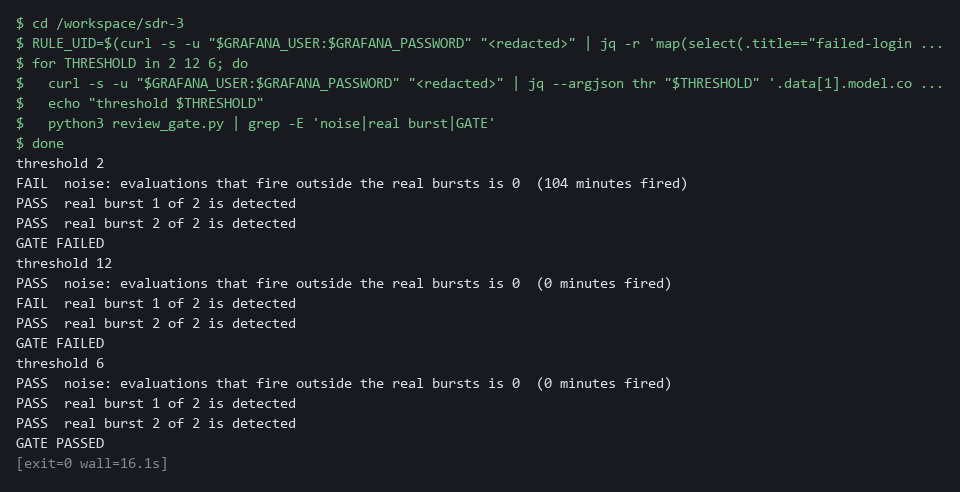

> **CHECKPOINT:** Threshold 2 fails on noise, threshold 12 fails on a missed burst, threshold 6 passes. This loop changes only the rule, not the panel, so the panel differs from the rule while the loop runs. At the end the rule is back at your value, which matches the panel from Step 4.

**How this meets the control**

- **SI-4:** The control asks for monitoring that detects what it should. A threshold of 2 brings the noise back, and a threshold of 12 misses the smaller real burst. Seeing the gate fail both shows that a pass in Step 5 means something.

## Section 5. What Each Control Is For

### Control mapping

| Control | What it requires, in plain words | Tool or service | Where this module covers it |
| --- | --- | --- | --- |
| SI-4 System Monitoring | Analyze what monitoring detects, and adjust the monitoring when risk changes. | Loki searches, the Grafana alert rule failed-login-burst and its dashboard panel. Explained in sections 2.1 and 2.2. | Section 3, Steps 1 to 4: you analyze the detected events and adjust the rule that detects them. Section 3, Step 5, and Section 4, Tests 1 and 2: the replay shows the rule still fires on real events. |
| AU-6 Audit Record Review, Analysis, and Reporting | Review audit records for unusual activity and the potential impact of that activity. | Your own LogQL searches over the audit records in Loki, and the file findings.json. Explained in section 2.3. | Section 3, Step 2: you follow one account through the audit records and state its impact in findings.json. |
| IR-4 Incident Handling | Handle an incident through detection and analysis, and keep the results comparable and predictable. | The file findings.json and the review gate (review_gate.py). Explained in section 2.2. | Section 3, Steps 1 and 2: the detection and analysis phase. Section 3, Step 5: the review gate makes the result checkable. |

### What each control is for

Each table below says what the control is trying to prevent and how this module's tool meets it.

#### SI-4 System Monitoring

| Question | Answer |
| --- | --- |
| Control Intent | Monitoring runs but nobody acts on it, either because it is drowned in false alerts or because it was quieted until it caught nothing. |
| The operational question | If this rule fires tomorrow, will anyone believe it, and if an attack like last month's happens again, will it fire? |
| What evidence proves it | The rule, the data it was tuned against, a replay showing it fires on real events and stays quiet on noise. |
| How much is enough | NIST requires analyzing detected events and adjusting monitoring when risk changes, and leaves the objectives organization-defined. The lab objective is to fire above the noise level, proved by replay. |
| How the tool in this module satisfies it | A threshold read from the data, applied through the Grafana API, and a gate that replays the recorded events. |

#### AU-6 Audit Record Review, Analysis, and Reporting

| Question | Answer |
| --- | --- |
| Control Intent | Someone finds the unusual activity but cannot say what it reached, so the report understates or overstates the impact. |
| The operational question | For the account that was taken over, what did it read or change after it got in? |
| What evidence proves it | A search that lists the account's actions in order, and a findings file with counts that can be rechecked. |
| How much is enough | Review covers the unusual activity and its potential impact. The frequency and recipients are organization-defined. |
| How the tool in this module satisfies it | Your own LogQL searches over sign-in and audit records, and findings.json checked by the gate. |

#### IR-4 Incident Handling

| Question | Answer |
| --- | --- |
| Control Intent | Two analysts investigate the same incident and report different facts, because each searched differently. |
| The operational question | Can another analyst repeat your search and reach the same facts? |
| What evidence proves it | Searches that can be rerun and facts that a script can verify against the records. |
| How much is enough | Handling is comparable and predictable. This module covers detection and analysis only, and the facts are checked automatically. |
| How the tool in this module satisfies it | findings.json with six facts, and a gate that recomputes them from the records. |

## Section 6. Next Steps

### Using this in other environments

- The investigation searches are plain LogQL and the tuning is plain Grafana HTTP API calls with curl and jq, so they run against any Loki and Grafana that hold the same records.
- Change these lab values first: LOKI_URL, LOKI_CA_FILE, the Loki credentials, GRAFANA_URL and the Grafana credentials, plus the rule title failed-login-burst, the dashboard uid sdr-auth-overview and the namespace names.
- The threshold band comes from the seeded records. On a real system read your own counts in Step 3 and choose a value between your noise and your weakest real burst.
- The oc extract of the sdr-review ConfigMap and the Keycloak and audit label names are cluster-specific. The Grafana API paths can differ by Grafana version, so check them on yours.

The table shows what changes on each platform:

| Check | In this lab (OpenShift) | On other platforms | What you change |
| --- | --- | --- | --- |
| Fetch the review gate | oc extract configmap/sdr-review -n siem | kubectl get configmap sdr-review -n <namespace> -o json, or keep the gate in git | The tool name and the namespace. |
| Sign-in records | Keycloak lines in the keycloak namespace, regexp on ipAddress and username | The same if you run Keycloak. Another identity provider logs other fields | The namespace label and the regexp. |
| Audit records | log_type=audit with the json stage, fields user_username and objectRef_resource | The provider's Kubernetes audit log, if collected | The labels and field names. Replace the search if audit is not collected. |
| Alert rule | Grafana rule failed-login-burst, edited at /api/v1/provisioning/alert-rules | The same on any Grafana that has this rule and API | The rule title and the threshold path in the rule JSON. |
| Dashboard panel | Dashboard sdr-auth-overview, saved at /api/dashboards/db | The same on any Grafana | The dashboard uid and the panel index. |
| Review gate | review_gate.py replays events into Loki under a run label | Runs wherever it can reach Loki and Grafana | The URL variables. Replay only into a store you can write test events to. |

> **TIP:** Next module: SDR-4 Build Detections and Pipelines: build a detection and the log pipeline behind it, and prove it fires on a recorded attack.

<details>
<summary><strong>Section 7. Terms</strong></summary>

Each term is also explained the first time it appears. In Word, hover over an underlined term to see its meaning, or Ctrl+click it to jump to this table.

| Term | Plain meaning |
| --- | --- |
| Alert | A message a monitoring tool sends when one of its rules matches. |
| Alert rule | A saved search plus a limit. Grafana runs the search on a schedule and raises an alert when the result is over the limit. |
| API | The address and rules a program uses to give another program commands. Here the Grafana API lets a command change a rule. |
| Audit record | The cluster's record of one request: who asked, what they asked for, and on which object. |
| AWS | Amazon Web Services, the cloud your lab runs in. |
| Baseline | The agreed starting configuration that the system is expected to match. |
| Burst | Many failures from one place in a short time. |
| Cluster | A group of servers that work together as one system. Here it is your own OpenShift cluster. |
| ConfigMap | A named bundle of small files stored in the cluster. The review gate is kept in one. |
| Container | A sealed box that holds one program and everything it needs to run. |
| Credential | A secret that proves who you are, such as a password, token or key. |
| Dashboard | A page of charts in Grafana. Each chart on it is a panel. |
| Dashboard panel | One chart on a Grafana dashboard. |
| Endpoint | One address and port that something listens on, such as a pod behind a Service or a URL path that returns data. |
| Evidence | Saved records that show a system is set up and behaving as claimed. |
| False alert | An alert that fires when nothing worth acting on happened. |
| Findings file | A small JSON file in which you state the facts of the incident. |
| Grafana | A free tool that draws dashboards and runs alert rules. |
| grep | A command that prints only the lines that match a pattern. |
| HTTP | The protocol that web pages and web APIs use. HTTPS is the encrypted form. |
| IP address | The number that identifies a computer on a network, such as 203.0.113.50. |
| jq | A tool that picks values out of JSON text, or builds JSON from values. |
| JSON | A plain-text format for data: names and values written inside curly braces. |
| Keycloak | The sign-in service in the lab. It writes a log line for every failed and every successful sign-in. |
| Kubernetes | The open-source system that runs and manages containers across servers. OpenShift is built on it. |
| Label | A key=value tag on log lines in Loki, such as log_type=audit. Searches start from labels. |
| Log | A line of text that a program saves about what happened. |
| LogQL | Loki's search language. A search names a label such as log_type and then filters or counts the lines. |
| Loki | A free log store. It keeps log lines and lets you search them. |
| mkdir | A command that makes a new folder. |
| Namespace | A named section of the cluster that holds a set of related parts. |
| NIST | The US National Institute of Standards and Technology. It publishes the security control catalog these modules cite. |
| Noise | Failures that happen all day for harmless reasons, such as a monitoring client with a wrong password. |
| oc | The command-line tool for OpenShift. You type oc to ask the cluster questions. |
| OpenShift | The Red Hat platform your lab cluster runs on. It is Kubernetes with extra security and tools built in. |
| Pipeline | A set of automated steps that run in order, such as scan, check and sign. |
| Project | A named section of the cluster that keeps workloads apart, as in project siem. OpenShift also calls it a namespace. |
| Provider | The company or plug-in that supplies a platform, such as a cloud provider or a Terraform provider. |
| Query | A question you ask a data store, written in a query language, such as a log search. |
| Reconnaissance | Early probing of an account or system before the real attack. |
| Regexp | Short for regular expression: a pattern that picks named pieces out of a line of text, such as an address or an account name. |
| Replay | Sending recorded events into the log store under a fresh label, then asking the rule whether it would have fired. |
| Review gate | An automated check that passes or fails a piece of work. Here it checks your findings, the rule and the panel. |
| Role | A list of actions a user or program may take on named kinds of objects. |
| Rule | A written condition that a tool checks. |
| Secret | A stored password or key held in the cluster. Reading one is a sensitive act. |
| Severity | How serious a finding is, such as low, medium, high or critical. |
| Signal | A count that rises because something real is happening, such as a small burst of probing before a larger attack. |
| Signature | A value made with a private key that shows who made something and that it was not changed. |
| Takeover | An attacker gaining control of another person's account. |
| Threshold | The count above which a rule fires. Here: the rule fires when the number of failures in 5 minutes is greater than the threshold. |
| TSV | Tab-separated values: a table written as text, with a tab between columns. |
| UID | The number that identifies the user a process runs as. |
| uniq | A command that removes repeated neighbouring lines. |
| URL | A web address, such as https://example.com/page. |
| UTC | The world's standard time, so a time means the same on every machine. |
| Variable | A named value you or the lab set, such as THRESHOLD. A dollar sign before the name means use its value. |
| Version control | A system that stores every version of a file, so each change can be tracked and undone. |

</details>
