# SDR-4: Build Detections and Pipelines (SI-4, SI-4(2), AU-6(3), IR-4(2))

| Item | Detail |
| --- | --- |
| Sequence | Module 19 of 29 in the recommended order |
| Timed work | About 77 minutes (56 hands-on, 21 verify) |
| Standalone start | `lab start sdr-4` |
| Combined start | Continue from the end state of the previous module |
| Tools | Loki LogQL (free, open source), Grafana Alloy (free, open source), OpenShift Container Platform, NetworkPolicy, oc, curl, jq, python3 |
| Prerequisites | ENG-0 Terminal, Git and Your Lab (you can open lab shell, type oc commands and read their output; the tunnel you need in Step 3 is explained there), SDR-3 Investigate and Tune (you wrote LogQL searches, read a rule as a search plus a threshold, and used a replay gate) |

## Section 1. Module Overview

- Purpose: detect three attack behaviors automatically and prove each detection works, then follow one account through three record sources and isolate the pod it reached.
- You write a labeling stage for the event pipeline, paste two detections and write the third yourself, and prove each with positive and negative test cases.
- You build one ordered timeline from sign-in, audit and runtime-alert records, and contain the suspect pod with a network policy and a label swap.

- **Skill:** Build detection queries and test them against recorded scenarios, correlate sign-in, audit and runtime records into a timeline, and isolate a suspect pod with a network policy and label swap.
- **Tools:** Loki stores events and evaluates detection queries written in LogQL; Grafana Alloy labels audit events as they arrive; the test harness proves each detection fires on the real behavior; oc and NetworkPolicy isolate the suspect pod.
- **Security Function:** Detects privilege escalation, secret reads and commands run inside a pod by a person. Proves each detection fires on its behavior and stays quiet on a lookalike. Builds a correlated timeline from three record sources. Isolates a suspect pod from all traffic without taking the service down.
- **NIST SI-4 System Monitoring:** Three LogQL detection files, each with a firing case and a lookalike, and the test harness show that monitoring fires on the right behavior and not on ordinary work.
- **NIST SI-4(2) Automated Tools and Mechanisms for Real-Time Analysis:** The Alloy pipeline labels audit events as they arrive, and Loki evaluates detection queries on a schedule with no person starting the check.
- **NIST AU-6(3) Correlate Audit Record Repositories:** Sign-in, audit and runtime-alert records are joined on the account name and then the pod name into one ordered timeline that an automatic check verifies.
- **NIST IR-4(2) Dynamic Reconfiguration:** A deny-all NetworkPolicy applied by a label swap isolates the suspect pod from all traffic while the Deployment starts a replacement that keeps the service running.

## Section 2. The Tools

### Tools used in this module

Each tool name links to its official overview. The table columns say how each tool is used in the lab and why the lab uses it instead of another way of doing the same job.

| Tool (overview link) | What it is | Used in this lab | Why this tool |
| --- | --- | --- | --- |
| [LogQL](https://grafana.com/docs/loki/latest/query/) | Loki's query language for searching and filtering logs. | You write three detection queries (privilege escalation, secret read, pod exec) and test them on recorded scenarios. | It is the query language Loki uses, so you need it to ask the stored logs a question and to write a detection. |
| [Grafana Alloy](https://grafana.com/docs/alloy/latest/) | A collector that gathers, processes and ships logs and metrics. | The collector pipeline in which you write the stage that adds the audit_resource label. | It collects logs and sends them to Loki, so you can see how data reaches the place you search it. It is free and open source. |
| [OpenShift Container Platform](https://docs.redhat.com/en/documentation/openshift_container_platform/4.22/html/overview/ocp-overview) | A Kubernetes container platform for running and managing containerized applications. | The cluster whose audit records the detections watch. | It is the platform the whole lab runs on, so every module works on the same real cluster, with the same kinds of objects a production OpenShift system has. |
| [NetworkPolicy](https://docs.redhat.com/en/documentation/openshift_container_platform/4.22/html/network_security/network-policy) | Rules for which pods may talk to which. Once a policy selects a pod, it accepts only what the policies allow. | The quarantine policy that denies all traffic to the pod you isolate. | It is the built-in way to limit which pods can talk to which, so you need no extra product to show what a blocked connection looks like. |
| [oc](https://docs.redhat.com/en/documentation/openshift_container_platform/4.22/html/cli_tools/openshift-cli-oc) | The OpenShift command-line tool for creating and managing applications and projects from a terminal. | Opens the tunnel to the pipeline intake, applies the Alloy configuration, and applies the policy and swaps the labels that isolate the pod. | It is the one command that talks to the cluster, so every module uses it to ask what is true and to make changes. You sign in once, and it works on OpenShift objects as well as standard Kubernetes ones. Unlike clicking in the web console, a command can be pasted, repeated and checked by a test. |
| [curl](https://curl.se/docs/manpage.html) | Command-line tool for transferring data over URLs, used here to call web endpoints. | Sends the queries to Loki and calls the isolated pod from a helper pod. | It calls a web address from the terminal, so you can check what a service really returns instead of trusting a screen. |
| [jq](https://jqlang.org/) | Command-line JSON processor. | Picks fields out of Loki replies to build the timeline. | It picks one field out of a long JSON reply, so a test can read a single value. |
| [Python 3](https://docs.python.org/3/tutorial/introduction.html) | General-purpose language, used here for small helper scripts. | Runs detect_test.py and timeline_check.py. | Python reads and writes JSON easily and is already in the lab shell, so a small script needs nothing installed. |

### How it fits together

#### From pushed events to labels, detections and a timeline

- Test events (recorded scenarios) enter an Alloy pipeline (the collector that receives events and processes them in stages).
- The pipeline adds a label (a tag on log lines) and sends the events to Loki (the log store), where your detections (saved searches with a limit) are evaluated.
- The incident records already sit in Loki, and you build the timeline from searches.
- The timeline names a pod in the project demo, and a network policy (a rule about which traffic a pod may send and receive) isolates it.
- Each step below adds one part, drawn with thick lines.
- The diagram shows the lab (test) setup: a script pushes in the recorded scenarios, and the incident records are seeded.
- In production, real cluster audit events flow in continuously through the collector, detections run on every event, and a person decides when a pod is released.

How the lab is set up, and why:

- You work in lab shell on your laptop.
- The detection files and the timeline you write there are checked by scripts that also run in lab shell.
- Your cluster runs a second copy of the Alloy collector, called alloy-detect, in the project siem (a project is a named section of the cluster) next to Loki.
- You can change its labeling stage without touching the pipeline the platform itself uses.
- SDR-4 adds the alloy-detect pipeline, the test harness and three detections to the layout the earlier modules showed.
- The pipeline sits in front of Loki and adds a label to audit events, and Loki evaluates your detections against what the pipeline stored.
- The harness reaches the pipeline through a tunnel that oc port-forward opens from lab shell (a tunnel from a port on your machine to a service inside the cluster).
- A tunnel is needed because the pipeline's intake, the port where events are pushed in, is inside the cluster and not open to your laptop.
- The harness is stored in the cluster as a ConfigMap (a named bundle of small files) and copied into lab shell, so everyone tests against the same recorded scenarios.
- The incident records already sit in Loki, so the investigation is searches and a file in lab shell, not another part to build.
- The suspect pod runs in the project demo, next to a small helper pod that calls it, so you can see the isolation work.
- Lab start creates both before it seeds the records.
- You apply the policy file you write in lab shell to the cluster with oc.

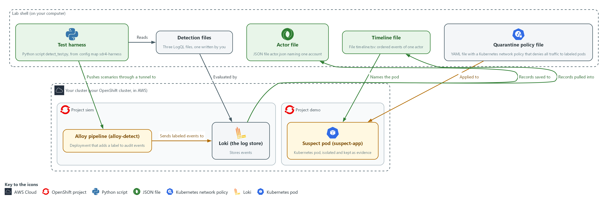

- **1. Test harness (detect_test.py):** a script in lab shell that pushes recorded scenarios through the pipeline and checks whether each detection fires or stays quiet.
- **2. Detection files:** your three LogQL files in the detections folder in lab shell, one for each behavior.
- **3. Actor file (actor.json):** every record naming one account, saved in lab shell.
- **4. Timeline file (timeline.tsv):** one actor's events from all sources in time order, in lab shell.
- **5. Quarantine policy file:** quarantine-policy.yaml in lab shell, applied to the project demo.
- **6. Alloy pipeline (alloy-detect):** a copy of the Alloy collector in the project siem. It adds a label to audit events as they arrive.
- **7. Loki (the log store):** stores the pushed scenarios and the incident records; evaluates your detection queries.
- **8. Suspect pod (suspect-app):** the pod the timeline names. You swap its labels and isolate it with a network policy.

Where each part runs, and why:

| Part | Where it runs | Why it is built this way |
| --- | --- | --- |
| Alloy pipeline | A second Alloy deployment, alloy-detect, in the project siem | Your labeling stage can change without touching the platform's own pipeline. |
| Labeling stage | Inside the Alloy pipeline, stored as a ConfigMap | Loki indexes labels, so the label must be added before the line is stored. |
| Test harness | A ConfigMap in the project siem, run in lab shell | Everyone runs the same recorded scenarios, and nothing real is touched. |
| Tunnel to the intake | Opened by oc port-forward from lab shell | The intake is inside the cluster, and the tunnel gives the harness in lab shell a way to reach it. |
| Detections and timeline | Files in your lab shell | They are your own work, so they stay next to your commands for the harness and the timeline check to read. |
| Suspect pod and helper pod | The project demo | The suspect pod is a real pod the timeline can name, and the helper pod gives you a second place to call it from, so you can show the isolation. |

### 2.1 A detection is a query, a condition and a test (SI-4 System Monitoring)

- A detection counts matching events in a time window and fires when the count passes a threshold.
- On a schedule, Loki runs the search over the last few minutes and compares the count with a number.
- A rule written without tests fails in two ways: it never fires on the real behavior, or it fires on ordinary work and gets ignored.
- Each detection here has a positive and a negative case: at least one event that must fire and at least one lookalike that must not.

#### SI-4: System Monitoring

*The control asks the organization to monitor the system to detect attacks and indicators of potential attacks against organization-defined monitoring objectives, to identify unauthorized use through organization-defined techniques, and to analyze detected events and anomalies. NIST leaves the objectives and techniques organization-defined. This is done using:*

- Three LogQL detection files, evaluated by Loki, are the monitoring for three chosen behaviors.
- The test harness (detect_test.py) runs each detection against a firing case and a lookalike.
- In Step 4 you search Loki to analyze what the detected events point to.

The table lists each detection, the behavior it catches and the lookalike that must stay quiet:

| Detection | Behavior | Lookalike that must stay quiet |
| --- | --- | --- |
| priv-escalation | A person binds the admin or cluster-admin role | View-only binding; a controller binding; reading a binding |
| secret-read | More than one read or list of secrets (stored passwords and keys) in 5 minutes by a person | A single read; 20 reads by a system service account |
| pod-exec | A person runs a command inside a pod (the smallest running unit on the cluster), a request called exec | Reading pod logs; a controller doing the same |

### 2.2 Labels make the search selective, but only some fields belong there (SI-4(2) Automated Tools and Mechanisms for Real-Time Analysis)

- Loki indexes labels, not the text of each line.
- A search that starts from a label reads only those lines.
- The Alloy stage pulls objectRef.resource out of each audit line and attaches it as a label.
- Use a label for a field with a few possible values, such as resource kinds.
- Do not use a label for a field with endless values: every new value creates a new stream and slows Loki down.
- Fields with many values stay in the line and are read with the json parser at search time.

#### SI-4(2): Automated Tools and Mechanisms for Real-Time Analysis

*The enhancement asks the organization to employ automated tools and mechanisms to support near real-time analysis of events. It gives no number for near real-time. This is done using:*

- The Alloy pipeline (alloy-detect) labels each audit event as it arrives.
- Loki evaluates your detection queries on a schedule, with no person starting the check.
- The 5 minute window and the check every minute are lab choices.

### 2.3 Correlation means joining on a shared value (AU-6(3) Correlate Audit Record Repositories)

- The three sources describe the same attack in different words.
- The sign-in log has an account name and an address.
- The audit log has the same account name and, on the command, a pod name.
- The runtime alert has no account but has the pod name.
- Each source has its own format: sign-in lines are text, audit lines are JSON, the runtime alert is JSON with different field names.
- The timeline needs one row layout of five columns: time, source, account, action, object.

#### AU-6(3): Correlate Audit Record Repositories

*The enhancement asks the organization to analyze and correlate audit records across different repositories to gain organization-wide situational awareness. The sign-in records, the audit records and the runtime alerts are three repositories with three formats. This is done using:*

- LogQL searches in Loki join the three sources on the account name and then the pod name.
- jq reshapes the three formats into one set of columns.
- The timeline check (timeline_check.py) verifies that the merged timeline is in order and holds only one actor.

### 2.4 Contain by changing a label, not by deleting (IR-4(2) Dynamic Reconfiguration)

- Containment cuts the affected part off so the damage stops spreading, before anyone cleans it up.
- In a cluster, a network policy that selects a pod and lists no allow rules denies all of its traffic in the directions it covers.
- Deleting a suspect pod removes the evidence of what ran in it.
- Changing the label that the ReplicaSet selects on releases the pod and starts a replacement, so the service keeps running.
- A network policy that selects the new label denies all traffic to and from the pod.

#### IR-4(2): Dynamic Reconfiguration

*The enhancement asks the organization to include organization-defined types of dynamic reconfiguration for organization-defined system components as part of the incident response capability. NIST says dynamic reconfiguration can stop attacks, misdirect attackers and isolate components of systems, limiting the extent of the damage. This is done using:*

- A deny-all Kubernetes NetworkPolicy cuts the pod off from all traffic in both directions.
- oc label swaps the pod's labels, so the policy selects it and the Deployment starts a replacement.
- The lab covers one type, a network policy on one pod, and sets no time limit.

The table compares three ways to contain a pod:

| Option | Service keeps running | Evidence kept | Pod cut off from the network |
| --- | --- | --- | --- |
| Delete the pod | Yes, a replacement starts | No | Yes, it is gone |
| Scale the Deployment to zero | No | No | Yes, it is gone |
| Swap the label and apply the deny-all policy | Yes, a replacement starts | Yes | Yes |

### Design decisions

#### Label only a field with few values

- How: A labeling stage in the Alloy pipeline parses each audit line and turns objectRef.resource into the label audit_resource. User names and pod names stay inside the line and are read with the json parser at search time.
- Why: A label with few values lets a search read only matching streams, while a label with endless values multiplies streams and slows the log store.
- Alternatives: The advantage of labeling the user name too is that searches for one person are faster. The drawback is that every new user creates a new stream, so the cost grows with the number of people.

#### Every detection ships with a firing case and a lookalike

- How: Each detection is a LogQL file with a comparison and a threshold. A harness pushes recorded scenarios through the labeling stage and checks that each detection fires or stays quiet as expected.
- Why: Each detection has a lookalike that must stay quiet, so a rule that fires on ordinary work or never fires on the real behavior is caught before anyone trusts it.
- Alternatives: The advantage of writing a query and checking it by eye on live data is that it is quick. The drawback is that it is not repeatable and has no negative case.

#### Contain with a label swap and a deny-all policy, and keep the pod

- How: The pod that the timeline names gets a different app label and the label quarantine=true. The Deployment starts a replacement, and a network policy that selects quarantine=true denies all traffic to and from the old pod.
- Why: The service keeps running, the evidence stays in the cluster, and the isolation is one reversible change that a call to the old pod can test.
- Alternatives: The advantage of deleting the pod is that it is one command and the suspect is gone. The drawback is that the evidence of what ran in it is lost, and an identical pod starts at once.

## Section 3. Implement

- Start: type `lab start sdr-4` in the terminal on your own computer (PowerShell on Windows, Terminal on Mac), not in the lab shell.
- Enter lab shell with `lab shell`. Every other command in this module runs inside lab shell.
- If a step fails: run `lab reset sdr-4` on your own computer and repeat the step once. If it still fails, copy the whole command and error and ask your AI assistant. Do not skip the step.

### Step 1. Write the labeling stage in the Alloy pipeline (SI-4(2) Automated Tools and Mechanisms for Real-Time Analysis)

**Learning point: Writing the labeling stage and storing it as a ConfigMap turns each audit event's resource kind into a searchable label before it reaches Loki.**

- The detection queries start from the label audit_resource, so the pipeline must add it.
- You replace the pass-through stage with one that reads objectRef.resource from each audit line and turns it into a label.
- The first block writes the file label.alloy.
- The stage is stored as a ConfigMap (a named bundle of small files) that Alloy reads, so the second block stores it and restarts the pipeline.
- You do not wait for the restart here: it finishes while you write the detections, and the test step waits for it.

What this step adds (thick lines and outlines are new):

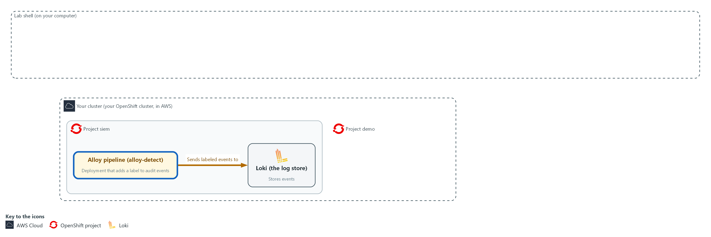

- You write the labeling stage and send it to the Alloy pipeline in the project siem as a ConfigMap, then restart the pipeline.

#### 1a. Write the labeling stage as label.alloy

You will now make a working folder for this module and write the labeling stage into a file named label.alloy in it.

- Paste the whole block at once into the lab shell.
- The stage does not run yet.

```bash
mkdir -p /workspace/sdr-4 && cd /workspace/sdr-4
cat > label.alloy <<'EOF'
loki.process "label" {
  forward_to = [loki.write.siem.receiver]

  stage.json {
    expressions = { audit_resource = "objectRef.resource" }
  }

  stage.labels {
    values = { audit_resource = "" }
  }
}
EOF
wc -l label.alloy
```

**Expected output:**

```
Example only.
11 label.alloy
```

| Part | What it does | Why you run it |
| --- | --- | --- |
| mkdir -p /workspace/sdr-4 && cd ... | Makes the working folder for this module and moves into it. The folder stays between lab sessions. | Every file in this module goes here, and every later block starts by moving here. |
| cat > label.alloy <<'EOF' ... EOF | Writes every line between the first line and EOF into the file label.alloy. The quotes around EOF keep the text exactly as typed. | You need no editor: pasting these lines makes the file. |
| wc -l label.alloy | Counts the lines in the file. | A quick check that the whole paste arrived. |
| loki.process "label" { | Names the stage. The intake sends events here, so the name must stay label. | Without this stage, events reach Loki with no audit_resource label, and the detections in the next step would find nothing. |
| forward_to = [loki.write.siem.receiver] | After processing, events go to the writer that sends them to Loki. | Labeled events still have to be stored, so the stage hands them on to Loki. Otherwise they would vanish here. |
| stage.json { expressions = ... } | Reads each line as JSON and takes the value at objectRef.resource into a working value named audit_resource. | This is the step that finds the kind of object each request was about, such as secrets or pods, inside the audit line. |
| stage.labels { values = ... } | Turns that working value into a label. The empty text means the label keeps the same name. | Only a label can be searched quickly, so the working value becomes one here. The field has few values, so it is safe to use. |

#### 1b. Store the stage in the cluster and restart the pipeline

You will now store label.alloy as a ConfigMap in the project siem and restart the Alloy pipeline so it reads it.

```bash
cd /workspace/sdr-4
oc create configmap alloy-detect-label -n siem --from-file=label.alloy --dry-run=client -o yaml | oc apply -f -
oc rollout restart deployment/alloy-detect -n siem
```

**Expected output:**

```
Example only. The wording comes from oc.
configmap/alloy-detect-label <created or configured>
deployment.apps/alloy-detect restarted
```

| Part | What it does | Why you run it |
| --- | --- | --- |
| cd /workspace/sdr-4 | Moves into the working folder, where label.alloy is. | oc reads the file from the folder you are in. |
| oc create configmap ... --dry-run=client -o yaml \| oc apply -f - | Builds the ConfigMap from the file and applies it, replacing the earlier one. | Alloy reads its stages from this ConfigMap, so storing the file there is how your stage reaches the running pipeline. |
| oc rollout restart ... | Restarts Alloy so it reads the new stage. | Alloy reads its files only when it starts. Without a restart it keeps using the old stage that does nothing. |

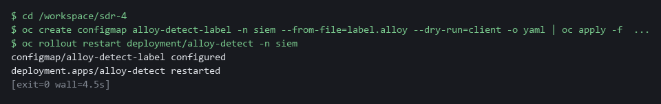

> **SECURITY:** Do not turn a user name or pod name into a label. Many different values multiply the number of streams and slow the log store. Keep those in the line.

> **YOUR TURN:** Run the block, then go on to the detections. If the rollout does not finish by the test step, read the Alloy log with oc logs deployment/alloy-detect -n siem and fix the syntax error it names.

> **CHECKPOINT:** The ConfigMap is applied and the restart is issued. The deployment reports its rollout in the test step.

> **TAKEAWAY:** A label must be added before a line is stored; a stage added after the fact applies only to new lines.

**How this meets the control**

- **SI-4(2):** The enhancement asks for automated tools that support near real-time analysis of events. You write the pipeline stage that turns each audit event into a labeled line as it arrives, which makes the Step 2 queries selective.

### Step 2. Write three detections (SI-4 System Monitoring, SI-4(2) Automated Tools and Mechanisms for Real-Time Analysis)

**Learning point: Writing a detection as a file with a threshold, then testing it against a firing case and a lookalike, proves it works before anyone trusts it.**

- Each detection file holds two comment lines (the comparison and the threshold) and one LogQL query that returns a count.
- Each query selects audit events by label, parses the line as JSON, keeps the verbs that change or read something, and excludes system service accounts, whose names begin with system:.
- The harness reads only files written in this layout: two comment lines, then one query.
- You paste the first two detections and read how they are built.
- You write the third detection yourself: the last block gives you a starter file that is too broad, and you write the finished version from a short list of what it must do.

What this step adds (thick lines and outlines are new):

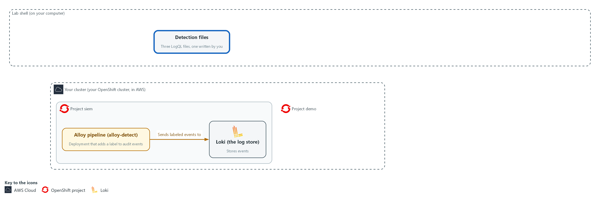

- You paste two detections and write the third as LogQL files in the detections folder in lab shell.

#### 2a. Write the privilege-escalation detection

You will now make the detections folder that the test harness reads, and write the first detection into a file named priv-escalation.logql inside it.

- Paste the whole block at once.
- The detection does not run yet.

```bash
mkdir -p /workspace/sdr-4 && cd /workspace/sdr-4
mkdir -p detections
cat > detections/priv-escalation.logql <<'EOF'
# op gt
# threshold 0
sum(count_over_time({log_type="audit", audit_resource=~"rolebindings|clusterrolebindings"} | json | verb=~"create|update|patch" | user_username!~"system:.*" | requestObject_roleRef_name=~"admin|cluster-admin" [5m]))
EOF
wc -l detections/priv-escalation.logql
```

**Expected output:**

```
Example only.
3 detections/priv-escalation.logql
```

| Part | What it does | Why you run it |
| --- | --- | --- |
| mkdir -p /workspace/sdr-4 && cd ... ; mkdir -p detections | Makes the module working folder and the detections folder, and moves into the working folder. -p means no error if they already exist. | The test harness looks only in the detections folder, so the three detection files must live there. |
| cat > detections/priv-escalation.logql <<'EOF' ... EOF | Writes the three lines between the first line and EOF into the file. wc -l then counts them: 3. | You need no editor: pasting these lines makes the file. |
| # op gt | Comment line the harness reads: fire when the count is greater than the threshold. | The harness reads this line to learn how to compare the count with the threshold, so each file is a complete rule on its own. |
| # threshold 0 | Fire when the count is above 0. | Any privilege escalation by a person is worth a look, so one match is enough to fire. |
| {log_type="audit", audit_resource=~"rolebindings\|clusterrolebindings"} | Selects audit events whose label audit_resource is either kind of role binding. =~ means matches this pattern. | Starting from the label you made in step 1 means Loki reads only role-binding lines and not every audit line. |
| \| json | Parses each line as JSON so its fields can be used. user.username becomes user_username; requestObject.roleRef.name becomes requestObject_roleRef_name. | The user name and the role sit inside the line and not in labels, so you read them out at search time. |
| \| verb=~"create\|update\|patch" | Keeps requests that change something, not reads. | Reading a binding is harmless. Creating or changing one is how privilege is granted, so only those verbs count. |
| \| user_username!~"system:.*" | Drops identities whose name starts with system:, the cluster's own programs. | The cluster's own programs change bindings all the time, so leaving them out keeps the detection quiet on normal work. |
| \| requestObject_roleRef_name=~"admin\|cluster-admin" | Keeps only bindings of the powerful roles. | A view-only binding is a lookalike that must stay quiet, so only the admin-level roles may fire. |
| count_over_time(... [5m]) | Counts matching lines in the last 5 minutes. | A detection needs a count over a window to compare with its threshold, and a short window keeps it timely. |
| sum(...) | Adds the counts of all streams into one number. | The count comes back once for each stream. Adding them gives the single number the threshold is compared with. |

#### 2b. Write the pod-exec detection

You will now write the second detection into a file named pod-exec.logql inside the detections folder.

- Paste the whole block at once.
- The detection does not run yet.

```bash
cd /workspace/sdr-4
cat > detections/pod-exec.logql <<'EOF'
# op gt
# threshold 0
sum(count_over_time({log_type="audit", audit_resource="pods"} | json | objectRef_subresource="exec" | verb="create" | user_username!~"system:.*" [5m]))
EOF
wc -l detections/pod-exec.logql
```

**Expected output:**

```
Example only.
3 detections/pod-exec.logql
```

| Part | What it does | Why you run it |
| --- | --- | --- |
| cat > detections/pod-exec.logql <<'EOF' ... EOF | Writes the three lines between the first line and EOF into the file. wc -l then counts them: 3. | You need no editor: pasting these lines makes the file. |
| audit_resource="pods" | Selects audit events about pods. | Running a command inside a pod is a request on pods, so starting from this label narrows the search. |
| \| objectRef_subresource="exec" | Keeps requests for the exec part of a pod, which is how a command is run inside it. | Only the exec part of a pod request means a command was run inside. Reading logs is a different part and must stay quiet. |
| \| verb="create" | Running a command is a create request. | Opening a command session is recorded as a create request, which keeps out reads such as watching a pod. |

#### 2c. Your turn: start the secret-read detection

You will now write a starter secret-read.logql that is too broad on purpose: it counts every read of a secret by anyone, and fires on one.

- Run the block once so the file exists.
- Write the finished detection yourself from the note below this block by running the same command again with your own lines.
- The answer file answer-secret-read.logql arrives in Step 3; do not open it until you have tried.

```bash
cd /workspace/sdr-4
cat > detections/secret-read.logql <<'EOF'
# op gt
# threshold 0
sum(count_over_time({log_type="audit", audit_resource="secrets"} | json [5m]))
EOF
wc -l detections/secret-read.logql
```

**Expected output:**

```
Example only.
3 detections/secret-read.logql
```

| Part | What it does | Why you run it |
| --- | --- | --- |
| cat > detections/secret-read.logql <<'EOF' ... EOF | Writes the starter into the file. Running the command again with different lines replaces the file. | This is how you edit without an editor: write the whole file again. |
| # threshold 0 | Fire when the count is above 0. This is the first gap to fix: choose the number from the note below. | The threshold decides how many reads are too many. At 0 a single ordinary read fires. |
| audit_resource="secrets" | Selects audit events about secrets, the stored passwords and keys. | Secrets hold passwords and keys, so reads of them are what this detection is about. This part is already right. |
| \| json | Parses each line as JSON. Nothing is filtered after it yet. | The filters are the second gap. Without them the detection counts every kind of request by every account, including the cluster's own. |

> **NOTE:** Your secret-read detection must fire when a person gets or lists secrets more than once in 5 minutes, and stay quiet for a single read and for 20 reads by a service account whose name starts with system:. Use the two files above as your pattern, one filter per line starting with |, keeping the 5m window. The scenarios accept any threshold from 1 to 5.

> **YOUR TURN:** Write your version of secret-read.logql: run the heredoc command again with your own lines. Read each of the three files once and note why the query leaves out a normal event. If you are unsure, Step 3 tells you which scenario fails, and then you may open the answer file.

> **CHECKPOINT:** The detections folder holds pod-exec.logql, priv-escalation.logql and secret-read.logql, and the secret-read file is your own version, not the starter.

> **TAKEAWAY:** A detection without a negative case has not been proven not to fire on ordinary work.

**How this meets the controls**

- **SI-4:** The control asks for monitoring that detects attacks and indicators of attacks. You paste two detections and write the secret-read detection yourself, each with a comparison, a threshold and the cluster's own accounts left out.
- **SI-4(2):** The enhancement asks for automated analysis of events. Each detection is a saved query that Loki evaluates over a 5 minute window without a person running it.

### Step 3. Test the detections against recorded scenarios (SI-4 System Monitoring, SI-4(2) Automated Tools and Mechanisms for Real-Time Analysis)

**Learning point: Running the harness against your detections proves they fire on the real behavior and stay quiet on the lookalike, and that the pipeline and the queries work together.**

- The harness is in a ConfigMap.
- You open a tunnel (oc port-forward) from your shell to the pipeline intake, run the harness, and read the result.
- For each scenario the harness pushes the recorded events through your labeling stage into Loki under a label that names this test run.
- Loki evaluates your query every minute.
- The harness then compares whether the query fired with what the scenario expects.

What this step adds (thick lines and outlines are new):

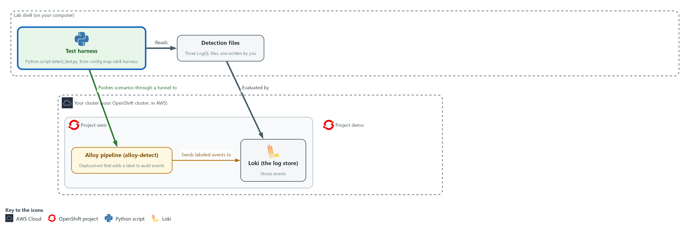

- The test harness in lab shell pushes recorded scenarios through the Alloy pipeline into Loki, and checks whether each of your detection files fires or stays quiet.

#### 3a. Run the harness against your detections

You will now wait for the restarted pipeline, copy the test harness, open a tunnel to the pipeline intake and run every scenario against your detection files.

- The eleven scenarios take about 30 seconds in total, and you can run the block again because it closes the earlier tunnel first.

```bash
cd /workspace/sdr-4
oc rollout status deployment/alloy-detect -n siem --timeout=240s
oc extract configmap/sdr4-harness -n siem --to=. --confirm > /dev/null
kill "$(cat pf.txt 2>/dev/null)" 2>/dev/null || true
oc port-forward -n siem svc/alloy-detect 3500:3500 > portforward.log 2>&1 &
echo $! > pf.txt
timeout 30 bash -c 'until echo > /dev/tcp/127.0.0.1/3500; do sleep 1; done' 2>/dev/null
python3 detect_test.py detections | tee test-report.txt
```

**Expected output:**

```
Example only. The wording and the counts come from the harness.
deployment "alloy-detect" successfully rolled out
<detection name>  fires when the count is gt <threshold>
  PASS  <scenario name>  expected <fire or no_fire>  peak count <n>
  ... (eleven scenarios in three groups)
TESTS PASSED
(peak count is the highest count Loki saw in the window)
```

| Part | What it does | Why you run it |
| --- | --- | --- |
| cd /workspace/sdr-4 | Moves into the working folder, where detections is. | The harness reads the detections folder from where you stand. |
| oc rollout status ... --timeout=240s | Waits up to 240 seconds for the restarted pipeline from the labeling step to be ready. It has had the whole detection step to finish, so this usually returns at once. | The restart from step 1 must be finished before the test. Otherwise events pass through the old stage and every detection fails. |
| oc extract configmap/sdr4-harness ... --confirm > /dev/null | Copies the harness, the scenarios, the timeline check, the start time anchor.txt and the reference answer answer-secret-read.logql into the current folder. > /dev/null hides the list of file names it would print. | The lab supplies the harness and its recorded scenarios and stores them in the cluster, so you copy them in to run the tests. The answer file is only for after you tried. |
| kill ... pf.txt | Closes a tunnel left from an earlier run. | Two tunnels cannot share port 3500, so a rerun would fail without this. |
| oc port-forward -n siem svc/alloy-detect 3500:3500 | Forwards port 3500 on your machine to the pipeline intake. | The intake is inside the cluster. The tunnel is how the harness in lab shell can push events to it. |
| > portforward.log 2>&1 & | Runs the tunnel in the background and keeps its messages in a file. | The tunnel must stay open while the tests run, so it goes to the background and its messages go to a file and not to your screen. |
| echo $! > pf.txt | Saves the process number of the tunnel in pf.txt. | The next run reads this file to close the old tunnel first. |
| timeout 30 bash -c 'until echo > /dev/tcp/127.0.0.1/3500; do sleep 1; done' | Checks once a second, for up to 30 seconds, whether anything answers on port 3500, and carries on as soon as the tunnel is open. | A tunnel can take a few seconds to open. A test started before it is open fails for the wrong reason, so waiting until it answers is safer than a fixed pause. |
| python3 detect_test.py detections \| tee test-report.txt | Runs every scenario against the files in the detections folder, about 30 seconds in total, and saves a copy of the report in test-report.txt for the verify step. | This is the proof that each detection fires on the real behavior and stays quiet on its lookalike. The saved report is your evidence in the verify step. |

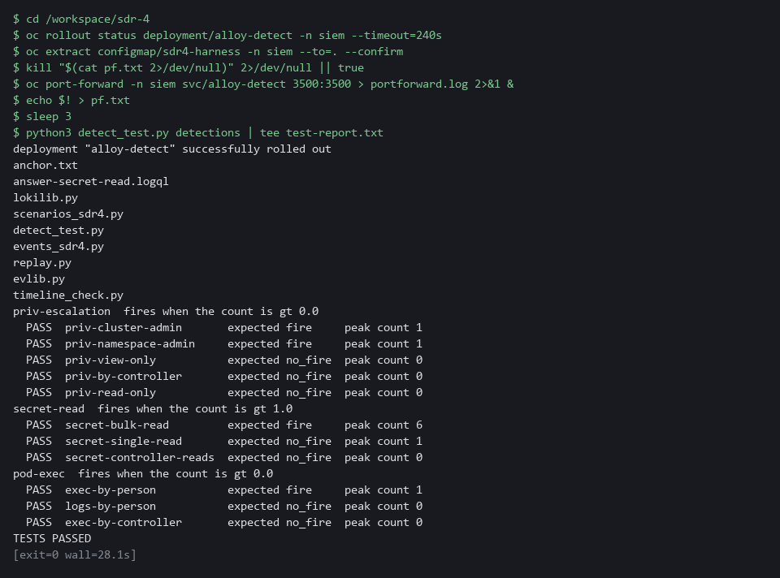

> **YOUR TURN:** Run the block. If it fails at once with an error and no scenario lines, a detection file is probably empty (for example, a paste that did not finish): check with wc -l detections/*.logql and write it again. For any FAIL line, read the scenario name, work out which condition of your query is wrong, fix the file and run only the last command again. A FAIL on secret-single-read means your threshold is too low. A FAIL on secret-controller-reads means the filter for system: accounts is missing. If you are still stuck after one more try, open answer-secret-read.logql and compare it with yours. Any layout is fine as long as the scenarios pass.

> **CHECKPOINT:** Eleven PASS lines in three groups and the last line says TESTS PASSED.

> **TAKEAWAY:** TESTS PASSED means eleven scenarios all behaved as expected, positive and negative.

**How this meets the controls**

- **SI-4:** The control asks for monitoring that detects attacks and indicators of attacks. The harness pushes recorded scenarios, including lookalikes, and its report is your evidence that each detection fires on the real behavior and not on ordinary work.
- **SI-4(2):** The enhancement asks for automated analysis soon after events happen. The harness sends events through your labeling stage into Loki, and a pass shows the pipeline and queries work together without a person.

### Step 4. Follow the actor and build the timeline (SI-4 System Monitoring, AU-6(3) Correlate Audit Record Repositories)

**Learning point: Naming the account with the most failures and saving every record that mentions it creates the starting point for a correlated timeline across three record sources.**

- The investigation starts from a burst of failed sign-ins, which you counted by hand in SDR-3.
- Here one search names the account with the most failures and keeps it in a variable.
- A second search pulls every record that mentions the account, from every source, into one file.
- Both searches add the run number from anchor.txt as the label seed_run, so records left from an earlier lab start are not counted.
- The audit record of the command names the pod.
- The runtime alert (Falco, the tool that watches commands inside containers) has the pod name but no account.
- You take the pod name from the audit record and search for the alert.
- You then reshape the three sources into the same five columns, merge them in time order and run the check.

What this step adds (thick lines and outlines are new):

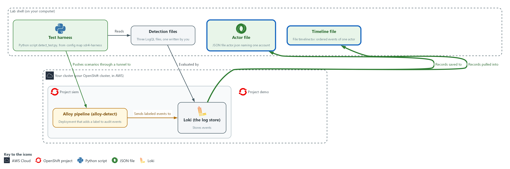

- You search Loki for the account behind the failed sign-ins, save its records to the actor file, follow the pod into the third source, and merge all three sources into one ordered timeline file in lab shell.

#### 4a. Name the actor and save its records

You will now ask Loki which account had the most failed sign-ins, then save every record that names that account.

```bash
cd /workspace/sdr-4
START=$(date -d '6 hours ago' +%s)
RUN=$(cat anchor.txt)
Q='topk(1, sum by (user) (count_over_time({lab_seed="sdr-4", seed_run="RUN_ID", kubernetes_namespace_name="keycloak"} |= "LOGIN_ERROR" | regexp `username="(?P<user>[^"]+)"` [6h])))'
Q=${Q/RUN_ID/$RUN}
ACTOR=$(curl -sG --cacert "$LOKI_CA_FILE" -u "$LOKI_USER:$LOKI_PASSWORD" "$LOKI_URL/loki/api/v1/query" --data-urlencode "query=$Q" | jq -r '.data.result[0].metric.user')
echo "$ACTOR"
curl -sG --cacert "$LOKI_CA_FILE" -u "$LOKI_USER:$LOKI_PASSWORD" "$LOKI_URL/loki/api/v1/query_range" --data-urlencode "query={lab_seed=\"sdr-4\", seed_run=\"$RUN\"} |= \"$ACTOR\"" --data-urlencode "start=$START" --data-urlencode 'limit=500' > actor.json
jq '[.data.result[].values[]] | length' actor.json
```

**Expected output:**

```
Example only. The account name is the one the exercise seeded.
lab-user9
11
(the last number is how many lines were saved to actor.json)
```

| Part | What it does | Why you run it |
| --- | --- | --- |
| cd /workspace/sdr-4 | Moves into the working folder, where the files from this step are saved. | A block must run on its own, so it starts by going to the folder. |
| START=$(date -d '6 hours ago' +%s) | Stores the time 6 hours ago; a range search without a start only looks back 1 hour. | The incident began earlier than the default range, so you widen it before you search. |
| RUN=$(cat anchor.txt) | Reads the number of this lab start from anchor.txt. Every exercise record carries it as the label seed_run. | Records from an earlier lab start may still be stored. Adding seed_run to each search keeps their old lines out of your counts. |
| Q='`topk(1, ...)`' and Q=${Q/RUN_ID/$RUN} | Stores the search in a variable, then puts your run number in place of the word RUN_ID. It counts failed sign-ins per account over 6 hours and keeps only the account with the highest count. | The account with the most failures is the actor you follow. Asking Loki for it directly replaces the table you read by eye in SDR-3. |
| regexp `username="(?P<user>[^"]+)"` | Pulls the account name out of each sign-in line into the label user. A regexp is a pattern that picks pieces out of text. | The count is grouped by account, so the name must be a label at search time. |
| ACTOR=$(... \| jq -r '.data.result[0].metric.user') | Stores the account name in a variable so the next search does not need it typed. | The join key travels in a variable, so a typing slip cannot change who you investigate. |
| {lab_seed="sdr-4", seed_run="$RUN"} \|= "$ACTOR" | Selects every exercise line of this lab start, from any source, that contains the account name. | The account name is your join key, so this pulls everything that names it from every source at once. |
| > actor.json | Saves the answer for the next block. | The next block reads this file three ways, so one saved answer saves repeating the search. |
| jq '[.data.result[].values[]] \| length' | Counts how many lines were saved. | A quick check that the search found about what the exercise says it should. |

#### 4b. Pivot to the pod and build the timeline

You will now find the pod in the audit records, search for the runtime alert on that pod, reshape the three sources into five columns, merge them and run the check.

```bash
cd /workspace/sdr-4
START=$(date -d '6 hours ago' +%s)
RUN=$(cat anchor.txt)
jq -r '.data.result[].values[][1] | select(startswith("{")) | fromjson | select(.objectRef.subresource == "exec") | .objectRef.name' actor.json | head -1 > pod.txt
POD=$(cat pod.txt)
echo "$POD"
curl -sG --cacert "$LOKI_CA_FILE" -u "$LOKI_USER:$LOKI_PASSWORD" "$LOKI_URL/loki/api/v1/query_range" --data-urlencode 'query={lab_seed="sdr-4", seed_run="'"$RUN"'"} |= "Terminal shell in container" |= "'"$POD"'"' --data-urlencode "start=$START" --data-urlencode 'limit=50' > falco.json
jq -r '.data.result[].values[] | (.[0] | tonumber / 1000000000 | floor | todate) as $t | .[1] | select(startswith("{") | not) | capture("type=\"(?<type>[A-Z_]+)\".*ipAddress=\"(?<ip>[^\"]+)\".*username=\"(?<user>[^\"]+)\"") | [$t, "keycloak", .user, .type, .ip] | @tsv' actor.json > kc.tsv
jq -r '.data.result[].values[][1] | select(startswith("{")) | fromjson | select(.kind == "Event") | [.stageTimestamp, "audit", .user.username, (.verb + " " + .objectRef.resource + (if .objectRef.subresource then "/" + .objectRef.subresource else "" end)), (.objectRef.name | if . == "" then "-" else . end)] | @tsv' actor.json > audit.tsv
jq -r '.data.result[].values[][1] | fromjson | [.time, "falco", .output_fields["user.name"], .rule, .output_fields["k8s.pod.name"]] | @tsv' falco.json > falco.tsv
cat kc.tsv audit.tsv falco.tsv | sort > timeline.tsv
wc -l timeline.tsv
python3 timeline_check.py timeline.tsv
```

**Expected output:**

```
Example only. The pod name and times differ in your lab.
<pod name>
12 timeline.tsv
<one line for each check>
TIMELINE PASSED (12 rows)
```

| Part | What it does | Why you run it |
| --- | --- | --- |
| cd ... and START=... and RUN=... | Moves into the working folder and sets the start time and the run number again. | This block uses START and RUN, so it sets them itself instead of relying on the block before. |
| POD=$(jq -r ... select(.objectRef.subresource == "exec") ...) | Finds the audit line for the command and takes the name of the pod it ran in. | The runtime alert names the pod but not the person, so the pod name from the audit record is the bridge to the third source. |
| \|= "Terminal shell in container" \|= "'"$POD"'" | Searches for the runtime alert whose text names that pod. The quote pieces let the shell insert the pod name. | This is the pivot from the audit record to the runtime alert for the same pod, which turns three sources into one story. |
| capture("type=...") | Pulls the event type, address and account out of a sign-in line, which is text, not JSON. | Sign-in lines are text and not JSON, so they need their own way to pull out the five columns. |
| [$t, "keycloak", .user, .type, .ip] \| @tsv | Writes time, source, actor, action and object as five tab-separated columns. | Every source must end up with the same five columns, or the lines cannot be merged into one table. |
| fromjson \| select(.kind == "Event") | Reads audit lines as JSON and writes the same five columns, joining the verb and the resource into the action. | Audit lines are JSON with their own field names, so they are reshaped into the same five columns. |
| falco.json ... .output_fields["user.name"] | Writes the runtime alert in the same five columns, using the pod name as the object. The account column holds the user inside the container, not the sign-in account. | The runtime alert has its own field names, so it too is reshaped into the same five columns. |
| cat kc.tsv audit.tsv falco.tsv \| sort > timeline.tsv | Merges the three files. Sorting works because each row starts with a date and time written year first, such as 2026-01-01T00:00:00Z. | One ordered table is the timeline. Times written year first sort correctly as plain text, so a plain sort puts the events in order. |
| python3 timeline_check.py timeline.tsv | Verifies the order, the failure count and that only this actor appears. | A person can put the rows in the wrong order or mix in another actor without noticing. The check catches both. |

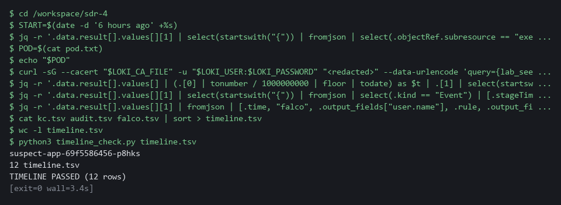

> **SECURITY:** The account name is the join key. Do not search for the address alone: the same address can serve many people behind one proxy.

> **YOUR TURN:** Run both blocks. Then print timeline.tsv with cat and read it from top to bottom as a story.

> **CHECKPOINT:** The first block prints the account lab-user9 and a saved line count of 11. The second ends with 12 rows, the failures first, the shell alert seconds after the command, the role binding last, and TIMELINE PASSED (12 rows).

> **TAKEAWAY:** Account name first, then pod name: each pivot uses a value found in the previous source to search the next.

**How this meets the controls**

- **SI-4:** The control asks that detected events be analyzed. The burst of failed sign-ins is the detected event, and one search names the account behind it.
- **AU-6(3):** The enhancement asks for records from different repositories to be analyzed and correlated. You join sign-in, audit and runtime-alert records on the account name and then the pod name into one ordered timeline.

### Step 5. Contain the suspect pod (IR-4(2) Dynamic Reconfiguration)

**Learning point: Applying a deny-all network policy and swapping the pod's label isolates it from all traffic while the Deployment starts a replacement pod to keep the service running.**

- The timeline ends in a pod that someone ran a command in.
- Deleting the pod would destroy the evidence, so you cut it off from the network and keep it.
- A pod that belongs to a Deployment is managed by a ReplicaSet (the part that keeps the wanted number of pods running), which finds its pods by label.
- If you change the label that the ReplicaSet selects on, the ReplicaSet lets the pod go and starts a replacement, so the service keeps running.
- A network policy that selects the label quarantine=true then denies all traffic to and from the pod.
- First you save the policy, then one block proves the pod answers now, applies the policy and swaps the labels.

What this step adds (thick lines and outlines are new):

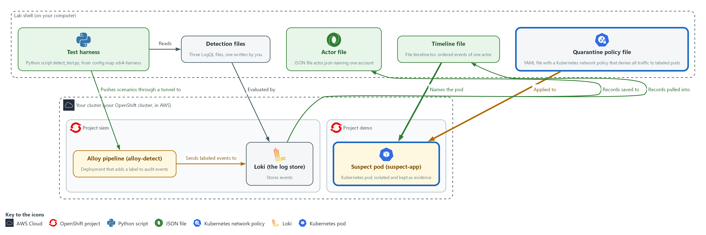

- You apply a network policy file from lab shell and swap the labels of the suspect pod in the project demo, so the policy isolates it and the Deployment starts a replacement.

#### 5a. Write the quarantine policy as quarantine-policy.yaml

You will now write the policy into a file named quarantine-policy.yaml in your working folder.

- Paste the whole block at once.
- You apply the policy in the next block.

```bash
cd /workspace/sdr-4
cat > quarantine-policy.yaml <<'EOF'
apiVersion: networking.k8s.io/v1
kind: NetworkPolicy
metadata:
  name: quarantine-deny-all
  namespace: demo
spec:
  podSelector:
    matchLabels:
      quarantine: "true"
  policyTypes:
    - Ingress
    - Egress
EOF
wc -l quarantine-policy.yaml
```

**Expected output:**

```
Example only.
12 quarantine-policy.yaml
```

| Part | What it does | Why you run it |
| --- | --- | --- |
| cat > quarantine-policy.yaml <<'EOF' ... EOF | Writes the lines between the first line and EOF into the file, with the spaces at the start of each line kept. wc -l counts them. | YAML depends on those spaces, and pasting through the heredoc keeps them. |
| namespace: demo | Puts the policy in the project where the pod runs. A policy only affects pods in its own project. | The suspect pod runs in the project demo, so the policy has to be there. |
| podSelector: matchLabels: quarantine: "true" | Applies the policy to pods that carry the label quarantine=true and to no others. | Nothing is cut off until you label a pod. Every other pod in the project keeps its traffic. |
| policyTypes: [Ingress, Egress] | Says the policy covers traffic into the pod and traffic out of it. | With no allow rules listed, a policy that covers both directions denies all of it. The pod can neither be reached nor call out. |

#### 5b. Check the pod answers, apply the policy and swap the labels

You will now call the suspect pod once to prove it answers now, apply the policy, relabel the pod, and list the pods.

```bash
cd /workspace/sdr-4
POD=$(cat pod.txt)
IP=$(oc get pod "$POD" -n demo -o jsonpath='{.status.podIP}')
oc exec -n demo deploy/probe -- curl -s -m 5 -o /dev/null -w '%{http_code}\n' "http://$IP:8080/"
oc apply -f quarantine-policy.yaml
oc label pod "$POD" -n demo app=suspect-app-isolated quarantine=true --overwrite
oc get pods -n demo -l 'app in (suspect-app,suspect-app-isolated)' -L app -L quarantine
```

**Expected output:**

```
Example only. Pod names, addresses and ages differ in your lab.
200
networkpolicy.networking.k8s.io/quarantine-deny-all <created or configured>
pod/<pod name> labeled
NAME  READY  STATUS  RESTARTS  AGE  APP  QUARANTINE
<pod name>  1/1  Running  0  <age>  suspect-app-isolated  true
<new pod name>  1/1  Running  0  <age>  suspect-app
```

| Part | What it does | Why you run it |
| --- | --- | --- |
| cd /workspace/sdr-4 | Moves into the working folder, where pod.txt and the policy file are. | A block must run on its own, so it starts by going to the folder. |
| POD=$(cat pod.txt) | Reads the pod name that Step 4 saved from the audit record. | The pod you contain is the one the timeline named, not one you picked. |
| IP=$(oc get pod ... -o jsonpath='{.status.podIP}') | Reads the pod's own address. | After the label swap the Service no longer sends traffic to this pod, so you test it by its own address. |
| oc exec -n demo deploy/probe -- curl -s -m 5 ... -w '%{http_code}\n' ... | Calls the pod from a helper pod named probe in the same project. -m 5 gives up after 5 seconds and -w prints only the status code. | A 200 now is the before picture. Without it, a timeout later could mean the pod was already broken. |
| oc apply -f quarantine-policy.yaml | Creates the policy. | The policy exists before the label does, so there is no moment when a labeled pod is still open. |
| oc label pod ... app=suspect-app-isolated quarantine=true --overwrite | Changes the app label, which the ReplicaSet and the Service select on, and adds the label the policy selects on. --overwrite allows a label that already has a value to change. | One command moves the pod out of the ReplicaSet and the Service and into the policy. The ReplicaSet starts a replacement because its count is one pod short. |
| oc get pods ... -L app -L quarantine | Lists the old pod and its replacement, with the two labels as columns. | Two pods, one labeled isolated and one still serving, is the picture of the containment. |

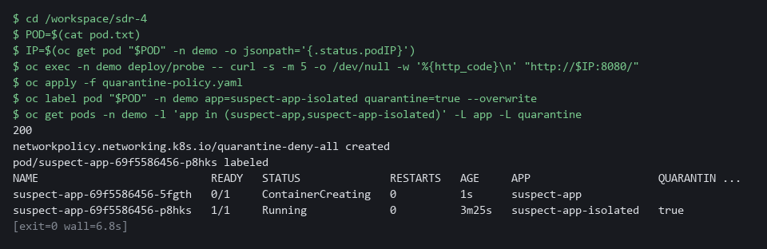

> **NOTE:** If you run the second block again, the first call to the pod prints 000 instead of 200, because the pod is already cut off. That is expected. lab reset sdr-4 removes the policy, the isolated pod and the sample workloads, but not the files in /workspace/sdr-4.

> **SECURITY:** Do not delete the isolated pod. It holds the evidence of what ran inside it, and it stays in the cluster until the incident owner releases it.

> **YOUR TURN:** Run both blocks. Read the last listing: the old pod keeps running under a new label, and a new pod serves under the old one.

> **CHECKPOINT:** The first call prints 200. The listing shows the old pod with app suspect-app-isolated and quarantine true, and a new pod with app suspect-app.

> **TAKEAWAY:** Contain first, then investigate: the pod keeps its evidence while the service stays up.

**How this meets the control**

- **IR-4(2):** The enhancement asks for dynamic reconfiguration as part of incident response, to isolate components and limit damage. You change the label of the pod the timeline named and apply a network policy that denies all its traffic.

## Section 4. Verify It Works

### Test 1 (positive). All scenarios pass and the service runs from the replacement (SI-4 System Monitoring, IR-4(2) Dynamic Reconfiguration)

- Read the saved test report, which is the evidence for the three detections.
- The timeline check already ended with TIMELINE PASSED in Step 4, so it is not run a second time.
- Call the Service by its name from the helper pod: it must still answer, because the replacement pod serves it.

```bash
cd /workspace/sdr-4
grep -c PASS test-report.txt
tail -n 1 test-report.txt
oc wait --for=condition=ready pod -l app=suspect-app -n demo --timeout=120s
oc exec -n demo deploy/probe -- curl -s -m 5 -o /dev/null -w '%{http_code}\n' http://suspect-app:8080/
```

**Expected output:**

```
Example only. The count line includes the TESTS PASSED line.
12
TESTS PASSED
200
```

| Part | What it does | Why you run it |
| --- | --- | --- |
| grep -c PASS test-report.txt | Counts the lines in the saved report that contain PASS. | Eleven scenarios plus the TESTS PASSED line make 12, so each detection did what its scenario expected. |
| tail -n 1 test-report.txt | Prints the last line of the report. | It must say TESTS PASSED; a failed scenario would change it. |
| oc wait --for=condition=ready pod -l app=suspect-app ... | Waits until the replacement pod is ready, so the Service has a pod to send the call to. | Without the wait, the call can print 000 right after the isolation step. |
| oc exec ... deploy/probe -- curl ... http://suspect-app:8080/ | Calls the Service by its name from the helper pod and prints only the status code. | 200 shows the service still runs from the replacement pod, so the containment did not take it down. |

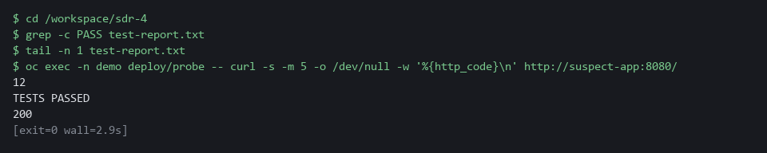

> **CHECKPOINT:** The count is 12 (11 scenarios and the summary line), the last report line says TESTS PASSED, and the Service answers 200.

**How this meets the controls**

- **SI-4:** The control asks for monitoring that detects what it should. The saved report shows eleven scenarios passed, so each detection fired on its real behavior and stayed quiet on its lookalike.
- **IR-4(2):** The enhancement asks for reconfiguration that limits the damage. The Service still returns 200, and only the replacement pod can answer because the isolated pod left the Service.

### Test 2 (negative). Remove the service account filter, add a decoy row, call the isolated pod (SI-4 System Monitoring, AU-6(3) Correlate Audit Record Repositories, IR-4(2) Dynamic Reconfiguration)

- A test you have only seen pass proves little.
- Remove the exclusion of system accounts from secret-read: the scenario with a controller reading 20 secrets must now fail.
- Add a row from another account to the timeline: the check must fail.
- Restore the detection file and the timeline afterwards.
- Last, call the isolated pod by its own address, as you did before the policy: curl must give up after 5 seconds, and the status code prints as 000.

```bash
cd /workspace/sdr-4
kill "$(cat pf.txt 2>/dev/null)" 2>/dev/null || true
oc port-forward -n siem svc/alloy-detect 3500:3500 > portforward.log 2>&1 &
echo $! > pf.txt
timeout 30 bash -c 'until echo > /dev/tcp/127.0.0.1/3500; do sleep 1; done' 2>/dev/null
cp detections/secret-read.logql secret-read.keep
sed -E -i 's/ *[|] *user_username!~"[^"]*"//' detections/secret-read.logql
python3 detect_test.py detections secret-read | grep -E 'secret|TESTS'
cp secret-read.keep detections/secret-read.logql
cp timeline.tsv timeline.keep
printf '2026-01-01T00:00:00Z\tkeycloak\tlab-user3\tLOGIN\t10.130.0.9\n' >> timeline.tsv
python3 timeline_check.py timeline.tsv
cp timeline.keep timeline.tsv
IP=$(oc get pod "$(cat pod.txt)" -n demo -o jsonpath='{.status.podIP}')
oc exec -n demo deploy/probe -- curl -s -m 5 -o /dev/null -w '%{http_code}\n' "http://$IP:8080/"; echo "exit $?"
```

**Expected output:**

```
Example only. The numbers will differ.
secret-read  fires when the count is gt 1.0
  PASS  secret-bulk-read         expected fire     peak count 6
  PASS  secret-single-read       expected no_fire  peak count 1
  FAIL  secret-controller-reads  expected no_fire  peak count 20
TESTS FAILED (1)
FAIL  rows are not in time order
FAIL  rows from unrelated actors: lab-user3
TIMELINE FAILED
000
command terminated with exit code 28
exit 28
```

| Part | What it does | Why you run it |
| --- | --- | --- |
| kill ...; oc port-forward ... &; timeout 30 bash -c ... | Opens the tunnel to the pipeline intake again and waits until it answers, as in Step 3. | The harness needs the tunnel. A new lab shell or a closed tunnel would make it fail with a connection error before any scenario runs. |
| cp ... secret-read.keep | Keeps a copy of the working detection. | You put it back after the test. |
| sed -E -i 's/ *[\|] *user_username!~"[^"]*"//' ... | Removes the line that leaves out the cluster's own accounts. | A detection that counts controller reads is a worse detection; the harness must notice. |
| FAIL  secret-controller-reads ... TESTS FAILED (1) | The scenario where a controller reads 20 secrets now fires when it should stay quiet. | A test that can fail is proven. |
| printf ... >> timeline.tsv; python3 timeline_check.py timeline.tsv | Adds a row from another account to the timeline and runs the check. | The check must refuse a row from an account that is not the actor. |
| FAIL ... rows from unrelated actors: lab-user3 and TIMELINE FAILED | The check names the foreign account and fails. | It protects the timeline from mixing in another person. |
| cp ...keep ... | Puts the detection and the timeline back as they were. | You leave the work in its good state. |
| 000 and exit 28 | The call to the isolated pod by its own address gave up after 5 seconds. 000 means no answer; 28 is curl's code for a timeout. | It was 200 before the policy, so the timeout proves the containment holds. |

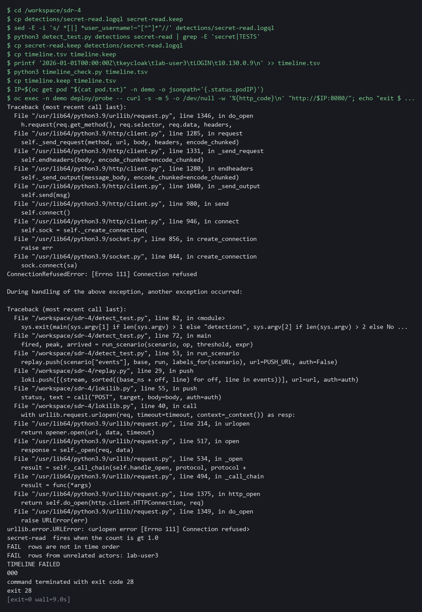

> **CHECKPOINT:** The controller scenario fails once the filter is gone, the timeline check refuses the foreign row, and the call to the isolated pod times out with status 000. Both files are restored at the end.

**How this meets the controls**

- **SI-4:** The control asks for monitoring that detects attacks. Removing the system account filter makes the controller scenario fail, which shows a pass means something.
- **AU-6(3):** The enhancement asks for audit records from different repositories to be correlated. The check must refuse a row from another account, so the timeline cannot mix in another actor.
- **IR-4(2):** The enhancement asks for reconfiguration that isolates a component. The call to the isolated pod answered 200 before the policy, so a timeout now is the evidence that the containment holds.

## Section 5. What Each Control Is For

### Control mapping

| Control | What it requires, in plain words | Tool or service | Where this module covers it |
| --- | --- | --- | --- |
| SI-4 System Monitoring | Monitor the system to detect attacks and indicators of potential attacks, and analyze what is detected. | Three LogQL detection files evaluated by Loki, and the test harness (detect_test.py). Explained in section 2.1. | Section 3, Steps 2 and 3: you build and test detections for three behaviors. Section 3, Step 4: you analyze what the failed sign-ins point to. Section 4, Tests 1 and 2: the report shows each detection fires and stays quiet as expected. |
| SI-4(2) Automated Tools and Mechanisms for Real-Time Analysis | Use automated tools to analyze events soon after they happen. | The Alloy pipeline alloy-detect with its labeling stage, and Loki rule evaluation. Explained in section 2.2. | Section 3, Step 1: you write the labeling stage that prepares each audit event. Section 3, Steps 2 and 3: you write and test the queries that analyze the events without a person starting them. |
| AU-6(3) Correlate Audit Record Repositories | Analyze and correlate records from different repositories to see the whole picture. | LogQL searches in Loki, jq to reshape three formats into one, and the timeline check (timeline_check.py). Explained in section 2.3. | Section 3, Step 4: you join sign-in, audit and runtime-alert records into one timeline. Section 4, Test 2: the check refuses a row from another actor. |
| IR-4(2) Dynamic Reconfiguration | As part of incident response, change the system's rules on the fly to stop an attack and isolate the affected component. | A Kubernetes NetworkPolicy, a label swap with oc, and a call from a helper pod with curl. Explained in section 2.4. | Section 3, Step 5: you isolate the pod that the timeline named. Section 4, Tests 1 and 2: the service still answers from the replacement, and the isolated pod no longer answers. |

### What each control is for

Each table below says what the control is trying to prevent and how this module's tool meets it.

#### SI-4 System Monitoring

| Question | Answer |
| --- | --- |
| Control Intent | An attacker escalates privilege or reads secrets and no rule was written for that behavior, or the rule exists but was never tested and does not fire. |
| The operational question | For each behavior on the list, can you show a rule and a recorded event that makes it fire, and an ordinary event that does not? |
| What evidence proves it | The detection files and a test report with a positive and a negative case for each. |
| How much is enough | NIST requires analyzing detected events and leaves the objectives and techniques organization-defined. The three behaviors are lab choices. |
| How the tool in this module satisfies it | Three LogQL detection files and a harness that runs 11 recorded scenarios against them. |

#### SI-4(2) Automated Tools and Mechanisms for Real-Time Analysis

| Question | Answer |
| --- | --- |
| Control Intent | Events are only read by a person after the fact, so an attack is found days later. |
| The operational question | Does the pipeline prepare each event, and does a rule evaluate it without a person starting the check? |
| What evidence proves it | The pipeline stage that labels audit events and a test showing a pushed event is evaluated by a rule within minutes. |
| How much is enough | The enhancement asks for near real-time analysis and gives no number. The 5 minute window and the check every minute are lab choices. |
| How the tool in this module satisfies it | Alloy labeling stage and Loki rule evaluation. |

#### AU-6(3) Correlate Audit Record Repositories

| Question | Answer |
| --- | --- |
| Control Intent | Each source is read alone: sign-in logs show failures, audit logs show reads, runtime alerts show a shell, and nobody connects them to one actor. |
| The operational question | Starting from one alert, can you list everything the same actor did across all three sources, in order? |
| What evidence proves it | A timeline file with time, source, actor, action and object, in order, containing only that actor. |
| How much is enough | Correlation across repositories is required. The lab joins three sources by account name and pod name, and the check verifies order and actor. |
| How the tool in this module satisfies it | LogQL searches in Loki, jq to reshape three formats into one, and a timeline check. |

#### IR-4(2) Dynamic Reconfiguration

| Question | Answer |
| --- | --- |
| Control Intent | The investigation ends with a name and a timeline, and the compromised pod keeps running on the network while people decide what to do, or it is deleted in a hurry and the evidence goes with it. |
| The operational question | Once the timeline names a pod, how fast can you cut it off from the network without losing it or taking the service down? |
| What evidence proves it | A network policy that selects only quarantined pods, a pod that kept running under a new label, a replacement that serves the service, and a call to the isolated pod that fails. |
| How much is enough | The enhancement asks for dynamic reconfiguration as part of incident response and leaves the types organization-defined. The lab covers one type, a network policy on a pod, and sets no time limit. |
| How the tool in this module satisfies it | A deny-all NetworkPolicy that selects the label quarantine=true, and oc label. |

## Section 6. Next Steps

### Using this in other environments

- Works as is on any OpenShift 4.x cluster that has Alloy and Loki, and the lab's seeded Falco and Keycloak records.
- Change these lab values first: the alloy-detect namespace and intake port, the detection file folder path, the actor name the seed uses, and the project demo name.
- On other Kubernetes platforms the oc commands become kubectl commands and the port-forward target changes; the LogQL, jq and Python scripts are tool-independent.
- The containment step uses Kubernetes NetworkPolicy and label swaps, which work on any Kubernetes distribution that enforces NetworkPolicy.

The table shows what changes on each platform:

| Part | In this lab (OpenShift) | On other Kubernetes | What you change |
| --- | --- | --- | --- |
| Alloy pipeline | Deployment alloy-detect in project siem | Any Alloy deployment | Namespace, intake port and ConfigMap name. |
| Detection files | LogQL files in detections/ folder in lab shell | Same | Nothing; LogQL is Loki-independent. |
| Test harness | ConfigMap sdr4-harness in siem, copied to lab shell | Any harness you supply | Replace the harness; recorded scenarios stay the same format. |
| Loki queries (investigation) | curl with the lab certificate authority | Same curl pattern | LOKI_CA_FILE and LOKI_URL. |
| oc commands | oc get, oc exec, oc port-forward, oc label | kubectl equivalents | Replace oc with kubectl. |
| Containment (NetworkPolicy) | OVN-Kubernetes (the OpenShift default) | Any Kubernetes network plugin that enforces NetworkPolicy | Nothing; NetworkPolicy is Kubernetes-standard. |

> **TIP:** Next module: SDR-5 Detection as Code: keep a detection in a repository, test it in a pipeline, and route its alerts to chat.

<details>
<summary><strong>Section 7. Terms</strong></summary>

Each term is also explained the first time it appears. In Word, hover over an underlined term to see its meaning, or Ctrl+click it to jump to this table.

| Term | Plain meaning |
| --- | --- |
| Actor | The account or program behind a set of events. |
| Alloy | Grafana Alloy: the collector that receives events, processes them in stages and sends them to Loki. |
| Audit record | The cluster's record of one request: who made it, what action (the verb, such as get or create) and on which object. |
| AWS | Amazon Web Services, the cloud your lab runs in. |
| Certificate | A file that proves a server's identity, signed by a trusted authority. |
| Cluster | A group of servers that work together as one system. Here it is your own OpenShift cluster. |
| ConfigMap | A named bundle of small files stored in the cluster. The Alloy stage and the test harness are each kept in one. |
| Container | A sealed box that holds one program and everything it needs to run. |
| Containment | Limiting the damage of an incident by cutting the affected part off, before it is cleaned up or removed. |
| Controller | A program in the cluster that keeps the real state matching what you asked for. |
| Deployment | A named description of a workload that the cluster keeps running, with a number of identical pods. |
| Detection | A saved query plus a condition (for example: count above 0) that says an event of interest happened. |
| Escalation | Gaining more permission than you were given. |
| Evidence | Saved records that show a system is set up and behaving as claimed. |
| Exec | The part of a request to a pod that runs a command inside it. |
| Falco | A free runtime detector. It watches what programs do inside containers and writes a record when a rule matches. |
| Grafana | The dashboard and alerting tool in the lab. It reads logs from Loki. |
| grep | A command that prints only the lines that match a pattern. |
| Heredoc | A way to make a file by pasting its text between a first line such as cat > name <<'EOF' and a last line that says EOF. Running the same command again with new text replaces the file. |
| HTTP | The protocol that web pages and web APIs use. HTTPS is the encrypted form. |
| Image | A packaged copy of a program and everything it needs to run. A container starts from an image. |
| Ingress | The way traffic from outside the cluster reaches a program inside it. |
| Intake | The port on the Alloy pipeline where events are pushed in. |
| jq | A tool that picks values out of JSON text, or builds JSON from values. |
| JSON | A text format for data, made of names and values in braces. |
| Keycloak | The sign-in service in the lab. It writes a log line for every failed and every successful sign-in. |
| Kubernetes | The open-source system that runs and manages containers across servers. OpenShift is built on it. |
| Label | A key=value tag on a group of log lines in Loki. Searches that name a label are fast; labels with many different values slow Loki down. |
| LogQL | Loki's search language. A search names labels and can then filter, parse and count the lines. |
| Loki | A free log store. It keeps log lines and lets you search them. |
| Lookalike | An ordinary event that resembles an attack but must not trigger the detection. |
| Merge | Combine the changes from one git branch into another. |
| mkdir | A command that makes a new folder. |
| Namespace | A named section of the cluster that holds a set of related parts. |
| NetworkPolicy | A rule about which traffic pods may send and receive. A pod that a policy selects accepts only what the policies allow. |
| NIST | The US National Institute of Standards and Technology. It publishes the security control catalog these modules cite. |
| oc | The command-line tool for OpenShift. You type oc to ask the cluster questions. |
| OpenShift | The Red Hat platform your lab cluster runs on. It is Kubernetes with extra security and tools built in. |
| Pipeline | A set of automated steps that run in order, such as scan, check and sign. |
| Pipeline stage | One processing step in an event pipeline, such as pulling a field out and attaching it as a label. |
| Pivot | Using a value found in one source (an account, a pod name) to search another source. |
| Pod | The smallest running unit on the cluster: one or more containers together. |
| Policy | A set of rules written down so that a tool can enforce them. |
| Positive and negative case | A positive case should trigger the detection; a negative case looks similar but should not. |
| printf | A command that prints text in a set format. |
| Privilege | The permission to do something powerful. |
| Project | A named section of the cluster that keeps workloads apart, as in project siem. OpenShift also calls it a namespace. |
| Query | A question you ask a data store, written in a query language, such as a log search. |
| Regexp | Short for regular expression: a pattern that picks named pieces out of a line of text, such as an address or an account name. |
| ReplicaSet | The part of a Deployment that keeps the wanted number of identical pods running. It finds its pods by their labels. |
| Role | A named list of permissions. A role binding gives that list to an account. |
| Role binding | Gives a role to a user, group or service account. |
| Route | An OpenShift object that gives a program inside the cluster an address reachable from outside. |
| Rule | A written condition that a tool checks. |
| Runtime | The time when a program is running, as opposed to when it is written or built. |
| Scenario | A small set of recorded events with the answer a correct detection gives: fire or stay quiet. |
| Secret | A stored password or key held in the cluster. |
| sed | A command that edits text as it passes through, often to replace one string with another. |
| Selector | A rule that picks objects by their labels. |
| Service | A stable name and address in the cluster that sends traffic to the pods whose labels it selects. |
| Service account | An identity used by a program, not a person. System service accounts have names beginning system:. |
| Stream | A set of log lines in Loki that share the same labels. Every new label value makes a new stream. |
| TCP | The standard way programs send data reliably over a network. |
| Test harness | A script that runs your work against known cases and reports pass or fail for each one. |
| Threshold | The count above which a detection fires. |
| Timeline | The events of one actor from all sources in time order. |
| Timestamp | The date and time recorded for an event. |
| TSV | Tab-separated values: a table written as text, with a tab between columns. |
| Tunnel | A connection that carries traffic from a port on your machine to a service inside the cluster. oc port-forward opens one. |
| URL | A web address, such as https://example.com/page. |
| YAML | A plain-text format for settings: lines of name: value, with indentation to show what belongs to what. |

</details>
