# SDR-5: Detection as Code (CM-3, CM-3(2), SI-4(2))

| Item | Detail |
| --- | --- |
| Sequence | Module 26 of 29 in the recommended order |
| Timed work | About 75 minutes (56 hands-on, 19 verify) |
| Standalone start | `lab start sdr-5` |
| Combined start | Continue from the end state of the previous module |
| Tools | Gitea, Tekton (OpenShift Pipelines), Grafana alerting (free, open source), Loki (free, open source), Mattermost, OpenShift Container Platform, oc, tkn, git, curl, jq, python3 |
| Prerequisites | ENG-0 Terminal, Git and Your Lab (you can clone, commit and push to Gitea from lab shell, and write a file with a heredoc), SDR-4 Build Detections and Pipelines (you wrote detections as a search plus a threshold and tested them against recorded scenarios) |

## Section 1. Module Overview

- Purpose: show that every detection change is approved, tested and recorded before it takes effect (CM-3, CM-3(2)), and that the path from event to alert is automated (SI-4(2)).
- You write the pod-exec detection and its tests, the test runner, the deploy script and a two-task pipeline in a Gitea repository.
- You run the pipeline on a deliberately broken branch to prove the gate stops a failing change, then prove a live event produces an alert in the channel.

- **Skill:** Store a detection as a versioned file with tests, run a test runner locally and in a pipeline, deploy the rule to Grafana, prove a failing test stops the deployment, and prove the deployed rule delivers an alert to the incident channel.
- **Tools:** Gitea keeps every detection change as a commit. Tekton runs the tests in Loki and deploys passing rules to Grafana. Loki stores the replayed events and answers each rule's query. Grafana alerting evaluates rules on a schedule and posts alerts to Mattermost. `git` clones, commits and pushes the files. `oc` applies the pipeline and reads Secrets. `tkn` starts the pipeline and shows its log. `curl` and `jq` call the Grafana API and read the answers. `python3` runs the test runner, the deploy script and the proof script, which pushes one event and checks that the alert arrives.
- **Security Function:** Makes every detection change traceable to a commit and a pipeline run; prevents an untested or failing detection from reaching Grafana; proves a live event produces an alert in the incident channel.
- **NIST CM-3 Configuration Change Control:** Every detection change is a commit in Gitea history and reaches Grafana only through the pipeline, so each running rule traces to an author, a time and a test result.
- **NIST CM-3(2) Testing, Validation, and Documentation of Changes:** The test runner replays recorded events in Loki against every rule, and a rule with no tests counts as a failure; the deploy task starts only after the test task passes.
- **NIST SI-4(2) Automated Tools and Mechanisms for Real-Time Analysis:** Grafana evaluates the deployed rule on a schedule and posts to the incident channel with no person starting the check; the proof script fails if the alert does not arrive.

## Section 2. The Tools

### Tools used in this module

Each tool name links to its official overview. The table columns say how each tool is used in the lab and why the lab uses it instead of another way of doing the same job.

| Tool (overview link) | What it is | Used in this lab | Why this tool |
| --- | --- | --- | --- |
| [Gitea](https://docs.gitea.com/) | A lightweight self-hosted git server. | Holds the detections repository and the push to main that starts the pipeline. | It gives the lab a git server of its own, so you can push and review changes without an outside account. |
| [OpenShift Pipelines (Tekton)](https://docs.redhat.com/en/documentation/openshift_container_platform/4.22/html/pipelines/index) | Kubernetes-native CI/CD built on Tekton. | Runs the pipeline that tests the rules and then deploys them. | It runs automated tasks inside the cluster, so you can see a check run with no person at the keyboard and under its own limited identity. A script run from a laptop could not show that. |
| [Grafana alerting](https://grafana.com/docs/grafana/latest/alerting/fundamentals/) | Rules that run a query on a schedule and send a notification when the result crosses a threshold. | Receives the rules your deploy script creates or updates. | It runs a log query on a schedule and notifies when the result crosses a limit, so a detection becomes an alert without writing a separate program. |
| [Grafana Loki](https://grafana.com/docs/loki/latest/) | Log storage that indexes only labels and keeps compressed log data in object storage. | Has the recorded cases replayed into it to test each rule. | It stores logs cheaply and is free and open source, so the lab can keep the logs that detections and investigations need without a paid logging product. |
| [Mattermost](https://docs.mattermost.com/developers/integrate/webhooks/incoming) | Open-source team chat. Incoming webhooks let tools post messages into a channel. | Where the proof script looks for the alert. | It is chat you run yourself and can send messages to from a script, so an alert reaches a person without an outside chat account. |
| [OpenShift Container Platform](https://docs.redhat.com/en/documentation/openshift_container_platform/4.22/html/overview/ocp-overview) | A Kubernetes container platform for running and managing containerized applications. | The cluster where the pipeline runs. | It is the platform the whole lab runs on, so every module works on the same real cluster, with the same kinds of objects a production OpenShift system has. |
| [oc](https://docs.redhat.com/en/documentation/openshift_container_platform/4.22/html/cli_tools/openshift-cli-oc) | The OpenShift command-line tool for creating and managing applications and projects from a terminal. | Applies the pipeline and starts the work. | It is the one command that talks to the cluster, so every module uses it to ask what is true and to make changes. You sign in once, and it works on OpenShift objects as well as standard Kubernetes ones. Unlike clicking in the web console, a command can be pasted, repeated and checked by a test. |
| [tkn](https://docs.redhat.com/en/documentation/openshift_container_platform/4.22/html/cli_tools/pipelines-cli-tkn) | Command-line tool for managing pipelines, runs and tasks. | Starts and follows the pipeline. | It starts and reads pipeline runs from the terminal, so the same shell you use for everything else drives the pipeline. The other way is the web console, which cannot be pasted into a step. |
| [Git](https://git-scm.com/about) | Version control that stores repository history. | Clone, commit and push to main. | It keeps scripts and settings with a history, so every change has a record of who made it and when, and a mistake can be undone. |
| [curl](https://curl.se/docs/manpage.html) | Command-line tool for transferring data over URLs, used here to call web endpoints. | Calls the web interfaces of Gitea, Loki and Grafana. | It calls a web address from the terminal, so you can check what a service really returns instead of trusting a screen. |
| [jq](https://jqlang.org/) | Command-line JSON processor. | Reads JSON from those calls. | It picks one field out of a long JSON reply, so a test can read a single value. |
| [Python 3](https://docs.python.org/3/tutorial/introduction.html) | General-purpose language, used here for small helper scripts. | Runs ci/run_tests.py, the deploy script and ci/prove_alert.py. | Python reads and writes JSON easily and is already in the lab shell, so a small script needs nothing installed. |

### How it fits together

#### Detections kept in Gitea, tested and deployed by a pipeline

- Lab (test) setup: A detection (a saved search plus a limit) is a file in a repository (a folder of files with a recorded history) on Gitea (a git server in your lab), together with recorded tests.
- A pipeline (an automated list of tasks) in the build project runs the tests against Loki (the log store) and, only if they pass, sends the rules to Grafana alerting (the tool that runs alert rules).
- Grafana posts alerts to the incident channel (the chat room where alerts arrive) in Mattermost (team chat).
- In production these would be your organization's shared services, and a person would review each change before it is merged to main.
- Each step below adds one part, drawn with thick lines.

How the lab is set up, and why:

- You work in lab shell on your laptop.
- There you keep a clone (a copy of the repository on your side) of the detections repository.
- You push (send) your committed changes to the repository on Gitea, the git server inside your cluster.
- Nothing you write reaches Grafana from lab shell directly, because the pipeline runs in the project build (a project is a named section of the cluster) and clones the repository from Gitea again.
- The pipeline then deploys through the Grafana API (the address programs use to give Grafana commands), so every running rule traces to a commit and a pipeline run.
- SDR-5 adds three things to the layout the earlier modules showed: Gitea as the home of the rules, the Tekton pipeline in the project build, and the alert path to the incident channel.
- SDR-5 reuses Loki and Grafana in the project siem.
- The pipeline replays recorded samples in Loki to test each rule.
- A sample is a set of events saved in a file with one name for each case.
- Replaying sends those events into Loki under a label that exists only for that run.
- Grafana is where a passing rule becomes live and later raises alerts.
- The pipeline gets its addresses and credentials from Secrets (stored passwords and keys) in the project build, so nobody types a password and nothing secret is committed.
- Your proof script runs in lab shell and sits outside the pipeline on purpose, because it plays the part of a real event and then checks that the alert reaches the channel.

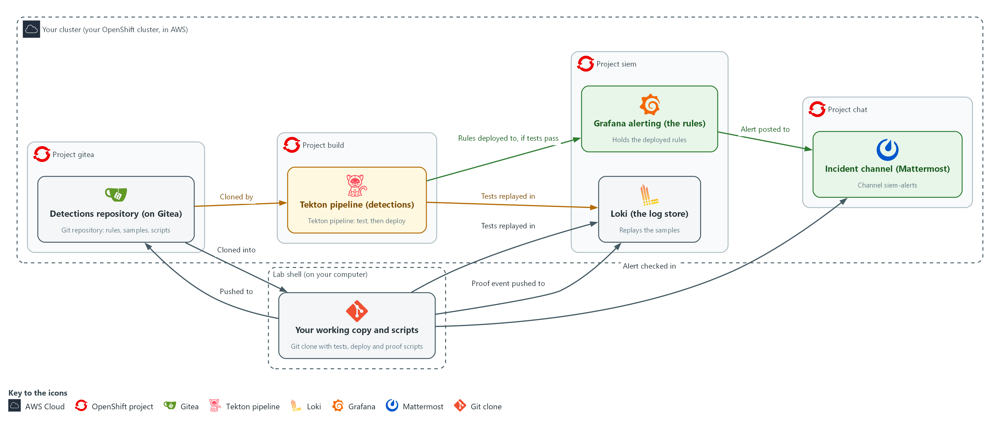

- **1. Detections repository (on Gitea):** holds the rule files, recorded samples and scripts. You push changes from your working copy in lab shell.
- **2. Your working copy and scripts:** the clone of the repository in lab shell, where you edit, test and run the proof script.
- **3. Loki (the log store):** where the recorded samples are replayed to test a rule, and where the proof script pushes its event.
- **4. Tekton pipeline (detections):** clones the repository from Gitea, replays the samples in Loki, and only then sends the rules to Grafana alerting.
- **5. Grafana alerting (the rules):** holds the deployed rules, runs them on a schedule, and posts an alert when one matches.
- **6. Incident channel (Mattermost):** where alerts arrive and the proof script looks for the alert.

Where each part runs, and why:

| Part | Where it runs | Why it is built this way |
| --- | --- | --- |
| Detections repository | Gitea, in the project gitea | A git server gives every rule change an author, a time and a message, which an edit in the Grafana screen cannot. |
| Working copy and scripts | Your lab shell | You edit and test here first and then push, so the pipeline only ever sees committed work. |
| Tekton pipeline | Pods in the project build | A pipeline in the cluster has no person at the keyboard, so test and deploy run the same way every time. |
| Secrets detections-ci and detections-ci-ca | The project build | The pipeline gets addresses and credentials from the cluster, so nobody types them and nothing secret is committed. |
| Grafana alerting | The project siem | Rules are deployed here through the Grafana API, and only after the tests pass. |
| Incident channel | Mattermost | People already read chat, so the alert lands where the team works. |

### 2.1 The file is the truth, Grafana is a copy (CM-3 Configuration Change Control)

- Each detection is one JSON file with its query, threshold, severity and tests.
- The pipeline reads the files and makes Grafana match them.
- Nobody edits rules in the Grafana screen.
- Grafana alerting runs each rule's search on a schedule (the evaluation interval).
- When a rule fires, the notification policy sends the alert to a contact point. Here the contact point is the Mattermost channel siem-alerts.
- A rule edited in a screen leaves no record of who changed what or why.
- A rule changed through a commit has an author, a time, a message and the test results of the pipeline run that deployed it.

#### CM-3: Configuration Change Control

*The control asks the organization to determine and document the types of changes that are configuration-controlled, to review and approve or disapprove proposed changes with explicit consideration for security and privacy impact, and to document those decisions. It also asks that approved changes be implemented, that records of them be retained for an organization-defined time period, and that the activities be monitored and reviewed. This is done using:*

- The Gitea repository keeps each detection as a file, so every change has an author, a time and a message.
- The Tekton pipeline is the only way a change reaches Grafana, so each running rule traces to a pipeline run.
- The Grafana provisioning API lets the pipeline create or update rules, so nobody edits them in the Grafana screen.
- A push to the main branch is the lab's approval step, and a real system adds a reviewer.

The table shows each file or folder in the repository, what it holds and who writes it:

| File or folder | What it holds | Who writes it |
| --- | --- | --- |
| rules/NAME.json | Query, comparison, threshold, severity, control, tests | You (pod-exec); supplied (priv-escalation, secret-read) |
| samples/NAME.jsonl | Recorded events, one per line, with a case name | Supplied |
| ci/run_tests.py | Replays each test case and compares with the expected result | You |
| ci/deploy.py | Creates or updates each rule in Grafana | You |
| ci/check_rule.py, ci/probe.py | An offline check of a rule file against its samples (Step 1), and the helper that builds the test event (Step 5) | Supplied |
| ci/task.yaml | The one reusable Task the pipeline runs (plumbing: secrets, certificate, clone) | Supplied |
| ci/pipeline.yaml | The pipeline: test, then deploy | You |

### 2.2 A gate is a dependency plus a failing exit code (CM-3(2) Testing, Validation, and Documentation of Changes)

- A program that fails ends with a non-zero exit code.
- The pipeline reads that exit code, marks the test task as failed, and does not start any task set to run after it.
- The gate is one dependency, a line saying that deploy runs after test. A failed test therefore means deploy never starts.
- One Task definition runs both pipeline stages, test and deploy. The script name is a parameter, a value handed to the Task when it runs.
- A Task is a list of steps inside one pod: first it clones the repository from Gitea, then it runs the script from the clone.

#### CM-3(2): Testing, Validation, and Documentation of Changes

*The enhancement asks the organization to test, validate, and document changes to the system before finalizing the implementation of the changes. This is done using:*

- The test runner (ci/run_tests.py) replays recorded events in Loki against every rule and fails a rule that has no tests.
- The two-task pipeline starts the deploy task only after the test task passes.
- The pipeline log records each test case as PASS or FAIL.

### 2.3 An alert is only a control if it is delivered (SI-4(2) Automated Tools and Mechanisms for Real-Time Analysis)

- An alert passes through three stages: the event reaches Loki, the rule is evaluated at its next interval, and the notification is sent.
- A break in any one stage means the rule exists but nobody is told.
- You prove the path with one live event rather than assume it.
- The proof is pass or fail: an alert naming the rule arrives in the channel, or the script fails.

#### SI-4(2): Automated Tools and Mechanisms for Real-Time Analysis

*The enhancement asks the organization to employ automated tools and mechanisms to support near real-time analysis of events. NIST gives no number for near real-time. This is done using:*

- Grafana alerting evaluates the deployed rule on a schedule and posts to the incident channel with no person starting the check.
- The incident channel in Mattermost is where the alert arrives for people to read.
- The proof script (ci/prove_alert.py) pushes one event and passes only if the alert arrives in the channel.

### Design decisions

#### The file is the truth and the pipeline is the only way in

- How: Each detection is a JSON file with its query, threshold and recorded tests in a Gitea repository. A two-task pipeline runs the tests first and the deploy script only after they pass, and nobody edits rules in the Grafana screen.
- Why: A failing test ends with a non-zero code so the deploy task never starts and the running rule stays untouched, and each rule in Grafana traces to a commit and a pipeline run.
- Alternatives: The advantage of editing rules in the Grafana screen is that changes are instant during an incident. The drawback is that there is no author, no review and no test record, and a quiet edit can switch off a detection.

#### A rule with no tests counts as a failure

- How: The test runner treats a rule with no tests as a failure and exits with a non-zero code.
- Why: Nothing untested reaches Grafana, so coverage cannot erode by omission.
- Alternatives: The advantage of only warning about missing tests is that new ideas ship quickly. The drawback is that untested rules accumulate and the gate becomes optional in practice.

#### Prove the alert path with a pass or fail check

- How: A proof script pushes one real-looking exec event, waits for the alert post naming pod-exec in the channel, and prints PASS or exits with FAIL if none arrives in the time allowed.
- Why: A deployed rule is only a control if its alert really reaches people, and only a live event proves the whole path from Loki through Grafana to the channel.
- Alternatives: The advantage of reading the rule back from Grafana alone is that no test event is needed. The drawback is that it misses a broken contact point or notification policy, so a rule can look deployed and never reach the channel.

## Section 3. Implement

- Start: type `lab start sdr-5` in the terminal on your own computer (PowerShell on Windows, Terminal on Mac), not in the lab shell.
- Enter lab shell with `lab shell`. Every other command in this module runs inside lab shell.
- If a step fails: run `lab reset sdr-5` on your own computer and repeat the step once. If it still fails, copy the whole command and error and ask your AI assistant. Do not skip the step.

### Step 1. Clone the repository and write the pod-exec detection (CM-3 Configuration Change Control, CM-3(2) Testing, Validation, and Documentation of Changes)

**Learning point: Cloning the repository and writing the detection as a versioned file means every change to the detection will have an author, a time and a message in Gitea history.**

- The repository already holds two finished detections (priv-escalation and secret-read) and recorded samples for three detections, including pod-exec.
- You clone the repository over HTTPS with your Gitea token (a long secret string that proves who you are), which a small helper hands to git only when git asks, as you did in ENG-0.
- The clone block also sets your name and address in git, so your commits carry a name.
- You write the pod-exec rule yourself, with the same behavior as the pod-exec query you wrote in SDR-4, now as a file that carries its own tests.
- You get the frame of the file and a spec.
- You write the two parts that make up the detection: the four filters of the query, and what each of the three tests must expect.
- The rule must fire when a person runs a command in a pod.
- The rule must stay quiet when a person reads logs, and when the cluster's own controller runs a command.
- A local check tells you whether your file gives the right answers on the recorded events.
- A reference answer is available to open after you have tried.
- Plan about ten minutes for writing the rule.

What this step adds (thick lines and outlines are new):

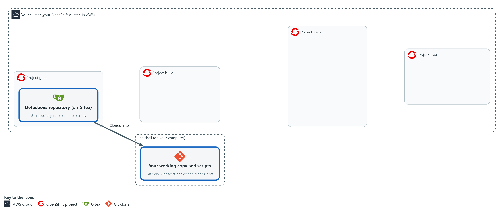

- You clone the repository from Gitea into lab shell and write the pod-exec detection query and its test cases yourself, then check them locally.

#### 1a. Clone the detections repository

You will now make a working folder, copy the detections repository from Gitea into it, tell git who you are and list the three folders.

- You can run this block again: if the copy is already there, it prints "already cloned" and goes on.

```bash
mkdir -p /workspace/sdr-5 && cd /workspace/sdr-5
git -c 'credential.helper=!f() { echo username=$GITEA_USER; echo password=$GITEA_TOKEN; }; f' clone "$GITEA_URL/$GITEA_USER/detections.git" || echo "already cloned"
cd detections
git config credential.helper '!f() { echo username=$GITEA_USER; echo password=$GITEA_TOKEN; }; f'
git config user.name "$GITEA_USER"
git config user.email "$GITEA_USER@example.invalid"
ls rules samples ci
```

**Expected output:**

```
Example only. The file names beyond those the module names may differ.
Cloning into 'detections'...
ci:
<the supplied helper files, including task.yaml>

rules:
priv-escalation.json  secret-read.json

samples:
<one sample file for each of the three detections, including pod-exec.jsonl>
```

| Part | What it does | Why you run it |
| --- | --- | --- |
| mkdir -p /workspace/sdr-5 && cd ... | Makes the working folder for this module and moves into it. The folder stays between lab sessions. | Every block in this module starts by moving into this folder or the clone inside it. |
| git -c 'credential.helper=...' clone ... \|\| echo "already cloned" | Clones the repository. The -c option gives git a helper for this one command that prints your Gitea user name and token when git asks. If the folder already exists, the message is printed instead of stopping. | You need a working copy on your own side to edit and test. The helper keeps the token out of every file. |
| cd detections | Moves into the clone. | Every path in the next steps starts from the root of the repository. |
| git config credential.helper ... | Saves the same helper in this repository so push works. The file stores the variable names, not the token value. | Lets push sign in without you typing the token. |
| git config user.name / user.email | Tells git who you are. The address is a placeholder that stays inside this repository. | Every commit records who made it, and git refuses to commit without a name. |
| ls rules samples ci | Lists the three folders so you can see the starting files. | It shows what is supplied and what you must write: two finished rules, recorded samples and helper scripts. |

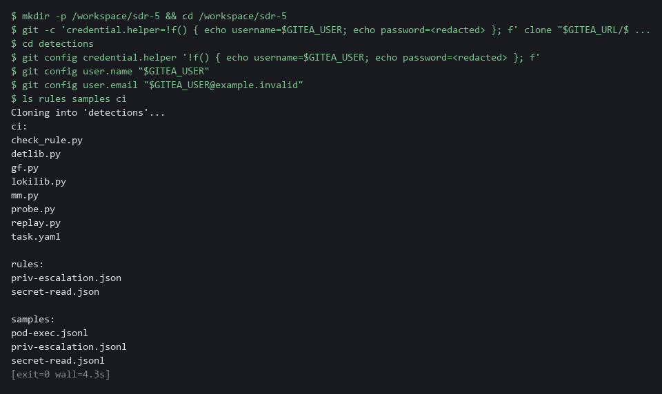

#### 1b. Look at the pattern and the recorded events

You will now read two things: the finished rule secret-read, so you see the pattern, and the three recorded cases for pod-exec, so you see which fields tell them apart.

- Nothing is changed.

```bash
cd /workspace/sdr-5/detections
jq -c '{expr, op, threshold}' rules/secret-read.json
jq -c '(.line | fromjson) as $e | {case, verb: $e.verb, user: $e.user.username, resource: $e.objectRef.resource, subresource: $e.objectRef.subresource}' samples/pod-exec.jsonl
```

**Expected output:**

```
Example only. The first line is shortened here.
{"expr":"sum(count_over_time({log_type=\"audit\"} | json | objectRef_resource=\"secrets\" | verb=~\"get|list\" | ... [5m]))","op":"gt","threshold":3}
{"case":"exec-by-person","verb":"create","user":"lab-tester","resource":"pods","subresource":"exec"}
{"case":"logs-by-person","verb":"get","user":"lab-tester","resource":"pods","subresource":"log"}
{"case":"exec-by-controller","verb":"create","user":"system:serviceaccount:openshift-gitops:argocd-application-controller","resource":"pods","subresource":"exec"}
```

| Part | What it does | Why you run it |
| --- | --- | --- |
| cd /workspace/sdr-5/detections | Moves into the clone. | A block must run on its own, so it starts by going to the folder. |
| jq -c '{expr, op, threshold}' rules/secret-read.json | Prints the query, the comparison and the threshold of the finished rule on one line. | Its query is your pattern: a label selector, then \| json \|, then filters joined by \|, then a time window. |
| jq -c '(.line \| fromjson) as $e \| {...}' samples/pod-exec.jsonl | For each recorded event, opens the event text and prints the case name with the four fields the rule can use. | The three cases differ in only a few of these values. Your filters must separate the one that fires from the other two. |

#### 1c. Your turn: write the pod-exec rule and check it

You will now write the one file in the module that is yours, rules/pod-exec.json.

- Do not paste this block as it stands: it has two kinds of blank, FILL-IN-FOUR-FILTERS and the three FILL-IN words, which you replace yourself as you type it.
- In the query (written in LogQL), write four filters joined by |.
- Each of the four filters has the form field operator "value", like the ones in secret-read.
- The operators are = (equals), != (does not equal), =~ (matches a pattern) and !~ (does not match a pattern).
- The four filters are: the resource is pods; the subresource is exec; the verb is create; the user name does not match system:.* (the cluster's own accounts start with system:, and .* means any characters).
- The field names are the ones printed above, with an underscore for a nested name: objectRef_resource, objectRef_subresource, verb, user_username.
- Inside the JSON text a double quote is written \".
- In the tests, write fire or no_fire for each case, from what the case name says.
- The last line checks your file against the recorded events on your own computer, without Loki.
- If a mistake is reported, type the block again with the fix.
- Give the rule about ten minutes, and open the reference answer in the next block only after you have tried.

```bash
cd /workspace/sdr-5/detections
cat > rules/pod-exec.json <<'EOF'
{
  "expr": "sum(count_over_time({log_type=\"audit\"} | json | FILL-IN-FOUR-FILTERS [5m]))",
  "op": "gt",
  "threshold": 0,
  "severity": "high",
  "control": "SI-4",
  "uid": "det-pod-exec",
  "title": "pod-exec",
  "tests": [
    {"sample": "pod-exec", "case": "exec-by-person", "expect": "FILL-IN"},
    {"sample": "pod-exec", "case": "logs-by-person", "expect": "FILL-IN"},
    {"sample": "pod-exec", "case": "exec-by-controller", "expect": "FILL-IN"}
  ]
}
EOF
test -s rules/pod-exec.json && echo ok || echo EMPTY
python3 ci/check_rule.py rules/pod-exec.json
```

**Expected output:**

```
Example only. When your file is right:
ok
OK    exec-by-person: expected fire, local check says fire
OK    logs-by-person: expected no_fire, local check says no_fire
OK    exec-by-controller: expected no_fire, local check says no_fire
PASS  pod-exec looks right
If a blank is still there, the last line reads: FAIL  a FILL-IN marker is still in the file
```

| Part | What it does | Why you run it |
| --- | --- | --- |
| cat > rules/pod-exec.json <<'EOF' ... EOF | Writes the lines up to EOF into the file rules/pod-exec.json. The quotes around EOF keep the text exactly as typed, including the backslashes. Typing it again replaces the file. | You need no editor, and starting over is how you retry. |
| "expr": ... \| json \| FILL-IN-FOUR-FILTERS [5m] | The query. You replace the blank with your four filters. The selector before it, the json stage and the 5 minute window are given. | This is the behavior itself: audit events for a command run in a pod by a person, counted over 5 minutes. Leaving out the cluster's own accounts keeps ordinary work quiet. |
| "op": "gt", "threshold": 0 | Fire when the count is greater than 0. Given. | A single exec by a person is reason enough to look, so any count above zero fires. |
| "uid": "det-pod-exec" | The fixed identifier of the rule in Grafana. Given. | The deploy script uses it to tell a rule it already made from a new one, so a rerun updates instead of duplicating. |
| "tests": ... "expect": "FILL-IN" | Three cases from samples/pod-exec.jsonl. You write fire or no_fire for each. | A rule without tests cannot be deployed. These three cases cover the behavior and two lookalikes. |
| test -s rules/pod-exec.json && echo ok \|\| echo EMPTY | Prints ok when the file has content and EMPTY when it does not. | A heredoc pasted twice can leave the file empty, and the check would then fail without saying why. |
| python3 ci/check_rule.py rules/pod-exec.json | Applies your filters to the recorded events and compares the result with what you expected. It prints one line per case, then PASS or FAIL. | It is a quick stand-in for Loki, so you find a mistake in seconds. The real test in Loki comes in Steps 2 and 4. |

#### 1d. Compare with the reference answer (only after you tried)

You will now print the query of the reference answer, which lab start placed outside the repository, and then your own query.

- Run this only after you have tried the block above and the check has passed or ten minutes have gone.
- Different wording is fine if your check passed.

```bash
cd /workspace/sdr-5/detections
jq -r .expr /workspace/sdr-5/reference/pod-exec.json
jq -r .expr rules/pod-exec.json
```

**Expected output:**

```
Example only. The first line is the reference answer; yours may differ in wording or order.
sum(count_over_time({log_type="audit"} | json | objectRef_resource="pods" | objectRef_subresource="exec" | verb="create" | user_username!~"system:.*" [5m]))
<your query>
```

| Part | What it does | Why you run it |
| --- | --- | --- |
| jq -r .expr /workspace/sdr-5/reference/pod-exec.json | Prints the query of the reference answer without the JSON quoting. | You compare your work with a known answer after you have tried, so you learn from the difference. |
| jq -r .expr rules/pod-exec.json | Prints your own query the same way. | The two lines are easy to read side by side. |

> **NOTE:** After lab reset sdr-5, delete /workspace/sdr-5/detections first (this deletes your local work) and run the first block again, because the rebuilt repository no longer matches your old copy. If you are stuck after ten minutes, ask your AI assistant to explain the error, or copy /workspace/sdr-5/reference/pod-exec.json into rules/.

> **YOUR TURN:** Run the first block, read the pattern in the second, then write rules/pod-exec.json in the third until the check says PASS. Only then open the reference answer in the fourth.

> **CHECKPOINT:** The check prints PASS pod-exec looks right, and rules holds three .json files: pod-exec, priv-escalation and secret-read.

> **TAKEAWAY:** The rule file is the only place where the detection is stated; the pipeline makes Grafana match it.

**How this meets the controls**

- **CM-3:** The control asks that configuration-controlled changes be documented and kept as records. Here you clone the repository and write the detection as one file holding the query, the threshold and the tests, so the change will have an author, a time and a message.
- **CM-3(2):** The enhancement asks that a change be tested before it is finalized. Each rule file carries its own tests, one case that must fire and two lookalikes that must not, and you write them before any code runs them.

### Step 2. Write the test runner (CM-3(2) Testing, Validation, and Documentation of Changes)

**Learning point: Writing the test runner and running it locally proves the recorded events replay correctly in Loki before the pipeline tries them.**

- The runner reads every rule file and, for each test, replays the recorded case in Loki through a helper (detlib) that is already in ci/.
- The detlib helper pushes the case under a label (a tag on log lines) that exists only for that run and asks Loki whether the rule would have fired.
- The runner compares the helper's answer with the expected result, prints PASS or FAIL for each case, and exits with 1 if any case failed or if a rule has no tests.
- The first block writes the runner to ci/run_tests.py.

What this step adds (thick lines and outlines are new):

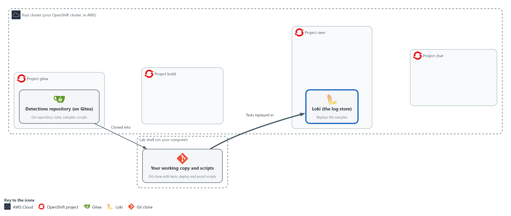

- You write the test runner in lab shell, which replays the recorded samples in Loki.

#### 2a. Write the test runner as ci/run_tests.py

You will now write the test runner into a file named ci/run_tests.py inside the repository.

- Paste all of it at once.
- You run it in the next block.

Look for these as you read:

- The loop over the rule files: it takes the files named on the command line, or every file in rules when none is named.
- The check for a missing tests list: a rule with no tests is printed as FAIL and counted. This is how an untested rule is refused.
- The line that compares detlib.fires with the expected result. A case passes when the rule fired and the test said fire, or when it stayed quiet and the test said no_fire.
- The last line, sys.exit(1 if failures else 0). The pipeline reads this exit code, so this one number decides whether the deploy can start.

```bash
cd /workspace/sdr-5/detections
cat > ci/run_tests.py <<'EOF'
import glob
import json
import sys

import detlib


def main():
    failures = 0
    for path in sys.argv[1:] or sorted(glob.glob("rules/*.json")):
        with open(path) as handle:
            rule = json.load(handle)
        if not rule.get("tests"):
            print("FAIL  %s has no tests" % rule["title"])
            failures += 1
        for test in rule.get("tests", []):
            events, labels = detlib.load_sample(test["sample"], test["case"])
            ok = detlib.fires(rule, events, labels) == (test["expect"] == "fire")
            failures += not ok
            print("%s  %s / %s" % ("PASS" if ok else "FAIL", rule["title"], test["case"]))
    print("%d failing" % failures)
    sys.exit(1 if failures else 0)


main()
EOF
wc -l ci/run_tests.py
```

**Expected output:**

```
Example only.
25 ci/run_tests.py
```

| Part | What it does | Why you run it |
| --- | --- | --- |
| cat > ci/run_tests.py <<'EOF' ... EOF | Writes the Python lines between the first line and EOF into the file, with the indentation kept. wc -l then counts the lines. | Python depends on the spaces at the start of each line, and the heredoc keeps them. |
| sys.argv[1:] or sorted(glob.glob(...)) | Uses the rule files named on the command line, or every rule file when none is named. sorted() makes the order the same every time. | One script serves both a single file while you work and every file when the pipeline runs it. |
| if not rule.get("tests") | A rule without tests counts as a failure, so nothing can be deployed untested. | An untested rule is the gap the gate exists to close, so the script fails on it and does not just warn. |
| detlib.load_sample(test["sample"], test["case"]) | Reads the recorded events for that case from the samples folder. | Each case is a small set of recorded events. Loading it by name keeps the rule file short. |
| detlib.fires(rule, events, labels) | Replays them in Loki and returns True if the rule would have fired. | This is the real test: the rule's own query runs in Loki over the replayed events, not a copy of its logic. |
| == (test["expect"] == "fire") | Compares what happened with what the test expects. | A pass means the rule did what the test said, whether that was firing or staying quiet. |
| sys.exit(1 if failures else 0) | Ends with exit code 1 when anything failed. The pipeline reads this code. | The pipeline sees only the exit code, so this one number is what lets a failed test stop the deploy. |

#### 2b. Run all the tests by hand

You will now run every test case against Loki and print the exit code of the run.

```bash
cd /workspace/sdr-5/detections
python3 ci/run_tests.py
echo "exit code $?"
```

**Expected output:**

```
Example only. Each case takes a few seconds.
PASS  <rule> / <case>
... (eleven PASS lines in all)
0 failing
exit code 0
```

| Part | What it does | Why you run it |
| --- | --- | --- |
| cd /workspace/sdr-5/detections | Moves into the clone. | The runner reads rules/ from the folder you stand in. |
| python3 ci/run_tests.py | Runs all tests against Loki. Each case takes a few seconds because the records must arrive first. | You run the tests by hand first, so you fix mistakes before the pipeline runs them. |
| echo "exit code $?" | Prints the exit code of the previous command. $? is that code. | The pipeline decides by this code, so you read it yourself once to see what the pipeline will see. |

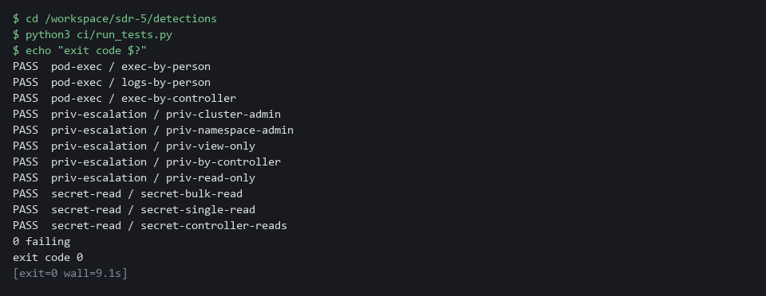

> **YOUR TURN:** Write the runner and run the second block. Read each line: the rule, the case, PASS or FAIL.

> **CHECKPOINT:** Eleven PASS lines, then 0 failing, then exit code 0.

> **TAKEAWAY:** Exit code 0 means every rule file passed; exit code 1 means the pipeline would stop the deploy.

**How this meets the control**

- **CM-3(2):** The enhancement asks that changes be tested and validated before they are finalized. The runner replays every recorded case in Loki, prints PASS or FAIL for each, and exits with 1 on any failure or on a rule with no tests, which is the code the pipeline reads.

### Step 3. Write the deploy script and the pipeline (CM-3 Configuration Change Control, CM-3(2) Testing, Validation, and Documentation of Changes)

**Learning point: Writing the deploy script and the two-task pipeline and applying them to the build project creates the controlled path that every detection change must follow.**

- The deploy script reads each rule file, builds the Grafana alert rule body with a helper (gf) from ci/, and creates the rule, or updates it if the same uid exists.
- The pipeline has two tasks that use the same Task definition: test runs ci/run_tests.py, and deploy runs ci/deploy.py and is set to run after test.
- The supplied file ci/task.yaml is already in the clone, so you do not retype or change it; the Task clones the branch you name from Gitea and runs the script you name, with the Gitea, Grafana and Loki credentials from the Secret detections-ci.
- The next two blocks write ci/deploy.py and ci/pipeline.yaml, and the last block applies the Task and the Pipeline.
- Do not run the deploy script by hand, because the pipeline is the only path to Grafana.

What this step adds (thick lines and outlines are new):

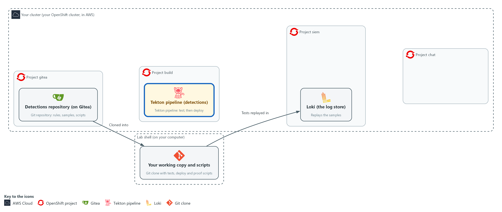

- You write the deploy script and the pipeline definition, and apply the pipeline to the project build: test first, deploy after.

#### 3a. Write the deploy script as ci/deploy.py

You will now write the deploy script into a file named ci/deploy.py inside the repository.

- Paste all of it at once.
- Do not run it by hand: only the pipeline runs it.

Look for these as you read:

- The call to gf.rule_payload: it turns one rule file into the body Grafana expects. The rule file stays the only place where the detection is written.
- The GET on the rule uid, then PUT if it exists and POST if it does not. This is why running the pipeline twice leaves one rule.
- The raise SystemExit line. If Grafana refuses, the script fails and the pipeline run turns red.
- No password or token appears in the file. The helper reads them from the environment, which the Task fills from a Secret.

```bash
cd /workspace/sdr-5/detections
cat > ci/deploy.py <<'EOF'
import glob
import json

import gf


def main():
    for path in sorted(glob.glob("rules/*.json")):
        with open(path) as handle:
            rule = json.load(handle)
        payload = gf.rule_payload(rule)
        url = "/api/v1/provisioning/alert-rules/" + rule["uid"]
        status, _ = gf.call("GET", url)
        if status == 200:
            status, body = gf.call("PUT", url, payload)
            action = "updated"
        else:
            status, body = gf.call("POST", "/api/v1/provisioning/alert-rules", payload)
            action = "created"
        if status not in (200, 201):
            raise SystemExit("FAIL  %s: Grafana answered %s %s" % (rule["title"], status, body))
        print("%s  %s" % (action, rule["title"]))


main()
EOF
wc -l ci/deploy.py
```

**Expected output:**

```
Example only.
25 ci/deploy.py
```

| Part | What it does | Why you run it |
| --- | --- | --- |
| cat > ci/deploy.py <<'EOF' ... EOF | Writes the Python lines between the first line and EOF into the file, with the indentation kept. | You need no editor, and the spaces Python needs are kept. |
| gf.rule_payload(rule) | Builds the Grafana rule body from the file: the query, the threshold, the severity and the folder. | Grafana expects its own body shape and the helper builds it, so the rule file stays the one place where you state the detection. |
| gf.call("GET", url) | Asks Grafana whether a rule with this uid exists. The call returns the status code and does not stop on an error status. | A rule that already exists must be updated and not created again, so the script asks first. |
| "PUT" ... "POST" | Updates an existing rule, or creates a new one. | Running the pipeline twice must leave one rule and not two, and this choice makes that true. |
| raise SystemExit(...) | Ends with a failure and a message if Grafana refuses, so the pipeline run fails. | If Grafana refuses, the pipeline must show red. Otherwise someone would think the rule is live when it is not. |

#### 3b. Write the pipeline as ci/pipeline.yaml

You will now write the two-task pipeline into a file named ci/pipeline.yaml inside the repository.

- Paste all of it at once.
- You apply it in the next block.

```bash
cd /workspace/sdr-5/detections
cat > ci/pipeline.yaml <<'EOF'
apiVersion: tekton.dev/v1
kind: Pipeline
metadata:
  name: detections
  namespace: build
spec:
  params:
    - name: branch
      type: string
      default: main
  tasks:
    - name: test
      taskRef:
        name: detections-step
      params:
        - name: branch
          value: $(params.branch)
        - name: script
          value: run_tests.py
    - name: deploy
      runAfter:
        - test
      taskRef:
        name: detections-step
      params:
        - name: branch
          value: $(params.branch)
        - name: script
          value: deploy.py
EOF
wc -l ci/pipeline.yaml
```

**Expected output:**

```
Example only.
29 ci/pipeline.yaml
```

| Part | What it does | Why you run it |
| --- | --- | --- |
| cat > ci/pipeline.yaml <<'EOF' ... EOF | Writes the YAML lines between the first line and EOF into the file, with the spaces at the start of each line kept. | YAML depends on those spaces, and the heredoc keeps them. Tabs are not used. |
| tasks: test | Runs the Task with the script run_tests.py. | Test is the gate: nothing after it starts until it has passed. |
| tasks: deploy | Runs the same Task with deploy.py. | Deploy reuses the same Task, which keeps the two stages identical apart from the script. |
| runAfter: [test] | Starts deploy only after test, and not at all if test fails. | This one line is the gate. Deploy waits for test, and a failed test means deploy never starts. |

#### 3c. Apply the Task and the Pipeline to the build project

You will now put the Task and the Pipeline into the project build and list them.

- You can run this block again; it updates what is there.

```bash
cd /workspace/sdr-5/detections
oc apply -f ci/task.yaml
oc apply -f ci/pipeline.yaml
oc get task,pipeline -n build
```

**Expected output:**

```
Example only. The wording comes from oc.
task.tekton.dev/detections-step <created or configured>
pipeline.tekton.dev/detections <created or configured>
NAME  AGE
task.tekton.dev/detections-step  <age>
NAME  AGE
pipeline.tekton.dev/detections  <age>
```

| Part | What it does | Why you run it |
| --- | --- | --- |
| cd /workspace/sdr-5/detections | Moves into the clone. | oc reads the two files from here. |
| oc apply -f ci/task.yaml | Applies the supplied Task. It names a public Python image that the pipeline pods pull when they run. | The Task is the plumbing the pipeline reuses for both stages, so it must exist in the project build. |
| oc apply -f ci/pipeline.yaml | Applies the Pipeline. | The pipeline definition is what Tekton runs. Applying it makes it available to start. |
| oc get task,pipeline -n build | Lists both to show they exist. | Seeing both listed is your proof that the cluster has them before you try to run anything. |

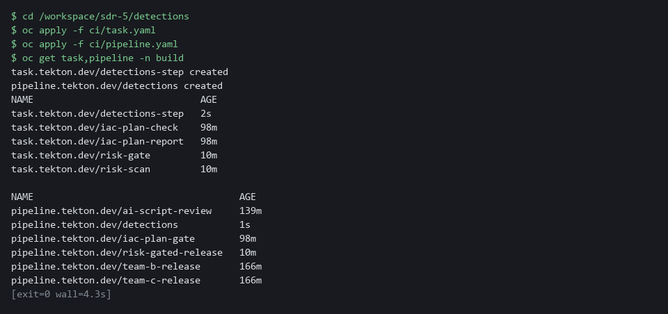

> **SECURITY:** The pipeline gets its credentials from a Secret in the build project. Never write a token or password into task.yaml, the rule files or the scripts: they are committed to history.

> **YOUR TURN:** Write ci/deploy.py and ci/pipeline.yaml, and run the last block. If oc apply says no objects passed or the run fails at once, ci/pipeline.yaml or a script is probably empty (a heredoc pasted twice): check with wc -l and write it again.

> **CHECKPOINT:** oc get lists Task detections-step and Pipeline detections.

> **TAKEAWAY:** The pipeline runs test, then deploy only if test passed: that one dependency line is the gate.

**How this meets the controls**

- **CM-3:** The control asks that approved changes be implemented under control. The deploy script is the only path to Grafana, and the pipeline runs it with credentials from a Secret, so the file in Gitea stays the source of truth.
- **CM-3(2):** The enhancement asks for testing before the change takes effect. The line runAfter: test makes deploy wait for the test task and not start if it fails, so an untested or failing change cannot reach Grafana.

### Step 4. Push, run the pipeline and prove the gate (CM-3 Configuration Change Control, CM-3(2) Testing, Validation, and Documentation of Changes)

**Learning point: Pushing to main and running the pipeline deploys the detection; running it on the broken branch proves a failing test stops the deploy without changing what runs in Grafana.**

- A change takes effect only through the pipeline.
- You commit everything, push to main, and start the pipeline on main.
- You then repeat the run on purpose with a broken change: you flip the expected result of the two no_fire cases so the tests must fail.
- On the broken branch the test task fails, the deploy task does not start, and the rule in Grafana does not change.

What this step adds (thick lines and outlines are new):

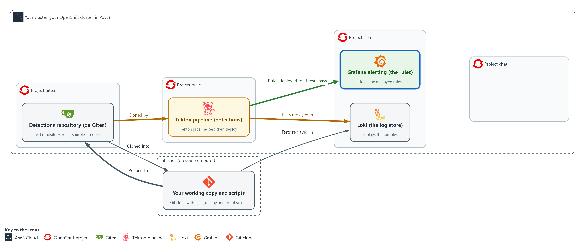

- You push your files from lab shell to the repository on Gitea, run the pipeline in the project build, and prove a failing test stops the deploy to Grafana.

#### 4a. Commit, push and run the pipeline on main

You will now commit your files, push them to Gitea and start the pipeline on the main branch.

- This step needs the cluster to reach the internet: the pipeline pods pull the image registry.access.redhat.com/ubi9/python-312:1 the first time.
- You can run this block again; if nothing changed, the commit is skipped.

```bash
cd /workspace/sdr-5/detections
git add rules/pod-exec.json ci/run_tests.py ci/deploy.py ci/pipeline.yaml
git commit -m "add pod-exec detection, tests and pipeline" || echo "nothing new to commit"
git push origin main
tkn pipeline start detections -n build --param branch=main --showlog
```

**Expected output:**

```
Example only. Hashes and times differ.
[main <hash>] add pod-exec detection, tests and pipeline
 <n> files changed
<push messages from Gitea>
<the test task log, then the deploy task log>
(the run ends as Succeeded)
```

| Part | What it does | Why you run it |
| --- | --- | --- |
| cd /workspace/sdr-5/detections | Moves into the clone. | git acts on the repository you stand in. |
| git add ... | Marks the files to be saved in the next commit. | Only the files you changed are committed, so nothing else from lab shell leaks into the repository. |
| git commit -m ... \|\| echo ... | Records the commit with the name you set in Step 1 and a message. On a rerun with nothing new, the message is printed and the block goes on. | The pipeline clones the repository, so a change that is not committed cannot reach it. The message is the record of why. |
| git push origin main | Sends the commit to Gitea. | The pipeline clones from Gitea and not from your laptop, so the change has to be there before the pipeline can use it. |
| tkn pipeline start detections -n build --param branch=main --showlog | Starts a run of the pipeline and shows its log until it ends. | This is the one allowed path to Grafana: tests first, then deploy, with the log in front of you. |

#### 4b. List the deployed rules

You will now ask Grafana which rules the pipeline deployed.

```bash
curl -s -u "$GRAFANA_USER:$GRAFANA_PASSWORD" "$GRAFANA_URL/api/v1/provisioning/alert-rules" | jq -r '.[] | select(.ruleGroup == "detections-as-code") | .title' | sort
```

**Expected output:**

```
Example only.
pod-exec
priv-escalation
secret-read
```

| Part | What it does | Why you run it |
| --- | --- | --- |
| curl -s ... /api/v1/provisioning/alert-rules | Asks Grafana for all alert rules. | The rules in Grafana are the result of the deploy, so you ask Grafana itself and not the pipeline log. |
| select(.ruleGroup == "detections-as-code") \| .title | Keeps rules in the group the deploy script uses and prints their titles. | The group holds only rules from the pipeline, so the list is short and shows exactly what it deployed. |

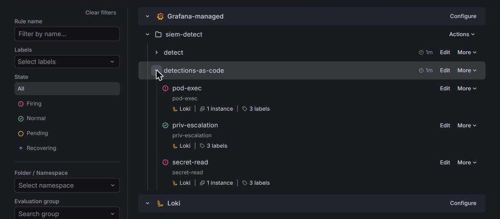

#### 4c. Break the tests on purpose and run the pipeline

You will now make a branch named broken with two wrong test expectations, push it and run the pipeline on it.

- The pipeline is expected to fail.
- You can run this block again: the branch is rebuilt from main and pushed with --force, which is safe on a throwaway branch.

```bash
cd /workspace/sdr-5/detections
git checkout -B broken
sed -i 's/"expect": "no_fire"/"expect": "fire"/' rules/pod-exec.json
git commit -am "break the pod-exec tests on purpose"
git push --force origin broken
tkn pipeline start detections -n build --param branch=broken --showlog || true
tkn pipelinerun describe --last -n build | grep -E "Status|test|deploy"
curl -s -u "$GRAFANA_USER:$GRAFANA_PASSWORD" "$GRAFANA_URL/api/v1/provisioning/alert-rules/det-pod-exec" | jq -r '.title, .updated'
git checkout main
```

**Expected output:**

```
Example only. Names and times differ.
Switched to a new branch 'broken'
<commit and push messages>
<the test task log showing FAIL lines>
Status  Failed
<test task: Failed; deploy task: not run>
pod-exec
<the updated time of det-pod-exec, the same as after the first run>
Switched to branch 'main'
```

| Part | What it does | Why you run it |
| --- | --- | --- |
| cd /workspace/sdr-5/detections | Moves into the clone. | git acts on the repository you stand in. |
| git checkout -B broken | Makes the branch broken from where you are, or resets it if it exists, so main is untouched. | The experiment must not touch main, which is what the pipeline runs for real. |
| sed -i 's/"expect": "no_fire"/"expect": "fire"/' rules/pod-exec.json | Changes every expectation of no_fire to fire in the rule file, so two cases must now fail. | Flipping the no_fire expectations makes two cases wrong on purpose, so the tests must fail. |
| git commit -am ... | Saves the broken rule file on the branch. | The pipeline clones from Gitea, so the broken change has to be a commit. |
| git push --force origin broken | Sends the branch to Gitea. --force replaces an older broken branch from an earlier run. | The pipeline clones a branch from Gitea, so the broken change has to be pushed before it can be tested. |
| tkn pipeline start ... --param branch=broken --showlog \|\| true | Runs the pipeline on that branch. \|\| true keeps the shell going after the expected failure. | This is the proof of the gate: the same pipeline, given a bad change, must stop. |
| tkn pipelinerun describe --last ... | Shows the status of the last run and its two tasks. | It shows test failed and deploy never ran, which is the evidence that the gate worked. |
| jq -r '.title, .updated' | Prints the rule name and when Grafana last changed it, which must be the time of the first run. | If the update time is unchanged, the broken change never reached Grafana, and that is the point of the gate. |
| git checkout main | Returns to the main branch. | You go back to the good version, so later steps start from the real state. |

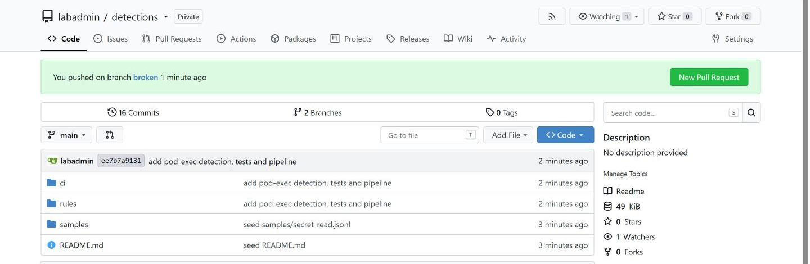

> **YOUR TURN:** Run the three blocks in order. The last block prints the time Grafana last updated det-pod-exec; compare it with the time of the first pipeline run.

> **CHECKPOINT:** After the first run the rule list shows pod-exec, priv-escalation and secret-read. The broken run ends Failed with test failed and deploy not run, and the updated time of det-pod-exec is unchanged.

> **TAKEAWAY:** If the update time of the rule in Grafana is unchanged after the broken run, the gate worked.

**How this meets the controls**

- **CM-3:** The control asks that changes be implemented through a controlled process and recorded. You commit and push the change and the pipeline run applies it, so the commit and the run record who changed the rule and when.
- **CM-3(2):** The enhancement asks that a change be tested before it takes effect. You run the pipeline on a deliberately broken branch, and the test task fails and the deploy task does not start, and the unchanged update time of the rule in Grafana is the evidence.

### Step 5. Prove the alert is delivered (SI-4(2) Automated Tools and Mechanisms for Real-Time Analysis)

**Learning point: Pushing one real-looking exec event and waiting for the alert in the incident channel proves the deployed rule reaches people, and the script fails if no alert arrives.**

- The script pushes one real-looking exec event into Loki, shaped as if a person ran a command in a pod, and waits for an alert naming pod-exec to appear in the channel siem-alerts.
- The script prints PASS when the alert arrives and exits with 1 if none arrives in the time allowed.
- The helper file ci/probe.py is already in the repository and builds the test event; the first block writes the script to ci/prove_alert.py.
- The proof script reads a Mattermost personal access token that the lab keeps in a Secret.

What this step adds (thick lines and outlines are new):

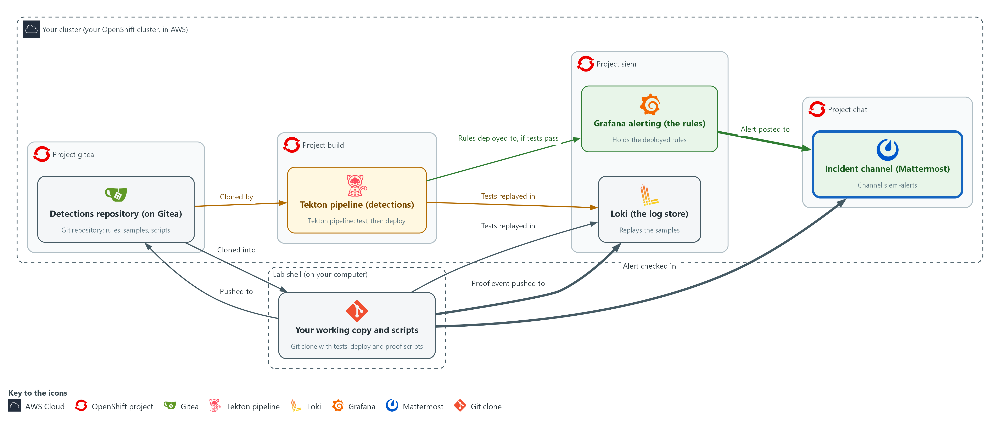

- You push one event to Loki and prove the alert naming pod-exec arrives in the incident channel.

#### 5a. Write the proof script as ci/prove_alert.py

You will now write the proof script into a file named ci/prove_alert.py inside the repository.

- Paste all of it at once.
- You run it in the next block.

Look for these as you read:

- The loki.push call. It sends one exec event, shaped as if a person ran it, with the label the rule selects.
- The wait_for_alert loop. It checks the channel every POLL_S seconds (5), for up to WAIT_S seconds (240), for a post that names pod-exec.
- The SystemExit line. If no alert arrives, the script ends with a failure and a message.
- The final print of PASS. It appears only after an alert naming pod-exec was found.

```bash
cd /workspace/sdr-5/detections
cat > ci/prove_alert.py <<'EOF'
import time

import lokilib as loki
import mm
import probe

WAIT_S = 240
POLL_S = 5


def wait_for_alert(channel, since_ms):
    deadline = time.time() + WAIT_S
    while time.time() < deadline:
        time.sleep(POLL_S)
        for post in mm.posts_since(channel, since_ms):
            if "pod-exec" in mm.post_text(post):
                return post
    return None


def main():
    channel = mm.channel_id()
    event_ns = time.time_ns()
    event_ms = event_ns // 1_000_000
    loki.push([({"log_type": "audit", "lab_measure": "sdr-5"}, [(event_ns, probe.exec_line(event_ns))])])
    if wait_for_alert(channel, event_ms) is None:
        raise SystemExit("FAIL  no alert naming pod-exec in the channel after %d seconds" % WAIT_S)
    print("PASS  alert naming pod-exec arrived in the incident channel")


main()
EOF
wc -l ci/prove_alert.py
```

**Expected output:**

```
Example only.
31 ci/prove_alert.py
```

| Part | What it does | Why you run it |
| --- | --- | --- |
| cat > ci/prove_alert.py <<'EOF' ... EOF | Writes the Python lines between the first line and EOF into the file, with the indentation kept. | You need no editor, and the spaces Python needs are kept. |
| probe.exec_line(event_ns) | Builds one audit event for a command run in a pod by the account lab-tester, stamped with the event time. The helper is supplied in ci/probe.py. | The event has the fields the rule selects, so the deployed rule has something to match. |
| loki.push([...]) | Pushes the event now, with the label log_type=audit that the rule selects. | Without this push there is no event, so the deployed rule would have nothing to match and no alert could arrive. |
| wait_for_alert(channel, since_ms) | Every 5 seconds, for up to 240 seconds, reads the channel posts made since the event and looks for one naming pod-exec. | The alert reaches the channel only after the rule's next evaluation, so the script polls until it sees one naming pod-exec. |
| raise SystemExit(...) | Ends with a failure and a message if no alert arrives. | A silent path is the failure this step exists to catch, so the script fails and does not just warn. |

#### 5b. Run the proof

You will now read the Mattermost token into a shell variable and run the proof script from the ci folder.

- The proof can take a few minutes.

```bash
cd /workspace/sdr-5/detections
export MM_TOKEN=$(oc get secret mm-api -n siem -o jsonpath='{.data.token}' | base64 -d)
cd ci
python3 prove_alert.py
```

**Expected output:**

```
Example only.
PASS  alert naming pod-exec arrived in the incident channel
```

| Part | What it does | Why you run it |
| --- | --- | --- |
| cd /workspace/sdr-5/detections | Moves into the clone. | A block must run on its own, so it starts by going to the folder. |
| oc get secret mm-api ... \| base64 -d | Reads the Mattermost token from the Secret and decodes it. It stays in the shell variable and is not printed. | The script needs permission to read the channel. The lab keeps that token in a Secret, so you never type it. |
| cd ci | The script imports its helpers from the same folder. | prove_alert.py imports its helpers from this folder, and Python looks for them next to the script. |
| python3 prove_alert.py | Runs the proof. It takes up to a few minutes. | This proves the deployed rule turns an event into an alert that reaches the channel. |

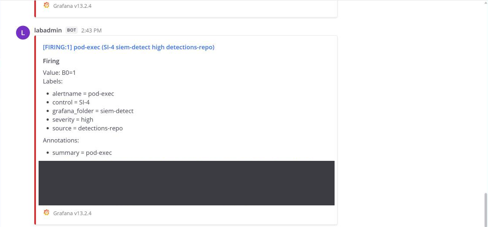

> **NOTE:** You can run the proof again at once. If the earlier alert is still active, the lab's notification policy posts it again about every minute, so a rerun can pass on that repeat. For a clean proof, wait about 10 minutes, until a RESOLVED post appears in the channel, then run it again.

> **YOUR TURN:** Write ci/prove_alert.py and run the last block. Read the last line.

> **CHECKPOINT:** The script prints PASS and an alert naming pod-exec is in the channel siem-alerts. If it exits with FAIL, no alert arrived in the time allowed.

> **TAKEAWAY:** PASS means the deployed rule turned an event into an alert in the incident channel; FAIL means the path is broken somewhere between Loki and the channel.

**How this meets the control**

- **SI-4(2):** The enhancement asks for automated tools that support near real-time analysis of events. The script pushes one event, waits for an alert naming pod-exec in the incident channel, and exits with 1 if none arrives, so the check is pass or fail with no person starting the analysis.

## Section 4. Verify It Works

### Test 1 (positive). The rule in Grafana matches the file the pipeline deployed (CM-3 Configuration Change Control)

You will now read the deployed rule back from Grafana and compare its title and threshold with the file in the repository.

```bash
cd /workspace/sdr-5/detections
curl -s -u "$GRAFANA_USER:$GRAFANA_PASSWORD" "$GRAFANA_URL/api/v1/provisioning/alert-rules/det-pod-exec" | jq -r '.title, .data[1].model.conditions[0].evaluator.params[0]'
grep threshold rules/pod-exec.json
```

**Expected output:**

```
Example only. Run names and times differ.
pod-exec
0
  "threshold": 0,
```

| Part | What it does | Why you run it |
| --- | --- | --- |
| cd /workspace/sdr-5/detections | Moves into the clone. | grep reads rules/pod-exec.json from here. |
| curl ... alert-rules/det-pod-exec \| jq -r '.title, ...params[0]' | Reads the live rule back from Grafana and prints its title and its threshold. | You compare what runs with what was committed, not what the pipeline log says. |
| grep threshold rules/pod-exec.json | Prints the threshold line from the file in the repository. | It must equal the number Grafana printed. |

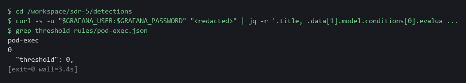

> **CHECKPOINT:** The title is pod-exec, and the threshold in Grafana equals the threshold in the file.

**How this meets the control**

- **CM-3:** The control asks that changes be implemented as approved and recorded. This test reads the rule back from Grafana and compares its title and threshold with the file, so a match shows the running rule is the one that was committed.

### Test 2 (negative). A rule without tests is refused (CM-3(2) Testing, Validation, and Documentation of Changes)

- You will now check that the gate also refuses an untested rule.
- You make a copy of a rule with the tests removed, run the test runner on that one file, read the exit code, then delete the copy.
- The copy is never committed or pushed.

```bash
cd /workspace/sdr-5/detections
jq 'del(.tests) | .uid = "det-untested" | .title = "untested"' rules/pod-exec.json > rules/untested.json
python3 ci/run_tests.py rules/untested.json > untested.log
echo "exit code $?"
grep -E 'untested|failing' untested.log
rm rules/untested.json untested.log
```

**Expected output:**

```
Example only.
exit code 1
FAIL  untested has no tests
1 failing
```

| Part | What it does | Why you run it |
| --- | --- | --- |
| jq 'del(.tests) \| ...' rules/pod-exec.json > rules/untested.json | Makes a copy of the rule with its tests removed and a different uid and title. | An untested rule is the case the gate must refuse. |
| python3 ci/run_tests.py rules/untested.json > untested.log | Runs the runner on that one file and keeps the output in a file. | The runner is the same one the pipeline uses. |
| exit code 1 | A non-zero number: the runner failed. | The pipeline reads this number, so a 1 means the deploy would not start. |
| FAIL  untested has no tests | The runner names the rule and the reason. | A rule without tests counts as a failure, not a warning. |
| rm rules/untested.json untested.log | Deletes the copy and the log. | Nothing is pushed, and the repository stays clean. |

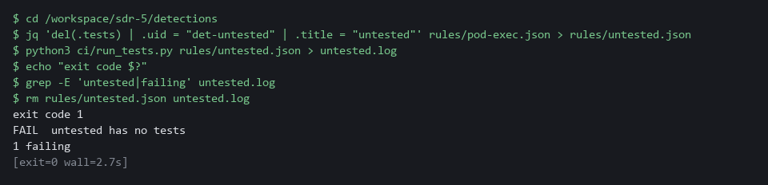

> **CHECKPOINT:** The runner reports the untested rule as a failure and exits with 1, so the pipeline would not deploy it.

**How this meets the control**

- **CM-3(2):** The enhancement asks that changes be tested before they are finalized. A copy of the rule with its tests removed is run through the test runner, and the runner fails it with exit code 1, so the pipeline would not deploy an untested rule.

## Section 5. What Each Control Is For

### Control mapping

| Control | What it requires, in plain words | Tool or service | Where this module covers it |
| --- | --- | --- | --- |
| CM-3 Configuration Change Control | Review, approve and implement configuration changes through a controlled process, and keep a record of them. | The Gitea repository, the Tekton pipeline and the Grafana provisioning API. Explained in section 2.1. | Section 3, Steps 1 and 4: every detection change is kept in Gitea history and applied only through the pipeline. Section 4, Test 1: the rule in Grafana matches the file. |
| CM-3(2) Testing, Validation, and Documentation of Changes | Test and validate a change before it takes effect. | The test runner (ci/run_tests.py) and the two-task pipeline, test then deploy. Explained in section 2.2. | Section 3, Steps 2 to 4: recorded events are replayed against every rule before the deploy task can start. Section 4, Test 2: a rule without tests is refused. |
| SI-4(2) Automated Tools and Mechanisms for Real-Time Analysis | Use automated tools to analyze events soon after they happen. | Grafana alerting, the incident channel in Mattermost and the proof script (ci/prove_alert.py). Explained in section 2.3. | Section 3, Step 5: you prove the deployed rule turns an event into an alert in the incident channel, pass or fail. |

### What each control is for

Each table below says what the control is trying to prevent and how this module's tool meets it.

#### CM-3 Configuration Change Control

| Question | Answer |
| --- | --- |
| Control Intent | Someone edits an alert rule in the Grafana screen, nobody knows who or why, and a detection quietly stops working. |
| The operational question | For any rule now running, can you point to the commit that put it there, the tests it passed, and who pushed it? |
| What evidence proves it | The Gitea history of the rule file, the pipeline run that deployed it, and the rule in Grafana matching the file. |
| How much is enough | NIST requires approved changes to be implemented under control and documented. The lab uses a push to main as the approval, and a real system adds a reviewer. How long records are kept is organization-defined. |
| How the tool in this module satisfies it | Gitea repository, Tekton pipeline and the Grafana provisioning API. |

#### CM-3(2) Testing, Validation, and Documentation of Changes

| Question | Answer |
| --- | --- |
| Control Intent | A threshold change that silences an attack is deployed because nobody replayed the attack against it. |
| The operational question | Before this change went live, did a recorded attack still fire it and a recorded ordinary event still stay quiet? |
| What evidence proves it | The test log of the pipeline run, with a PASS line for each case, and a failed run showing the deploy did not start. |
| How much is enough | The control requires testing before the change is finalized. The lab requires at least one test for every rule and refuses a rule with none. |
| How the tool in this module satisfies it | A test runner that replays recorded samples in Loki, and a pipeline that does not run the deploy task when the test task fails. |

#### SI-4(2) Automated Tools and Mechanisms for Real-Time Analysis

| Question | Answer |
| --- | --- |
| Control Intent | The rule is deployed, but the alert never reaches the channel because the notification path is broken, and nobody learns of the event. |
| The operational question | When a matching event happens, does an alert naming the rule arrive in the incident channel? |
| What evidence proves it | The proof script printing PASS after it pushed one event and found the alert in the channel. |
| How much is enough | The enhancement asks for near real-time analysis and gives no number. The lab proves the alert is delivered, as pass or fail; any timing target is the organization's choice. |
| How the tool in this module satisfies it | prove_alert.py: pushes one event, waits for the alert post in the channel, and prints PASS or fails. |

## Section 6. Next Steps

### Using this in other environments

- Works as is on any OpenShift cluster that has OpenShift Pipelines, Loki, Grafana alerting and Mattermost, plus the lab's Gitea repository and secrets.
- Change these lab values first: the Gitea server address and repository name, the Grafana folder and rule-group name, and the Mattermost team and channel names.
- The rule file format (JSON with expr, op, threshold, tests) and the Python scripts are tool-independent; the Grafana API calls in deploy.py need adjustment only if the Grafana version changes.
- On other Kubernetes platforms the oc commands become kubectl commands; the pipeline YAML and Tekton syntax are the same.

The table shows what changes on each platform:

| Part | In this lab (OpenShift) | On other Kubernetes | What you change |
| --- | --- | --- | --- |
| Detection repository | Gitea inside the lab cluster | Any git server (GitHub, GitLab, Gitea) | Credential helper and clone URL. |
| Pipeline | OpenShift Pipelines (Tekton), project build | Tekton or any CI/CD system with a test-then-deploy pattern | Task YAML syntax and runner command. |
| Test replay | Loki in project siem via detlib helper | Any Loki instance | LOKI_URL, certificate, credentials. |
| Alert rules | Grafana alerting, folder siem-detect | Any Grafana instance | GRAFANA_URL, folder UID, rule group name. |
| Incident channel | Mattermost channel siem-alerts | Slack, Teams or any webhook target | Contact point in Grafana; mm.py helpers need replacement. |
| oc commands | oc get secret, oc apply | kubectl equivalents | Replace oc with kubectl. |

> **TIP:** This is the last module in the security data and incident response dimension. Next module: CPS-5 Guardrails Developers Inherit: build guardrails that every developer team gets by default, the same idea of a shared, enforced control that you used here for the test gate.

<details>
<summary><strong>Section 7. Terms</strong></summary>

Each term is also explained the first time it appears. In Word, hover over an underlined term to see its meaning, or Ctrl+click it to jump to this table.

| Term | Plain meaning |
| --- | --- |
| Alert | A message a monitoring tool sends when one of its rules matches. |
| API | The address and rules a program uses to give another program commands. Here the Grafana API creates and changes alert rules. |
| Audit event | A record the cluster keeps of one request, such as who ran a command in which pod. |
| AWS | Amazon Web Services, the cloud your lab runs in. |
| Branch | A separate line of work in a repository. The branch main is the main one. |
| Certificate | A file that proves a server's identity, signed by a trusted authority. |
| CI/CD | Continuous integration and delivery: tests and releases that run automatically each time a change is pushed. |
| Clone | Copy a repository from a server into a folder on your side. |
| Cluster | A group of servers that work together as one system. Here it is your own OpenShift cluster. |
| Commit | One recorded change to the repository, with an author and a message. |
| Contact point | The place Grafana sends an alert to, such as a chat channel. |
| Container | A sealed box that holds one program and everything it needs to run. |
| Controller | A program in the cluster that keeps the real state matching what you asked for. |
| Credential | A secret that proves who you are, such as a password, token or key. |
| Deploy | Put a new version of a program into the running system. |
| Detection | A saved search plus a limit. When the number of matching events passes the limit, the detection fires. |
| Detection as code | Keeping detection rules as files in version control, tested and deployed by a pipeline instead of edited by hand in a screen. |
| Evaluation interval | How often Grafana runs a rule's search. The wait for the next run is part of the time from event to alert. |
| Evidence | Saved records that show a system is set up and behaving as claimed. |
| Exit code | A number a command leaves behind when it ends. 0 means success; anything else means a problem. |
| Filter | One condition in a LogQL query, such as verb="create". Lines that do not meet every condition are dropped before they are counted. |
| Gate | A point where the process stops unless a condition holds. Here: no deploy unless the tests pass. |
| Gitea | A git server that runs inside your lab cluster. It holds the detections repository. |
| Grafana | A free tool that draws charts and runs alert rules. |
| grep | A command that prints only the lines that match a pattern. |
| Header | A line of extra information sent with a web request, such as a sign-in token. |
| Heredoc | A way to make a file by pasting its text between a first line such as cat > name <<'EOF' and a last line that says EOF. |
| HTTP | The protocol that web pages and web APIs use. HTTPS is the encrypted form. |
| Image | A sealed package that holds a program and everything it needs. The pipeline pods start from a public Red Hat Python image. |
| Incident channel | The Mattermost channel siem-alerts, where alerts are posted. |
| jq | A tool that picks values out of JSON text, or builds JSON from values. |
| JSON | A text format for data, made of names and values in braces. |
| JSONL | A text file with one JSON object on each line. |
| kubectl | The standard command-line tool for Kubernetes. oc does the same jobs and more on OpenShift. |
| Kubernetes | The open-source system that runs and manages containers across servers. OpenShift is built on it. |
| Label | A key=value tag on log lines in Loki, such as log_type=audit. Searches start from labels. |
| LogQL | Loki's search language. A search names labels and can then filter, parse and count the lines. |
| Loki | A free log store. It keeps log lines and lets you search them. |
| Mattermost | A free team chat tool. In this lab it holds the incident channel. |
| mkdir | A command that makes a new folder. |
| Namespace | A named section of the cluster that holds a set of related parts. |
| NIST | The US National Institute of Standards and Technology. It publishes the security control catalog these modules cite. |
| Notification policy | The Grafana rules that decide which contact point receives which alert. |
| oc | The command-line tool for OpenShift. You type oc to ask the cluster questions. |
| OpenShift | The Red Hat platform your lab cluster runs on. It is Kubernetes with extra security and tools built in. |
| Operator | A program that installs and looks after another tool inside the cluster. |
| Parameter | A value handed to a Task or script when it runs, such as the name of the script to run. |
| Payload | The data carried inside a message or request. |
| Pipeline | An automated list of tasks that runs in a set order. Here: test, then deploy. |
| PipelineRun | One execution of a Tekton pipeline. |
| Pod | The smallest thing the cluster runs: one or more containers that run together and share one network address. |
| Pod-exec | Running a command inside a running pod, for example to open a shell in it. The pod-exec detection fires when a person does this. |
| Project | A named section of the cluster that keeps workloads apart, as in project build. OpenShift also calls it a namespace. |
| Provisioning API | The Grafana web interface that creates and changes alert rules from a program. |
| Push | Send your commits to the repository on the server. |
| Query | A question you ask a data store, written in a query language, such as a log search. |
| Registry | A server that stores container images. |
| Replay | Sending recorded events into Loki under a label that exists only for that run, then asking whether the rule fires. |
| Repository | A folder of files with a recorded history of every change. Here it is hosted in Gitea. |
| Route | An OpenShift object that gives a program inside the cluster an address reachable from outside. |
| Rule | A written condition that a tool checks. |
| Runner | The program or container that carries out the steps of a pipeline. |
| Sample | Recorded events saved in a file, with a name for each case. |
| Script | A text file of commands that a computer runs in order. |
| Secret | A stored password or key held in the cluster. |
| sed | A command that edits text as it passes through, often to replace one string with another. |
| Selector | A rule that picks objects by their labels. |
| Severity | How serious a finding is, such as low, medium, high or critical. |
| Task | One reusable unit of work in a Tekton pipeline. It is a list of steps that run in one pod. |
| Team | A group in Mattermost that holds channels. The lab team is named lab. |
| Tekton | The open-source pipeline system that OpenShift Pipelines is built on. A Task is a list of steps; a Pipeline runs Tasks in an order. |
| Threshold | The limit at which something is counted or an alert fires. |
| tkn | The command-line tool for Tekton. tkn pipeline start runs a pipeline and shows its log. |
| Token | A long secret string that proves who you are to a service, used here instead of a password. |
| UID | The number that identifies the user a process runs as. |
| URL | A web address, such as https://example.com/page. |
| Webhook | An address that another program calls to send it a message when something happens. |
| YAML | A plain-text format for settings: lines of name: value, with indentation to show what belongs to what. |

</details>
