# Tool Walkthrough: finding your way around the lab

This guide shows each tool you will open during the training, what it is for, and the few pages a security engineer comes back to most. Every picture is a real page from the lab. The lab prints the web address and the sign-in name for each tool when it starts; the sign-in values are saved as lab variables, so you never copy a password into a file.

## How to read this guide

- Each tool has a short 'what it is for' line, then the pages to learn, in the order you will meet them.
- Under each picture, 'Look at' says what to read on the page, and 'Why it matters' says what a security engineer does with it.
- The modules that use the tool are listed so you know where to practise.

## OpenShift web console

**What it is for.** The control panel for the cluster. You use it to see what is running, what failed, and what the platform is warning about.

**Used in:** Almost every module points at it

### Overview

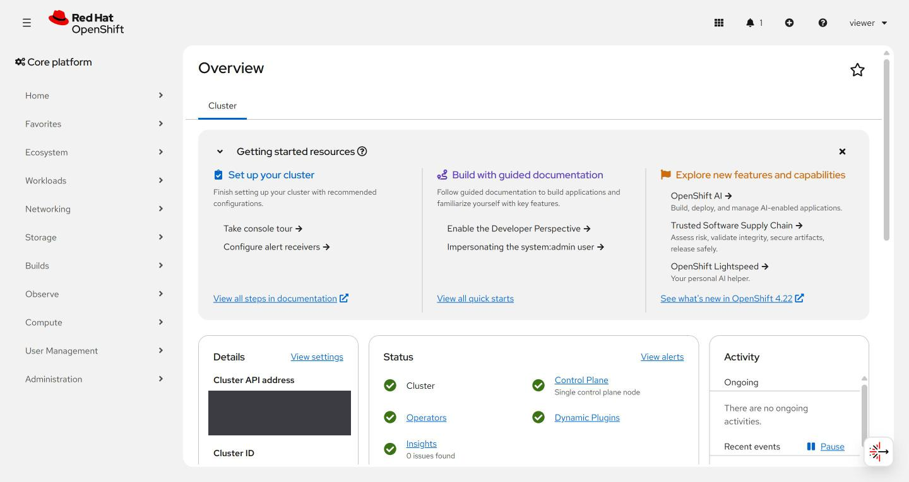

**Look at:**

- The Status box: Cluster, Control Plane, Operators. Green ticks mean healthy.
- The left menu: Workloads, Networking, Observe and Administration hold most of what you need.

**Why it matters.** Start here. A red item on the Overview tells you where to look before you run any command.

### Nodes

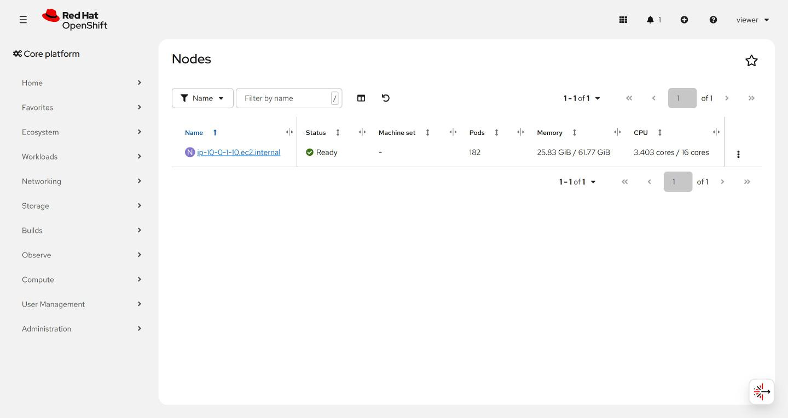

**Look at:**

- Status says Ready when the machine is healthy.
- Pods, Memory and CPU show how full the machine is.

**Why it matters.** A full node is the first thing to rule out when pods are slow or fail to start.

### Pods in a project

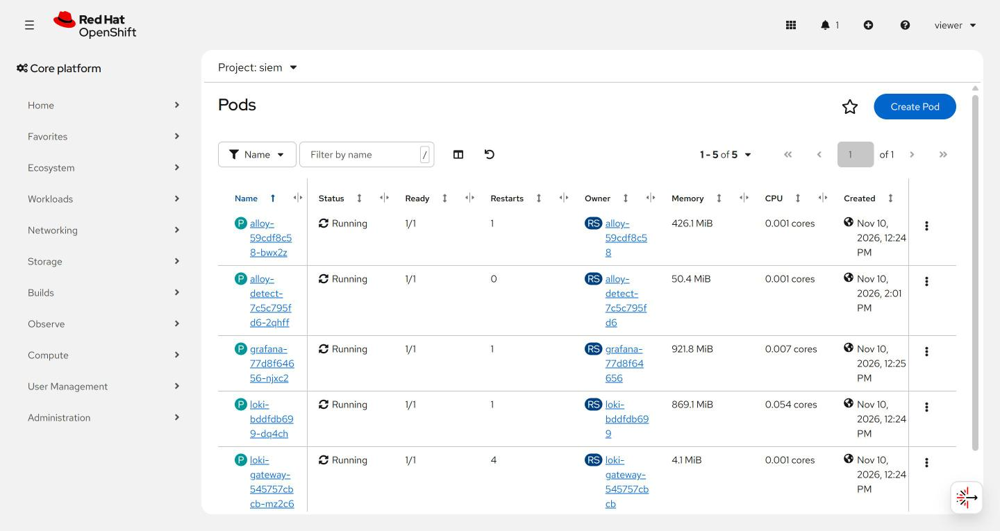

**Look at:**

- The project picker at the top (here: siem). Pods only show for the project you chose.
- Status and Restarts. Running with many restarts means something keeps crashing.
- Memory and CPU per pod.

**Why it matters.** Pods are where your workloads live. Restarts and status are the quickest health check, and they match what the oc get pods command prints.

### Events

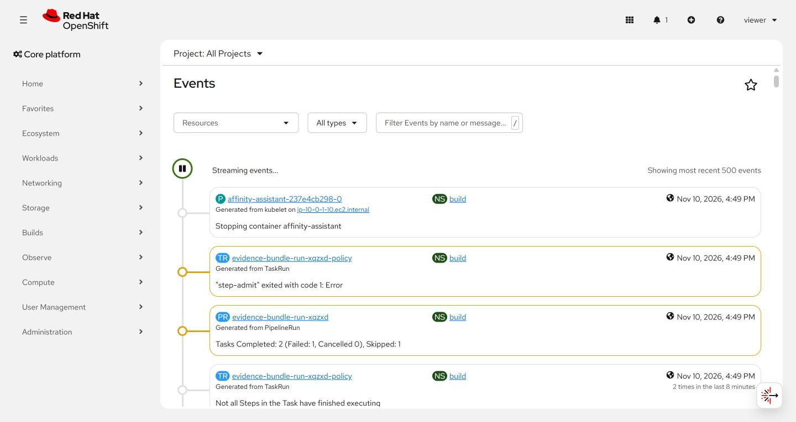

**Look at:**

- Newest first. Yellow rows are warnings.
- Each row names the object and the project it belongs to.

**Why it matters.** Events say why something failed, for example a task that exited with an error. They are the first thing to read when a pipeline run fails.

### Pipelines and runs

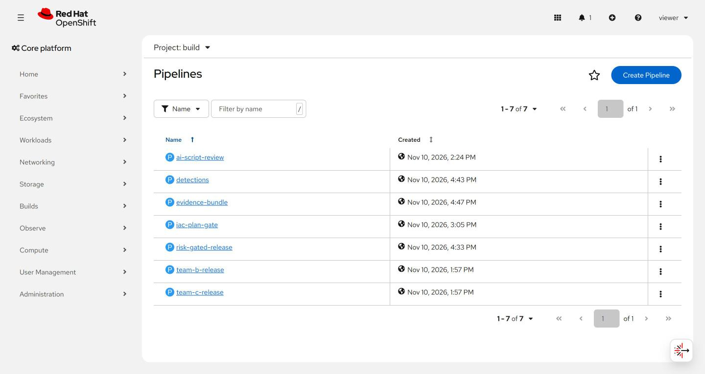

**Look at:**

- Pipelines are the definitions. Open Pipelines, then PipelineRuns to see each run.

**Why it matters.** This is where a build or a security gate runs. Modules on scanning, signing and evidence use it.

### PipelineRuns

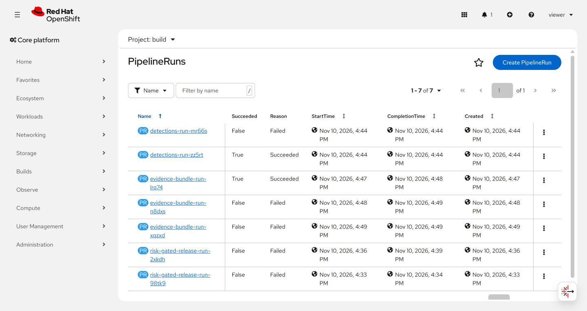

**Look at:**

- Succeeded True or False, and the Reason. Failed means a task stopped the run.
- Open one run to see its tasks and logs.

**Why it matters.** A failed gate is a result, not a mistake. Read which task failed and why before you rerun.

### Kyverno policies

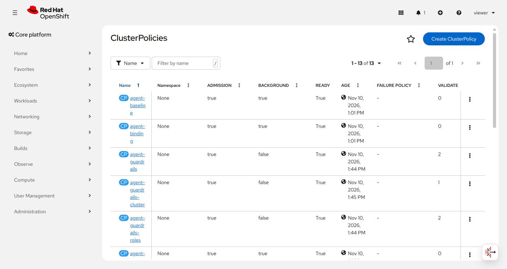

**Look at:**

- READY True means the policy is loaded.
- ADMISSION true means it can refuse a new object. BACKGROUND true means it also checks what already exists.

**Why it matters.** Policies are the guardrails. This page shows which rules are on, and whether they refuse or only record.

### Alerting

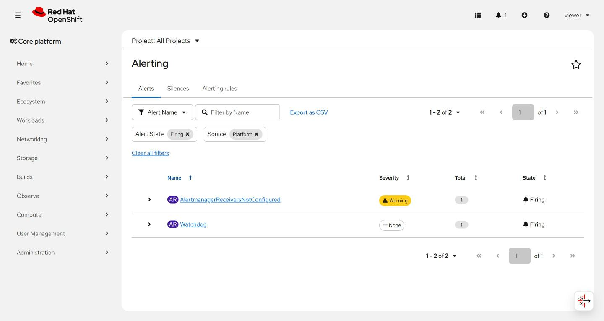

**Look at:**

- Filters at the top: state and source. Platform alerts come from the cluster itself.
- Firing means the condition is true right now.

**Why it matters.** Alerts tell you something needs attention. Watchdog firing is normal: it proves alerting works.

## Grafana (with Loki)

**What it is for.** Search logs and set up alerts. Loki stores the logs; Grafana is how you search them and turn a search into an alert.

**Used in:** SDR-2 to SDR-5, AID-3 to AID-5, ENG-0

### Explore

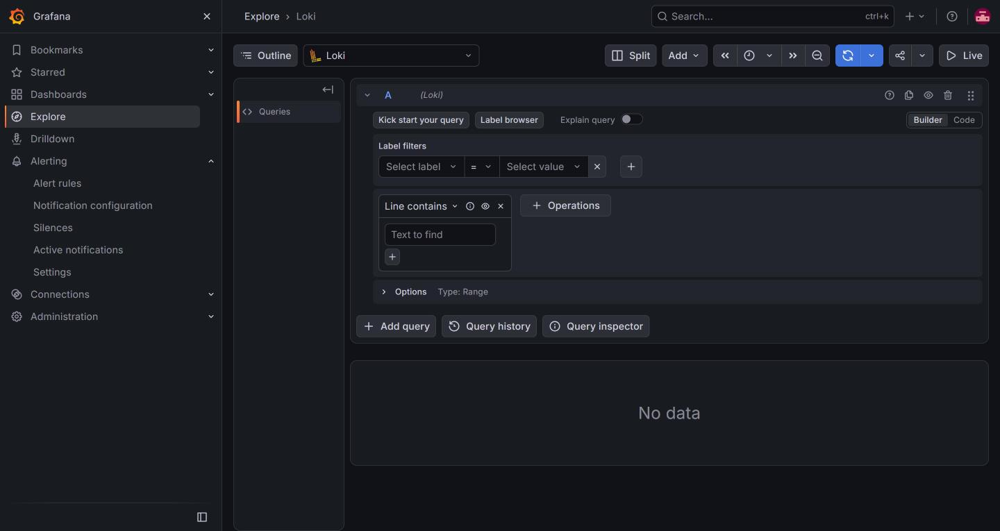

**Look at:**

- The data source at the top says Loki.
- Pick a label, then a value, to narrow the logs. Use Code to type a query yourself.
- Set the time range with the clock button.

**Why it matters.** This is the search box for every log. Investigations start here: who did what, and when.

### Alert rules

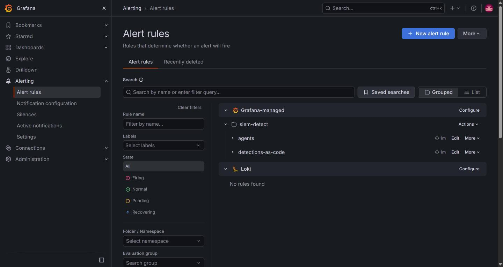

**Look at:**

- Rules are grouped in a folder (here siem-detect).
- State filters: Firing, Normal, Pending.

**Why it matters.** Each rule is a saved search with a threshold. This is where detections live and where you check that they are healthy.

### Contact points

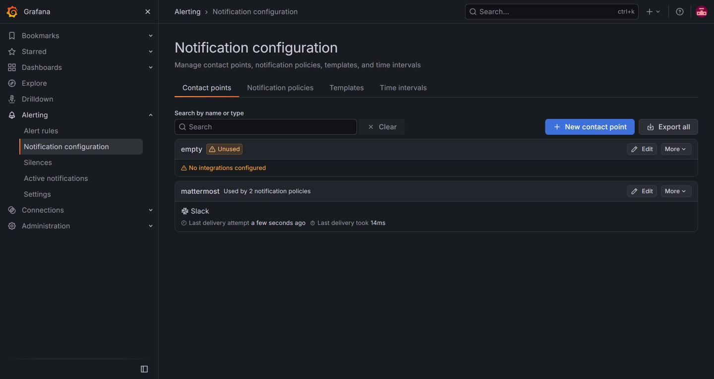

**Look at:**

- A contact point is where an alert goes. Here, mattermost.
- Last delivery attempt shows whether the message was sent.

**Why it matters.** An alert nobody receives is the same as no alert. Check delivery here first when a message does not arrive.

## Mattermost

**What it is for.** Team chat. Alerts from Grafana arrive in a channel, the way a real security team receives them.

**Used in:** SDR-2, SDR-5, AID-2, ENG-0

### The alert channel

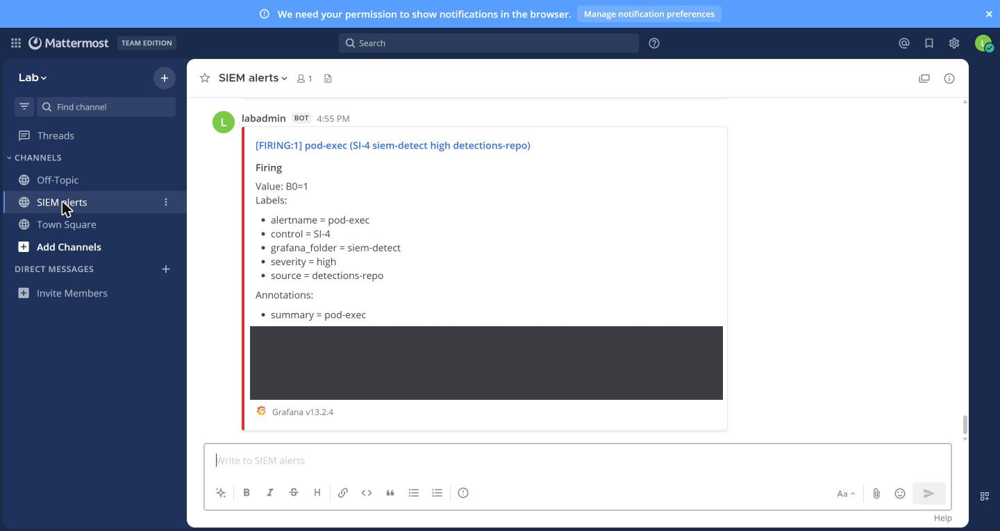

**Look at:**

- The title shows FIRING, the rule name and the severity.
- Labels name the control, the folder and where the rule came from.
- Source opens the rule. Silence mutes it for a while.

**Why it matters.** This is what you triage. Read the labels first: they tell you what fired and who owns the rule.

## Gitea

**What it is for.** The lab's git server. Detections, pipelines and infrastructure files live here as code, and changes go through pull requests.

**Used in:** ENG-0, GRC-3, SDR-5, AID-3, IAC-2, VM-2 to VM-5

### Dashboard

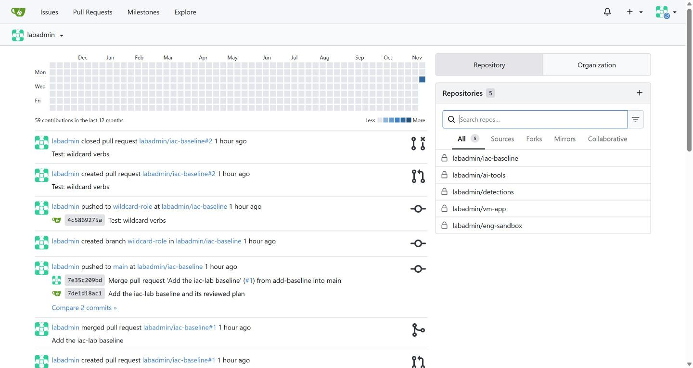

**Look at:**

- Repositories on the right. The feed on the left shows recent pushes and pull requests.

**Why it matters.** The feed is an audit trail of who changed what, and when.

### Pull requests

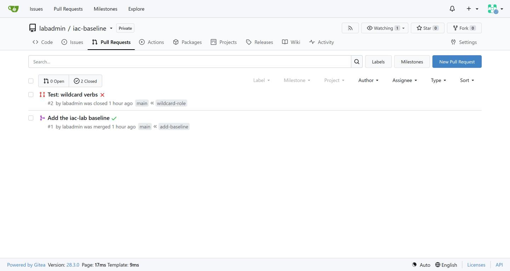

**Look at:**

- Open and Closed counts. A green tick means checks passed; a red cross means they failed.
- main on the left, the branch on the right.

**Why it matters.** A pull request is where a change is reviewed and gated before it reaches main. A closed, failed one is a gate doing its job.

## Keycloak

**What it is for.** Sign-in and identity. It decides who users are and which applications they may use.

**Used in:** SDR-2 to SDR-4

### Home and sign-in

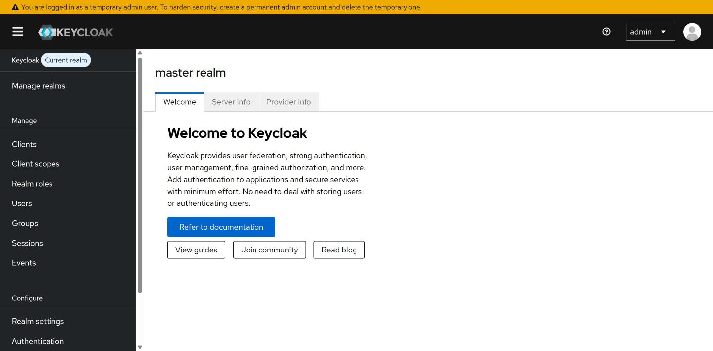

**Look at:**

- The realm name at the top left. A realm is one separate set of users and clients.
- The menu: Clients, Users, Sessions, Events.

**Why it matters.** Check which realm you are in before you read or change anything.

### Clients

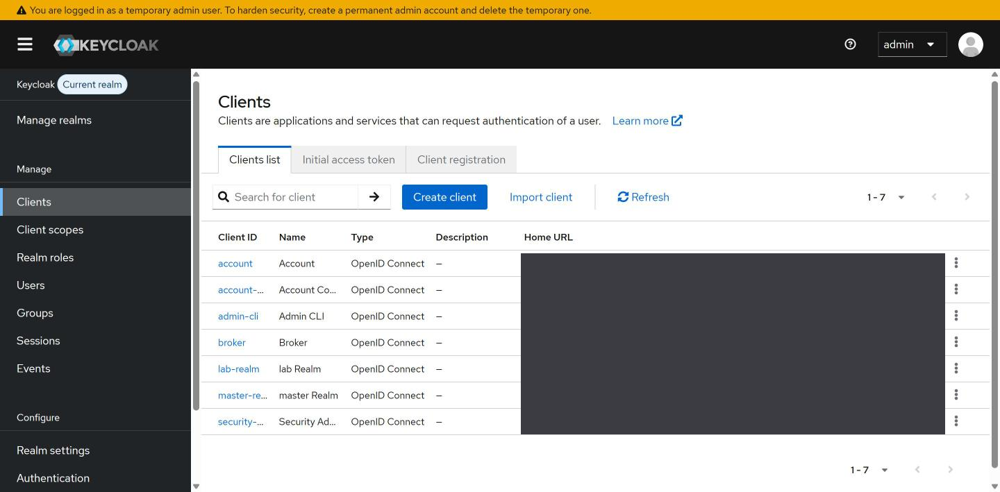

**Look at:**

- A client is an application that asks Keycloak to sign users in.

**Why it matters.** Every client is a door into the system. Know which ones exist and which you did not expect.

### Users

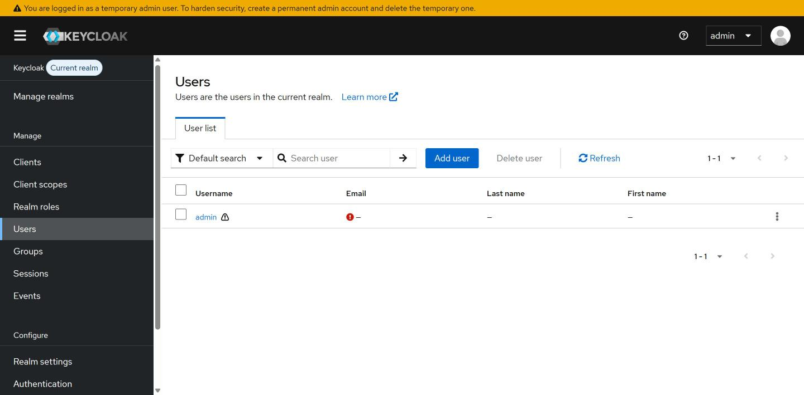

**Look at:**

- The user list and the Add user button.

**Why it matters.** Accounts are what an attacker wants. Review who exists, and look for accounts nobody can explain.

### Events

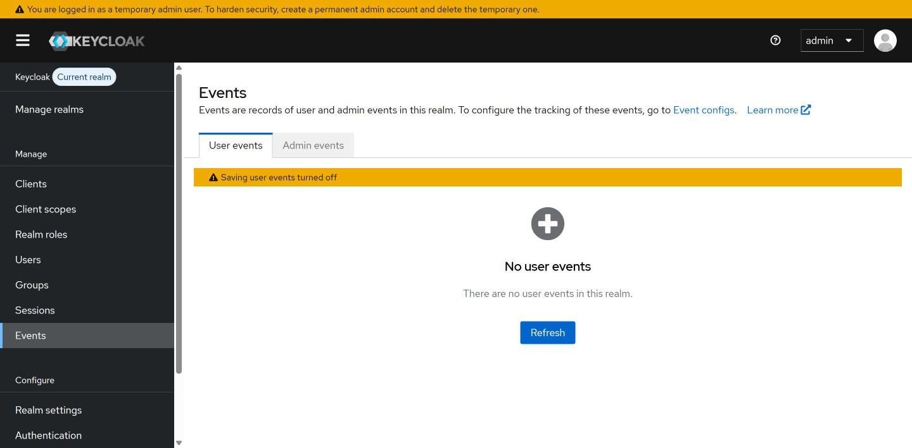

**Look at:**

- The banner says saving user events is turned off. No events are kept until you turn it on.

**Why it matters.** Sign-in events are the raw material for detections. Turn them on, or you cannot investigate a bad sign-in.

## Argo CD

**What it is for.** Keeps the cluster matching what is in git. If someone changes the cluster by hand, Argo CD shows the difference.

**Used in:** GRC-5

### Applications

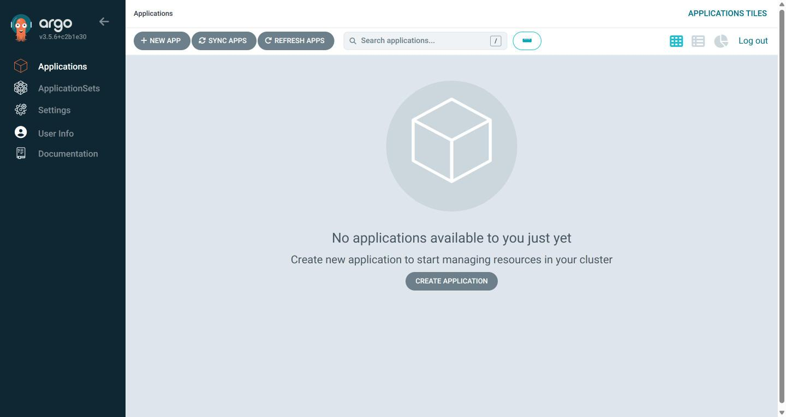

**Look at:**

- The page is empty until an application is added in GRC-5. Once there are applications, each tile shows its sync state and health.
- Sync apps and Refresh apps compare git with the cluster.

**Why it matters.** Out of sync means the cluster no longer matches git. That is drift, and it is evidence a change happened.

## AWS console

**What it is for.** The cloud account the lab runs in. You mostly use the command line, but the console is the quickest way to see what exists.

**Used in:** ENG-0 setup, CPS-4

### EC2 instances

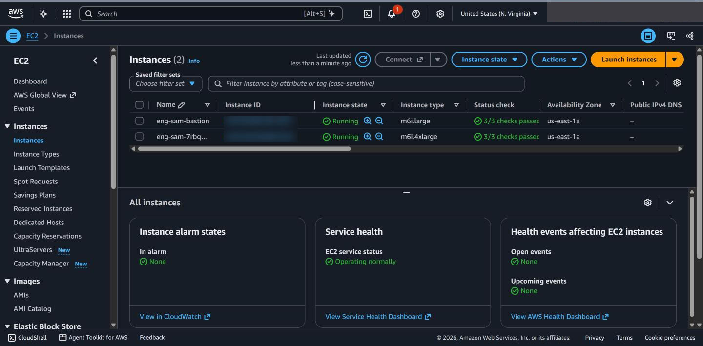

**Look at:**

- Instance state: Running costs money. The cluster machine and the bastion are listed.
- Instance type shows the size.

**Why it matters.** Anything running is billed. Check here that nothing is left on after the lab is shut down.

### S3 buckets

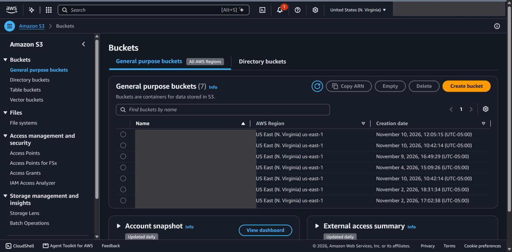

**Look at:**

- Names starting eng-sam are the lab's logs, artifacts and state.

**Why it matters.** Buckets hold logs and evidence. Know which hold what, and who can read them.

### KMS keys

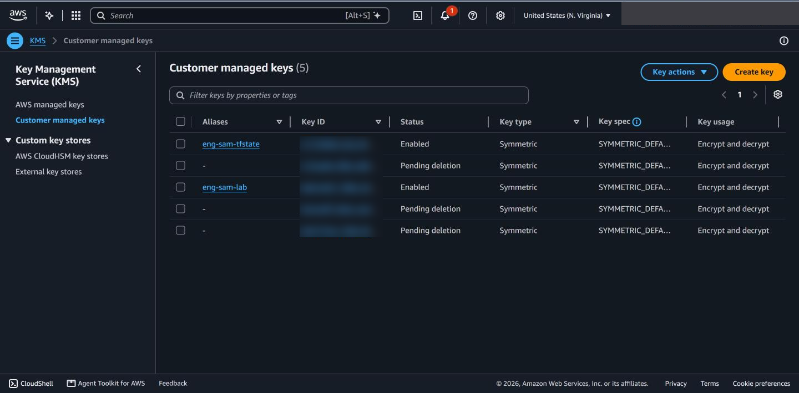

**Look at:**

- Status Enabled or Pending deletion.
- Key usage says what a key is for.

**Why it matters.** Encryption keys protect the data. A key pending deletion is a key you can no longer use.

## Trivy (command line)

**What it is for.** Scans a container image for known vulnerabilities. It has no web page: you run it in the lab shell, and the Trivy operator also scans what runs in the cluster and saves the results as reports.

**Used in:** ENG-0, GRC-4, VM-2 to VM-5

### Scan an image

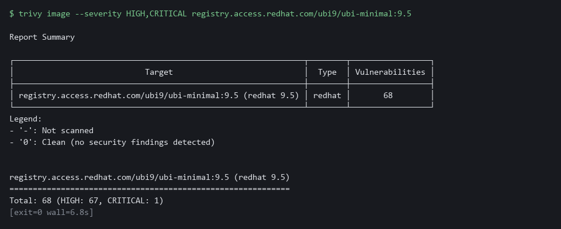

**Look at:**

- Total at the bottom: how many findings, split by severity.
- --severity HIGH,CRITICAL hides the low and medium noise.

**Why it matters.** A scan gives a count to act on. A gate in a pipeline blocks a release when the count is not zero.

### Count by severity, and fixable only

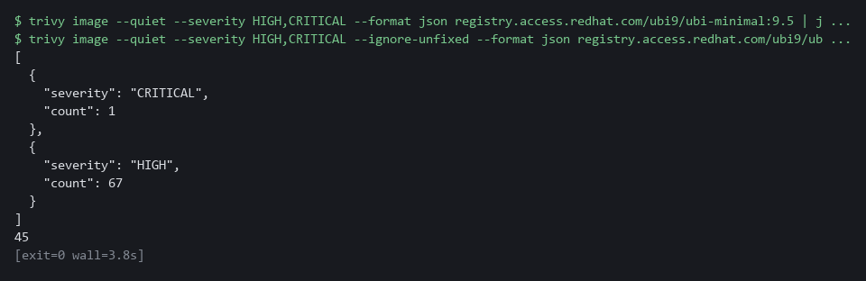

**Look at:**

- The first block groups findings by severity.
- The last number counts only findings that have a fix, using --ignore-unfixed.

**Why it matters.** Fixable findings are the ones you can act on today. Unfixable ones need a decision, not a patch.

### What the operator found in the cluster

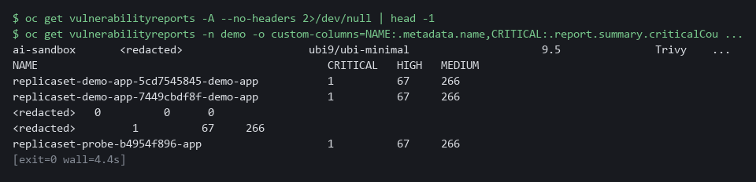

**Look at:**

- One report per running workload, with Critical, High and Medium counts.
- A row of 0 0 0 is a clean image.

**Why it matters.** Reports show what is vulnerable right now in the cluster, without scanning anything by hand.

## Habits that carry across every tool

- Start from the question, not the tool. 'Did anything change?' goes to Gitea and Argo CD. 'Who did this?' goes to Grafana Explore. 'Is it healthy?' goes to the console.
- Pick the project or realm first. Most empty pages are the wrong project, not missing data.
- Read Events and logs before you retry a failed run.
- Use the web page to look, and the command line to prove it. Both should show the same thing.
- Never paste a password into a note or a message. Read it from the lab variable and type it where it is asked.
