# VM-2: Scan and Hand Off (RA-5, SI-2)

| Item | Detail |
| --- | --- |
| Sequence | Module 4 of 29 in the recommended order |
| Timed work | About 62 minutes (42 hands-on, 20 verify) |
| Standalone start | `lab start vm-2` |
| Combined start | Continue from the end state of the previous module |
| Tools | OpenShift Container Platform, Trivy (free, open source), Gitea (free, open source), oc, git, jq |
| Prerequisites | ENG-0 Terminal, Git and Your Lab (typing commands in lab shell, git clone, and reading oc output) |

## Section 1. Module Overview

- Purpose: find known flaws in what the system runs, and give the person who decides what to fix a result they can rely on (RA-5, SI-2).
- You run four scans. The image scan reads the packaged files a container starts from. The repository scan reads a copy of a git repository's files. The configuration scan reads the settings of a workload on your cluster. The SBOM scan reads a list of the packages inside an image.
- A supplied script, handoff.sh, turns the four results into one JSON record with a fixed shape and stores it in the cluster, where the lead reads it.
- You then break the input on purpose, with a damaged inventory and an empty folder, to see that a failed or partial scan is escalated and never reads as zero.

- **Skill:** Run four scans (image, repository, cluster configuration, SBOM), hand the findings to a lead as one record of fixed shape, and tell a failed or partial scan from a clean one.
- **Tools:** `trivy` scans an image, a folder, a configuration and an SBOM for known flaws and bad settings, `git` copies the repository from Gitea, `oc` fetches the supplied files and reads the record back, and `jq` reads the reports.
- **Security Function:** Detects known flaws and bad settings, and proves a scan really ran: a scan that failed or analyzed nothing is marked failed or partial and escalated, never reported as zero findings.
- **NIST RA-5 Vulnerability Monitoring and Scanning:** Trivy scans an image, a repository checkout, a live configuration and an SBOM for software flaws and improper configurations, and Tests 2 to 5 check the scan results before they are trusted.
- **NIST SI-2 Flaw Remediation:** The supplied script handoff.sh reports the findings to the lead as one JSON record with a fixed shape, stored as a ConfigMap in the cluster.

## Section 2. The Tools

### Tools used in this module

Each tool name links to its official overview. The table columns say how each tool is used in the lab and why the lab uses it instead of another way of doing the same job.

| Tool (overview link) | What it is | Used in this lab | Why this tool |
| --- | --- | --- | --- |
| [OpenShift Container Platform](https://docs.redhat.com/en/documentation/openshift_container_platform/4.22/html/overview/ocp-overview) | A Kubernetes container platform for running and managing containerized applications. | The cluster that holds the hand-off script and the live legacy-web workload you scan. | It is the platform the whole lab runs on, so every module works on the same real cluster, with the same kinds of objects a production OpenShift system has. |
| [Trivy](https://trivy.dev/) | Scans images, code and clusters for known flaws and misconfigurations. | Runs the four scans: an image, a repository checkout, the cluster configuration and an SBOM. | It scans images and clusters for known flaws and bad settings from the command line and is free and open source, so the same scan can run by hand and in a pipeline. |
| [Gitea](https://docs.gitea.com/) | A lightweight self-hosted git server. | Holds the vm-app repository that you clone and scan. | It gives the lab a git server of its own, so you can push and review changes without an outside account. |
| [oc](https://docs.redhat.com/en/documentation/openshift_container_platform/4.22/html/cli_tools/openshift-cli-oc) | The OpenShift command-line tool for creating and managing applications and projects from a terminal. | Fetches the supplied files and exports the live legacy-web Deployment as YAML for scanning. | It is the one command that talks to the cluster, so every module uses it to ask what is true and to make changes. You sign in once, and it works on OpenShift objects as well as standard Kubernetes ones. Unlike clicking in the web console, a command can be pasted, repeated and checked by a test. |
| [Git](https://git-scm.com/about) | Version control that stores repository history. | Clones the vm-app repository from Gitea. | It keeps scripts and settings with a history, so every change has a record of who made it and when, and a mistake can be undone. |
| [jq](https://jqlang.org/) | Command-line JSON processor. | Counts findings in the scan reports to check the hand-off numbers. | It picks one field out of a long JSON reply, so a test can read a single value. |

### How it fits together

#### Four scans, one hand-off

- Lab (test) setup: you run four scans from your lab shell (an image, a repository checkout, a live cluster configuration and an inventory of the image).
- A supplied script turns the results into one JSON record stored in the cluster, where the lead reads it.
- In production the scans run on a schedule from a pipeline, not by hand.
- Each step below adds one part, drawn with thick lines.

How the lab is set up, and why:

- You type in lab shell on your laptop, and the scans run there, so one place holds all the commands and all the result files.
- Trivy in lab shell reaches three places: a public registry, the Gitea server inside your cluster, and the live workload in the project vm-lab.
- The registry, the repository and the live workload each hold a different kind of flaw, and a different person fixes each.
- The fourth scan reads an inventory file kept in your folder, so it needs no outside place.
- The supplied script stores the hand-off as a ConfigMap in the project security-tools, so it sits in the cluster beside other evidence and the lead can read it with oc without asking you for a file.
- The supplied files come from the cluster too, so everyone runs the same script.

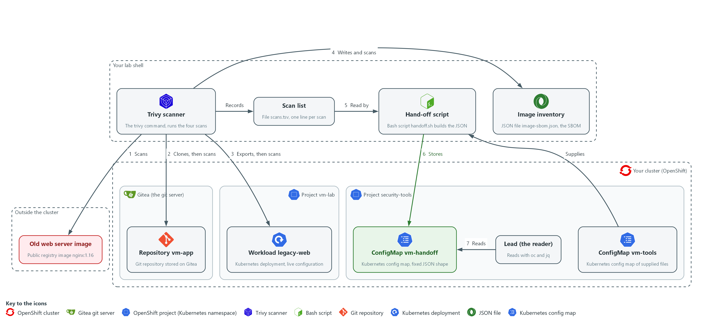

- **1. Trivy scanner:** the trivy command in lab shell. It runs all four scans.
- **2. Scan list:** the file scans.tsv in your folder. Trivy adds one line per scan (the Records arrow).
- **3. Hand-off script:** handoff.sh, copied from the ConfigMap vm-tools into your folder (the Supplies arrow). It reads the scan list (flow 5).
- **4. Old web server image:** the public image nginx:1.16. Trivy scans it first (flow 1).
- **5. Repository vm-app:** the repository on Gitea. Trivy clones it, then scans the checkout (flow 2).
- **6. Workload legacy-web:** the live Deployment in vm-lab. Trivy scans an export of its configuration (flow 3).
- **7. Image inventory:** the SBOM file image-sbom.json that Trivy writes for the image and then scans (flow 4).
- **8. ConfigMap vm-tools:** the supplied files stored in security-tools, including handoff.sh.
- **9. ConfigMap vm-handoff:** the JSON hand-off that the script stores in security-tools (flow 6).
- **10. Lead (the reader):** reads the hand-off from vm-handoff with oc and jq (flow 7).

Where each part runs, and why:

| Part | Where it runs | Why it is built this way |
| --- | --- | --- |
| Trivy scanner | In lab shell on your laptop | One scanner reads an image, a folder, a settings file and an inventory, so you learn one tool for four kinds of scan. |
| Old web server image | A public registry outside the cluster | It is an old image that is known to contain flaws, so the first scan has real findings to count. |
| Repository vm-app | On Gitea, inside the cluster | Gitea is the git server the lab already has, so the checkout needs no outside account. |
| Workload legacy-web | The project vm-lab, in the cluster | It is a live workload, so the scan reads real settings instead of an example file. |
| Image inventory | A file in your folder in lab shell | A list of packages can be stored and scanned again later, without pulling the image. |
| ConfigMap vm-handoff | The project security-tools, in the cluster | The record sits in the cluster beside other evidence, so the lead reads it from there and not from a laptop. |

### 2.1 Four things to scan (RA-5 Vulnerability Monitoring and Scanning)

- A container image holds packages (bundles of software) that can be old and carry known flaws.
- A repository names the packages it needs in a file such as requirements.txt, and those packages can be old too.
- A running workload can have unsafe settings, for example a container allowed to run as the administrator of its machine.
- An SBOM is a list of the packages in an image, written once and scanned later without the image.
- A different person fixes each kind of finding: an image is rebuilt, a repository file is edited, and a workload setting is changed in its configuration. Separate scans tell the lead which kind of finding they are looking at.

#### RA-5: Vulnerability Monitoring and Scanning

*The control asks the organization to monitor and scan for vulnerabilities in the system and the applications it hosts, at an organization-defined frequency, and to analyze the scan reports and results. This is done using:*

- Trivy: scans an image, a repository checkout, a live configuration and an SBOM with one tool.
- The exit code recorded in scans.tsv: tells a scan that ran from one that failed.
- The script handoff.sh: checks each scan before the counts are trusted.
- Scan frequency: the lab scans on demand, so no recurring schedule is built here.

The four kinds of scan, what Trivy reads in each and what a finding looks like:

| Kind | What Trivy reads | Command in this module | What a finding looks like |
| --- | --- | --- | --- |
| image | Packages inside a container image | trivy image | A package name, its installed version, a CVE ID (a public ID for one known flaw), a fixed version or none |
| repo | Packages named in the repository files | trivy fs | The same fields, found in requirements.txt |
| config | Settings in a Deployment exported as YAML | trivy config | A bad setting, such as no limit on memory, with a severity |
| sbom | The package list of an image, written as CycloneDX JSON | trivy sbom | The same fields as an image finding, found without the image |

### 2.2 The hand-off has a fixed shape (SI-2 Flaw Remediation)

- If every scan result is a different file, the lead must work out each time what it means.
- One JSON record (a text format of named fields that tools can read) with the same field names every time lets the lead ask the same question the same way.
- A later script can read the same record without a person in between.
- The record is stored as a ConfigMap in the security-tools project, so it sits in the cluster beside the other evidence and not on your laptop.

#### SI-2: Flaw Remediation

*The control asks the organization to identify, report and correct system flaws, and to install security-relevant updates within an organization-defined time period of their release. This is done using:*

- The script handoff.sh: reports the scan findings to the lead as one JSON record with a fixed shape.
- The ConfigMap vm-handoff: keeps the record in the cluster, where the lead reads it with oc and jq.
- The next two modules install the fixes; this module does not install them.

The fields of the hand-off record and what each one means:

| Field | Meaning |
| --- | --- |
| schema | The name and version of the shape: scan-handoff/1 |
| scanned_at, scanned_by | When the record was built, and which cluster user ran it |
| scans[].kind, target | image, repo, config or sbom, and exactly what was scanned |
| scans[].status | complete, partial or failed |
| scans[].critical, high, medium, low | Counts per severity, or null when the scan failed |
| scans[].fixable | How many findings have a published fix |
| escalate, reasons | true when the lead must act now, and the plain reasons |

### 2.3 Failed and partial scans, and when to escalate

- The most dangerous scan result is a quiet zero: zero looks like good news.
- A scan that could not pull its image, could not read its database, or was pointed at an empty folder reports no findings.
- The supplied script never lets a quiet zero through: it checks the exit code and the report before it trusts the counts.
- The escalation rule is the lab's own choice: escalate when any scan is not complete, or when any scan has a critical finding.

The three scan statuses, how each one looks and what you do:

| Status | How it looks | What you do |
| --- | --- | --- |
| complete | Exit code 0 and a report that lists at least one analyzed target | Hand off the counts |
| partial | Exit code 0 but the report has no Results: nothing was analyzed | Check the path you scanned and that the folder holds the files you expect, scan again once, then escalate if it is still empty |
| failed | A non-zero exit code, or no valid report file | Read the error, check the image name and network, scan again once, then escalate with the error text |

### Design decisions

#### A scan is complete, partial or failed, never a quiet zero

- How: Each scan line records its exit code beside its report. The supplied script marks a scan complete only when the exit code is zero and the report lists at least one analyzed target, and it gives partial or failed otherwise, with null counts for a failed scan.
- Why: A scan that failed or looked at nothing reports no findings, and zero looks like good news, so the script must tell absent evidence from clean evidence.
- Alternatives: Advantage of trusting the exit code alone: it is a one-line check that is easy to read. Drawback: an empty folder exits with zero and no findings, so a scan that analyzed nothing would be reported as clean.

#### One fixed-shape record stored in the cluster

- How: The hand-off is one JSON record with a schema name and the same fields for every scan, stored as a ConfigMap in the security-tools project. The lead reads it with oc and jq.
- Why: The lead and any later script can ask the same question the same way each time, and the record sits in the cluster beside other evidence instead of on a laptop.
- Alternatives: Advantage of passing on each raw Trivy report: nothing is lost in summarizing. Drawback: every scan kind has its own shape that each reader must interpret, and a ConfigMap has a size limit that suits a summary better than full reports.

## Section 3. Implement

- Start: type `lab start vm-2` in the terminal on your own computer (PowerShell on Windows, Terminal on Mac), not in the lab shell.
- Enter lab shell with `lab shell`. Every other command in this module runs inside lab shell.
- If a step fails: run `lab reset vm-2` on your own computer and repeat the step once. If it still fails, copy the whole command and error and ask your AI assistant. Do not skip the step.

### Step 1. Fetch the supplied files and scan the image (RA-5 Vulnerability Monitoring and Scanning)

**Learning point: Scanning one old public image gives the first real findings and the first line of the scan list, scans.tsv. Writing the exit code down at once is what lets the hand-off script later tell a failed scan from a clean one.**

- The hand-off script is supplied as a ConfigMap (a small named record the cluster stores).
- The first scan downloads the vulnerability database (the list of known flaws Trivy compares against), so it can take a few minutes and needs internet from the lab shell.
- The exit code of the scan is read from the variable $?, which changes after every command, so nothing may sit between the scan and the line that records it.

What this step adds (thick lines and outlines are new):

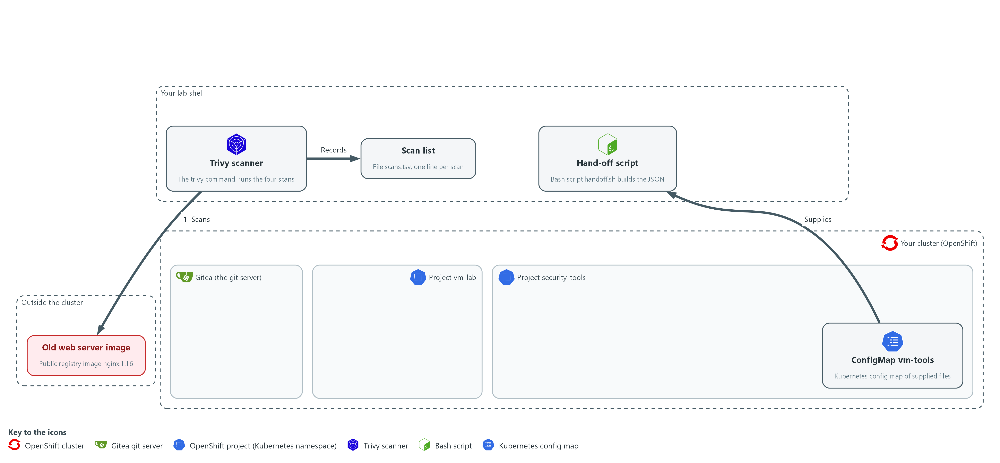

- You copy the supplied hand-off script from the cluster into your folder in lab shell. Trivy in lab shell scans an old public web server image and you record the result as the first line of scans.tsv.

#### 1a. Copy the supplied files, scan the image and count the findings

You will now make a folder, copy the supplied files out of the cluster, scan one public image, write the scan down in scans.tsv, and count the findings.

```bash
mkdir -p /workspace/vm-2 && cd /workspace/vm-2
oc extract configmap/vm-tools -n security-tools --to=. --confirm
rm -f scans.tsv
IMAGE=docker.io/library/nginx:1.16
trivy image --scanners vuln --quiet --format json --output image.json "$IMAGE"
printf 'image\t%s\timage.json\t%s\n' "$IMAGE" "$?" >> scans.tsv
jq '[.Results[]?.Vulnerabilities[]?] | length' image.json
jq '[.Results[]?.Vulnerabilities[]? | select((.FixedVersion // "") != "")] | length' image.json
```

**Expected output:**

```
Example only. Your counts will differ as the database changes.
handoff.sh
<n>
<n>
(the first number is all findings, the second is the findings that have a fix)
```

| Part | What it does | Why you run it |
| --- | --- | --- |
| mkdir -p ... && cd ... | Makes a folder for this module and moves into it, so files from other modules cannot collide with yours. The folder persists between lab sessions. | Gives the scan files of this module one place to live, so the later steps find them in the same folder. |
| oc extract configmap/vm-tools ... --confirm | Writes each file stored in the ConfigMap into the current folder, replacing files that exist. The files include handoff.sh. | The hand-off script is kept in the cluster, so this copies it from the project security-tools into your folder in lab shell. |
| rm -f scans.tsv | Removes any old list of scans. The -f option means no error if the file is missing. | Starts the list empty, so lines from an earlier run cannot end up in this hand-off. |
| IMAGE=... | Stores the image name in a variable. | The name is used twice, in the scan and in the list line, so one variable keeps both the same. |
| trivy image --scanners vuln | Scans the image for known package flaws only. | This is the first scan: it looks for old packages inside the image. |
| --format json --output image.json | Saves the full result as a JSON file. | Keeps the raw report, so the hand-off script and the later count check can read it. |
| printf 'image\t...' >> scans.tsv | Adds one tab-separated line to the list: kind, target, report file, exit code. The >> adds to the end of the file. | Writes the exit code of the scan down right now, because the script later uses it to tell a failed scan from a clean one. |
| jq ... \| length | Counts all findings, then the findings that have a published fix. | Gives you totals that later steps compare against, and shows how many findings an update could remove. |

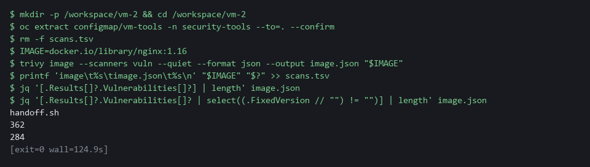

> **YOUR TURN:** Run the commands and note how many findings have a fix.

> **CHECKPOINT:** handoff.sh is in your folder, the first count is greater than zero, and scans.tsv has one line.

> **TAKEAWAY:** A scan result is only usable together with the exit code that says whether the scan ran.

**How this meets the control**

- **RA-5:** The control asks for scanning of the system and its hosted applications for software flaws. This step scans one image with Trivy and records the scan's exit code, so later steps can tell a clean scan from a failed one.

### Step 2. Scan the repository checkout (RA-5 Vulnerability Monitoring and Scanning)

**Learning point: Scanning a checkout of the vm-app repository finds old packages named in requirements.txt, before they are built into an image. The final jq command proves the scan analyzed that file, so a count of zero could not hide an empty scan.**

- Clone (copy) the vm-app repository from Gitea, the git server that runs in your lab, into a folder, then scan that folder.
- The extra header on the git command passes your token (a secret string that proves who you are) from a lab variable, so the token is never typed or saved in the clone.

What this step adds (thick lines and outlines are new):

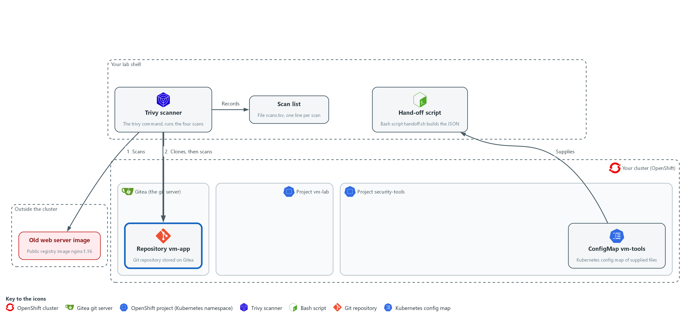

- Trivy scans a checkout of the vm-app repository, copied from Gitea into your folder, and adds a second line to scans.tsv.

#### 2a. Clone the repository and scan it

You will now copy the vm-app repository from Gitea into a folder, scan that folder, and write the scan down in scans.tsv.

```bash
mkdir -p /workspace/vm-2 && cd /workspace/vm-2
rm -rf vm-app
git -c http.extraHeader="Authorization: token $GITEA_TOKEN" clone --quiet "$GITEA_URL/$GITEA_USER/vm-app.git" vm-app
cat vm-app/requirements.txt
trivy fs --scanners vuln --quiet --format json --output repo.json vm-app
printf 'repo\t%s\trepo.json\t%s\n' "$GITEA_USER/vm-app" "$?" >> scans.tsv
jq -r '.Results[]? | [.Target, ((.Vulnerabilities // []) | length)] | @tsv' repo.json
```

**Expected output:**

```
Example only. The packages and counts will differ.
<package>==<version>
(one line for each package in the file)
requirements.txt	<n>
```

| Part | What it does | Why you run it |
| --- | --- | --- |
| rm -rf vm-app | Removes an older checkout, so that the clone works if you run this step again. | A clone fails if the folder already exists, so this lets you repeat the step. |
| git -c http.extraHeader=... | Sends your Gitea token with the request. The -c setting applies to this one command only and is not stored in the clone. | Gitea asks who you are before it hands over the repository. The header answers with the token from the lab variable, so you never type it. |
| clone --quiet ... vm-app | Copies the repository files from Gitea into a folder named vm-app in lab shell. | The scan needs the files on disk in lab shell, and a checkout is what a developer would build from. |
| cat vm-app/requirements.txt | Shows the pinned package versions the scan will read. | Lets you see the old versions yourself, so the findings that follow are not a surprise. |
| trivy fs | Scans a folder instead of an image. | This is the second scan: it checks the packages the repository asks for, not an image. |
| printf 'repo\t...' >> scans.tsv | Adds the second line to the list. | Records the exit code of this scan right away, the same way as for the image. |
| jq -r ... @tsv | Prints each analyzed file and how many findings it has. | Proves the scan really analyzed requirements.txt, so a count of zero could not be an empty scan. |

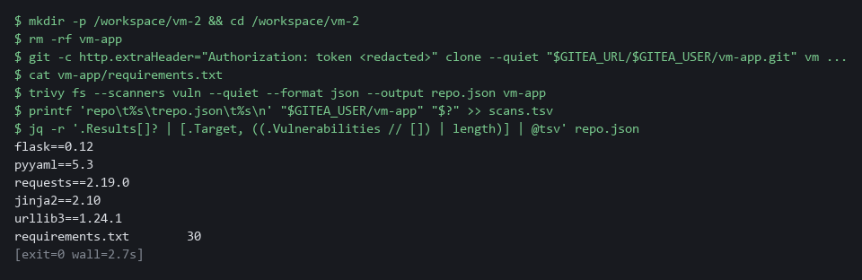

> **YOUR TURN:** Run the commands and read the file names and counts at the end.

> **CHECKPOINT:** requirements.txt is listed as an analyzed target with a count above zero, and scans.tsv has two lines.

> **TAKEAWAY:** A scan counts only if the report names the files it analyzed.

**How this meets the control**

- **RA-5:** The control asks for scanning of hosted applications, which includes the packages they are built from. This step scans a checkout of the vm-app repository and lists which files were analyzed.

### Step 3. Scan the cluster configuration (RA-5 Vulnerability Monitoring and Scanning)

**Learning point: Exporting the live legacy-web Deployment and scanning it finds unsafe settings, a different kind of finding from the package flaws in Steps 1 and 2. The per-severity counts show how serious the settings are.**

- The third scan checks how the running workload legacy-web is set up, not its software.
- You export its live Deployment (a cluster object that keeps a program running) as YAML (a plain-text settings format), then scan the folder that holds the file.

What this step adds (thick lines and outlines are new):

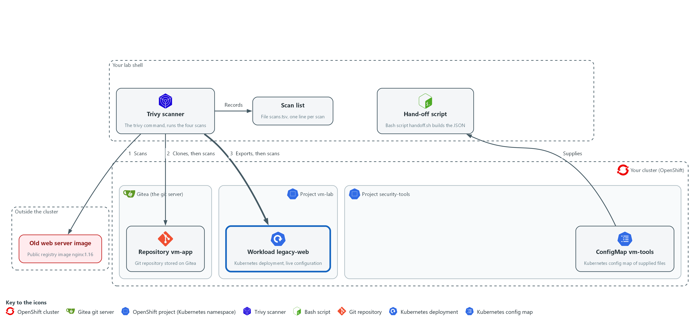

- You export the live configuration of the legacy-web workload into a file in your folder, Trivy scans that file, and a third line goes into scans.tsv.

#### 3a. Export the live configuration and scan it

You will now save the live settings of legacy-web into a file, scan that file, and read back the scan list.

```bash
mkdir -p /workspace/vm-2 && cd /workspace/vm-2
mkdir -p live-config
oc get deployment legacy-web -n vm-lab -o yaml > live-config/legacy-web.yaml
trivy config --quiet --format json --output config.json live-config
printf 'config\t%s\tconfig.json\t%s\n' "deployment/legacy-web in vm-lab" "$?" >> scans.tsv
jq -r '[.Results[]?.Misconfigurations[]? | .Severity] | group_by(.) | map("\(.[0]) \(length)") | .[]' config.json
cat scans.tsv
```

**Expected output:**

```
Example only. The severities and counts will differ. The scan takes about 30 seconds and prints nothing while it downloads its check bundle, so wait for it.
HIGH <n>
LOW <n>
MEDIUM <n>
image	docker.io/library/nginx:1.16	image.json	0
repo	<user>/vm-app	repo.json	0
config	deployment/legacy-web in vm-lab	config.json	0
```

| Part | What it does | Why you run it |
| --- | --- | --- |
| oc get deployment ... -o yaml > ... | Saves the live settings of the workload to a file. | Trivy reads files, not the cluster, so you export a copy of what is running into a folder first. |
| trivy config | Checks configuration files for bad settings instead of package flaws. | This is the third scan: it looks for unsafe settings, which are fixed by changing configuration. |
| printf 'config\t...' >> scans.tsv | Adds the third line to the list. | Completes the list of the first three scans, so the hand-off script has a line for each. |
| jq ... group_by(.) | Counts the bad settings per severity. | Turns a long report into a few numbers, so you can see how serious the settings are. |
| cat scans.tsv | Shows all three lines. Each line is one scan. | Checks the list is complete before you build the hand-off from it. |

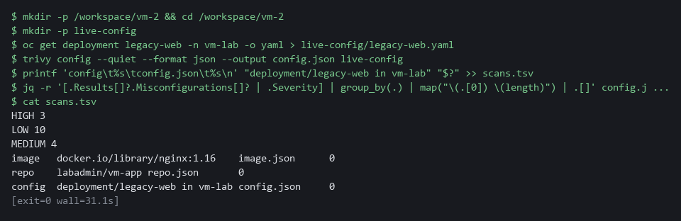

> **NOTE:** Zero findings in a configuration scan would not be proof of safety: it means only that the checks Trivy ships found nothing in what you gave it.

> **YOUR TURN:** Run the commands and read the counts per severity.

> **CHECKPOINT:** scans.tsv shows three lines, and the configuration scan lists at least one severity with a count.

> **TAKEAWAY:** A bad setting is fixed by changing configuration, not by rebuilding an image.

**How this meets the control**

- **RA-5:** The control names improper configurations as well as software flaws. This step scans an export of a live Deployment for bad settings.

### Step 4. Write an inventory of the image and scan it (RA-5 Vulnerability Monitoring and Scanning)

**Learning point: Writing the image's package list to a file and scanning that file gives a fourth scan that reads the list instead of the image. The comparison with the Step 1 count shows whether the list is missing packages.**

- An SBOM (software bill of materials) is a machine-readable list of the packages inside an image, and here you write one for the same image and scan it with trivy sbom.
- The CycloneDX format (a standard SBOM format) writes the list alone, without findings.
- The image is downloaded again, so this step needs internet from the lab shell.

What this step adds (thick lines and outlines are new):

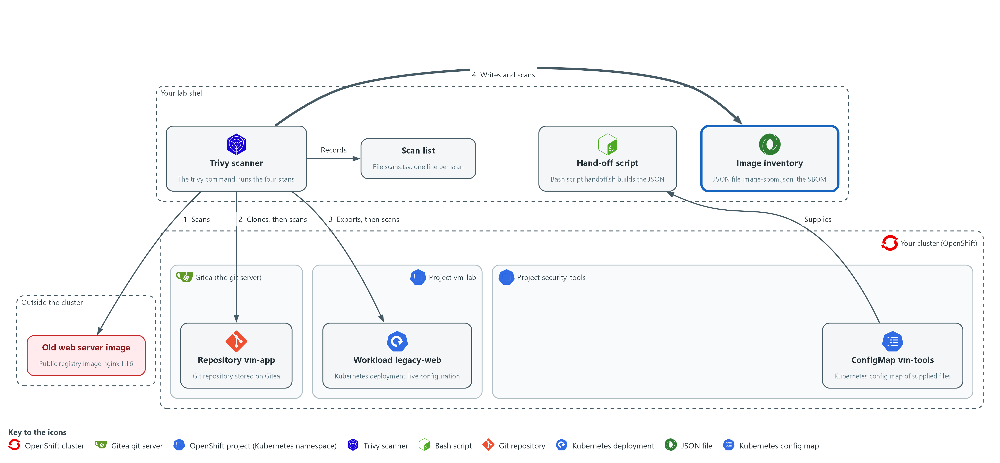

- Trivy writes an inventory file (an SBOM) of the same image in your folder, scans the inventory, and a fourth line goes into scans.tsv.

#### 4a. Write the SBOM, scan it and compare with the image scan

You will now write the list of packages of the image to a file, count its entries, scan that file, write the scan down in scans.tsv, and compare the finding counts with the image scan.

```bash
mkdir -p /workspace/vm-2 && cd /workspace/vm-2
IMAGE=docker.io/library/nginx:1.16
trivy image --quiet --format cyclonedx --output image-sbom.json "$IMAGE"
jq '{format: .bomFormat, spec: .specVersion, components: (.components | length)}' image-sbom.json
trivy sbom --scanners vuln --quiet --format json --output sbom.json image-sbom.json
printf 'sbom\t%s\tsbom.json\t%s\n' "image-sbom.json" "$?" >> scans.tsv
jq '[.Results[]?.Vulnerabilities[]?] | length' sbom.json image.json
```

**Expected output:**

```
Example only. Your counts will differ.
{
  "format": "CycloneDX",
  "spec": "<version>",
  "components": <n>
}
<n>
<n>
(the first number is the SBOM scan, the second is the image scan from Step 1; they should be close, and a difference of a few findings is possible)
```

| Part | What it does | Why you run it |
| --- | --- | --- |
| trivy image ... --output image-sbom.json | Writes the inventory of the image in CycloneDX JSON. With this format Trivy lists the packages and does not look for flaws. | The inventory is a file you can store and scan again later, without the image. |
| jq '{format: ..., components: ...}' | Prints the format name, its version and how many components (packages and the operating system) the list holds. | Shows the file is a real CycloneDX list with entries, before you scan it. |
| trivy sbom --scanners vuln ... image-sbom.json | Scans the list for known package flaws and saves a JSON report in the same shape as the other scans. | This is the fourth scan: it finds flaws from the inventory alone, which is how you re-check a stored release. |
| printf 'sbom\t...' >> scans.tsv | Adds the fourth line to the list with the exit code of the scan. | The hand-off script treats this scan like the others, so a failed one cannot read as clean. |
| jq ... sbom.json image.json | Prints the number of findings in each report. | A large gap would mean the list is missing packages, so you compare before you trust it. |

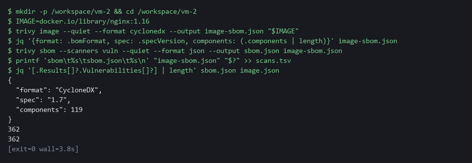

> **NOTE:** An SBOM written by Trivy carries extra properties that Trivy reads back, so a list from another tool can give less accurate results.

> **YOUR TURN:** Run the commands and read the two finding counts.

> **CHECKPOINT:** The SBOM has a CycloneDX format and components above zero, and scans.tsv shows four lines.

> **TAKEAWAY:** A stored package list can be scanned again later, when the vulnerability database has changed.

**How this meets the control**

- **RA-5:** The control asks for scanning of the system and its hosted applications, and a scan needs to know what is installed. This step writes an SBOM (a list of every package in the image) and scans the list instead of the image.

### Step 5. Hand the findings to the lead (SI-2 Flaw Remediation)

**Learning point: Running handoff.sh turns the four scan lines into one JSON record and stores it in the cluster. Reading it back with oc and jq shows exactly what the lead will see, including the status of each scan and the escalate field.**

- For each line of scans.tsv the script checks the exit code and the report.
- The script decides whether each scan is complete, partial or failed, and counts the findings per severity.
- The script then stores one JSON record in the cluster as the ConfigMap vm-handoff.

What this step adds (thick lines and outlines are new):

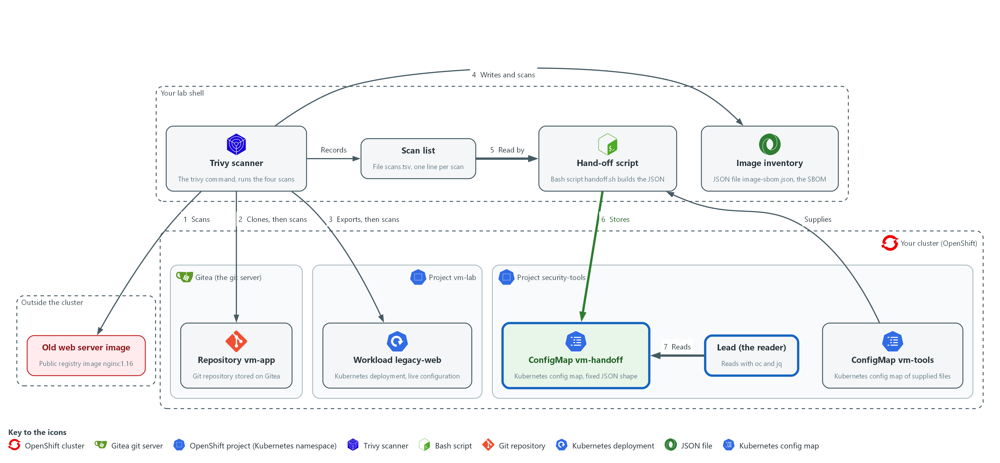

- The supplied script reads scans.tsv, builds the JSON hand-off and stores it in the cluster as a ConfigMap in the project security-tools, and the lead reads it there with oc and jq.

#### 5a. Build the hand-off and read it as the lead

You will now run the supplied script on the scan list, then read the stored record back from the cluster.

```bash
cd /workspace/vm-2
bash handoff.sh scans.tsv vm-handoff
oc get configmap vm-handoff -n security-tools -o jsonpath='{.data.handoff\.json}' | jq .
```

**Expected output:**

```
Example only. Your names, time and counts will differ.
stored configmap/vm-handoff in security-tools
{
  "schema": "scan-handoff/1",
  "scanned_at": "<time>",
  "scanned_by": "<your user name>",
  "scans": [ ...four entries: image, repo, config, sbom... ],
  "escalate": <true or false>,
  "reasons": [ ... ]
}
```

| Part | What it does | Why you run it |
| --- | --- | --- |
| bash handoff.sh scans.tsv vm-handoff | Builds the record from the list and stores it as a ConfigMap named vm-handoff in security-tools. | This is the hand-off itself: the script checks each scan and puts the record where the lead can read it. |
| oc get configmap ... -o jsonpath | Reads back the stored text from the cluster. The backslash before the dot is needed because the key is named handoff.json. | Reads the record from the cluster, as the lead would, and not from a file on your laptop. |
| \| jq . | Prints the record in a readable layout. | The stored text is one long line, so this makes the escalate field and the scan entries easy to find. |

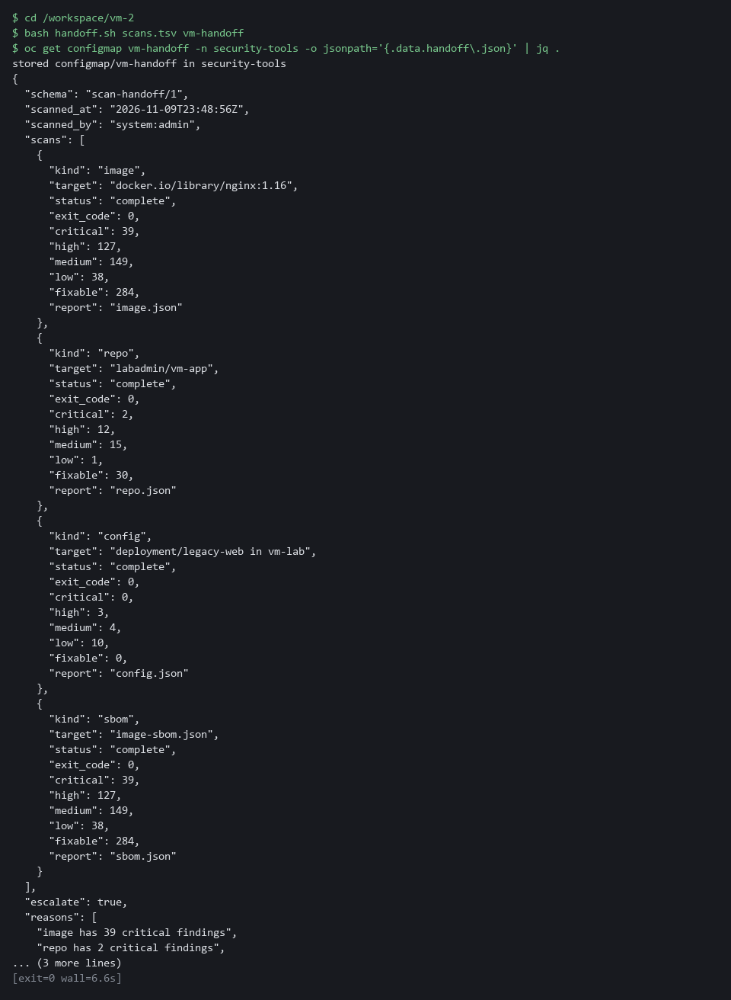

> **TIP:** Read the escalate field first. If it says true, the reasons list says why.

> **YOUR TURN:** Run both commands. Find the four scan entries, their statuses, and the escalate field.

> **CHECKPOINT:** The record shows four scans, all complete, and escalate is true only if a scan has a critical finding.

> **TAKEAWAY:** The lead gets one record of fixed shape from the cluster, not four files from your laptop.

**How this meets the control**

- **SI-2:** The control asks that flaws be reported to designated people so that they can be corrected. This step runs the supplied script, which builds one JSON record from the four scans and stores it in the cluster for the lead to read.

## Section 4. Verify It Works

### Test 1 (positive). The lead can read the hand-off and it has the fixed shape (SI-2 Flaw Remediation)

A fixed shape is only useful if it is checked, and this query succeeds only when the schema name is right, there are four scans, and every scan has every required field.

```bash
cd /workspace/vm-2
oc get configmap vm-handoff -n security-tools -o jsonpath='{.data.handoff\.json}' | jq -e '.schema == "scan-handoff/1" and (.scans | length) == 4 and all(.scans[]; (["kind","target","status","critical","high","medium","low","fixable"] - keys) == [])'
echo "exit code: $?"
```

**Expected output:**

```
true
exit code: 0
```

| Part | What it does | Why you run it |
| --- | --- | --- |
| cd /workspace/vm-2 | Moves into the folder with your scan files. | Every block starts in the working folder. |
| jq -e '.schema == ... ' | Checks the schema name, that there are four scans, and that every scan has every field in the list. Prints true or false. | A missing field turns the answer into false, so a broken report is caught here. |
| true | The shape is right. | This is the pass condition. |
| exit code: 0 | jq -e exits 0 only when the answer is true. | A script can use this exit code to stop on a bad report. |

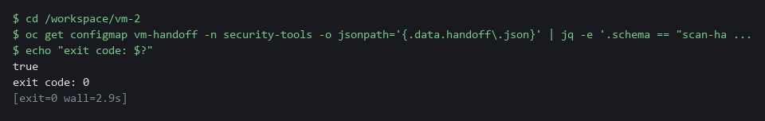

> **CHECKPOINT:** The query prints true and the exit code is 0. A missing field would print false and exit with 1.

**How this meets the control**

- **SI-2:** The control asks that flaws be reported to designated people, so the report has to be readable in the same way each time. This test passes only if the schema name, the four scans and every required field are present.

### Test 2 (positive). The hand-off counts match the raw report (RA-5 Vulnerability Monitoring and Scanning)

A summary is only trustworthy once it is compared with its source, so count the critical findings in the raw image report and read the same number from the stored record.

```bash
cd /workspace/vm-2
jq '[.Results[]?.Vulnerabilities[]? | select(.Severity == "CRITICAL")] | length' image.json
oc get configmap vm-handoff -n security-tools -o jsonpath='{.data.handoff\.json}' | jq '.scans[] | select(.kind == "image") | .critical'
```

**Expected output:**

```
Example only. Your counts will differ.
27
27
```

| Part | What it does | Why you run it |
| --- | --- | --- |
| cd /workspace/vm-2 | Moves into the folder with image.json. | The raw report is a file in this folder. |
| jq ... select(.Severity == "CRITICAL") | Counts critical findings in the raw image report. | This is the source number. |
| oc get configmap ... \| jq '... .critical' | Reads the critical count the hand-off holds for the image scan. | This is the summary number. |
| 27 and 27 | The two numbers match. | A summary that equals its source can be trusted. |

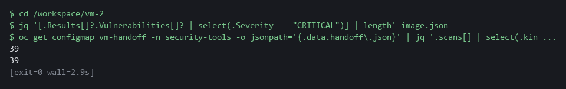

> **CHECKPOINT:** The two numbers are equal.

**How this meets the control**

- **RA-5:** The control asks that scan reports be analyzed, which starts with checking that a summary matches its source. This test compares the critical count in the raw image report with the count in the stored record.

### Test 3 (positive). The inventory covers every package that has a finding (RA-5 Vulnerability Monitoring and Scanning)

- A scan of a list is only as good as the list.
- Take the names of the packages that have findings in the image report and remove every name the SBOM holds, so that nothing is left.

```bash
cd /workspace/vm-2
jq -n --slurpfile report image.json --slurpfile sbom image-sbom.json '([$report[0].Results[]?.Vulnerabilities[]?.PkgName] | unique) - ([$sbom[0].components[]?.name] | unique)'
```

**Expected output:**

```
[]
```

| Part | What it does | Why you run it |
| --- | --- | --- |
| cd /workspace/vm-2 | Moves into the folder with the two files. | Both files are read from here. |
| jq -n --slurpfile report ... --slurpfile sbom ... | Loads the image report and the SBOM as two named inputs. | One query compares both files. |
| unique) - (... unique) | Takes package names that have findings and removes every name the SBOM holds. | What is left is a package with a finding that the SBOM misses. |
| [] | Nothing is left. | The SBOM covers every package with a finding. |

> **CHECKPOINT:** The answer is an empty list. A name in the list would be a package with a finding that the SBOM does not hold.

**How this meets the control**

- **RA-5:** The control asks that the system be scanned for software flaws, and a list that misses packages hides flaws. This test lists packages with findings that are absent from the SBOM, and an empty answer shows the list covers them.

### Test 4 (negative). A damaged inventory is flagged and never reported as zero (RA-5 Vulnerability Monitoring and Scanning)

- Cut the SBOM short so that it is no longer a valid file and scan it: the scan fails, and the lead must see a failure, not a zero.
- The damaged scan is handed off to a test ConfigMap, which you then read the way the lead would.

```bash
cd /workspace/vm-2
head -c 300 image-sbom.json > broken-sbom.json
trivy sbom --scanners vuln --quiet --format json --output broken.json broken-sbom.json
printf 'sbom\t%s\tbroken.json\t%s\n' "broken-sbom.json" "$?" > bad-scans.tsv
bash handoff.sh bad-scans.tsv vm-handoff-test
oc get configmap vm-handoff-test -n security-tools -o jsonpath='{.data.handoff\.json}' | jq -c '{status: .scans[0].status, critical: .scans[0].critical, escalate, reasons}'
```

**Expected output:**

```
Example only. The error text from Trivy differs by release.
FATAL ... SBOM decode error ... (the exact words differ by Trivy release)
stored configmap/vm-handoff-test in security-tools
{"status":"failed","critical":null,"escalate":true,"reasons":["sbom scan failed"]}
```

| Part | What it does | Why you run it |
| --- | --- | --- |
| head -c 300 image-sbom.json > broken-sbom.json | Keeps only the first 300 bytes of the SBOM. | A cut file is no longer valid JSON, so the scan must fail. |
| trivy sbom ... broken-sbom.json | Tries to scan the damaged file and prints an error. | The error shows that Trivy did not read the file. |
| printf ... > bad-scans.tsv | Writes a one-line scan list with the real exit code. The single > starts a new file. | The hand-off script judges the scan from this line. |
| bash handoff.sh bad-scans.tsv vm-handoff-test | Builds a hand-off into a test ConfigMap, not the real one. | Your real record stays untouched. |
| "status":"failed","critical":null | The scan is marked failed and its count is null, not 0. | A failure must not read as zero findings. |
| "escalate":true | The lead is told to act. | A failed scan always escalates. |

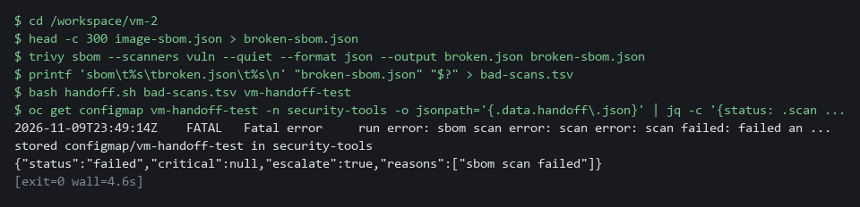

> **CHECKPOINT:** The status is failed, the critical count is null and not 0, and escalate is true. Next you would write the inventory again once, then tell the lead with the error text.

**How this meets the control**

- **RA-5:** A scan that fails has not monitored anything, so it must not read as a clean result. This test hands off a scan of a damaged SBOM, and the record shows status failed, a null count and escalate true.

### Test 5 (negative). A scan that analyzed nothing is flagged as partial (RA-5 Vulnerability Monitoring and Scanning)

Scan an empty folder: Trivy runs without an error and reports no findings, but it looked at nothing, and the script must not call that clean.

```bash
mkdir -p /workspace/vm-2 && cd /workspace/vm-2
mkdir -p empty-dir
trivy fs --scanners vuln --quiet --format json --output empty.json empty-dir
printf 'repo\t%s\tempty.json\t%s\n' "empty-dir" "$?" > empty-scans.tsv
bash handoff.sh empty-scans.tsv vm-handoff-test
oc get configmap vm-handoff-test -n security-tools -o jsonpath='{.data.handoff\.json}' | jq -c '{status: .scans[0].status, critical: .scans[0].critical, escalate, reasons}'
oc delete configmap vm-handoff-test -n security-tools
```

**Expected output:**

```
Example only.
stored configmap/vm-handoff-test in security-tools
{"status":"partial","critical":0,"escalate":true,"reasons":["repo scan partial"]}
configmap "vm-handoff-test" deleted from security-tools namespace
```

| Part | What it does | Why you run it |
| --- | --- | --- |
| mkdir -p empty-dir | Makes an empty folder. | Scanning it analyzes nothing. |
| trivy fs ... empty-dir | Runs without an error and writes a report with no Results. | This is the quiet zero the script must catch. |
| printf ... > empty-scans.tsv | Writes a one-line scan list with exit code 0. | The script judges from this line and the report. |
| bash handoff.sh ... vm-handoff-test | Builds a hand-off into the test ConfigMap. | Your real record stays untouched. |
| "status":"partial","critical":0 | The scan is partial although the count is 0. | Nothing was analyzed, so zero is not proof of clean. |
| oc delete configmap vm-handoff-test | Removes the test record. | Cleans up and lets you run the test again. |

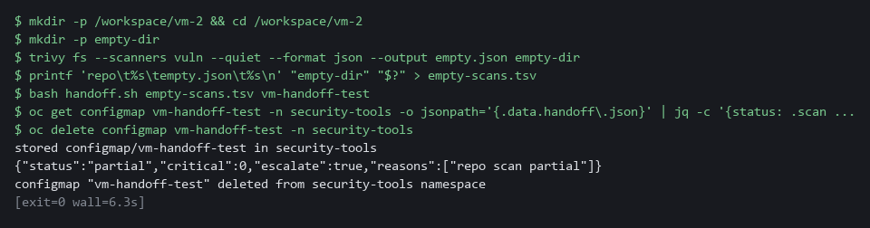

> **CHECKPOINT:** The status is partial and escalate is true, even though the count is 0. Next you would check the path and the files in the folder, scan again once, then escalate.

**How this meets the control**

- **RA-5:** A scan that looked at nothing has not scanned the system. This test scans an empty folder, and the hand-off marks it partial and escalates instead of reading zero as clean.

## Section 5. What Each Control Is For

### Control mapping

| Control | What it requires, in plain words | Tool or service | Where this module covers it |
| --- | --- | --- | --- |
| RA-5 Vulnerability Monitoring and Scanning | Scan the system and its hosted applications, cover software flaws and improper configurations, and analyze the results. | Trivy, which scans an image, a repository checkout, a cluster configuration and an SBOM. Explained in sections 2.1 and 2.3. | Section 3, Steps 1 to 4: run the four scans. Section 4, Tests 2 and 3: the hand-off counts are compared with the raw report and the inventory covers the packages with findings. Section 4, Tests 4 and 5: a scan that did not run properly is flagged. |
| SI-2 Flaw Remediation | Identify and report flaws to designated people, so that they can be corrected. | The supplied script handoff.sh, which stores one JSON record as a ConfigMap in the cluster. Explained in section 2.2. | Section 3, Step 5: the findings are reported to the lead in a fixed shape. Section 4, Test 1: the shape is checked. Installing the fixes is the work of the next two modules in this dimension. |

### What each control is for

Each table below says what the control is trying to prevent and how this module's tool meets it.

#### RA-5 Vulnerability Monitoring and Scanning

| Question | Answer |
| --- | --- |
| Control Intent | A known flaw sits in a running component because nobody scanned it, or a scan quietly failed and was read as clean. |
| The operational question | When a scan says nothing is wrong, did it actually look at everything it was pointed at? |
| What evidence proves it | Each scan with its target, its date, its exit code, and its counts per severity. |
| How much is enough | Scans cover software flaws and improper configurations, results are analyzed, and a failed scan is visible as a failure. NIST leaves the frequency organization-defined. This lab scans on demand. |
| How the tool in this module satisfies it | Trivy scans an image, a repository, a configuration and an SBOM (Steps 1 to 4). The hand-off marks each scan complete, partial or failed (Step 5). |

#### SI-2 Flaw Remediation

| Question | Answer |
| --- | --- |
| Control Intent | Findings exist but never reach the person who can fix them, or reach them in a form that differs every time. |
| The operational question | Does the person who decides what to fix receive every finding, in the same shape each time? |
| What evidence proves it | The hand-off record, with its schema name, its date, who ran the scans, and whether it says escalate. |
| How much is enough | Flaws are reported to designated people. NIST leaves the time allowed to install fixes organization-defined. Meeting that time is the work of the next modules. |
| How the tool in this module satisfies it | handoff.sh turns the four results into one JSON record with a fixed shape and stores it as a ConfigMap (Step 5). |

## Section 6. Next Steps

### Using this in other environments

- The four Trivy scans (trivy image, trivy fs, trivy config, trivy sbom), git clone and jq are standard tools and run as is anywhere Trivy can reach an image registry and the vulnerability database.
- Change these lab values first: the image reference (docker.io/library/nginx:1.16), GITEA_URL, GITEA_USER and GITEA_TOKEN, the repository vm-app, and the namespaces security-tools and vm-lab.
- The hand-off is stored as a ConfigMap with oc. On other Kubernetes use kubectl, or write the same JSON file to storage the lead can read.
- The Gitea token header is specific to Gitea. Another git host uses its own token method.

The table shows what changes on each platform:

| Check | In this lab (OpenShift) | On other platforms | What you change |
| --- | --- | --- | --- |
| Fetch the supplied files | oc extract configmap/vm-tools -n security-tools | kubectl get configmap vm-tools -n <namespace> -o json, or keep handoff.sh in git | The tool name and the namespace. |
| Image scan | trivy image on a public nginx image | The same | The image reference. Mirror it and the vulnerability database if there is no internet. |
| Repository scan | git clone from Gitea with an Authorization: token header | git clone from your git host | The URL and the token method. |
| Cluster configuration scan | oc get deployment legacy-web -n vm-lab -o yaml, then trivy config | kubectl get deployment <name> -n <namespace> -o yaml, then trivy config | The tool name, workload and namespace. |
| SBOM scan | trivy image with the CycloneDX format, then trivy sbom | The same | Nothing. |
| Hand-off record | ConfigMap vm-handoff in security-tools, read with oc and jq | kubectl, or a JSON file in shared storage | The tool name, the namespace and where the lead reads it. |

> **TIP:** Next module: VM-3 Triage and Track Fixes: write a short script that ranks the findings by severity score and fix availability, opens one tracking item per finding in Gitea, and re-scans to confirm each fix.

<details>
<summary><strong>Section 7. Terms</strong></summary>

Each term is also explained the first time it appears. In Word, hover over an underlined term to see its meaning, or Ctrl+click it to jump to this table.

| Term | Plain meaning |
| --- | --- |
| Cluster | A group of servers that work together as one system. Here it is your own OpenShift cluster. |
| Cluster configuration | The settings of objects running in the cluster, such as a Deployment, read back as YAML. |
| ConfigMap | A small named record stored in the cluster. |
| Container | A sealed box that holds one program and everything it needs to run, so it runs the same way anywhere. |
| CVE | Common Vulnerabilities and Exposures: a public ID for one known flaw. |
| CycloneDX | A standard file format for an SBOM. Trivy writes it as JSON. |
| Deployment | A cluster object that keeps a set number of copies of a program running. legacy-web is one. |
| Escalate | Tell the lead now, instead of waiting for them to look. |
| Evidence | Saved records that show a system is set up and behaving as claimed. |
| Exit code | A number a command returns when it ends: zero means it ran properly, anything else means it failed. |
| Finding | One thing a scan reports: a flaw in a package or a bad setting, with a severity. |
| Gitea | A git server that runs in your lab. It holds the repository vm-app. |
| Hand-off | The record you give to the lead so that they can decide what to fix. |
| Header | A line of extra information sent with a web request, such as a sign-in token. |
| HTTP | The protocol that web pages and web APIs use. HTTPS is the encrypted form. |
| Image | A packaged copy of a program and the files it needs. A container starts from an image. |
| Inventory | A list of the packages inside an image. Here it is the SBOM file image-sbom.json. |
| jq | A tool that picks one value out of JSON text. |
| JSON | A plain-text format for data: names and values written inside curly braces. |
| Kubernetes | The open-source system that runs and manages containers across servers. OpenShift is built on it. |
| Lead | The person who receives the hand-off and decides what gets fixed. |
| mkdir | A command that makes a new folder. |
| Namespace | A named section of the cluster that holds a set of related parts. |
| NIST | The US National Institute of Standards and Technology. It publishes the security control catalog these modules cite. |
| Null | A JSON value that means no number is known. It is different from 0, which means a count of zero. |
| oc | The command-line tool for OpenShift. You type oc to ask the cluster questions. |
| OpenShift | The Red Hat platform your lab cluster runs on. It is Kubernetes with extra security and tools built in. |
| Package | A bundle of software that an image or a program installs and uses. Old packages are the usual source of known flaws. |
| Partial scan | A scan that ran without an error but analyzed nothing, or only part of its target. |
| Pipeline | A set of automated steps that run in order, such as scan, check and sign. |
| printf | A command that prints text in a set format. |
| Project | A named section of the cluster that keeps workloads apart. OpenShift also calls it a namespace. |
| Query | A question you ask a data store, written in a query language, such as a log search. |
| Registry | A server that stores container images and hands them out when asked. |
| Remediate | Fix a finding, for example by upgrading a package or changing a setting. |
| Repository checkout | A copy of a git repository's files on your own machine, made with git clone. |
| Rule | A written condition that a tool checks. |
| SBOM | Software bill of materials: a machine-readable list of the packages inside an image or program. |
| Scan | A run of a tool that compares what is in an image, a folder, a configuration or an inventory with a database of known flaws and known bad settings. |
| Schema | The agreed list of field names and meanings that a record must follow. |
| Secret | A cluster object that holds a sensitive value such as a password or token, kept apart from ordinary settings. |
| Severity | How serious a finding is: CRITICAL, HIGH, MEDIUM or LOW. |
| Token | A secret string that proves who you are to a server, used here in place of a password. |
| Trivy | A free, open source scanner for images, folders and configuration files. |
| TSV | A plain-text table where a tab character separates the columns. The file scans.tsv uses it. |
| URL | A web address, such as https://example.com/page. |
| Variable | A named value. The dollar sign in front of a name means use its value. |
| Vulnerability database | The list of known flaws that Trivy downloads and compares what it reads against. |
| Workload | A program that runs on the cluster, such as legacy-web. |
| YAML | A plain-text format for settings: lines of name: value, with indentation to show what belongs to what. |

</details>
