# VM-3: Triage and Track Fixes (RA-5, SI-2, SA-11)

| Item | Detail |
| --- | --- |
| Sequence | Module 12 of 32 in the recommended order |
| Timed work | About 72 minutes (52 hands-on, 20 verify) |
| Standalone start | `lab start vm-3` |
| Combined start | Continue from the end state of the previous module |
| Tools | OpenShift Container Platform, Trivy (free, open source), Gitea (free, open source), python3, oc, git, curl, jq |
| Prerequisites | ENG-0 Terminal, Git and Your Lab (typing commands in lab shell, git clone, and reading oc output), VM-2 Scan and Hand Off (running Trivy on a repository, reading the JSON, and knowing a failed or empty scan from a clean one) |

## Section 1. Module Overview

- Purpose: make sure every scan finding has a tracking item and a due date, and is worked in a sensible order (RA-5, SI-2, SA-11).
- You build a short Python script that ranks findings by severity and score, opens one tracking item per finding in Gitea with a due date, and closes items after a fix is confirmed by a new scan.
- You run it in lab shell: first a review gate that must pass, then the script against Gitea, then a re-scan of the fix branch.

- **Skill:** Rank scan findings by a stated rule, open one dated Gitea item per finding, pass a review gate before the script touches Gitea, then re-scan a fix branch and close only the items whose findings are gone.
- **Tools:** `trivy` scans a copy of the repository for known flaws and writes a JSON report. `python3` runs the ranking code, the triage script and the review gate. Gitea (the git server in your cluster) holds the repository and the tracking items. `git` copies the repository and its fix branch from Gitea. `curl` and `jq` read the items back from the Gitea API. `oc` copies the review gate out of the cluster, and OpenShift Container Platform is the cluster that runs Gitea.
- **Security Function:** Detects which known flaws are worst and still unfixed, blocks the triage script from reaching Gitea until the review gate passes, and proves a fix by closing an item only after a fresh scan no longer shows the flaw.
- **NIST RA-5 Vulnerability Monitoring and Scanning:** `trivy` finds the flaws, `rank.py` orders the findings by a stated rule, and `deadlines.py` sets a due date for each severity.
- **NIST SI-2 Flaw Remediation:** `triage.py`, with `gitea_api.py` and `gitea_items.py`, opens one dated Gitea item for each flaw and closes it only after a fresh scan shows the flaw is gone.
- **NIST SA-11 Developer Testing and Evaluation:** `review_gate.py` runs the triage script against a fixture with a known answer and fails on bad work, and the re-scan in Step 5 proves that a flaw was corrected.

## Section 2. The Tools

### Tools used in this module

Each tool name links to its official overview. The table columns say how each tool is used in the lab and why the lab uses it instead of another way of doing the same job.

| Tool (overview link) | What it is | Used in this lab | Why this tool |
| --- | --- | --- | --- |
| [OpenShift Container Platform](https://docs.redhat.com/en/documentation/openshift_container_platform/4.22/html/overview/ocp-overview) | A Kubernetes container platform for running and managing containerized applications. | The cluster that holds the supplied gate and fixtures. | It is the platform the whole lab runs on, so every module works on the same real cluster, with the same kinds of objects a production OpenShift system has. |
| [Trivy](https://trivy.dev/) | Scans images, code and clusters for known flaws and misconfigurations. | Scans the main branch and the deps-updated branch of vm-app. | It scans images and clusters for known flaws and bad settings from the command line and is free and open source, so the same scan can run by hand and in a pipeline. |
| [Gitea](https://docs.gitea.com/) | A lightweight self-hosted git server. | Holds vm-app and the tracking items that the script opens and closes through the Gitea API. | It gives the lab a git server of its own, so you can push and review changes without an outside account. |
| [Python 3](https://docs.python.org/3/tutorial/introduction.html) | General-purpose language, used here for small helper scripts. | You write rank.py and the Gitea code, then run triage.py to plan, open and close items. | Python reads and writes JSON easily and is already in the lab shell, so a small script needs nothing installed. |
| [oc](https://docs.redhat.com/en/documentation/openshift_container_platform/4.22/html/cli_tools/openshift-cli-oc) | The OpenShift command-line tool for creating and managing applications and projects from a terminal. | Fetches the supplied files from their ConfigMap. | It is the one command that talks to the cluster, so every module uses it to ask what is true and to make changes. You sign in once, and it works on OpenShift objects as well as standard Kubernetes ones. Unlike clicking in the web console, a command can be pasted, repeated and checked by a test. |
| [Git](https://git-scm.com/about) | Version control that stores repository history. | Clones the repository and the fixed branch. | It keeps scripts and settings with a history, so every change has a record of who made it and when, and a mistake can be undone. |
| [curl](https://curl.se/docs/manpage.html) | Command-line tool for transferring data over URLs, used here to call web endpoints. | Checks Gitea directly, with a token, against what the script created. | It calls a web address from the terminal, so you can check what a service really returns instead of trusting a screen. |
| [jq](https://jqlang.org/) | Command-line JSON processor. | Counts findings in the scan reports to check the ranking. | It picks one field out of a long JSON reply, so a test can read a single value. |

### How it fits together

#### From a scan to tracked, closed items

- Lab (test) setup: Trivy scans the repository and writes a report, your script ranks the findings and opens one tracking item for each in Gitea, and a review gate checks the script before it runs.
- After the developers' fix lands on a branch, a new scan closes the items whose findings are gone.
- In production the review gate runs in a pipeline on every change and the items live in the team's own tracker.
- Each step below adds one part, drawn with thick lines.

How the lab is set up, and why:

- You write and run everything in lab shell on your laptop, the same lab shell you already use, and Gitea runs inside your cluster, so the code stays in one place and the tracking items live on a server that others could open.
- This module adds your own script to the layout of the module before it, which only scanned and handed off results.
- The script reads the report in lab shell and talks to Gitea through its API (the way a script talks to a program), signed in with the token the lab gives you.
- The review gate runs in lab shell because it needs only your files and a fixed test input, and it must pass before the script is allowed to reach Gitea.
- The fix sits on a branch in Gitea, so the final scan reads the developers' real change and the script closes an item only when a fresh scan shows the finding is gone.

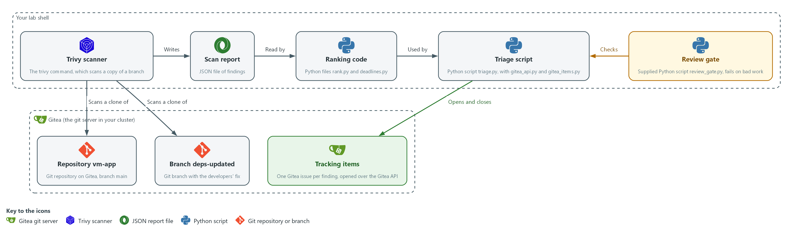

- **1. Trivy scanner:** the trivy command in lab shell. It scans a copy of a branch that git cloned from Gitea.
- **2. Scan report:** the JSON file of findings that Trivy writes into your folder.
- **3. Ranking code:** the files rank.py and deadlines.py. They read the report, put the findings in order and set a due date for each.
- **4. Triage script:** triage.py with gitea_api.py and gitea_items.py. It uses the ranking code and opens or closes items on Gitea.
- **5. Review gate:** the supplied script review_gate.py. It checks the triage script on a fixed input before the script runs.
- **6. Repository vm-app:** the repository on Gitea whose branch main holds the code as it is today.
- **7. Branch deps-updated:** the branch that holds the developers' fix, scanned a second time to prove the fix.
- **8. Tracking items:** one Gitea issue per finding, opened and closed by the triage script.

Where each part runs, and why:

| Part | Where it runs | Why it is built this way |
| --- | --- | --- |
| Trivy scanner | In lab shell on your laptop | It makes the report that every later part reads. |
| Ranking code and triage script | Files in your folder in lab shell | They run where you write them, so you can change and test them before anything reaches Gitea. |
| Review gate | A script in lab shell, copied from the cluster | It tests your script on a fixed input, so the script is checked before it can change Gitea. |
| Repository vm-app and its branches | On Gitea, inside your cluster | The fix and the code live on the server the lab already has, so no outside account is needed. |
| Tracking items | On Gitea, as issues of the repository vm-app | Issues carry a title, a body and a due date, so each finding has a place and a date that others can see. |

### 2.1 What a good ranking looks like (RA-5 Vulnerability Monitoring and Scanning)

- A scan can list hundreds of findings, and triage is the rule that puts them in order.
- A useful rule is short enough to explain in one sentence and gives the same order every time.
- This module puts the severity word first (CRITICAL before HIGH before MEDIUM) and the higher score first. After that, findings with a published fix come before those without one, and the CVE ID breaks any tie.
- Putting fixable findings first means the first items a developer opens are ones they can close today.

#### RA-5: Vulnerability Monitoring and Scanning

*The control asks the organization to analyze vulnerability scan reports and results, and to remediate legitimate vulnerabilities within organization-defined response times, in accordance with an assessment of risk. This is done using:*

- rank.py: analyzes the report by ordering the findings with the stated rule above.
- deadlines.py: sets a due date of 15, 30 or 90 days for Critical, High and Medium findings. These response times are the lab's own choice.

The table shows the order in which the ranking rule compares two findings:

| Order of comparison | Why |
| --- | --- |
| 1. Severity word | The broadest signal, and the one the due dates use |
| 2. Score | Separates two HIGH findings, one of which may be far easier to exploit |
| 3. Fix available first | A finding that can be closed now should not wait behind one that cannot |
| 4. CVE ID | Makes the order identical on every run, which the gate depends on |

### 2.2 One item per finding (SI-2 Flaw Remediation)

- A finding is one CVE (a public ID for one known flaw) in one package.
- The same CVE in the same package can appear twice in a report, for example in two files. The code treats the pair (CVE ID, package) as one finding and keeps one record for it.
- The tracking item title repeats that key, for example: HIGH CVE-2020-0001 in flask.
- Before opening an item, the script lists the open items. It skips any title it already finds, so a second run creates no duplicate.

#### SI-2: Flaw Remediation

*The control asks the organization to identify, report and correct system flaws, and to install security-relevant updates within an organization-defined time period of their release. The SI-2(3) enhancement asks the organization to measure the time between flaw identification and flaw remediation. This is done using:*

- triage.py with gitea_items.py: opens one dated Gitea item for each flaw, which reports the flaw to the people who correct it.
- triage.py in close mode: closes an item only after a fresh scan no longer shows the flaw, so the time from finding to fix can be worked out from the item's dates.

### 2.3 A review gate (SA-11 Developer Testing and Evaluation)

- A gate is a check that stops work that is not acceptable. Here the gate is the supplied script review_gate.py, and it does not read your code to judge it.
- The gate runs your triage script in dry-run mode against a fixture whose right answer is known. It then compares the output with rules it states itself: the order, one item per finding, the due dates, no token in the output, a clear message when the token is missing, and a refusal of an empty scan.
- A gate beats a careful read because a person can skip a step. A gate runs in a second, every time, and leaves evidence that the tool was tested.

#### SA-11: Developer Testing and Evaluation

*The control asks the organization to require the developer of the system, at all post-design stages of the system development life cycle, to produce evidence of the execution of the assessment plan and the results of testing and evaluation, to implement a verifiable flaw remediation process, and to correct flaws found in testing. This is done using:*

- review_gate.py: runs the triage script you write against a fixture with a known answer and reports a pass or a fail for each rule, which is the evidence of testing.
- A fresh Trivy scan in Step 5: shows that a flaw was corrected before its item is closed, which makes the remediation process verifiable.

> **IN PRODUCTION:** In the real environment the same gate would run in a pipeline on every change to the script, and a failing gate would block the merge. The lab runs it by hand so you see each result.

### Design decisions

#### One ranked item per finding, found by title

- How: The script keeps one record per CVE and package pair and ranks by severity word, then score, then fix availability, then CVE ID. It opens an item only when no open item already has the same title.
- Why: A stated rule gives the same order on every run, and title matching makes the script safe to run twice on a schedule.
- Alternatives: Advantage of tracking items by a stored ID in a local database: titles can change without creating duplicates. Drawback: it adds state to keep and back up, whereas title matching works from Gitea alone but breaks if someone edits a title.

#### A review gate that tests the script before it touches Gitea

- How: A supplied gate runs the triage script in dry-run mode against a fixture with a known answer. It checks the order, the duplicates, the due dates, that the token is never printed, and that an empty scan is refused.
- Why: The gate restates the rules independently of the code and runs in a second every time, so the tool is tested before it changes the tracker.
- Alternatives: Advantage of a careful human read: a person can notice design flaws that no fixture covers. Drawback: a person can skip it, and it leaves no repeatable evidence.

#### Close an item only after a fresh, non-empty scan

- How: Close mode closes an item only when its finding is absent from a fresh scan report. The ranking code raises an error when the report has no Results.
- Why: A failed or empty scan would otherwise look like every finding being fixed and would close every item at once.
- Alternatives: Advantage of closing items when a pull request merges: it matches how developers work and needs no re-scan. Drawback: a merge proves a proposal, not a fix, so items could close while the flaw is still deployed.

## Section 3. Implement

- Start: type `lab start vm-3` in the terminal on your own computer (PowerShell on Windows, Terminal on Mac), not in the lab shell.
- Enter lab shell with `lab shell`. Every other command in this module runs inside lab shell.
- If a step fails: run `lab reset vm-3` on your own computer and repeat the step once. If it still fails, copy the whole command and error and ask your AI assistant. Do not skip the step.

### Step 1. Fetch the supplied files and scan the main branch (RA-5 Vulnerability Monitoring and Scanning)

**Learning point: Fetching the gate and scanning the main branch gives you repo.json, the report every later step reads, and shows the field names your code will use.**

- The review gate and its fixtures are stored in the cluster as a ConfigMap (a small named record).
- Fetch the gate and fixtures, then scan the main branch of the vm-app repository, as in the previous module.
- The lab shell needs internet access for the Trivy database.

What this step adds (thick lines and outlines are new):

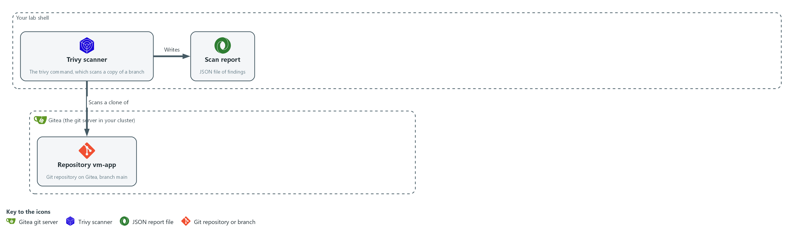

- Trivy in lab shell scans a copy of the main branch of the vm-app repository, cloned from Gitea, and writes a JSON report into your folder in lab shell.

#### 1a. Fetch the supplied files, then clone and scan the main branch

You will now copy the supplied files out of the cluster, copy the vm-app repository from Gitea, scan it, and look at one finding.

```bash
mkdir -p /workspace/vm-3 && cd /workspace/vm-3
oc extract configmap/vm-tools -n security-tools --to=. --confirm
rm -rf vm-app
git -c http.extraHeader="Authorization: token $GITEA_TOKEN" clone --quiet "$GITEA_URL/$GITEA_USER/vm-app.git" vm-app
trivy fs --scanners vuln --quiet --format json --output repo.json vm-app
jq '.Results[0].Vulnerabilities[0] | {VulnerabilityID, PkgName, InstalledVersion, FixedVersion, Severity, CVSS}' repo.json
```

**Expected output:**

```
Example only. Your names and numbers will differ.
(oc extract may print nothing; the files review_gate.py, fixture-findings.json and fixture-empty.json are written either way)
{
  "VulnerabilityID": "CVE-<year>-<number>",
  "PkgName": "<package>",
  "InstalledVersion": "<version>",
  "FixedVersion": "<version or empty>",
  "Severity": "<severity>",
  "CVSS": { ... }
}
```

| Part | What it does | Why you run it |
| --- | --- | --- |
| mkdir -p ... && cd ... | Makes a folder for this module and moves into it, so the clone and files from other modules cannot collide with yours. The folder persists between lab sessions. | Gives the files you write in the next steps one folder, so the gate and your code sit side by side. |
| oc extract ... --confirm | Writes review_gate.py and the two fixtures into the current folder from the ConfigMap in the project security-tools. | The gate and its test inputs are kept in the cluster, so you copy them into your folder before you need them in Step 4. |
| rm -rf vm-app | Removes an older copy, so that the clone works if you run this step again. | A clone fails if the folder already exists, so this lets you repeat the step. |
| git -c http.extraHeader=... clone | Copies the repository from Gitea into your folder using your token from the lab variable. The setting applies to this command only. | The scan needs the files on disk, and the header answers the sign-in question from Gitea without you typing the token. |
| trivy fs ... --output repo.json | Scans the folder and saves the report as JSON. | The report is the input for everything you write next. |
| jq '.Results[0].Vulnerabilities[0] ...' | Prints the first finding with only the fields your code will read. Note FixedVersion and CVSS. | Lets you see the exact field names before you write code that depends on them. |

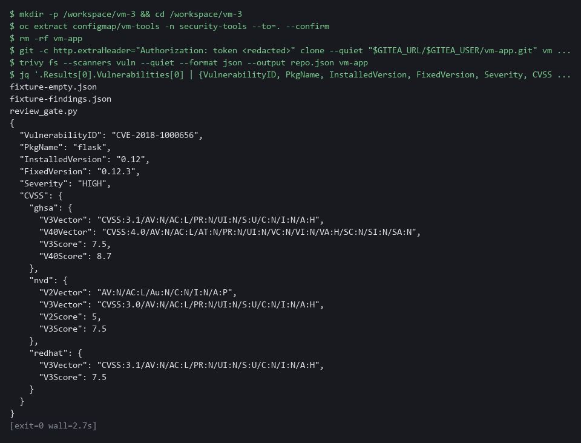

> **YOUR TURN:** Run the commands. Look at the fields of one finding.

> **CHECKPOINT:** You can see the severity, the fixed version and the CVSS block of one finding.

> **TAKEAWAY:** Every later step reads the report, so you look at its fields before you write code.

**How this meets the control**

- **RA-5:** The control asks that scan results be analyzed, which needs a report you can trust. This step produces repo.json and shows the fields the ranking code will read.

### Step 2. Write the ranking code (RA-5 Vulnerability Monitoring and Scanning)

**Learning point: Writing rank.py and deadlines.py turns the ordering and due-date rules into code, and the quick check shows the order they produce on a known input.**

- rank.py reads a report, keeps one finding for each (CVE ID, package) pair, and orders them by the rule in section 2.1.
- rank.py also refuses a report with no Results, because a scan that analyzed nothing must never look like a clean scan.
- deadlines.py turns a severity into a due date and builds the tracking item title.

What this step adds (thick lines and outlines are new):

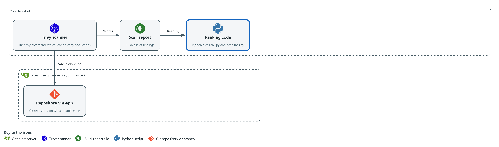

- You write the ranking code in your folder in lab shell. It reads the report and puts the findings in order.

#### 2a. Create rank.py

You will now paste this block into lab shell to create the file rank.py in your folder, and the check in 2d runs it (this way of making a file is called a heredoc).

Look for these as you read:

- rank calls sorted with sort_key, the rule you write in the next block but one, so the order of the findings comes from one small function.
- The check for Results at the top of load_findings raises an error for a report with no Results, so an empty scan cannot pass for a clean one.
- The found dictionary (a lookup table) uses the CVE ID and the package name together as its key, so a second copy of the same finding replaces the first.
- from ranking_rule import sort_key loads the rule from the file you write yourself in the block after deadlines.py.

```bash
cd /workspace/vm-3
cat > rank.py <<'EOF'
"""Load Trivy findings and rank them."""
import json

from ranking_rule import sort_key


def load_findings(path):
    with open(path, encoding="utf-8") as handle:
        report = json.load(handle)
    if not report.get("Results"):
        raise ValueError("report has no Results: the scan analyzed nothing")
    found = {}
    for result in report["Results"]:
        for vuln in result.get("Vulnerabilities") or []:
            scores = [s.get("V3Score", 0) for s in (vuln.get("CVSS") or {}).values()]
            found[(vuln["VulnerabilityID"], vuln["PkgName"])] = {
                "id": vuln["VulnerabilityID"],
                "package": vuln["PkgName"],
                "installed": vuln.get("InstalledVersion", ""),
                "fix": vuln.get("FixedVersion", ""),
                "severity": vuln.get("Severity", "UNKNOWN"),
                "score": max(scores, default=0.0),
            }
    return list(found.values())


def rank(findings):
    return sorted(findings, key=sort_key)
EOF
wc -l rank.py
```

**Expected output:**

```
Example only.
28 rank.py
```

| Part | What it does | Why you run it |
| --- | --- | --- |
| wc -l rank.py | Counts the lines of the file you just made. | A quick check that the whole file arrived. The count should match the number in the expected output. |
| cd /workspace/vm-3 | Moves into the working folder of this module. | The file must land next to the other files, whatever folder you were in before. |
| cat > rank.py <<'EOF' ... EOF | Writes every line between the two marker lines into the file rank.py. The quotes around EOF keep each dollar sign and backslash exactly as typed. | Lab shell has no editor, so a block like this is how a file is made. Running it twice just writes the same file again. |
| from ranking_rule import sort_key | Loads the sort rule from ranking_rule.py, the file you write in this step. | The ranking rule is the part you write yourself, so it lives in its own small file. |
| if not report.get("Results") | Refuses a report that analyzed nothing, with a clear message. | An empty scan must never look clean, and later it keeps close mode from closing every item. |
| found[(id, package)] = {...} | Keeps one record per (CVE ID, package). A second copy with the same key replaces the first, which removes duplicates. | Keeping one record per finding is what makes one tracking item per finding possible. |
| max(scores, default=0.0) | Takes the highest CVSS score any source gave. A finding with no score counts as 0.0. | The score is the second sort key, so every finding needs a number. |
| sorted(findings, key=sort_key) | Orders the findings with your rule. Returns a new list and leaves the original alone. | The report data stays unchanged, so ranking twice gives the same answer. |

#### 2b. Create deadlines.py

You will now paste this block into lab shell to create the file deadlines.py in the same folder.

Look for these as you read:

- DUE_DAYS is the lab's response-time table. Low is not in it, so a Low finding gets no due date and no item.
- due_date returns None for a severity that has no deadline. The caller skips those findings.
- item_title builds the title that also serves as the duplicate check in the next step.

```bash
cd /workspace/vm-3
cat > deadlines.py <<'EOF'
"""Due dates and tracking-item titles."""
import datetime

DUE_DAYS = {"CRITICAL": 15, "HIGH": 30, "MEDIUM": 90}


def due_date(severity, today):
    days = DUE_DAYS.get(severity)
    if days is None:
        return None
    return today + datetime.timedelta(days=days)


def item_title(finding):
    return f"{finding['severity']} {finding['id']} in {finding['package']}"
EOF
wc -l deadlines.py
```

**Expected output:**

```
Example only.
15 deadlines.py
```

| Part | What it does | Why you run it |
| --- | --- | --- |
| wc -l deadlines.py | Counts the lines of the file you just made. | A quick check that the whole file arrived. The count should match the number in the expected output. |
| cd /workspace/vm-3 | Moves into the working folder of this module. | The file must land next to the other files, whatever folder you were in before. |
| cat > deadlines.py <<'EOF' ... EOF | Writes every line between the two marker lines into the file deadlines.py. The quotes around EOF keep each dollar sign and backslash exactly as typed. | Lab shell has no editor, so a block like this is how a file is made. Running it twice just writes the same file again. |
| DUE_DAYS | The lab's response times: 15 days for Critical, 30 for High, 90 for Medium. Low has none here, so it gets no item. | Keeps the severity table in one place, so the dates on the items can be traced to it. |
| due_date(severity, today) | Adds the number of days to today. Returns None when the severity has no deadline. | Turns a severity into a date that Gitea can show on the item. |
| item_title(finding) | Builds the title, for example HIGH CVE-2020-0001 in flask. The title is also the duplicate check. | One function builds every title, so the same finding always gets the same title and the script can spot an item it already made. |

#### 2c. Your turn: write the sort rule

You will now write ranking_rule.py, the sort rule, with two gaps on purpose: the score and the fix test are the wrong way round.

- Run the block once so the file exists.
- Fix the two lines yourself from the note below this block by running the same command again with your own lines.

Look for these as you read:

- The first line of the list is already right: the minus sign makes a high severity number sort first.
- Python sorts a list of values one item at a time, so the second item only matters when the first two findings tie on the first.

```bash
cd /workspace/vm-3
cat > ranking_rule.py <<'EOF'
"""The sort rule for findings."""

SEVERITY_ORDER = {"CRITICAL": 4, "HIGH": 3, "MEDIUM": 2, "LOW": 1}


def sort_key(item):
    return (
        -SEVERITY_ORDER.get(item["severity"], 0),
        item["score"],
        item["fix"],
        item["id"],
    )
EOF
wc -l ranking_rule.py
```

**Expected output:**

```
Example only.
12 ranking_rule.py
```

| Part | What it does | Why you run it |
| --- | --- | --- |
| cat > ranking_rule.py <<'EOF' ... EOF | Writes the starter into the file. Running the command again with different lines replaces the file. | This is how you edit without an editor: write the whole file again. |
| -SEVERITY_ORDER.get(item["severity"], 0) | Turns the severity word into a number and negates it, so Critical sorts first. This part is already right. | Sorting goes from small to large, so a minus sign puts the largest first. |
| item["score"] | The first gap. As written, the lowest score sorts first. | Within one severity the rule wants the highest score first. |
| item["fix"] | The second gap. As written, a finding with no fix (an empty text) sorts before one with a fix. | The rule wants a finding that can be fixed now ahead of one that cannot. |

#### 2d. Check your sort rule on the supplied fixture

You will now rank the supplied fixture with your rule.

- The command prints True when the whole order is right, then the order it produced.
- Until you fix the two gaps it prints False.

```bash
cd /workspace/vm-3 && python3 -c 'import rank; ids = [f["id"][-4:] for f in rank.rank(rank.load_findings("fixture-findings.json"))]; print(ids == ["1001", "1006", "1003", "1002", "1005", "1008", "1004", "1007"], ids)'
```

**Expected output:**

```
Example only.
True ['1001', '1006', '1003', '1002', '1005', '1008', '1004', '1007']
```

| Part | What it does | Why you run it |
| --- | --- | --- |
| python3 -c '...' | Runs one line of Python. It loads the supplied fixture, ranks it with your rule and prints True if the order matches the rule in section 2.1. | A check that proves your rule before the gate in Step 4 runs it again on the full script. |

> **NOTE:** Your sort_key must rank by severity, then the highest score first, then a finding with a fix before one without, then the CVE ID. Use the first line of the list as your pattern. Reference, only after you have tried: the second line is -item["score"] and the third is not item["fix"], which is False when a fix exists, and False sorts before True.

> **YOUR TURN:** Paste the two blocks, write ranking_rule.py yourself, then run the check.

> **CHECKPOINT:** The check prints True, and the order it lists starts 1001, 1006 (both Critical).

> **TAKEAWAY:** The ranking is a stated rule in code, so the same report always gives the same order.

**How this meets the control**

- **RA-5:** rank.py orders the findings by a stated rule and deadlines.py sets a due date from the severity. The quick check shows the order on a known input.

### Step 3. Write the Gitea code (SI-2 Flaw Remediation)

**Learning point: Writing the two Gitea files gives the script a way to open one item per finding and to close items, without touching Gitea yet.**

- gitea_api.py makes the web calls and reads the token (a secret string that proves who you are) from the lab variable at the moment of each call, never writing it anywhere.
- gitea_items.py opens an item only when no open item has the same title, and closes an item only when its finding is absent from the new report.

What this step adds (thick lines and outlines are new):

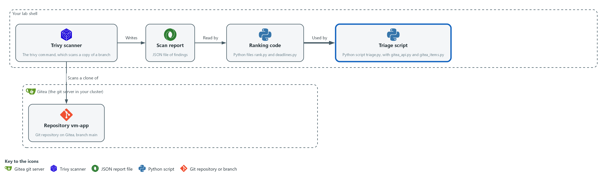

- You write the Gitea code in your folder in lab shell. In the next step it joins the ranking code to Gitea through the triage script.

#### 3a. Create gitea_api.py

You will now paste this block into lab shell to create the file gitea_api.py in the same folder.

Look for these as you read:

- The token comes from the environment variable GITEA_TOKEN at the moment of each call. It is never written to a file.
- TITLE_RE matches only titles this script makes, so the script never closes an issue that a person opened.
- The timeout of 30 seconds keeps an unattended run from waiting forever. The lab chose that value.
- open_titles asks for at most 50 issues, and does not page, so a longer list would be cut short.

```bash
cd /workspace/vm-3
cat > gitea_api.py <<'EOF'
"""Small Gitea API helpers. The token comes from the environment, never from a file."""
import json
import os
import re
import urllib.request

TITLE_RE = re.compile(r"^(CRITICAL|HIGH|MEDIUM) CVE-\S+ in \S+$")


def api(method, path, body=None):
    base = os.environ["GITEA_URL"].rstrip("/") + "/api/v1"
    data = None if body is None else json.dumps(body).encode("utf-8")
    request = urllib.request.Request(base + path, data=data, method=method)
    request.add_header("Authorization", "token " + os.environ["GITEA_TOKEN"])
    request.add_header("Content-Type", "application/json")
    with urllib.request.urlopen(request, timeout=30) as response:
        return json.load(response)


def open_titles(repo):
    owner = os.environ["GITEA_USER"]
    issues = api("GET", f"/repos/{owner}/{repo}/issues?state=open&type=issues&limit=50")
    return {i["title"]: i["number"] for i in issues if TITLE_RE.match(i["title"])}
EOF
wc -l gitea_api.py
```

**Expected output:**

```
Example only.
23 gitea_api.py
```

| Part | What it does | Why you run it |
| --- | --- | --- |
| wc -l gitea_api.py | Counts the lines of the file you just made. | A quick check that the whole file arrived. The count should match the number in the expected output. |
| cd /workspace/vm-3 | Moves into the working folder of this module. | The file must land next to the other files, whatever folder you were in before. |
| cat > gitea_api.py <<'EOF' ... EOF | Writes every line between the two marker lines into the file gitea_api.py. The quotes around EOF keep each dollar sign and backslash exactly as typed. | Lab shell has no editor, so a block like this is how a file is made. Running it twice just writes the same file again. |
| TITLE_RE | Matches only titles this script creates, so it never touches other issues. | The script must close only its own items, never an issue that a person opened. |
| api(method, path, body) | Makes one call to the Gitea API with the token in an Authorization header and returns the JSON answer. | Every Gitea call goes through this one function, so the token is handled in a single place. |
| timeout=30 | Stops waiting after 30 seconds so the script cannot hang. The lab chose this value. | A script that runs unattended must not wait forever for a server that does not answer. |
| open_titles(repo) | Lists the open issues and returns their titles with their numbers. Gitea returns at most 50 per page. | Both opening and closing need to know which items already exist, so they share this list. |

#### 3b. Create gitea_items.py

You will now paste this block into lab shell to create the file gitea_items.py in the same folder.

Look for these as you read:

- open_new skips an item whose title already exists. This is why a second run creates nothing.
- The due date gets T00:00:00Z added, because Gitea wants a full timestamp.
- close_fixed closes only the open items whose titles are not in the new plan, which means the finding is gone from the fresh scan.
- Closing is an edit of the state, so the item and its history stay in Gitea.

```bash
cd /workspace/vm-3
cat > gitea_items.py <<'EOF'
"""Open and close one Gitea item per finding."""
import os

from gitea_api import api, open_titles


def open_new(repo, items):
    owner, have, made = os.environ["GITEA_USER"], open_titles(repo), 0
    for item in items:
        if item["title"] in have:
            continue
        f = item["finding"]
        text = f"Installed: {f['installed']}\nFixed in: {f['fix'] or 'no fix published'}\nScore: {f['score']}"
        api("POST", f"/repos/{owner}/{repo}/issues", {"title": item["title"], "body": text, "due_date": item["due"] + "T00:00:00Z"})
        made += 1
    return f"created {made}, already tracked {len(items) - made}"


def close_fixed(repo, items):
    owner, current, closed = os.environ["GITEA_USER"], {i["title"] for i in items}, 0
    for title, number in open_titles(repo).items():
        if title not in current:
            api("PATCH", f"/repos/{owner}/{repo}/issues/{number}", {"state": "closed"})
            closed += 1
    return f"closed {closed}, still open {len(open_titles(repo))}"
EOF
wc -l gitea_items.py
```

**Expected output:**

```
Example only.
25 gitea_items.py
```

| Part | What it does | Why you run it |
| --- | --- | --- |
| wc -l gitea_items.py | Counts the lines of the file you just made. | A quick check that the whole file arrived. The count should match the number in the expected output. |
| cd /workspace/vm-3 | Moves into the working folder of this module. | The file must land next to the other files, whatever folder you were in before. |
| cat > gitea_items.py <<'EOF' ... EOF | Writes every line between the two marker lines into the file gitea_items.py. The quotes around EOF keep each dollar sign and backslash exactly as typed. | Lab shell has no editor, so a block like this is how a file is made. Running it twice just writes the same file again. |
| open_new | For each planned item, skips it if an open item has the same title, otherwise creates it with a body and a due date. | The skip is why running the script twice creates nothing the second time. |
| due_date ... T00:00:00Z | Gitea wants a full timestamp, so the date gets midnight UTC (the world time standard) added. | Without a full timestamp Gitea would not accept the due date, and the item would have no date. |
| close_fixed | Closes each open item whose title is not in the new plan. That means its finding is gone from the fresh scan. | Closure follows the new scan, not a promise, so an item closes only when the evidence shows the fix. |
| {"state": "closed"} | The edit that closes an issue. | Closing keeps the item and its history on Gitea, so the time from finding to fix can still be seen. |

> **SECURITY:** The token never appears in a file, in a printed line, or in the issue text. The gate checks that it is not printed.

> **YOUR TURN:** Paste the two blocks.

> **CHECKPOINT:** Both files are created. Nothing runs yet.

> **TAKEAWAY:** Matching titles prevents duplicates, and closing depends on the new scan.

**How this meets the control**

- **SI-2:** The code opens one item for each flaw and closes an item only when its finding is gone. Nothing runs yet.

### Step 4. Pass the review gate, then open the items (SA-11 Developer Testing and Evaluation, SI-2 Flaw Remediation, RA-5 Vulnerability Monitoring and Scanning)

**Learning point: Running the gate before the script shows the script was tested before it could change Gitea, and the real run creates one dated item per finding.**

- triage.py ties the other files together and has three modes: a dry run that prints the plan, the normal mode that opens items, and a close mode used after a fix.
- Run the review gate first, and run triage.py against Gitea only when the gate passes.

What this step adds (thick lines and outlines are new):

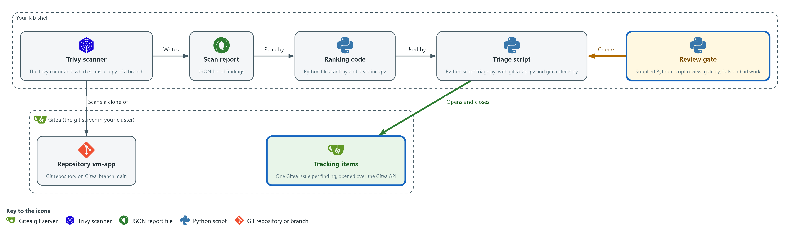

- The review gate in lab shell checks the triage script. When it passes, the script sends one tracking item per finding to the repository vm-app on Gitea.

#### 4a. Create triage.py

You will now paste this block into lab shell to create the file triage.py in the same folder, which you run in the next block after the gate.

Look for these as you read:

- plan builds the list of items without calling Gitea, which lets the gate test it with --dry-run.
- The except clause turns a missing file or an empty scan into a message and exit code 3.
- With --dry-run the script prints the titles and due dates and changes nothing.
- A missing GITEA_TOKEN stops the script with exit code 2 and a plain message.
- The last choice between open_new and close_fixed is what the --close-fixed flag controls.

```bash
cd /workspace/vm-3
cat > triage.py <<'EOF'
"""Rank Trivy findings and track them in Gitea."""
import argparse
import datetime
import json
import os
import sys

import deadlines
import gitea_items
import rank


def plan(report_path, today):
    items = []
    for finding in rank.rank(rank.load_findings(report_path)):
        due = deadlines.due_date(finding["severity"], today)
        if due:
            items.append({"title": deadlines.item_title(finding), "due": due.isoformat(), "finding": finding})
    return items


def main():
    parser = argparse.ArgumentParser(description=__doc__)
    parser.add_argument("report")
    parser.add_argument("--repo", default="vm-app")
    parser.add_argument("--dry-run", action="store_true")
    parser.add_argument("--close-fixed", action="store_true")
    args = parser.parse_args()
    try:
        items = plan(args.report, datetime.date.today())
    except (OSError, ValueError, KeyError) as error:
        print(f"cannot use {args.report}: {error}", file=sys.stderr)
        return 3
    if args.dry_run:
        for item in items:
            print(json.dumps({"title": item["title"], "due": item["due"]}))
        return 0
    if not os.environ.get("GITEA_TOKEN"):
        print("GITEA_TOKEN is not set. Run this inside lab shell.", file=sys.stderr)
        return 2
    action = gitea_items.close_fixed if args.close_fixed else gitea_items.open_new
    print(action(args.repo, items))
    return 0


if __name__ == "__main__":
    sys.exit(main())
EOF
wc -l triage.py
```

**Expected output:**

```
Example only.
47 triage.py
```

| Part | What it does | Why you run it |
| --- | --- | --- |
| wc -l triage.py | Counts the lines of the file you just made. | A quick check that the whole file arrived. The count should match the number in the expected output. |
| cd /workspace/vm-3 | Moves into the working folder of this module. | The file must land next to the other files, whatever folder you were in before. |
| cat > triage.py <<'EOF' ... EOF | Writes every line between the two marker lines into the file triage.py. The quotes around EOF keep each dollar sign and backslash exactly as typed. | Lab shell has no editor, so a block like this is how a file is made. Running it twice just writes the same file again. |
| plan(report_path, today) | Ranks the findings and builds one planned item for each severity that has a deadline. | Planning is kept apart from talking to Gitea, so the gate can test the plan without touching Gitea. |
| except (OSError, ValueError, KeyError) | Turns a missing file, an empty scan or a bad report into a clear message and exit code 3, not a long error dump. | A clear message and a fixed exit code tell the person or the pipeline what went wrong. |
| --dry-run | Prints the planned titles and due dates and changes nothing. The gate uses this. | It lets the gate and you see the plan before any item is created. |
| if not os.environ.get("GITEA_TOKEN") | Stops with exit code 2 and a plain message when there is no token. | Outside lab shell the token is missing, and the script should say so instead of failing in a confusing way. |
| action = ... | Chooses between opening new items and closing fixed ones. | One script serves both jobs, so the same ranking and title rules apply to opening and closing. |

#### 4b. Run the gate, look at the plan, then open the items

You will now run the review gate, print the first five planned items, and then run the script for real, from the same folder.

```bash
cd /workspace/vm-3
python3 review_gate.py .
python3 triage.py repo.json --dry-run | head -5
python3 review_gate.py . && python3 triage.py repo.json
```

**Expected output:**

```
Example only. Your titles and dates will differ.
PASS  dry run exits 0
PASS  one item per finding, no duplicates
PASS  items are ranked by severity, score, then fix first
PASS  due dates follow the severity table
PASS  low findings get no item
PASS  the token is never printed
PASS  missing token stops with a message
PASS  a scan that analyzed nothing is refused
RESULT: PASS
{"title": "<SEVERITY> CVE-<id> in <package>", "due": "<date>"}
(five lines like that)
(the gate output is printed again, then:)
created <n>, already tracked <n>
```

| Part | What it does | Why you run it |
| --- | --- | --- |
| python3 review_gate.py . | Runs the gate on the files in the current folder. It exits 0 only if every check passes. | Tests your script on a known input before the script is allowed to change Gitea. |
| triage.py repo.json --dry-run \| head -5 | Shows the first five planned items. | Lets you read the plan yourself, as a second look beside the gate. |
| review_gate.py . && triage.py repo.json | The && means the second command runs only if the first succeeded. A failing gate stops the run before Gitea is touched. | The real run: the items reach Gitea only when the gate has passed. |

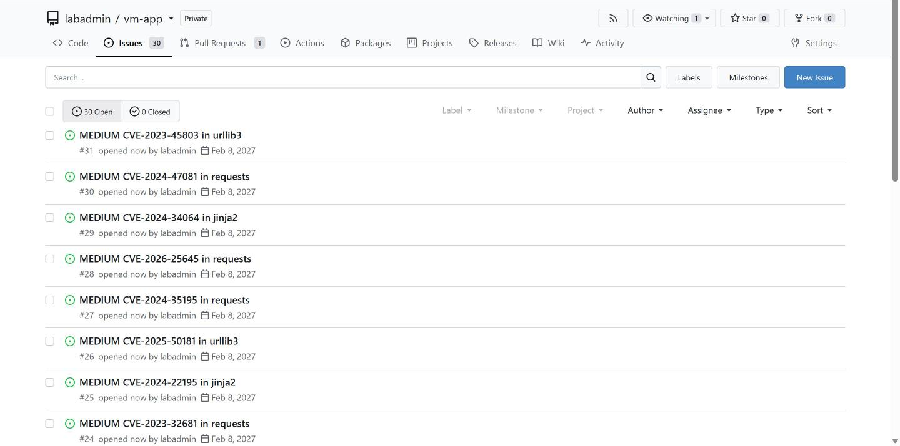

> **YOUR TURN:** Paste triage.py, run the next block, and read the result lines of the gate.

> **CHECKPOINT:** The gate prints PASS on every line and RESULT: PASS, and the script prints created followed by a number.

> **TAKEAWAY:** The triage script reaches Gitea only after the review gate passes.

**How this meets the controls**

- **SA-11:** The gate runs the triage script on a fixed input and prints a pass or fail for each rule. The script reaches Gitea only after the gate passes.
- **SI-2:** The script opens one tracking item for each finding, with a title and a due date, so each flaw has a place and a date.
- **RA-5:** The script sets each due date from the severity, using the lab's own table.

### Step 5. Re-scan the fix and close what is gone (SI-2 Flaw Remediation, SA-11 Developer Testing and Evaluation)

**Learning point: Scanning the fix branch and running close mode shows that an item closes only when a fresh scan proves its finding is gone.**

- The developers' fix is already on the branch deps-updated (a named line of changes in the same repository), which moves the package pins to newer versions.
- Clone that branch, scan it, and run triage.py in close mode, which closes the items whose findings no longer appear and leaves the others open.
- The lab shell needs internet access for the scan.

What this step adds (thick lines and outlines are new):

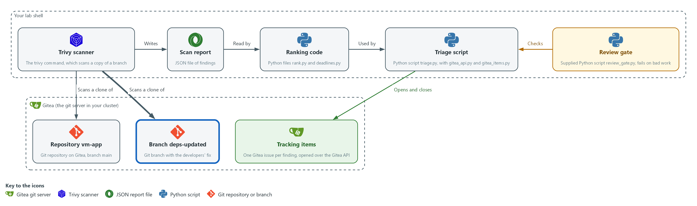

- Trivy scans a copy of the deps-updated branch, cloned from Gitea, and the script closes the tracking items on Gitea whose findings are gone.

#### 5a. Clone the fix branch, scan it and close the fixed items

You will now copy the deps-updated branch from Gitea, scan it, and close the tracking items whose findings are gone.

```bash
mkdir -p /workspace/vm-3 && cd /workspace/vm-3
rm -rf vm-app-fixed
git -c http.extraHeader="Authorization: token $GITEA_TOKEN" clone --quiet --branch deps-updated "$GITEA_URL/$GITEA_USER/vm-app.git" vm-app-fixed
cat vm-app-fixed/requirements.txt
trivy fs --scanners vuln --quiet --format json --output fixed.json vm-app-fixed
python3 triage.py fixed.json --close-fixed
```

**Expected output:**

```
Example only. Your pins and counts will differ.
<package>==<newer version>
(one line for each package in the file)
closed <n>, still open <n>
```

| Part | What it does | Why you run it |
| --- | --- | --- |
| rm -rf vm-app-fixed | Removes an older copy of the fix branch, so that the clone works if you run this step again. | A clone fails if the folder already exists, so this lets you repeat the step. |
| clone ... --branch deps-updated | Copies the fix branch from Gitea into a separate folder. | The fix must be scanned apart from the old code, so you keep the two copies in two folders. |
| cat vm-app-fixed/requirements.txt | Shows the newer pins. | Lets you see what the developers changed before you trust it. |
| trivy fs ... fixed.json | Scans the fixed code. This new scan is the proof; the branch name alone is not. | A fresh report is the only evidence that a flaw is gone. |
| triage.py fixed.json --close-fixed | Closes the open items on Gitea whose findings are not in the new report. | Closes only what the new scan shows is fixed, and leaves the rest open for the team. |

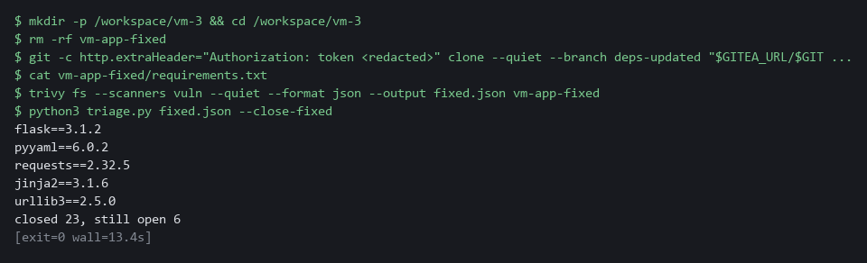

> **YOUR TURN:** Run the commands and read the closed and still-open counts.

> **CHECKPOINT:** The script prints closed with a number above zero. Any items still open are findings the fix did not remove.

> **TAKEAWAY:** A fix counts only when a new scan no longer shows the finding.

**How this meets the controls**

- **SI-2:** Only items whose findings are gone are closed. The items left open are flaws the fix did not remove.
- **SA-11:** The fresh scan is the verification. It produces fixed.json, which the script compares with the open items.

## Section 4. Verify It Works

### Test 1 (positive). One item per finding, with due dates from the severity table (SI-2 Flaw Remediation, RA-5 Vulnerability Monitoring and Scanning)

- Count the items the script plans from repo.json, then list every item in Gitea, open and closed, with its due date.
- The planned count and the number of items in Gitea should match, and each title should appear once.

```bash
cd /workspace/vm-3
python3 triage.py repo.json --dry-run | wc -l
curl -s -H "Authorization: token $GITEA_TOKEN" "$GITEA_URL/api/v1/repos/$GITEA_USER/vm-app/issues?state=all&type=issues&limit=50" | jq -r '.[] | [.state, .title, .due_date[:10]] | @tsv'
```

**Expected output:**

```
Example only. Your findings differ.
29
closed	CRITICAL CVE-2020-14343 in pyyaml	2026-11-13
open	HIGH CVE-2019-10906 in jinja2	2026-11-28
```

| Part | What it does | Why you run it |
| --- | --- | --- |
| cd /workspace/vm-3 | Moves into the working folder. | repo.json is read from here. |
| triage.py repo.json --dry-run \| wc -l | Counts the planned items. | The count of items the script meant to create. |
| curl ... issues?state=all | Asks Gitea for every issue of vm-app, open and closed, using your token from the variable. | What Gitea really holds. |
| jq -r '.[] \| [.state, .title, .due_date[:10]] \| @tsv' | Prints state, title and due date for each issue. | Each title should appear once and the dates should follow the table. |

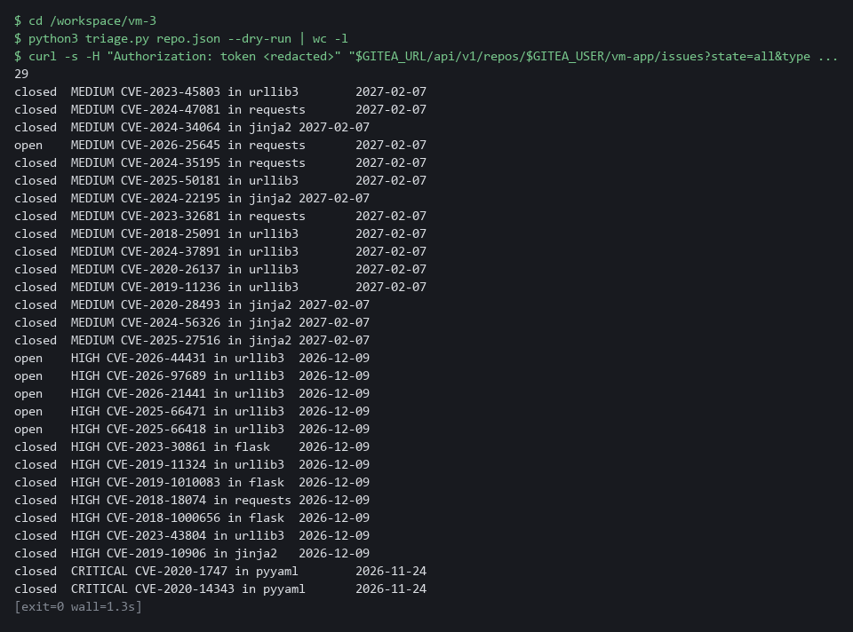

> **CHECKPOINT:** The total of open and closed items equals the planned count, each title is unique, and the CRITICAL items are due 15 days after the day you ran the script.

**How this meets the controls**

- **SI-2:** This test compares the planned count with the items in Gitea. Each title appears once, with its state and due date.
- **RA-5:** The due dates follow the severity table, with Critical items due 15 days after the run.

### Test 2 (positive). Running it again creates nothing (SI-2 Flaw Remediation)

- A script that runs on a schedule must be safe to run twice.
- Run open mode twice on fixed.json; the first run may create an item for a finding nobody tracked yet, and the second run must create nothing.

```bash
cd /workspace/vm-3
python3 triage.py fixed.json
python3 triage.py fixed.json
```

**Expected output:**

```
Example only.
created 1, already tracked 6
created 0, already tracked 7
(the first count depends on the day's database)
```

| Part | What it does | Why you run it |
| --- | --- | --- |
| cd /workspace/vm-3 | Moves into the working folder. | fixed.json is read from here. |
| triage.py fixed.json (first run) | Opens an item for any finding that has none yet. | Creates nothing if every item already exists. |
| created 0, already tracked 7 (second run) | The second run creates nothing. | A script that runs on a schedule must be safe to repeat. |

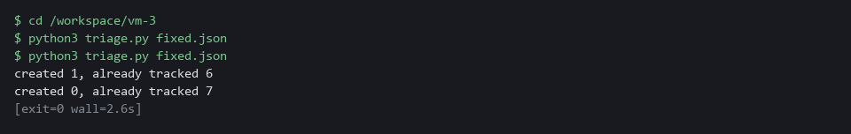

> **CHECKPOINT:** The second line says created 0. Do not run the open mode on repo.json now: the old report still lists the findings you closed in Step 5, so it would open them again.

**How this meets the control**

- **SI-2:** Open mode run twice on the same report creates nothing the second time, so a scheduled run cannot flood the tracker.

### Test 3 (negative). The gate fails a broken ranking (SA-11 Developer Testing and Evaluation)

- A gate you have only seen pass proves nothing.
- Copy your files, reverse the severity order in the copy with one small edit, and run the gate on the copy.

```bash
cd /workspace/vm-3
mkdir -p broken
cp rank.py ranking_rule.py deadlines.py gitea_api.py gitea_items.py triage.py broken/
sed 's/-SEVERITY_ORDER/SEVERITY_ORDER/' ranking_rule.py > broken/ranking_rule.py
python3 review_gate.py broken
echo "exit code: $?"
```

**Expected output:**

```
Example only.
PASS  dry run exits 0
PASS  one item per finding, no duplicates
FAIL  items are ranked by severity, score, then fix first: got ['MEDIUM CVE-2099-1004 in jinja2', 'HIGH CVE-2099-1003 in requests', 'HIGH CVE-2099-1002 in flask'] ...
PASS  due dates follow the severity table
PASS  low findings get no item
PASS  the token is never printed
PASS  missing token stops with a message
PASS  a scan that analyzed nothing is refused
RESULT: FAIL (1 checks failed)
exit code: 1
```

| Part | What it does | Why you run it |
| --- | --- | --- |
| cp ... broken/ | Copies your files into a folder named broken. | You break the copy and leave your files alone. |
| sed 's/-SEVERITY_ORDER/SEVERITY_ORDER/' ... | Removes one minus sign in the copy of ranking_rule.py. | Removing it reverses the severity order. |
| FAIL  items are ranked ... | The gate catches the wrong order. | A gate you have seen fail is a gate you can trust. |
| exit code: 1 | The gate ends with a non-zero code. | A pipeline would stop on this code. |

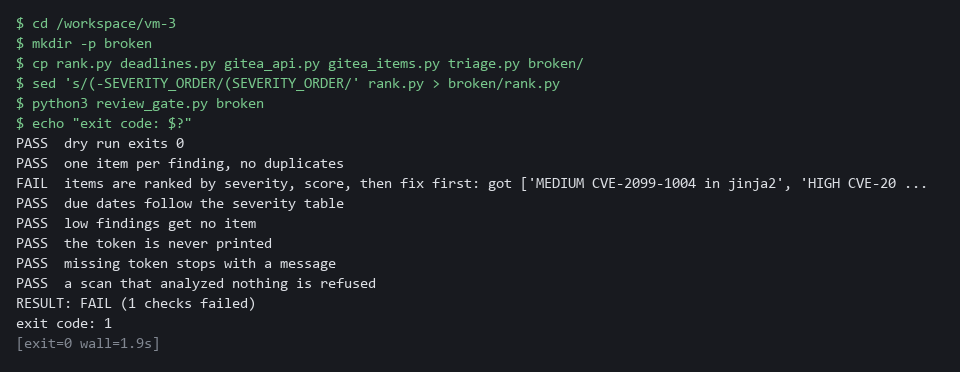

> **CHECKPOINT:** The ranking check says FAIL, the result is FAIL, and the exit code is 1. Your own files are untouched.

**How this meets the control**

- **SA-11:** The gate fails and exits with 1 on a deliberately broken ranking, which shows it can catch bad work.

### Test 4 (negative). An empty scan is refused and closes nothing (SI-2 Flaw Remediation, SA-11 Developer Testing and Evaluation)

- Run close mode on the supplied empty report and count the open items before and after.
- Without a guard in the script, an empty report would look like every finding fixed and would close every item.

```bash
cd /workspace/vm-3
curl -s -H "Authorization: token $GITEA_TOKEN" "$GITEA_URL/api/v1/repos/$GITEA_USER/vm-app/issues?state=open&type=issues&limit=50" | jq length
python3 triage.py fixture-empty.json --close-fixed
echo "exit code: $?"
curl -s -H "Authorization: token $GITEA_TOKEN" "$GITEA_URL/api/v1/repos/$GITEA_USER/vm-app/issues?state=open&type=issues&limit=50" | jq length
```

**Expected output:**

```
Example only.
7
cannot use fixture-empty.json: report has no Results: the scan analyzed nothing
exit code: 3
7
```

| Part | What it does | Why you run it |
| --- | --- | --- |
| ... \| jq length (first) | Counts the open items before. | The number to compare with. |
| triage.py fixture-empty.json --close-fixed | Runs close mode on a report with no Results. | The script must refuse it. |
| exit code: 3 | The script stopped with its error code. | A scan that analyzed nothing must not close anything. |
| ... \| jq length (last) | Counts the open items after. | Equal to the first count, so nothing was closed. |

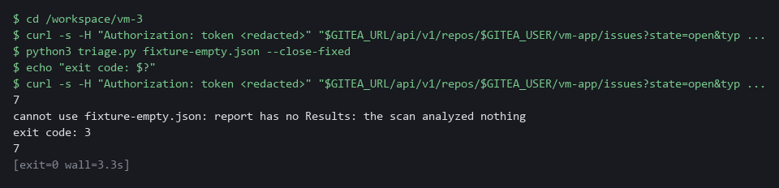

> **CHECKPOINT:** The exit code is 3, the message names the empty scan, and the two counts of open items are equal.

**How this meets the controls**

- **SI-2:** Close mode refuses a report with no results, with exit code 3, and no item is closed.
- **SA-11:** A scan that analyzed nothing is not verification, so it is refused. The open-item counts before and after are the evidence.

## Section 5. What Each Control Is For

### Control mapping

| Control | What it requires, in plain words | Tool or service | Where this module covers it |
| --- | --- | --- | --- |
| RA-5 Vulnerability Monitoring and Scanning | Analyze the scan results and remediate vulnerabilities within organization-defined response times, based on an assessment of risk. | The Python files rank.py and deadlines.py that you write. Explained in section 2.1. | Section 3, Steps 1 and 2: read and rank the findings. Section 3, Step 4: a due date is set from the severity. Section 4, Test 1: the due dates are checked. |
| SI-2 Flaw Remediation | Identify, report and correct flaws, and (in the SI-2(3) enhancement) measure the time from flaw identification to remediation. | Gitea issues, opened and closed by the Python files gitea_api.py, gitea_items.py and triage.py. Explained in section 2.2. | Section 3, Step 4: one tracked item is opened for each flaw. Section 3, Step 5: a re-scan confirms the fix before the item is closed. The date on each item is what makes the time measurable. Section 4, Tests 1, 2 and 4. |
| SA-11 Developer Testing and Evaluation | The people who build the system must implement a verifiable flaw remediation process and correct flaws found in testing. | The supplied review gate review_gate.py, and a fresh Trivy scan as the proof of a fix. Explained in section 2.3. | Section 3, Step 4: the review gate checks the triage script before it runs. Section 3, Step 5: the re-scan is the proof that a flaw was corrected. Section 4, Test 3: the gate fails a broken ranking. |

### What each control is for

Each table below says what the control is trying to prevent and how this module's tool meets it.

#### RA-5 Vulnerability Monitoring and Scanning

| Question | Answer |
| --- | --- |
| Control Intent | A long list of findings is read top to bottom, or not at all, and serious ones wait behind trivial ones. |
| The operational question | Of the findings we have today, which one should a developer fix first, and why? |
| What evidence proves it | The ranked list, the rule that produced the order, and the due date on each item. |
| How much is enough | Results are analyzed, ordered by a stated rule, and each finding gets a response time. NIST leaves the response times to the organization. The lab uses 15 days for Critical, 30 for High and 90 for Medium, its own choice. The lab opens no item for Low findings, so a real system would add an entry for them. |
| How the tool in this module satisfies it | rank.py orders by severity, then by score, then puts fixable findings first. deadlines.py turns severity into a due date (Steps 2 and 4). |

#### SI-2 Flaw Remediation

| Question | Answer |
| --- | --- |
| Control Intent | A fix is merged and nobody checks that it worked, or the same flaw is tracked three times and no one knows which item is real. |
| The operational question | For each flaw, is there exactly one item, and is it closed only after a new scan no longer shows the flaw? |
| What evidence proves it | One open item per finding, a close action tied to a scan, and the dates that let you work out the time to fix. |
| How much is enough | Flaws are reported once, fixes are tested before they are installed, and the time from finding to fix can be measured. NIST leaves the benchmarks to the organization. This module records the dates; measuring them is left to a later module. |
| How the tool in this module satisfies it | triage.py opens items without duplicates and closes only the items whose findings are absent from a fresh scan (Steps 4 and 5). |

#### SA-11 Developer Testing and Evaluation

| Question | Answer |
| --- | --- |
| Control Intent | The tool that handles findings has its own bug, and nobody knows until it ranks wrongly or closes the wrong items. |
| The operational question | How do we know the triage script does what we say it does, before it touches the tracker? |
| What evidence proves it | A gate that runs the script against a known input and compares the result with the rules. |
| How much is enough | The check states the rules independently of the code and fails when the work is wrong. A passing result you have never seen fail proves nothing, so Test 3 breaks the code on purpose. |
| How the tool in this module satisfies it | review_gate.py re-states the ranking and due-date rules and runs triage.py in dry-run mode against a fixture (Step 4). |

## Section 6. Next Steps

### Using this in other environments

- The ranking and deadline code you write is plain Python, and trivy fs, git and the Gitea issue calls use standard tools, so they run anywhere Trivy and a Gitea server are reachable.
- Change these lab values first: GITEA_URL, GITEA_USER and GITEA_TOKEN, the repository vm-app and its branches main and deps-updated, and the namespace security-tools.
- The tracking calls are the Gitea issues API. Another tracker (GitHub, GitLab, Jira) has its own API, so the create, edit and list calls in the Gitea code must be rewritten for it.
- The due dates (15, 30 and 90 days) are the lab's table. Put your own response times in deadlines.py.

The table shows what changes on each platform:

| Check | In this lab (OpenShift) | On other platforms | What you change |
| --- | --- | --- | --- |
| Fetch the review gate | oc extract configmap/vm-tools -n security-tools | kubectl get configmap vm-tools -n <namespace> -o json, or keep the gate in git | The tool name and the namespace. |
| Repository scan | git clone from Gitea with an Authorization: token header, then trivy fs | git clone from your git host, then trivy fs | The URL and the token method. |
| Tracking items | Gitea issues API: create with title, body and due_date, edit with state | The API of your tracker | Rewrite the Gitea code for that API. Keep one item per finding. |
| Due dates | 15, 30 and 90 days in deadlines.py | Your organization's response times | The values in deadlines.py. |
| Review gate | review_gate.py with its fixtures, run by hand | The same script, run in a pipeline on every change | Where it runs. The script stays the same. |
| Re-scan after a fix | trivy fs on the deps-updated branch | trivy fs on the branch or build that carries the fix | The branch name. |

> **TIP:** Next module: VM-4 Prioritize by Context and Validate: add what runs, what is exposed and what is critical, suppress findings with a reason and an expiry, fix through a Gitea branch, and record exceptions.

<details>
<summary><strong>Section 7. Terms</strong></summary>

Each term is also explained the first time it appears. In Word, hover over an underlined term to see its meaning, or Ctrl+click it to jump to this table.

| Term | Plain meaning |
| --- | --- |
| API | Application Programming Interface: the way a script talks to a program. |
| Branch | A named line of changes inside a repository. main is the main one; deps-updated holds the developers' fix. |
| Certificate | A file that proves a server's identity, signed by a trusted authority. |
| Clone | Copy a repository from a server into a folder of your own. |
| Cluster | The group of servers that runs your lab and the programs in it. |
| ConfigMap | A small named record stored in the cluster. |
| Container | A sealed box that holds one program and everything it needs to run. |
| CVE | Common Vulnerabilities and Exposures: a public ID for one known flaw, such as CVE-2020-0001. |
| CVSS | Common Vulnerability Scoring System: the 0 to 10 score of how serious a flaw is. |
| Dry run | A run that prints what would happen and changes nothing. |
| Evidence | Saved records that show a system is set up and behaving as claimed. |
| Exit code | A number a command returns when it ends: zero means it ran properly, anything else means it failed. |
| Exploit | Code or a method that takes advantage of a vulnerability. |
| Finding | One thing a scan reports: a flaw in a package or a bad setting, with a severity. |
| Fix availability | Whether the maintainers have published a fixed version of the package. An empty FixedVersion field means no. |
| Fixture | A small fixed input file used to test a script with a known right answer. |
| Function | A named group of lines in a script that you can call by name. |
| Git | A tool that records the history of a folder of files. |
| Gitea | A git server that runs in your lab. It holds the repository vm-app and the tracking items. |
| Gitea API | The web address and rules a script uses to read and change Gitea without the web page. |
| Header | A line of extra information sent with a web request, such as a sign-in token. |
| Heredoc | A way to make a file by pasting its text between a first line such as cat > name <<'EOF' and a last line that says EOF. |
| HTTP | The protocol that web pages and web APIs use. HTTPS is the encrypted form. |
| Image | A packaged copy of a program and everything it needs to run. A container starts from an image. |
| Issue | A numbered entry in the Gitea tracker, with a title, a body and an optional due date. This module uses issues as tracking items. |
| jq | A tool that picks one value out of JSON text. |
| JSON | A plain-text format for data: names and values written inside curly braces. |
| Merge | Combine the changes from one git branch into another. |
| mkdir | A command that makes a new folder. |
| Namespace | A named section of the cluster that holds a set of related parts. |
| NIST | The US National Institute of Standards and Technology. It publishes the security control catalog these modules cite. |
| oc | The command-line tool for OpenShift. You type oc to ask the cluster questions. |
| OpenShift | The Red Hat platform your lab cluster runs on. It is Kubernetes with extra security and tools built in. |
| Package | A bundle of software that a program installs and uses. Old packages are the usual source of known flaws. |
| Pin | A line in requirements.txt that names one exact version of a package. |
| Pipeline | A set of automated steps that run in order, such as scan, check and sign. |
| Project | A named section of the cluster that keeps workloads apart. OpenShift also calls it a namespace. |
| Pull request | A request to merge one branch into another, where others can review the change first. |
| Remediate | Fix a finding, for example by upgrading a package or changing a setting. |
| Repository | A folder whose history git tracks, so you can see what changed and when. |
| Review gate | An automated check that fails, with a non-zero exit code, when the work is not acceptable. |
| Rule | A written condition that a tool checks. |
| Scan | A run of a tool that compares what it reads with a database of known flaws and bad settings. |
| Script | A text file of commands that a computer runs in order. |
| Secret | A cluster object that holds a sensitive value such as a password or token, kept apart from ordinary settings. |
| sed | A command that edits text as it passes through, often to replace one string with another. |
| Severity | How serious a finding is, such as low, medium, high or critical. |
| Severity score | A number from 0 to 10 (the CVSS score) that rates how serious a flaw is. Trivy reports a word (CRITICAL, HIGH, MEDIUM, LOW) and, where it has one, the score. |
| Signature | A value made with a private key that shows who made something and that it was not changed. |
| Timestamp | The date and time recorded for an event. |
| Token | A secret string that proves who you are to a server, used here in place of a password. |
| Tracking item | One Gitea issue that stands for one finding, with a title, a body and a due date. |
| Triage | Putting findings in order so the most important are handled first. |
| Trivy | A free, open source scanner for images, folders and configuration files. |
| TSV | Tab-separated values: a table written as text, with a tab between columns. |
| URL | A web address, such as https://example.com/page. |
| Variable | A named value the lab sets for you. The dollar sign in front of a name means use its value. |

</details>
