# VM-4: Prioritize by Context and Validate (RA-5, RA-7, CA-5, CM-3)

| Item | Detail |
| --- | --- |
| Sequence | Module 18 of 29 in the recommended order |
| Timed work | About 67 minutes (47 hands-on, 20 verify) |
| Standalone start | `lab start vm-4` |
| Combined start | Continue from the end state of the previous module |
| Tools | OpenShift Container Platform, Trivy (free, open source), Gitea (free, open source), python3, oc, git, curl, jq |
| Prerequisites | ENG-0 Terminal, Git and Your Lab (typing commands in lab shell, git clone, commit and push, and reading oc output), VM-3 Triage and Track Fixes (how rank.py reads a Trivy report, and how a Gitea issue tracks one finding; the start state supplies rank.py) |

## Section 1. Module Overview

- Purpose: the same flaw carries different risk on different workloads, so findings are ranked by whether the workload runs, is exposed and is critical, and by known exploitation (RA-5, RA-7, CA-5, CM-3).
- You build scripts that read cluster facts and public exploit evidence, join them with Trivy findings, and choose for each finding: fix, suppress with an expiry, or record an exception.
- You run them in lab shell, record the decisions in Gitea, and prove a fix with a re-scan.

- **Skill:** Rank scan findings by where each workload runs and by public evidence of exploitation, record each decision (suppress with an expiry, record an exception, or fix through a pull request), and prove a fix with a re-scan.
- **Tools:** `oc` and Python scripts read facts from the OpenShift cluster, Trivy scans the images, `curl` and Python read the KEV catalog and the EPSS scores, `jq` reads the JSON files, and `git` and Gitea carry the fix branch, the pull request and the exception issue.
- **Security Function:** Prioritizes and tracks. Findings are ranked by whether the workload is running, exposed and critical, and by known exploitation. Urgent work comes first, and a decision not to fix expires or is recorded instead of staying hidden.
- **NIST RA-5 Vulnerability Monitoring and Scanning:** Python scripts join Trivy findings with cluster facts and KEV and EPSS evidence, so remediation follows an assessment of risk, and a Trivy re-scan proves a fix.
- **NIST RA-7 Risk Response:** A Trivy ignore file with a reason and an expiry, and a Gitea issue with a due date, record the response to each finding the team does not fix now.
- **NIST CA-5 Plan of Action and Milestones:** A Gitea issue with a cause and a due date is the record for a flaw that has no fix, so the team sees it again on a set date.
- **NIST CM-3 Configuration Change Control:** A Gitea branch and pull request put the fix in front of a reviewer before it reaches main.

## Section 2. The Tools

### Tools used in this module

Each tool name links to its official overview. The table columns say how each tool is used in the lab and why the lab uses it instead of another way of doing the same job.

| Tool (overview link) | What it is | Used in this lab | Why this tool |
| --- | --- | --- | --- |
| [OpenShift Container Platform](https://docs.redhat.com/en/documentation/openshift_container_platform/4.22/html/overview/ocp-overview) | A Kubernetes container platform for running and managing containerized applications. | The cluster whose workloads' exposure and scale the script reads. | It is the platform the whole lab runs on, so every module works on the same real cluster, with the same kinds of objects a production OpenShift system has. |
| [Trivy](https://trivy.dev/) | Scans images, code and clusters for known flaws and misconfigurations. | Scans the two images the workloads use and keeps every severity. | It scans images and clusters for known flaws and bad settings from the command line and is free and open source, so the same scan can run by hand and in a pipeline. |
| [Gitea](https://docs.gitea.com/) | A lightweight self-hosted git server. | Holds the repository where the fix goes through a branch and pull request. | It gives the lab a git server of its own, so you can push and review changes without an outside account. |
| [Python 3](https://docs.python.org/3/tutorial/introduction.html) | General-purpose language, used here for small helper scripts. | Runs collect_facts.py and prioritize.py, which turn facts and scans into a plan. | Python reads and writes JSON easily and is already in the lab shell, so a small script needs nothing installed. |
| [oc](https://docs.redhat.com/en/documentation/openshift_container_platform/4.22/html/cli_tools/openshift-cli-oc) | The OpenShift command-line tool for creating and managing applications and projects from a terminal. | Reads the facts about each workload. | It is the one command that talks to the cluster, so every module uses it to ask what is true and to make changes. You sign in once, and it works on OpenShift objects as well as standard Kubernetes ones. Unlike clicking in the web console, a command can be pasted, repeated and checked by a test. |
| [Git](https://git-scm.com/about) | Version control that stores repository history. | Branch and commit the Dockerfile fix. | It keeps scripts and settings with a history, so every change has a record of who made it and when, and a mistake can be undone. |
| [curl](https://curl.se/docs/manpage.html) | Command-line tool for transferring data over URLs, used here to call web endpoints. | Calls the Gitea web interface, with a token, for the pull request. | It calls a web address from the terminal, so you can check what a service really returns instead of trusting a screen. |
| [jq](https://jqlang.org/) | Command-line JSON processor. | Picks fields out of the facts and the plan. | It picks one field out of a long JSON reply, so a test can read a single value. |

### How it fits together

#### From findings and cluster facts to decisions

- Lab (test) setup: you read facts about three workloads from the cluster and join them with Trivy scans of their images and with public evidence of exploitation, which gives every finding a priority and an action.
- The numbers on the arrows show the order, 1 to 8.
- Each step below adds one part, drawn with thick lines.
- In production the scans run in the delivery pipeline, the exception goes to the organization's system of record, and the fix goes through the team's own git host and build.

How the lab is set up, and why:

- You work in the lab shell you already use, on your laptop.
- Your cluster holds the three workloads and Gitea, so the facts come from the real objects and the decisions are recorded on a server others can open.
- The earlier modules scanned and ranked findings without asking where a workload runs.
- This module adds facts read from the cluster and evidence from two public sources, so one finding can get a different priority on each workload.
- The three workloads live in three projects on purpose, because one is running and exposed, one is running and internal, and one is switched off, and that difference is what the tiers show.
- Scripts in lab shell read the cluster with oc and write the facts and the plan as files in your folder.
- A decision that must outlast your session goes to Gitea, as an issue or as a branch with a pull request, so the record sits on the server and not on your laptop.

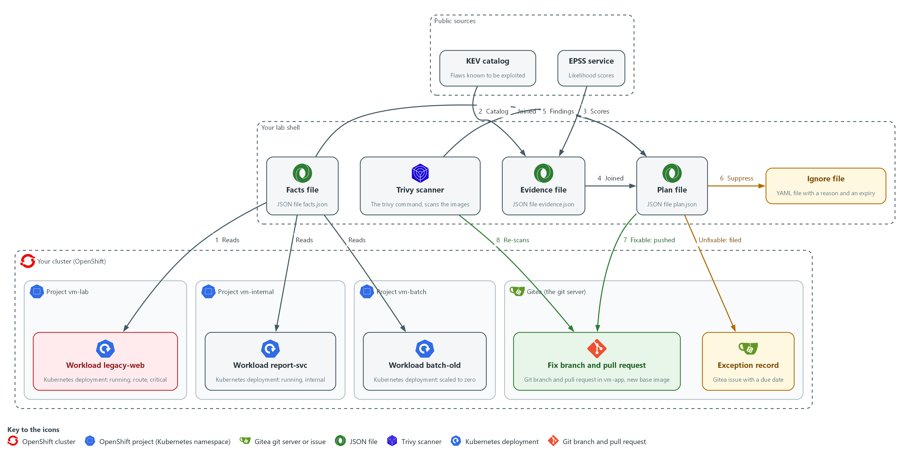

- **1. Workload legacy-web:** a running web server in project vm-lab. A route exposes it and its project is marked critical.
- **2. Workload report-svc:** a running service in project vm-internal. It has no route, so nothing outside the cluster reaches it.
- **3. Workload batch-old:** a workload in project vm-batch that is scaled to zero, so nothing runs.
- **4. Facts file:** facts.json, written from the three workloads (arrow 1). For each workload it says which images it runs and whether it is running, exposed and critical.
- **5. KEV catalog:** a public list of flaws that attackers are known to use, each with a due date (arrow 2).
- **6. EPSS service:** a public service that gives each CVE ID a score from 0 to 1 for how likely it is to be exploited (arrow 3).
- **7. Evidence file:** evidence.json, built from the catalog and the scores (arrow 4). For each CVE ID it says whether the catalog lists it, the due date, and the score.
- **8. Trivy scanner:** the trivy command in lab shell. It scans the two images (arrow 5) and later scans the new base image (arrow 8).
- **9. Plan file:** plan.json, which joins the findings, the facts and the evidence and gives each finding on each workload a tier and an action.
- **10. Ignore file:** a YAML file that hides one finding on batch-old from Trivy, with a written reason and an expiry date (arrow 6).
- **11. Exception record:** a Gitea issue with a due date for a flaw that has no fix on the exposed workload.
- **12. Fix branch and pull request:** a branch in the repository vm-app on Gitea that moves the base image, and the pull request that asks for a review (arrow 7).

Where each part runs, and why:

| Part | Where it runs | Why it is built this way |
| --- | --- | --- |
| Facts file and plan file | Files in your folder in lab shell | The scripts read the cluster once and work from the files, so you can read and check each step. |
| Trivy scanner | In lab shell on your laptop | It scans the images the workloads use, so findings can be joined to the workloads that run them. |
| KEV catalog and EPSS service | Public sources outside the cluster | They say which flaws attackers are known to use and how likely each is to be used, which a scanner cannot know. |
| Workloads legacy-web, report-svc and batch-old | Three projects in your cluster | They differ in how they run, so one finding gets different priorities. |
| Ignore file | A file in your folder in lab shell | A suppression is a local file with a reason and an expiry, so it can be read and ends by itself. |
| Exception record, branch and pull request | On Gitea, inside your cluster | A decision that must last is stored on the server, where others can see and review it. |

### 2.1 Context changes the order (RA-5 Vulnerability Monitoring and Scanning)

- A scan finding says a package has a flaw. It does not say whether the package is running, who can reach it, or what depends on it.
- Whether a package is running, who can reach it and what depends on it are each held in a different place in the cluster, and a script can read all of them.
- The KEV catalog lists flaws that attackers are known to have used. That is a fact about the past, so a listed flaw is treated as urgent on any running workload.
- EPSS gives every CVE ID a score from 0 to 1 for how likely exploitation is. That is a prediction, so it only orders findings inside a tier. This module sets no EPSS threshold, because the EPSS documentation gives none.
- Without context a team fixes in the order the scanner prints. With context it fixes in the order of risk, and a finding moves down only because of a fact that can be shown.
- NIST leaves the response times to the organization. The lab reuses the response times from the previous module.

#### RA-5: Vulnerability Monitoring and Scanning

*The control asks the organization to analyze vulnerability scan results and to remediate legitimate vulnerabilities within organization-defined response times, in accordance with an organizational assessment of risk. This is done using:*

- collect_facts.py: reads whether each workload is running, exposed and in a critical project.
- evidence.py: reads the KEV catalog and the EPSS score for every CVE ID.
- tiers.py and prioritize.py: turn the facts and the evidence into a tier and an action for each finding.
- Trivy: scans the images, and scans the new base image again to prove a fix.

The table shows each question the scripts ask, where the answer lives, and how the script finds it:

| Question | Where the answer lives | How the script finds it |
| --- | --- | --- |
| Is it running? | The Deployment status | readyReplicas is above zero |
| Is it reachable from outside? | A Route points at a Service, and the Service selects the pods | A Route in the project names a Service whose selector matches the pod labels |
| Is the project critical? | A label on the namespace (a project is a namespace) | The label criticality=high |
| Is a fix available? | The scan report | FixedVersion is not empty |
| Is it known to be exploited? | The KEV catalog, a public JSON file | The CVE ID is among the cveID values, and the catalog's dueDate is kept |
| How likely is exploitation? | The EPSS service, a public web API | The EPSS score for the CVE ID, used to order findings inside a tier |

### 2.2 Four tiers and three actions (RA-7 Risk Response)

- The tiers are the lab's own rules, written in tiers.py. A different team could choose differently.
- A stricter rule puts more findings in P1 and wears out the people who work them. A looser rule lets an exposed flaw wait.
- Every finding gets one of three actions: fix it, suppress it with a written reason and an expiry, or record an exception with a due date.
- The 30 day length of a suppression or exception is the lab's choice.

#### RA-7: Risk Response

*The control asks the organization to respond to findings from assessments, monitoring and audits in accordance with organizational risk tolerance. This is done using:*

- The tier rules in tiers.py: choose fix, suppress or exception for each finding.
- A Trivy ignore file: hides a finding with a written reason and an expiry (Step 4).
- A Gitea issue with a due date: records the acceptance of a flaw that has no fix (Step 4).
- A pull request: proposes the fix that mitigates the risk (Step 5).

The table shows each tier, the rule that puts a finding in it, and the action it gets:

| Tier | Rule in this lab | Action |
| --- | --- | --- |
| P1 | Running, and either listed in the KEV catalog, or the severity is CRITICAL or HIGH and reachable from outside | Fix if a fix exists, otherwise record an exception |
| P2 | Running, CRITICAL or HIGH, in a critical project, not reachable from outside | Fix if a fix exists, otherwise record an exception |
| P3 | Running, anything else; or not running but listed in the KEV catalog | Fix in the normal release if a fix exists, otherwise record an exception |
| P4 | Not running and not listed in the KEV catalog | Suppress with a reason and an expiry |

### 2.3 A suppression is a debt with a due date (CA-5 Plan of Action and Milestones)

- Trivy reads an ignore file in YAML. Each entry has an id (the CVE ID), a statement (the reason) and expired_at (a date).
- After the expired_at date Trivy stops hiding the finding, so a forgotten suppression returns by itself.
- A flaw that has no fix and sits on a running, exposed workload cannot be hidden. It becomes an exception: a Gitea issue that holds the reason and a due date.
- An ignore file hides the CVE in every scan that uses it, so suppressing for one workload hides it for every workload that shares the image. This module suppresses only on an image that no running workload uses.
- In a real program the official plan of action and milestones lives in the organization's system of record (its official tracking tool), and the Gitea issue only teaches the fields.

#### CA-5: Plan of Action and Milestones

*The control asks the organization to develop a plan of action and milestones that documents the planned remediation actions for weaknesses and known vulnerabilities, and to update it at an organization-defined frequency. This is done using:*

- A Gitea issue titled EXCEPTION: records the CVE ID, the package and the reason for a flaw that has no fix.
- The due date on the issue: is the review date, when the team sees the flaw again.

### 2.4 Fix through a branch, prove with a re-scan (CM-3 Configuration Change Control)

- A fix is a change, so it goes through a branch and a pull request where someone can review it.
- The proof is a new scan that no longer shows the finding, not the merge.
- Here the base image is the fixable part: the branch changes the FROM line, and Trivy scans the new base image as the stand-in for the rebuilt image.
- Merging and deploying happen after review and are not done in the lab module.

#### CM-3: Configuration Change Control

*The control asks the organization to review proposed configuration-controlled changes, approve or disapprove them with explicit consideration for security and privacy impact analyses, and document the decisions. This is done using:*

- A Gitea branch: holds the one-line Dockerfile change apart from main.
- A pull request that names the finding: waits for a reviewer, so the decision is recorded.

> **IN PRODUCTION:** In the real environment the pull request triggers a build, the new image is scanned and signed, and a deployment replaces the running workload. Only after that does the running workload stop being affected.

### Design decisions

#### Priority comes from cluster facts, not scanner order

- How: Scripts read whether a replica is ready, whether a Route reaches the pods, whether the namespace is labeled critical, and whether the KEV catalog lists the flaw, and the evidence script exits with 2 when the catalog is empty or a lookup fails. The tier rules combine all of it with severity and fix availability: a listed flaw is P1 on any running workload and is never suppressed, and EPSS only orders findings inside a tier.
- Why: A finding moves up or down because of a fact that can be shown, and the same CVE gets different priorities on different workloads. Exploitation that has happened is a fact and a prediction is not, so each is used for what it can support, and a failed download stops the run instead of reading as nothing exploited.
- Alternatives: Advantage of ranking by scanner severity alone: it needs no cluster access and is easy to explain. Drawback: a flaw in a switched-off workload ranks beside one on an exposed service, and a flaw under attack ranks beside one nobody uses, so effort follows the scanner and not the risk.

#### A suppression expires and is kept per image

- How: A finding on a workload scaled to zero is hidden through an ignore file with a written reason and an expiry date, kept for one image only. A running exposed workload with no fix gets a Gitea issue with a due date instead.
- Why: The expiry brings the finding back without anyone remembering, and one file per image stops a suppression for a switched-off workload from hiding the same flaw in a running one.
- Alternatives: Advantage of one shared ignore file for every image: there is a single place to review. Drawback: the file hides a CVE in every scan that uses it, so a suppression meant for one workload silently hides the flaw for the others.

#### Fix through a branch, prove with a re-scan

- How: The fix is a Dockerfile change on a branch with a pull request that names the finding. The proof is a Trivy scan of the new base image named on that branch, which stands in for a rebuilt image.
- Why: A change gets reviewed before it takes effect, and the evidence is a scan result, not the act of merging.
- Alternatives: Advantage of pushing straight to main: it is the fastest route. Drawback: it leaves no review record, and a wrong change reaches the release unchecked.

## Section 3. Implement

- Start: type `lab start vm-4` in the terminal on your own computer (PowerShell on Windows, Terminal on Mac), not in the lab shell.
- Enter lab shell with `lab shell`. Every other command in this module runs inside lab shell.
- If a step fails: run `lab reset vm-4` on your own computer and repeat the step once. If it still fails, copy the whole command and error and ask your AI assistant. Do not skip the step.

### Step 1. Collect the facts from the cluster (RA-5 Vulnerability Monitoring and Scanning)

**Learning point: Running the facts script turns three things you check by hand (running, exposed, critical) into facts.json, the context the plan joins to every finding.**

- Look at the facts by hand first, so you know what the script will read.
- The supplied facts_lib.py runs oc for you, so you read it and do not retype it.
- You then write the script that saves one record for every Deployment in the lab projects.

What this step adds (thick lines and outlines are new):

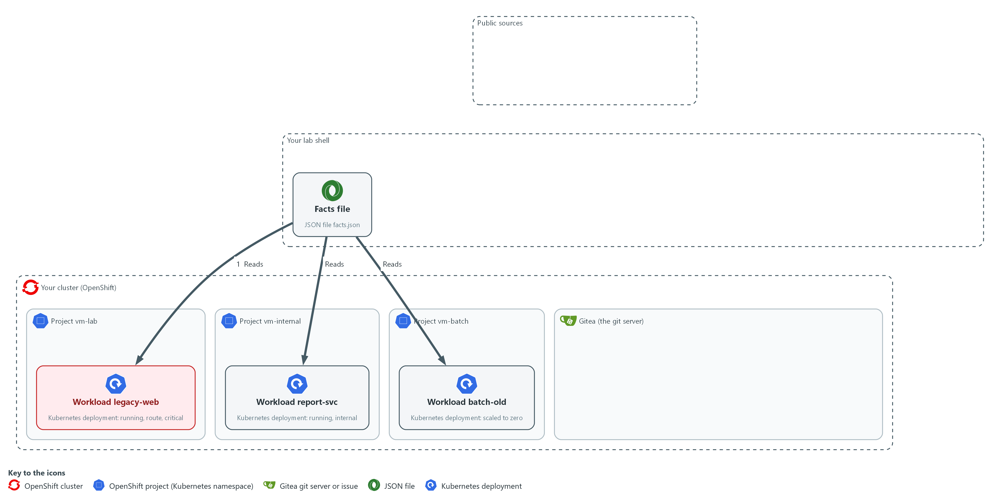

- Scripts in lab shell read the facts about each workload from the cluster and write them to facts.json in your folder: is it running, is a route exposing it, is its project marked critical.

#### 1a. Fetch the supplied files and look at the cluster by hand

You will now copy the supplied files out of the cluster and look at the three workloads and the route with oc, which changes nothing.

```bash
mkdir -p /workspace/vm-4 && cd /workspace/vm-4
oc extract configmap/vm-tools -n security-tools --to=. --confirm
oc get deployments -A | grep -e vm-lab -e vm-internal -e vm-batch
oc get routes -n vm-lab
```

**Expected output:**

```
Example only. Your columns and ages will differ.
deadlines.py
facts_lib.py
rank.py
(a line for each of the three workloads: batch-old, report-svc and legacy-web, with their ready counts)
(one Route in vm-lab, with its host and the Service it points at)
```

| Part | What it does | Why you run it |
| --- | --- | --- |
| mkdir -p ... && cd ... | Makes a folder for this module and moves into it, so files from other modules cannot collide with yours. The folder persists between lab sessions. | Gives the files of this module one folder, so the scripts and their outputs sit together. |
| oc extract ... --confirm | Fetches the supplied rank.py and deadlines.py, which are the files you wrote in the previous module, and facts_lib.py, the helper shown in the next block. This module uses rank.py in Step 2 and does not use deadlines.py. | The supplied helper files are kept in the cluster, so you copy them into your folder before the scripts import them. |
| oc get deployments -A \| grep ... | Lists the three workloads and how many replicas are ready. | Shows by hand the first fact, running or not, before a script reads it for you. |
| oc get routes -n vm-lab | Shows the Route that exposes one workload and the Service it points at. | A route is the second fact: it is what makes a workload reachable from outside. The script follows the Service to the pods, and reads the project label of the third fact the same way. |

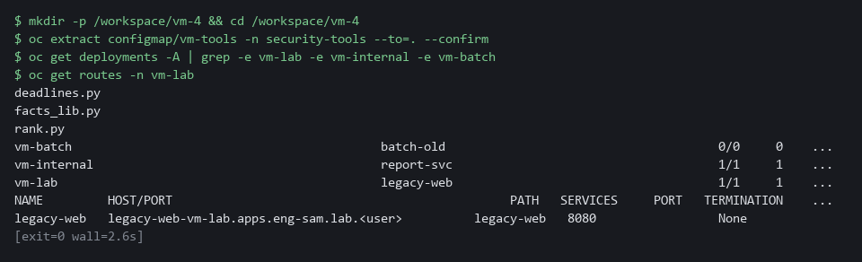

#### 1b. Read the supplied facts_lib.py

You will now read the supplied file facts_lib.py, copied in the previous block; you do not type it, and it prints nothing.

Look for these as you read:

- oc_items runs oc get with JSON output. The check=True option makes a failed command stop the script, so a failure never turns into a false answer.
- selects returns true only when every key and value of the Service selector is found in the pod labels. An empty selector never matches.
- critical_namespaces returns the projects labeled criticality=high. That label is the third fact.

```python
"""Helpers that read cluster objects with oc."""
import json
import subprocess


def oc_items(*args):
    result = subprocess.run(["oc", "get", *args, "-o", "json"], check=True, capture_output=True, text=True)
    return json.loads(result.stdout)["items"]


def selects(selector, labels):
    """True when a Service selector matches the pod labels."""
    return bool(selector) and all(labels.get(key) == value for key, value in selector.items())


def critical_namespaces():
    named = oc_items("namespaces")
    return {n["metadata"]["name"] for n in named if (n["metadata"].get("labels") or {}).get("criticality") == "high"}

```

| Part | What it does | Why you run it |
| --- | --- | --- |
| oc_items(*args) | Runs oc get with JSON output and returns the list of objects. check=True makes a failure stop the script. | Every fact comes through this one function, and a failed oc call stops the run instead of giving a false answer. |
| selects(selector, labels) | True when every key and value of the Service selector is found in the pod labels, and the selector is not empty. | This is how a Service is matched to the pods it serves, which the exposed check needs. |
| critical_namespaces() | Returns the names of the projects labeled criticality=high. | Collects the critical projects once, so each workload can be checked against the set. |

#### 1c. Create collect_facts.py

You will now paste this block into lab shell to create collect_facts.py in your folder (the trick is called a heredoc), and you run the file in the next block.

Look for these as you read:

- PREFIX limits the script to the lab projects. Without it the script would read every project on the cluster.
- is_exposed follows the chain from a Route to a Service to the pods. A workload counts as exposed only when the whole chain is there.
- running is true when at least one replica is ready. A missing status counts as zero.
- Each record in facts.json holds the images and the three facts. The plan joins findings to workloads by image name.

```bash
cd /workspace/vm-4
cat > collect_facts.py <<'EOF'
"""Write facts.json: one record for each Deployment in the lab projects."""
import json

import facts_lib

PREFIX = "vm-"


def is_exposed(namespace, labels, services, routes):
    names = {s["metadata"]["name"] for s in services if s["metadata"]["namespace"] == namespace and facts_lib.selects(s["spec"].get("selector"), labels)}
    return any(r["metadata"]["namespace"] == namespace and r["spec"]["to"]["name"] in names for r in routes)


def main():
    critical = facts_lib.critical_namespaces()
    services, routes = facts_lib.oc_items("services", "-A"), facts_lib.oc_items("routes", "-A")
    facts = []
    for dep in facts_lib.oc_items("deployments", "-A"):
        namespace = dep["metadata"]["namespace"]
        if not namespace.startswith(PREFIX):
            continue
        template = dep["spec"]["template"]
        facts.append({
            "namespace": namespace,
            "name": dep["metadata"]["name"],
            "images": [c["image"] for c in template["spec"]["containers"]],
            "running": (dep.get("status") or {}).get("readyReplicas", 0) > 0,
            "exposed": is_exposed(namespace, template["metadata"].get("labels") or {}, services, routes),
            "critical": namespace in critical,
        })
    with open("facts.json", "w", encoding="utf-8") as handle:
        json.dump(facts, handle, indent=2)
    print(f"wrote facts.json with {len(facts)} workloads")


if __name__ == "__main__":
    main()
EOF
wc -l collect_facts.py
```

**Expected output:**

```
Example only.
37 collect_facts.py
```

| Part | What it does | Why you run it |
| --- | --- | --- |
| cd /workspace/vm-4 | Moves into the working folder of this module. | The file must land next to the other files, whatever folder you were in before. |
| cat > collect_facts.py <<'EOF' ... EOF | Writes every line between the two marker lines into the file collect_facts.py. The quotes around EOF keep each dollar sign and backslash exactly as typed. | Lab shell has no editor, so a block like this is how a file is made. Running it twice writes the same file again. |
| wc -l collect_facts.py | Counts the lines of the file you just made. | A quick check that the whole file arrived. The count should match the expected output. |
| PREFIX = "vm-" | Keeps the script to the lab projects. The lab chose the prefix. | Without it the script would read every project on the cluster, including the platform's own. |
| is_exposed | A workload is exposed when a Route in its project points at a Service that selects its pods. | Exposure is the fact that raises a finding to P1, so it must follow the chain from route to pods. |
| running | True when at least one replica is ready. A missing status counts as zero. | A workload that is not running moves its findings to P4. |
| critical | True when the project is in the critical set. | Lets a serious finding on an internal workload reach P2. |
| facts.json | One record per Deployment with its images and the three facts. | The next step reads this file, so the plan depends on facts that you can read and check. |

#### 1d. Run the facts script and read the result

You will now run collect_facts.py and print one line for each workload.

```bash
cd /workspace/vm-4
python3 collect_facts.py
jq -c '.[]' facts.json
```

**Expected output:**

```
Example only.
wrote facts.json with 3 workloads
{"namespace":"vm-batch","name":"batch-old","images":["docker.io/library/httpd:2.4.38"],"running":false,"exposed":false,"critical":false}
{"namespace":"vm-internal","name":"report-svc","images":["docker.io/library/nginx:1.16"],"running":true,"exposed":false,"critical":false}
{"namespace":"vm-lab","name":"legacy-web","images":["docker.io/library/nginx:1.16"],"running":true,"exposed":true,"critical":true}
(the order of the lines may differ)
```

| Part | What it does | Why you run it |
| --- | --- | --- |
| python3 collect_facts.py | Reads the cluster and writes facts.json. | Turns what you looked at by hand into a file that the plan can use. |
| jq -c '.[]' facts.json | Prints one line per workload. | Lets you check each fact against what you saw with oc. |

> **YOUR TURN:** Run 1a, read facts_lib.py in 1b, save collect_facts.py in 1c, then run 1d.

> **CHECKPOINT:** Three workloads are listed: legacy-web is running, exposed and critical; report-svc is running only; batch-old is none of them.

> **TAKEAWAY:** Context comes from the cluster, so a script reads it instead of a person guessing.

**How this meets the control**

- **RA-5:** This step reads whether each workload is running, exposed by a route and in a critical project. It writes facts.json for the plan in Step 3.

### Step 2. Scan the images and add exploit evidence (RA-5 Vulnerability Monitoring and Scanning)

**Learning point: Scanning both images and looking each CVE ID up in the KEV catalog and the EPSS service produces evidence.json, which says which flaws are known to be exploited and how likely each is.**

- Scan the two images the workloads use and keep every severity, because a flaw known to be exploited matters even at medium severity.
- You then download the KEV catalog and ask the EPSS service about every CVE ID in the reports.
- This step needs the lab shell to reach the internet, and the script refuses an empty or cut-short catalog.

What this step adds (thick lines and outlines are new):

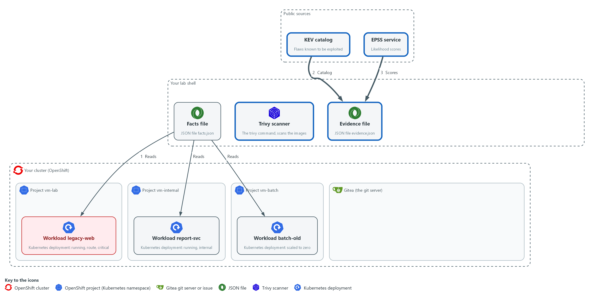

- Trivy in lab shell scans the two images. A script reads the KEV catalog and asks the EPSS service about every CVE ID, and writes evidence.json in your folder.

#### 2a. Scan the two images

You will now scan the two images the workloads run, and count the findings in each report.

```bash
mkdir -p /workspace/vm-4 && cd /workspace/vm-4
OLD_IMAGE=docker.io/library/nginx:1.16
BATCH_IMAGE=docker.io/library/httpd:2.4.38
trivy image --scanners vuln --quiet --format json --output nginx.json "$OLD_IMAGE"
trivy image --scanners vuln --quiet --format json --output httpd.json "$BATCH_IMAGE"
jq '[.Results[]?.Vulnerabilities[]?] | length' nginx.json httpd.json
```

**Expected output:**

```
Example only. Your counts will differ as the database changes.
<n>
<n>
(the first number is for nginx.json, the second for httpd.json; both should be above zero)
```

| Part | What it does | Why you run it |
| --- | --- | --- |
| OLD_IMAGE, BATCH_IMAGE | The exact image names the Deployments use. The script matches on this text. | The plan joins a report to a workload by the image name, so the names must be the same. |
| trivy image ... --output nginx.json | Scans each image and keeps every severity. | A known-exploited flaw can have a medium severity, so a filter on severity would hide it. |
| jq ... length | Prints the number of findings in each report. | Checks that both scans found something, so an empty report is caught before it is joined. |

#### 2b. Create evidence.py, part 1

You will now paste this block into lab shell to create the first half of evidence.py, which is split in two so each paste is short; paste part 2 next, in the same folder.

Look for these as you read:

- load_catalog refuses a catalog with no entries or with a count that does not match its entries. A failed download would otherwise read as no known exploitation.
- fetch_scores asks for 50 CVE IDs at a time, because the service accepts at most 2000 characters in its list of IDs.
- The EPSS values come back as text, so float turns them into numbers. A CVE the service does not know gets no entry here.

```bash
cd /workspace/vm-4
cat > evidence.py <<'EOF'
"""Write the exploit evidence for every CVE in the reports. Usage: python3 evidence.py KEV OUT REPORT ..."""
import json
import sys
import urllib.parse
import urllib.request

import rank

SCORE_URL = "https://api.first.org/data/v1/epss"
BATCH = 50


def load_catalog(path):
    with open(path, encoding="utf-8") as handle:
        catalog = json.load(handle)
    entries = catalog.get("vulnerabilities") or []
    if not entries or catalog.get("count") != len(entries):
        raise ValueError("KEV catalog is empty or its count does not match its entries")
    return {entry["cveID"]: entry["dueDate"] for entry in entries}


def fetch_scores(ids):
    scores = {}
    for start in range(0, len(ids), BATCH):
        query = urllib.parse.urlencode({"cve": ",".join(ids[start:start + BATCH])}, safe=",")
        with urllib.request.urlopen(f"{SCORE_URL}?{query}", timeout=30) as response:
            body = json.load(response)
        if body.get("status") != "OK":
            raise ValueError(f"EPSS answered with status {body.get('status')}")
        for row in body.get("data", []):
            scores[row["cve"]] = float(row["epss"])
    return scores
EOF
wc -l evidence.py
```

**Expected output:**

```
Example only.
32 evidence.py
```

| Part | What it does | Why you run it |
| --- | --- | --- |
| cd /workspace/vm-4 | Moves into the working folder of this module. | The file must land next to the other files, whatever folder you were in before. |
| cat > evidence.py <<'EOF' ... EOF | Writes every line between the two marker lines into the file evidence.py. The single > starts the file new. | Lab shell has no editor, so a block like this is how a file is made. Running it again starts the file over, so run part 2 after it. |
| load_catalog(path) | Reads the catalog, refuses an empty one or one whose count field differs from its list, and returns each CVE ID with its due date. | A missing catalog must stop the run, because it would look the same as a catalog with no match. |
| fetch_scores(ids) | Asks the EPSS service for up to 50 CVE IDs per call and returns each score as a number. | The service limits the length of the request, so a long list has to be sent in batches. |
| body.get("status") != "OK" | Stops when the service does not answer with status OK. | An error answer must not turn into scores of zero. |
| wc -l evidence.py | Counts the lines so far. | A quick check that part 1 arrived whole. |

#### 2c. Create evidence.py, part 2

You will now add the second half to evidence.py; the >> adds to the end of the file, so paste part 1 first and paste this block only once.

Look for these as you read:

- Any error prints one line and exits with 2 before evidence.json is written, so no stale file is left to be used by mistake.
- A CVE that has no score is stored as null, not as 0.

```bash
cd /workspace/vm-4
cat >> evidence.py <<'EOF'


def main(argv):
    try:
        catalog = load_catalog(argv[0])
        ids = sorted({f["id"] for path in argv[2:] for f in rank.load_findings(path)})
        scores = fetch_scores([i for i in ids if i.startswith("CVE-")])
    except (OSError, ValueError, KeyError) as error:
        print(f"cannot build evidence: {error}", file=sys.stderr)
        return 2
    evidence = {i: {"exploited": i in catalog, "due": catalog.get(i), "likelihood": scores.get(i)} for i in ids}
    with open(argv[1], "w", encoding="utf-8") as handle:
        json.dump(evidence, handle, indent=2)
    known = sum(1 for e in evidence.values() if e["exploited"])
    print(f"wrote {argv[1]}: {len(ids)} CVEs, {known} in the KEV catalog, {len(scores)} with an EPSS score")
    return 0


if __name__ == "__main__":
    sys.exit(main(sys.argv[1:]))
EOF
wc -l evidence.py
```

**Expected output:**

```
Example only.
52 evidence.py
```

| Part | What it does | Why you run it |
| --- | --- | --- |
| cat >> evidence.py <<'EOF' ... EOF | Adds every line between the markers to the end of evidence.py. The double >> means add, not replace. | Joins part 2 to part 1 to make the whole script. If you paste it twice the file breaks, so paste part 1 again first. |
| scores.get(i) | Gives None for a CVE with no score. | No score is not the same as a low score, and the plan sorts missing scores last. |
| except (OSError, ValueError, KeyError) | Turns a network error, a bad file or a missing field into one message and exit code 2. | A clear message and a fixed exit code tell a person or a pipeline what went wrong. |
| wc -l evidence.py | Counts all the lines of the finished file. | The count should match the expected output. |

#### 2d. Download the catalog, build the evidence and read the top scores

You will now download the KEV catalog, build evidence.json, and print the five CVE IDs with the highest EPSS score.

```bash
cd /workspace/vm-4
CATALOG_URL=https://www.cisa.gov/sites/default/files/feeds/known_exploited_vulnerabilities.json
curl -fsS -o catalog.json "$CATALOG_URL"
jq '{catalogVersion, dateReleased, count, entries: (.vulnerabilities | length)}' catalog.json
python3 evidence.py catalog.json evidence.json nginx.json httpd.json
jq -r 'to_entries | sort_by(-(.value.likelihood // 0)) | .[:5][] | [.key, .value.likelihood, .value.exploited] | @tsv' evidence.json
```

**Expected output:**

```
Example only. Your catalog version, counts and scores will differ.
{
  "catalogVersion": "<version>",
  "dateReleased": "<time>",
  "count": <n>,
  "entries": <n>
}
wrote evidence.json: <n> CVEs, <n> in the KEV catalog, <n> with an EPSS score
CVE-<id>	<score between 0 and 1>	<true or false>
(five lines like that)
```

| Part | What it does | Why you run it |
| --- | --- | --- |
| curl -fsS -o catalog.json | Downloads the catalog. -f makes curl fail on an HTTP error, -s hides the progress bar, -S still shows an error. | A failed download must stop the step, not leave an error page in the file. |
| jq '{catalogVersion, dateReleased, count, entries: ...}' | Prints the catalog version, its release date, the count it states and the entries it holds. | Lets you see that the catalog is current and that the count equals the entries. |
| python3 evidence.py catalog.json evidence.json ... | Looks up every CVE ID of both reports in the catalog and in the EPSS service, and writes evidence.json. | This is the exploit evidence the plan joins to each finding. |
| jq -r 'to_entries \| sort_by(...)' evidence.json | Prints the five CVE IDs with the highest EPSS score, with their KEV flag. | Shows what the data looks like: most flaws score low, and a few score high. |

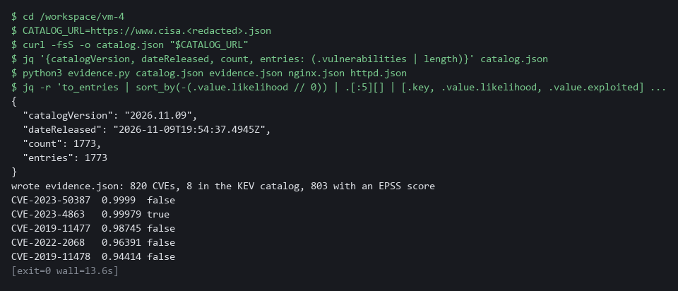

> **NOTE:** Few matches, or even zero, in the KEV catalog can be a valid answer, but only because the catalog loaded and its count matched. On the lab images a handful of CVEs (about eight) are in the catalog. Test 4 breaks the catalog on purpose.

> **YOUR TURN:** Run 2a, save evidence.py in 2b and 2c, then run 2d.

> **CHECKPOINT:** Both counts are above zero, the catalog count equals its entries, and evidence.json lists every CVE ID, most of them with an EPSS score.

> **TAKEAWAY:** A failed download must stop the run, because a missing catalog looks the same as no exploited flaws.

**How this meets the control**

- **RA-5:** This step scans two images and looks every finding up in the KEV catalog and the EPSS service. It writes the reports and evidence.json for the plan in Step 3.

### Step 3. Build the plan (RA-5 Vulnerability Monitoring and Scanning)

**Learning point: Building plan.json joins the findings, the facts and the evidence into one tier and one action for each finding on each workload.**

- Write the decision rules and the script that joins findings, facts and evidence; rank.py from the previous module reads the reports.
- A known-exploited finding is P1 on any running workload and is never suppressed, and inside a tier the highest EPSS score comes first.

What this step adds (thick lines and outlines are new):

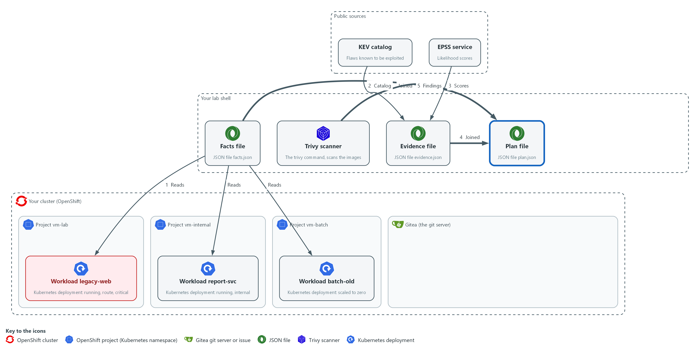

- The prioritize script joins the findings, the facts and the evidence into plan.json in your folder.

#### 3a. Create tiers.py

You will now paste this block into lab shell to create the file tiers.py in the same folder.

Look for these as you read:

- tier is the table in section 2.2 written as code. The KEV check comes first: a known-exploited finding is P1 on a running workload and P3 on one that is switched off.
- Without exploit evidence, a workload that is not running is P4, a serious finding that is exposed is P1, a serious finding in a critical project is P2, and anything else is P3.
- action turns a workload, a fix and the KEV flag into a decision: suppress, fix or exception. A known-exploited finding is never suppressed.

```bash
cd /workspace/vm-4
cat > tiers.py <<'EOF'
"""Decision rules: a priority tier and an action for one finding on one workload."""

SERIOUS = ("CRITICAL", "HIGH")


def tier(finding, workload):
    if finding["exploited"]:
        return "P1" if workload["running"] else "P3"
    serious = finding["severity"] in SERIOUS
    if not workload["running"]:
        return "P4"
    if serious and workload["exposed"]:
        return "P1"
    if serious and workload["critical"]:
        return "P2"
    return "P3"


def action(finding, workload):
    if not workload["running"] and not finding["exploited"]:
        return "suppress"
    return "fix" if finding["fix"] else "exception"
EOF
wc -l tiers.py
```

**Expected output:**

```
Example only.
22 tiers.py
```

| Part | What it does | Why you run it |
| --- | --- | --- |
| cd /workspace/vm-4 | Moves into the working folder of this module. | The file must land next to the other files, whatever folder you were in before. |
| cat > tiers.py <<'EOF' ... EOF | Writes every line between the two marker lines into the file tiers.py. The quotes around EOF keep each dollar sign and backslash exactly as typed. | Lab shell has no editor, so a block like this is how a file is made. Running it twice writes the same file again. |
| wc -l tiers.py | Counts the lines of the file you just made. | A quick check that the whole file arrived. The count should match the expected output. |
| SERIOUS | The severities that can reach P1 or P2 without exploit evidence. | Names the lab's cut-off in one place, so the tier rule is easy to find and change. |
| if finding["exploited"] | A known-exploited finding is P1 on a running workload, and P3 when nothing runs. | Evidence of exploitation outranks the guess that severity and exposure make, so it is tested first. |
| tier(finding, workload) | Without evidence: not running is P4, serious and exposed is P1, serious in a critical project is P2, anything else is P3. | This function is the table in section 2.2 written as code, so you can read the rule and test it. |
| action(finding, workload) | Not running and not known-exploited means suppress. Otherwise a fix means fix, and no fix means exception. | Turns a tier and a fix into a decision, which Steps 4 and 5 then carry out. |

#### 3b. Create prioritize.py

You will now paste this block into lab shell to create prioritize.py in the same folder, and you run it in the next block.

Look for these as you read:

- build_plan is the join. For each image it finds the workloads that run it, so one finding on two workloads becomes two rows.
- evidence[f["id"]] has no default. A finding with no evidence record stops the script with an error, so a gap cannot pass as no evidence.
- The new row is a copy of the finding with the workload and the evidence added. The original record is not changed.
- The rows are sorted by tier, then by EPSS score with missing scores last, then by CVSS score, so the top of plan.json is the most urgent work.

```bash
cd /workspace/vm-4
cat > prioritize.py <<'EOF'
"""Join reports, facts and evidence: python3 prioritize.py facts.json evidence.json plan.json IMAGE=report.json ..."""
import json
import sys

import rank
import tiers


def load(path):
    with open(path, encoding="utf-8") as handle:
        return json.load(handle)


def build_plan(facts, evidence, scans):
    rows = []
    for image, path in scans.items():
        findings = rank.load_findings(path)
        for workload in (w for w in facts if image in w["images"]):
            name = f"{workload['namespace']}/{workload['name']}"
            for f in findings:
                known = evidence[f["id"]]
                row = {**f, "workload": name, "exploited": known["exploited"], "due": known["due"], "likelihood": known["likelihood"]}
                rows.append({**row, "tier": tiers.tier(row, workload), "action": tiers.action(row, workload)})
    return sorted(rows, key=lambda r: (r["tier"], -(r["likelihood"] or 0.0), -r["score"], r["id"], r["workload"]))


def main(argv):
    scans = dict(pair.split("=", 1) for pair in argv[3:])
    plan = build_plan(load(argv[0]), load(argv[1]), scans)
    with open(argv[2], "w", encoding="utf-8") as handle:
        json.dump(plan, handle, indent=2)
    print(f"wrote {argv[2]} with {len(plan)} rows")


if __name__ == "__main__":
    main(sys.argv[1:])
EOF
wc -l prioritize.py
```

**Expected output:**

```
Example only.
36 prioritize.py
```

| Part | What it does | Why you run it |
| --- | --- | --- |
| cd /workspace/vm-4 | Moves into the working folder of this module. | The file must land next to the other files, whatever folder you were in before. |
| cat > prioritize.py <<'EOF' ... EOF | Writes every line between the two marker lines into the file prioritize.py. The quotes around EOF keep each dollar sign and backslash exactly as typed. | Lab shell has no editor, so a block like this is how a file is made. Running it twice writes the same file again. |
| wc -l prioritize.py | Counts the lines of the file you just made. | A quick check that the whole file arrived. The count should match the expected output. |
| build_plan(facts, evidence, scans) | For each image, finds the workloads that use it, and for each finding makes one row with its evidence, tier and action. | This is the join: one finding on two workloads becomes two rows with their own priorities. |
| evidence[f["id"]] | Reads the evidence record of the finding. A missing record raises an error. | A gap in the evidence must stop the run and not turn into a default. |
| {**row, ...} | Copies the finding and adds fields, so the original record is not changed. | The report data stays as it was, so the same report can be joined again. |
| sorted(rows, key=...) | Orders by tier, then by EPSS descending (no score counts as 0), then by CVSS score, CVE ID and workload. | Puts the flaws most likely to be exploited first inside each tier. |
| scans = dict(pair.split("=", 1) ...) | Reads arguments of the form IMAGE=report.json. | Lets you pair each image name with its report on the command line. |

#### 3c. Build the plan and read it

You will now build plan.json from the facts, the evidence and the two reports, read the top rows, and count the rows for each tier.

```bash
cd /workspace/vm-4
OLD_IMAGE=docker.io/library/nginx:1.16
BATCH_IMAGE=docker.io/library/httpd:2.4.38
python3 prioritize.py facts.json evidence.json plan.json "$OLD_IMAGE=nginx.json" "$BATCH_IMAGE=httpd.json"
jq -r '.[] | [.tier, .action, .workload, .severity, .id, .package, .likelihood] | @tsv' plan.json | head -12
jq -r '.[] | [.tier, .workload] | @tsv' plan.json | sort | uniq -c
```

**Expected output:**

```
Example only. Your findings and counts will differ.
wrote plan.json with <n> rows
P1	fix	vm-lab/legacy-web	<SEVERITY>	CVE-<id>	<package>	<score>
(twelve rows in all, the first ones P1 on legacy-web; the action may be fix or exception)
   <n> P1	vm-lab/legacy-web
   <n> P3	vm-lab/legacy-web
   <n> P3	vm-internal/report-svc
   <n> P4	vm-batch/batch-old
(rows for other tiers and workloads may also appear, such as P1 on report-svc or P3 on batch-old, when a CVE is in the KEV catalog)
```

| Part | What it does | Why you run it |
| --- | --- | --- |
| prioritize.py facts.json evidence.json plan.json ... | Writes plan.json. | Builds the plan from the facts, the evidence and the two reports. |
| jq -r ... @tsv \| head -12 | Prints the first twelve rows: tier, action, workload, severity, ID, package, EPSS score. | Shows the top of the plan, where the urgent rows should be. |
| jq -r '.[] \| [.tier, .workload]' \| sort \| uniq -c | Counts the rows for each tier and workload, so you can see every tier even though the plan is long. | Shows the tiers the rules produce, which shows they separate the workloads. |

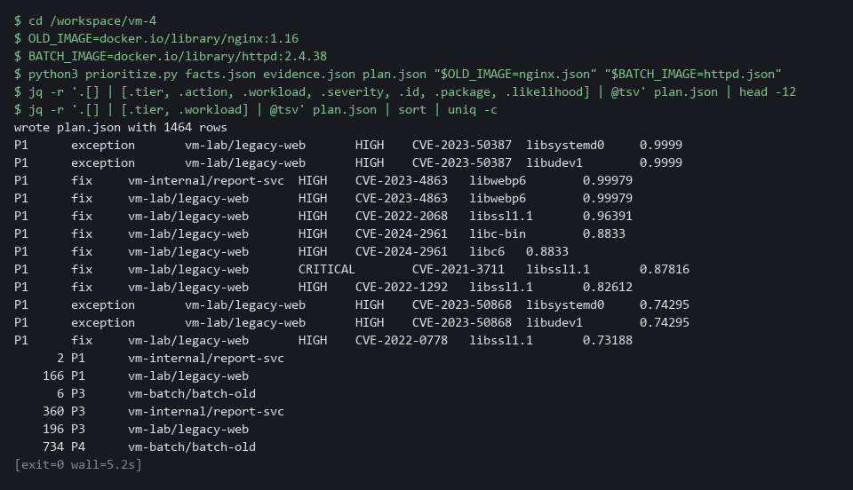

> **YOUR TURN:** Save the two files, then build and read the plan.

> **CHECKPOINT:** The first rows are P1 for legacy-web. The count shows P1 and P3 rows for legacy-web, P3 rows for report-svc, and P4 rows for batch-old (a P1 row on report-svc, or a P3 row on batch-old, is a known-exploited finding).

> **TAKEAWAY:** The same flaw gets a different priority on each workload, because the rules read facts about where it runs.

**How this meets the control**

- **RA-5:** The decision rules put known exploitation first and join the findings with the facts and the evidence. plan.json gives each finding on each workload a tier and an action.

### Step 4. Suppress with an expiry and record the exception (RA-7 Risk Response, CA-5 Plan of Action and Milestones)

**Learning point: The ignore file hides a finding on a switched-off workload until a date, and the Gitea issue records a flaw with no fix with a due date, so both decisions end by themselves.**

- You make two decisions, each with a reason and an end date 30 days from today (the lab's choice).
- A finding on batch-old, scaled to zero, is suppressed on its own image until that date.
- A finding with no fix on the exposed legacy-web becomes an exception record in Gitea with the same due date.
- The scan in block 4a needs the lab shell to reach the internet.

What this step adds (thick lines and outlines are new):

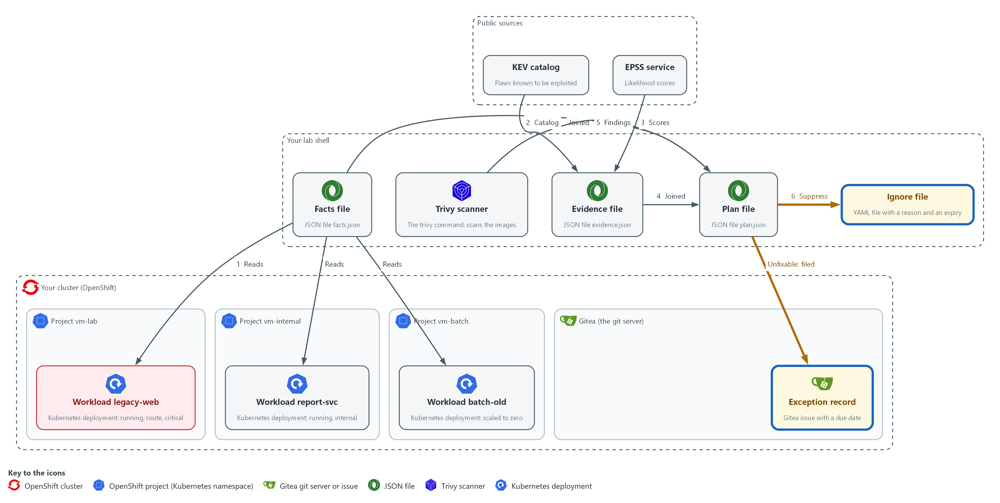

- A finding on a workload that is not running is suppressed in an ignore file in your folder, with a reason and an expiry. An unfixable finding on the exposed workload becomes an exception record, a new issue sent to the repository vm-app on Gitea.

#### 4a. Write the ignore file and check that it hides the finding

You will now pick one finding on the switched-off workload, write an ignore file with a reason and an expiry, scan with it, and count that finding with and without it.

```bash
cd /workspace/vm-4
BATCH_IMAGE=docker.io/library/httpd:2.4.38
jq -c 'map(select(.tier == "P4")) | .[0]' plan.json > suppress-row.json
SUP_CVE=$(jq -r .id suppress-row.json)
EXPIRY=$(date -u -d "+30 days" +%F)
printf 'vulnerabilities:\n  - id: %s\n    statement: "%s"\n    expired_at: %s\n' "$SUP_CVE" "Workload batch-old is scaled to zero until it is rebuilt" "$EXPIRY" > httpd.trivyignore.yaml
cat httpd.trivyignore.yaml
trivy image --scanners vuln --quiet --format json --ignorefile httpd.trivyignore.yaml --output httpd-ignored.json "$BATCH_IMAGE"
jq --arg id "$SUP_CVE" '[.Results[]?.Vulnerabilities[]? | select(.VulnerabilityID == $id)] | length' httpd.json httpd-ignored.json
```

**Expected output:**

```
Example only. Your CVE ID and dates will differ.
vulnerabilities:
  - id: CVE-<id>
    statement: "Workload batch-old is scaled to zero until it is rebuilt"
    expired_at: <date 30 days from today>
<n>
0
(the first number is the count without the ignore file, at least 1; the second is the count with it)
```

| Part | What it does | Why you run it |
| --- | --- | --- |
| jq -c ... > suppress-row.json | Saves the first P4 row, the one with the highest EPSS score. SUP_CVE then reads its ID. | Picks one finding on the switched-off workload to suppress, and keeps its ID for the next lines. |
| EXPIRY=$(date -u -d "+30 days" +%F) | The date 30 days from now, as year-month-day. | A suppression needs an end date, and the same date is used again for the exception record. |
| printf '...' > httpd.trivyignore.yaml | Writes the ignore file: the CVE ID, the reason, and the expiry date. The date must not be in quotes. | The reason and the date are written beside the CVE, so anyone who reads the file sees why it is hidden and until when. |
| --ignorefile httpd.trivyignore.yaml | Tells Trivy to hide the listed findings in this scan only. | Applies the suppression to a scan of the batch image only, so it cannot hide the flaw anywhere else. |
| jq --arg id ... httpd.json httpd-ignored.json | Counts that CVE in the scan without the ignore file, then with it. | Proves the suppression works: the count falls to zero only with the file. |

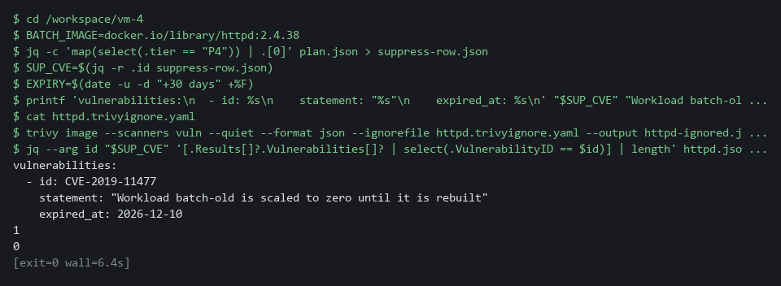

#### 4b. Record the exception in Gitea

You will now pick a finding that has no fix on the exposed workload and send it to Gitea as an issue with a due date.

```bash
cd /workspace/vm-4
EXPIRY=$(date -u -d "+30 days" +%F)
jq -c 'map(select(.tier == "P1" and .action == "exception")) | .[0]' plan.json > exception-row.json
EXC_CVE=$(jq -r .id exception-row.json)
EXC_PKG=$(jq -r .package exception-row.json)
TITLE="EXCEPTION $EXC_CVE in $EXC_PKG"
curl -s -H "Authorization: token $GITEA_TOKEN" "$GITEA_URL/api/v1/repos/$GITEA_USER/vm-app/issues?state=open&type=issues&limit=50" > open-issues.json
if jq -e --arg t "$TITLE" 'any(.[]; .title == $t) | not' open-issues.json > /dev/null; then
  jq -n --arg title "$TITLE" --arg due "${EXPIRY}T00:00:00Z" --arg body "No fix is published. Workload legacy-web is running and exposed by a route. Revisit on the due date." '{title: $title, body: $body, due_date: $due}' | curl -s -X POST -H "Authorization: token $GITEA_TOKEN" -H "Content-Type: application/json" -d @- "$GITEA_URL/api/v1/repos/$GITEA_USER/vm-app/issues" | jq '{number, title, due_date}'
else
  echo "already recorded: $TITLE"
fi
```

**Expected output:**

```
Example only.
{
  "number": <n>,
  "title": "EXCEPTION CVE-<id> in <package>",
  "due_date": "<date and time>"
}
(if you run the block a second time it prints: already recorded: EXCEPTION CVE-<id> in <package>)
```

| Part | What it does | Why you run it |
| --- | --- | --- |
| cd /workspace/vm-4 and EXPIRY=... | Moves into the folder and sets the 30-day date again. | This block runs on its own, so it sets what it needs. |
| jq -c ... > exception-row.json | Saves the first P1 row that has no fix. The next two lines read its ID and package. | Picks the finding that cannot be fixed on the exposed workload, which is the one that needs a record. |
| curl ... > open-issues.json | Saves the open issues of vm-app. | The next line checks this list, so running the block twice does not create two records of the same exception. |
| if jq -e ... not; then ... else ... fi | Creates the issue only when no open issue has this title, otherwise prints a note. | Keeps one exception record for each flaw. |
| jq -n --arg ... '{title: ..., body: ..., due_date: ...}' | Builds the issue as JSON. The title starts with EXCEPTION, the body holds the reason, and the due date is the expiry. | The reason and the date go into the record, so the exception has a cause and a review date. |
| curl -s -X POST ... -d @- | Sends the JSON that jq printed to the repository vm-app on Gitea. The dash means read the body from the pipe. | Stores the record on Gitea, where others can see it, and not only on your laptop. |
| jq '{number, title, due_date}' | Prints the fields of the new issue so you can check them. | Confirms Gitea accepted the record and kept the due date. |

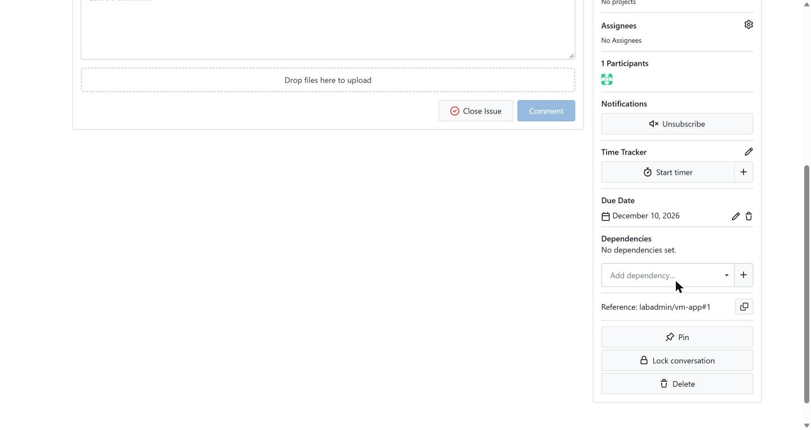

> **SECURITY:** The ignore file applies to every scan that uses it. Keep one ignore file for one image, as here, so a suppression for a workload that is switched off can never hide the same flaw in a workload that is running.

> **YOUR TURN:** Run both blocks and read the counts and the issue.

> **CHECKPOINT:** The count is 1 or more without the ignore file (more than 1 when the same CVE ID is reported for more than one package) and 0 with it, and the new issue is printed with a due date 30 days after today (the printed issue is the record that the exception is tracked).

> **TAKEAWAY:** A decision not to fix is accepted only with a reason and an end date.

**How this meets the controls**

- **RA-7:** One finding on a switched-off workload is suppressed with a written reason and an expiry. A flaw that has no fix becomes a recorded exception.
- **CA-5:** The exception is a Gitea issue with a reason and a due date. The team sees it again on the due date.

### Step 5. Fix through a branch and a pull request, then prove it (CM-3 Configuration Change Control, RA-7 Risk Response, RA-5 Vulnerability Monitoring and Scanning)

**Learning point: The branch and pull request propose the fix, and the re-scan of the new base image proves the finding is gone.**

- A fixable finding on the exposed workload is a change to the repository, so you make it on a branch.
- You clone the repository, move the Dockerfile to a newer base image, push the branch and open a pull request that names the finding.
- A pull request is a proposal, not a fix, so you then scan the base image named on the branch to check the finding is gone; that last block needs internet.

What this step adds (thick lines and outlines are new):

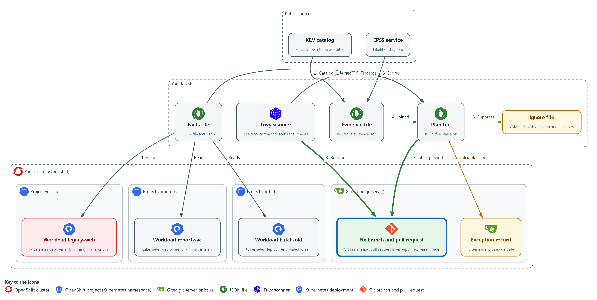

- A fixable finding on the exposed workload is fixed on a branch that you push to the repository vm-app on Gitea, and you open a pull request there. Trivy in lab shell then scans the new base image named on the branch, and the finding is gone.

#### 5a. Make the fix on a branch and push it

You will now pick a fixable finding, copy the repository, change the base image on a new branch, check the change, and push the branch to Gitea.

```bash
mkdir -p /workspace/vm-4 && cd /workspace/vm-4
jq -c 'map(select(.tier == "P1" and .action == "fix" and (.exploited | not))) | .[0]' plan.json > fix-row.json
FIX_CVE=$(jq -r .id fix-row.json)
BRANCH=fix/legacy-web-base-image
NEW_BASE=docker.io/library/nginx:1.28-alpine
rm -rf vm-app-fix
git -c 'credential.helper=!f() { echo username=$GITEA_USER; echo password=$GITEA_TOKEN; }; f' clone --quiet "$GITEA_URL/$GITEA_USER/vm-app.git" vm-app-fix
cd vm-app-fix
git config credential.helper '!f() { echo username=$GITEA_USER; echo password=$GITEA_TOKEN; }; f'
git config user.name "$GITEA_USER"
git config user.email "$GITEA_USER@example.invalid"
git checkout -b "$BRANCH"
sed -i "s#^FROM .*#FROM $NEW_BASE#" Dockerfile
git diff
git commit --quiet -am "Move base image to $NEW_BASE ($FIX_CVE)"
git push --quiet --force origin "$BRANCH"
```

**Expected output:**

```
Example only. Your old base image will differ.
Switched to a new branch 'fix/legacy-web-base-image'
diff --git a/Dockerfile b/Dockerfile
(header lines)
-FROM <old base image>
+FROM docker.io/library/nginx:1.28-alpine
(the commit prints nothing because of --quiet; the push may print a few lines that start with remote: and offer a link to open a pull request, which is harmless)
```

| Part | What it does | Why you run it |
| --- | --- | --- |
| rm -rf vm-app-fix | Removes an older copy, so that the clone works if you run this block again. | A clone fails if the folder already exists. |
| FIX_CVE=$(jq ... plan.json) | Reads the ID of the first P1 row that has a published fix and is not known-exploited. The Tests use this finding to show the effect of context and of evidence. | Picks the finding to fix, and keeps its ID for the commit message and the pull request. It is set again here so the block runs on its own. |
| git -c '...' clone ... vm-app-fix | Copies the repository from Gitea into a new folder. The -c part gives git a helper for this one command that prints your Gitea user name and token when git asks. | You change a copy, not the repository on the server, so nothing changes until you push. |
| git config credential.helper ... | Saves the same helper in this copy so push works. The file stores the variable names, not the token value. | Lets push sign in without you typing the token. |
| git config user.name / user.email | Tells git who you are, so the commit carries a name. The address is a placeholder. | Git refuses to commit without a name. |
| git checkout -b | Makes a branch and moves onto it. | The fix goes on its own branch, so main stays as it is until someone reviews the change. |
| sed -i "s#^FROM .*#FROM ...#" Dockerfile | Replaces the whole FROM line of the Dockerfile with the new base image. The # signs are used as separators because the image name has slashes. | This one-line change is the fix itself: a newer base image has fewer flaws. |
| git diff | Shows the one-line change so you can check it. | Confirms that only the FROM line changed before you save it. |
| git commit --quiet -am | Saves the change on the branch. | The commit message names the CVE, so the change can be traced back to the finding. |
| push --force origin "$BRANCH" | Sends the branch to the repository vm-app on Gitea. --force replaces an older copy of this branch from an earlier run. | A pull request needs the branch on the server. The force only touches this practice branch, and it lets you run the block again. |

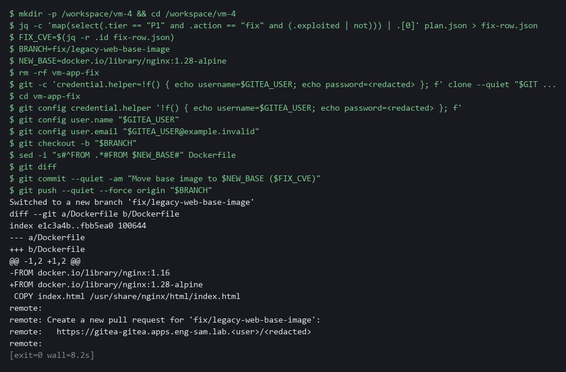

#### 5b. Open the pull request

You will now ask Gitea to open a pull request from the branch into main, and you do not merge it.

```bash
cd /workspace/vm-4
BRANCH=fix/legacy-web-base-image
jq -c 'map(select(.tier == "P1" and .action == "fix" and (.exploited | not))) | .[0]' plan.json > fix-row.json
FIX_CVE=$(jq -r .id fix-row.json)
jq -n --arg head "$BRANCH" --arg title "Fix $FIX_CVE: move the base image" --arg body "Priority P1 on legacy-web: running, exposed by a route, in a critical project, and a fix exists. Re-scan the new base image before merging." '{head: $head, base: "main", title: $title, body: $body}' | curl -s -X POST -H "Authorization: token $GITEA_TOKEN" -H "Content-Type: application/json" -d @- "$GITEA_URL/api/v1/repos/$GITEA_USER/vm-app/pulls" | jq '{number, state, title}'
```

**Expected output:**

```
Example only.
{
  "number": <n>,
  "state": "open",
  "title": "Fix CVE-<id>: move the base image"
}
(if you run the block a second time Gitea refuses a second pull request for the same branch, and the three fields print as null; that is fine)
```

| Part | What it does | Why you run it |
| --- | --- | --- |
| BRANCH=... and FIX_CVE=... | Sets the branch name and reads the finding ID again. | This block runs on its own, so it sets what it needs. |
| jq -n --arg head ... '{head, base, title, body}' | Builds the pull request: from the branch into main, with a title and a body that gives the reason. | The body states why the change is urgent, so the reviewer knows what to check. |
| curl -s -X POST ... /pulls | Opens the pull request in the repository vm-app on Gitea. | A pull request is where the change is reviewed and approved before it reaches main. |

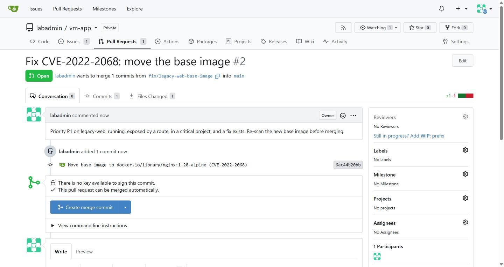

#### 5c. Scan the new base image and compare

You will now read the base image from the branch, scan it, check that the finding is gone, and compare the finding counts.

```bash
cd /workspace/vm-4
jq -c 'map(select(.tier == "P1" and .action == "fix" and (.exploited | not))) | .[0]' plan.json > fix-row.json
FIX_CVE=$(jq -r .id fix-row.json)
SCAN_BASE=$(sed -n 's/^FROM //p' vm-app-fix/Dockerfile | head -n 1)
echo "$SCAN_BASE"
trivy image --scanners vuln --quiet --format json --output nginx-new.json "$SCAN_BASE"
jq --arg id "$FIX_CVE" -e '[.Results[]?.Vulnerabilities[]? | select(.VulnerabilityID == $id)] | length == 0' nginx-new.json
echo "exit code: $?"
jq '[.Results[]?.Vulnerabilities[]?] | length' nginx.json nginx-new.json
```

**Expected output:**

```
Example only. Your counts will differ.
docker.io/library/nginx:1.28-alpine
true
exit code: 0
<n>
<n>
(the second count is lower than the first)
```

| Part | What it does | Why you run it |
| --- | --- | --- |
| FIX_CVE=$(jq ... plan.json) | Reads the finding ID again. | This block runs on its own, so it sets what it needs. |
| sed -n 's/^FROM //p' ... | Prints the part of the FROM line after FROM, which is the image name. | Reads the base image from the branch itself, so you scan what the branch really names. |
| trivy image ... nginx-new.json | Scans the new base image. | A fresh scan is the proof, because a pull request is only a proposal. |
| jq --arg id ... -e '... length == 0' | Prints true and exits 0 only when the finding is absent. -e makes the exit code follow the result. | Turns the check into a yes or no that a script could also use. |
| jq ... nginx.json nginx-new.json | Prints the number of findings before and after. | Shows how much the change helped overall, not only for one CVE. |

> **YOUR TURN:** Run the three blocks. Do not merge the pull request.

> **CHECKPOINT:** The diff shows one changed FROM line, the pull request is open, and the re-scan prints true with the exit code 0 and a lower second count.

> **TAKEAWAY:** A pull request is a proposal, and only a new scan is proof.

**How this meets the controls**

- **CM-3:** The fix is made on its own branch, and a pull request names the finding. Nothing reaches main until someone reviews it.
- **RA-7:** The pull request proposes the fix that mitigates the risk. A reviewer approves it.
- **RA-5:** The last block scans the new base image named on the branch and checks that the finding is gone. It prints the finding counts before and after.

## Section 4. Verify It Works

### Test 1 (positive). Context and exploit evidence change the priority of one finding (RA-5 Vulnerability Monitoring and Scanning)

- One CVE in one image appears on two running workloads that differ only in how they run.
- You change one fact in a copy of the evidence, marking that CVE as known-exploited, and build a test plan.
- Your real evidence.json and plan.json stay as they are.

```bash
cd /workspace/vm-4
OLD_IMAGE=docker.io/library/nginx:1.16
BATCH_IMAGE=docker.io/library/httpd:2.4.38
jq -c 'map(select(.tier == "P1" and .action == "fix" and (.exploited | not))) | .[0]' plan.json > fix-row.json
FIX_CVE=$(jq -r .id fix-row.json)
jq -r --arg id "$FIX_CVE" '.[] | select(.id == $id) | [.workload, .tier, .action] | @tsv' plan.json
jq --arg id "$FIX_CVE" --arg due "$(date -u +%F)" '.[$id].exploited = true | .[$id].due = $due' evidence.json > evidence-test.json
python3 prioritize.py facts.json evidence-test.json plan-test.json "$OLD_IMAGE=nginx.json" "$BATCH_IMAGE=httpd.json"
jq -r --arg id "$FIX_CVE" '.[] | select(.id == $id) | [.workload, .tier, .action, .exploited] | @tsv' plan-test.json
```

**Expected output:**

```
Example only.
vm-lab/legacy-web	P1	fix
vm-internal/report-svc	P3	fix
wrote plan-test.json with <n> rows
vm-lab/legacy-web	P1	fix	true
vm-internal/report-svc	P1	fix	true
(the two lines in each pair may print in the opposite order)
```

| Part | What it does | Why you run it |
| --- | --- | --- |
| cd /workspace/vm-4, then image names and FIX_CVE | Moves into the folder and sets the variables again. | This block runs on its own, so it sets what it needs. |
| jq ... select(.id == $id) ... plan.json | Lists the real plan rows for one CVE ID: workload, tier and action. | Shows the same flaw with a different tier on each workload. |
| jq ... .[$id].exploited = true ... > evidence-test.json | Makes a copy of the evidence in which that CVE is marked known-exploited. | Your real evidence.json stays as it is. |
| prioritize.py ... evidence-test.json plan-test.json ... | Builds a test plan from the changed copy. | Shows what exploitation does to the tier. |
| The two lines before and the two lines after "wrote plan-test.json" | The first pair is the real plan. The last pair is the test plan. | Known exploitation raises the internal workload from P3 to P1. |

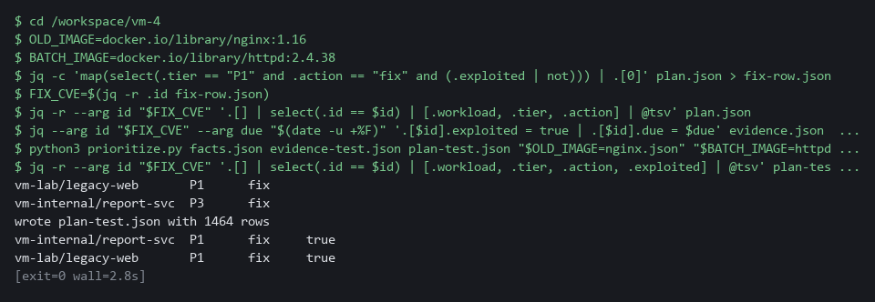

> **CHECKPOINT:** In the real plan legacy-web is P1 and report-svc is P3 for the same CVE ID. In the test plan, with the evidence changed, both are P1.

**How this meets the control**

- **RA-5:** One CVE ID is P1 on the exposed workload and P3 on the internal one. When a test copy of the evidence marks it known-exploited, both become P1.

### Test 2 (negative). An expired suppression stops hiding the finding (RA-7 Risk Response)

- A suppression that never ends is a hidden risk.
- Copy the ignore file, change the expiry to yesterday, scan again, and see the finding return.

```bash
cd /workspace/vm-4
BATCH_IMAGE=docker.io/library/httpd:2.4.38
SUP_CVE=$(jq -r .id suppress-row.json)
EXPIRED=$(date -u -d "-1 days" +%F)
sed "s/expired_at: .*/expired_at: $EXPIRED/" httpd.trivyignore.yaml > httpd-expired.yaml
trivy image --scanners vuln --quiet --format json --ignorefile httpd-expired.yaml --output httpd-expired.json "$BATCH_IMAGE"
jq --arg id "$SUP_CVE" '[.Results[]?.Vulnerabilities[]? | select(.VulnerabilityID == $id)] | length' httpd-expired.json
```

**Expected output:**

```
Example only. The same count as the first number printed in Step 4 (1 or more).
1
```

| Part | What it does | Why you run it |
| --- | --- | --- |
| cd /workspace/vm-4, BATCH_IMAGE, SUP_CVE | Moves into the folder and sets the image and the suppressed CVE again. | This block runs on its own, so it sets what it needs. |
| sed "s/expired_at: .*/expired_at: $EXPIRED/" ... | Copies the ignore file with the expiry changed to yesterday. | An expiry in the past should end the suppression. |
| trivy image ... --ignorefile httpd-expired.yaml | Scans again with the expired file. | Trivy should ignore an entry whose date has passed. |
| 1 | The finding is counted again. | The suppression ended by itself. |

> **CHECKPOINT:** The count is back to the number you saw without the ignore file, and not 0. With a date in the past the suppression no longer applies, with no one having to remember it.

**How this meets the control**

- **RA-7:** The expiry is set to yesterday and the image is scanned again. The finding returns, so the suppression ends by itself.

### Test 3 (negative). A branch alone does not fix the running workload (CM-3 Configuration Change Control, RA-5 Vulnerability Monitoring and Scanning)

- The pull request is open and the new base image no longer shows the finding, but nothing has been built or deployed.
- Ask the cluster what legacy-web runs now, and whether the old finding is still in the plan.

```bash
cd /workspace/vm-4
jq -c 'map(select(.tier == "P1" and .action == "fix" and (.exploited | not))) | .[0]' plan.json > fix-row.json
FIX_CVE=$(jq -r .id fix-row.json)
oc get deployment legacy-web -n vm-lab -o jsonpath='{.spec.template.spec.containers[0].image}{"\n"}'
jq --arg id "$FIX_CVE" '[.[] | select(.id == $id and .workload == "vm-lab/legacy-web")] | length' plan.json
```

**Expected output:**

```
Example only. The second number is 1 or more, because the same CVE ID can be reported for more than one package.
docker.io/library/nginx:1.16
1
```

| Part | What it does | Why you run it |
| --- | --- | --- |
| cd /workspace/vm-4 and FIX_CVE=... | Moves into the folder and reads the finding ID again. | This block runs on its own, so it sets what it needs. |
| oc get deployment legacy-web ... jsonpath | Prints the image the running workload uses. | The cluster still runs the old image, so the pull request has not changed it. |
| jq ... length plan.json | Counts the plan rows for the finding on legacy-web. | The finding is still in the plan until a rebuilt image is deployed. |

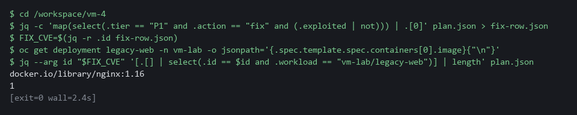

> **CHECKPOINT:** The workload still runs the old image and the finding is still in the plan. The finding is closed only after a rebuilt image is deployed and the plan is built again.

**How this meets the controls**

- **CM-3:** The pull request is still a proposal, so the cluster still runs the old image. The change takes effect only after review, a build and a deployment.
- **RA-5:** The finding stays in the plan because the running workload is unchanged. It closes only after a rebuilt image is deployed and the plan is built again.

### Test 4 (negative). An empty or cut-short KEV catalog is refused (RA-5 Vulnerability Monitoring and Scanning)

- If the download fails or is cut short, the catalog holds no entries, and every finding would look as if nobody exploits it.
- Empty a copy of the catalog and run the script on it.

```bash
cd /workspace/vm-4
jq '.vulnerabilities = [] | .count = 0' catalog.json > catalog-empty.json
python3 evidence.py catalog-empty.json evidence-empty.json nginx.json httpd.json
echo "exit code: $?"
ls evidence-empty.json
```

**Expected output:**

```
Example only.
cannot build evidence: KEV catalog is empty or its count does not match its entries
exit code: 2
ls: cannot access 'evidence-empty.json': No such file or directory
```

| Part | What it does | Why you run it |
| --- | --- | --- |
| cd /workspace/vm-4 | Moves into the working folder. | The files are read from here. |
| jq '.vulnerabilities = [] \| .count = 0' ... > catalog-empty.json | Makes a copy of the catalog with no entries. | This is what a failed download would leave. |
| evidence.py catalog-empty.json ... | Runs the evidence script on the empty copy. | The script must refuse it. |
| exit code: 2 | The script stopped with its error code. | A failed catalog must not read as no known exploitation. |
| ls evidence-empty.json | Tries to list the output file. | The error shows that no file was written. |

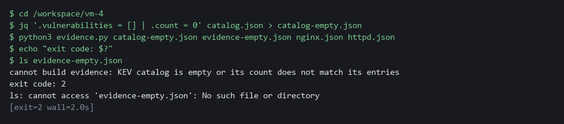

> **CHECKPOINT:** The message names the empty catalog, the exit code is 2, and no evidence file exists.

**How this meets the control**

- **RA-5:** An emptied copy of the catalog makes the evidence script exit with 2 and write no file. A failed download therefore cannot read as no known exploitation.

## Section 5. What Each Control Is For

### Control mapping

| Control | What it requires, in plain words | Tool or service | Where this module covers it |
| --- | --- | --- | --- |
| RA-5 Vulnerability Monitoring and Scanning | Analyze scan results and remediate legitimate vulnerabilities within organization-defined response times, in accordance with an organizational assessment of risk. | The Python files collect_facts.py, evidence.py, tiers.py and prioritize.py, and Trivy for the re-scan. Explained in section 2.1. | Section 3, Steps 1 to 3: the risk assessment is built from cluster facts and exploit evidence. Section 3, Step 5: a re-scan proves the fix. Section 4, Test 1: one finding gets different priorities, and known exploitation raises it. Section 4, Test 4: a missing catalog is refused. |
| RA-7 Risk Response | Respond to findings from assessments, monitoring and audits in accordance with the organization's risk tolerance. | A Trivy ignore file that hides a finding, and a Gitea issue for exceptions. Explained in sections 2.2 and 2.3. | Section 3, Step 4: a suppression is recorded with a reason and an expiry, and an exception with a due date. Section 3, Step 5: the risk is mitigated by fixing. Section 4, Test 2: an expired suppression stops hiding the finding. |
| CA-5 Plan of Action and Milestones | Keep a plan of action and milestones that documents the planned fix for each known weakness, and update it at an organization-defined frequency. | A Gitea issue with a due date, used as the exception record. Explained in section 2.3. | Section 3, Step 4: the exception record is created as a Gitea issue with a due date. |
| CM-3 Configuration Change Control | Review and approve changes before they are made, and document the decision. | A Gitea branch and pull request. Explained in section 2.4. | Section 3, Step 5: the fix is made on a branch and a pull request is opened, so the change is reviewed before it reaches main. Section 4, Test 3: the branch alone does not change the running workload. |

### What each control is for

Each table below says what the control is trying to prevent and how this module's tool meets it.

#### RA-5 Vulnerability Monitoring and Scanning

| Question | Answer |
| --- | --- |
| Control Intent | Every finding is treated alike, so the exposed, running service waits behind findings in something switched off. |
| The operational question | For this finding, is the affected workload running, reachable from outside the cluster, and in a project we have marked critical, and is the flaw known to be exploited? |
| What evidence proves it | The facts file, the evidence file, the plan with its tier and action, and the rule that produced them. |
| How much is enough | Remediation follows an assessment of risk, with response times set by the organization. A flaw on the known-exploited list is P1 here and carries the date of the list. The previous module's deadlines.py holds the lab's own response times (15 days for Critical, 30 for High and 90 for Medium), and this module does not recompute them. This module sets the tiers and the actions, by the lab's own rules. |
| How the tool in this module satisfies it | collect_facts.py reads the cluster, evidence.py reads the two public sources, tiers.py applies the rules, and prioritize.py writes the plan (Steps 1 to 3). |

#### RA-7 Risk Response

| Question | Answer |
| --- | --- |
| Control Intent | A finding is silenced with no reason and no end date, and years later nobody knows why it is not reported. |
| The operational question | For each finding we are not fixing, who decided, why, and when does the decision end? |
| What evidence proves it | A reason and an expiry beside every suppression, and a due date on every exception. |
| How much is enough | Risk is mitigated or accepted with justification. The lab requires a written reason and a 30-day expiry on every suppression and exception, which is the lab's choice. An expired suppression stops hiding the finding by itself. |
| How the tool in this module satisfies it | An ignore file with statement and expired_at, and a Gitea issue with a due date (Step 4). Test 2 shows an expired entry stop working. |

#### CA-5 Plan of Action and Milestones

| Question | Answer |
| --- | --- |
| Control Intent | A flaw with no fix is dropped from view, and the people who accept the risk never see it again. |
| The operational question | Where is the record of each flaw we cannot fix yet, and when is it next reviewed? |
| What evidence proves it | One tracked item for each open weakness, with its date. NIST says to document the planned remediation actions in the plan. |
| How much is enough | NIST requires the plan to document planned remediation actions. The lab's Gitea issue records the cause and a due date. The official record is kept in the organization's system of record. The Gitea issue teaches the fields. |
| How the tool in this module satisfies it | A Gitea issue titled EXCEPTION with the CVE ID and package, a body with the reason, and a due date (Step 4). |

#### CM-3 Configuration Change Control

| Question | Answer |
| --- | --- |
| Control Intent | A fix is pushed straight to main, nobody reviews it, and it breaks the release or does not fix the flaw. |
| The operational question | Was the change that fixed this finding proposed, reviewed and recorded before it took effect? |
| What evidence proves it | A branch, a pull request that names the finding, and a re-scan of the new base image. |
| How much is enough | Changes are reviewed and decisions are documented. The branch and pull request are that record. Merging and deploying happen after review and are not done in this module. |
| How the tool in this module satisfies it | A branch fix/legacy-web-base-image and a pull request created through the Gitea API (Step 5). |

## Section 6. Next Steps

### Using this in other environments

- Trivy, the KEV and EPSS lookups, git, the Gitea API calls and the Python ranking code are standard and run anywhere they can reach their sources.
- Change these lab values first: GITEA_URL, GITEA_USER and GITEA_TOKEN, the repository vm-app, the namespaces vm-lab, vm-internal and security-tools, the criticality=high label, and the three public images.
- The exposure check reads OpenShift Route objects. On other Kubernetes it must read Ingress objects, or Services of type LoadBalancer or NodePort, so that part of the facts code must be rewritten.
- The KEV and EPSS sources are public. A cluster with no internet needs its own copy of both.

The table shows each part of this lab, what it becomes on other platforms, and what you change:

| Check | In this lab (OpenShift) | On other platforms | What you change |
| --- | --- | --- | --- |
| Read the cluster facts | oc get deployments, services and routes with -A, through facts_lib.py | kubectl get with the same objects, except routes | The command name in facts_lib.py. |
| Exposed from outside | A Route that points to a Service of the workload | An Ingress that points to the Service, or a Service of type LoadBalancer or NodePort | Rewrite is_exposed for those objects. |
| Critical project | The label criticality=high on the namespace | Your own label or inventory | The label name and value. |
| Exploit evidence | The public KEV JSON feed and the EPSS API | The same sources, or a mirror | The URLs if you mirror them. |
| Coordinate the fix | Gitea branch, push and pull request, with a credential helper | Your git host's branch and pull request, with its token method | The URL, the token method and the API calls. |
| Re-scan after the fix | trivy image on the new base image | The same | The image references. |

> **TIP:** Next module: VM-5 Risk-Based Gate in Delivery: turn these rules into a team-level gate in a Tekton pipeline, with exceptions as code that the gate enforces, and measure whether it works.

<details>
<summary><strong>Section 7. Terms</strong></summary>

Each term is also explained the first time it appears. In Word, hover over an underlined term to see its meaning, or Ctrl+click it to jump to this table.

| Term | Plain meaning |
| --- | --- |
| Base image | The image named on the FROM line of a Dockerfile, which supplies the operating system packages. |
| Branch | A named line of changes inside a repository. main is the main one. |
| Clone | Copy a repository from a server into a folder of your own. |
| Cluster | A group of servers that work together as one system. Here it is your own OpenShift cluster. |
| Commit | One saved snapshot in git, with a short message. |
| Container | A sealed box that holds one program and everything it needs to run, so it runs the same way anywhere. |
| Context | Facts about the place a flaw sits: whether the workload is running, reachable from outside, and in a critical project. |
| Credential | A secret that proves who you are, such as a password, token or key. |
| CVE | Common Vulnerabilities and Exposures: a public ID for one known flaw. |
| CVSS | Common Vulnerability Scoring System: a score from 0 to 10 for how severe a flaw is. |
| Deployment | A cluster object that keeps a set number of copies of a program running. |
| diff | A command that shows the differences between two files. |
| Dockerfile | A text file that tells a build how to make an image. Its FROM line names the base image. |
| EPSS | Exploit Prediction Scoring System: a public score from 0 to 1 for how likely a flaw is to be exploited. |
| Evidence | Saved records that show a system is set up and behaving as claimed. |
| Exception record | A tracked record of a flaw with no fix that the team accepts for a limited time. |
| Exit code | A number a command returns when it ends: zero means it ran properly, anything else means it failed. |
| Exploit | Code or a method that takes advantage of a vulnerability. |
| Finding | One thing a scan reports: a flaw in a package or a bad setting, with a severity. |
| Gitea | A git server that runs in your lab. It holds the repository vm-app, the pull requests and the issues. |
| Gitea API | The web address and rules a script or curl uses to read and change Gitea without the web page. |
| grep | A command that prints only the lines that match a pattern. |
| Header | A line of extra information sent with a web request, such as a sign-in token. |
| Heredoc | A way to make a file by pasting its text between a first line such as cat > name <<'EOF' and a last line that says EOF. |
| HTTP | The protocol that web pages and web APIs use. HTTPS is the encrypted form. |
| Ignore file | A YAML file that tells Trivy which findings to hide, each with a reason and an expiry date. |
| Image | A packaged copy of a program and the files it needs. A container starts from an image. |
| Ingress | The way traffic from outside the cluster reaches a program inside it. |
| Inventory | A list of the parts of a system; in Ansible, the machines a playbook runs against. |
| Issue | A tracked item in Gitea with a title, a body and an optional due date. |
| jq | A tool that picks one value out of JSON text. |
| JSON | A plain-text format for data: names and values written inside curly braces. |
| KEV catalog | Known Exploited Vulnerabilities: a public list of flaws that attackers are known to use. Each entry carries a due date. |
| Kubernetes | The open-source system that runs and manages containers across servers. OpenShift is built on it. |
| Label | A key=value tag on a cluster object, such as criticality=high. Services and the scripts pick objects by label. |
| Merge | Combine the changes from one git branch into another. |
| mkdir | A command that makes a new folder. |
| Namespace | A named section of the cluster that holds a set of related parts. |
| NIST | The US National Institute of Standards and Technology. It publishes the security control catalog these modules cite. |
| oc | The command-line tool for OpenShift. You type oc to ask the cluster questions. |
| OpenShift | The Red Hat platform your lab cluster runs on. It is Kubernetes with extra security and tools built in. |
| Pipeline | A set of automated steps that run in order, such as scan, check and sign. |
| Pod | The smallest running unit on the cluster: one or more containers together. |
| printf | A command that prints text in a set format. |
| Project | A named section of the cluster that keeps workloads apart. OpenShift also calls it a namespace. |
| Pull request | A request to merge a branch into main, which lets someone review the change first. |
| Remediate | Fix a finding, for example by upgrading a package or changing a setting. |
| Replica | One running copy of a pod. A workload scaled to zero has no replicas, so nothing runs. |
| Repository | A folder whose history git tracks, so you can see what changed and when. |
| Route | An OpenShift object that makes a Service reachable from outside the cluster. |
| Rule | A written condition that a tool checks. |
| Scan | A run of a tool that compares what it reads with a database of known flaws and bad settings. |
| Schema | The expected shape of data: which fields it has and what type each one is. |
| sed | A command that edits text as it passes through, often to replace one string with another. |
| Selector | The labels a Service uses to choose which pods it sends traffic to. |
| Service | A stable address inside the cluster for a set of pods, chosen by labels. |
| Severity | How serious a finding is, such as low, medium, high or critical. |
| Signature | A value made with a private key that shows who made something and that it was not changed. |
| Suppression | Telling the scanner to hide one finding, here with a written reason and an expiry date. |
| Tekton | The pipeline engine in OpenShift Pipelines. It runs each pipeline step in a container. |
| Threshold | The limit at which something is counted or an alert fires. |
| Tier | A priority label, P1 (most urgent) to P4 (least urgent). |
| Token | A secret string that proves who you are to a server, used here in place of a password. |
| Trivy | A free, open source scanner for images, folders and configuration files. |
| TSV | Tab-separated values: a table written as text, with a tab between columns. |
| uniq | A command that removes repeated neighbouring lines. |
| URL | A web address, such as https://example.com/page. |
| Workload | A program running in the cluster, here a Deployment (the object that keeps a set of identical pods running). |
| YAML | A plain-text format for settings: lines of name: value, with indentation to show what belongs to what. |

</details>
