# VM-5: Risk-Based Gate in Delivery (RA-5, SI-2, SA-11)

| Item | Detail |
| --- | --- |
| Sequence | Module 25 of 29 in the recommended order |
| Timed work | About 73 minutes (55 hands-on, 18 verify) |
| Standalone start | `lab start vm-5` |
| Combined start | Continue from the end state of the previous module |
| Tools | OpenShift Container Platform, OpenShift Pipelines (Tekton), Trivy (free, open source), Gitea (free, open source), python3, tkn, oc, jq |
| Prerequisites | ENG-0 Terminal, Git and Your Lab (typing commands in lab shell, reading oc output), VM-4 Prioritize by Context and Validate (what the KEV catalog is, and why an exception needs a reason and an expiry; the start state supplies every file) |

## Section 1. Module Overview

- Purpose: show that vulnerability blocking is automated, evidence-based and measurable (RA-5, SI-2, SA-11).
- You choose the gate rules by counting what each would block, write the rule-matching function, build the gate from supplied parts and run it on fixtures.
- You run the gate as a shared Tekton task in a pipeline, measure coverage and time to fix, and patch other team pipelines to inherit the same gate.

- **Skill:** Choose vulnerability gate rules by counting what each would block, write the rule-matching function, build a gate that fails closed on missing inputs, run it in a shared pipeline task, and measure coverage and time to fix.
- **Tools:** OpenShift runs the cluster and OpenShift Pipelines; Trivy scans the base image for HIGH and CRITICAL findings; a Python gate evaluates findings against rules, exceptions and a ledger; Tekton runs scan and gate as shared tasks; tkn starts a pipeline run and shows its log; Gitea holds team exceptions under review; oc applies the files and patches other pipelines to call the same tasks; jq counts findings and reads values out of JSON.
- **Security Function:** Blocks fixable critical findings and known-exploited flaws from reaching production; expires exceptions automatically on their date without anyone acting; measures the time from first seen to fixed for each finding.
- **NIST RA-5 Vulnerability Monitoring and Scanning:** Trivy and the gate automate the scan and the decision; policy.json states the rules chosen by counting what each would block; the known-exploited list blocks any listed flaw regardless of severity or fix.
- **NIST SI-2 Flaw Remediation:** The ledger records the first-seen and fixed date for each finding; the gate reports the mean and maximum days from first seen to fixed on every run.
- **NIST SA-11 Developer Testing and Evaluation:** The gate is run on fixtures in both directions before the pipeline; it exits with 2 when any input is missing, so a broken input fails closed instead of passing.

## Section 2. The Tools

### Tools used in this module

Each tool name links to its official overview. The table columns say how each tool is used in the lab and why the lab uses it instead of another way of doing the same job.

| Tool (overview link) | What it is | Used in this lab | Why this tool |
| --- | --- | --- | --- |
| [OpenShift Container Platform](https://docs.redhat.com/en/documentation/openshift_container_platform/4.22/html/overview/ocp-overview) | A Kubernetes container platform for running and managing containerized applications. | The cluster that runs the shared gate and holds the application scanned. | It is the platform the whole lab runs on, so every module works on the same real cluster, with the same kinds of objects a production OpenShift system has. |
| [OpenShift Pipelines (Tekton)](https://docs.redhat.com/en/documentation/openshift_container_platform/4.22/html/pipelines/index) | Kubernetes-native CI/CD built on Tekton. | Runs the gate as shared tasks: risk-scan and the gate task. | It runs automated tasks inside the cluster, so you can see a check run with no person at the keyboard and under its own limited identity. A script run from a laptop could not show that. |
| [Trivy](https://trivy.dev/) | Scans images, code and clusters for known flaws and misconfigurations. | Finds the base image and scans it. | It scans images and clusters for known flaws and bad settings from the command line and is free and open source, so the same scan can run by hand and in a pipeline. |
| [Gitea](https://docs.gitea.com/) | A lightweight self-hosted git server. | Holds the application repository. | It gives the lab a git server of its own, so you can push and review changes without an outside account. |
| [Python 3](https://docs.python.org/3/tutorial/introduction.html) | General-purpose language, used here for small helper scripts. | You write gate_rules.py, gate_exceptions.py and gate.py, and run the gate. | Python reads and writes JSON easily and is already in the lab shell, so a small script needs nothing installed. |
| [tkn](https://docs.redhat.com/en/documentation/openshift_container_platform/4.22/html/cli_tools/pipelines-cli-tkn) | Command-line tool for managing pipelines, runs and tasks. | Starts and follows gate runs. | It starts and reads pipeline runs from the terminal, so the same shell you use for everything else drives the pipeline. The other way is the web console, which cannot be pasted into a step. |
| [oc](https://docs.redhat.com/en/documentation/openshift_container_platform/4.22/html/cli_tools/openshift-cli-oc) | The OpenShift command-line tool for creating and managing applications and projects from a terminal. | Applies the ConfigMap and tasks. | It is the one command that talks to the cluster, so every module uses it to ask what is true and to make changes. You sign in once, and it works on OpenShift objects as well as standard Kubernetes ones. Unlike clicking in the web console, a command can be pasted, repeated and checked by a test. |
| [jq](https://jqlang.org/) | Command-line JSON processor. | Reads the scan and result files. | It picks one field out of a long JSON reply, so a test can read a single value. |

### How it fits together

#### A shared gate that every team pipeline inherits

- A team pipeline clones the repository, scans the base image, and calls the shared gate.
- The gate reads the platform's rules and code from one ConfigMap, the team's exceptions from the repository, and a ledger of first-seen dates from a volume.
- The gate passes or blocks, and reports the time to fix and the expired exceptions.
- The lab (test) setup keeps the ledger as a file on a volume, with the rules in a ConfigMap you create yourself.
- In production the ledger lives in a database or tracking system, the platform team owns the ConfigMap through reviewed changes, and a scheduled job refreshes the known-exploited list.
- Each step below adds one part, drawn with thick lines.

How the lab is set up, and why:

- You still work in the same lab shell as in earlier modules, but this module moves the decision into the cluster, where a pipeline runs it with nobody at the keyboard.
- The earlier modules scanned, ranked and tracked findings by hand; this one adds a gate that runs inside every team pipeline in the project build.
- The team's code and its exceptions file stay in the repository on Gitea, so a change to either one is reviewed like any other change.
- The rules and the gate code sit in one ConfigMap owned by the platform, so every team pipeline inherits the same rules and a team cannot change them alone.
- The ledger sits on a volume in the project build, because the gate needs a memory of first-seen dates that lasts from one run to the next.

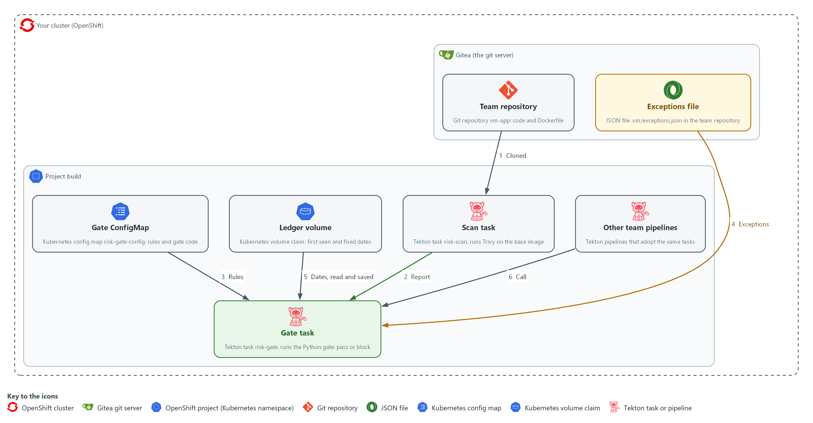

- **1. Team repository:** the repository vm-app on Gitea. It holds the team's code, Dockerfile and exceptions file.
- **2. Exceptions file:** a JSON file at .vm/exceptions.json in the team repository, listing accepted findings with a reason, an owner and an expiry date.
- **3. Gate ConfigMap:** a record in the project build that holds the policy file and all gate code. The platform owns it.
- **4. Scan task (risk-scan):** reads the base image from the Dockerfile and scans it with Trivy, writing scan.json.
- **5. Gate task (risk-gate):** evaluates scan.json against the policy rules, exceptions and ledger; fails the pipeline when a rule blocks; writes a summary result.
- **6. Ledger volume:** a disk claim in the project build that holds first-seen and fixed dates between runs.
- **7. Other team pipelines:** team-b-release and team-c-release, patched to call the same scan and gate tasks.

Where each part runs, and why:

| Part | Where it runs | Why it is built this way |
| --- | --- | --- |
| Team repository and exceptions file | On Gitea, inside your cluster | The code and its exceptions are reviewed in the place where the team already works. |
| Gate ConfigMap | The project build, in the cluster | One platform-owned copy of the rules and code, so every pipeline that calls the gate gets the same rules. |
| Scan task and gate task | Pods in the project build, started by OpenShift Pipelines | Shared tasks cost a team a few lines, and they run with no person at the keyboard. |
| Ledger volume | A volume claim in the project build | A scan has no memory, so the first-seen dates are kept on disk between runs. |
| Other team pipelines | The project build | They show that the gate becomes the default for every team and not only for one pipeline. |

### 2.1 Choose rules from evidence (RA-5 Vulnerability Monitoring and Scanning)

- A rule set is a design: each candidate rule blocks a different number of findings.
- You count before you choose, so the rule set costs what you expect.
- A flaw on the KEV catalog blocks whether or not a fix exists, because exploitation has been seen.
- The gate keeps only the CVE IDs of the catalog in a small file next to the policy.
- A valid exception can still excuse a listed flaw, for 30 days at most (the lab's own value).
- Blocking everything serious would stop every release when unfixable flaws are present.
- A rule on fixable findings blocks only what a team can act on today.

#### RA-5: Vulnerability Monitoring and Scanning

*The control asks the organization to employ vulnerability monitoring tools that automate parts of the vulnerability management process, and to remediate legitimate vulnerabilities within organization-defined response times, in accordance with an organizational assessment of risk. This is done using:*

- The risk-scan Tekton task runs Trivy on the base image, which automates the scan.
- The risk-gate Tekton task applies the rules and the known-exploited list to the findings, which automates the decision about what blocks.
- The file policy.json states the rules that block, which you choose by counting what each one would block.

The table compares the three candidate rules:

| Candidate rule | What it protects | What it costs |
| --- | --- | --- |
| Block any HIGH or CRITICAL | Everything serious is visible | Blocks on flaws with no fix, so exceptions pile up |
| Block fixable HIGH or CRITICAL | Every flaw a developer can fix today | A new fixable HIGH blocks on day one, which may be too early |
| Block fixable CRITICAL, and fixable HIGH only when overdue or exposed | The worst now, the rest on a clock or when exposed | Needs the ledger for age, and the exposure as an input |

### 2.2 Exceptions as code (SA-11 Developer Testing and Evaluation)

- An exception is an entry in a JSON file in the team's repository.
- An exception has the CVE ID, the package, a reason, an owner and an expiry date.
- Because it is a file in a repository, it is reviewed in a pull request and its history shows who approved it.
- An entry is active when all fields are present, the expiry is today or later, and the expiry is within the policy's 30-day limit (the lab's own value).
- An entry is expired when its expiry date has passed.
- An entry is invalid when a field is missing or empty, or the expiry is further away than the limit.
- Only active entries excuse a finding.
- The gate counts expired entries as its second measurement.

#### SA-11: Developer Testing and Evaluation

*The control asks the organization to require the developer to implement a verifiable flaw remediation process, and to produce evidence of the execution of the assessment plan and the results of the testing and evaluation. This is done using:*

- gate_exceptions.py decides by code which exceptions are active, expired or invalid, so the remediation process does not depend on a person remembering.
- gate.py writes a result file on every run and exits with a code, which is the evidence of each run.
- The fixtures in Tests 1 to 3 run gate.py in both directions, so you see it pass when it should and block when it should.

### 2.3 The ledger and the two measurements (SI-2 Flaw Remediation)

- A scan has no memory, so the gate keeps one: a file mapping each (CVE ID, package) pair to the date first seen and, once it stops appearing, the date fixed.
- The first-seen date gives a finding its age for the age rules.
- The first-seen and fixed dates together give the time to fix.
- A finding that comes back starts a new record.

#### SI-2: Flaw Remediation

*The control asks the organization to identify, report and correct system flaws. Its SI-2(3) enhancement asks the organization to measure the time between flaw identification and flaw remediation, and to establish benchmarks for corrective actions, which NIST leaves organization-defined. This is done using:*

- gate_ledger.py records a first-seen date and a fixed date for each finding.
- gate.py reports the mean and maximum days between those two dates on every run.
- gate.py also reports the number of expired exceptions on every run.
- A good gate shows the mean going down over time and expired exceptions staying at zero.

> **IN PRODUCTION:** In the real environment the ledger lives in a database or in the tracking system, not in a file on one volume, and the measurements go to a dashboard that the whole team can see. A scheduled job refreshes the known-exploited list, and the gate also checks how old the list is.

### 2.4 Teams get the gate by default

- The rules and the gate code live in one ConfigMap owned by the platform, and two shared tasks do the work.
- A team pipeline gets the gate by calling those two tasks, which costs a few lines.
- A team can change its exceptions and the exposure parameter but cannot change the shared rules without a reviewed change to the ConfigMap.
- Coverage is the share of pipelines that call the gate task.
- Coverage is measured with one query and raised with one patch applied to every pipeline that lacks the gate.

### Design decisions

#### Block rules chosen by counting what each would stop

- How: Step 1 counts what each candidate rule would block on the supplied scan. The policy keeps five rules: any fixable critical, any critical when exposed, a fixable high once overdue, a fixable high when exposed, and any finding on the KEV list.
- Why: Blocking what a team can act on keeps the gate credible, because a gate that blocks flaws with no fix forces a pile of exceptions and teaches people to route around it.
- Alternatives: Advantage of blocking every high or critical finding: all serious flaws stay visible and the rule is easy to state. Drawback: unfixable findings block every release, so exceptions pile up and the gate turns into noise.

#### Exceptions as reviewed files that expire

- How: An exception is an entry in a JSON file in the team repository with a reason, an owner and an expiry. The gate classifies each entry on every run as active, expired or invalid, and the policy limits how far ahead an expiry may be.
- Why: Review in a pull request leaves a history of who approved it, and expiry works without anyone remembering.
- Alternatives: Advantage of a central register owned by the platform team: a team cannot approve its own exception. Drawback: it adds a hand-off and a bottleneck, and the register is another system to run.

#### One shared gate with a ledger of dates

- How: The rules, the gate code and the known-exploited list live in one platform ConfigMap used by two shared tasks, and a ledger file on a volume records when each finding was first seen and when it stopped appearing. The gate exits with 2 when an input is missing.
- Why: Teams inherit one reviewed rule set by default, and the ledger gives each finding an age and makes time to fix measurable.
- Alternatives: Advantage of a database for the ledger: it handles concurrent runs and keeps long history. Drawback: it adds a service to run, whereas a file on one volume is simple but can be overwritten when two runs happen at the same moment. Another drawback: the list in the ConfigMap is a snapshot, and it goes stale until someone refreshes it.

## Section 3. Implement

- Start: type `lab start vm-5` in the terminal on your own computer (PowerShell on Windows, Terminal on Mac), not in the lab shell.
- Enter lab shell with `lab shell`. Every other command in this module runs inside lab shell.
- If a step fails: run `lab reset vm-5` on your own computer and repeat the step once. If it still fails, copy the whole command and error and ask your AI assistant. Do not skip the step.

### Step 1. Choose the rules from evidence (RA-5 Vulnerability Monitoring and Scanning)

**Learning point: Counting what each candidate rule would block in the supplied scan, then downloading the known-exploited list, produces the evidence you choose the five gate rules from.**

- You will now count what each candidate rule would block in the supplied scan, scan-before.json, then download the known-exploited list and write policy.json with five named rules.
- The supplied files are kept in a ConfigMap, a small named record the cluster stores.
- The supplied scan-before.json is the same scan the gate runs on in Step 3, so the numbers you choose the rules from are the numbers the gate meets in Step 3.
- The live scan of a real image waits for the pipeline in Step 4.
- Step 1 needs the lab shell to reach the internet for the known-exploited list.

What this step adds (thick lines and outlines are new):

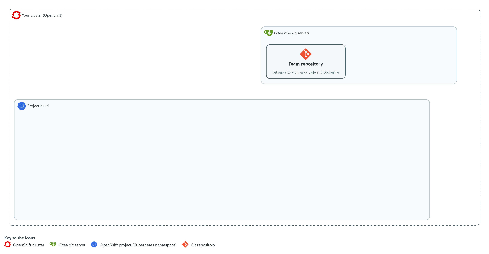

- In lab shell you count what each candidate rule would block in the supplied scan file of the team's base image, and you write the chosen rules to a policy file in your folder.

#### 1a. Fetch the supplied files and count what each rule would block

You will now copy the supplied files out of the cluster and then count the serious findings in the supplied scan.

```bash
mkdir -p /workspace/vm-5 && cd /workspace/vm-5
oc extract configmap/vm-tools -n security-tools --to=. --confirm
jq '[.Results[]?.Vulnerabilities[]? | select(.Severity == "HIGH" or .Severity == "CRITICAL")] as $v | {serious: ($v | length), serious_fixable: ([$v[] | select((.FixedVersion // "") != "")] | length), critical_fixable: ([$v[] | select(.Severity == "CRITICAL" and (.FixedVersion // "") != "")] | length)}' scan-before.json
```

**Expected output:**

```
Example only. Your counts will differ.
rank.py
(a line for each other supplied file, including scan-before.json, scan-after.json, ledger-seed.json, exceptions-sample.json, gate_rules.py, gate_exceptions.py, gate_ledger.py, check_matches.py and reference-rule_match.py)
{
  "serious": <n>,
  "serious_fixable": <n>,
  "critical_fixable": <n>
}
```

| Part | What it does | Why you run it |
| --- | --- | --- |
| oc extract ... --confirm | Fetches rank.py, the fixtures, the sample exceptions, three of the gate's code files (you read them in Steps 2 and 3), the check for Step 2 and its reference answer from the ConfigMap in the project security-tools into your folder. | The supplied files are kept in the cluster, so you copy them into your folder before you read or use them. |
| jq '... as $v \| {...}' scan-before.json | Reads the supplied scan, keeps the HIGH and CRITICAL findings (the serious ones) and counts three things: all of them, those with a fix, and the CRITICAL ones with a fix. These are the costs of the three candidate rules. | You choose the rules by what they cost, so count first and write the policy second. |

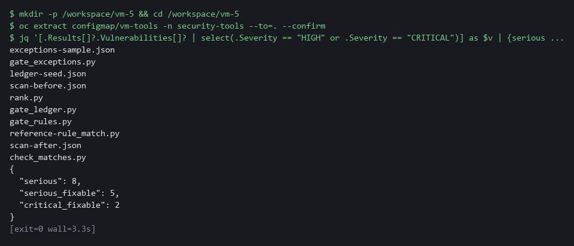

#### 1b. Download the known-exploited list

You will now download the KEV catalog, keep only its CVE IDs in a file, and count them.

```bash
cd /workspace/vm-5
CATALOG_URL=https://www.cisa.gov/sites/default/files/feeds/known_exploited_vulnerabilities.json
curl -fsS "$CATALOG_URL" | jq -e '[.vulnerabilities[].cveID] | sort | select(length > 0)' > exploited-ids.json
jq length exploited-ids.json
```

**Expected output:**

```
Example only. The count grows as the catalog grows.
<n>
```

| Part | What it does | Why you run it |
| --- | --- | --- |
| curl -fsS "$CATALOG_URL" | Downloads the catalog. -f makes curl fail on an HTTP error, -s hides the progress bar, -S still shows an error. | A failed download must not leave an error page to be read as a list. |
| jq -e '[.vulnerabilities[].cveID] \| sort \| select(length > 0)' | Keeps the CVE ID of each entry in a sorted list, and produces nothing when the list is empty, which makes jq -e exit with a non-zero code. | The gate needs only the IDs, and an empty list would read as nothing exploited. |
| > exploited-ids.json | Saves the list as a small file that goes into the ConfigMap in Step 4. | The platform owns the list, so every pipeline reads the same one. |
| jq length exploited-ids.json | Prints how many IDs the list holds. | Shows the list is not empty before you rely on it. |

#### 1c. Create policy.json

You will now create the file policy.json (the trick is called a heredoc).

Look for these as you read:

- max_exception_days is the longest an exception may run from today. A longer one is treated as invalid.
- known-exploited names no severity and no fix condition, so it matches every listed finding.
- Each rule has a name. The name appears in the block message, so a team knows which rule stopped the release.
- A rule that names exposure applies only when the pipeline says external. Rules without it apply always.
- high-fixable-overdue uses min_age_days, which is why the gate needs the ledger.

```bash
cd /workspace/vm-5
cat > policy.json <<'EOF'
{
  "max_exception_days": 30,
  "rules": [
    {"name": "critical-fixable", "severity": ["CRITICAL"], "fix": true},
    {"name": "critical-exposed", "severity": ["CRITICAL"], "exposure": "external"},
    {"name": "high-fixable-overdue", "severity": ["HIGH"], "fix": true, "min_age_days": 30},
    {"name": "high-fixable-exposed", "severity": ["HIGH"], "fix": true, "exposure": "external"},
    {"name": "known-exploited", "exploited": true}
  ]
}
EOF
wc -l policy.json
```

**Expected output:**

```
Example only.
10 policy.json
```

| Part | What it does | Why you run it |
| --- | --- | --- |
| cd /workspace/vm-5 | Moves into the working folder of this module. | The file must land next to the other files, whatever folder you were in before. |
| cat > policy.json <<'EOF' ... EOF | Writes every line between the two marker lines into the file policy.json. The single > starts the file new. | Lab shell has no editor, so a block like this is how a file is made. The quotes around EOF keep each dollar sign and backslash exactly as typed. |
| wc -l policy.json | Counts the lines of the file so far. | A quick check that the paste arrived whole. The count should match the expected output. |
| max_exception_days | The longest an exception may run from today. The lab chose 30 days. | Without a limit an exception could be written to last forever, so the gate treats a longer one as invalid. |
| critical-fixable | Block any CRITICAL finding that has a fix. | A team can act on it today, so it is the clearest reason to stop a release. |
| critical-exposed | Block any CRITICAL finding, even with no fix, when the application is reachable from outside. | Reachability raises the risk enough that even a flaw with no fix stops the release, or needs an exception. |
| high-fixable-overdue | Block a HIGH finding with a fix once it has been open for 30 days, the lab's own response time for HIGH findings. | Gives a new HIGH time to be fixed before it blocks, which is why the gate needs the ledger for age. |
| high-fixable-exposed | Block a HIGH finding with a fix at once when the application is reachable from outside. | On an exposed application a fixable HIGH should not wait for the clock. |
| known-exploited | Block any finding whose CVE ID is on the known-exploited list, with a fix or without one, at any severity. | Exploitation has been seen, so waiting for the clock or for a fix is not a safe default. |

> **YOUR TURN:** Run the first two blocks and read the counts. Paste the policy block to create policy.json. The file reference-rule_match.py is now in your folder: do not open it yet. Step 2 says when.

> **CHECKPOINT:** You can say how many findings the broadest rule would block compared with the fixable-only rule, the list holds more than zero IDs, and policy.json is saved.

> **TAKEAWAY:** A rule on fixable findings blocks only what a team can act on today; a rule on everything serious forces exceptions and teaches teams to route around the gate.

**How this meets the control**

- **RA-5:** The control asks that remediation follow an assessment of risk, and a rule writes that assessment down. This step counts what each candidate rule would block in the supplied scan and produces the policy.json file with five named rules.

### Step 2. Write the rule check, and read the exception code (SA-11 Developer Testing and Evaluation)

**Learning point: Writing the matches function and checking it against ten known cases proves the gate will block what it should and pass what it should, before the gate itself is assembled.**

- The gate rests on one small function, matches, which decides whether one finding matches one rule.
- You write the last three of its five conditions yourself from the spec below, and a supplied check tells you whether your function gives the right answer for ten cases.
- Read gate_rules.py and gate_exceptions.py first; you do not write them.
- gate_rules.py calls your function for each rule and lists the findings that block, and gate_exceptions.py reads the exceptions file and classifies each entry as active, expired or invalid.

What this step adds (thick lines and outlines are new):

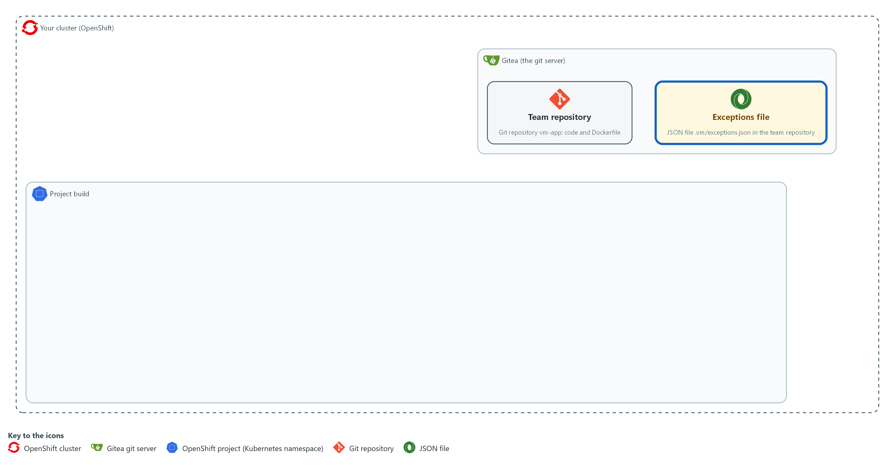

- You write the rule check in your folder in lab shell and read the exceptions code. The exceptions are a file named exceptions.json in the folder .vm of the team's repository on Gitea.

#### 2a. Read the two supplied files

You will now print the two supplied files, which Step 1 copied into your folder.

- Nothing is changed.

Look for these as you read:

- gate_rules.py takes matches from a file named rule_match.py, which you write in the next block.
- evaluate skips any finding excused by an active exception before it looks at the rules, and marks each remaining finding as exploited when its ID is on the list.
- Each blocking record names the rules it matched and the age of the finding.
- REQUIRED lists the fields every entry must have, filled in. An empty reason makes the entry invalid.
- classify returns invalid, expired or active. An expiry further away than the policy limit is invalid.
- A missing exceptions file means no exceptions, so a team with none does not need an empty file.

```bash
cd /workspace/vm-5
cat gate_rules.py
cat gate_exceptions.py
```

**Expected output:**

```
Example only. The text of the two files, about 50 lines in all.
"""List the findings that block, using matches() from rule_match.py."""
(the rest of gate_rules.py, then gate_exceptions.py)
```

| Part | What it does | Why you run it |
| --- | --- | --- |
| cat gate_rules.py | Prints the supplied rule code. | You read what calls your function before you write it. |
| from rule_match import matches | Takes your function from the file rule_match.py in the same folder. | Until that file exists, the gate cannot start. |
| evaluate(...) | Skips findings excused by an active exception, works out each finding's age from the ledger, marks each finding as exploited or not from the list, and returns the rules each remaining finding matched. | It produces the list that decides pass or block, and names the rules so a team knows what to change. |
| REQUIRED | The fields every exception entry must have, filled in. | An exception with no reason or no owner cannot be reviewed later, so it must not count. |
| classify(...) | Invalid if a field is empty or the date is unreadable. Expired if the date is before today. Invalid if the date is more than the policy's limit away. Otherwise active. | This is where expiry is enforced by code, so an old exception stops working on its date with no one acting. |
| active_keys | The (CVE ID, package) pairs that are excused today. Only active entries are included. | Hands the rule code only the exceptions that count today. |

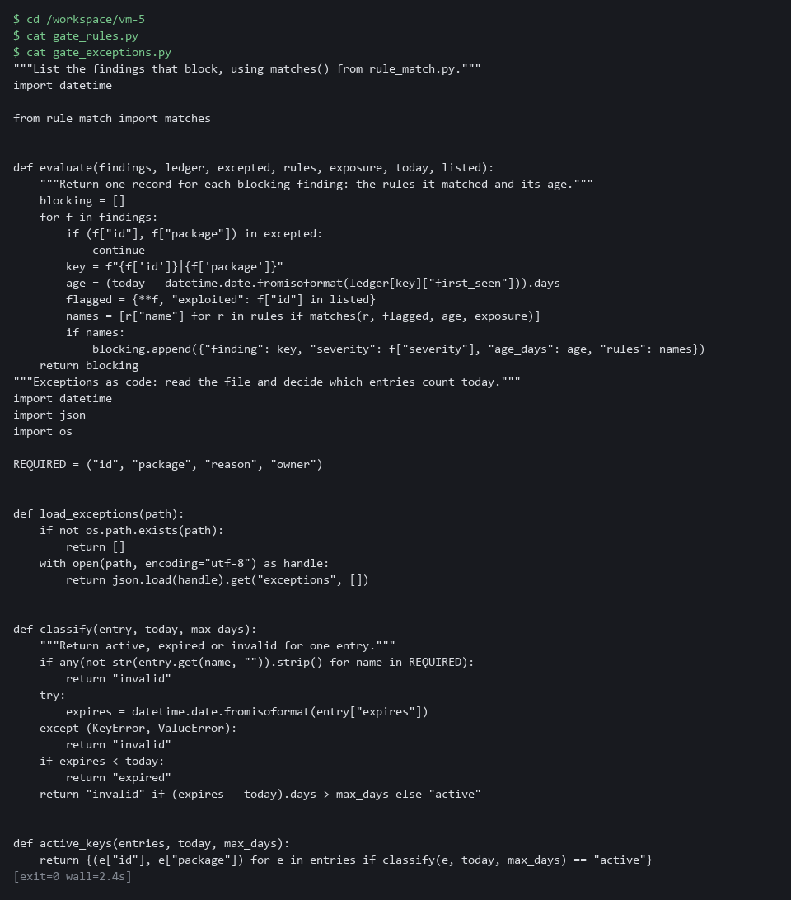

#### 2b. Create rule_match.py, the part that is given

You will now create rule_match.py with the function header and its first two conditions already written.

- You add the rest in the next block.
- Pasting this block again starts the file over.

Look for these as you read:

- The function takes the rule from policy.json, one finding, the finding's age in days, and the exposure the pipeline was given.
- Each condition is an if that returns False when the rule names a condition the finding does not meet. Your three conditions follow the same pattern.
- If every if passes, the function must still end with a return that gives True or False. You write that.

```bash
cd /workspace/vm-5
cat > rule_match.py <<'EOF'
"""One rule against one finding. Part of the gate."""


def matches(rule, finding, age_days, exposure):
    """True only when every condition the rule names holds. A condition the rule does not name is ignored."""
    if finding["severity"] not in rule.get("severity", [finding["severity"]]):
        return False
    if "fix" in rule and bool(finding["fix"]) != rule["fix"]:
        return False
EOF
wc -l rule_match.py
```

**Expected output:**

```
Example only.
9 rule_match.py
```

| Part | What it does | Why you run it |
| --- | --- | --- |
| cd /workspace/vm-5 | Moves into the working folder of this module. | The file must land next to the other files, whatever folder you were in before. |
| cat > rule_match.py <<'EOF' ... EOF | Writes every line between the two marker lines into the file rule_match.py. The single > starts the file new. | Lab shell has no editor, so a block like this is how a file is made. The quotes around EOF keep each character exactly as typed. |
| def matches(rule, finding, age_days, exposure): | Starts the function (a named piece of code that takes inputs and gives back an answer). The four names are its inputs. | gate_rules.py calls it once for every rule and every finding. |
| if finding["severity"] not in rule.get(...) | Returns False when the rule lists severities and the finding's is not one of them. A rule that lists none lets every severity through. | This is the first condition, and it shows the pattern: test one condition, and return False if it fails. |
| if "fix" in rule and ... != rule["fix"] | Returns False when the rule says fix true or false and the finding disagrees. A finding with an empty fix text counts as having no fix. | The second condition. A rule that does not name fix is not checked. |
| wc -l rule_match.py | Counts the lines of the file. | A quick check that the paste arrived whole. |

#### 2c. Add your three conditions to rule_match.py

You will now add the rest of the function.

- Before you run this block, delete the four comment lines and type your own code in their place, with four spaces at the start of each line.
- The double >> adds to the end of the file, so run this block only once; to start again, run the previous block first.

Look for these as you read:

- Write conditions 3 and 4 as if statements like the two you were given. The last line is a return, not an if.
- Python needs the four spaces at the start of every line. Without them it stops with an indentation error.
- Run as it is, this block adds only comments, and the check in the next block will say which cases fail. That is a safe way to see what is missing.

```bash
cd /workspace/vm-5
cat >> rule_match.py <<'EOF'
    # Write three conditions here. Indent each line by four spaces.
    # Condition 3: if the rule names "exploited", return False unless the finding's "exploited" equals it.
    # Condition 4: return False if age_days is less than the rule's "min_age_days" (a rule that has none means 0).
    # Last line: return True only when the rule's "exposure" equals the exposure given (a rule that names none matches any exposure).
EOF
wc -l rule_match.py
```

**Expected output:**

```
Example only. Run as given, with only the four comment lines added, the count is 13. Your count depends on how you write the lines, and the reference answer gives 14.
13 rule_match.py
```

| Part | What it does | Why you run it |
| --- | --- | --- |
| cat >> rule_match.py <<'EOF' ... EOF | Adds the lines you type to the end of the file. The double >> adds and does not start new. | The first half of the function stays as given, and only your part is new. |
| Condition 3 | The finding's exploited flag must equal the one the rule names. gate_rules.py sets the flag from the known-exploited list. | This is how the known-exploited rule matches only listed findings. |
| Condition 4 | A finding younger than the rule's minimum age does not match. A rule with no minimum uses 0, so every age passes. | This is how the overdue rule waits 30 days from the ledger's first-seen date. |
| Last line | Returns True only when the exposure agrees. A rule that names no exposure always agrees. | This is how the exposed rules switch on only when the pipeline says external. |

#### 2d. Check your function

You will now run the supplied check, which calls your function on ten cases with known answers.

- Run the check again after every change to rule_match.py.
- If it fails at once with an import error, rule_match.py is probably empty (a heredoc pasted twice): check with wc -l rule_match.py and write it again.

```bash
cd /workspace/vm-5
python3 check_matches.py
```

**Expected output:**

```
Example only. When every case is right:
ok: all 10 cases
(when some are wrong, the line "not yet right:" and then the name of each case that came out wrong)
```

| Part | What it does | Why you run it |
| --- | --- | --- |
| python3 check_matches.py | Runs your function on ten cases: some must match and some must not, across severity, fix, listed, age and exposure. | The cases that must not match prove your function can say no, which is as important as saying yes. |
| ok: all 10 cases | Every case came out as expected. | Your function is ready for the gate. |
| not yet right: | Lists the cases that came out wrong, by name. | The name tells you which condition to look at. |

#### 2e. Compare with the reference answer, only after you have tried

You will now compare your file with the reference answer.

- Run this block only after the check says ok, or after you have tried for about ten minutes.
- Different lines are fine if your check says ok; to see the whole reference answer, type cat reference-rule_match.py.

```bash
cd /workspace/vm-5
diff rule_match.py reference-rule_match.py || true
```

**Expected output:**

```
Example only. Nothing prints when your file is the same as the reference. Otherwise each differing line is shown, with < for yours and > for the reference.
```

| Part | What it does | Why you run it |
| --- | --- | --- |
| diff rule_match.py reference-rule_match.py | Shows the lines where your file differs from the reference. | Another way of writing the same condition is fine. A real difference is worth understanding. |
| \|\| true | diff exits with 1 when the files differ, which is not an error here. | Without it the shell would treat the difference as a failure. |

#### 2f. Read the sample exceptions and predict their states

You will now print the four sample exception entries so you can work out which are active, expired and invalid on 2026-10-29.

```bash
cd /workspace/vm-5 && cat exceptions-sample.json
```

**Expected output:**

```
Example only. Four entries are printed, each with its fields and expiry date.
```

| Part | What it does | Why you run it |
| --- | --- | --- |
| cat exceptions-sample.json | Prints the four sample entries. | You predict each state from the fields and the expiry before the gate classifies them. |

> **NOTE:** Spec for matches: a rule matches a finding only when every condition the rule names holds, and a condition the rule does not name is ignored. The five conditions, in order, are severity, fix, exploited, minimum age in days, and exposure. The first two are given.

> **YOUR TURN:** Run the first block and read the two files. Paste the second block. Write your three conditions and run the third block. Run the check, fix your lines until it says ok, and only then compare with the reference. Then, before the code tells you, run the last block and work out which of the four sample entries are active, expired and invalid on 2026-10-29.

> **CHECKPOINT:** The check prints ok: all 10 cases, and you can name which of the four sample entries should be active, expired and invalid on 2026-10-29.

> **TAKEAWAY:** The cases that must not match are as important as the ones that must; prove your function can say no.

**How this meets the control**

- **SA-11:** The control asks for a verifiable flaw remediation process. You write the function that decides whether a finding matches a rule and prove it with a check that has known answers, and you read the code that decides whether an exception is active, expired or invalid.

### Step 3. Read the ledger, write the gate, and run it on fixtures (SI-2 Flaw Remediation, SA-11 Developer Testing and Evaluation)

**Learning point: Running the gate on the supplied fixtures with a fixed date shows three findings block with named rules and the exception classification matches the prediction from Step 2.**

- The supplied gate_ledger.py records dates and computes the time to fix; read it first.
- gate.py ties rules, exceptions and ledger together, writes a result file, prints it, and exits 1 when anything blocks.
- Run gate.py on the supplied fixtures with a fixed date, so the output is the same every time.
- The ledger starts from a seeded copy with some history in it.

What this step adds (thick lines and outlines are new):

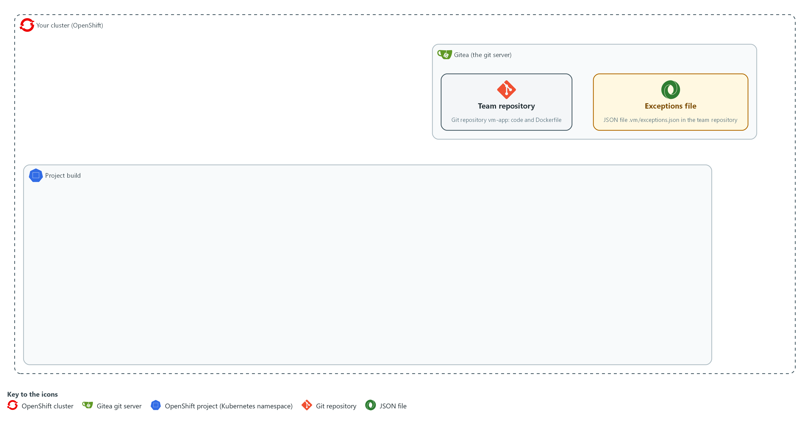

- You read the ledger code and write the command-line gate in your folder in lab shell, and you run the gate there on fixtures.

#### 3a. Read the supplied gate_ledger.py

You will now print the ledger code, which Step 1 copied into your folder.

- You read gate_ledger.py and do not write it.

Look for these as you read:

- update builds a new ledger and leaves the old one unchanged.
- A finding that is new or has come back starts today. A finding that left the scan gets a fixed date once.
- time_to_fix counts only records that have a fixed date, and returns the count, the mean and the maximum.

```bash
cd /workspace/vm-5
cat gate_ledger.py
```

**Expected output:**

```
Example only. The text of the file, about 36 lines.
"""A ledger of when each finding was first seen and when it stopped appearing."""
(the rest of gate_ledger.py)
```

| Part | What it does | Why you run it |
| --- | --- | --- |
| update(ledger, keys, today) | Findings in the new scan keep their first-seen date, or start today if new or returning. Findings missing from the scan get a fixed date, once. | This gives every finding an age and a fixed date, which the age rule and the measurement both need. |
| {**rec, "fixed": now} | Copies the record and adds the fixed date, so the old ledger is not changed. | The old ledger stays intact while the new one is built, so a mistake cannot lose history. |
| time_to_fix(ledger) | For each record with a fixed date, the days between first seen and fixed. Returns the count, the mean and the maximum. | This is the first measurement: how long flaws stay open before a scan no longer shows them. |

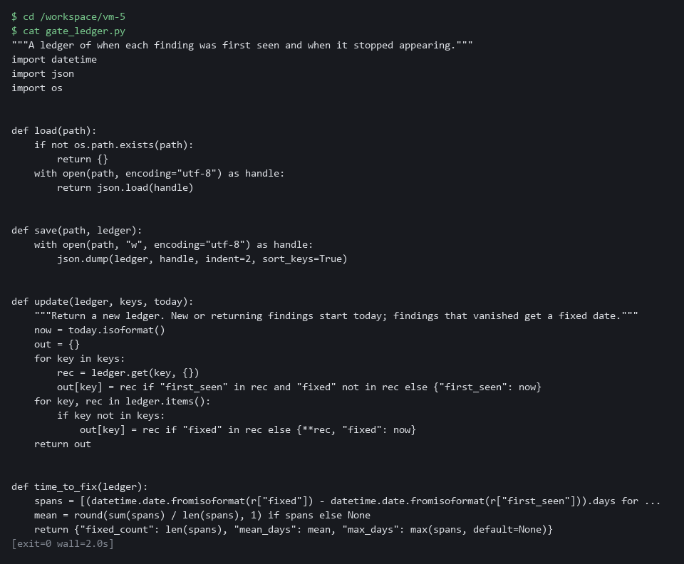

#### 3b. Create gate.py, part 1

You will now create the file gate.py in 2 parts, so each paste is short.

Look for these as you read:

- decide joins the three parts: exceptions, ledger and rules. It can be tested without a pipeline.
- load_listed refuses an empty list, and any missing or unreadable input ends the run with exit code 2 before anything is written. The gate fails closed.

```bash
cd /workspace/vm-5
cat > gate.py <<'EOF'
"""Risk-based gate. Exit code 0 means pass, 1 means blocked, 2 means the gate could not decide."""
import argparse
import datetime
import json
import sys

import gate_exceptions
import gate_ledger
import gate_rules
import rank


def load_listed(path):
    with open(path, encoding="utf-8") as handle:
        ids = json.load(handle)
    if not ids:
        raise ValueError("the known-exploited list is empty")
    return set(ids)


def decide(findings, entries, ledger, policy, exposure, today, listed):
    max_days = policy["max_exception_days"]
    states = [gate_exceptions.classify(e, today, max_days) for e in entries]
    keys = {f"{f['id']}|{f['package']}" for f in findings}
    new_ledger = gate_ledger.update(ledger, keys, today)
    active = gate_exceptions.active_keys(entries, today, max_days)
    blocking = gate_rules.evaluate(findings, new_ledger, active, policy["rules"], exposure, today, listed)
    counts = {name: states.count(name) for name in ("active", "expired", "invalid")}
    result = {"blocked": bool(blocking), "blocking": blocking, "exceptions": counts, "time_to_fix": gate_ledger.time_to_fix(new_ledger)}
    return result, new_ledger
EOF
wc -l gate.py
```

**Expected output:**

```
Example only.
30 gate.py
```

| Part | What it does | Why you run it |
| --- | --- | --- |
| cd /workspace/vm-5 | Moves into the working folder of this module. | The file must land next to the other files, whatever folder you were in before. |
| cat > gate.py <<'EOF' ... EOF | Writes every line between the two marker lines into the file gate.py. The single > starts the file new. | Lab shell has no editor, so a block like this is how a file is made. The quotes around EOF keep each dollar sign and backslash exactly as typed. |
| wc -l gate.py | Counts the lines of the file so far. | A quick check that the paste arrived whole. The count should match the expected output. |
| decide(...) | Classifies the exceptions, updates the ledger, evaluates the rules, and returns the result and the new ledger. | This one function joins the three parts, so the gate can be tested on fixtures without a pipeline. |

#### 3c. Create gate.py, part 2

You will now add part 2 to gate.py.

- The >> adds to the end of the file, so paste the parts in order and only once.
- To start again, paste part 1 first.

Look for these as you read:

- The --today option fixes the date for tests. In a pipeline it defaults to today.
- The --summary option writes a short JSON line that a Tekton task keeps as a result.
- The last return statement is the gate: exit code 1 when anything blocks, otherwise 0.

```bash
cd /workspace/vm-5
cat >> gate.py <<'EOF'


def main():
    parser = argparse.ArgumentParser(description=__doc__)
    for name in ("scan", "policy", "exceptions", "ledger", "exploited"):
        parser.add_argument("--" + name, required=True)
    parser.add_argument("--exposure", choices=["internal", "external"], default="internal")
    parser.add_argument("--today", default=datetime.date.today().isoformat())
    parser.add_argument("--result", default="gate-result.json")
    parser.add_argument("--summary", default="")
    args = parser.parse_args()
    try:
        with open(args.policy, encoding="utf-8") as handle:
            policy = json.load(handle)
        listed = load_listed(args.exploited)
        findings = rank.rank(rank.load_findings(args.scan))
        entries = gate_exceptions.load_exceptions(args.exceptions)
        ledger = gate_ledger.load(args.ledger)
        today = datetime.date.fromisoformat(args.today)
    except (OSError, ValueError, KeyError) as error:
        print(f"gate cannot run: {error}", file=sys.stderr)
        return 2
    result, new_ledger = decide(findings, entries, ledger, policy, args.exposure, today, listed)
    gate_ledger.save(args.ledger, new_ledger)
    with open(args.result, "w", encoding="utf-8") as handle:
        json.dump(result, handle, indent=2)
    if args.summary:
        short = {"blocked": result["blocked"], "blocking": len(result["blocking"]), "expired_exceptions": result["exceptions"]["expired"], "mean_days_to_fix": result["time_to_fix"]["mean_days"]}
        with open(args.summary, "w", encoding="utf-8") as handle:
            handle.write(json.dumps(short, separators=(",", ":")))
    print(json.dumps(result, indent=2))
    return 1 if result["blocked"] else 0


if __name__ == "__main__":
    sys.exit(main())
EOF
wc -l gate.py
```

**Expected output:**

```
Example only.
66 gate.py
```

| Part | What it does | Why you run it |
| --- | --- | --- |
| cd /workspace/vm-5 | Moves into the working folder of this module. | The file must land next to the other files, whatever folder you were in before. |
| cat >> gate.py <<'EOF' ... EOF | Writes every line between the two marker lines into the file gate.py. The double >> adds to the end of the file. | Lab shell has no editor, so a block like this is how a file is made. The quotes around EOF keep each dollar sign and backslash exactly as typed. |
| wc -l gate.py | Counts the lines of the file so far. | A quick check that the paste arrived whole. The count should match the expected output. |
| --today | Lets you fix the date for tests. In a pipeline it defaults to today. | A fixed date makes the output the same every time, so you can compare it with the expected result. |
| --summary | Writes a short JSON line for a Tekton task result. | The pipeline keeps this line after the run, so the measurement can be read later. |
| except (OSError, ValueError, KeyError) | Turns a missing file, a bad file or an empty known-exploited list into one message and exit code 2. | A gate that cannot read its inputs must stop the release and not let it through. |
| return 1 if result["blocked"] else 0 | The exit code is the gate: a failing task stops the pipeline. | A non-zero exit is how the pipeline knows to stop the release. |

#### 3d. Run the gate on the before-fix fixture

You will now copy the seeded ledger, run the gate on the supplied scan with a fixed date, and read the result.

```bash
cd /workspace/vm-5
cp ledger-seed.json ledger.json
python3 gate.py --scan scan-before.json --policy policy.json --exceptions exceptions-sample.json --exploited exploited-ids.json --ledger ledger.json --today 2026-10-29 --result before.json --summary before-summary.json > /dev/null
echo "exit code: $?"
jq -c '.blocking[] | [.finding, .rules]' before.json
jq -c .exceptions before.json
```

**Expected output:**

```
Example only. Your finding IDs and rule names come from the fixture.
exit code: 1
["CVE-<id>|<package>",["<rule name>"]]
(three lines like that, one for each blocking finding)
{"active":1,"expired":1,"invalid":2}
```

| Part | What it does | Why you run it |
| --- | --- | --- |
| cp ledger-seed.json ledger.json | Starts from the seeded ledger. The gate changes ledger.json, never the seed. | The seed has some history in it, so findings already have ages, and you can run the step again from the same start. |
| gate.py --scan scan-before.json ... | Runs the gate on the fixture scan with the date fixed. The exposure is internal, the default. | Shows the gate on a known input, so you can check its answer before it runs in a pipeline. |
| echo "exit code: $?" | Shows the gate's exit code. | The exit code is what a pipeline reads, so you see here what it will see. |
| jq -c '.blocking[] \| ...' | Lists each blocking finding and the rules it matched. | Shows which rule blocks which finding, which is what a team would be told. |
| jq -c .exceptions | Shows how many entries were active, expired and invalid. | Checks that the sample exceptions are classified the way you predicted in Step 2. |

> **YOUR TURN:** Read the ledger code, paste the two parts of gate.py, then run the last block. The gate uses the rule_match.py you wrote in Step 2.

> **CHECKPOINT:** The exit code is 1, three findings block with named rules, the exceptions line shows one active, one expired and two invalid.

> **TAKEAWAY:** Exit code 1 means findings blocked; exit code 2 means the gate could not decide; a gate that cannot decide must fail closed.

**How this meets the controls**

- **SI-2:** The control, through its SI-2(3) enhancement, asks for the time between flaw identification and remediation to be measured. You read the ledger code that records the first-seen and fixed dates, and running the gate reports the time to fix as a count, a mean and a maximum.
- **SA-11:** The control asks for evidence of the results of testing. You run the gate on fixtures with a fixed date, and it writes a result file and exits 1 when anything blocks.

### Step 4. Run the gate as a shared task in a pipeline (RA-5 Vulnerability Monitoring and Scanning, SA-11 Developer Testing and Evaluation)

**Learning point: Putting the rules and code in one platform ConfigMap and running the scan and gate as shared Tekton tasks makes the gate the same for every pipeline that calls those tasks.**

- Step 4 needs the lab shell and the pipeline pods to reach the internet, because they pull two public images and the Trivy database.
- You give the gate to the team as Tekton tasks, each a reusable unit of work in a pipeline, and the rules and the code go into one ConfigMap in the project build.
- Two tasks do the work: risk-scan finds the base image on the FROM line of the Dockerfile and scans it, and risk-gate runs the gate from the ConfigMap with a ledger on a volume.
- One pipeline calls risk-scan then risk-gate.
- tkn is the command-line tool for Tekton: tkn pipeline start starts one run of a pipeline, and --showlog prints its log while it runs.
- The first run is on the old base image, so it should block.

What this step adds (thick lines and outlines are new):

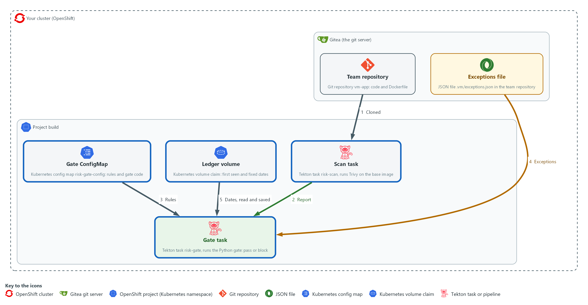

- The gate runs in the project build as a shared Tekton task in a pipeline: clone from Gitea, scan, gate. The rules and code come from one ConfigMap in the project build.

#### 4a. Put the rules and the gate code in one ConfigMap

You will now pack the policy, the list and the code files into a ConfigMap in the project build and list what it holds.

```bash
cd /workspace/vm-5
oc create configmap risk-gate-config -n build --from-file=policy.json --from-file=gate.py --from-file=gate_rules.py --from-file=rule_match.py --from-file=gate_exceptions.py --from-file=gate_ledger.py --from-file=rank.py --from-file=exploited-ids.json --dry-run=client -o yaml | oc apply -f -
oc get configmap risk-gate-config -n build -o jsonpath='{.data}' | jq keys
oc get configmap risk-gate-config -n build -o json | jq -j '.data["rule_match.py"]' | diff - rule_match.py && echo same as yours
```

**Expected output:**

```
Example only.
configmap/risk-gate-config created (it says configured when the ConfigMap already exists)
["exploited-ids.json","gate.py","gate_exceptions.py","gate_ledger.py","gate_rules.py","policy.json","rank.py","rule_match.py"]
same as yours
```

| Part | What it does | Why you run it |
| --- | --- | --- |
| oc create configmap ... --from-file=... | Packs the policy, the known-exploited list and the six code files into one ConfigMap in the project build. The --dry-run piped into apply makes the command safe to run again. | The rules and code live in one place owned by the platform, so every pipeline that calls the gate gets the same copy. |
| jq keys | Lists the file names stored, to check all eight are there. | A missing file would only show up as a failure inside a pipeline, so check it now. |
| oc get configmap ... \| jq -j ... \| diff - rule_match.py | Reads your function back out of the cluster and compares it with your local file. Nothing prints from diff when they match. | The pipeline runs the copy in the cluster, not your folder, so this proves the gate will use the function you wrote. |

#### 4b. Create risk-gate-tasks.yaml, part 1

You will now create the file risk-gate-tasks.yaml in 2 parts, so each paste is short.

Look for these as you read:

- One volume claim shares the cloned code between tasks, and the ledger file sits beside the clone on the same claim, so it survives from one run to the next.
- risk-scan reads the image name from the FROM line of the Dockerfile and scans it.

```bash
cd /workspace/vm-5
cat > risk-gate-tasks.yaml <<'EOF'
apiVersion: v1
kind: PersistentVolumeClaim
metadata:
  name: risk-pvc
  namespace: build
spec:
  accessModes:
    - ReadWriteOnce
  resources:
    requests:
      storage: 1Gi
---
apiVersion: tekton.dev/v1
kind: Task
metadata:
  name: risk-scan
  namespace: build
spec:
  params:
    - name: trivy-image
    - name: context
      default: "."
  workspaces:
    - name: source
  steps:
    - name: scan-base-image
      image: $(params.trivy-image)
      workingDir: $(workspaces.source.path)/$(params.context)
      script: |
        #!/bin/sh
        set -e
        base=$(sed -n 's/^FROM //p' Dockerfile | head -n 1)
        trivy image --no-progress --scanners vuln --severity HIGH,CRITICAL --format json --output scan.json "$base"
EOF
wc -l risk-gate-tasks.yaml
```

**Expected output:**

```
Example only.
33 risk-gate-tasks.yaml
```

| Part | What it does | Why you run it |
| --- | --- | --- |
| cd /workspace/vm-5 | Moves into the working folder of this module. | The file must land next to the other files, whatever folder you were in before. |
| cat > risk-gate-tasks.yaml <<'EOF' ... EOF | Writes every line between the two marker lines into the file risk-gate-tasks.yaml. The single > starts the file new. | Lab shell has no editor, so a block like this is how a file is made. The quotes around EOF keep each dollar sign and backslash exactly as typed. |
| wc -l risk-gate-tasks.yaml | Counts the lines of the file so far. | A quick check that the paste arrived whole. The count should match the expected output. |
| risk-pvc | One volume claim. The clone goes into its repo folder and the gate keeps ledger.json next to that folder. | Tasks run in separate pods, so they need shared disk, and the ledger needs disk that outlives a run. A task can use only one volume claim here, so the ledger shares the claim. A fresh clone replaces only the repo folder, so the ledger is kept. |
| risk-scan | Reads the image name from the FROM line of the Dockerfile and scans it, saving scan.json in the shared workspace. | This is the scan the gate judges, run the same way for every team. |

#### 4c. Create risk-gate-tasks.yaml, part 2

You will now add part 2 to risk-gate-tasks.yaml.

- The >> adds to the end of the file, so paste the parts in order and only once.
- To start again, paste part 1 first.

Look for these as you read:

- The gate reads the known-exploited list from the same config workspace as the policy, so teams cannot change either.
- risk-gate takes the code and policy from the config workspace and keeps the ledger on the shared volume.
- The summary result keeps the measurement after the pods are gone.
- The exceptions file is read from the team repository at .vm/exceptions.json.

```bash
cd /workspace/vm-5
cat >> risk-gate-tasks.yaml <<'EOF'
---
apiVersion: tekton.dev/v1
kind: Task
metadata:
  name: risk-gate
  namespace: build
spec:
  params:
    - name: gate-image
    - name: exposure
      default: internal
    - name: context
      default: "."
  workspaces:
    - name: source
    - name: config
  results:
    - name: summary
  steps:
    - name: gate
      image: $(params.gate-image)
      workingDir: $(workspaces.source.path)/$(params.context)
      script: |
        #!/bin/sh
        python3 "$(workspaces.config.path)/gate.py" --scan scan.json --policy "$(workspaces.config.path)/policy.json" --exceptions .vm/exceptions.json --ledger "$(workspaces.source.path)/ledger.json" --exploited "$(workspaces.config.path)/exploited-ids.json" --exposure "$(params.exposure)" --summary "$(results.summary.path)"
EOF
wc -l risk-gate-tasks.yaml
```

**Expected output:**

```
Example only.
58 risk-gate-tasks.yaml
```

| Part | What it does | Why you run it |
| --- | --- | --- |
| cd /workspace/vm-5 | Moves into the working folder of this module. | The file must land next to the other files, whatever folder you were in before. |
| cat >> risk-gate-tasks.yaml <<'EOF' ... EOF | Writes every line between the two marker lines into the file risk-gate-tasks.yaml. The double >> adds to the end of the file. | Lab shell has no editor, so a block like this is how a file is made. The quotes around EOF keep each dollar sign and backslash exactly as typed. |
| wc -l risk-gate-tasks.yaml | Counts the lines of the file so far. | A quick check that the paste arrived whole. The count should match the expected output. |
| risk-gate params and workspaces | The tool image and the exposure come in as parameters. The code and policy come from the config workspace, and the ledger is a file on the shared volume. | A team sets only its exposure, while the rules stay with the platform. |
| results: summary | A short result line the pipeline run keeps, so the measurement can be read afterwards. | A result survives after the pods are gone, so the measurement stays readable. |
| python3 "$(workspaces.config.path)/gate.py" ... | Runs the gate from the ConfigMap. The exceptions file is read from the team's repository at .vm/exceptions.json. | The code comes from the platform copy and the exceptions from the team's repository, so each side owns its own part. |

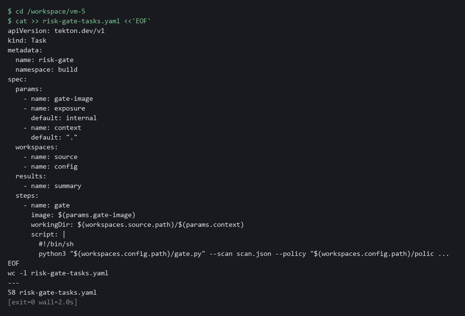

#### 4d. Create risk-gated-release.yaml, part 1

You will now create the file risk-gated-release.yaml in 2 parts, so each paste is short.

Look for these as you read:

- The parameters are the only inputs a team has to give. The exposure is the one a team sets for its own application.
- clone runs first, so the Dockerfile is in the shared folder before the scan needs it.

```bash
cd /workspace/vm-5
cat > risk-gated-release.yaml <<'EOF'
apiVersion: tekton.dev/v1
kind: Pipeline
metadata:
  name: risk-gated-release
  namespace: build
spec:
  params:
    - name: git-url
    - name: git-revision
      default: main
    - name: trivy-image
    - name: gate-image
    - name: exposure
      default: internal
  workspaces:
    - name: source
    - name: config
    - name: ssl-ca
      optional: true
  tasks:
    - name: clone
      taskRef:
        resolver: cluster
        params:
          - name: kind
            value: task
          - name: name
            value: git-clone
          - name: namespace
            value: openshift-pipelines
      params:
        - name: URL
          value: $(params.git-url)
        - name: REVISION
          value: $(params.git-revision)
        - name: SUBDIRECTORY
          value: repo
      workspaces:
        - name: output
          workspace: source
        - name: ssl-ca-directory
          workspace: ssl-ca
EOF
wc -l risk-gated-release.yaml
```

**Expected output:**

```
Example only.
42 risk-gated-release.yaml
```

| Part | What it does | Why you run it |
| --- | --- | --- |
| cd /workspace/vm-5 | Moves into the working folder of this module. | The file must land next to the other files, whatever folder you were in before. |
| cat > risk-gated-release.yaml <<'EOF' ... EOF | Writes every line between the two marker lines into the file risk-gated-release.yaml. The single > starts the file new. | Lab shell has no editor, so a block like this is how a file is made. The quotes around EOF keep each dollar sign and backslash exactly as typed. |
| wc -l risk-gated-release.yaml | Counts the lines of the file so far. | A quick check that the paste arrived whole. The count should match the expected output. |
| params | The repository, the branch, the two tool images and the exposure. A team sets the exposure for its own application. | These are the only inputs a team has to give, which keeps adoption short. |
| clone | Fetches the code from Gitea using the ready-made clone task, as the two team pipelines the start state supplies do. | The scan needs the Dockerfile in the shared folder, so the pipeline fetches it first. |

#### 4e. Create risk-gated-release.yaml, part 2

You will now add part 2 to risk-gated-release.yaml.

- The >> adds to the end of the file, so paste the parts in order and only once.
- To start again, paste part 1 first.

Look for these as you read:

- gate runs after scan, and a failing gate fails the pipeline.

```bash
cd /workspace/vm-5
cat >> risk-gated-release.yaml <<'EOF'
    - name: scan
      runAfter: ["clone"]
      taskRef:
        name: risk-scan
      params:
        - name: trivy-image
          value: $(params.trivy-image)
        - name: context
          value: repo
      workspaces:
        - name: source
          workspace: source
    - name: gate
      runAfter: ["scan"]
      taskRef:
        name: risk-gate
      params:
        - name: gate-image
          value: $(params.gate-image)
        - name: exposure
          value: $(params.exposure)
        - name: context
          value: repo
      workspaces:
        - name: source
          workspace: source
        - name: config
          workspace: config
EOF
wc -l risk-gated-release.yaml
```

**Expected output:**

```
Example only.
70 risk-gated-release.yaml
```

| Part | What it does | Why you run it |
| --- | --- | --- |
| cd /workspace/vm-5 | Moves into the working folder of this module. | The file must land next to the other files, whatever folder you were in before. |
| cat >> risk-gated-release.yaml <<'EOF' ... EOF | Writes every line between the two marker lines into the file risk-gated-release.yaml. The double >> adds to the end of the file. | Lab shell has no editor, so a block like this is how a file is made. The quotes around EOF keep each dollar sign and backslash exactly as typed. |
| wc -l risk-gated-release.yaml | Counts the lines of the file so far. | A quick check that the paste arrived whole. The count should match the expected output. |
| scan, gate | The two shared tasks, run in order. gate runs after scan and fails the pipeline when the gate blocks. | The order matters, because the gate judges the report that the scan has just made. |

#### 4f. Apply the tasks and the pipeline, then start a run

You will now check each file with a server dry run, save the tasks and the pipeline, and start one run that you watch.

```bash
cd /workspace/vm-5
TRIVY_IMAGE=ghcr.io/aquasecurity/trivy:0.76.1
PY_IMAGE=registry.access.redhat.com/ubi9/python-312:1
oc apply -f risk-gate-tasks.yaml --dry-run=server
oc apply -f risk-gate-tasks.yaml
oc apply -f risk-gated-release.yaml --dry-run=server
oc apply -f risk-gated-release.yaml
tkn pipeline start risk-gated-release -n build -p git-url="$GITEA_URL/$GITEA_USER/vm-app.git" -p trivy-image="$TRIVY_IMAGE" -p gate-image="$PY_IMAGE" -p exposure=external -s pipeline --use-param-defaults -w name=source,claimName=risk-pvc -w name=config,config=risk-gate-config -w name=ssl-ca,config=lab-ca --showlog || true
```

**Expected output:**

```
Example only. The names and the log come from your cluster.
(each oc apply prints a line for each object; the dry runs end in (server dryrun))
(the log streams: the clone and scan tasks succeed, then the gate task prints its JSON result with "blocked": true, the blocking findings and the rule names, and the run fails; the list is long, over a hundred findings, because the old base image and the external setting trigger many rules)
```

| Part | What it does | Why you run it |
| --- | --- | --- |
| TRIVY_IMAGE=..., PY_IMAGE=... | The two public images the tasks run in: Trivy 0.76.1 from the GitHub container registry, and Red Hat's Python 3.12 image. Both are version-pinned. | Nothing in the lab builds tool images, so the pipeline uses vendor images that anyone can pull. |
| --dry-run=server | Asks the cluster to check each file without saving it. | Catches a mistake in the YAML before anything is created. |
| oc apply -f | Saves the volume claim, the two tasks and the pipeline in the project build. | This creates the shared parts that any team pipeline can then call. |
| tkn pipeline start ... -p exposure=external -s pipeline | Starts a run on the main branch and says the application is exposed. -s pipeline runs it as the service account named pipeline, the identity the lab set up with access to Gitea. | The first run uses the old base image, so the gate should block, and external switches on the exposed rules. |
| --use-param-defaults | Uses the default for any parameter you did not give, here the branch (main). Without it tkn stops and asks. | A pipeline started from a script or a schedule has nobody to answer a question. |
| -w name=source,claimName=risk-pvc | Attaches the volume claim as the source workspace. The ledger file lives on it. | A volume claim keeps its files after the run ends. |
| -w name=config,config=risk-gate-config | Attaches the ConfigMap as the config workspace. | This is how the gate task receives the policy and the code from the platform copy. |
| -w name=ssl-ca,config=lab-ca | Gives the clone task the lab's certificate authority, so it can verify the Gitea certificate. The lab start created the lab-ca ConfigMap. | Gitea uses a certificate the lab made itself. The clone stays encrypted and checked, and trusts only this authority. |
| \|\| true | A blocked run exits non-zero, which is the expected result here, so the shell carries on. | Without it the shell would treat the expected block as an error and stop your steps. |

> **YOUR TURN:** Run the blocks in order, pasting every part of both YAML files, and watch the gate task.

> **CHECKPOINT:** The clone and scan tasks pass and the gate task fails with a list of blocking findings and the names of the rules.

> **TAKEAWAY:** The first run on the old base image should block; a blocked pipeline run is the expected result, not a failure of the setup.

**How this meets the controls**

- **RA-5:** The control asks that parts of vulnerability management be automated. You put the rules and the code in one ConfigMap and run the scan and the gate as shared tasks; the first run is on the old base image, so it blocks.
- **SA-11:** The control asks for evidence of results, so each run has to leave a record. The gate task fails the pipeline when a rule blocks and keeps a summary as a task result, with nobody at the keyboard.

### Step 5. Measure, and make the gate the default (SI-2 Flaw Remediation, RA-5 Vulnerability Monitoring and Scanning)

**Learning point: Reading the summary from the pipeline run, running the gate on the after-fix scan, and patching every ungated pipeline measures both the time to fix and coverage in one step.**

- A gate is only worth having if you can show it works and that teams use it.
- You read the summary of the run, run the gate on the after-fix fixture to see time to fix move, and measure coverage across all pipelines.
- You then patch the pipelines that lack the gate so that they call the same tasks.

What this step adds (thick lines and outlines are new):

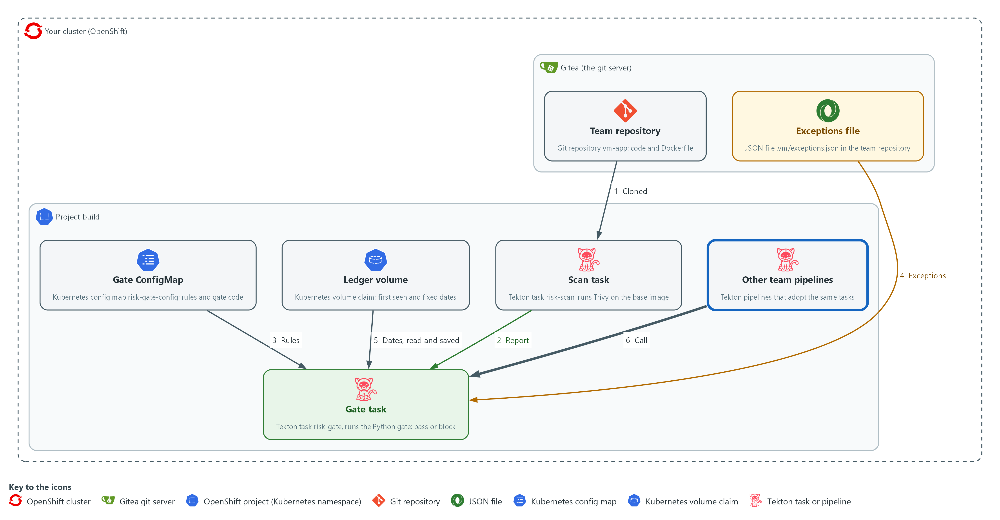

- The gate reports its measurements in a task result kept in the cluster, and other team pipelines in the project build are patched to call the same tasks.

#### 5a. Read the run's summary, then run the gate on the after-fix scan

You will now read the summary kept by the gate task, then run the gate on the after-fix scan with the same ledger.

```bash
cd /workspace/vm-5
RUN=$(tkn pipelinerun describe --last -n build -o jsonpath='{.metadata.name}')
oc get taskrun -n build -l tekton.dev/pipelineRun=$RUN,tekton.dev/pipelineTask=gate -o jsonpath='{.items[0].status.results[0].value}{"\n"}'
python3 gate.py --scan scan-after.json --policy policy.json --exceptions exceptions-sample.json --exploited exploited-ids.json --ledger ledger.json --today 2026-10-29 --result after.json --summary after-summary.json > /dev/null
echo "exit code: $?"
cat after-summary.json
echo
```

**Expected output:**

```
Example only. Your numbers will differ.
{"blocked":true,"blocking":<n>,"expired_exceptions":<n>,"mean_days_to_fix":<days or null>}
exit code: 0
{"blocked":false,"blocking":0,"expired_exceptions":<n>,"mean_days_to_fix":21.8}
```

| Part | What it does | Why you run it |
| --- | --- | --- |
| tkn pipelinerun describe --last ... | Finds the name of the run you just made. | You need the run's name to find its gate task. |
| oc get taskrun ... results[0].value | Reads the summary the gate task saved: whether it blocked, how many findings, the expired exceptions, the mean days to fix. | Shows that the measurement is kept with the run and does not depend on your terminal. |
| gate.py --scan scan-after.json ... | Runs the gate on the fixture after the fixes, using the ledger from the earlier run. The fixed findings get their fixed date now. | This shows the other side: with the fixes made the gate passes, and time to fix is computed. |
| cat after-summary.json | Shows the measurements after the fixes. | Lets you compare the numbers before and after the fixes. |

#### 5b. Create adopt-gate.json

You will now create the file adopt-gate.json (the trick is called a heredoc).

Look for these as you read:

- The parameters adopt-gate.json adds have names that start with risk-, so they cannot clash with parameters a team pipeline already has.
- The default images are the same two public images the pipeline uses, so the patched pipelines need no extra parameters.
- The two tasks adopt-gate.json adds run after the clone task that these pipelines already have.

```bash
cd /workspace/vm-5
cat > adopt-gate.json <<'EOF'
[
  {"op": "add", "path": "/spec/params/-", "value": {"name": "risk-trivy-image", "default": "ghcr.io/aquasecurity/trivy:0.76.1"}},
  {"op": "add", "path": "/spec/params/-", "value": {"name": "risk-gate-image", "default": "registry.access.redhat.com/ubi9/python-312:1"}},
  {"op": "add", "path": "/spec/params/-", "value": {"name": "risk-exposure", "default": "internal"}},
  {"op": "add", "path": "/spec/workspaces/-", "value": {"name": "config"}},
  {"op": "add", "path": "/spec/tasks/-", "value": {"name": "risk-scan", "runAfter": ["clone"], "taskRef": {"name": "risk-scan"}, "params": [{"name": "trivy-image", "value": "$(params.risk-trivy-image)"}], "workspaces": [{"name": "source", "workspace": "source"}]}},
  {"op": "add", "path": "/spec/tasks/-", "value": {"name": "risk-gate", "runAfter": ["risk-scan"], "taskRef": {"name": "risk-gate"}, "params": [{"name": "gate-image", "value": "$(params.risk-gate-image)"}, {"name": "exposure", "value": "$(params.risk-exposure)"}], "workspaces": [{"name": "source", "workspace": "source"}, {"name": "config", "workspace": "config"}]}}
]
EOF
wc -l adopt-gate.json
```

**Expected output:**

```
Example only.
8 adopt-gate.json
```

| Part | What it does | Why you run it |
| --- | --- | --- |
| cd /workspace/vm-5 | Moves into the working folder of this module. | The file must land next to the other files, whatever folder you were in before. |
| cat > adopt-gate.json <<'EOF' ... EOF | Writes every line between the two marker lines into the file adopt-gate.json. The single > starts the file new. | Lab shell has no editor, so a block like this is how a file is made. The quotes around EOF keep each dollar sign and backslash exactly as typed. |
| wc -l adopt-gate.json | Counts the lines of the file so far. | A quick check that the paste arrived whole. The count should match the expected output. |
| op add .../params/- | Appends the parameters the shared tasks need, with defaults, so the team does not have to pass them. The names start with risk- so they cannot clash with parameters a team pipeline already has, such as a trivy-image parameter. | The patch adds the gate without rewriting the pipeline, so a team keeps what it already has. |
| op add .../workspaces/- | Appends the config workspace. | The gate tasks need this folder, and the older pipelines do not declare it. The ledger is kept in the source workspace, and those pipelines clone into its root, so a fresh clone replaces the ledger there. Only a pipeline that clones into a sub-folder, like risk-gated-release, keeps it. |
| op add .../tasks/- | Appends the risk-scan and risk-gate tasks, which run after the clone task that these pipelines already have. Their names also start with risk- so they cannot clash with a task such as scan in another pipeline. | Running after the existing clone task is what puts the gate into the pipeline's order of work. |

#### 5c. Measure coverage, then patch every pipeline that lacks the gate

You will now measure coverage across the team pipelines (names that start with team- or risk-), list the ones that have no gate, patch each one, and measure coverage again.

- Running this block twice is safe, because only pipelines without the gate are patched.

```bash
cd /workspace/vm-5
oc get pipeline -n build -o json | jq '{total: ([.items[] | select(.metadata.name | test("^(team-|risk-)"))] | length), gated: ([.items[] | select(.metadata.name | test("^(team-|risk-)")) | select(any(.spec.tasks[]?; .taskRef.name? == "risk-gate"))] | length)} | . + {percent: ((.gated * 100 / .total) | floor)}'
oc get pipeline -n build -o json | jq -r '.items[] | select(.metadata.name | test("^(team-|risk-)")) | select(any(.spec.tasks[]?; .taskRef.name? == "risk-gate") | not) | .metadata.name' > ungated.txt
cat ungated.txt
while read -r p; do oc patch pipeline "$p" -n build --type json -p "$(cat adopt-gate.json)"; done < ungated.txt
oc get pipeline -n build -o json | jq '{total: ([.items[] | select(.metadata.name | test("^(team-|risk-)"))] | length), gated: ([.items[] | select(.metadata.name | test("^(team-|risk-)")) | select(any(.spec.tasks[]?; .taskRef.name? == "risk-gate"))] | length)} | . + {percent: ((.gated * 100 / .total) | floor)}'
```

**Expected output:**

```
Example only. Your pipeline names may differ.
{
  "total": <n>,
  "gated": <n>,
  "percent": <n>
}
team-b-release
team-c-release
pipeline.tekton.dev/team-b-release patched
pipeline.tekton.dev/team-c-release patched
{
  "total": <n>,
  "gated": <n>,
  "percent": <n>
}
(the first block of numbers is the coverage before the patch. The second is the coverage after it, where gated equals total and percent is 100. If another module left a pipeline in build whose name starts with team- and that cannot be patched, patch prints an error for it and the percent stays below 100.)
```

| Part | What it does | Why you run it |
| --- | --- | --- |
| cd /workspace/vm-5 | Moves into the working folder. | The patch file adopt-gate.json is read from here. |
| jq '{total: ..., gated: ..., percent: ...}' | Counts all pipelines, and the pipelines that have a task referring to risk-gate. Coverage is the gated share, rounded down. | A gate that few pipelines call protects few releases, so you measure before and after the patch. |
| jq -r '... \| not) \| .metadata.name' > ungated.txt | Lists the pipelines that have no gate task, one name per line. | You patch only the pipelines that lack the gate, so the ones that already have it stay as they are. |
| while read -r p; do oc patch pipeline ... | Applies the patch to each pipeline on the list in the project build. | This is the one change that makes the gate the default for every team in the project. |
| second jq | Measures coverage again. | Proves the patch worked: the gated count now equals the total. |

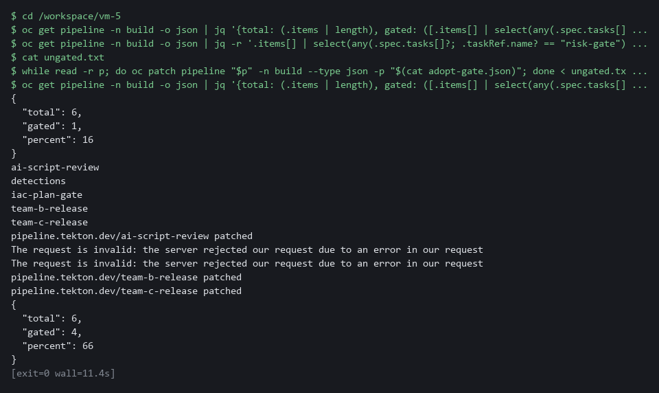

> **YOUR TURN:** Run the three blocks in order and read the coverage after the fix.

> **CHECKPOINT:** The gate summary shows the run blocked, the after-fix run passes with a mean time to fix, and coverage rises to every pipeline in build.

> **TAKEAWAY:** Coverage rising to 100% means every pipeline in the project now inherits the same gate rules.

**How this meets the controls**

- **SI-2:** The control, through SI-2(3), asks for the time to remediate to be measured. You read the summary kept by the run and run the gate on the after-fix scan, which gives the fixed dates a value and produces a mean time to fix.
- **RA-5:** The control asks that parts of vulnerability management be automated. You measure coverage and patch the pipelines that lack the gate, so coverage rises to every pipeline in the project.

## Section 4. Verify It Works

### Test 1 (positive). After the fixes the gate passes, and time to fix is measured (SI-2 Flaw Remediation, RA-5 Vulnerability Monitoring and Scanning)

- The after-fix scan has no blocking finding (Step 5 already printed the summary and the exit code), and the ledger now holds fixed dates for the findings that left.
- You read the time to fix from the result file.

```bash
cd /workspace/vm-5
jq -c '{blocked, blocking: (.blocking | length), time_to_fix}' after.json
```

**Expected output:**

```
{"blocked":false,"blocking":0,"time_to_fix":{"fixed_count":5,"mean_days":21.8,"max_days":40}}
```

| Part | What it does | Why you run it |
| --- | --- | --- |
| cd /workspace/vm-5 | Moves into the working folder. | after.json is a file in this folder. |
| jq -c '{blocked, blocking: ..., time_to_fix}' after.json | Prints whether the gate blocked, how many findings block, and the time-to-fix figures. | These are the pass result and the first measurement. |
| "blocked":false,"blocking":0 | Nothing blocks after the fixes. | The after-fix scan has no finding that matches a rule. |
| "fixed_count":5,"mean_days":21.8,"max_days":40 | Five findings have a fixed date; the mean is 21.8 and the worst case is 40, both counted in days. | This is the time between identification and remediation. |

> **CHECKPOINT:** blocked is false, five findings have a fixed date, and the mean time to fix is 21.8 and the worst case is 40, in days.

**How this meets the controls**

- **SI-2:** The control, through SI-2(3), asks for the time between identification and remediation to be measured. This test reads the count of fixed findings, the mean and the worst case in days from the result file.
- **RA-5:** The control asks that remediation follow risk and be automated. This test shows the gate passes when no finding blocks.

### Test 2 (negative). Expired and invalid exceptions never excuse a finding (SA-11 Developer Testing and Evaluation)

- An exception that never ends is a hidden risk.
- libcharlie has no fix and is excused by an exception that ends on 2026-10-20.
- Run the same gate on two dates, in external mode where a CRITICAL blocks whether or not it has a fix, and count how often libcharlie blocks.
- Check the two entries that break the rules: libhotel has an empty reason, and libindia has an expiry much further away than the 30-day limit.

```bash
cd /workspace/vm-5
cp ledger-seed.json ledger-test.json
python3 gate.py --scan scan-before.json --policy policy.json --exceptions exceptions-sample.json --exploited exploited-ids.json --ledger ledger-test.json --today 2026-10-19 --exposure external --result early.json > /dev/null
cp ledger-seed.json ledger-test.json
python3 gate.py --scan scan-before.json --policy policy.json --exceptions exceptions-sample.json --exploited exploited-ids.json --ledger ledger-test.json --today 2026-10-29 --exposure external --result late.json > /dev/null
jq '[.blocking[].finding | select(contains("libcharlie"))] | length' early.json late.json
jq -c .exceptions before.json
jq '[.blocking[].finding] | index("CVE-2099-2009|libindia") != null' before.json
```

**Expected output:**

```
0
1
{"active":1,"expired":1,"invalid":2}
true
```

| Part | What it does | Why you run it |
| --- | --- | --- |
| cp ledger-seed.json ledger-test.json | Starts each run from the seeded ledger. | Both dates must start from the same history. |
| gate.py ... --today 2026-10-19 ... --exposure external | Runs the gate on the date before the exception ends. | In external mode a CRITICAL with no fix blocks unless excused. |
| gate.py ... --today 2026-10-29 ... | Runs the gate ten days later, after the exception ended. | Expiry should work with nobody acting. |
| 0 then 1 | libcharlie blocks 0 times on the first date and 1 time on the second. | The exception excused it until it expired. |
| {"active":1,"expired":1,"invalid":2} | These are the counts from the Step 3 run. | Two entries are invalid and never excuse anything. |
| true | libindia (expiry too far away) is still among the blocking findings. | An invalid exception does not excuse a finding. |

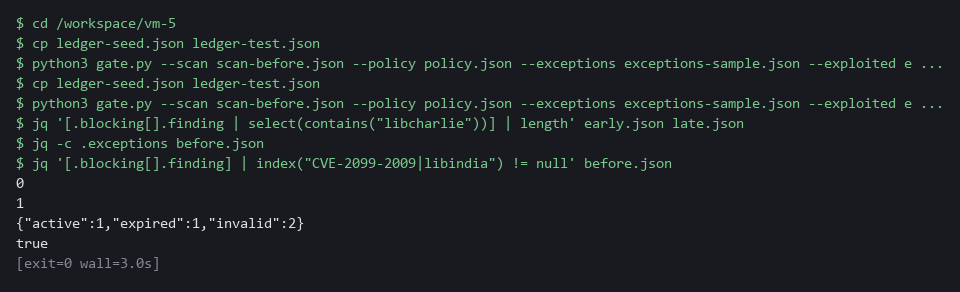

> **CHECKPOINT:** The first date prints 0 because the exception was still active, and the second prints 1 because it had expired, with nobody acting. Two entries are invalid, and libindia is still among the blocking findings.

**How this meets the control**

- **SA-11:** The control asks for a verifiable process, which includes proving that an exception ends on its date and that bad input is refused. This test runs the gate on two dates: the finding is excused on the first and blocks on the second, and neither invalid entry excuses its finding.

### Test 3 (positive). A known-exploited finding blocks, with no other rule matching (RA-5 Vulnerability Monitoring and Scanning)

- The finding CVE-2099-2007 is MEDIUM and has a fix, so none of the first four rules blocks it.
- Put its ID on a test list of known-exploited IDs and run the gate on the after-fix scan, which otherwise passes.

```bash
cd /workspace/vm-5
printf '["CVE-2099-2007"]\n' > exploited-test.json
cp ledger.json ledger-test.json
python3 gate.py --scan scan-after.json --policy policy.json --exceptions exceptions-sample.json --exploited exploited-test.json --ledger ledger-test.json --today 2026-10-29 --result listed.json > /dev/null
echo "exit code: $?"
jq -c '.blocking[] | [.finding, .rules]' listed.json
```

**Expected output:**

```
exit code: 1
["CVE-2099-2007|libgolf",["known-exploited"]]
```

| Part | What it does | Why you run it |
| --- | --- | --- |
| printf '["CVE-2099-2007"]' > exploited-test.json | Writes a test list with one ID. | Your real list is not touched. |
| cp ledger.json ledger-test.json | Copies the ledger from Step 5. | The test must not change the real ledger. |
| gate.py --scan scan-after.json ... --exploited exploited-test.json | Runs the gate on the after-fix scan with the test list. | That scan passed with the real list. |
| exit code: 1 | The gate blocked. | A pipeline would stop here. |
| "known-exploited" | Only the known-exploited rule matched. | The finding is MEDIUM with a fix, so no other rule blocks it. |

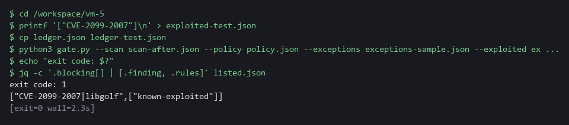

> **CHECKPOINT:** The exit code is 1 and exactly one finding blocks, by the rule known-exploited. The same scan passed in Step 5 with the real list.

**How this meets the control**

- **RA-5:** The control asks that remediation follow an assessment of risk, and a flaw that attackers are known to exploit is the highest risk. This test puts one MEDIUM finding that no other rule matches on a test list, and the gate blocks it by the known-exploited rule alone.

### Test 4 (negative). The gate fails closed when its list is missing (SA-11 Developer Testing and Evaluation)

- If the list is missing, empty or unreadable, the gate cannot tell which findings are exploited.
- The gate must stop with a message naming the missing list, and must not pass the release.
- Point the gate at a file that does not exist.

```bash
cd /workspace/vm-5
python3 gate.py --scan scan-after.json --policy policy.json --exceptions exceptions-sample.json --exploited no-such-list.json --ledger ledger-test.json --today 2026-10-29 --result none.json
echo "exit code: $?"
ls none.json
```

**Expected output:**

```
gate cannot run: [Errno 2] No such file or directory: 'no-such-list.json'
exit code: 2
ls: cannot access 'none.json': No such file or directory
```

| Part | What it does | Why you run it |
| --- | --- | --- |
| --exploited no-such-list.json | Points the gate at a file that does not exist. | The gate cannot tell which findings are exploited. |
| gate cannot run: ... | The gate says why it stopped. | A clear message tells the team what to fix. |
| exit code: 2 | The gate stopped with its error code. | A gate that cannot decide must fail closed. |
| ls none.json | Tries to list the result file. | The error shows that no result was written. |

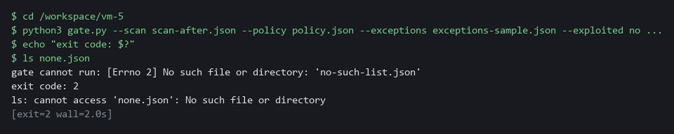

> **CHECKPOINT:** The message names the missing list, the exit code is 2, and no result file exists. In a pipeline the task would fail and the release would stop.

**How this meets the control**

- **SA-11:** The control asks for a verifiable process, and a gate that passes when an input is missing proves nothing. This test points the gate at a list that does not exist and shows it exits with 2 and writes no result file, so the pipeline would stop.

## Section 5. What Each Control Is For

### Control mapping

| Control | What it requires, in plain words | Tool or service | Where this module covers it |
| --- | --- | --- | --- |
| RA-5 Vulnerability Monitoring and Scanning | Automate parts of vulnerability management, and remediate legitimate vulnerabilities within organization-defined response times, in accordance with an organizational assessment of risk. | The Tekton tasks risk-scan and risk-gate, with Trivy, one policy.json and one list of known-exploited IDs. Explained in sections 2.1 and 2.4. | Section 3, Step 1: the rules are chosen by evidence and the known-exploited list is downloaded. Section 3, Steps 3 and 4: the rules block. Section 3, Step 4: the scan and the gate run in the pipeline. Section 3, Step 5: the gate becomes the default. Section 4, Test 1: the gate passes after the fixes. Section 4, Test 3: a known-exploited finding blocks. Section 4, Test 4: a missing list stops the gate. |
| SI-2 Flaw Remediation | In the SI-2(3) enhancement: measure the time between flaw identification and flaw remediation, and keep benchmarks for corrective actions. | The ledger file written by gate_ledger.py and kept on a volume claim. Explained in section 2.3. | Section 3, Step 3: the ledger records the dates. Section 3, Step 5 and Section 4, Test 1: the mean time to fix is reported. |
| SA-11 Developer Testing and Evaluation | The people who build the system run a verifiable flaw remediation process and keep evidence of its results. | The gate code gate.py with gate_rules.py and gate_exceptions.py, run on fixtures and as a pipeline task. Explained in section 2.2. | Section 3, Steps 3 and 4: the gate leaves a result on fixtures and in the pipeline. Section 4, Tests 1 to 4: the gate passes when it should, blocks when it should, and refuses to decide without its inputs. |

### What each control is for

Each table below says what the control is trying to prevent and how this module's tool meets it.

#### RA-5 Vulnerability Monitoring and Scanning

| Question | Answer |
| --- | --- |
| Control Intent | Scanning runs but nothing stops a vulnerable release, or a gate stops everything and teams route around it. |
| The operational question | If a team ships a release with a fixable critical flaw tomorrow, what stops it, and what does the gate do about a flaw that has no fix? |
| What evidence proves it | The rules in policy.json, a run that blocks and a run that passes, a run that refuses to decide without its list, and the share of pipelines that call the gate. |
| How much is enough | Scanning and the decision are automated, and remediation follows an assessment of risk. NIST leaves the response times to the organization, so the lab uses its own response times (15, 30 and 90 days in the earlier modules). It also uses five gate rules here, and one of them blocks any finding on the KEV list (known exploited vulnerabilities). |
| How the tool in this module satisfies it | The risk-scan and risk-gate tasks (Step 4), one policy.json and the known-exploited list (Step 1), and the counts that justified each rule (Step 1). |

#### SI-2 Flaw Remediation

| Question | Answer |
| --- | --- |
| Control Intent | Nobody knows how long a flaw stays open, so nobody can say whether remediation is getting faster or slower. |
| The operational question | From the day a flaw is first seen, how many days until a scan no longer shows it? |
| What evidence proves it | A ledger with a first-seen date and a fixed date for each finding, and the mean and maximum days between them. |
| How much is enough | The time between identification and remediation is measured. NIST leaves the benchmarks to the organization, so the lab compares the mean with its own response times, and reads the maximum as the worst case. |
| How the tool in this module satisfies it | gate_ledger.py records first seen and fixed dates and computes the figures (Step 3). The gate keeps them in a task result (Step 5). |

#### SA-11 Developer Testing and Evaluation

| Question | Answer |
| --- | --- |
| Control Intent | The gate has a bug, or an exception quietly lives forever, and the release process is trusted for no reason. |
| The operational question | Can we show the gate blocks what it should, passes what it should, refuses an exception that has expired or has no reason, and fails closed when an input is missing? |
| What evidence proves it | Runs against fixtures with known answers, in both directions, and a record of each run's result. |
| How much is enough | There is a verifiable process and evidence of its results. |
| How the tool in this module satisfies it | gate_exceptions.py classifies each entry as active, expired or invalid, and gate.py exits with 2 when an input is missing. Tests 2 and 4 break the inputs on purpose. |

## Section 6. Next Steps

### Using this in other environments

- Works as is on any OpenShift cluster with OpenShift Pipelines, Gitea and internet access to pull the Trivy and Python images and download the KEV catalog.
- Change these lab values first: the Gitea repository name, the two image references, and the namespace (build) where the shared tasks and volume claims live.
- On other Kubernetes platforms the oc commands become kubectl commands; the Tekton task YAML and pipeline YAML are Tekton-standard.
- The gate code (gate.py and helpers) is pure Python with no Kubernetes dependency; it runs on any machine with Python 3 and the same input files.

The table shows what changes on each platform:

| Part | In this lab (OpenShift) | On other Kubernetes | What you change |
| --- | --- | --- | --- |
| Scan task (risk-scan) | Trivy 0.76.1 from ghcr.io, reads Dockerfile FROM line | Same Trivy image | Image reference if mirrored; sed and head must be in the image. |
| Gate task (risk-gate) | Red Hat Python 3.12 image, ConfigMap workspace | Same Python image | Image reference; ConfigMap workspace syntax is Tekton-standard. |
| Ledger | File ledger.json on volume claim risk-pvc in project build | Any volume claim that one pod can write to | Volume claim name in the pipeline start command. |
| Exceptions file | .vm/exceptions.json in the team Gitea repository | Same path in any git server | Nothing if the path stays the same. |
| KEV list | Downloaded from the public KEV catalog, stored in ConfigMap | Same | CATALOG_URL if the catalog address moves. |
| oc commands | oc apply, oc get, oc patch | kubectl equivalents | Replace oc with kubectl. |

> **TIP:** This is the last module in the vulnerability management dimension. Next module: SDR-5 Detection as Code: keep detection rules as reviewed files that a pipeline checks and deploys, the same idea of controls as code that you used here for the gate.

<details>
<summary><strong>Section 7. Terms</strong></summary>

Each term is also explained the first time it appears. In Word, hover over an underlined term to see its meaning, or Ctrl+click it to jump to this table.

| Term | Plain meaning |
| --- | --- |
| Base image | The image named on the FROM line of a Dockerfile, which supplies the operating system packages. |
| Branch | A separate line of changes in git. The main branch is the agreed version. |
| Certificate | A file that proves a server's identity, signed by a trusted authority. |
| Cluster | A group of servers that work together as one system. Here it is your own OpenShift cluster. |
| ConfigMap | A small named record stored in the cluster. Here it holds the policy and the gate code. |
| Container | A sealed box that holds one program and everything it needs to run. |
| Coverage | The share of pipelines that call the gate. |
| CVE | Common Vulnerabilities and Exposures: a public ID for one known flaw. |
| diff | A command that shows the differences between two files. |
| Dockerfile | A text file that tells a build how to make an image. Its FROM line names the base image. |
| Evidence | Saved records that show a system is set up and behaving as claimed. |
| Exception as code | An exception kept as a reviewed file in the repository, with a reason, an owner and an expiry date that the gate checks. |
| Exit code | A number a command returns when it ends: zero means it ran properly, anything else means it failed. |
| Exposure | Whether the application is reachable from outside the cluster, here given to the pipeline as internal or external. |
| Fail closed | Stop the release when the gate cannot decide, for example when an input is missing, instead of letting it pass. |
| Finding | One thing a scan reports: a flaw in a package or a bad setting, with a severity. |
| Fixture | A supplied test input with a known correct answer, used to check that the gate passes and blocks when it should. |
| Function | A named piece of code that takes inputs and gives back an answer. |
| Gate | A step in a pipeline that stops the run when a rule is broken. |
| Gitea | A git server that runs in your lab. It holds the repository vm-app. |
| Header | A line of extra information sent with a web request, such as a sign-in token. |
| Heredoc | A way to make a file by pasting its text between a first line such as cat > name <<'EOF' and a last line that says EOF. |
| HTTP | The protocol that web pages and web APIs use. HTTPS is the encrypted form. |
| Image | A packaged copy of a program and the files it needs. A container starts from an image. |
| jq | A tool that picks one value out of JSON text. |
| JSON | A plain-text format for data: names and values written inside curly braces. |
| KEV | Known Exploited Vulnerabilities: a list of flaws that attackers are known to use. |
| KEV catalog | Known Exploited Vulnerabilities: a public list of flaws that attackers are known to use. The gate keeps only the CVE IDs. |
| Kubernetes | The open-source system that runs and manages containers across servers. OpenShift is built on it. |
| Ledger | A file that records the date each finding was first seen and the date it stopped appearing. |
| Namespace | A named section of the cluster that holds a set of related parts. |
| NIST | The US National Institute of Standards and Technology. It publishes the security control catalog these modules cite. |
| oc | The command-line tool for OpenShift. You type oc to ask the cluster questions. |
| OpenShift | The Red Hat platform your lab cluster runs on. It is Kubernetes with extra security and tools built in. |
| Parameter | A named value given to a pipeline or task when it starts, such as the exposure. |
| Patch | A small edit applied to an object that already exists, here to add the gate tasks to a pipeline. |
| Pipeline | An automated sequence of tasks. Each task runs in its own pod, which is one running copy of a program. |
| PipelineRun | One execution of a Tekton pipeline. |
| Pod | The smallest thing the cluster runs: one or more containers that run together and share one network address. |
| Policy | A set of rules written down so that a tool can enforce them. |
| printf | A command that prints text in a set format. |
| Project | A named section of the cluster that keeps workloads apart. OpenShift also calls it a namespace. |
| Pull request | A request to merge a branch so that someone can review the change first. |
| Query | A question you ask a data store, written in a query language, such as a log search. |
| Registry | A server that stores container images and hands them out when asked. |
| Remediate | Fix a finding, for example by upgrading a package or changing a setting. |
| Repository | A folder whose history git tracks, so you can see what changed and when. |
| Route | An OpenShift object that gives a program inside the cluster an address reachable from outside. |
| Rule | A set of conditions on a finding, such as CRITICAL with a fix available, that makes the gate block when all of them hold. |
| Scan | A run of a tool that compares what it reads with a database of known flaws and bad settings. |
| sed | A command that edits text as it passes through, often to replace one string with another. |
| Service account | A name that programs, such as pipeline pods, run as inside the cluster. The one called pipeline has the access the lab gave it. |
| Severity | How serious a finding is, such as low, medium, high or critical. |
| Task result | A short value that a Tekton task saves, so the pipeline run keeps it after the pods are gone. |
| TaskRun | One execution of a single Tekton task. |
| Tekton | The pipeline engine that OpenShift Pipelines runs. A pipeline, its tasks and its runs are Tekton objects. |
| Tekton Task | One reusable unit of work in a pipeline, with parameters, workspaces and steps. |
| Time to fix | The number of days from the first-seen date to the fixed date. |
| tkn | The command-line tool for Tekton. You type tkn to start a pipeline run and read its log. |
| Trivy | A free, open source scanner for images, folders and configuration files. |
| URL | A web address, such as https://example.com/page. |
| Volume claim | A request for disk space that the cluster keeps between runs. The ledger lives on one. |
| Workspace | A folder that a pipeline shares between its tasks, backed by a volume claim, a ConfigMap or a secret. |
| YAML | A plain-text format for settings: lines of name: value, with indentation to show what belongs to what. |

</details>
